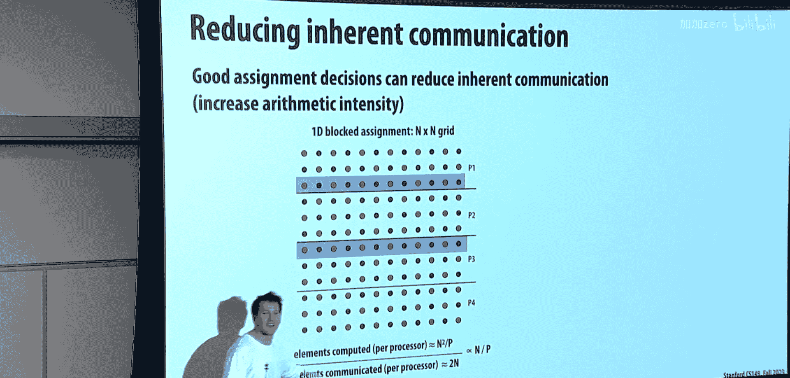
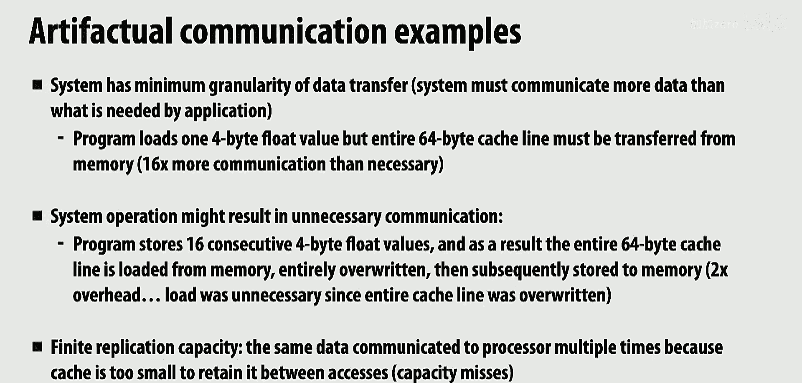
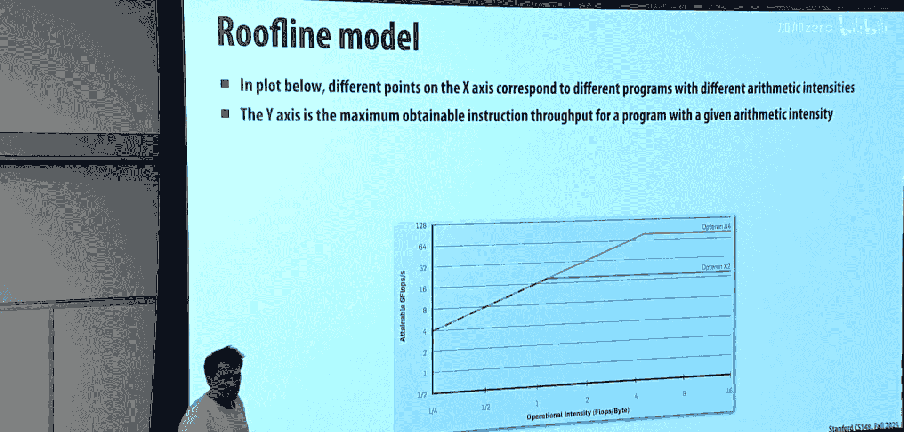

# 【并行计算 CS149 2023】斯坦福大学—中英字幕 p06 p5 Lecture 6 - Performance Optimization II： Locality, Communication, and Content -BV1du17YfE5G_p6-

So we're getting to the end of sort of this is lecture 6 next week is GPUs and GPU programming and lecture 8。

 which would be data parallel programming and data parallel thinking。

And then there'll be a bit of a switch in the class。

 so I do a bunch of software and performance optimization lectures for the first state lectures。

 Vancouver Kuma is going to come in and tell you a little bit about hardware and things like that。

 so that's where we're going。

Okay， so if last time if on， on Tuesday， Tuesday was about scheduling。

 So we talked about different strategies for if I have a number of threads or a number of processors。

 and I had a bunch of work to do。What are some basic techniques to make sure that the workload is distributed evenly onto all the workers without incurring too much overhead in that distribution？

Today is going be adding in the extra thinking of it's not just about good workload balance。

 It often is about reducing communication and synchronization overhead。

 So today is gonna be a lot more about， about communication， so。

I'm going to talk about reducing cost of communication between processors， again。

 techniques that you as a software developer might use， and then at the end， if there's time。

 I'd like to go into some general program optimization tips that are not necessarily relevant to your assignments or anything like that。

 but now that you have so much background， it might be a good idea to talk about that kind of stuff。

嗯。So so far in this course。And in all of the assignments， basically， that you'll do in this course。

 we've assumed that all of the processors are connected to some shared memory system。

 or in other words， there was one address space and all threads could read and write to variables in that address space。

 And I've given you some hints about， even though that's conceptually simple。

The actual underlying implementation of the ability for all processors to read and write to all variables is actually pretty complex。

 For example， if you have like your multi core CPU， that address space where the data， you know。

 is all of the data might be stored out in D Ram， but lots of copies of that data are stored in your various caches。

😊，And the first thing Kunle is going to talk about next week is what starts happening or the end of next week is what starts happening。

You know， core， this core makes a copy of some data， and this core makes a copy of the same address。

 and they both write。Now of a sudden we， we've got a real challengeca I have different parties in the system writing to the same address。

There might be different values of these copies， and that can become a big mess really quickly。

 So we'll tell you a little bit about how modern systems keep everything。Coherent， if I take like。

 you know， kind of a standard Intel CPU these days， that has a couple of cores。

 theres there's a GPU on the same thing。 There's a network on this chip that connects all those cores and gets them all out to the same memory system。

And these networks can be quite complex。 So， for example， in Intel architectures。

 all of the various processors are connected together and to memory， actually by a ring。😊。

So there's a， you know， like we just think about it as load and store of the value X。

 but load and stored of value X from， from a processor here。

 This is like the four cores is actually sending a a request out on this ring that ultimately gets routed out to memory and in different parts on this ring。

 like if it's if it's a cache hit， It might actually go to one of the pieces of the cache and get the data out of the cache。

 it can be quite quite a quite a complicated thing。 Actually。

 one thing that's kind of interesting is did you notice that like all of the different cores are kind of connected to or know like if you think about this as being a core plus its piece of the L3。

 notice how everything is connected to the ring twice。😊，Do you have any idea why they do that。

I that to reduce the leency？你。Well， first of all， yeah， it is。 And first of all。

 it it makes things simple if you're always sending messages always in clockwise order。

 So things like deadlock and stuff are not much of a problem。 And if you want to reduce latency。

 if you get hit， if， if you're touching， you know， if youre， if you have two contact points， exactly。

 like so if you're gonna go to your left neighbor， your right neighbor and you can only send right。

You can actually get there a little bit faster。Here's another processor。

 It's actually a processor that Kunle was a big， a big part of the initial design of this technology。

 This was done by Sun at the time where sun existed。

 know then it got bought by Oracle later with the ultra sparks。

 And this was one of the first mainstream multi threadreaded chips。 So it had， in this case。

 eight cores。😊，And each of those cores had a bunch of threads。

 But all of those cores were connected out to to the main memories via what's a crossbar switch。

 The CC X is crossbar。 And a crossbar means that every core is actually like physically wired to every other one。

 It's like n squared wires for and N cores。 And what's kind of interesting is if you look at the chip diagram。

 the actual area， the footprint of a， a processor core。😊。

Is about the same as the footprint of the network。So like this and these networks that get high bandwidth connection between all the processors are extremely expensive and extremely complex。

And even in。A simple oh， by the way， if I go to this。

 it actually means that depending on what core you're at。

 an L 3 cache can actually hit be be a different cost based on what the address is and where it actually is and which of these slices of the L 3 cache。

 So this is， this is like a sharded cache where different addresses go in different places。😊。

Another example of it is if you just go out and buy a motherboard that has two sockets in it for two physical CPU。

Let's say there's two different four corere CPUs。Theres an onship network that ring connecting the cores。

 the 1 I showed you。 And then there are traces out over the， the， over the， the dual socket board。

And。A load or a store from like core 1 to address X in that diagram。

Might be a lot faster or a good bit faster than a load in store from， let's say， core 8 to address X。

 regardless of the caching behavior or things like that。So in a modern system。

 as we get bigger and bigger。 and this is incredibly true in these big， you know。

 like like a modern GPU and things like that。It's not just。

 if you think about like how close something is。 It's not just。

 it's either in memory or it's in cash。 There's actually a lot more nuance to that that we don't necessarily think about when we were programming because our minds would explode。

 But if you actually really wanted to optimize things， you would be aware of that placement。So。

 you know， even though we we like to just basically think in terms of like a computer it's a big pile of core。

 is connected to a shared memory。You know， those loads and stores on how the different threads communicate。

 those can have very， very different costs。And if you're elite， you're actually asking。

 where is this address in this machine？And you might be doing different things based on this cost。

Now。One way to think about communication and make it a little bit easier to reason about is to think about other designs where moving data is more explicit。

 So I want to talk about a different model of computing for a second。

 which is called message passing， which is something all of you are used to if youve written any distributed programs in a web setting。

 It's not like if you're on the Internet， you just say I want the data at this memory address and all computers on the Internet have access to a unified address space。

When we communicate on you know， in a distributed system， we， we do it via sending messages。

 You know， maybe it's an H T TP get or a post or something like that or a response。

 But the name of the game is I have two different computers or two different threads。

 And each thread keyword now works in its own address space。

So address X in threadread1's address base。Is not the same address as address X and thread2s。

 address space。 They are different address spaces。 And the only way to exchange information。

 like every thread can load and store the variables in its own address space。

 But the only way to exchange information across these threads is to explicitly send a message。

 So in this case， you know， rather than an H TTP request。 I said， look， let's just abstractly say。

 thread1 is going to send the contents of its address X。

2 thread to and tag the message with an ID D so that the receiver on the other side knows what it's getting。

Okay。And correspondingly， thread 2 is gonna post a receive， which says。

 I want to receive the message with this Id from thread1。 And when we get the data。

 we are gonna put that data and store it to the as the contents of the address。

 why in my own address space。 So these messages say， how do I identify data in my address space。

 who is it gonna go to， and is there like an abstract I that the other side can can know to listen to and stuff like that。

 So in a message passing setting， like the real world way of thinking about it is if a shared memory is like a bulletin board or anybody can post a message without asking and anybody can read that message without passing message passing is a little bit more like sending stanail mail like you put you wrap up your data in an envelope。

 you address it to a particular location and then someone is responsible for getting it to that location。

😊，Of course， yeah。ました。This messaging。啊不都言。Mire so much。And board your site pocket and data。Yeah。

 and and any message passing system is basically gonna have some mechanism of addressing。 Like。

 this is where this needs to go。 And the differences between。

 is it done at the scale of the Internet， Is it done at the scale of inside a single computer with threads or is it maybe done at the scale of a small cluster of computers or at large scale with like a big rack or something like that。

 There might be different mechanisms for how we identify the recipient。

 There might be different mechanisms for how the data moves， I it I it TCPIP， Is it UDP。

 Like there are many different implementations of how to get the message to the location。

 But conceptually the difference is。😊，In a shared address based system。

 we all talk about the same addresses， and we all have direct access to read and write。

In a message passing system， we all operate in our own address spaces， and we send messages。

 meaning I say， hey， here's some data。Go make a copy of it and put it in your address space。

And I think this would become more explicit if we go back to this example that we talked about last time。

 which again， to to re remindd everybody is， is that the workload was for every red cell update the value of the red cell。

 given read access to the surrounding neighbors。And if we haven't converged， basically do it again。

 But this time with the black cells。Okay。And I'd like you to think about implementing this。

This program on， let's say， not a two core machine。

 but let's think about it as a cluster with two different computers。

 I can only exchange messages like like Internet traffic or something like that。

 Let's say over ethernet。 So here's my， here's my new kind of like simple computer。

 I have a processor with its own memory， its own memory D Ram， which implements its own address base。

 And I have some network， whether it be the Internet， whether it be ethernet。

 whether it be carrier pigeon。😊，I have some way to get information from one memory to the other。

And yeah， this is just to reiterate like I only have these two operations send and receive。So。

 so here's what I'm gonna do is。 first of all， now let's imagine that。I want to， first of all。

 I have to divide all the data。 have to partition the grid across these processors。

And before it was like， I had one big array， right， Like when I was， we did this assignment 1。

 there was one big array。 And then the code of the program said， hey， thread 0 or thread 1。

 you should touch these addresses and thread2， you should touch these addresses。

 So now things are a little bit different。 We don't have a shared address space， right？

 So now every thread or every machine in this cluster。 And all of a sudden。

 I jump to four machines just， to make it a little bit easier。😊。

Has its own copy of part of the array。There are four different allocations now in these four different address spaces。

That hold the data that each worker is responsible for。

 So you see that difference conceptually before we had a shared allocation。

 We all just kind of got our own。 We touched our own part of it。 Now。

 we have four different address spaces。 There is no way for thread 3 in this diagram to directly say。

 load of value here。In the same way that if you have a computer in your dorm and I have a computer in my office。

 I cannot issue a load store from my computer that stores data to your office， to， to your computer。

Okay。Now， to compute， let's say if I wanted to compute the value of this element here。

What information do I need。Well， I I need my left neighbor， I need my right neighbor。

 and I need the neighbor below me， which is fine because thread3 has all this information。

 but I also need information that currently is stored in an address space that I cannot access。

Alright， so what almost all of these systems in in a message passing do is， is they say， well。

 I need to be able to access this data， but I can't because it's not in my address space。

 So I'm gonna make a copy of it and keep a copy of it here in my address space。

 So what I'm actually doing now is on each of the nodes。 I'm actually over allocating。😊，I'm。

 I'm allocating an extra row and an extra row above and below my section。

And I'm going to need to ask my neighbors to send me via message。

The values that I should store in this row。 And if you look at my code on the right。

 the side of the diagram， this is the， the logic that every thread is is executing。

 and notice that it allocates a buffer that is two rows larger than the data that it is responsible for。

So some terminology would be like， for example， in thread 2。

 there's an extra over allocation that corresponds to holding a copy of this data。

So this extra over allocation where you're storing data that that thread doesn't own or is not responsible for updating。

 you'll often hear that's like like ghost rows or ghost sales， ghost values。

 that's a common thing you'll see in scientific computing。Okay。Now。

 let's take a look at a full implementation of one iteration of the solver application written in a message passing kind of way。

 not in a loads and stores kind of way。 So here it is。

 It's a little bit the font size is a little small， but take a look at it。 And see， you know。

 like give it， give it some talk。 Now， this is code that's being executed by every thread。

 It's like an SPMD kind of way， right， So what every thread does， is gonna come from its thread I。

 So that's T I is the thread I here。 And， you know， like I'll give it。

 go ahead and give you a minute or so。 it's sort of commented in some sense。

 but talk it over and make sure that you all kind of understand the flow here。

 So I'll let you discuss。😊，Yeah， let's discuss。I want to make sure everybody understands this。

 This is worth discussing。So what is this thing like doing。

 So there's a phase of sounding and receiving data。

 There's a phase of doing the work you're supposed to do。

 There's a phase of sending the updated data to everybody else。

 And then there's a phase of determining if we're done and whether or not we have to repeat again。

 Okay， so discuss。it is。 Okay， so let， let's get back together。

 I think most people have converged the， the conversation。So let's start talking just through。

 make sure everybody understands this。 And， and there was a question about good。

 And I purposely kind of didn't clarify this because I was gonna get into a little bit more later。

 Like， how does acend and receive work。 So if I'm a threat and I。Call， receive。

That will return when some other thread。Has sent， right。 So in some sense。

 it's like when that call returns， the data is now with me in my address space。 So technically。

 if I call receive and nobody sends me anything， I'll just wait there for forever。Right。Okay。

Let's just take a look at this code and look at and pick out some of the details。

 So one of the more interesting things is。😊，Just the allocation at the top。

 So I have this variable local a， which is just my this threads local copy of some portion of this whole conceptual grid。

 and local a has rows per thread plus2 allocation。😊。

So it's the my fraction of the array plus one row on top and one row on bottom。

And notice that these calls to send and receive the if statements are just， you know。

 if I'm the first thread， I don't No， there's nothing to my left。 So I I， I don't need to。

 But notice that they're storing data into。The first row or the yeah， the first row of local a or。

 in fact， the last row of local A。 So the data that I send and receive kind of goes right into my local array at the top or the bottom。

 And I did that so that when I iterate。😊，With actual memory aes。

 I don't have to differentiate between what's like the ghost row and what's not the ghost row。

 I just， at that point， I just put all the data where it's supposed to be。 So my code is， is simple。

Okay， now that， that， that's good， yes。It seems to be the first of the round。

should also have like one go each They should。 I mean， they all allocate the same。 in this case。

 the last one will doesn't have a ghost throw underneath it， right， And so that data is allocated。

 but nothing is ever written there。 So it's it's just， you know， just to keep the code simple。

 I didn't wantan to， I didn't want to put a conditional around the allocation。

us what happens in the middle？Pop and bottom row， it is going to be reaching intoated。

Did I mess this up， So I'm going from rose per thread。😊，Yeah， so I'm doing。

 I'm starting on the first row and on the next row， and then。Yeah。

 I think I just didn't guard that properly。 Sorry about that。 Yeah。

 because if you look at at this example， now， I'm only showing the ghost rows for thread 3。

 But as you pointed out， there'd be a ghost row here and here。

 there'd be a ghost row here And to be honest， if you recall our code from before。

 it would just iterate for， from I equals 1 to I equal to like the last row that we compute values for was this one。

 That was the definition of the problem， right， so I。😊，Yeah， I was a little sloppy。

 but I hope you get the point，Okay， and then， oops， and then kind of an interesting thing is。

 remember last time we had in the shared address space， we had the walk。😊，And we had the barriers。

 But there's no locks， and there's no barriers here。 So how is this mess patches code。

 like can you describe to me。 And I know there's a comment here on the slide。

 Let's just talk it over in our own words。How does， how do we determine whether or not we should。

Keepep going。Yeah。Is it all that we're seeing？Do we wait for all of her in Bolo。

 which one right here？Okay， so look at this， so it says if thread ID is not thread0。

So every thread but thread 0 sends its local di。If your threads 0。

You wait to receive that local diff from all other threads。

You do a calculation to compute whether or not we are done。

 So thread 0 determines this calculation and then actually sends the Boolean value done equals true to every other thread。

 which is then received right here by every other thread。 Now， of course， like we could have done。

 And I could have just computed the total value and sent the total value back And everybody independently could have computed if we were done。

 But that's just how I did in this code。 So why is there no lock in this code。😊，所以不。

Receiving your waitingning so you。Correct， and even more fundamentally。

 why would we never see a lock in any message passing code。There's nothing shared。

 so there's nothing to maintain mutual exclusion on。

So the only way to synchronize is via these messages。So we've essentially。

 we've created a situation where everybody sends a partial sum to one player or to one thread here。

 One thread does all the math and then gives a result back to everybody else。😊。

Why do we not see any barriers here？Yeah， essentially。

 the barrier is inherent in this communication pattern that I did， exactly。

And since everybody has their own copy of the done variable， because there's no shared address base。

 there's no worry about like someone starting in the future and overriding something that somebody else receives。

So the communication is really， really explicit in these sins and receives。

And so just like a summary is。You know， notice that all of the array computation was relative now。

 So if I go back here， just keep in mind that。All threads are iterating over the same indices now。

They're iterating over the same indices in their own local piece of the array。

 whereas before in the shared address space， you know。

 I did some math to make sure that everybody was iterating over different indices。

 So it's another example。 So rate indexing is relative。

 Comication is performed via sends and receive。 in this case。

 we decided to send many elements at a time。 And you know for efficiency do one send instead of a bunch of little ones。

 And synchronization is not done through locks and barriers。

 synchronization is manifest in how we construct the message。 The messages。😊，Now。

 there was something that you all assumed。 There was a question from the back that got to this。 like。

 wait a minute。 Like， let's just make sure we understand the order of things that happen in a what's called a blocking send and receive。

 So the send and receives that I just showed you that we all kind of assumed would be if the sender calls send fo。

Data from the variable fo in my local address space and the sender's address space will be copied kind of into the network。

 The network will transmit the message。And assuming that the receiver has called receive on some of its own local variable bar。

The receiver will get the message， copypy whatever is in the message into the local variable。

And when the receiver is done copying that data and has that data。

 it might send an acknowledgement back to the sender and the sender the send call returns。

Once we are guaranteed that the receiver has the data。That's a blocking send。😡，And similarly。

 a blocking receive， this receive returns when the receiver has the data in the appropriate variable in its address space。

 Okay， yes。What if the data never arrives。 So since the data it never arrives if there's a network failure。

 for example， right， if there's a network failure。In this simplistic definition of blocking。

 send and receive， the receiver never returns。 just for now。 Yeah。

 the sender wouldn't get an acknowledgement。 and the sender never returns。

 So you're kind of thinking about it， like I am in a network。

I'm in a network distributed program environment。 Fails happen。 I need to be robust to it。Now take。

 you know， this。 And let's just say you bought a 16 core computer。And one。

1 message from one core couldn't get to the L3 cache。You throw it out。Right right， or all of the。

 the， the reliability of the， the protocol。 Let's say if we're talking about a network on a chip。😊。

All of the， the failure retransmission is gonna be handled at the hardware level。

 And so a message send from one core to like if you， if your processor stores to memory。

And you get a error， sorry。You know， you throw the machine out。Right， so that。

 that's kind of how I want you to think about it right now。

 Or you should think about it as there's something underneath this API。

 maybe some system software or something that will do all of the retries and just keep retrying until that that thing happens。

Obviously， you can think of alternative APIs that like the send could fail。 like。

 let's say the hardware return some air code。 The API could say， well， it didn't get sent。

 It would turn an air code or something like that。 But， but trust me。

 if you're like writing code like this， you're not checking your air codes on whether or not like memory doesn't work and stuff like that。

Okay， so。You all discussed。And you all correctly told me how that code on the previous slide worked。

But nobody told me that there was a fatal bug in the code。Let's go back to the code。

I'd like you to take another look at it。I'd like you to tell me what happens if I run this code with blocking sends and receipts。

 So everybody， I want everybody to take 1520 seconds to think about it。My， my。

 my hint is that it will be as bad as this comment just a second ago， if memory does not work。

All right。So it feels like I see some eyes lighting up。 Any want to tell me what， what's wrong。 Yes。

 so imagine that all of you in this， in this room are sort of。😊，The or every but like。

 like imagine like every processors like a row in this room。

And so the first thing all of you do is you look。I guess in this case， you look backwards。

Or you send backwards。Right， that's what you're doing。

 You're sending backwards and your sin will complete when the person behind you acknowledges the or makes a matching receiver。

 But what did the person behind you do。They're looking。 They're sending backwards， too。

 So they're never going get around to that receive。How can we fix this？

While still making only using blocking senses and stuff like that， Yeah， Okay， yeah。

 no asynchronous operation， You can only use blocking sense。😊，Yeah believe interested in one。Yeah。

 so a simple solution would just to pair everybody up by their row parody， so first row sends back。

You know， the next row， all first things they receive forward。 And then you can。

 you can set that would be like one way of of， of doing it。 I guess if you look carefully。😊。

Some people sometimes say， well， won't the first row because they don't actually send anything won't it work。

 And it actually， it actually doesn't even work because like the first row。If it doesn't send back。

 it sends forward。So everybody is gonna do aend before they post their first receipt。

 So this will deadlock under any any conditions。 Thiss a a form oflock， right。

 Like you are not making any progress at all becauseuse someone。

 you're waiting on someone else who also can't make any progress at all。So good。 So。

 so moving forward， like， you know， one possible implementation would be to。

 to pair folks up by parity。 And so you say， okay， I'm gonna have a partner。 And I， you know。

 for each partner， someone's gonna send first and someone's gonna receive first and so on and so on。

😊，Caution。No， O。als really。ItFes like a very small mistake。Could cause your program to walk。

 absolutely。 So we could also go in a different direction。

 We could also go in a direction where communication is asynchronous。

 So last time when we were talking about silk， I talked about an asynchronous function call。

 a function call that can carry on potentially concurrently with the collar and。😊。

A message is you could think about it as it could also be an asynchronous function call。

 So here's an asynchronous send and receive。 So now when a thread calls send， it's more of like。

 I want this message to be sent at some point in the future。So the sender calls send。

 but send returns immediately。Right， you don't know at this point。 you meaning the thread。

 You don't know that the data is gone。Or has been sent yet。 So typically。

 the API will give you back a handle。 Like it just says， hey。

 if you ever need to know if this is done， here's the I D that you can use to check。

 So I'm calling that H1 here。 So at some point in the future， like， so。

 so this thread can just keep running。At some point in the future， the。

 the message library gets around to copying the data to the network and and pushing it over。

And at some point， the receiver will get around actually doing the receive。

And once we know that the data has been received， we can probe the system。

 we can say like are you done， which I'm writing here is check the send status。

 Check the send of that message。 and if and if that returns true。

 it's now I'm guarantee that the data is gone， and I can delete like I could do something like delete foo or modify Fo。

 notice that if I do anything to foo in between this point and this confirmation。

 I have no guarantee that the the message passing library has picked up the data and send it over the wire。

It'd be like me putting a package out on my porch， telling U P。 S to come take it。 And then me。

 like changing the contents of the package before U P S shows up。

The modified message is what's gonna get sent， right， Or if I remove the package from the port。

 U P S is gonna say you told me to come get it。 And there's nothing here。Okay。

 on the flip side on the receive， this is an asynchronous receive。 So if I say。

 I want you to receive a message that I'm expecting。That returns immediately with a handle。

 And then the receiver at some point later can say， hey， is it here yet， Is it here yet。

 Is it here yet？ And if so， I know I can touch the data in bar at this point。

If I read bar at this point， it's unclear what data I will get。

So that's the asynchronous version of these things。

 And so the asynchronous version can make it easier to。

 to implement some things like what I just talked about because you don't not so worry necessarily about Dlock。

That's a good。 That's a really good point is what will happen in。

 let's say this send and receive were a library， which is what it normally would be。

 If you were the library implementer inside of send and receive。

 you definitely would be putting various what's called memory fences or other things in there。

 So that the compiler would not reorder around those instructions。

 So I'll talk a little bit about that on a lecture later。

 which is about implementing synchronization。 Yeah do Well。

 the acknowledgecknowledments would be an underlying detail of the communication transport mechanism。

 So they don't appear on the slide on purpose。 from the consumer from the the threads perspective。

 what I have available to me is。😊，I initiate a send。 I essentially get a tracking number。

 which is the handle。And I can check via that tracking number later if the send is complete。

 yes or no， or maybe if it failed。Now， how under the hood the network layer implements reliable transport。

 that's a completely different story and outside the scope of this class。

when you had two consecutive sense， how does this。社。So on this slide， if I said sin fo。And again。

 fo is the variable that I'm sending in my local address space。 If I set send fo again here。

 and these were asynchronous。 it's pretty undefined what will happen because there's no guarantee of what order those two messages would be sent。

 that're actually both sending the contents of the same local variable。 So are you saying。

 what if I had send foo， and then another send fizz or something like that。 I mean。

 I'm just sending two messages。 So there's no guarantee that they will be unless the library gives you states guarantees。

 There's no fundamental reason that they would be arrive at the receiver in the same order。 Yeah。

 You know， unless like there's some configuration on the the message passing API。

 which says if you set this flag， we guarantee you， it will be in the same order。😊。

A you making sure like just like busy weight here Yeah， So one one way would be to busy wait。

 Another way， you know， some libraries might be designed and that you register callback or other things。

 You know， like in， in asynchronous jascript， it's more like essentially posting that age X request is like you're putting yourself in a queue and you get。

 you get invoked when it's done。It's about the ordering of the receives if their sends sent in sequence。

 I think previously there was a message ID D also Yeah I could like the way you would do it is I'm just being simple here。

 I to send fo ID D， whatever。And then the receive， you could either receive most of these APIs。

 You just， you know， it's very specific now to the thread to the message passing， you might say。

 I want to explicitly receive the message with this I D。Or you just post a receive and say。

 I'm just receiving。 And then once you have checked the receipt， you say， oh， the message is here。

 and here's the here's the idea of what it was。And then your program might be， oh， if it's ID D 43。

 I do this， if it's I D 42， I do that。Yeah， so every message you should think of as having an I D and sending or waiting or receiving can be wait for a message。

Any message， Wait for a message from this sender。 Wait for a message with this I D。

 Those are all parameters and details of your， your message passing thing。Now。

 even though I set this up as like imagine these are different computers communicating。

 I want you to just keep in mind that there's many different types of communication。

 So there's no difference conceptually if we're talking about communication between a core and its memory。

Or two different cores on the same chip。 or two different computers in different dorm rooms。

 Like abstractly， we can send messages between anything， right。

 And communication can be between like movement of data can happen between the processor and its registers or its local L 1 or it's L 3 or D Ram on my own computer or D Ram on somebody else's computer or D Ram。

 you know， often Google。 So communication， I want you to think of as just being abstract。😊，And。

 and once you start thinking about this， like these diagrams that I I showed you a few lectures earlier where I said。

 imagine a processor issues a load instruction。 and there's some memory latency。

And then the data has to actually start moving back to me。 So now hopefully。

 you get like a little bit of a sense of where all this memory latency comes from， right。

 Like it's an L 1 cash lookup an L 2 cash lookup。 Maybe you actually have a TLB miss because of。

 you know， in operating systems or something like that。 Maybe you like a request。

 a message has to get sent to memory saying， I want the data at this address。 And at some point。

 the memory starts sending you the data back。😊，And if you have a bandwidth of B bits per second。

 you start getting B bits per second back in that blue region。Okay， and so that's why when I。

 you know， when I drew this thing。I drew an example like this where this was river there was a program that it did two instructions and then a memory transaction。

 So it's like math， math， read， math， math， read， math， math， read。

 And the main idea of this diagram is， if we just look very carefully， first of all。

 even though the reads don't come back for a while。😊，As long as the。

 the processor has some ability to hide the latency， like multi threading or something like that。

 we don't really care so much about the latency。 We actually care the most about the length of the blue bar。

So if you look carefully at this diagram， just double， you know。

 double convince yourself that memory。Is always busy。And the processor is not always busy。 And I。

 and I drew， drew these yellow bars to show you that memory was always busy。

 And the pink bars are times when the processor is not executing instructions。Because it's waiting。

For the next piece of data to come back from memory。

So like you can think about that like this blue bar as being like， it's a cache line。

 It's like 64 B or something like that。 If every one of these reads is a unique cache line。 Yeah。

 question。 So is this a message passing an alternative to what we talked about last time with the worker cues or like。

 how does it work together， Message passing is just a way to exchange data between threats。

An alternative on how to pass communicate data between threads is everybody reads and writes to a shared address base。

 right， And so the reason why I brought up message passing other than to make everybody familiar with the idea of message passing is it's kind of helpful to think about communication in the context of message passing。

Because like， you literally see it in the program。 Here is where the communication is。

Whereas what we talked about in assignment 1， or like。

 this was an example that I used for the bandwidth bound problem in assignment 1。

 Where's the communication， You Well， the communication is the load in store。

But that load in store is actually about sending a request out to memory and getting the data back。

 So the communication in a shared address based program is kind of implicit in the implementation of memory。

😊，So， you know， I'm just like， there's。But I could implement shared work cues。

Using message passing on a bunch of machines on a cluster that had no shared address space， right。

 I could。Do that dynamic work stealing with different cues very easily， Except now， you know。

 stealing work is about sending another computer a message and getting work back as opposed to directly accessing their data structure。

Okay。Yeah。If you're writing a program on a practical system where it's not a cluster。

 but just one processor here， is there ever a reason to use message passing as opposed to there definitely can be。

 there definitely can be because in some sense， message passing forces you to think about all the communication。

So a lot of folks do actually write with a message passing model。

On a multi course shared memory system， just because locks are hard。 And like。

 like if messages were like throw something in in a message queue and let the other side pick it up。

 that can actually be an easier way to reason about concurrency。 Like， for example。

 in most multipro systems， you might send a message to another process as opposed to memory map the address space into both processes and stuff like that。

 So message passing is a highly structured form of communication。

 which forces you to work hard to get it right， But once you get it right。

 communication is really explicit。 you kind of know where any stalls might be。

 might be easier to debug in performance tune。😊，Shared memory is just a different mechanism that doesn't force you to have any discipline at all。

 So it might be easier to get your first program running。

Maybe you just throw a big global lock around everything or something like that。 But。

 as you start to performance tune it， now you don't get maybe as much structure or or as help。 And。

 and there's different reasons why you might wantan to use different things。Yeah。

 one more question about it seems like when we're doing is passing。

 there's this extra right that's happening where you have to first write to the network there's a there's a copy is there to get around that or is there are plenty of ways to get around that right like so let's go back here。

In a modern， high performance network， like even like a modern data center。

 where you got a bunch of machines。 And let's say you're running like a key value store that needs to be distributed over a bunch of machines。

 There's a lot of interest in reducing the latency and the cost of sending messages。

 So it could be very easy that this send fo。 This is， this fo is a variable。 This is a pointer。😊。

And the only thing that happens is that pointer is' sent to your Nick。

And your knit goes reason that data out of memory directly itself and pushes data out over the wire。

 So there are very high performance networking implementations that don't necessarily mean that data is copied unnecessarily。

 But even in that implementation until the data has been at the very。

 at some point has to get copied。 This has got to get copied into the network。

 until that copy happens， any modification to fool by the calling thread。Could， in fact。

 change the bits prior to that copy， which means that even though you thought you were sending the contents of foo。

 when I called the thing， you actually send the contents of fo later。

 And that's that's gonna be a bug。So asynchronous， you know， all of a sudden， if it's synchronous。

 you never think about concurrency between the call and the message transmission。 Asynchronous。

 you know， like it was suggested that it might be an easier way to do things。

 It can also be a harder way to do thingsca now you've introduced more concurrency in your program and you potentially have more problems。

Okay。All right， so let's see here。嗯。I talked about this， you know， a few lectures ago。

 but I wanted to put another slide。 This is something I'd like you to take offline。 And， you know。

 when you look at this diagram here。I want you to be able to go， yeah， that's。

 that program is bandwidth bound。It is basically communication bound between memory and the processor。

 And I'd like you to be able to answer all of these， these questions。

 Like if you increased memory latency， which means if you increase the distance from here to here。

Would any of the utilization or efficiency change， and your answer should be no。

As long as you can hide that latency。Right， if you increase the bandwidth of the system。

What would happen？The blue bar should shrink。And if the bo bar shrinks。

 that means I'm stalled less in the pink regions。If I increase the number of math operations per blue memory request。

 utilization goes up。 Those are all things that I want you to be able to think through。😊。

And at the end of the day， it all comes out if we're not worried about latency。

 if we have the ability to hide latency， whether it be multi threading， prefeing data or whatever。

 The name of the game is going come down to。Something called arithmetic intensity。

 which is the number of math operations you're gonna do per unit data that you read。

Some people like to call it communication to computation ratio， which is one over this。

 I like arithmetic intensity because A kind of sounds cooler and B hires better。

 which is intuitive for me。😊，So let's talk a little bit about。a few more ideas about communication。

You will find that there， it's helpful to， to。Break apart communication in two ways。

 One is communication that just has to happen。Because of the nature of the algorithm。

 And another one is communication that happens because of the way machines actually work。

 So the first one is called inherent communication。 The second one is artifactual or art。

 and that comes from the fact that like， I have some real details of how a computer works。

 and there are artifacts of that。 So let me just give you an example here。 Okay。

 so in this grid solver application。😊，I cannot do the application。

 I can't get the right answer unless I move this data to this thread。That is inherent。😡。

To the computation。 So that's communication that just has to happen。Somehow， I have to pay that cost。

Okay， and we talked a little bit last time about， well， how much communication is there。

 Let's take a look at this。 So if I partition my work across my processors sorry for interleaving P1 and T1 and processors and threads to me the same in this lecture。

😊，How much communication do we do。For every。Every element that we process。 So what is that ratio of。

 like elements processed。2 amount of communication that happens。 So let's think about one thread。

If the total amount of data is n squared。And theyre divide this up amongst P processors。

 How much work does every processor do。And squared over P， right， and squared over P， right。

 And how much communication does every processor do。2 P， right。 So if we have n squared over P。

 I'm gonna drop my， my， my constants， and I have2 n。Communication， did I say 2 P。Oh， sorry。 Yeah，2 n。

 right， It's the width of the width of a thing。 Well， then my， my arithmetic intensity is n over P。

 right。😊。

Sorry， and overP。Now， if I went with this interlea assignment。And。

 and we think about like the message passing program。 What is the amount of computation I do。

Still n squared over P。 And how much data do I move。

 another way to think about it is for every row that I compute， how much data do I have to move。

2 rows of data， right。 So now my arithmetic intensity has gone from n over P。

 And let's just assume that n is probably a good bit bigger than P to  one half。

So if I go back to that diagram where the speed of my。

 my utilization is gonna be a function of can I not be bandwidth or communication bound here I'm doing n operations for every P elements communicated There I'm doing one operation for every two elements communicated。

 And I'mm much more likely to be bandwidth bound with the scheme on the right than I am on the scheme on the left。

😊，Okay， can anybody think of how to maybe do better。So left is way better than right。 for sure。

 Can you do better than the left。一住唔落血。So， so the arithmetic intensity， very good is， it's basically。

 it's the ratio of the area of a region to its perimeter。In this case。And the。

 the way to create a shape that has the highest ratio of area to perimeter is what。Is a square。

 right？ So let's look at this。 Let's divide up the work this way。 Instead。

 I had to create a few more processors here just to make the， the diagram a little bit more obvious。

 So now let's just say I have 9 cores。😊，And so， again， I have n squared elements， P processors。

What is the work per processor stays n squared over P。 That hasn't changed。 What's the communication。

 Well， every one of these borders。Is square root of n over square root of P， right。

So the elements communicated as basically four times n over square root of P。you发问。Okay。

cause I basically， I， I divided something of with n。I have P processors total。

 so there are square root P processors along one row。Okay，And so now my arithmetic intensity before。

 remember， it was N over P。Now， it is N over root P。

 which is a larger value and potentially very important if my P is large on a large core count machine。

Right， so this trick of redistributing the work。In this tile format。

 as opposed to the chunks of rows， means that I have higher arimetic intensity。

 I'm doing more operations per byte cent。And I can stay running at full utilization。

 with lower memory bandwidth。Or if I'm under a machine with a lot of cores。

 I have higher utilization for longer。不申。Minim of the issue of。Well， I mean， you could。

 but go for it， yeah。thats going be up to you。 Like you are， like， if you are bandwidth bound。

If your communication bound。Anything you do to increase arithmetic intensitys will translate into enhanced performance。

Now， you know， you want to cut this up into circles。 What are you gonna do with the regions inside。

 know， like I'm not exactly sure you probably gonna waste so much math at that point to figure out what you're doing that it may not be faster。

 But， but this is a pretty substantial improvement。😊，You know， in other words， think about this way。

 Imagine you're running on a， on a， you know，64 core machine or something like that。

 Or it'll just say a 16 core machine root P versus P。 That's a 4 x difference。 Like。

 you can maintain peak utilization with four times less bandwidth。😊，Using this scheme。

 that can be a really big deal。Okay， so that was an example of an optimization to reduce inherent communication because like that was data that had to move。

Often， we're， we're fighting a bunch of stuff that is inherent or sorry， artifactual communication。

 which kind of comes from the fact that we never move one data in a piece of data in a computer。

 We always move a cache line or the minimum packet size might be a kilobe or something that。

 So there's always details of how a machine works where you're like， oh。

 that communication shouldn't be so bad。 And then you're like， oh gosh， that was really bad。

 So let me let me give you a common example， which is caches。 why we teach caches in this class。

 So think about the caching behavior of the grid solver。😊，Okay。

 and so imagine that I have a cache that the cache line size is four elements。

 So each of those blue things is four dots wide。 So it's four elements。

 And imagine I have a cache that is 6 lines or 24 total grid elements。

 So imagine that when I'm computing that red dot there as a result of computing that red dot。

 I read the four cardinal neighbors。 And hopefully。

 you agree with me that these would be the cache lines that would be loaded。😊。

So after producing that red dot， those would be the cache lines。

 I move over horizontally one element。Will there be any cash misses？No， actually。

 they're all cash hits。 And now imagine just， you know， we， we proceed in the。

 in the horizontal direction when we get to the end of the row。😊，I've computed all of these elements。

 and that is the state of my cache。 Remember， my cache can hold six lines。Now。

 I want you to think about what happens。When I get back to here。I want to process the red dot。😡。

My cache has the blue region in it， but not too long ago， I had all the data that I needed。

 except for the， the robe underneath the red dot sitting there in cache。And now it's not there。

 So I'm gonna miss on everything again。That's kind of artifactual communication， right。

 Like theoretically， I loaded that data。 And if I had some magical cache。

 I'm not communicating it back to the processor again。😊，But if you actually looked at this program。

 you would say， no， like， I'm taking all these cache misses every single time I， I。

 I touch data right。 So if you look carefully， this program for every four elements of output。😊。

I load three new cache lines。 That's one way to think about it。 That's probably easier to see here。

If I go。Well， once I get into steady state。 So notice here， the first element， three cache lines。

 the second element， no new cache lines。 The third element actually is gonna load three more cache lines。

 But in steady state across the thing， I'm gonna do four red dots for every three cache lines that I I load。

😊，So that's my arithmetic intensity， Four elements of output per three cache lines。

That's a ratio of work to， to bandwidth。Okay， and there's a lot of examples of artifactual communication。

 like， you know， Ca lines or finite size caches or network traffic that has to be transmitted on。

 you know， boundaries of size  16 and stuff like that。So。My blocking example that tiling。

 that was an example of changing the assignment of work。

2 processors to reduce inherent communication。 So I divided the world up into tiles， I said， okay。

 if I do a different workload balance。

You're going to communicate less。可是。Inherently， you will communicate less。Now。

 let me give you a technique for reducing the artifactual communication。 Or， in fact。

 maybe you can come up with a technique on instead of running across the array like this。

 Is there a way I can change the program。😊，To increase its arithmetic intensity。Yes。Re fish。

Inherit communication is。Given the scheme。Like given the assignment scheme。

 how much data actually has to move between the processors to actually get the job done。

In this example， actually， I remove parallelism。 So assume that this is all going on inside of one thread。

Right。So now I'm saying that even inside a one thread， there was。

 there was before communication across the processors or across the the， the workers。

 This is communication within a worker between the processor and its own memory。😊，So can I do better？

 Yeah， Maybe if you like go across the top and then just move down what can they go right to left like zigzag pattern。

 So my goal here is when I come back to the left， I want to come back quick enough。

Before the data has fallen out of cash。Right， that that's like what's what's going on。

 So if I change the， I jump forward again。 if I， if I change the order in which I iterate over this array。

 I complete， I compute the same answer。 I'm just gonna iterate in a different order。

This is not about perism。 Again， this is just about communication。Now， whenever I get back to here。

 some of the data that I've already accessed is still valid and in my cache。

 And I only have to load this one new line below me。

And if you carry this pattern out before it was four pieces of output。For every three lines loaded。

 this new pattern is six elements of output for every two lines loaded。 So I've again。

 increased my arithmetic intensitytensities pretty substantially。This is called cache blocking。

 This is probably the most important technique that you will ever do in any kind of code that involves。

Tensors and matrices and stuff like that。 So any modern matrix multiplication。

 any modern tensor operation， The reason why Ky N N is so fast is because of choosing really good orderings to move over the data。

 yeah。😊，Be faster and get very in reverse order across the rows like going。

 if I enter it in reverse order across the rows， you mean all the way across and then all the way back。

 Yeah， that would also be a reasonable scheme here。 kind of actually。

 it would not be a reasonable scheme here。 It's a reasonable scheme if you look at this diagram。

 but imagine end being really wide。If n is really wide。

 sure you get a little bit of reuse at the ends。 But you're back to the failure mode in the middle。

 So， yes， on this diagram， youd， you'd look at it and go， yeah。

 most of the reuse on the ends is about everything。 But now I imagine n is 1000， yes。For our permit。

 like our cash is like。But L1， it's 16 k or 32 k or something like that。 Yeah， I think it's 32 k。

 Yeah， yep， and a matrix can be quite big like a 2 k by 2K matrix is blowing out your L 3。😊，有嗯。

But is that we figure out from the corner？Without us， having would think about， oh hey。

 this is like kind of exactly what's going on this is be exactly man with the cash stuff。

If I like us to figure that was just my thumb profile。Well。

 profile will tell you what your arithmetic intensity is。 Like， you know。

 tools can say you are bandwidth bound。They'll tell you that。

 but they're not going to tell you how to fix it。So here's another example that pops up in all of your lives very often。

 So here is a program that might look。 I wrote it in C。But it looks a lot like code。 You might run。

 run in Ny or something like that， right， So I have a bunch of library functions for multiplying arrays or adding arrays。

 It is very much like sxby from assignment assignment 1。😊，But usually， if you have that library。

 you might do a more complex calculation on a array by， you know。

 basically performing some expression， which I wrote here in C code。Right。

 so each one of those library functions has the arithmetic intensity of basically our thing from the slide before。

 right， Like it loads two values。 Does one math up， writes one value。Okay。

 and so any program that is created by composing these library functions。

 if all of the library functions have arithmetic intensity， one third。

 your program is gonna have an arithmetic intensity。😊，忘字儿了。Right？

So this is a really convenient way to write code is like you just write it like this。 And。

 and hopefully every one of those are these big vector operations。 And it's in pretty bad shape。😊。

Now， here's an example where I took the program， and I rewrote it。

I rewrote it by instead of iterating over all elements and doing the ad and then iterating over all elements and doing the mole。

I'm iterating over all elements， but for every element。

 I'm doing the entire expression of then writing the result。So why is this better。

Iterating over four ways and。😔，So I'm iterating over four rays instead of 6。 But in particular， Oh。

 yeah， yeah， yeah。 That's a way to say it。 Yeah， is， yeah， I'm reading the value from ABCD。😊。

I'm computing all of the intermediates， which probably get stored in a register or in cache。

 And then I get all the done with all of that stuff and then dump the result out。So as a result， as。

 you know， as， as pointed out， I'm iterating over far fewer。I'm doing far fewer math operations。

 So in this case。One math operation for every three loads in stores。In this， I do 1，2，3，4。

5 math loads and stores， and I do 1，2，3 math operations。

 So my arithmetic intensity has gone from one， third to 3，5。😊。

And given that we know that this is bandwidth bound。

 my speed up is going to be how much I improve arimetic intensity。

So this is a common optimization that a lot of the deep learning compilers are now starting to do for you。

 You want to kind of write your code in terms of ads and moles and looks， you know。

 in terms of these vector tensor operations。 But you sure as heck don't want it to actually run under the hood like that。

So in a high level language like Tensorflowlow or Pytor Jit， that's what these things are doing。

 They're taking your tensor program， which looks like these operations on vectors。

 but they want to execute it in a manner that looks like this。😊，And then yeah， yeah，'s fine。

We're not going get into like coloccating threads to share data across threads today。 Okay， allright。

 so let's see。 So how are we doing。1138， All right， any other questions？

I have this section on contention。 and I， and I actually wanna， I'll give it like two minutes。

 but I'll let you kind of read it offline。 I don't think it's the completely on brand for the lecture。

 One thing I just wanted to point out is that。What I'm trying to stress is at the end of the day。

 everything you do。Is going be ratio bytes communicated amount of work you do。 Like I。

 that's the point I want to instill。This section is just pointing out that sometimes when you do that communication or when you do that work matters。

 So let me just give you one example。 Imagine you all come into office hours and you come into my office hours and the steps would be。

 you take five minutes to walk over my office。 you wait in line if necessary。

 and you get your question answered， let's say in five minutes。It's pretty useful office hours。

 So the latency here is what it's at least 10 minutes。And plus， you're waiting time in line。 Okay。

 so the first student that shows up in my office hours。Immediately starts talking to me。

 They take five minutes to walk over。 We start working on their question immediately。

 So5 minutes to walk over。 That's the yellow bar，5 minutes to deal with their question。

 They're done in 10 minutes。The next student that arrives at office hours。

 maybe they come also like right on time， but right after the start of office hours。

 They take five minutes to walk， but they really got to wait for five minutes behind somebody else in line。

 and then they get their question answered。😊，So it's like basically。

 if people arrive at my office hours all at the same time。There's going to be contention for me。

And the later you come， the longer you're gonna to wait。Right。

 it's kind of an inefficient thing to have have happen。 Like， so like the bottom of the slide。

 student 5 is kind of screwed。So this is a contention for a shared resource。

And so this is a little bit of a different concept that everything I've been talking about with bandwidth。

 It's like。The， the amount of work and the amount of travel time of all of these requests are the same。

 It just so happens that one's behind a queue。Whereas instead， of like。

 you make an appointment with me。And I give you an appointment。 Well。

 you can be guaranteed that you can be in and out in 10 minutes， right， So that's actually why I。

 I kind of like appointment driven office hoursca it' a lot more efficient for the students。Okay。

 so the time cost to student is 10 minutes。And so when we were talking last time about contention。

We talked about it like the shared My di variable， the shared cues。

 Last class I was talking about how we often like to replicate things to avoid contention。

And in memory communication， the contenttion is for memory。Right。

 so it could be the case where if all processors asked for data from memory at the same time。

 Some of this beautiful， like pipeline diagrams and stuff that I'm drawing。

 maybe don't quite actually work out in practice。 So。

 so that's why I just wanted to put this wrinkle in there and say in practice。

 usually in many systems， there's not a lot of contention。 So we think in terms of averages。

 like bys red per operations。 But if all of those bytes red happen to happen at the same time。😊。

Memory could appear to be a lot slower than it really is and stuff like that。 So， you know。

 people like in the work queue setting， we talked about different work queuees in the memory request scheduling。

 you'll actually see sometimes it's good to actually randomized things to avoid contentions。

 like everybody leave their house and get on the highway at a random time And then the highway is more。

 it's more likely to get peak bandwidth and stuff out of it。

 So just a little aside on when stuff happens really， really matters。😊，Yeah。

 so what do we talk about， We talked about。We talked about a number of different techniques。

 So we talked about。Reassigning work to workers to reduce inherent communication。

We talked about reordering the order that any one worker does things in order to reduce artifactual communication in particular。

 cash locality。And so he gave you just a couple of examples of stuff like that。Cool， okay。

 so let me just finish up on just a few， a few tricks and some then。

 So reminders going forward as you get into assignment in these assignments。

 One is sometimes the simplest， dumb， static solution with no optimizations is faster than a complex solution。

😊，Always try the simplest thing first in this class。 Okay， if it works， great， move on。

 Go work on some other class， okay。And then the question is。

 when you're not happy with your performance。You know， one question that I always ask myself is。

Is there an opportunity to do better？So you asked this question about， like。

 how do I get measurements to know if I should just keep trying。 So in assignment 1。

 you made a lot of measurements that told you whether or not workload was well balanced。

 And that was really helpful because like， if it wasn't balanced， you know。

 you could work a little harder。But what about measurements in I bandwidth bound or not。So， you know。

 one， one technique would be to go grab a tool like V tuneune or any of a performance profile。

 and it might just tell you。But there's a lot of other tools that are kind of of interesting， like。

Let's say that I know that I' am computing it this many instructions per per second or in the in the math。

 like this many megaflps。Well， if I just knew the total megaflps of my program on my computer。

I could ask the question， what fraction of peak mega flops am I actually getting。

 And that might give me a sense of whether I should keep trying or go on。

 right So theres these graphs that are pretty useful graphs。

 This is actually something worth really knowing that is a way to plot where you are on the curve。😊。

So let me， let me explain this graph to you。 This is。

 so the X axis of the graph are different arithmetic intensities。

It's labeled operational intensity because some people call arithmetic intensity。

 Opera intensityities the same thing。 And notice the units are flops per byte。

 So that's math operations per byte red from memory。😊，Okay。

And so these different points on the X axis are different programs。If I move along the X axis。

 I'm talking about a program that does one op for every4 B for memory。 or on the far left。

 a program that does 16 ops for every by for memory。 So this is gonna be。

Not very arithmetically intense。 This is extremely arithmetically intense， over here。

And so imagine that， I guess， empirically。You took programs that you manufactured to have those arithmetic intensities。

And you ran them on a computer。And when you run them on the computer。

 you're gonna get a performance in terms of operations per second。 So gigapfls。Okay。If you're。

If you're。If your program or if your computer can do， let's say， 16 gigaplops。

Has a 1 GB Hz clock and has 16 cores。And your program is compute bound， you should expect。

To run at what。If you're doing a good job。And your program runs at 16 giglas。

 you like this is as good as I can do。Right。So this is a plot of all of those different programs。

 what they actually achieve。And let's see if you can explain the shape of this graph。

 It's called a roofline graph because it looks like a roof。Right。So let's start over here。

 And I just want you to look at this line and this blue line， because this is one computer。

 The other line is a different computer。 So it has a different roof line plot。

 But let's just look at this blue line。This blue line says that for all programs of arithmetic intensity one or higher。

When you run them on this computer。You get the same performance。Does that make sense？

And if it does make sense to you， why。Okay， so it must be memory。 Why is that。In your health grade。

そ so。我没抓紧时。Okay， let's， let's take a look at that。 So these are programs that access memory less and less often。

Right， higher athmetic intensity， less frequent memory access。So as I do less and less memory access。

 my performance is unchanged。So wait a minute， right， Yeah， so anyone wantan to help。 Yeah。

 I guess that's like the maximum。 So this is basically saying for these programs。😊。

I'm doing so many operations per unit by red。 My performance is limited by what my arithmetic units can crank out。

😊，And I'm maxing them out all the way until this point。And then at this point。

 my performance starts going down。 Why is that。Yeah， that point memory at that point。

 you can't get data to the processor fast enough。In order to， to run these ops。 And so though。

 as you begin to lower arithmetic intensity。It takes you more and more time to get the data to the processor in order to carry out the ops。

 right， because before it was like 1 B per op。 And now I got to get 2 B per op。

 So it takes me half the time。 If you look at this as a logp， I used to get done at 16 gigapopps。

 I double the amount of bandwidth per op， which means I double my runtime。 If I'm bandwidth bound。

 which means I half my performance。Exactly， so if you look carefully at this。

 the slope of this curve should be the bandwidth。But okay， so now imagine you， you have a program。

And somehow you kind of look at your code。 you kind of know what your arithmetic intensity is。

 Like you kind of look at the main loop。 You're like， okay， it seems to be you did this in program 1。

And so you're like， okay， I'm let's say at arithmetic intensity 4。

And then you run it and you compute that you're like right here on the graph。What does that mean？

That means that this should not be memory bound。 And I'm， I'm a good fraction off of peak。

 Something is wrong。Right， maybe I have workload balance。 Maybe I have contention。

 Maybe I have something。 So that's like this graph gives you this like。

 where do I stand kind of point。 This green curve is just another processor。 The other processor。

 even though this is called X 2 and this X 4s are actually like marketing names。

 This is a processor with four times more total compute。😊。

And so notice that with four times more total compute。

 the peak performance is about four times higher。 Not， what do you notice about the memory ban。

 bound to compute， bound trade off。😊，一个。Operal intensity before you。 It's the same memory system。

 but with four times more compute， which means you need。

Approximately four times more arithmetic intensity to stay bandwidth bound。

 versus to say excuse with compute bound。So if you get， you buy a computer。

 you pack it full of parallel capability。 that's only going to run at peak performance if you have applications that have the math to use it。

And the way you make your application go this way on the chart。

Is you do the things I talked about in class， you fuse loops， you block loops。

 you reorder things to reduce communication。 So almost everything you do is trying to drive your program this way so that your program performance rides up on this curve until you hit the flat line。

😊，That's basically the name of the game of everything。Okay， we should stop。

 but I'll answer these two questions。

Any where you want to go what？Be that operational custody and MI。

Of you're way out here。And。You never want to go。 Well， okay， so。This curve says if you're out here。

 you're running at peak performance。What is your wall clock time。

 Your wall clock time is how much work you're doing times the rate。

So if you could change your algorithm and it moves you in this direction。

 what keeps you on the roof line。And that algorithmic chains means you do less work。

Then you're in good shape， right， because I'm running at the same peak performance。

 And maybe I have something that's algorithmically more efficient and does less work。

So this is a plot about efficiency and throughput。RightSo if you make a change and it reduces your ametic intensity。

 but like makes you do 10 times fewer fewer things。 If you stay at high throughput。

 you're doing 10 times less work at the same throughput， that's good。Right。

But if you change your algorithm and you do two times less work。

 like you make a computer graphics algorithm improvement。

 and that algorithm change brings your arithmetic intensity from like here to here。

 It could be a wash because you might be doing two times less work。But twice as less efficiently。

 And so maybe it doesn't matter。Right。So， that's。That's maybe the reason why youd。

 you would move down the curve if， if you felt like there was an overall benefit。

