# 【并行计算 CS149 2023】斯坦福大学—中英字幕 p07 p6 Lecture 7 - GPU architecture and CUDA Programming -BV1du17YfE5G_p7-

Okay， all right， shall we get started。

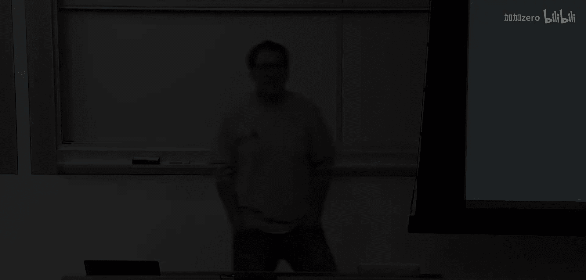

Everything else's going， okay。Alright， week 4。How about we talk about GPus。

We talk about some GP Ps today。 Alright， so here's what I thought I'd do today。

I wanted to start with just a little bit of history。On how we got here with modern GP computing。

 which basically is like， how did these chips that folks like Nvidia and A MD were producing that we're producing largely to play quake。

😊，How do they， how do they get us to a point where NviDdia is a trillion dollar company that's much。

 much bigger than Intel and everybody's fighting over how to buy these things。

 So it get some history。 And then we're gonna do a conversation about how to program these GPUs using a language that's that's provided by NviDdia。

 mean， most people write GPU code and Kuda these days。 Kuda， you're gonna find very similar to ISPC。

 In fact， IPC。 if you read that blog post about the history of ISPC actually is a reaction to Kuda。

 They're like， oh， people are programming GPus with Kuda。 why can't we program the same way on CPUus。

 And so they hacked up ISPC in response。 So the programming model should be pretty familiar。

 and then we're gonna talk a little bit about how modern GPU architectures work。😊。

And how they run that coa code。 So I want you to think back to。

 to basically the first week of class of the second week of class。 And we talked about。

 and you've done a written assignment now， really working through the details of ideas like multi threading and Sim and multi core execution。

 And you've had some experience running that code on CPU。

 So the first thing I want to tell you is that。😊，There's not going to be anything new today。

It's the same ideas， multi core， Sdi， multi threading and stuff like that。

 They're just gonna be deployed at a little bit bigger scale for a modern GPU。 So in some sense。

 known new concepts today， just another instantiation of those ideas。Alright。

 so how many of you have taken looking for familiar faces have've taken 1，48 or， or sit around for 1。

48 after this or， or 2，48 with me or something like that。so you know。

 some of you know a little bit about graphics。 You know a little bit about how pictures are rendered for the rest of you。

Here is CS 2，48， like  five slots。So， the goal of。An original GPU design。

Was to solve one specific problem。And that one specific problem was。

Given some mathematical description of a scene。And that mathematical description was kind of the geometry of surfaces。

 the location of whites， the position of some fake virtual camera。😊，Perform a simulation。

 simulate the boun sheet of light in the scene， simulate all these materials。

 and give me a picture of what I would have seen if that was a real camera at that location。😊。

That was the goal of a graphics chip。Okay， and graphics chips do that quite well。 You know。

 here's an image。 It's actually a pretty old image Now。 It's 2015， this image。

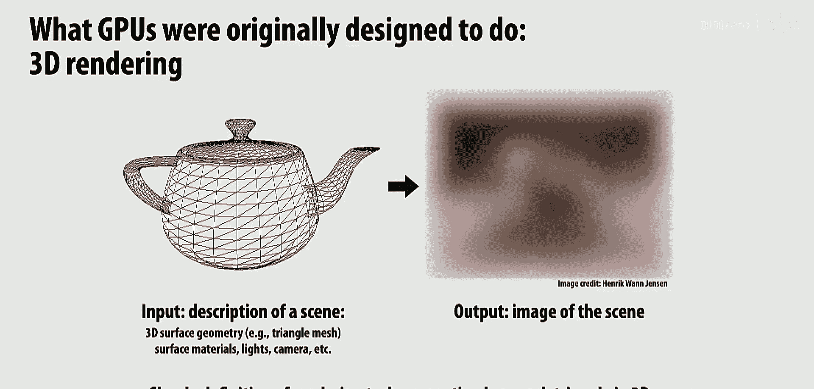

60 frames per second， easily on on on a high end GPU in 2015。

 If we step forward to a little bit more modern graphics。

 this is something that we can render in real time on unreasonable high end GP。

 So this is from the Naite demo from， from from epic。😊，And the workload， like the actual computation。

 if I asked you to write some software that that ran， you know， that computed this stuff。

It's pretty simple。 And， and so here's 2 C， CS， S 2，48 in。Maybe 45 seconds。

So the name of the game is to render a surface like this。

 And so the way you work with a GPU in the old days， or at least if you're doing graphics。😊。

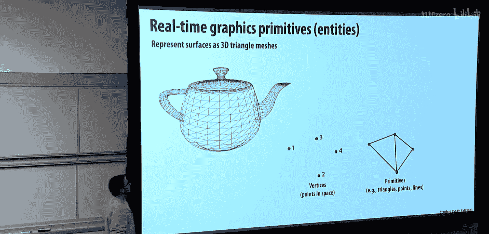

Is you provide it some notion of what your surface is And and the surface that we。

 the representation that that we typically use in computer graphics are triangle meshes。

 So you give the pipeline， you give the GPU a list of points in 3D space where all your triangle vertices are。

😊，And。You basically ask the GPU， given these points in 3D space and given like a camera position or orientation。

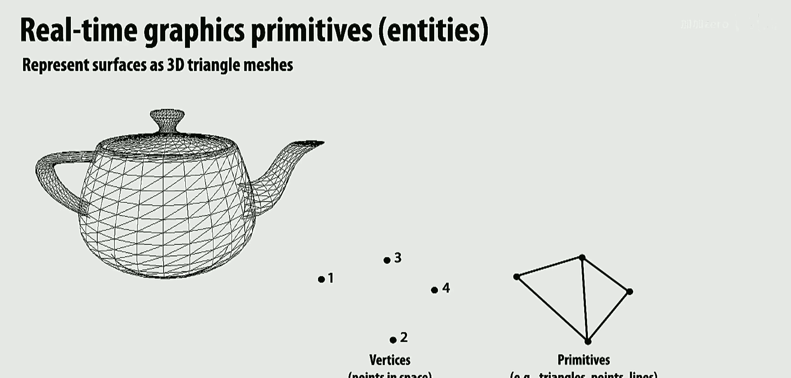

Hey， GPU， you go do a little bit of math that we teach you in 2。

48 to figure out where on screen all of these little little vertices project onto。So it's like。

 if I held up a camera right here， where is every vertex。Good to be on screen。

And for every pixel in the image that's covered by these triangles。

 Once I know where they're on screen， I need to compute the color of that triangle。

And if I want to compute the color of the triangle， if you look around this room。

 the color of all the various surfaces in the room， it comes from what material they're made out of。

And if you think about like， if we have to simulate how w light is bouncing off these chairs or off this bamboo texture or off off like the shiny metal of the。

 the door handles。

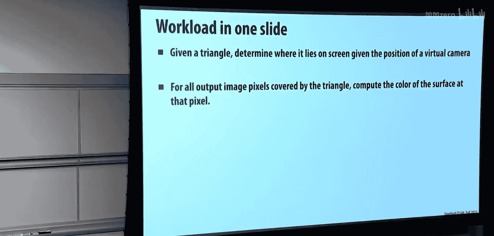

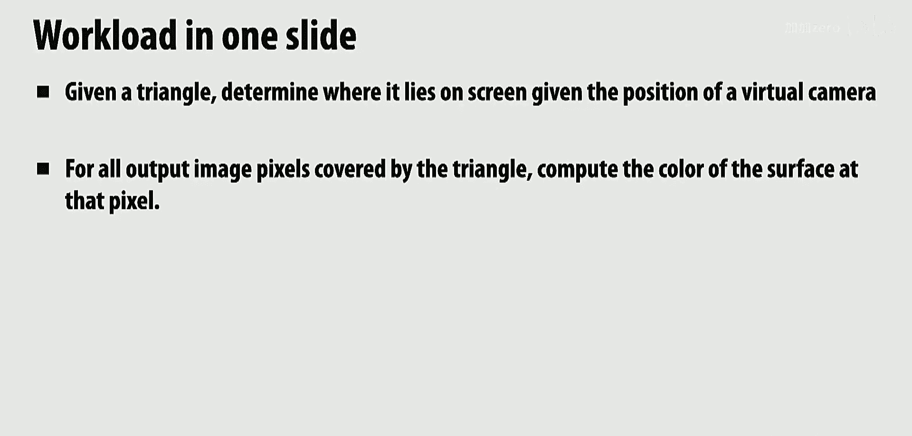

You you quickly go， wow， there's a lot of different materials in the world。Right。

 and early graphics said。

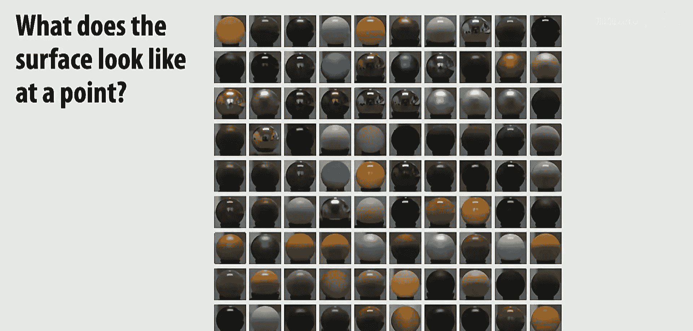

Oh， and， and like， you know， here's an example of a bunch of materials， these all kinda look a lot。

 like。 But， you know， if we can get pretty sophisticated with our materials。 Like。

 if we look at the glins in these shoes， if we look at the fact that human skin。

 light enters the skin bounces around the lot and comes out somewhere else。

 Simulating how light bounces off these materials to just compute the color of these triangles。😊。

People were like。The materials of the world are so different。

 We just want to write a program that does this。It's not like we're going to say the color is red or the color is blue。

 we're just going to write a program。And so in the mid。

 the early like 200s was the time when people started developing these little programming languages that。

Will run for every pixel on screen， which given some information about the current material and the orientation of the surface。

 So the code doesn it。 the details of the code doesn't really matter。 But it's like。

 there's like a coordinate， a 2D coordinate of where I am on the surface。

 There's the normal of the surface， which is like the vector pointing away from the surface。

 And there's details of like。😊，Texture maps， which if we just do a little bit of work。 we， we。

 we have algorithms for computing， given the orientation of the surface。

 given that I want like this image to be wrapped over the chair surface。

If I run this code for every single pixel on screen， I compute a color。 If you look at the output。

 Re vector as a color。 This is like K D is a V 3， RGB。 And that last component there is alpha。😊。

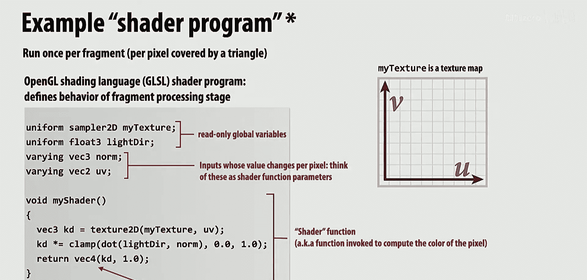

Running this function for every element or every pixel gives me an image that looks like this。

So there's just basic data parallel computation， like we've talked about for every pixel。

 computes some inputs and then run this completely independent function on every pixel to compute some colors。

😊。

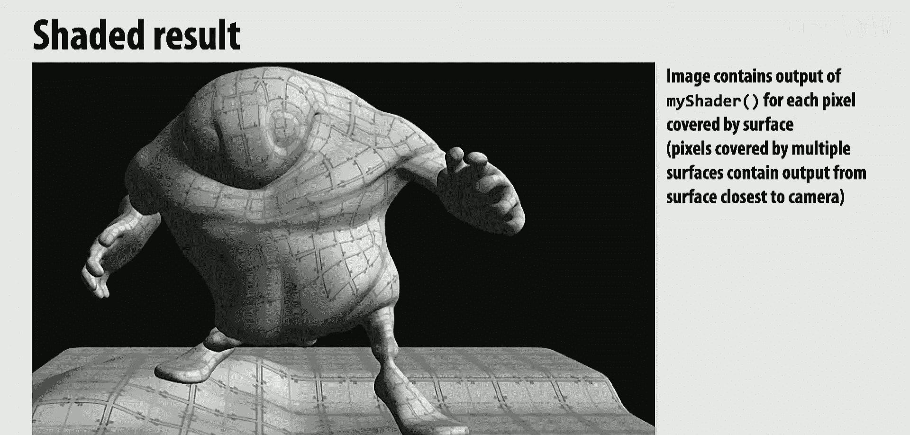

That's kind of C， S 2，48， in a nutshell。And so the reason why GP started adding multi core and adding Simdi。

Its because theyre like， I got a。Process of 4K image。You know， millions of pixels。

 And I need to do it 60 times a second or more。 You know。

 I've got to get through hundreds of millions of pixels to billions of pixels per second。

So they just started like adding more and more GPUs to compute color of of more of these。m sorry。

 They added more and more cores and more and more AUs in order to compute the color much more fast。

 much more quickly。And so if you go back about almost exactly 20 years now。

 and we go back to lecture 1， remember， we said that like， there were more and more transistors。

 The green line was the number of transistors per chip。😊。

But all these ways to turn these transistors into faster single threaded processors。

Were kind of not working anymore， right， We couldn't ramp clock speed because like power was going through the roof with 4 GHz processors。

 We couldn't do superscalealar anymore because like， there was no ILP to find。In threads。

 But these GP Ps were adding more had already gone to perism。

 They were just gonna add more and more cores as the green line went up。

And so some folks around the country， some folks here at Stanford。

 some folks at the University of North Carolina and a few other places said， well。

Intel's processors are not getting any faster。But these GPus are adding more cores every single time the transisted doubles。

 and they can run code。 They run these little programs that compute the color of things。😊。

So some folks were just started to hack。And they started to hack by doing the following。

Let's say you were rendering an image to a screen that was 5，12 by 5，12。They said。

 here's what we're going to do。 We're going to render two triangles。So the。

 the entire screen is covered by those triangles。And then we're gonna。

 instead of running a program that computes the color of something。

 we're just gonna have that program do something interesting。

 like time step a particle in a physics simulation or or do some protein folding or something like that。

 So there was this big hack where you actually drew two triangles on the screen。

 basically to create 5，12 squared function calls And then inside this thing that was supposed to compute the color of a surface。

 you just said。😊，Do something that I wanted to do。And so there are these hacks， like。

 if you look at the dates on these about 20 years ago， people said， oh， I can like。

Treat that RGBA output as like X， Y， Z position of a fluid simulation or something like that。

 So people started hacking and like these GPUs are really， really fast。

 We can actually run a lot faster than than what we would would do if we ran threaded code in C plus plus or something like that。

😊，Now， there was a research project at Stanford in 20202004， which kind of said， wait a minute。

 like this is a hack。 This is pretty stupid， right。

 Like if we're gonna use these things as parallel processors and we all know about data parallelism and all this other stuff。

 could we just have a proper programming system to just treat them as such， right？

 And so there was this project where folks。😊，Use the data parallel programming model， where。

You just have， which we'll talk about in more detail on Thursday。

 But the main idea is there's some function here。 like in this case， scale。

 which takes as input and A and a B and just scales A by amount。😊，But scale is evaluated。

 not on scalar values， but on collections。 So I'm making up some syntax here。

 Think about this as like a vector of 1000 numbers。

 And you're applying scale to every element of that collection。

 So this was called like the stream programming model or data parallel programming model。

 And this code， which was actually a valid code in this language called Brook。😊。

Actually got compiled source to source to this graphics program that drew two triangles and then used the GPU again。

 like it。😊，You know， less of a hack for the users， but a total hack from the implementation standpoint。

 okay。So around this time， when video was making faster and faster processors。

 they were starting to think about， well， maybe these things can do more than just graphics because they run。

 they run code。😊，And， and so inspired by projects like this and others， Nvidia says， you know what。

 we should actually just do it ourselves to allow people to write general purpose code for these things because the chip could already do that。

😊。

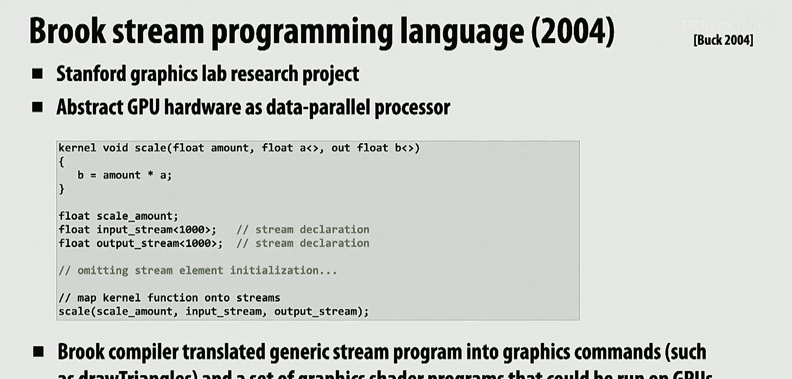

So if we， if we remember a little bit about how CPU work。

 Imagine you had a multi core CPU here that has two cores， two total execution contexts。

 How do you run some code on this processor， Or in other words， what does the operating system do。

Like， actually think through。 Imagine you were taking， you know， let's hypothesize。

 Many of you probably have not。 But imagine you're taking an operating systems class。

And as an operating system， you're supposed to， let's。

 let's say we want to run two different programs on this two core machine。 What。

 How do you get that program started。So if you have two different programs。

 you I have a two stream instructions， Yes， I have two programs，'ll go， you I compile my program。

And then as the operating system， if I want that program to run， what happened， What do I do。就主。あ。

It kind of take par each stream and assign it to each performance。 Yeah。

 so the operating system is gonna say， here's instruction。 stream 1。 Hey， core， like。

 let me initialize the value of your registers。 I'm gonna set the the next instruction to execute to the top of that program。

 You just tell it， go。So it runs a thread here。 And if you want to run another thread。

 the operating system might say， I've got this other thread from this other program。

 I'm gonna run it here on core0。 So you kind of say， here's your program binary。😊。

Iitialize the state of the thread and go， and you do this one thread at a time。Okay， and that's。

 that's exactly how what an operating system does If you took an operating systems course。

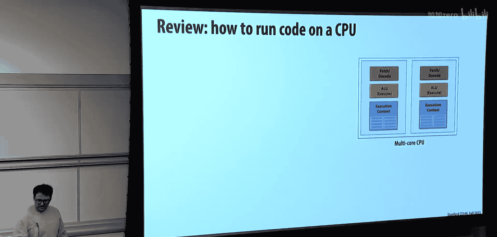

Okay。That's how we run code on CPU。But how we ran code on GPus before Nvidia said， hey。

 we need to give you access was there was no like， run a thread。

It was literally the command you sent the GPU was draw these triangles and use this program to compute the color of the pixels after you've figured out what pixels need to be colored in。

And so that interface to the GPU was this thing we call the graphics pipeline that has all the algorithms of C S 2。

48 in it。 But the interface to software is literally software gives the GPU a list of triangles。😊。

And a program to compute the color of the surface and a location of the camera。

 And then the pipeline just runs。😊，And it runs that program whenever it needs to compute the color of pixelel。

 very， very different way of thinking about how to kick off computation。So， in 2007。

Invidia said we had we need something kind of in between those two。 Like it。

 it seems stupid to draw triangles to use our processor to do things that are have nothing do with graphics。

 And at the same time， like。We don't really want。Users to。Create all these different threads。

 because all these different threads aren't gonna run very well on my GPU that has 32 wide C D and has terrible single threaded performance and stuff like that。

😊。

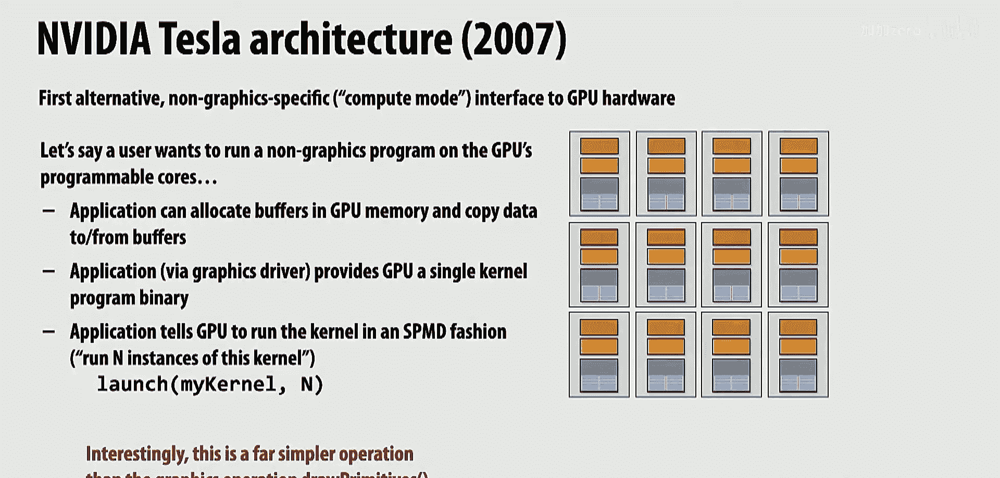

So they created this new abstraction called compute mode， which exists today。

 and the interface to the hardware is the following now。

It says you write yourself a little program like some function fo。 In this case， I call it my kernel。

 because often we call like in a data parallel sense， the， the code you run is called the。

 the kernel。And then you say， I want to to， to invoke。En copies of this kernel。You just， you know。

 GP U chip， you figure out like how to do that。 But I just want this kernel run n times。

So what programming model is this， This is classic SMD programming。 I'm gonna give you some code。

 It's gonna have a thread I D in here somewhere。 And we're gonna launch end copies and run end copies of this。

 So you can think about this as like， you know， similar programming model to something like IS PCC。😊。

And that program programmingming model is what's embodied in what's called the Kuda programming language。

 which in modern GPU programming is basically CC plus plus with the one exception of you don't create threads。

 you just say， here's my program。 Please run end copies of it。And then the G view says， okay。

 I'll go figure out how to paralyze those copies， however I wish。 Yes。

 contrast this again with what we were doing before before it was just computing two parameters。

 and it wasn't in an SPMP fashion。Yeah， I mean， the difference from before。

 it was literally you would open up， open G L。And you would say， open G L。

 draw these triangles in these positions， and you' would set up the positions very carefully so that every pixel on screen was covered。

😊，It was just， you know， its a hack。So now they're just like， let's。

 let's use proper SMD programming abstractions to essentially do the same thing。Yeah， exactly。 Okay。

 So， so here's the plan。 So that， that's just some history。 And that's how where we。

 where we are today with Kuta and why。 So I'm gonna talk a little bit about this programming model。

 And while you're thinking about it， I want you to think about， is this。😊，You know， like。

 should I be thinking about this as data parallel， Should I be thinking about as SPMD。

 Is this message passing or a shared address space， You know。

 if you had to organize this in your head， how would you draw analogies to IS PCC and some things that you know okay。

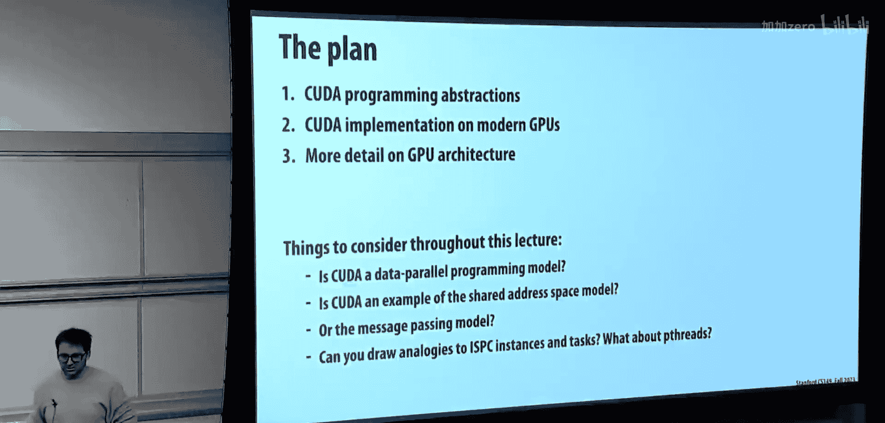

Okay， and I'm going to describe， since we're talking about Kuta today。

 I'm gonna use Kuta terminology。 So when I talked about IS PCC， remember。

 I said there was like a gang of program instances。

 And you kind of thought about program instances as a thread logically。

 but you kind of knew under the hood。 The implementation was not like a hardware execution context。

 It was a little vector lane。😊，In kuda， what a program， you know。

 a program instance in IS PCC is called a coupa thread。 So when I say thread in this lecture。

 unless I'm being careful to say， like hardware execution context， I mean。

 a couda thread and a couda thread is whatever。😊，You know， Nvidia defines it to be。Okay，Allright。

 so here， here we go。 So just like an IS PCC， when you called an IS PCC function。

 you launched a gang of program instances and the number of instances in the gang was N。

 It was kind of set at compile time， usually8 or something like that。

 And when you called IS PCC tasks。 You said that I gonna run this function。 I'm gonna run this， this。

 this code。 I need to run an n time。😊，Okay， so when you're programming kupa。

 you're gonna basically think about it the same way。So here's a call from regular C plus plus code。

 which says， I want you to run the Kuda function matrix ad。And to be honest， I want you to run it。

 give it these arrays as input arguments。 A， B and C are just normal C style arrays。

And the only thing that's kind of funky here in this weird bracket syntax is instead of saying。

 I want you to run it n times。The number of times， the number of instances you create。

Is this multidial value。 And the reason why it's multidisal is just because it's sort of convenient for graphics and tensor operations can be helpful to say。

 create n threads， but organize them like in a 4 by3 grid or something like that。😊，Okay。

So in other words， thread Is are going be multidimensional。And。The one additional detail is that。

The instances are group。Into these blocks。 So what this code does is I'm creating。

Thread blocks of size 4 by3 threads。 So I'm gonna 12 threads per block。

And I'm creating a total of the number of blocks I'm creating is 12 divided by 4 and 6 divided by 3。

 So in other words， imagine I'm gonna add element wise add two matrices that are each of size 12 by 6。

😊，And来我。Every couda thread to kind of take on the job of adding one element。

 So I need to create 72 threads。Okay， now。Here I， I decided to just say。

 instead of just creating 72 threads and saying creative 72，72 threads， I just said。

 create these thread blocks where each thread block is 4 by 3。😊。

And the reason why I'm illustrating that now is I just want you to know about the concept of thread block。

 So it comes back later。 If all I was trying to do in practice of adding two arrays。

 I might have just chosen to， to say that there are1 D thread blocks。

 And I'm just gonna have one block of size 72。So here is some basics kuda syntax。

 The code I showed on the previous slide is what's up here。

 That's like main do CP calls the kuta matrix add function。

 It does so with a certain number of thread blocks。 And then the kuda matrix add function。😊。

Looks a whole lot like an SMD program that you're useful with IS PCC。

 The only difference is instead of program count and program index， theres these built in variables。

 block index， block dimension and thread index that allow you to kind of figure out your unique thread I D。

😊，Okay， so in this case， thread I D is the I D is the I D of the thread in the block， like 0，0，1。

0 or so on and so on。The block ID is the block。And then to know like your unique position。

 you need to know the size of the blocks。 So you can kind of think about it as your thread I D in the block is kind of like your program instance I。

 your， your， your program instance。The block I D is kind of like your task I D in IS PCC。

 So there's like this level of hierarchy is that instead of organize like IS PCC organizes things into tasks and gangs inside the task。

 Kuta organizes itself into thread blocks and then can create many thread blocks at the same time。

no new concepts， just kind of some different names and some small detail differences in the details。

 And so if you look here， this is a couda function called matrixtri add。

 The first thing it does is every thread computes which element of the input arrays it is responsible for based on its thread I D and its block I D and then every thread carries out the work that it's responsible for。

 and keep in mind that in my program，72 instances of this function are being executed concurrently。😊。

So the entire array is added together。 Each thread copies or adds one element。

 and I create one thread per matrix per element of the matrix。 Okay， so there's some questions。

 So we get to that。 I still don to understand why we move to the system。😊。

I'm showing you the 2D system in these slides because it exists。

 And I kind of want you to know about it。 I could have done all of these intro examples as thread Id and block Id being one dimensional。

And that would worked just fine for this example。 It turns out that in a lot of things that we do on GPUs。

 image processing， Tensor processing graphics， it actually can be a little bit helpful to have your thread I D be two dimensional because then you just go I J。

😊，Whereas if your thread I D was one dimensional and then you had to compute your location。

 like in an N D tensor， there would be a lot of divides。So actually。

 you can skip a lot of divides by giving you the， the multi dimensionional location。

 And so you can compute your memory address more efficiently。 So that's the history of that。 Yeah。

 but it's not fundamental at all。And every year I， I， I consider redo， you know。

 changing these as the initial intro to be 1 D thread I Ds。 But then I have to introduce 2D later。

 And so I just decide to save some time by doing that。 Okay， so at this point。

 you should be thinking about the two， the kind of two worlds to live in。 There's the。😊。

The world that's running the normal C plus plus code over here。That's like void main。

 And you should think about that as running on a thread on the CPU。

And then there's the world that runs all of these instances of matrixtri ad。 And in IS PCC。

 that's where we said， oh， it's a gang of program instances。 In IS PCC。

 we said the implementation was Sdy instructions in that same thread。😊，Now。

 without getting into too many implementation details。

 the implementation of running all of these kuda threads is actually gonna be execution on the GPU。

So that call of matrixtri add double B here is is the point at which in the underlying implementation。

 if we get into that， that's going be the communication to start running things on the GPU。

previous diagram point out with the lot I mentioned sure。

For reasons that don't seemme necessary in this example。

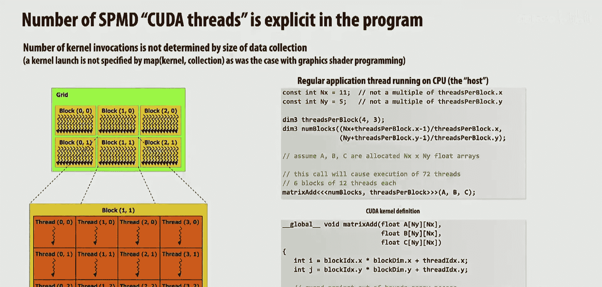

I have organized my code instead of just saying， launch 72 threads。I have said。

 launch a certain number of thread blocks， and each block is a 4 by3 grid of threads。

 So the thread I D is two dimensional。 Those are these numbers。 The block dims are not on this slide。

 but the block dim is 4 by 3。😊，And then the block index is whatever the current block is。

So it's just a multidisional addressing there。Makes sense。

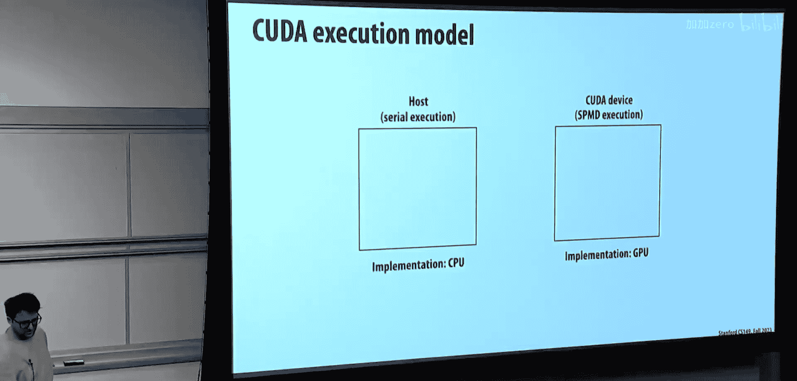

Okay， so the， you know， so the， the ka， the， the， the kuta memory model is I have like void main presumably running on the CPU that has its own address space。

 And in simplistic kuda。😊，Then there's the device， the GPU side of the world that has its own memory address space that can be accessed by the coupa threats。

Okay。So that means that if you allocate an array in C。And try and dereence that pointer in Kuta。

That will work because these are in different address spaces。Okay， so here's an example of this code。

 Here's my void main running on the CPU。I allocate an array， A， a normal C allocation。

 That's an allocation in your CPU address space。Then I allocate， or is it kuta malic。

 then I allocate an array in the GPU side of the fence， the device address space。

 and then I use library calls to move the values from the CPU address space to the GPU address space。

And then when I call a coup the kernel， I pass at the pointers to device a。

Because the k kernels running on the GPU need to access the memory in the address space of the GPU。

This is kind of nuts and bolts。 Kuta。 Now these days， it's on more modern systems。

 It's easy to actually just directly pass a C pointer into a kuda kernel。

 But it actually means that your， your GPU memory access is actually gonna go over PC I。

e and and things like that。 So I w to stick to kind of straightforward separate address spaces for now。

 okay。😊，All right， questions， yes， so。Example like in this case。

Are there any situations where it's useful to？Pref data from the CPU to the GP。

 knowing like more computation。 So this kuda M copy right here is a movement from data。 now。

 now we're talking about implementation。Is a movement of data from CPU memory。

And if we're thinking about a system that has a GPU that's like a discrete card。

 like a R T X GPU or an A 100， this Me copy is actually moving bys over the PCI。

e bus and putting it in the GP's D Ram，2 different D Rams。 So that's actually a slow copy。Right。

 and yes， like， there are ways to do that asynchronous and stuff like that。

 So what does this feel like actually， in terms of last time didn don't we talk about message passing。

Kind of， in some sense， this mem copy is a message passed from one address base to another。

And you very well might want to do it asynchronously to hide latency and stuff like that， absolutely。

Yeah。So by going at the previous example when we had matrixtri what we is passing A C into this function C in this example are coUa device allocations and actually I'm glad you brought me back to this example。

 here's an example of I wanted to check everybody's understanding here。Okay。

 so this is the same matrix to add example。 But I change the matrix size to 11 by 5。

But I kept the thread block size to 4 by 3。I did this just for explanatory purposes。

So I have 55 things to do， right。But I have thread blocks。

 I create work in the granularity of groups of 12 threads。So I have， you know， if I round up。

 and if you look at like my little math there for non blocks， I'm rounding up。

Which means I'm creating more threads than just 55 threads。

 So when each of these threads does this work to figure out its I And J。

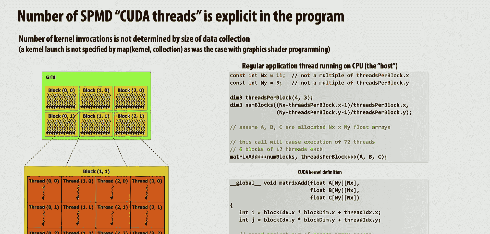

Notice that some of those threads would actually be out of bounds in that array。

And I have an if statement in the code to say， hey， this thread。

 check to make sure that you're actually responsible for valid work。 And if you're not。

 don't do anything。So this really underscores。 It should underscore that this is an SPMD programming model。

 You're just creating threads and the threads use the program to figure out what they're supposed to do。

You are not doing something which says for every element in an array， launch a thread。

 That's not the programming model。 The programming model is you launch a thread for all your blocks。

And for all your threads per block。And inside in my code。

 I might write some code that happens to do one thing per thread， or I could do what。

 whatever I want， right， So that if statement there。

 what would happen if I didn't have that if statement。

I I would basically read and write to memory that was off the end of my array。Right。

 so who knows my program will crash So you're seeing like the abstraction is that you're kind of creating threats。

 but it's just the implementation that's very different。like correct。

 The abstraction to be precise is you're creating coupa threads， right。

 but you're not creating them one by one。 You're creating them with like a bulk thread launch。

 So it's like， imagine you had a C plus plus API， which said， standard thread， you know， create。

 But you gave it some parameters after that， which was like。😊。

I want 1 hundred and 50 of them or stand， but really it would be like。

 it's not only that I want 150 of them。 I want1 hundred and 50 blocks of threads。

 and each block should be 4 by 3。So there's this bulk launch of threats。 Okay。

 And I haven't told you how it's implemented yet other than the GPU is gonna run those threads， yeah。

So can you go back to a few slide that ahead。

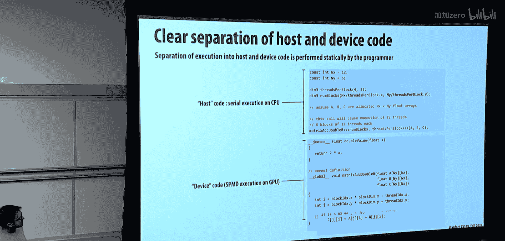

いが。A you want the cooler。不太很对。Yeah， so out here， like after you have done this quo function。You will。

 I guess all the computations you will be performing with be device in， right like all the functions。

 all the kr computations I'll be doing will be on device A correct。 And if in this code right here。

 like in this C plus plus code， if I said print F。Devicice a sub 0。

Convince yourself that that should se fault。Becauseuse device A is actually a pointer into an address space that I can't reference from here。

Right， this is basically， this is low level C code。 So you can do that kind of stuff and that's。O。

Alright， so the basics of the memory model is that you have an address space for your CPU threads。

 You have an address space for your GPU coupa threads。

 And it turns out that you actually have additional address spaces in Kuda。

 We have a block of threads。 And one reason why they have this concept of a block of threads is they can they say that。

 oh。😊，Every thread block has an address space that only those threads can access。

And every thread has its own local address space， like its own local stack that only it can access so。

😊，You know， local variables to a thread can only be accessed by the thread。 That makes sense。

 That's like IS PCC。 But now there's like per thread block variables。

Which are kind of like uniform variables in ISTC， actually， But there's per thread block variables。

 And then there's overall device global memory that can be accessed by any thread with loads and stores。

😊，So you just see this organization that's popping up。 You're kind of saying here。

 here's a bunch of threads that are gonna work together on something。

Here's another group of threads that are gonna work together on something。

 And to do that work together， they're gonna have some shared， shared space。Okay， and so hopefully。

 you're starting to think， oh， we're giving hints to the GPU on how to co locatecate all these threads。

For locality purposes。 Okay， so let's do some coa practice with， you know。

 one of the simplest things I can think of in Kuda， which is， let's not add to， two matrices。

 but let's。Let's perform a simple 1D convolution。 So I'm gonna take the output is the average of the inputs in the same location。

 So this is a basic operation image processing or signal processing。

 It's actually the 1D equivalent of a convolutional layer in a deep neural network。

 something that you might want to do。 So look at the top of the slide。

 And I have illustrated the input and output location。

 And I have some red arrows there that suggest what input elements are needed to compute every output element。

 So，  first of all， confirm that you agree the input is two elements bigger than the output。

 I have to worry about any boundary conditions or craft like that。😊，Just keep it。 Okay。

 so here's the code for that。 So first of all， we， we create， we call the convolve ka kernel。

If the array is 1024 in size， let's say the array is a million elements，1024 in sizees。

 I decided to create。 if my block size is threads per block。

 noticeice that I'm spawning n over threads per block blocks。😊。

Assuming that that divides evenly to keep my integer map。 And then for every thread。

 we just treat it as a 1 D array index in this case。 I， And I say， okay。

 I'm gonna compute my index and I'm responsible for computing。

 I'm gonna load three values from memory。😊，Multiply them together and output the result。 So。

 first of all， confirm that this is a correct implementation of a 1D convolution in Kuta。

 I will produce a million or 10 1024 squared output elements。😊，Alright， so far in this example。

 there was really， I didn't use the idea of threads per block， really at all。 Like。

 I really would have preferred a programming model that just said get rid of all this stuff。

 Just say launch end threads。And I'm good。 Like， I don't have to deal with any of this blocking and stuff like that。

Okay， so if you look at this code， this code。Every thread reads three elements and different threads。

 like kind of neighboring threads， actually overlap in the elements that they read。So， in some sense。

This thread is issuing load instructions for data。 And then the other thread is issuing load load instructions for the same data。

 Now， maybe there could be some cache hits and stuff like that to amplify that。

 But if we really wanted to write an efficient program。 Let me show you something else that I could。

 So here's a much more complex program， but gives you a sense of what you can do with this idea of a block that has memory local to the block。

😊，Okay， so the same thing down here。 I'm still launching the same number of thread blocks。

 My thread block size is what，1 hundred28 here。 So to compute 1 hundred and 28 outputs。

 how many inputs do I need。1undd28 plus 2， right， I need1 hundred and 30 inputs。

 So now look at what my thread does。 My thread allocates this shared array of 1 hundred and 30 elements。

 And that prefix that the type modifier shared is saying this is not a per thread allocation。

 This is a per thread block allocation。 So this is kind of like a uniform variable in ISPC。😊，And now。

 look what the threads do。 This is kind of interesting。 So every thread。😊，Loads。1 value。

 if I go right to that first line index equals。 So I I compute the index。

 and then the first line of code in the block is copying a value from。

 from the input array into this shared allocation。 So the first thread in the block。

 computes something and then copies that value into that shared variable at address 0。

 at index 0 and so on and so on。😊，And then I say if the thread index。

 and remember that's a block local thread index is less than2。So in other words。

 if your thread 0 or one in the block。What do they do？They move the last two elements。

 So I have 1 28 threads in the block。 Every thread is responsible for grabbing one piece of data for memory and putting it in this shared array。

😊，And then because I need 1 and 30 things and not 1 hundred and 28 things。

 I had to have two of these folks do a little bit more work。 So ugly。

And then ignore this for a second。And then every thread just does what it's supposed to do。

 It computes the convolution。 But instead of accessing main global memory。

 it accesses this local support， the shared variable。😊，Co。Now， this is the last little piece of this。

 And that sync threads is。The equivalent of a kupa barrier。Within a thread block。So remember。

 all these threads， It's SMD。 They might be running concurrently。All the threads。

Cooperatively load some data into this shared array。They barrier。

 which is waiting for all the threads in the block to do their share the work。

 And then once they know that all the data is there， they run completely again in parallel。

 independently computing their output element。

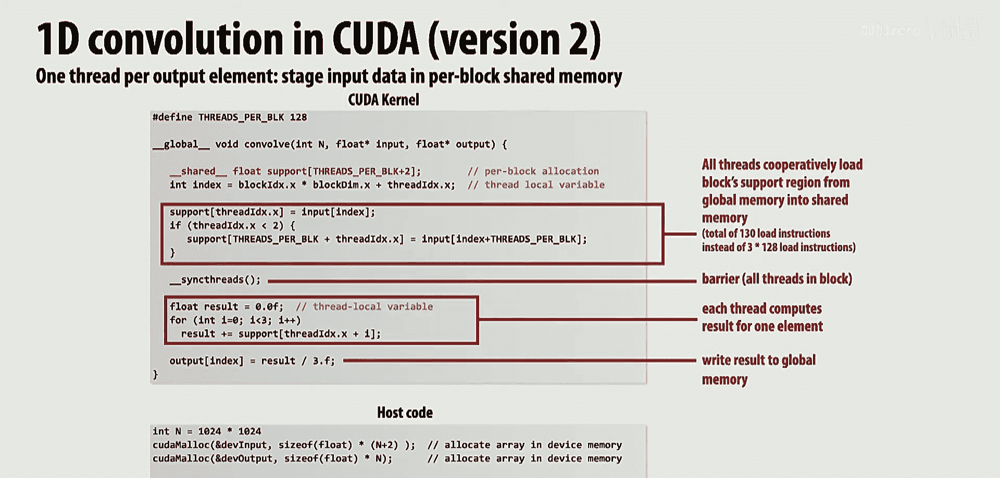

So this got an interesting thing about， like， why did I spend all this time like orchestrating this computation。

 Well， the reason is that these shared variables。Are backed by storage that you can think of as a high performance L 1 cash。

Okay， so what Kuda knows。 And then I'm talking implementation is that it's gonna put all the threads on the same the same thread block。

 kind of on the same core。And those threads can now access this fast local memory whenever there is reuse。

 So this code is actually saying that， look， no thread accesses the same data twice。 Every thread。

 you know， like no one thread ever reuses data。😊，But one thread uses data that its neighbor also uses。

 So we cooperate to bring all that data in once。 And then we do our work running out of a fairly fast shared memory or a local memory。

 Yes， Sir。😊，や。Why do you need the sink threads like idea I've lowered this day and then This is a great question。

 I want us to think about that as a class。 If I remove that sync threads call。

Why could my program be incorrect？对。Access the access to that。でにやとる。是。

so there's no guarantee in what order a GPU is gonna run this code。

 It's just all these threads are potentially concurrent。

 So one thread might load its data in and then immediately start doing the computation。

 But we don't know if all the other threads has has brought its data in yet。

 So that sync threads is the barrier， which when you proceed past it you're guaranteed that this shared local memory has been initialized properly。

😊，Good question。By we data separate get a block， why couldn't we have a large block？Oh， I mean。

 I see you're saying like why do I have local variables like result？I， I think it。

 I wouldn't necessarily stress too much about it。 I mean， it's pretty， I feel like it's， you know。

 clearly the programming model needs to allocate thread local variables。And then this， so by default。

 everything is a thread local variable。 There's a coffee per thread。

 And then there ares also the ability to allocate once per block variables。Yeah， so how， you know。

 where these variables get allocated， like the implementation could allocate these in a， in a。

 in a piece of memory。 that's a big block for all the threads and stuff like that。

 But that's up to the， the compiler。 But conceptually。

 it makes sense that I need private variables that。Are private to my own threads execution。

 and I might need shared variables as well。MH to code is SPMD， yes。大なで。SPMD。

 you're confusing with Cdy。SPMD is a programming model question independent of the implementation。

 So like IS PCC is an SPMD programming model。 Kuta is a SPMD programming model。

 What that means is I write one program like this program right here。

 and the system will run it many times with different thread Is。Now。

 how we execute all of those instant， all those threads or all those instances efficiently is up to the implementation。

 And IS PCC use Sni instructions to execute things。Very efficiently。

 I have not yet told you how the GPU implements things。 And， yes， there will be S involved。

 but it's a little bit different。 Yeah's completely under your control。 Like in the same way that。

 like， it's up to you to figure out how many threads you wantna launch in C plus plus here。

 it's up to you to figure out how many threads you wantna launch。

 but it's also up to you to tell the system how you want to organize them in blocks。😊，Well呃。

It cannot be。 Let me tell you this way。 You are not allowed for it to be more threads than a single cl can run。

Could certainly be left。Cause I can put multiple blocks on a core。Yeah。In this case。

 we were able to like doing this a block data meaning because were reading data from the same part of the memory like executive three item but if for a reading like say something like a matrix and you want to read like。

Call main。Would it be more efficient to？Do the same thing。Her block， memory。

 or would you want to get saved by life？Well allm asking is does it matter if you're reading contiguous in block。

 It will certainly matter your performance。 absolutelyolly like the nice thing here is that all these threads are accessing consecutive memory addresses。

 you can imagine that's gonna be quite friendly under the hood。

 But if they were accessing certainly it's possible。

 they could access arbitrary memory addresses and bring them in the program would still work。

 but obviously the memory system may provide lower performance because of cash locality and other things。

 we have control over。😊，Kuda Malop stores them。Well， you have control over like。

 would you ask Kutamalek for data。It will allocate you a continuous part of the address space。

 just like Malik does in C++ how you lay out and place your matrix elements in that block of memory is completely up to you is how you wrote that program。

😊，Here， I'm assuming contiguous throw major， but that was my choice as the the writer。Okay， so。

 you know， unlike IS PCC， you actually， you know how like IS PCC had those cross lane operations to sort of communicate with some of the instances。

 Kuda has a variety of synchronization constructs。 It has like a pro thread block barrier。

 It has atomic operations。 And then， of course， there's like。

 actually synchronization that you have to do between the host and the device。

 like start these couda threads， Wait for them to be done and stuff like that。

 And you'll run into all of them and assignment 3。😊。

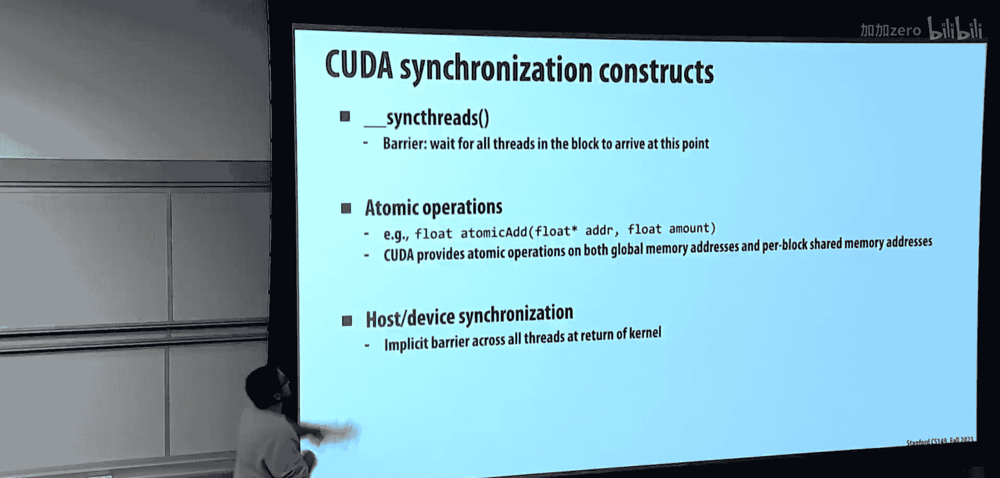

So the programming model for Kuta is an SPMD programming model where you。

 you write a single program that defines what a thread does。

 What a thread does is based on its thread I D， its block I D and so on and so on。

 Those threads can synchronize in a block with some barriers， if they so wish。

 And when I launch threads， I launch threads and mass for a large number of threads all at once。😊。

All right。Okay， so now let's start thinking about implementation。So take a look at this program。

 This is the same convolved program as before。 Exact same thing as the previous slide。

 Tread block size is128。But look down here in the host code。 This is a C plus plus code。

And I decided to create。呃，About呃。A million threads。And if you divide a million by 1，28。

 it's about 8 K thread blocks。So how do you think this is going to be implemented。

 Do you think NviDdia is going to launch。Like， semantically。

 this says we need to run a million coupa threads。Do you think it's actually going go try and find a million thread contexts around these lists？

 Why not。Probably doesn't have that capability， you know， like， to have that many execution context。

 So what does this like big bulk launch remind you of。我。Yeah。

 it feels a lot like task it like I'm going to give you a whole bunch of work。

 like do all of these thread blocks。That's all the work you gotta do。

 And just like an IS PCC task breaks down in the program instances。

 Kupa thread block breaks down into couda threads。Okay。So。

We want to be able to run this thing without the user。

 Li code should work regardless of the number of cores you have or the number of your S with and so on and so on。

 right， We want this thing to work on a big GPU with a bunch of cores or a midrange GPU with small number of cores or like a grace hopper chip that cost 100000 or whatever it is these days。

 That's what we we wanted to run on any of these things， okay。Alright。

 so now let's talk about implementation。 Okay， so here's our program again。 host CPU code。

 device code。 And when I compile this device code now， I not only get the instruction stream。

 but I also have a little bit of metadata about what it requires to run。

 I might have something like it says， oh， well。😊，You know。

 I need 128 threads per block because that's what the programmer asserted。 I needed。

It also says that， oh， like， if it's 1 hundred 28 threads per block。

 it means that that shared allocation is 1 hundred and 30 elements wide。Right。

 so I know that I need 1 hundred 30 floats。 I need 512 B of like storage in order to to do that allocation。

 So I know I need1 hundred and28 threads with those of of resources， and I need 512，20 B of， of。

 of storage。In order to actually run this thing。Okay。Alright。

 so what's gonna happen is imagine we have a little GPU here has four cores。

 Let's not think about the details。 But I just created those 8000 thread blockss up at the top。😊。

So you're pretty good at this now， or at least for those of you that have been doing a little bit of threadpo stuff。

 How's this gonna work， You're， you just got all these tasks， all these thread blocks。

 and you're just gonna go， you know， to all your different workers。 And by the way， in Kuta。

 you could actually set up dependencies between some of these thread blocks。 And so。

 but instead of like what you're doing in assignment to and writing some software that decides what。

 what worker threads get what work。😊，What you're doing in assignment， too。

 is embedded in GPU hardware in Sil。 So the API that you're implementing in assignment to。

 like run this task this many times。 Remember， that's the interface to the hardware now。

So the interface is not。 Here's a， here's a program。 Here's a PC。 Start running it on this thread。

 The interface of the hardware is， Here's an instruction stream， a program binary。

 Please run all of these thread blocks of it。😊，And in the hardware。

 like the right at the top of the GPU is someone that says， oh， I have to run 8000 thread blocks。

 I've got four cores。 Let's get to work。Okay， so this is another instance of this design pattern of you declare declare independent work and you let a scheduler assign it to workers。

So let's talk a little bit about those workers now。 So I'm gonna give you diagrams for a Volta V 100。

 I will at some point later in the week， once I get done with one of my own personal deadlines。

 And once you get into the coup assignment just for kicks。

 I'll go ahead and make a few slides on what like a modern Gracehopper chip looks like。

 but it's pretty similar， not much has changed since then。 So okay。

 so I want you to think about like basically like a mini little GPU processor， a GPU core。😊。

And it's got a fetch and decocode unit at the top， like we're used to。And ignore all the。

 the rainbow colors here off the side here are 16 A O Us that have to run in a70 fashion。 Okay。

 so that's again， my， my， my orange boxes。 So that's， that's the 16 execution units。

 And then here I have all of my execution。😊，Contexact storage。Now。

 I'm drawn it this way a little bit different for a reason。 as I want you to think about， here's the。

 the storage for thread 0。 So R 0， R1， R 2， R 3。Here's the storage for thread 1。

 Here's the storage for thread 2。 Here's the storage for thread 31。

 And I'm gonna keep going and going and going。 So I have execution context for。

 at least in this diagram。1 hundred and28 threads。Right， yeah。Heavily multi threaded chip。

1 hundred and 28 threads now of execution context。I have no superscalear in what I've drawn so far。

And I have execution units that are 16 wide Cindy。Makes sense and。The reason why I have other things。

 this is floating point execution Cdi。 It could also do an integer operation Cim。

 It could also do some weird funky math， like an 8 wide Cimdi。

 like trig functions and stuff like that。 It can also do loads in stores。

 So just imagine there's a whole bunch of different types of Cdi operations that the thing can run。😊。

Okay。And this is actually called like an S M subcore。 that's their terminology。 Okay。

 so these are scalar registers。For one thread。Now， remember， we talked about SD on a CPU。

 we said vector registers。So these are not vector registers。 These are scalar registers。

 The execution context of an Nvidia thread is a bunch of scalar registers。

Here are Scalar registers for T two。So two different execution contexts。Now。

 here's the one major difference between how SD execution works on CPUus。

And how Cdy execution pops up on GPSus。So on CPU， if we had a thread and it ran SimD。

 the compiler generated SD instructions。On GPSUs， because it's SMD interface to the hardware。

The hardware knows that it's running n copies of this program。Right。

So what it's going do is that every single thread here has its own program counter。

 It's one of the registers。In the event that 32 consecutive threads are on the same program counter。

That same instruction is going get executed in C D biology for。So it's all the same idea。

 There's just a small implementation detail difference is that on C on on C P。

 the compiler generates that70 instruction。On GPUs。

 I have all of these coa threads that are all running the same program。

If they all happen to be in the same place， the GPU goes， oh， let's run them with my Simdi unit。

 all at want。 So this is called like implicit Simdy。 But at the end of the day， it's the same idea。

 And one way you can think about it， is you can think about it as up until very， very recently。

 especially in this older GPU， the only way to run multiple threads in Cdi is if the threads with consecutive I had the same。

😊，The same operation， like in video would never take a thread from here and a thread from there around these Sdy。

So effectively， a group of 32 execution contexts。Is kind of like a CPU thread with vector registers。

You see how it's basically the same thing。And Nvidia calls this concept a warp。

So a warp is a block of execution context for 32 coupa threads。

That when those kuda threads are doing the same thing， those 2。

32 kuda threads actually get Cindy like execution on this hardware。😊，系。

So threads in a warp are executed in a s manner if they're at the same point in the program。

And it's up to the hardware to identify that it's the same point in the program。

 They just basically compare PCs。 And if all the PCs are the same。

Across all of the threads in the warp， boom one clock。Simdy instruction， yes。いう先定です。Yeah， okay。

 so I just said that a warp is 32 threads。And I've only got 1670 A LUs。Somethings weird here， right。

Boom， boom。So it would actually only run an instruction every other clock。

So it'll do that SimD instruction as 16 wide，16 wide on consecutive clocks。

Maybe you might be wondering， well， doesn't that mean that instruction fetch decocode is just idle every other clock。

It's not because on that extra clock， it actually starts dispatching instructions to the other things。

Right。So they say， oh， we can actually get by with less instruction， fetch and decode。

 We'll issue a 32 wide operation every clock， but it means we don't have to fill that unit up again for another two clocks。

 which gives me some time to like issue floating point now an integer in the next clock。

 and then back to floating point and so on and so on。

 So the instructions actually look a little bit like this。 This is time and clocks。

 This is like instruction 0， instruction 1， instruction 2。😊。

And so the actual schedule of the processor is， let's dispatch this warp instruction。

 It takes two cycles。 Let's dispatch the next warp instruction that might be I plus plus on all the threads。

 It's integer。 And then two cycles later， we can dispatch back to the FP 32 unit and stuff like that。

 This all really you know， low level implementation details。 It doesn't matter of the course。

 But I thought you might find it cool。 schedule doing our number of units an。😊，Like it has a buffer。

Yeah for sure I mean， this is your standard and substance out of order pipeline processor。

It's actually pretty simple。 It not's not being that dynamic。

 It's just saying when I issue a floating point instruction。

 I know I can issue the next one in two cycles。It's not that hard。 Yeah。

 thats not nearly CPU P level sophistication。 And so those different banks are's floating point A U。

 It's 8 bit integer， It's 32 B integer。 It's load storage， It's transcendental math。 So basically。

 that fetch and decod unit is just going down the the， the program。

 the coa program and going look all all these， this block of 32 threads and needs to run a floating point。

 Okay， this block of 32 threads and needs to run integer， okay。😊，So that's just how it works。

 but the details are not super important。 Yeah1。Every thread has its own PC。

Every thread has its own PC。But you're only going to get Cindy if that PC is the same for everything in the whp。

So it's effectively the same as if there were only four PCs。Effectively。

 but there are a few things N videodia could do with this abstraction， right， They could。

Reorganize the threads to get high better Cindi coherence for you if they wanted to。

TheyOnly very recently， only very recently， under some very limited conditions。

 they'll actually do that。Right， so they are， in some sense。

 it99% of the time behaves like a 32 wide70 machine with four unique pieces。

And you can think about like， as a warp as basically like a conventional thread with vector instructions。

 But that's actually not true。 There really are a different PC for every coupa thread。

 And this chip is dynamically checking to make sure that the PCs are all the same before it actually uses the vector instruction。

😊，Oh in this sorry in this diagram。I have execution context for， oh， sorry， I expanded myself now to。

 to 64 to 60 war worth of execution。 That's a lot of execution。 but no that's actually true。

 But let me， let me just go back to this， this diagram。 This will be better。 Hol on。 I'll shoot。

 Okay， there's a reason why I'm doing that。 I'll tell you in one second。😊，But really。

 there's 16 of these warps。So there's 16 times 32 execution context here。And sixth。

 and that's how many PCs there are。But there could only be one of those uniquely executing at once。

A warp is a hardware implementation detail， it's a collection of threads。How is a work different？

there any thread block is part of the programming model， A warp you never see。

All you saw is you created 128 coupa threads， and a video is going to use four warps of execution context to actually run it。

😊，Okay， let me put it all together。 You know， again， like。

 we're not gonna do any of this stuff on the exam。 I just think it's kind of fun to nerd out on this a little bit。

 The actual core of this chip。😊，Is this thing。Replated four times。Okay。

 so now that this is why I was numbering my execution context this way。 So there's actually 6， this。

 this core， this big core actually has 64 Ws worth of execution context。

 So that's 2000 coupta threats， right，64 times 32。😊，Now。

 and now it's got four different banks of these vector use。

And it's got four different instruction fetch and decocodes。So there's all one thing。

And it's got like， shared memory attached to all of this。So the way it actually works。

 you could think about it as。We have superscalealar 4 wide。 And in every clock。

 every stretch stretch fetch and decode tries to find a warp to run and runs it。 In practice。

 it's a little bit limited。 That fetch and decode is only gonna pick amongst these warps。

 And this fetch and decocode is only gonna pick amongst these warps。😊。

So you can think about this almost as like four separate cores。

 but it's actually not true because all these execution contexts share the same shared memory storage。

So you could create a thread block on this chip to your question earlier that has 2000 coa threads and has 128 kB of shared storage。

 And that would occupy this thing。And then this core， which is called an SMM。

 would actually do 2000 way multi threading of those 2000 coupa threads。Every clock。

 it could actually make progress on up to 4 warps that it selects from any of the 64 warps that are available to it。

😊，There's a ton of latency hiding here。But notice， there's no new concept here， right。

 Like it's multi threading。Simdy， an actually simultaneous multi threading and superscalealar coming from the in infections。

😊，You said forward。P course it could be 16。No， no， just think about only what's on the slide。

Every fetch and decode is gonna choose a warp to run。So I can only run four ropes at a time， right。

 or any one clock， I'm dispatching four warps。 I'm gonna maybe one warp runs here。

 one warp once here， one warp once here， one warp once here。So it's like， I can run。

 I can make progress on four warps at a time， but I've got 64 to choose from。

It'd almost be like a processor that can run instructions。

 like an Intel processor can run vector instructions from four threads at once。

 And it had 64 hyperths to choose from。You're not running the entire warp。

 right because there might be some threat to the same program counter or another I'm selecting a warp。

And running and， I finding all the threads of the same PC and running it。 Otherwise， I'm masking。

Same， same Cimdy mask stuff。 Yes， you're right。 Yeah keep PC P PC is just there's one register here in any program。

 which is the program counter。 And that's like the pointer to the next instruction to run。

 So the way to think of it is you look around and you say， okay， this warp。

 like all of my different threads are all at the same point in the program。😊。

And they're all runnable。 Let's go dispatch this warp and use the s use to do it。 Yeah， exactly。

I wna move on because。 I don' wanna get two in the leads for too long here。m Well， it。

 it behaves exactly like the Sdy that you know， right， If all the threads in a warp。

 don't have the same program counter。 We're just gonna run all the ones that do and then we'll run another instruction that runs the the other program counter。

 So it'll behave just like your masking from assignment to。😊。

The only difference now is the hardware is figuring that out for you。

You are not asserting it at compile time What runs together。

 So Nvidia is leaving themselves the option， too。In a future chip， change the s width to 64。

 If Intel changes their 70 width， you have to recompile your code because your binaries say this is an A V X instruction with Sim0 with 8。

They wont allow themselves to change that S with in some future chip。

 and your code will still run because it's all just scalar instructions。

 They want the ability to reorder the operations to re improve coherence for you under the hood。

 if you have divergence。 and they do a little bit of that sometimes。But for most code。

 if you just think about it like straightforward7 that you know。

 you will have a great model of how it works on a modern GPU like you were talking about the user being able to use the block size。

 But let's say across and architectures， they make some changes， if the use things， correct。

 if you put something in your program， you are asserting that the hardware has to handle it。

 So if you， let's say on this particular processor。

 you can create a block size of of 2048 threads because I can fit 2048 coa threads here and they can all have access to the same shared memory in the block。

😊，Earlier， GPUs had a maximum number of execution contexts per SM M core of like 2，56。

So you could not have compile， it will compile time fail。

 You cannot run this program on this GPU because your program needs 200 2000 threads per block。

 and this GPU can only support2，56。 the program。 Let's say you wrote for the green architecture It's not2 scale just。

 So now it's not as bit like if I wrote a program that like used 256 threads per block。

 And then N video comes out with a new GPU that supports 2000。I could change my program。Or。

I can just keep it the same。 And Nvidia might be able to run four blocks per core。 Yeah， exactly。 So。

 yes， I might， you know， whenever you start manually scheduling something yourself。

 you're making assumptions about what the hardware can do。😊，Right。

 and that's what Nvidia is saying here is we prefer you not to manually schedule the S。

 Let us do it because we might change the block size。 We might want to reorder things for you。

 and we'll do it better than you will， sometimes。Yeah。Cool， okay， so。To， to， to wrap this section up。

 let's go back to this code。 Remember， this is something that has 1 hundred28 threads per block and needs 512 B of storage to run。

 So when Kuda says， oh， I need to run this thing on a core， it will take this thread block。

 allocatecate 512 B out of the shared memory here and allocate how many execution content or how many。

 Yeah， how many。😊，Execution context。128 threads， which actually here ends up being four wars worth of execution context。

And I intelligently allocated them across the slices so that they can kind of run concurrently。 Okay。

 now， this diagram here， what you're seeing is what Nvidia calls the shared multi pro or the the streaming multi processorces。

 the S M。 And this is the block that's replicated 80 times on the V 100。😊，Okay。Right。

And so if you just do the math， there's 1。2 GHz clock。 I think at normal clock speed。

 there's 80 of these things per chip。 Each of these 80 has kind of these four columns。

 And those columns have 16 wide vector AUs， right， for floating point math。

 So you multiply all those together， that's 12。7 terra flops of performance for floating point math。

 And if you do 80 times 64 warps per SM。 times 32 threads per warp。

 That's 163000 concurrent live coa threads on the chip at once。

 So your Intel processor has support for two hyperths。 This thing has support for 163000 coa threads。

😊，We can't all execute at the same time， but they're all there on the chip at the same time。Yes。

 you mentioned that each memory will get allocated the shared memory right， those shared variables。

 right， So remember， this program had that shared variable shared float support says this thread block。

So the shared memory is the place where you start asserting actual scheduling details as the programmer。

 So there's a compromise， right， Like Kuta said， you should just tell us how many blocks to to run and we'll run them however we wish。

 But they said memory is super important。 So we're gonna allow you to assert that I need 512 B of storage。

😊，And what Nvidia is going do we're getting to that。 we're getting to that is if we run this thing。

It's gonna to run a thread block。 It's gonna choose warps， you know。

 execution context on the same core processor。 It's gonna allocate that storage So all those execution contexts can read and write from it。

 And since all these threads are kind of there in the same core。

 things like a barrier between them will be very fast。😊，Whereas if I happen to like。

 take some of the threads from this thread block and put them somewhere else， you know。

 on this machine over here， imagine a barrier would be communication across all of these things。

 So the thread block is the granularity of synchronization and data locality when you're writing a program。

😊，I before share memory。 Yes now， now， and I'm giving you a simplistic version of kuda。

 Like if you go to the modern kuda dos that are gonna say sure。

 you can call Malik on shared memory also。 But， but then there's gonna be some， you， it gets harder。

 So I want， I want to give the simple version first， right， So let's talk about running this thing。😊。

We create this， you know， like we write a program。 We have all of these thread blocks。

 We need 512 B of storage。 And let's imagine a very simple GP。 You know。

 not the thing I just showed you， but a very simple GPU， which can run one instruction per clock。

 actually has 32 light7。 So I， I drew it out and has execution context。😊。

Per SM M core for 384 coupa threads， which is 12 wars。Okay， so what do you think is gonna to happen？

 So we run this thing， we say， okay， we need 8000 thread blocks。You're implementing thread cues。

 or thread pools。 You know how it works。 You're gonna say I need to execute this task。

 this convolve function。 My arguments are this。 and the number of blocks are 1000。Okay。

And my GPU work scheduler， just like probably very much like your implementation， says well。

 first thing I'm going gonna do is I'm allocate 128 execution context over here。

 I'm gonna allocate 512 B of shared memory， and I'm gonna increment my next pointer to one。😊。

Becauseuse I've already dispatched one of these thread blocks。Okay， what happens next。

Can I schedule more work？Absolutely， so where do we put it？probably should put it on the other core。

 right， So the next thread block comes out。 We execute it， or we， we allocate 1 28 thread blocks。

 We grab 512 B of storage。 We're good。 Now， the next task is or sorry。

 the next the next pointer of the next thread block is 2。 Can we keep going。😊，Now we can。

's schedule the next block。 So now notice multiple blocks are being scheduled in the same process。

 I've got a ton of execution context。 So now I grabbed another 28 execution，12 execution。

 I grabbed another 512 B。 Let me go ahead and fill this thing up with the fourth thread block。

 And now the fifth thread block cannot be scheduled right now。 I do not have the resources。

 Why do I not I actually have the execution context。 But I actually didn't have the shared memory。😊。

In this example， I only had 1。5 K sharing memory。So Nvidia is gonna not schedule things that it knows it can't fit。

So， we'll just wait。And at some point， one of the thread blocks finishes。

 When that thread block finishes， some resources are available。

 And now let's schedule thread block 4。And now notice that since this is SMD and all of these thread blockslock use the same amount of resources。

 it's pretty easy to just， whenever someone finishes。

 the exact amount of resources are free to start a new thing。

 It's like kind of very homogeneous resource requirements。

 You don't have to solve an allocation problem or anything like that。

 That's why it's nice to know the resources up front。😊，Okay。

 so things will just keep going and going and going and going and going。

And that's what the NviIdia GPU is going to do。So let's check our understanding just a little bit in the last like 4 or 5 minutes of class。

 Okay， so if you understand the next three slides， you are are really thinking through step by step。

 You are in your head like going through， Okay， I can。

 I can just play out in my head what the implementation is doing。 Okay， so。Here's an example。 Okay。

 so now I I made a， I made a core。 and this is not the full thing。

 Notice that let's just say it only has a hundred and28 execution context。 So four wars here。

 I made a tiny little core。 Okay， and I have my thread block with 256 co threads。

So I have a core that only has execution context for 128。 I have a program that I wrote。256。

Why can't So Nvidia is gonna say， sorry， you can't run this。But why can't it。

 Why doesn't it just run the first 1 hundred and 28 threads in the thread block。

 Wait till they finish。And then run the next 128 threads。

 I think it's because like the programmer that specified that。かに。很哭。

And that's sort of true because that's the rules of the programming model。

 but why are the rules of the programming model this way？

Why don't I just say you can ask for as many threads per block as you want。

 And we're just gonna run them And you know， we're gonna run the first half of the threads to completion that will run the next half。

I'm still gonna give you your shared memory。Yes yes it does make。

Based on what you know about the program is going to run more efficiently。That's true。 I mean。

 what you're saying is that if the programmer told you to do something， it's good in a system to。

 to do it。 But there are a lot of times when the the the underlying system implementer says。

 I think I know better。 As long as I can do it correctly。 I'm fine。月ずぱい。So look at this program。

 it has a barrier in it。So that barrier says that we will not proceed until all threads get here。

What if we ran 128 threads， they stall at that barrier。

 They're still having those execution contexts。And what happens。Nothing， they never yield them。

 And so the other threads never get a chance to run。

 So unless you start thinking about more advanced implementations where we're gonna preempt。

These threads rip them off the processor， put the other ones on。

 which would be highly not performant。This programs get deadlock if I try and run it on this machine。

So that's why Nvidia says look like we're a high performance programming system。

 If the programmer decided to do something， we need to respect their wishes。

 We don't want to do crazy things that are that might impact performance in a bad way just to get the programmer run correctly。

 so。Standard kupuds， you should think about it as no， no preemption。

And things that would be magical are not done。 And so this is why Kuda will reject this program。

 The idea is that the threads in the thread block are not just SPMD threads。

 but running concurrently at the same time， lie at the same time on the same S M。😊。

Because you may do things like， want them to cooperate with barriers or atomics and stuff like that。

 So this thing is， this thing is busted。 Okay， Alright， two more things。 So。

 so this is like just a review slide。 Let's think about this one。

 Let's think about a coupa program that creates a histogram。 I create a bunch of threads。😊。

And all of them， in whatever thread blocks they are in。

 just compute some value and then increment a bin。And Kuta has the ability to have atomic operations like atomic ads。

 So imagine all of us are kuta threads。We all grab a variable， compute some function， say， oh。

 I need to increment bin 42。 So you go to bin 42 and do an atomic， safe update。😊。

Is this a valid Kuda program？I kind of have threads in different thread box。

 touching the same memory。I synchronize between the different five blocks of drawing。Well。

 imagine that this atomic ad is atomic out to global memory。This is okay。Like。

 I've not done nothing here that makes any assumptions at all about how Kuta runs these threadblock。

Yeah， it's just gonna run them whenever it wants。 and they might contend for an atomic。 But。

 you know， so what。So this is okay。 This is okay。 I'm， I'm treating the thread block as like。

 I'm just gonna launch as many as I need and execute them in whatever order you want。But now。

 think about this one。Imagine a piece of code where I launched two thread block。And one of them says。

 okay， update this variable in memory。And then the other thread block says。

 wait until that variable is updated。So one thread block says， I did something。

 The other thread block waits for it。Imagine running this code a on a GPU that only can run one thread block at a time。

If it runs threadblock。One first thread block 0 never gets to go。

 And thread block  one is waiting all the time。 So you see how there's a difference。

 Like these things， communication is possible， but you cannot make assumptions about the order in which stuff is done。

 So thread blocks need to be， They can interact， but they cannot make assumptions about order。

 whereas threads inside a thread block， you can assume that they're all running at the same time。

 And you can use barriers and stuff like that。 Okay， I should stop here so you can go。

 but feel free to ask any questions。😊。

