# 【并行计算 CS149 2023】斯坦福大学—中英字幕 p10 p9 Lecture 10 - Efficiently Evaluating DNNs on GPUs -BV1du17YfE5G_p10-

All right， folks， so there's a lot going on。I wanted to check in。

 So the course is kind of speeding up a little bit in terms of the work。

 I think the course is actually maybe slowing down a little bit in terms of the number of new concepts that you're being exposed to in every lecture。

 So that's my， my thought。 So this is the phase where it's like kind of about banging out assignment 3。

 all these practice assignments， as well as just starting to shore up understanding of actual material。

 For those of you that haven't looked at。Assignment3， There are two parts or three parts technically。

 but the first two parts of the assignment are what I would consider to be warm of。

 Like we give you an algorithm。 you're supposed to write it in couta just to kind of start learning some mechanics how do I get this code to compile。

 how do I create some threads。 The real part of the assignment is the last part， which is the render。

 And unlike most other systems classes， this is about coming up with a performance implementation。

 Sure， but it's also actually about coming up with some algorithms that will make this work， know。

 they'll actually allow you to paralyze this thing。

 And I figured I'd spend five minutes actually just kind of taking everybody through the problem that you're having to solve。

 So the problem that you have to solve is actually to render a picture。

 here's some picture these are low resolution。 But you render like 10 by 100 image that looks like this。

 And to keep things simple since this isn't a computer graphics class。

 the only thing you can draw in your pictures， there are a bunch of circles。😊。

So I basically give you the center X， Y position， the radius and the color of。😊。

Large numbers of circles。 And so all of these， these images。

 if you look at are just images of circles。 and the main loop of。

 of how to do this is actually pretty simple。And go through all the other parts。

 It's actually pretty simple。 If you look at it is let's ignore the front part where every frame the circles can move。

 So ignore that。 But， but here it， it's quite simple。 It's for every circle that I give you。

Compute the bounding box of the circle。 So if I gave you the position in the radius。

 you can compute the bounding box。 And then given the bounding box。

 iterate through every pixel in that bounding box。 And if the center of the pixel is inside the circle。

You update the， the color of the pixel accordingly， According to the color of the circle。

 That's like the world's simplest drawing algorithm for samples。Now。

 the challenge is that it's not these circles。 if you look carefully in my picture。

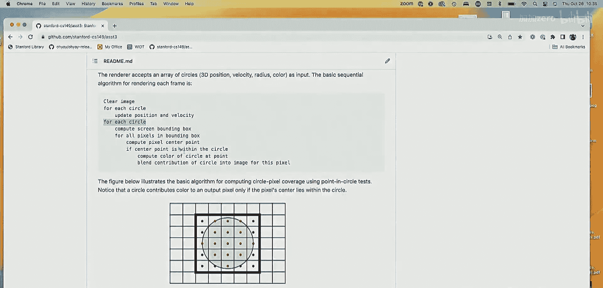

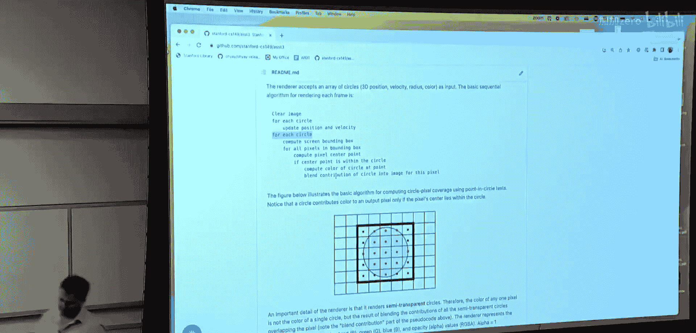

嗯。Are actually somewhat transparent。So it's kind of like a piece of stained glass or something like that。

So a 50% transparent red circle on top of a blue circle looks different。

Thenhan that blue circle on top of the red circle， because of transparency。So the rule。

 the thing that makes this problem， goes from incredibly trivial to incredibly interesting。

Is that I'm gonna give you the circles in in an order。 I'm just gonna give them to you an array。

 And I want you to assume that they're ordered in like sort of back to front order。

 So in other words， you have to add in the first circle before you add in the next circle and so on and so on。

 So that's the， the ordering constraint that actually makes this a tough little problem。 And just。

 to give you a sense of that is here's an example of blue over green over red。😊。

So if you kind of look carefully， you know， like like the blue is the the first piece of， like。

 of a filter， here is if I combine them together in some other order。

And you just get a different result。 So we're gonna call that wrong。Okay。

 so the name of the game is if you just look at this nested sequence of loops， sequentially。

 this is a valid algorithm。For each circle in the orderer they are in the array。

The thing that you would probably do and the code that we give you to start paralyzes this loop。

For every circle in parallel on a different thread， just carry this out。

 And that will compute the wrong answer。Okay， so step 1 is to confirm to yourself that that computes the wrong answer and then make a change。

Right， and when we talked in the data parallel thinking class。

 we talked through some various possibilities。 This is very similar to for every particle。

 What bin is it in。And the key thing to keep in mind is that。

Even though you're supposed to process all these circles in the order that they appear。

The only way that you can get the wrong answer is if you process in the wrong order。And。

They overlap because if they don't overlap， it doesn't matter what order you process it。

So that's all I'm gonna do to set up the problem right now。 But step 1 should almost certainly be。

Change the code to get a correct answer。And that correct answer will be parallel， but very slow。

And then you're gonna chip away at correct， parallel and fast。

So that's the sort of the sequence of the assignment。Okay， or in other words。

 if you knew for every pixel。What circles possibly overlapped it。You'd basically be done。Like。

 if you had this magical data structure of for every pixel on screen。

 here's a list of circles that might overlap it。 You would basically be done because， you know。

 you can process every pixel in parallel and do that safely。😊，那张老师养那三个。It's a fun 1。

 I think most people really， really like this。😊，That was either a sarcastic laugh or a laugh in agreement。

Okay， so since Kley is away on some business travel today。

 the reason why efficiently evaluating DNNs is at this point in the lecture schedule。

 we're not continuing on with with some other stuff is is largely just for scheduling。

 So this is a lecture that will be very useful to you in assignment4。

 So it's coming a little bit earlier than it needs to be。😊。

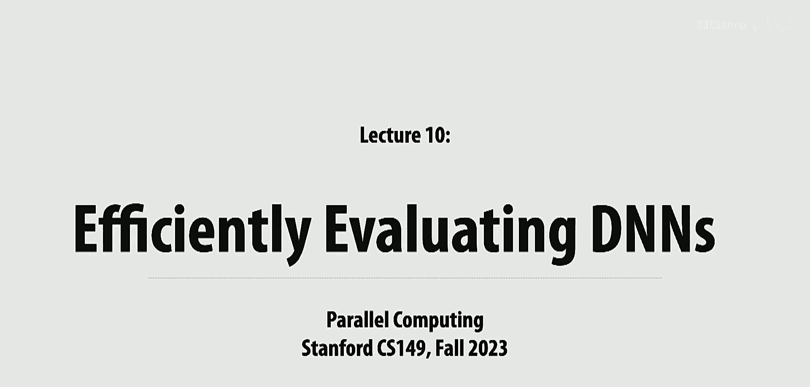

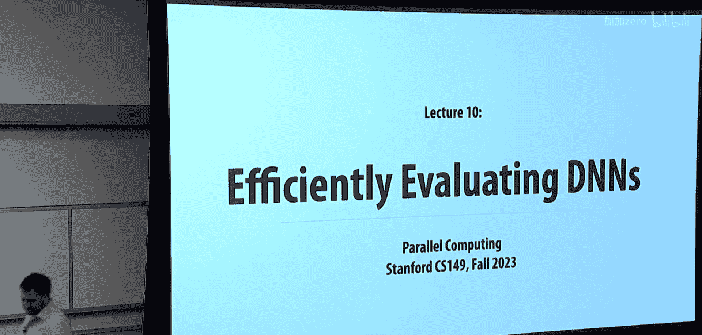

But in general， I thought that it might be， be fairly interesting to folks。

 given that everybody is messing with various forms of deep neural networks today。

 I'm gonna talk a little bit about how we efficiently optimize these things in the context of running deep neural networks on modern GP and CPU。

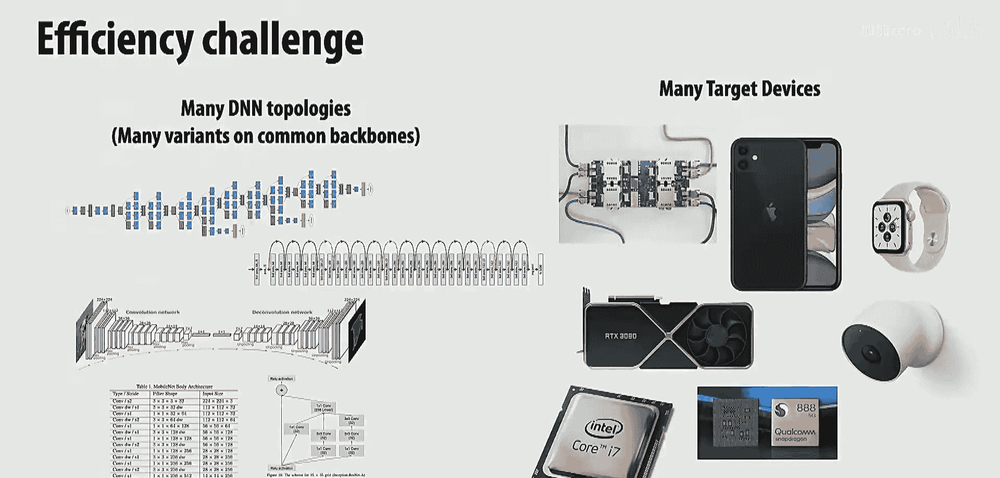

I will hint at the very end of the day。About all of the interesting。

 specialized hardware for DNA acceleration that is starting to emerge。

 But I'm gonna save that to the lecture on specialized hardware。

 which I think is right before Thanksgiving。 if I remember。

 So today is gonna be about mapping DNA NNs to GPS and and CPU。😊。

Quick this survey of what folks know how many people have taken a class where you have had to execute or implement or use modern deep networks。

That number keeps going up every year。 So we're getting closer and closer to。

 to almost everybody in the class。 How many people。

 there's actually another class this quarter by a new faculty member here。

 She's teaching this great class called 2，29 S， right。

 Do we have any people in that class because there might be some overlap here。

 And so either this is going to be review or this is going be very helpful。 we'll see actually。😊。

And so， you know， I probably need to coordinate a little bit more next year。

 but I didn't know she was teaching that class。 so anyways。

So I want to just start with for those the small fraction of you that have not seen any deep neural networks。

 I'm gonna get into the workload a little bit because I need to make sure everybody's familiar with the workload。

 And I want to do that for two reasons。 one is I think I'd like to give everybody a base like a basis of how to how to think about things and and really。

 we can think about things in assistance class without much math at all。

 and that's gonna be very helpful。 So here's a question。

 you've seen dependency graphs before in this class。

 Like we saw this we talked about superscalealar execution or to be honest。

 if I gave you this task graph， you would know how to execute it right now。

 So what is what is this code do。😊。

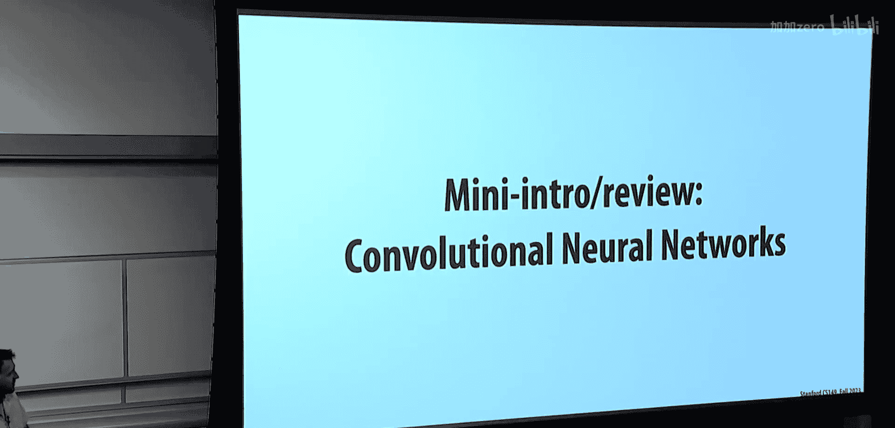

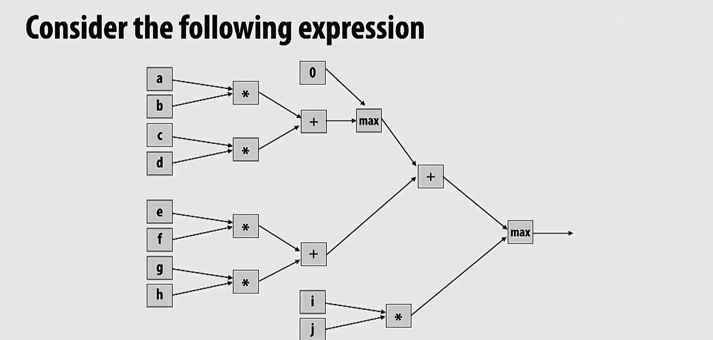

I mean， it's just an expression。 But let's look at it a little bit more carefully。

 Like it maps to basically what I've done here， right， Like， I'm basically computing。😊，The。

 the product of some values， and I'm summing them。if you look carefully。

 that's actually just a dot product。

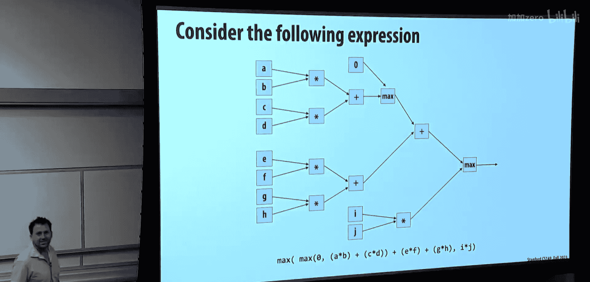

Fol by a max on the value of that dot product。And if you took like an early deep neural networks class。

 you would see a diagram that looks a little bit like this。

 They would call this like a neuron and a modern deep neural network。 And at the end of the day。

 it's just a circuit that performs an operation like what I put on the previous。

 the previous slide where inside this neuron， there's a set of weights。😊。

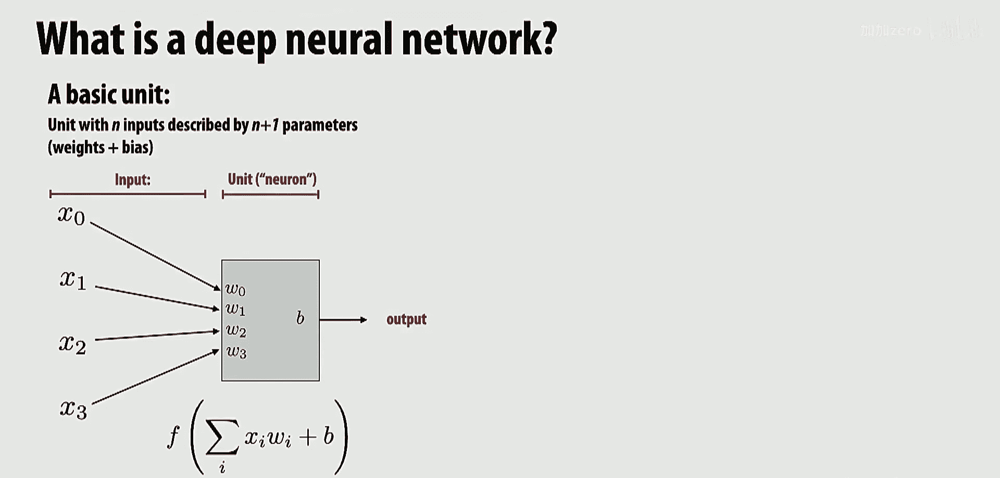

Which is just a vector。 We don't need to think about the meaning of those weights at all at the moment。

 And there's some input， you know， input vector here， which is， you know， in this case。

 a four vector。 And the output of this neuron， this neuron， you should just think of as a function。

 which performs a dot product between two vectors。 You know。

 optionally actually has a bias or an addition of another vector and then takes that through some nonlinear function。

 And that doesn't really matter at all either。 And the function that I'm gonna use in this class is called a max。

😊，You know， if you took a deep learning class and wanted to feel better about yourself。

 you'd call it something like a rectified linear unit， but it's a max in this case。好。

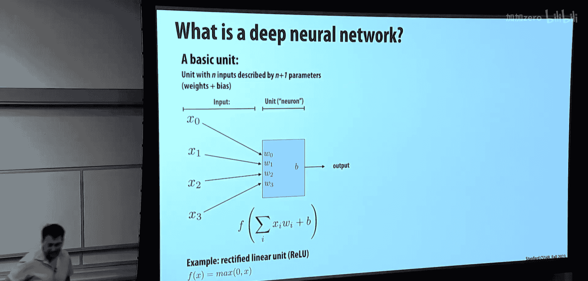

So from the sake of this， this conversation， we can think about what we're interested today is taking。

 you know， sort of this。😊。

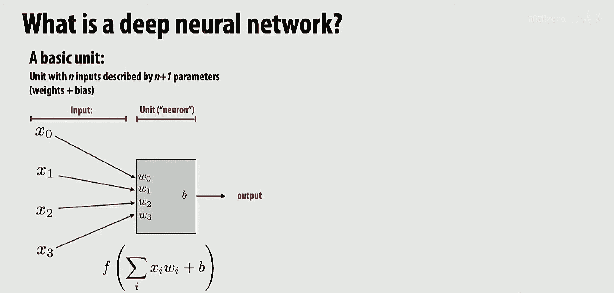

This overall computation， which is this nonlinearar function F on essentially a big matrix algebra operation in this case。

 a dot product。 And and repeating that over and over and over。 So， you know。

 you can think actually about this neuron as actually being。

 you can think about every one of these little neurons as being a little binary classifier。

 If you want to take a machine learning interpretation of that。 like if it's above0， It's saying。

 yep， if it it's below zero， saying no， And now let's just start wiring them up because we're computer scientist。

 I have a little function， and I can wire a simple function up into larger functions。😊。

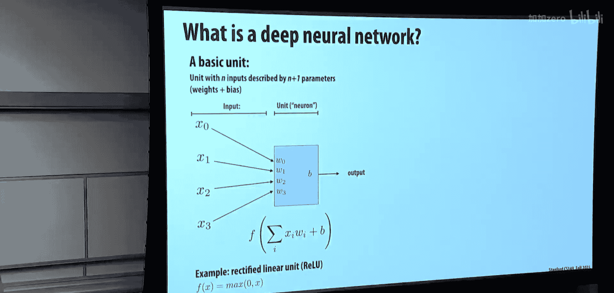

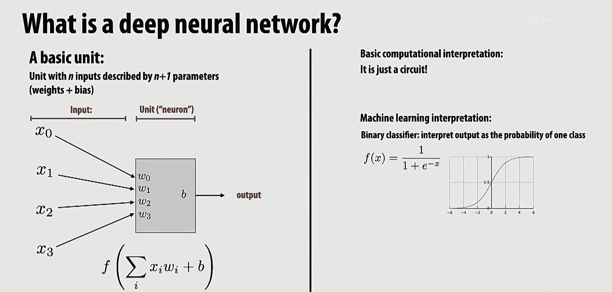

And。You know， often these these networks are arranged in a fairly regular way。

 and that I'll have some number of these at every layer。

 and the layers are defined by saying like the output of all of this layer turns into the inputs of the next layer。

 And if you look carefully in my diagrams on the left， you see an example of a fully connected layer。

 meaning that every single output from layer I is an input to layer I plus1 on the diagram on the right。

 you'll see something that's not a fully connected layer。 It's actually a convolutional layer in 1 D。

 where every， you know， there's like the sliding window of every three inputs in this case go to the next neuron。

😊。

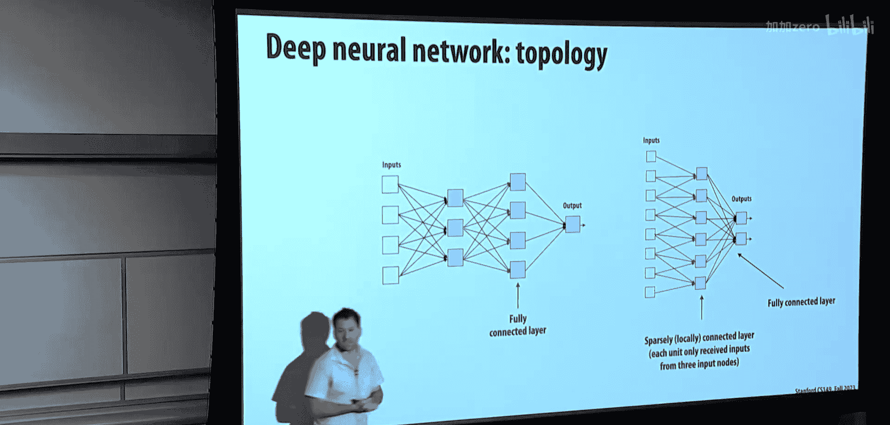

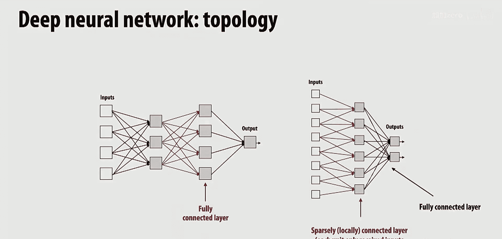

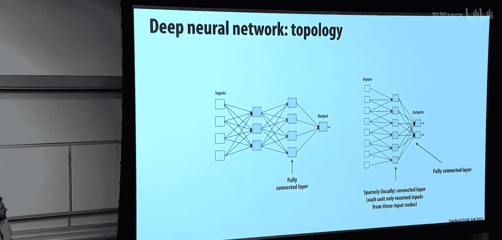

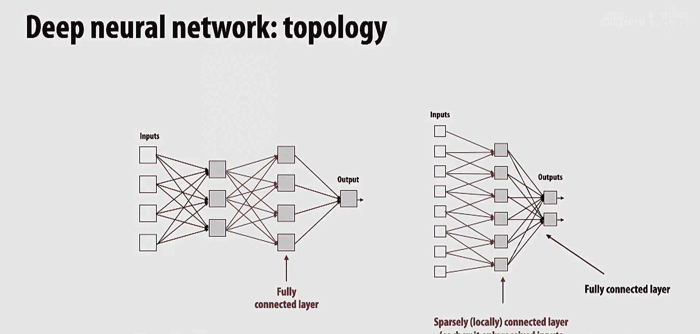

在。So let's write this a little bit differently。 Let's write this instead of these visual diagrams。

 Let's write this as some more in a linear algebra notation。And just keep in mind that see， see here。

 I have four neurons。So I have four sets of， or I guess， in this case， I have three。Yeah。

 I have four neurons。 And so I have these different sets of three weights。 So in this case。

 my neuron has actually got three weights in it。 Ex me。 My original diagram had four。

 but this is a neuron with three weights in it。 So for every one of these four gray boxes。

 there are three weights。 The input noticeice that there are three input values。

 That's the righthand side vector X。 And then the execution of computing the output is just a matrix vector product here。

😊。

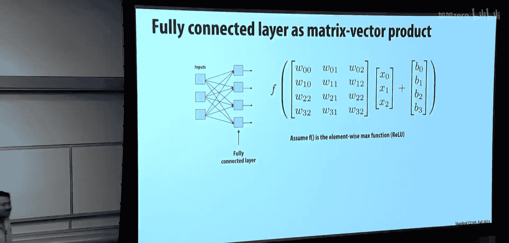

And of course， that goes through that non linearity F。So all of these， like， you know。

 some fancy diagrams start boiling down to dense matrix algebra pretty quickly。

 If you want to think about it like that。 Another way you can think about the exact same thing。😊。

Is more like this。So this is， is a convolution。So if you look carefully at this C code。

 there's an input image， which is width by height。 It's actually width by height with plus 2 just for some boundary conditions。

 The output is a width by height image。 I have these weights。 And for every pixel of the output。

 I do something that involves surrounding pixels of the input。 And if you take a look at this code。

 And I asked you， what does it do， You know， some of you might say， oh， it performs 2D convolution。

 And then I turn right back around， you go， what the heck does that mean， And so if this was。

 let's say an input image。😊。

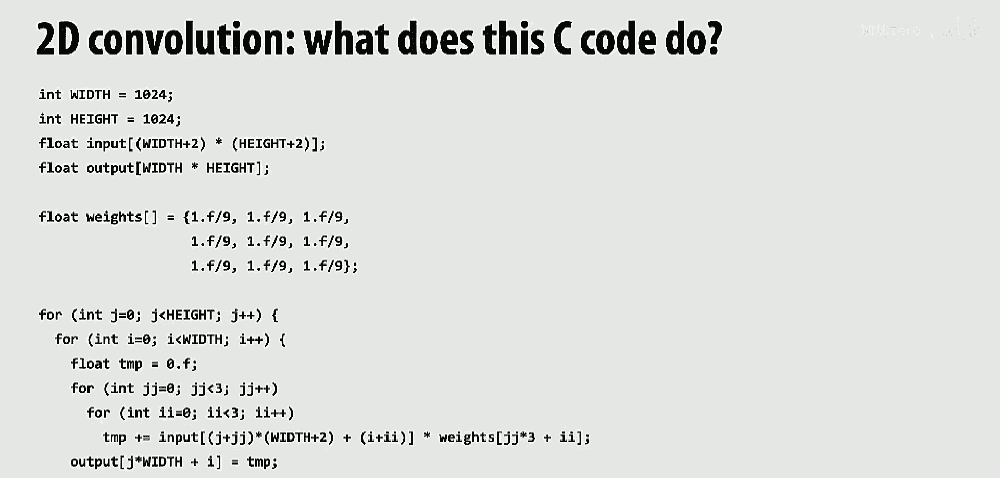

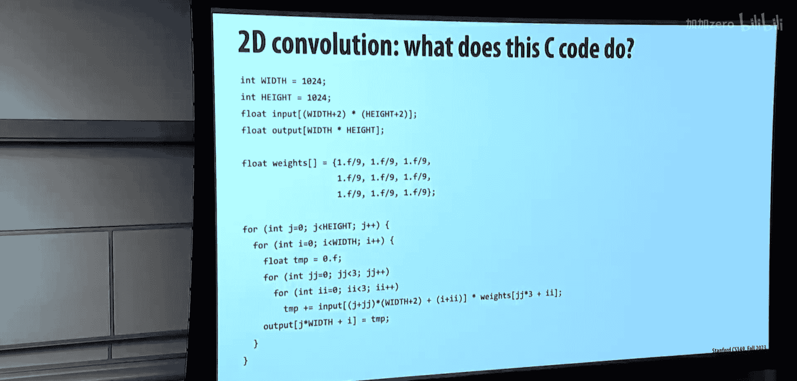

What does the output image look like。喂。It's blurry， right。

 because every output pixel is essentially the average of the surrounding pixels。

 So imagine a situation where I had a white input pixel and really dark colored surrounding pixels。

 The convolution is going to bring that white pixel down to the average。😊。

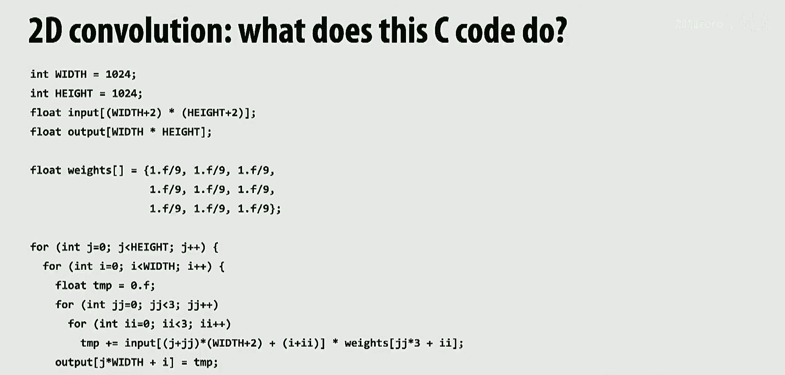

And around that pixel， it's gonna bring those black pixels up to the average。 right。

 So if I run this code， you know， on an image that looks like this。

 you'll get an image that looks like that。 That's one example of a， of a convolution， okay。😊，Right。

 so， so that was our， our 3D image convolution。 And I just want you to， to， in your mind。

 kind of think through this image。 If we think about every one of these outputs， pixels as a neuron。

😊。

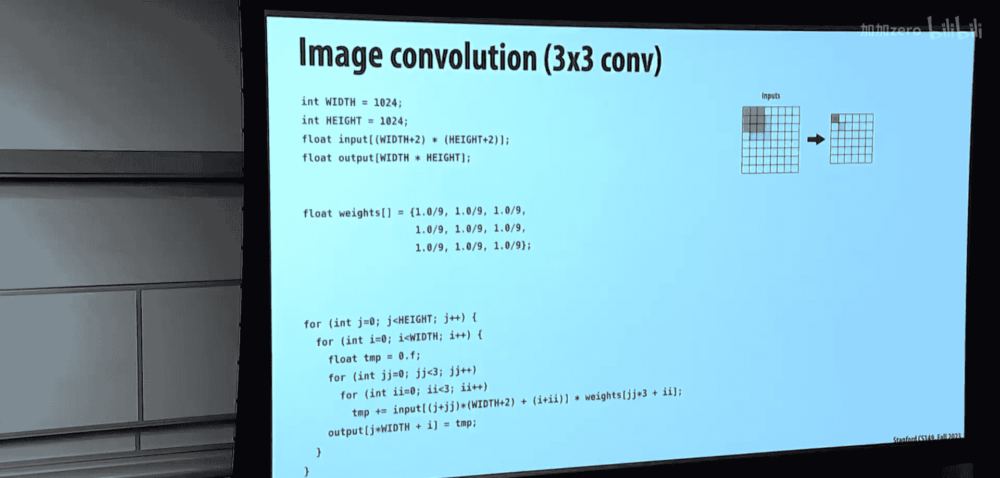

Its output is a weighted combination of 9 inputs here， right。

And those9 inputs in this case are weighted by these fixed weights，1，9th，1，9th，1，9th。

 And that's why I drew this diagram that looks like this。 Now。

 just keep in mind that when I drew it like this， I'm showing you three inputs into everyone in 2D。

 it would be 9 inputs into everyone right， So if this is actually an image that would be 9 inputs。

 And so I didn't， you know， I didn't draw 2D version of a convolution in my little。😊，Dags。

 I drill1 okay？

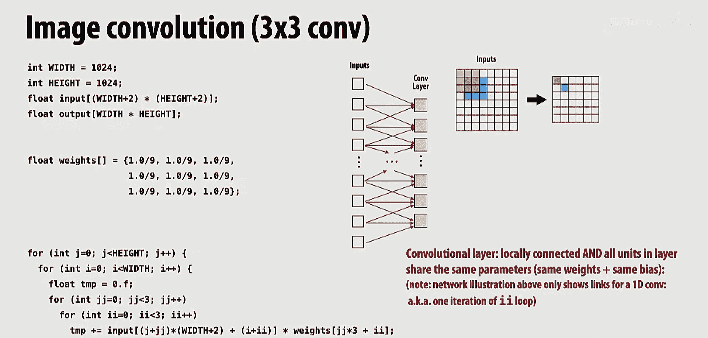

And if you took like a computer graphics or computer vision class， you would learn that there。

 you know， if I change these weights， I actually get very different outputs。 And so， you know。

 averaging made a lot of sense。 But imagine I changed some of these weights and make some of them negative。

😊，Now， of a sudden， what is this computation doing， instead of averaging every pixel。

 It's saying I want some positive scaling times these pixels over here。

 minus the value of these pixels over here。 And now of a sudden。

 that's a finite difference computation。 That's a gradient computation。

 So with these different weights。 All of a sudden， my convolution is not blurring the image。 It's。

 in fact， doing things like， it's detecting horizontal gradients。 or。

 it's detecting vertical gradients。😊，Okay，And so all of these， at least。

 at least in image processing in the front half of the talk， I'm gonna focus on these convoyers。

 which are common in image processing。 in the back half of the talk。

 I'm gonna bring up and transformers。 But， you know， like， like all these， these commonnets are。

 are there are a bunch of these convolutions， largely， except the weights。Are not given by me。

 They are learned。So here's an example of like the classic image net weights from a long time ago is here are the。

 the the weights of a whole bunch of different filters visualized。So this is like， like。

 this is an 11 by 11 convolution now。 Okay， And so this is a convolution that takes 1 hundred and 21 elements of the input for every output。

 And there's 96 different versions of these convolutions。

 And so if I take these filters by this input image， you get these different。😊，Outputs。

 you can just say that different filters are sort of lighting up on different parts of the image。

 They are sort of like detecting different features。

And so I want you to think about this calculation as taking， you know， this code here。

And then repeating it for a whole bunch of different filters with different weights。

 That's the the essence of what we're gonna to do here on something like this。

And a common way to visualize this stuff is think about these n dimensional tensors。

 So imagine you had an input image that's with by hyp。 So it's width by height by one。

And then imagine I have all of these different filters。That are just like， you know， like。

 I just showed you 3 by three matrix of values and stuff like that。

 So that I have these 3 by three filters。 And if I'm gonna do numb filters of them， I'm gonna。

 I'm just just for convenience。 I'm gonna stack them together in a tensor。

 So it's 3 by 3 by number of these filters。And so if I do numb filters convolutions of this。

 I should get with by height by nu filterss amount of output。

And then we're just gonna repeat this process over and over and over， producing a bunch of filters。

Taking it through that function F， which is， you know， setting everything to， to clamping at 0。

 and then maybe actually doing some， you know， a few other calculations。 like in this case。

 a max pool is largely just a down sample and so on and so on。

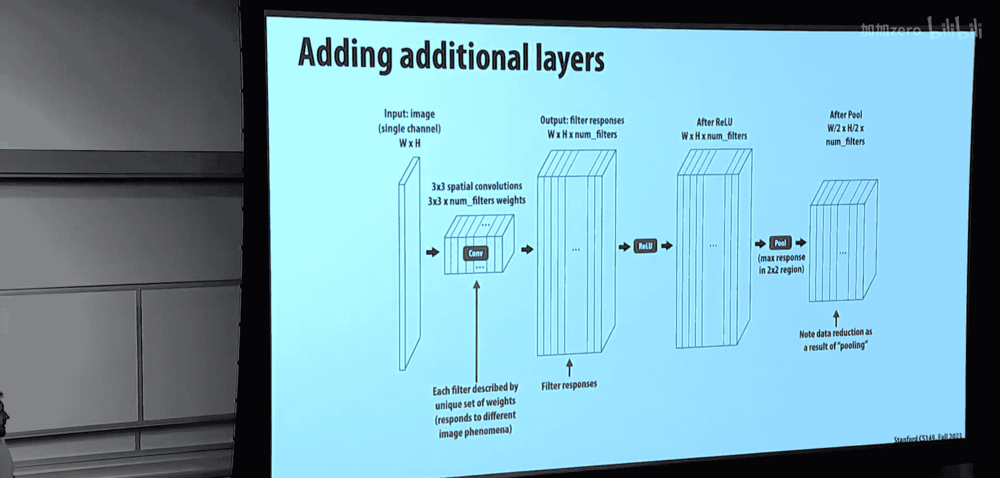

And when you see all these fancy diagrams like this， this is， you know。

 all this is is just each one of these blocks is， is largely。

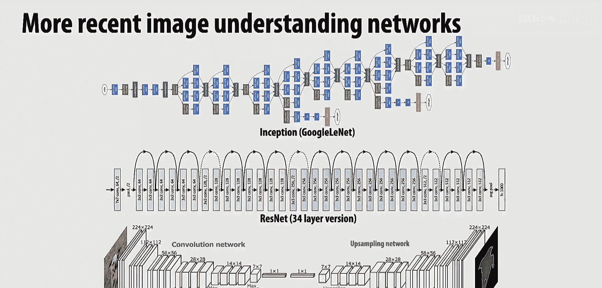

This sequence of a bunch of convolutions， at least that's the computational meat of it。

 wired up in very different different ways。 right， So here I have resnet。

 here I have a common unit architecture where everything decimates。 and then it comes back。

 That's inception from Google。 Okay， so。At this point。

All I really want you to know is that it's important to be able to perform a bunch of convolutions。

On a bunch of， on an input image。 And that produces a bunch of output images。

And then we're gonna perform convolutions on those。

And that's the workload that I want you to know about。Okay。

This is a point where I'd be happy to take a question or two。

 because a lot of you probably know a lot of machine learning and you may， you know。

 maybe have something。 you may take issue with any of my simplifications or， or something like that。

😊，Okay， is it okay to keep going？All right。So first of all。

 now let's think about how we are going make this stuff faster。

And this is a good point in this course， where。I'd like to sort of talk through what are our avenues。

 and there's three avenues of making this faster。One way。

Is we take machine learning classes and we think about these architectures。

 and we design better ones。For example， there's a lot fewer flops in resnet and inception than in some of the original conmvoers that sort of made it big the the Comnets that made it big early in this modern deep learning wave。

 So significant algorithmic topology design improvements， reduce the amount of memory needed。

 amount of flops needed and so on and so on。😊，Okay， so so that's， that's sort of。

 that's one way we can go。 And that has nothing to do with the skills that I teach you in this class。

 That would be， you know， you go take a machine learning class and you say， you know what， the way。

 you know， the way SGD performs。 I feel like there's some value in。

 in transferring information around a couple of layers with skip connections。

 which is one of the big innovations of Resnet。 or I actually want。

 I don't really want a lot of convolutions， I only need a couple， but I have to wire them up in。

 in this particular way。😊。

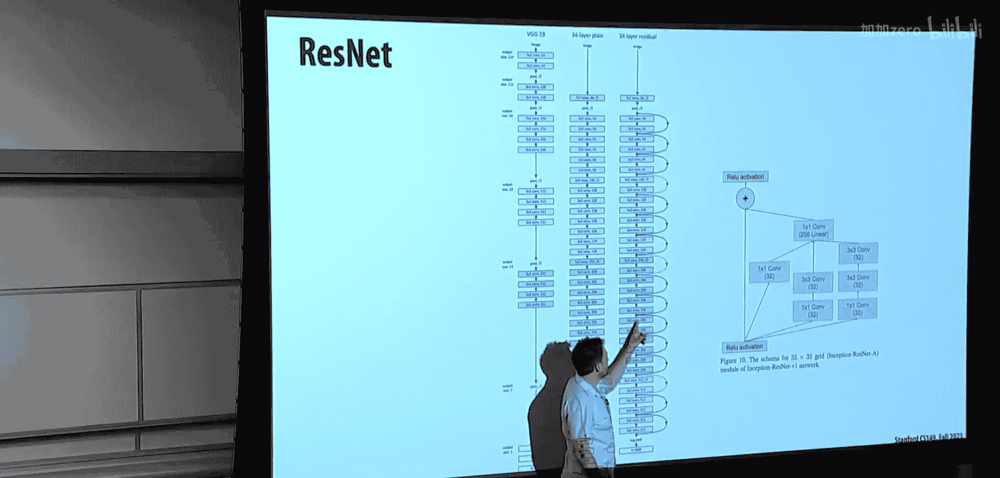

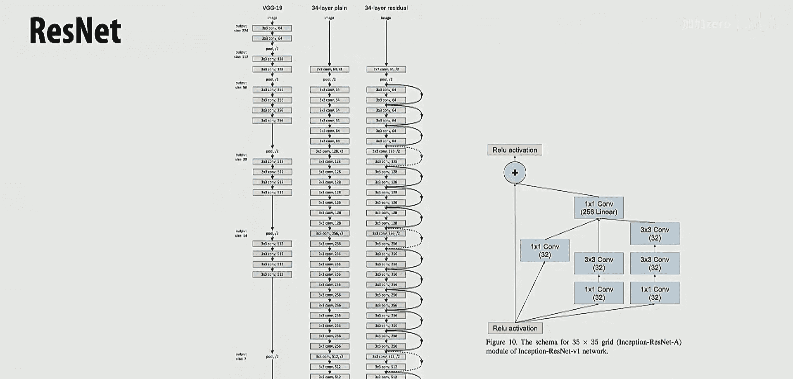

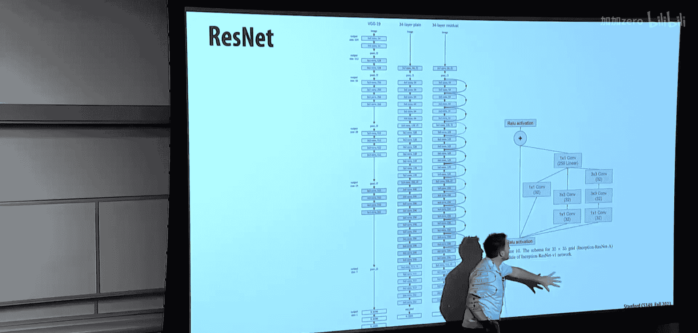

so I'm showing you an example of from。Yeah， that's from the。

 the the inception resnet block theyre kind of like， if you think about it， you say， well。

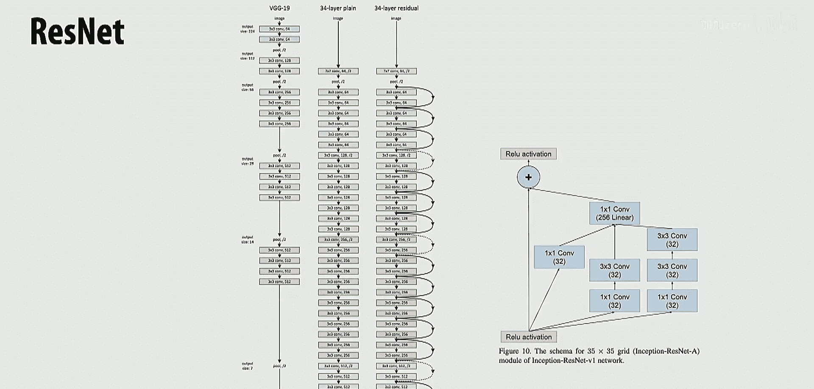

What do I need here， I kind of feel like I want a couple of paths of three by three convolutions to do this amount。

 you know， features of this spatial extent。 I need a few cascades of them。

 Maybe I might have one path that has features of a wider extent。

 If you're a designer of these networks， you think about those sorts of things。

And if you're a designer of those networks at Google and they say。

 make these things fit on a mobile phone， you hang around for two years trying various combinations of this stuff and come up with an architecture that looks a little。

 This is a mobile net。

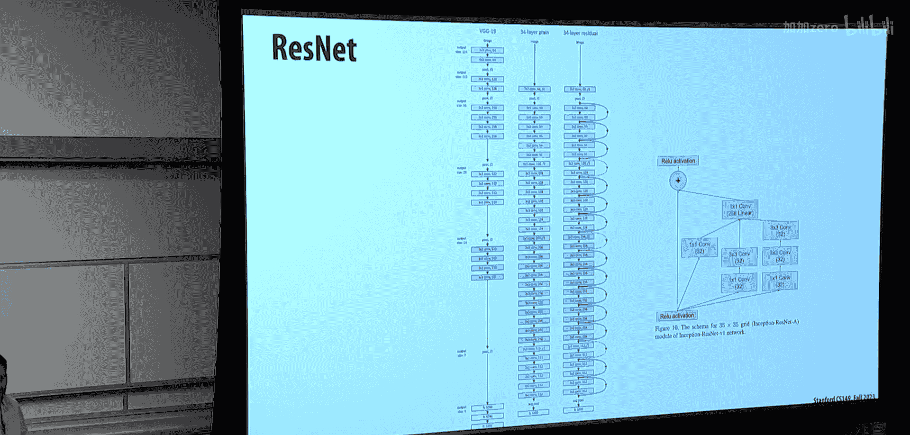

And this is， you know， getting we're getting， you know， we're back in 2017 and stuff。

 So This is starting to get kind of old now。 But the point was that there there was a small team。

 a person at Google that tried different combinations of I need this many filters。

 And I need this many layers and so on and so on。 And they came up with this design。

 If you look at it， here's the size of the filters，3 by3 versus one by one。

 here's the number of those filters， And if every single time you do a sort of a down sample。

 this is the output tensor sizes of all of those layers。 And first of all， actually。

 if you take a look at this。 is there anything alarming。😊，Given what you know in this class。系啊不仲话嘞。

Work I thought you meant like figuring this out with a lot of work。 And I'm like， yeah， I was。

 And they tried to automate this guy later。 but that's a different story。Well， I mean。

 the couple of things that I see is， first of all， if you look at every one of these layers and you look at the output size And at first。

 you might look at， well， it's just a 28 by 28 image that's pretty tiny should be nothing。

 And then if you think about instead of red， green and blue at every point。

 you think about there actually being 256 channels or 500 and 12 channels。 you like。

 there's quite a bit of output between each of these layers。

 Like that's not fitting on cash in cache anymore。 The other thing that should be like a little surprising to use。

 which like crap 7 by 7。😊，How the heck are you gonna symdiize this thing， right。

 Theses some weird numbers here to actually make fit in a， in a modern s processor。

 So very well could have been the case that like， you know。

 mine as well made that 8 by 8cause you would have gotten a bunch of stuff for free， But anyways。😊。

OkaySo the point of this is， first of all， a lot of systems classes take the architecture that is the best architecture of the day as a given。

And say， let's try and optimize that。And I just want you to keep in mind that on the algorithm side of the fence。

 there's constantly massive innovation and iteration。 So here are some examples。 This is。

 this is again， from like image classification， kind of the task that kind of got a lot of this started。

 at least And these are different networks that people designed in the research。 And you know。

 like you can think about and， so basically， they're getting more accurate over time。 right。

 So the Y axis here is accurate how， how well they classify objects in an image or what's in an image。

 this graph down here is accuracy， like 90%，91% per flop。😊。

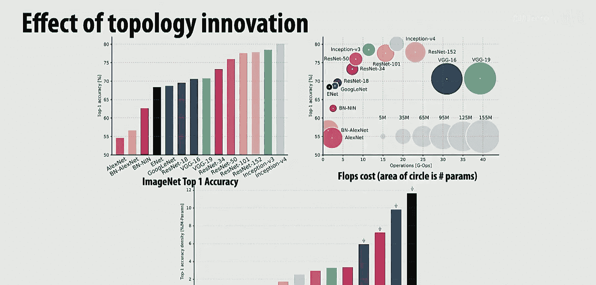

Per， like， expense。And， and this is where we were in the early days。

And these networks over here may not perform all that much better。 Some of them perform better。

 but like this VG G19 is already all the way over here。

These better topologies are actually efficiency。Right。

 and that plot over there is actually just like a 2D diagram of accuracy per unit cost。

 So you w to be on the top left of that diagram。对。And so if I look at just a couple of these things。

 I pull them out and I pull them out from like basically a change every year。

The accuracy was largely at this time， was kind of about all the same。

 But if you look in both like the number of weights。

 So the number of filters more or less the size of those filters， there's a dramatic drop。

In the amount of， of memory that's needed to store this model。

 And there's almost a commensurate drop in the amount of computation math needed to perform it。

So that's about 25 x from algorithms in a span of about four years。

 Hardware is not going get 25 times faster。

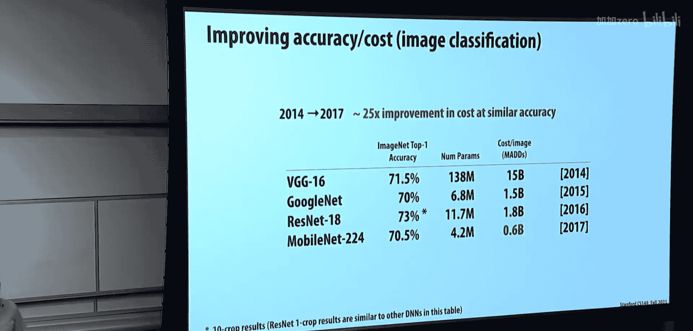

In those four years。Okay， so if you had designed an algorithm for this network。

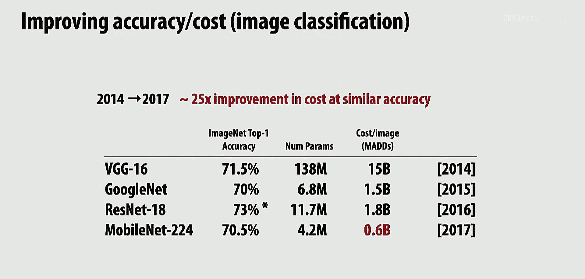

You know， you have been， you know， you might have been pretty far off。

 What is the right algorithm for this network。So I。

 I just want to start by making sure everybody understands that that's out there。

 And so if you were a good machine learning systems engineer， you have to be tracking。

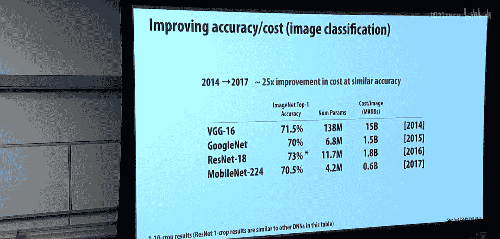

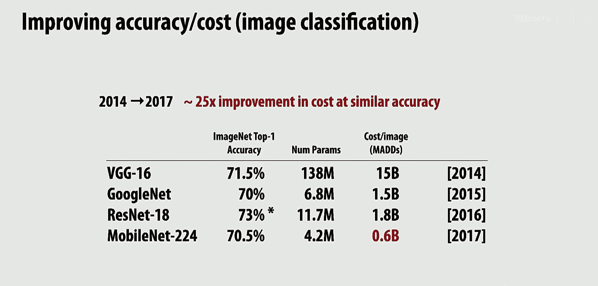

You know， the state of the art and these things。 And with these big。

 large language models and transformers， there's this huge push to build bigger and bigger because of the scaling loss。

 And there's definitely a reason for that。 But at some level of quality。

 there's all these chip companies out there that we're building these big chips because they're like。

 well， today's LL M is huge。 And what's been going on in the last six months or the last 12 months is with Lama and all these other things。

 It's about once you get something that works to your satisfaction。

 the engineers can come in or the M engineers can come in and they can shrink the hell out of these things。

Right， so it makes a complicated design problem of what should you be designing your systems for。

Okay， now approach 2 is highly relevant to us in this class is at some point。

 you say this is the architecture。 This is the topology that we're going with。And。

 and we need to make it execute well on the machine that I have。 And in this class。

 the machine that you have would be a multi core CPU or a GP。

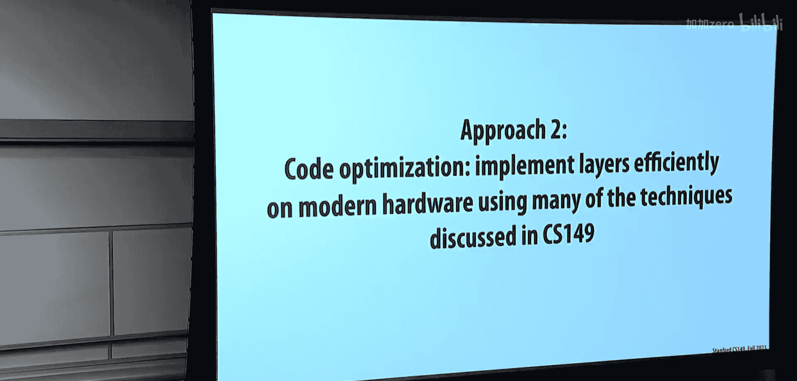

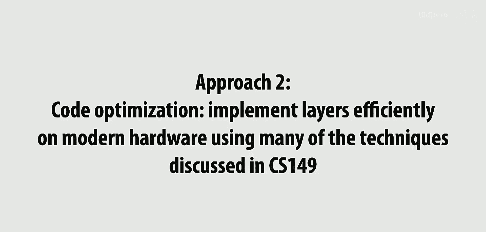

And I don't mean in this class， me 1，49 in today's lecture。 I mean， a multi course CPU。 So here's a。

 me taking my 3 by three convolution slide and just changing the C code a little bit to talk a little bit more about what's going on。

 So， first of all， you know， it used to be four loops。 now。 Now it's， it's， it's 7。 So it's。

 for let's look at the I and J first for every output pixel。😊。

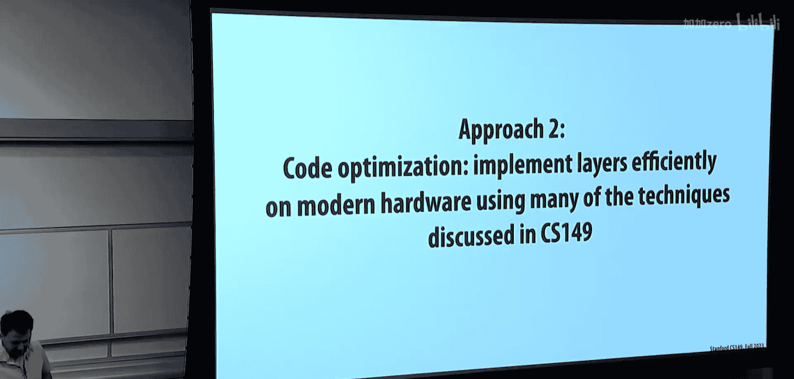

For every filter。For every filter， we need to iterate over the input pixels I and J。And also， okay。

 so one thing I haven't said that it's input filter We're iterating over all input pixels， I and J。

 but that input image， the input has multiple channels of depth， right。

 So you're actually iterating over all pixels and all RGB or all 512 channels and so on and so on。

 So this is the convolution。 It's a 3D convolution， largely。😊。

Or it's a 2D convolution on a 3D input for every filter， for every output pixel。

 And then the outermost loop is， is the loop over batches of images。

 So often we'll actually do multiple things through the network at once。 That's your batch size。

 Okay， so 7 loops here，1，2，3，4，5，6，7。😊，And this wouldn't be hard， to implement at all。

 Like you could just go code this thing up， code it up and see。

 It probably wouldn't perform that well， but it would be a correct implementation。

So now comes into the， the association between。Convolutions。And vector algebra。

So let me show you a quick hack。 So you can go to Numpie。 You can go to your favorite library。

 and you can。😊，Call matrix， matrix multiplication。And you assume that whether it be matlab or torch or anumy。

 if you call matrix matrix multiplication， someone has taken the time to implement it well。Right。

So there's kind of this reduction if you can boil something down to matrix operations。

 maybe you're in reasonable shape。

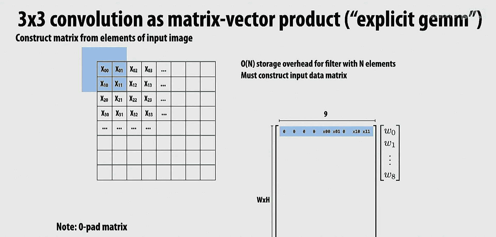

So it turns out that it's really easy to think about a convolution as a matrix multiply。

And let me tell you how to do that。 And this is actually how some of the earliest column layer implementations were implemented back in the age of system of。

 of precuian end systems and stuff like that。 So imagine that I have my， my input image here。😊。

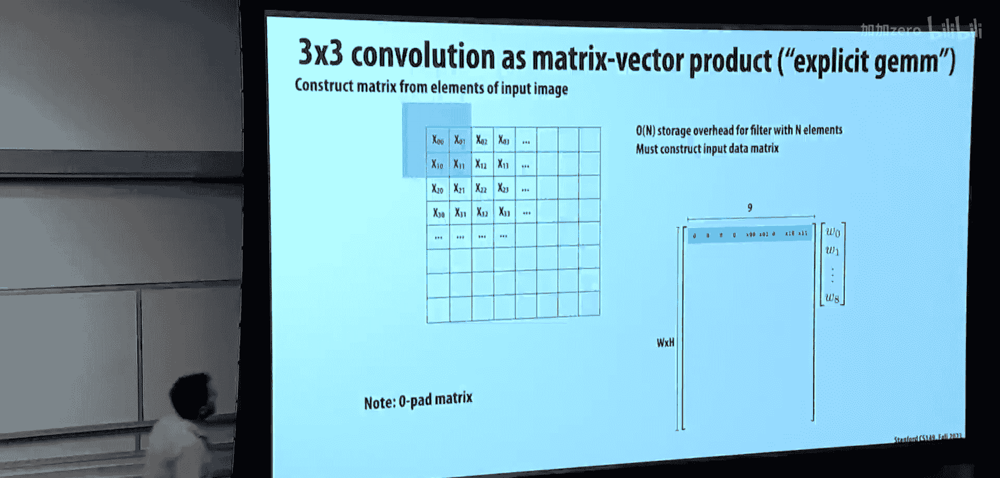

This is my input image， X and Y at every every X and Y。And imagine I have my convolution。

 let's say it's a  three by three convolution。 So there should be 9 weights。Makes sense。

And then what I'm going to do is I'm gonna to say， well。

 every output pixel is just the dot product of these weights。And some subset of the input pixels。

So I'm going copy the appropriate input pixels into a matrix here。That is width by height rose。

And9 elements across。Okay， so this is nine times bigger than the original image。其时咧。

So I'm just gonna copy data in so that the output pixel， the output row。

Or the dot product of this row and this row is the first pixel of the convolution。

And so what I'm showing you here on the slide is， is what values， how I would copy values in。

And then let's go ahead and think about the next row and copy these values。

 And it might be the most clear if I get way down here where there's no boundary conditions。

 And so if I'm gonna produce pixel at 1，1 coordinate of output， you know， output pixel。

 I'm gonna need those 9 pixels from the input。 So I just copy them in right here。😊。

And the output of the convolution is just going be。The dot product there。

So I hope you can see at this point that with the appropriate padding and data duplication。

 I can implement convolution as a matrix vector product。😊，Right。Okay， so check your understanding。

 Now， imagine I want to do a convolution with not just one filter。

 but I want to do a convolution with many filters。How does my setup change。So this vector。

 these different this column vector， which is the weights of one convolution。

 I would just stack more and more columns there and it becomes a matrix。

 So if I wanted to do multiple convolutions against the input image at once。

 I just copy the image into this lefthand side matrix。

 my weights are just sitting there as a number of filters columns。

 and now I have matrix matrix product。So if you give me a matrix matrix multiplication library。

 I know how to populate this matrix。In order to， to produce the output。 Okay。

 one more check your understanding。 imagine that the input tensor。Is not just a single channel image。

 So here at every X， Y， there's only one value。Imagine that it has multiple values。 It's。

 It's a multidimensional tensor。Let's say it has 512 values here。How do I change。My computation。

Becauseuse now， remember， every every convolution is gonna be 3 by 3 by 5，12。

How does this setup change？Okay， so this is going to be multiplied by 512。

And I need weights for 3 by 3 by 5，12 to go down here。 So I'm gonna get much， much bigger matrices。

 It'll look a little bit like this。If there were three channels instead of 512， this is RGB。

 let's say it would look like this。Okay。So now we have， you know。

 like if you give me the fastest matrix multiplication on the planet。You give me。

 I can produce inputs for you， or I use that。Fastest matrix multiplication on the planet to execute one of these co layers。

 And so here's a slide or some a figure that I stole from from NviDdia where they talk about this transformation。

 So on the left hand side are the values in your tensors Like what you'd think of if you're using torch right。

 So I have an input types are X， which is with by height with C channels and that size N。 Well。

 that means I need a weight matrix of C channels R and S is the 3 by3， the size of the the thing。

 And then I have K filters， right。😊，Exactly， so this is like common parameters for your co Blair。

 And just notice that this converts using what I told you on the last slide to matrices A， B。

 and C that have dimensions that are the products of some of those those parameters。😊。

So this is what you do， you know， like if you， if I gave you a fast。Matrix multiplication library。

And so that matrix product， you know， A times B equals C。C contains the result of convolving with N。

 Oh， sorry， with K filters。An input that is with by height by C to produce an output that is P by Q by n。

Pausing for questions。Okay， and， and as you can imagine， you know， pick your favorite computer。

 Intel Nvidia GPUs， increasingly AMD GPus。 and you can go download a library that does fast matrix multiplication。

😊，And you're not going to write it any faster than them because they have they're crazy hackers working on this at all times。

Okay， so， so that's one way to， to do this。 But maybe we should talk very briefly about how the heck do would you even begin to implement this matrix multiplication if you wanted to be one of those crazy hackers that that worked all the time on these libraries。

 right， So here's。Matrix multiplication。 It's actually much simpler， right。

 I showed you a7 loop loop nest。 Ma multiplication is just a simple three loop nest。

 And some things to think about are like。In this case， I have an M by K matrix by a K by N matrix。

 Let's just， for simplicity， let's just say all the dimensions are n for now so we can think through this。

 So if all the dimensions are N， how much data do we end up touching。Three times。N squared。

 And how much work do we do。N cubed because there's three loops over N so。

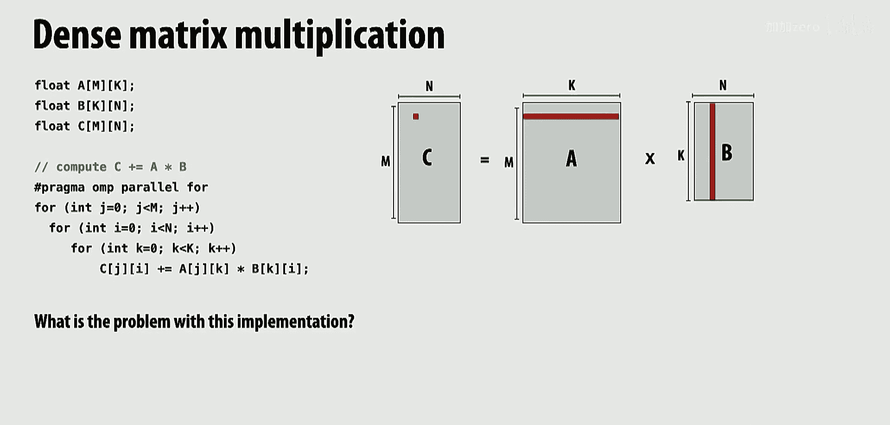

The problem with this implementation， Let's think about it for large n， because， you know。

 we set this thing up。 N can be quite large because N might be 5。

12 times 7 by 7 or something like that。 These might be gigabte size matrices。

 knowing what you know about how computers work， What do you see is the problem。

 If I think about this innermost loop of matrix multiply。

It's reading that row of A and that column of B to output one element of C。对。request。Okay， so， well。

 and the story is a little bit different。 So the question， the statement。

 which I agree with is we're going to get very bad cash locality。 Well。

 let's think about that in more detail。 So we are reading across a。Across that row。

Are we particularly upset about that。Not really， because it's kind of like the most coherent memory access you can make。

B， we're jumping all around memory because B is， if this is row major data。

 every element you touch is going to be far away in the address space and on a unique cache line。

And C is actually as best as it possibly could be， because I'm just reading and writing the same value that's going to sit in cache。

But if you take a step back and think about your bandwidth bound problem on your homework。

 this is actually not much better。Then that bandwidth down problem on the homework， right。

 because we're gonna read an A， We're gonna read a B。 The access to B is pretty terrible。

 And then we're just adding into C。 So you're really only doing one math off， you know。

 a multiplier or two math offs， a multiply ad。 yet you're reading two values。

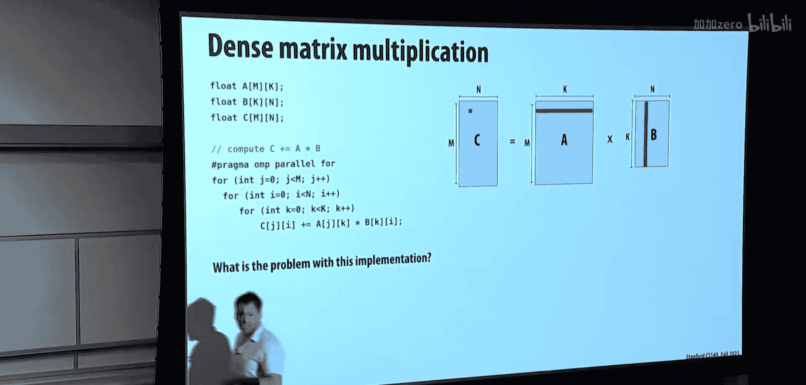

So this is your classic bandwidth bound setup。

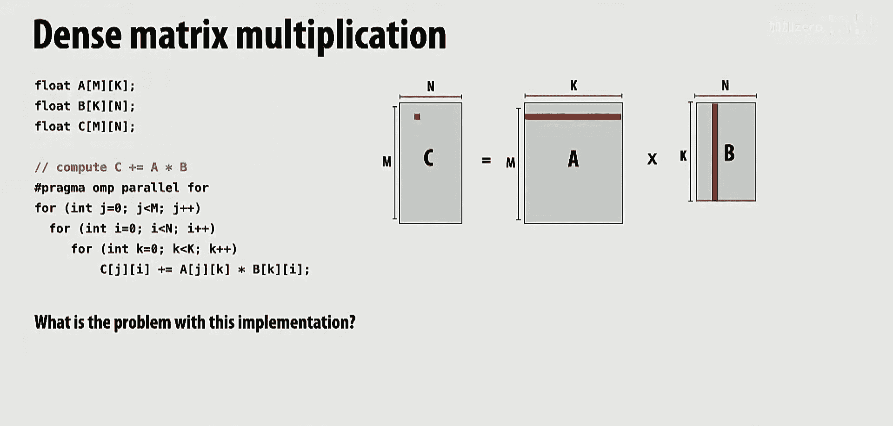

Which is a little bit weird， right， because matrix multiplication， you just told me。Is N cubed work？

For n squared data access， so fundamentally。It should be O of N orrithmetic intensity。

 And you just gave me something that's like O of one。 So you gave me a bandwidth or I wrote。

 you didn't give it to me。 I wrote a bandwidth bound problem。

 Yet if I think about how to do this properly， you would tell me， oh。

 just put matrix A B and C in cash。😊，And then the arithmetic intensity should be all N and and cubed work for every。

 But the reason why I can't put A M B in cache is what。They're big， you know。

 these can be gigabyte size matrices。 right， So this lower arithmetic intensity is。

Doesn't seem fundamental。 but at least the way I wrote the code right now is I'm screwed。 You know。

 like， I'm running problem 5， essentially from assignment 1。How can I do better？じやこれ。

Why the matrixes between blocks so that each single block can fit them into the memory？Okay， so。

 so the idea which was just given is is the first thing is to observe。

That I can express matrix multiplication， not as operations on individual elements of the matrix。

But I can express matrix multiplication hierarchically。😊。

In terms of a bunch of sub matrix multiplications on blocks。RightThat's。

 that's like a real key insight。So I'm gonna rewrite the code。

 And here's how I'm gonna to rewrite the code。

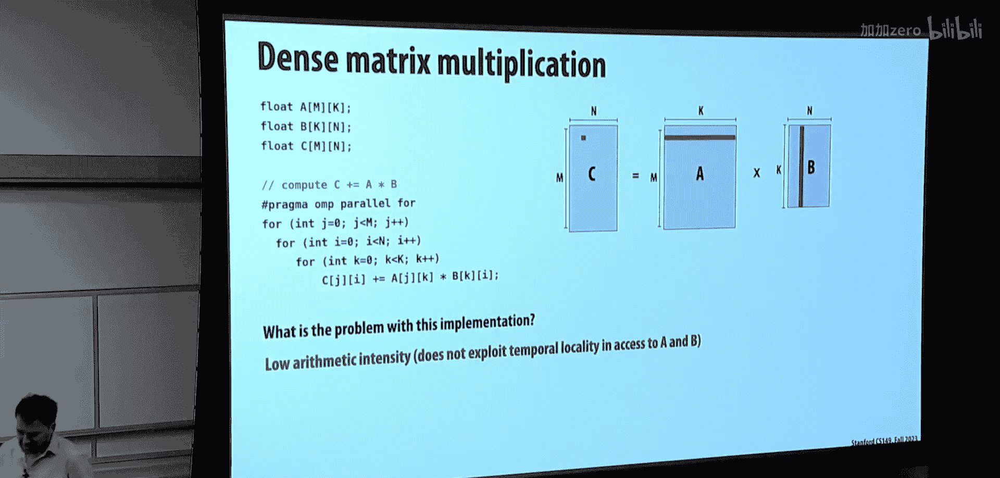

Think about everything from this floor loop down。

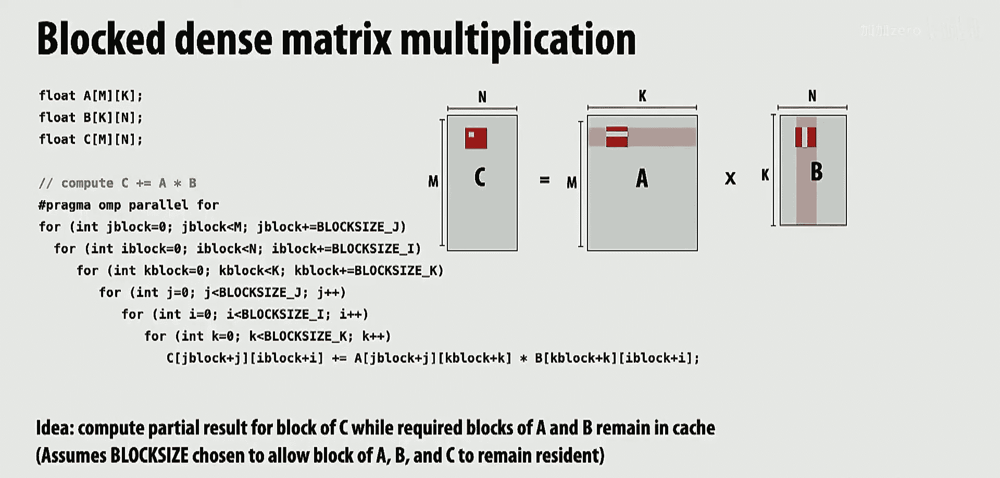

As just a matrix multiplication of two subbs。And so， the outermost loop。

Is matrix multiplication over blocks。 So let's think about it is let's take one block of a。

1 block of B。Let's load them into cash。And let's multiply those matrices together。

And I'm gonna get an output matrix， which is a piece of C。

And then I'm gonna move one block over and A and one block over and B。

And I'm going multiply those matrices。And in the same way that I added in an element to see here。

 I'm gonna add in the resulting sub blocklock result into the block of C that I'm computing。Okay。So。

 what's my。Arithmetic intensity now。For every one of these steps， if I kind of think about， like。

 I should have highlighted this。 if I think about now the computation being a sequence of these steps。

 what is the earth then and intensity of this。Just matrix multiplication on block sizes of B or block size here。

 So the amount of data that I have to load is what。B squared on the order of B squared。

And the amount of work that I do is be cubed。So my arithmetic intensity is this。 It's not not N。

 but it's B。So the greater I make my block sizes as they go to N， You know。

 as the block sizes go to N， I get arithmetic intensity of N。 As the block sizes go down to 1。

 I get arithmetic intensity of one， so。😊，My thinking of how to choose the block size should be。

 I want as big of a block size as possible。And what do I actually mean by possible here on this statement。

Yeah， I， I cannot make my block sizes so large that I start getting capacity misses on my cache。

 right， So you would know your cache size。 You would pick your block size so that you could fit a block of A。

 B and C in cache。 And then you would structure your code this way。

And I think we focused on this example in the， in the Kuda tutorial last night。 But if you don't。

 like， I mean， the code on the previous slide in this slide will take you all of like 15 minutes to write。

Like in C， pop open a C compiler and do it。Make your matrices on the order of many megabytes or a gigabyte。

You'll be on the order of 1000 x different speed。It'll be insane how much faster the difference is。

So if you ever implement matrix multiply like this on big matrices。

 you are running at your bandwidth limit。 And if you block， you'll be going much， much faster。

on are sort by rural arts or。 It's a great question。 Let's answer the question first。

 on let's think about how that would work on a normal CPU。On a normal CPU， a cache。

 just all it does is store lines from the address face。

 So even though let me go back to my figure here， think about all of the catlet。

 let's just say that like， I choose a block size that's like cash line size by cache line size。 Okay。

 just to， to make this description easier。😊。

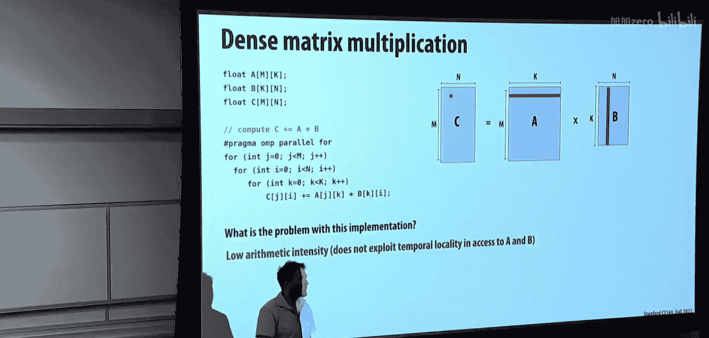

The， the cache lines that I need for that block of a are not contiguous in the address space， right。

 because of the way they're stored。So I'm going to just load those cache lines。

And the cast is going to figure out a place to put them。Right。

 and when the processor issues a load instruction to whatever address that this is。

The cash will map that to the location and the cache where that cash line is stored。So on a CPU。

 the whole point of the cache is you don't manage it as a software programmer。

And you could get in trouble if， for example， Intel's algorithm for mapping addresses to cache lines doesn't allow like like if there are collisions。

 you know， two very different cache lines end up in the same spot of the cache that could cause some problems and you might not get the performance。

 You expect。 You go， oh， shoot， how did this happen。

 And then you might have to sort of change your data layout or something like that。

But you could also consider like that shared memory on a GPU。

 We would do things a little bit differently。 We would literally have our coa thread say。

 please load that v from the address space and put it in a contiguous allocation in couda shared memory。

 And that's the difference between a cache and what what a kuda shared memory is more of what's called a scratch pad。

😊，A scratch pad is a different address space。 A cache is just an implementation detail on the same address space right。

But either way， let's assume that we can fit this， those those blocks in cash。 Yeah， Yeah。

 you mentioned the number of。める？This is here。B squared for every sub step。

That subset just correspond each the B squared elements in the block That's right。

 we're going load b squared elements here。 We're going to load B squared elements here。

 and let's just assume let's ignore the reuse and we're going to load B squared elements here。

 Then we're going to do a matrix multiply with those matrices and we'll do B cubed work。😊。

So we're doing B cubed work for every， every B squared IO。Make sense。

I thought Is saw one more question。And by the way， remember。

 any modern system or at least the CPU is gonna have an L 1 cache。 It's gonna have an L 2 cache。

 It's gonna have an L 3 cache。 You might even block into your registers。 So， you know。

 my code can start adding loops pretty quick。😊，Right all I'm doing is now choosing different block sizes。

 So that blocks， you know， I could say， give me some blocks that fit in the L 3 cache。

 and then let me partition that into a sub matrix multiplication of blocks that fit in the L2 cache and so on and so on。

 You almost certainly probably want to block for the L1。

 but like one level of blocking will get you most of the work。 But， you know。

 maybe an extra factor or two or something like that could come from more blocking。😊，Now， of course。

 this is， you know， an algorithm that's just plus equals blah， bla， blah， blah。 Like。

 I haven't even talked about Cindy yet。Right， so the multi threading seems pretty simple。

 I'd probably just paralyze over the outermost loop or something like that。

 But the sim could be a little bit gnarly if I， you know， again， like， you know。

 there's professional grade hackers hacking on this all the time and stuff like that。 So like。

 let's just think a little bit about the sim。 So I decided to write this in intrinsics。

 Let's say that we are。 And now， by the way， my figures are not the entire matrices。

 I'm thinking about how do I multiply these blocks。 So notice the dimensions are block size now。😊。

So I could think about it as well。 I should take a vector from B。An element from a。

Coffee the element of a， that's the spot。Cooffpy that element of a four times。 And now my。

 my dot product is actually producing multiple outputs of C at the same time。

So that's kind of interesting。 Now。 I have a S D version of the thing。

 but I kind of have to waste this spt instruction。 I don't like the fact that I'm still walking through B。

 not in row major order。 I don't like the fact that every instruction here is dependent on the previous oneca I'm doing a dot product。

😊，Which actually might hurt ILP E and some other things。 So the design space here gets。

 gets interesting and complex theft。😊，Like， for example。

 I could do something where I pre transposed the block of B。And if I pre transpose the block of B。

 you know， now I'm actually just doing a straight 70 dot product the whole time。😊，嗯。

Where there's other versions of it where I actually pre transpose A and not B and produce。

 transpose C， and then re transpose the thing at the end。

 So I'm not gonna get into any of the details。 Like it kind of depends on your s0 instruction set and your machine and stuff like that。

 My point being is like this could easily be a two week programming assignment if I wanted it to be for you。

 And you could try all these various things。 And keep in mind that the strategy。 Let me go back here。

 You know， the strategy might be a function of my dimensions of the block size or the matrix。

 Different block sizes might lend themselves to different strategies。😊。

And if we go back and look at this particular network。You know， here are your input matrix sizes。

 and they're all different on every layer。So if you really want a good implementation。

 you might use a different matrix multiplication implementation for the various layers。

And if you implement only one， you're probably gonna be some optimal like in this in this like sort of like really weird long matrices as composed up there。

So this stuff gets gnly and people have put a lot of work into kublos and a lot of work into these matrix multiplication routines。

Now， there's also another big， if I go back a little bit， there's a big problem with this also。

And I'm surprised nobody's raising their hand yet。Cause I had an input image， right。

 or a couple of input images。 And what did I do。I basically took every element and duplicated it a ton of times in order to make this matrix。

 so I took a data set that might have been a few hundreds of mes and actually made it a matrix and did all this data copying to generate you know maybe multiple gigabytes of matrices。

And especially with a certain batch size， and actually if you think about for those of you that have taken a machine learning class。

 having to keep extra information around during back propagation and stuff like that。

 you're out of memory very， very quickly like with these little matrices。

 all of a sudden your footprint is like 16 gig。😊，Or these little， you know。

 intrinsically small matrices that just blow out to 16 gig。So one thing to keep in mind is that。

 where are we。对。One very modern way to do this。Is to say we're gonna think about it like matrix multiplication。

 but we're gonna go get the data from the original sources on demand when I'm constructing these blocks。

Right， so the actual data will be。So if you look at this。

 this is a matrix multiplication for simplicity， I didn't block it here For simplicity。

 it's not blocked。 It's just normal matrix multiplication。

 But instead of the element A coming from X， you know， I times with plus J。

 it comes from this accessor， which does all of the math to figure out what is the location in the original input tensor。

 not the matrix that would have stored the value that I need at this matrix cell。😊。

So it's matrix multiplication， but not accessing the matrices that I would have created。

 It's accessing the original tensors。 so in other words。

 they're burning math in this inner loop to compute that address as a function of the tensor dimensions in exchange for not decompressing the data into these big matrices。

😊，Okay， so this is， this is something called implicit matrix multiply in that it's not actually operating on matrices that are the size。

 even though the loop structure as is is if it's operating on matrices of that size， yes。

Cash ineffici is now right， because we have not put up a con。You're correct。 So like， you know。

 this dot product that feels like it's iterating over a a line of the row of the matrix is actually iterating all over that original image。

 But don't be too worried about that。 because remember， I'm gonna like。

 that would have sucked anyways。 This is gonna be blocked。😊。

So you should think about these accessors are you bounce all over memory when you're bringing that data into shared memory or to cache。

 Once it's into shared memory or cache， you flatten it out and make it， make it dense。

 And then you run your sub block matrix multiplication on the dense stuff。😊，Okay，In other words。

 you have to copy data from D Ram into cache。 That's the point at which you do your copy。

 You don't copy it into a new location in D Ram， and then bring it in。It's a big difference。Okay。So。

 so that， that's what you'll see if you just see this implicit， implicit gem。 And and by the way。

 just one one more thing is the other thing that good implementations do is all of this math that goes from like with height number of tensors and batch size to an address。

 if you want the fastest implementation is you precompute that math。😊。

And then you actually make this a lookup table。 So you actually burn a little bit of memory to get back the the address and calculations。

 which actually can be nontrivial for for larger tensors。 So NviDdia has this library called cutlas。

 which if you want to be a pretty L hacker and not go all the way to implementing， you know。

 a matrix multiplication by yourself on in PT T X on GPSs。 You might lose cutlesss these days。

 So cutlesss gives you access to very fast matrix multiplication libraries that fit in shared memory that have the ability to go pull the data from various locations and things like that。

 So this is like。😊，You know， short of writing your own good couda assembly。

And on the low end and using Tensor flow on the high end， Culess is something in between。

 You're like， I wna implement my own deep networkca I want a really small network running as fast as possible on an Nvidia GPU。

 You'd use something like this。 these days。 This is not a very user friendly library。😊，Okay， now。

 just keep in mind that all of this， at least you know。

 on a big CPU or on a big GPU is running on this thing that's， that's quite large。Right， so。

 you know， each of these little S M cores might be kind of cranking on a sub block matrix multiplication。

 You still need pretty large matrices to fill up this GPU。

And that's why when batch size is one in machine learning， your performance can go down。

 there's just not enough work。And so here are some plots where I'm varying N。 And remember。

 P and Q were the output size。 R and S was the filter size。 So 1 by 1，3 by 3，5 by 5。

 And just notice that， like， you've gotta make。嗯。For different batch sizes。

 you've got to make those output image sizes somewhat large before the performance of the GPU。

 the GPU has enough work to actually keep itself busy。Right， so when， when。When people are saying。

 gosh， with these big neural networks， I can only run batch size 2 or three or something like that。

Because I'm going to run out of memory otherwise， they pay for that in performance because as these things get a little bit smaller。

 you're not going to be able to run this big， big processor at P Creek。Just the Y axis here。

This throughput， Yeah， floating point，terra operations per second。 So higher is better。

 These three different lines are three different model sizes， different output tensor sizes。

 P And Q is the the X and Y dimension of the output tensor。 And then here。

 this is not relevant these days because these wide convolutions don't really exist。

 But this is just saying if you're using wider convolutions。 you do more work。

 and that work fills up the GPU more quickly。So the graph on the right。

 I think is on the left is probably more applicable today。Okay。Now， of course。

 I can also just go back to my original。Block conir， which here's my C code of my 6 loops，7 loops。

And I just did 15 minutes on how hard it is to optimize a three loop version of matrix multiply。

 You can also just say， go at it， start blocking these loops。And so， you know。

 if you wantan to just do a direct implementation and do it well， you can。

 you can definitely do that on your own as well。 And， and these days。

 and I'll get into this in a second， There's a lot of interest in just giving this information at a good compiler。

😊，And saying， hey， good compiler， you come up with the blocking strategy tree for me， right。

 And that's things like X OA， Google or this new Triton thing from open AI。 They're trying。

 they're trying to do that。 But， but in general， I still think these core inner loops are still kind of best done by by by hand by hand by humans by hand。

 let me just show you a few other tricks， which are actually pretty interesting。

 And so keep in mind that like， okay， so remember， I said that a convolution ignore all this。😊。

We can think about it as a set of weights as a right hand side and a matrix vector product against a matrix that comes from the elements of the input tensor。

 And if you look carefully，You're like， you know what。 So let's。

 let's think about this as M1 plus M2 plus M3。 So M1 is just this product。 M2 is this product。

 M3 is that product。 If we look carefully， there's some common sub expressions in here。

And we can exploit those commons sub expressions to do some partial， you know， to do some。

 some early math and then actually compute the outputs as a function of those commons sub expressions。

 So in this example， this is actually the essence of what's called a winnerad filter。

 So you might have heard of a winnerad convolution。 because I've taken direct convolution。

 I used to do six multiplies in four ads。 Now， I'm actually doing far fewer multiplies and a lot more a。

😊，Now， whether or not this is a good trade off， It's gonna depend on your machine and stuff like that。

 But there are ways that I can algorithmically start moving symbols around and do different amounts of math。

Probably the most common one would be for those of you that are from E E or know anything about signal processing。

 You know that a convolution can be expressed as a Fourier transform a basic pointwise multiplication and a Fourier transform back。

 And that fast Fourier transform is basically employing techniques like this where we're exploiting common sub expressions to remove work。

 So you can think about this as applying Fourier transform kind of ideas。Okay。

 so all of the big vendors have their own deep learning libraries like coy and N or Intel's one API these days。

 And if you move up the stack and use torch or Tensorflow。

 all of you or many of you are probably familiar with the library of different layer types that you have available to you。

 So we've talked about2D that's the one we've talked about here today。

 but other ones are a little bit simpler。 And so you get this library of optimizations。

 And if you use this in torch or Tensorflow， these operations under the hood get compiled down to coo DNN and these lower level vendor specific libraries。

 And if we pop open the API of cooy and N， which is Nvidias core library。

 you just kind of look at the parameters to this is coy and N convolution forward。

 this is the forward pass of a convolution layer like we just talked about。

 And you see a bunch of interesting algorithm。😊，ms or parameters to that thing。

 It's not just tensor X weight weights W and output Y。

 you get like this descriptor to the input tensor。 You get choices for what algorithms you want to use。

 And if we look at the algorithms， this should actually make a little bit more。More since now。

 So let's go look for。 Here's implicit G gem。 So gemm is general matrix multi matrix multiplication。

The default algorithm is implicit gem， which says take my tensors。

Treat the convaler as a big matrix multiply， but don't ever actually make these big matrices just do the loop indexing as you're doing a matrix multiply to look up the values。

喂。Here's forward algorithm direct。 This is my， this would be like， oh。

 just use the your blocked version of my 7 loop nest to actually directly do the convolution。

 Here are various other ones like， oh， here's gem， but not implicit。

 So this actually says copy the data into these big matrices。

 and please do it as a normal matrix multiplication。 So you have a lot of these options。

 These winnegrad options of these FFT options are saying， oh。

 we want you to transform with an FFT and so on and so on。 So you basically just tell the API。

 given what I know about this， Here's how I want you to do it。😊，Okay， so。

What we've talked about so far is how to implement matrix matrix multiplication。

 which is basically how to implement a con layer。 By the way。

 like a blocked MOP or a fully connected layer is also a matrix matrix multiplication。

 So it applies to， to that as well。What we have not talked about at all。

Is the fact that there are multiple layers back to back to back。

 and there could be hundreds of these layers back to back to back。Now。

 keep in mind that I just told you that the output of one of these layers is a big freaking matrix。

 a big freaking tensor that could be tens of megabytes or hundreds of megabytes。

 And let's just think about the basic sequence of a of a con layerer。

 We might do this big matrix multiplication， an output a width by height by N by K output tensor。

 We're gonna store that in memory。😊，And then。And then we're going to bring it right back in and do something like add in the bias。

 And then we're going to store that in memory。😊，And we're going to bring it right back in and do a max poll。

So this tensor is going in and out of memory over and over and over again。And for these， you know。

 con layer might be blockable， but scale and bias is not。

 The only thing you're doing is multiplying every element by a number。 And Max pool。

 there's not a lot of math in there。 I'm just taking every  two by two region of the。

 of the tensor computing the max and outputting that。

 So these things here are severely bandwidth bound。Severely bandwidth up。

So we would love to be able to just kind of do all this in one shot and then send the tensor out to the to the rest of the to memory。

 So here's an example of， you know， like， it's very easy for me if I knew the scale and bias that's happening is once I get done with the the matrix multiply。

 I should go ahead and and scale it and bias it。😊。

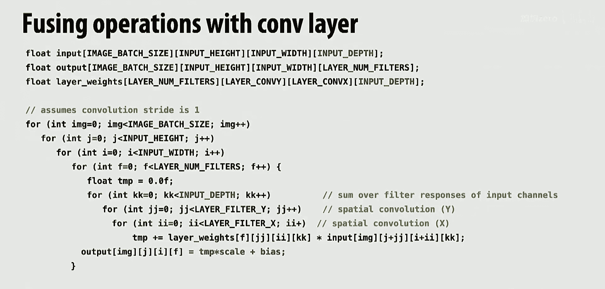

And that just saved me hundreds of you know， hundreds of megabytes out to memory and back。

Here's an interesting thing is， how would you rewrite this code if you wanted to do the max pool all in line here。

It's not that hard。 It makes for some gnarly code， but conceptually， it's not that hard。

 How would you do the max pool right on the spot。Yeah。

 you just need to ensure your block size is like a multi。Yeah， so imagine this was blocked。

 If it was blocked， I would have produced a block of output sitting there in cash。

 I should do my max pool right then before I send it out。 And then I， I not only save the。

 the store and the load。 I actually， what I store is four times smaller than what I produced anyways。

😊，So there's a huge win there。 So it turns out that this stuff you know， really matters。

 and that's when your layer types get kind of gnarly。And without any compile compiler support。

 that's when Tensorflow start having API entry points that were called like co 2 Dfuseed batch normed。

 you know， power of 10 or something like that。 Like you just start seeing this API that just gets huge becauseuse like。

 they're like， well， this one's like a really slow sequence。

 And we need to make a special case for that。😊，Nowadays。

 people are hoping with things like Jackx and Triton that if you the compilers given knowledge of these operations can do some of this fusion for you。

 but it's still not great。 It's still not that great。And let me tell you why， why it's。

 it's not super great。 I want to tell you about a cool little trick that was invented here at Stanford about a year and a half ago now that' significantly improved the performance of these transformer layers in large language models。

 And if you take a step back， this trick is basically something that any of you in 1，49。

 had I given you a transformer layer。 You would have looked at it。 And you would have gone。

 you should definitely do this。😊，Right， and you had you have done this a year and a half ago。

 you would have been in the talk of the town you know， in the machine learning Twitter sphere， right。

 So I want to talk very quickly。 I'm gonna move away from these convolutional models。

 I'm gonna talk about these transformers。 And I want to think talk about sequence to sequence transformers。

 So one， like， for example， the input might be a sequence of tokens， maybe a sequence of words。

 and the output of the model is to produce the next word。 just auto auto aggressively。

 Okay The application doesn't matter at all。 What does matter is the workload when we look into the key part of this neural network。

 which is this box， which is called attention。😊。

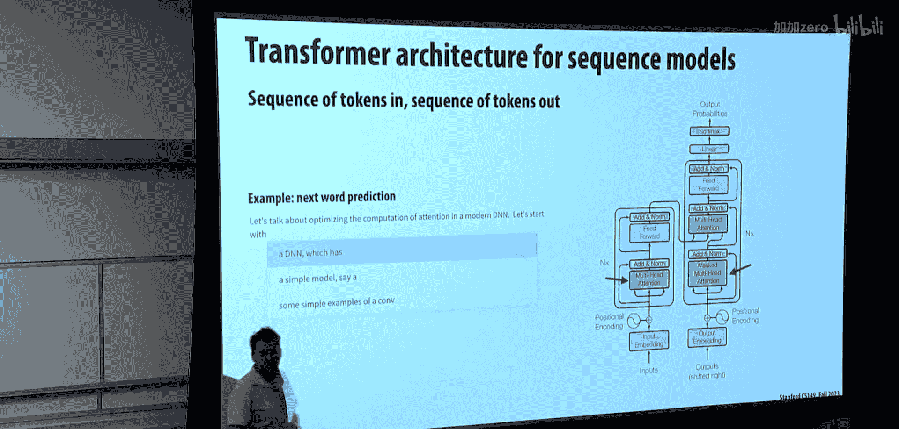

And I'm not gonna get in the algorithms of of attention at all right now。

 But I'm just gonna tell you what the workload looks like。The input are a bunch of tensors。

 three tensors。

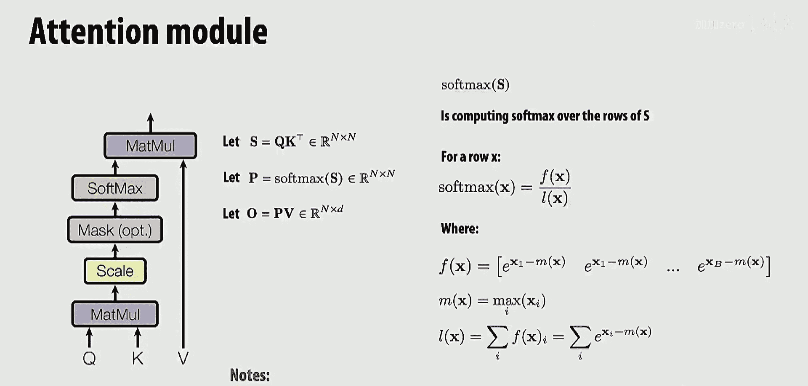

Q， K and V。 There is some。 I could give you an interpretation of this as a query。

 This is the key that the queries match。 And this is the value。 So you could say， hey。

 for every element in my input sequence， I'm gonna think about that as looking up in a database of what other tokens match。

 And based on what matches， that's gonna influence the output。 But just think about it for now。

 as I have three embeddings。 I have three vectors， Q， K and V， there are n dimensional array。

 And at every point in that array， think about there being a D dimensional embedding。😊，Okay。

 so I didn't give you the dimensions here somehow。 but this is N by D。 This is N by D。

 This is M by D。And this attention layer basically is just gonna compute interactions between key queries and keys。

 So in other words， we're gonna take an outer product of the query vector Q against the key vector K。

 And if these are N by D， my output is going be an M by N matrix。 So I'm gonna do a matrix。

 I'm gonna do an outer product to produce a matrix。😊，Then for every row of that matrix。

 I'm going to perform an operation called a softftmax。If you don't know what a softm is。

 it does not matter。 Let me tell you what matters about the softm， The softm of X。

 which I want you to think of X as the row of the vector。It's just a scaling of all the elements。

 but that scaling depends on the maximum element in the vector。Okay， why does that matter。

 That matters， because I don't know what the maximum element of a vector is until。

I've computed the entire vector。So this would be like saying。

 compute the sum of all the elements in the array and normalize everything by the sum。

 computationalutally， it would be equivalent。Okay， so the problem here is I do a matrix multiply。

I produce an M by N matrix。 Then for every row in the matrix， I gotta compute the max element。😊。

And then I use that max element in a， a new computation to do another matrix multiply。

Or lets case sorry， I a matrix vector product。 So let me diagram this out for you。

 I have Q and my K vectors that are N by D。

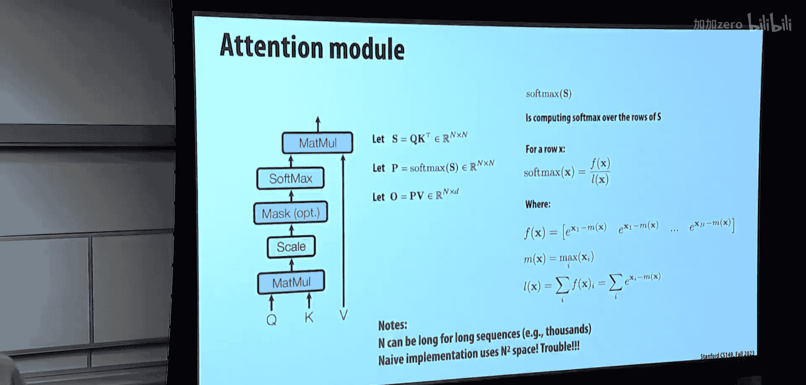

I multiply them together to get a matrix here that's n by N。 And by the way。

 n is large because if we think about sequences of tens of thousands of tokens。

 we're talking about n squared on n equals 10000。 This is a huge multi gigabyte matrix。😊。

Then for every row of that matrix， I'm gonna compute the softm， which again。

 if you don't care about softmes， just take about， I'm gonna compute the sum of all the elements in the vector or the max of all the elements in the vector。

😊，Okay。So I normalize all the rows by that sum， and then I do a matrix vector product in order to compute the final result。

Okay。The problem is that this matrix is huge。 And so you could do blocked matrix multiply。

 so you can compute that matrix very efficiently， but you still have to store it out out to memory。

 You have to bring it back in row by row to compute the softmax。 You have to bring it back in again。

 to compute this matrix vector product。 And I'm not showing you a few other steps。

 There' are some things that people do with like masking this thing and stuff like that。

 You got to bring it in like a bunch of times。😊。

RightThat's where the compute is in these transformers， or at least the the。

 the cost is and the transformers。 There's no compute， actually， which is the problem。

So here's the trick。 The trick was， is there any way we can do this whole sequence block by block。

 You just told me how to do a max pool in the middle of a coner。 The question is the same here。

 Is there any way that I can fuse through this softm。

 which looks like something that needs every element of the matrix before I can go any further。😊。

And some folks just kind of looked at it and said， okay， So here's again， the math of the softm。

 which is for every element of the vector X， we're just gonna scale。

 we're gonna raise E to the power of x scaled by the maximum element in the vector。

 So I have to compute that max。 And I have to compute the sum in order to know how to scale。

 That's basically okay。😊，And it turns out that you can factor this。And compute it block by block。

Okay， and like the details of this， I think we should， we should take off line。

 But the general gist of it is， let's think about x as a first half and a second half。

 So here's the first half。 Here's the second half。And if I think about what is the max of vector X in terms of maxes of x1 and x2。

Well， the max of x is clearly the max of x 1 and the max of x 2， so。

You know， this can definitely break down。And it also turns out that computing this， this F of X。

 well， all I need to know if I knew the max value。I can compute F on the first mate on the first half。

 and I just scale it back up by something we already know。Okay。

 now I don't expect this to be followed in real time。 But in 10 minutes of math。

 And you just notice that inside of this term， there's an E to the X 1。 So these are gonna cancel。

 You're gonna end up with， it'll all work out。 The point being is that softm can be computed in chunks。

 If you just keep a running sum of Mac。

Okay， and as a result of that， I con fuse through this whole thing。

So I can compute the matrix multiplication， I can compute the softmax。

 and I can compute the final matrix product by loading a block of Q， loading a block of k。

 loading a block of V， Comp the sub matrix multiplication。

 Comp the sub the softmax on a chunk of the whole row， which is sub a row of the sub matrix。

 then doing the matrix multiply and then accumulating into O。😊，So all of a sudden。

 my memory requirement shrunk from n squared to block size squared。

 which means I can fit much more data on chip in a GPU。

 which means I can run on much longer sequences。 And because I'm not bandwidth bound in some situations。

 I can run faster。 So the speed improvement was modest。 I think like a few small constant factors。

 The memory footprint was enormous。 and that moved us from sequences of length 8000 to sequences of 32000 and stuff like that。

 I believe GP4 is enabled by an optimization like this。

 So this is your basic producer consumer locality optimization。

 You can imagine it would have been hard for a compiler to do the mathematical analysis to figure out that this was possible。

 But some folks in group did that。 And once you know how to chunk that softm。

 Then you can chunk through the whole thing。 And all of a sudden。

 you know the equivalent of just reordering some loops here there。😊。

And it's a very big change。Okay。So these are the types of stuff that matter the most， you know。

 once youve， once you have a good matrix multiplication implementation。

 These are the types of things that are pretty funny。 I actually alluded to this before。 Like。

 you know， about 8 or 9 years ago， people are like， well， you've got a fuse。

 but we don't really know how to do it。 So we're just gonna have those people that implemented a good matrix multiplication are going and go ahead and implement you a good fuse batch norm into the matrix multiplication or fuse resize and pad Com 2 D and get a coffee at the end of it。

 know， like that's basically what was sort of hopping up。😊。

You know， Kuda has had this sort of very template would templated sort of fusion capability。

 like any convolution operator， followed by what's called a pointwise operator。

 a pointwise operator is something that just is like a map。Foled by another pointwise operator。

 anything that fit that pattern。 they say， okay， we。

 we'll try andfuse the point wise into the matrix multiplication。 You know。

 given the fact that a great solution for Max poolol and other stuff was proposed in5 seconds。

 you know， this is not。Intellectually that hard。 What is hard is to do it on arbitrary tensor programs。

 And so when you see these， these frameworks out there， like Jax is actually a pretty。

 pretty nice sophisticated one right now， They are now starting to analyze your tensor loop nests and stuff like that。

 and go， yeah， we， we see how we confuse this right in。 And we can generate that code for you。

 So stuff's getting better。😊，It turns out that you need both。

 You need an excellent implementation of convoy or matrix multiply。

 and then you need excellent smarts so that everything else on the deep network。

 It being bandwidth bound doesn't slow everything down。

 You need both optimizations to have a good network implementation。Just as I finish up。

 I want to talk about like， there's just a whole bunch of other stuff out there。 You know。

 like like the next thing you do to speed things up is you stop using regular precision math。

 You go to lower precision math。 People are pushing this to the extreme。

 I think Nvidia GPs are now starting to muck around with about 44 bit precision math these days。

 So the space of techniques is，1 of all， you want to start with good algorithms。😊。

Like if you're a systems person and you ignore algorithm innovation。

 you will get left behind and there's a huge number of startups that are being left behind because they saw this curve of everything bigger。

 everything bigger。 and I think that was done。Then you need to take 1。

49 like principles and good compilers principles and optimize these things so that they run well on modern hardware。

 We didn't talk too much today about approximations like low precision and sparsity。

 But that's out there as well。 And then the last piece of the puzzle is what hardware you run this thing on。

 So let's close up in the last minute and a half on this。Given what you know。

 why would we say that a GPU is a good platform to run these deep neural network computations on。

 What are some properties。PTnonss of parallelism， these are huge matrix multiplication operations。

 What else？Has a lot of arithmetic intensity if you do it correctly， yep。

And so there's a lot of good algorithm good ordering optimizations to get thetic intensive so we can use all that compute。

 of the the it's。 So we got a lot of Cd capability。

 And we already have these processors that had a crap ton of AUs on them for graphics。

 So they happen to be right in the right place for the right time to do machine learning about a decade ago。

 right， So that's why everybody loves GPU。😊，Okay。Now。

 the flip side is why might GPUus be a suboptimal platform for DNA evaluation。

 given that a GPU is an arbitrary general purpose processor。

 and most of this work are these very simple matrix multiplication。

 maybe matrix vector multiplication operations， right？So we're gonna have a whole class on this。

 but I wantna hint at it right now so that those of you taking 229 or or， you know。

 maybe when you get around your assignment is what was the motivation of the s0 instruction。😊。

Why do architects put S instructions in in a processor。That's correct。 But， but so what， why。

 why not just build a whole bunch of little processes。The idea is to amortize non math work。

 instruction stream control， data access， whatever across that same operation。

Okay。And it we don't have to stop there with a 70 instruction。

 We could add an instruction like a dot product。 It be super helpful for a matrix multiplication computation。

 like a 4 by  four dot product。Do four math op and add them together。Or we could actually say， what。

 about an instruction that does a4 by4 matrix multiply， a little， little matrix multiply。

 I know how to use that because I know how to break down big matrix multiplications into that。 Okay。

 So the key principle here， if you're an architect is you want to amortize all of the overhead of running a program over the biggest math operations that you can think of。

 And here are some examples of the magnitude of that overhead and energy efficiency。😊，So compared to。

 and these are invidious estimates。 So， you know， what they have a vested interest in making deep learning accelerators like T Ps seem very inefficient or not so efficient。

 But they said， if you just run ads and multiplies on an NviDdia processor and you do your matrix multiplication with that。

 you're 2000 times less efficient， then if you built custom silicon to do that matrix multiply。😊。

If you make a couple of bigger operations， like just four component dot product。

You're all the way down to like，500。Only 500 x more efficient。If you give yourself an instruction。

 that's a 4 by 4 matrix multiply because that does a lot of work， right， That's。

 that's 64 ops in one instruction。You're all the way down to maybe only 30% more inefficient than these things。

So these Nvidia， their reaction was， in addition to math units for ads and loads and all your standard math。

 They have this thing called a tensor core off to the side。 What that tensor core is。

 That's a fancy marketing name for all it is。😊，Is support for a special instruction that does a4 by。

 I guess nowadays， it's like a 4 by 8 by 8 by 4 matrix multiplication。's like 128 ops。

So if you write your code in terms of your sub matrix multiply， just going， oh。

 do your 8 by 4 matrix multiplication。You have access to。Your couda cores give you 19。

5terra flops of floating point math at 32 B precision。If that's math。

 that can be phrased in terms of matrix multiplies and you can do it in 16 bit floating point。

You get 300 ter flops of compute capability。It's an order of magnitude。

 more than an order of magnitude， more peak compute on that GPU just in basically A O use they can only do a matrix vector。

 do a matrix matrix multiply。 That's what a Tensor core is。 It's just a fancy instruction。

 And that's Nvidia's reaction to what we'll talk about later， like T Ps and other accelerators。

 like things like this。 So that's your like little crash course on modern optimization of these networks。

 and hopefully allows you to kind of situate yourself in the space of all these different solutions that are out there。

 spanning different fields。 You know， the algorithms people are contributing。

 the software compiler and 1，49 people are contributing in the hardware people are now contributing as well。

 So it's a very， very interesting cross cutting space。 Co。😊。

