# 【并行计算 CS149 2023】斯坦福大学—中英字幕 p12 p11 Lecture 12 - Memory Consistency -BV1du17YfE5G_p12-

So as I said， today， we're going to finish our discussion of cash coherence。

 and then we'll talk about coherence's tricky Po memory consistency。😊。

Okay， so to refresh our memories about where we were。 We're talking about， you know。

 definition of coherence。And the deficit of coherence we said was we wanted to have a memory system that even though we had these vulnerable caches that shared the cached memory locations from a shared address space。

 If we look at any particular address。 what we want to see is that all of the reads and rights made to that address by all the processor for can be ordered in some sequential order。

 such that the ordering corresponds to the order， the program order issued by any of the threads in the processor。

 Okay， so that's the first thing。 second thing we want is we want to make sure that in this sequential order。

 that the value that you read it was the value that was lost written in the sequential order。

 So these are the two things that we want to。Maintain in a in a coherent memory system with with caches。

 Okay， so we said that in order to implement this， there were two invaris that we needed to maintain。

 First， the idea of a single writer multiple reader invariant， right。

 so we have we can sort of abstractly divide the access to any particular location into these epochs and these epochs could be a readrite epoch in which only one processor has sole access to the cache line or a read only epo。

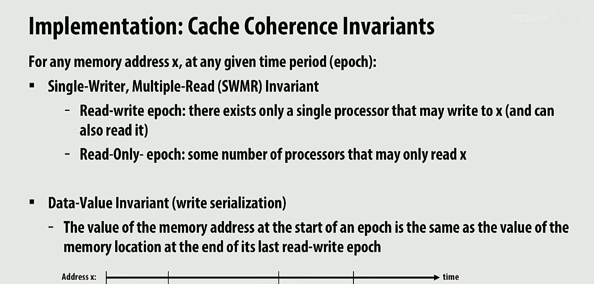

In which multiple processes can read， so it's read only， but multiple processes can share the line。

 and the idea of the data value invariant was that， you know。

 the value that you see in the read only Epo is the value that was lost written in the most recent read。

 write Epo Okay， everybody understand these two invariants， Okay。

 we're going to come back to them in just a moment。

So we said the issue that we have would right you know we could implement cash coherence would write through caches。

 but that was not had performance problems because every right that the processor makes appears on the bus and the bus becomes a bottleneck。

 a performance bottleneck。 So in a right back cash right， we have this problem that you know。

 each individual processor has its own cash and if everybody is writing， you know。

 into that cash in a right back fashion， then of course， we have an incoherent system。

 right So the question is， there are two questions。 One is you know， when as a processor。

 do I have the permission to actually perform a right。

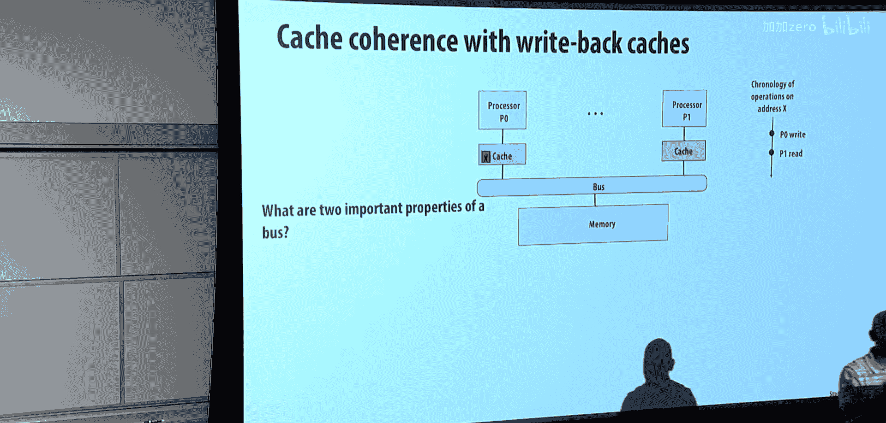

Right so and the way that we want to indicate that a processor can perform a right is by having a modified or dirty state right And so the idea is that you know the only one processor should be in the modified state at any point in time and then the second question is。

 okay so I have got this data in my cache and some other processor wants to to read that data。

 read that cache line So the question then is that who should provide the data to that processor and it should be the owner of the cache line。

 which is typically also the processor that has the cache line and modified state。Allright。

 so so let's kind of see how we actually implement cache coherency and write back caches and what we want is an invalidbased write back protocol to maintain these two invariance that we've defined So the idea you know we've already point out is that you want to have a single line in the system in modified state at any point in time and that the idea is that the processes can only write when they've got the cache line and modified state and then you have to have a way of getting the data from a cache that has it in modified state to other caches that want to read that data at some later point in time okay so let's see how this works。

 So we reminded you that the idea talks about a cache line we said you the data component and the metadata and part of the metadata。

😊，I the tag that indicates the line， the address of the line that is contained in this cache particular cache line and then the dirty bit indicating that the data is has been modified in the cache and then the line state which is going to be used in the cache coherence protocol All right so we talked about the we briefly introduced the idea of a modified。

 shared invalid right back right back invalidation protocol。😡。

And so what we want to make sure then is that with this protocol that we can maintain the two invariants to implement cache coherency correctly。

 So there are three line states invalid which basically means that the cache line is not in the cache right the idea of it's not there or of course。

 if you access that cache line and invalid valid state， it's going to be amiss。

Then there's the shared state right That says the line is valid in in one or more caches。

 And the important thing to， to remember is that memory is up to date。

 So whenever cache line is in shared state， memory is always up to date。

 And then there's the modified state。 And in this state the line is about is valid in exactly one cache right。

 So only one cache in the system has the cache line in in modified state and also means that the the dirty bit is set。

 another way of thinking about this iss exclusive， right。

 So only one cache in the system has the cache line in that state。😊。

And so you can think of it as as being exclusive。 Okay。

 so then there are two operations that the processes can make。 They can make reads and write to。

 to cash lines。 So process of reads and process of write。

 And then there are three coherence bus transactions that are of the result of these reads and write that get that get made by the processes。

 right， There's a bus read， which says， get me the line because I want to read it。

Bus read exclusive that says， get me the line because I want to actually modify it。

 I want to change it。 So I want to get it into exclusive state。 and then bus right back， which says。

 hey， there's a dirty line in the cache that's going to be replaced。

 and I'm I'm going write it back to memory。Okay， so let's see how these operations get implemented in a cash coherency program。

 So here is the cash coherency protocol state transition diagram。

 So we have the three states invalid， shared and modified。

 and we have the operations that are made by the processor and and the subsequent transaction that come from the bus。

 So the way to read this state transition diagram is that each of the as is labeled by a A B action pair or transaction pair。

 and so the a is is the initiating action。 and then and then the B is the result resulting behavior or is action taken by the cash controller and the way to think of the way to look is the。

😊。

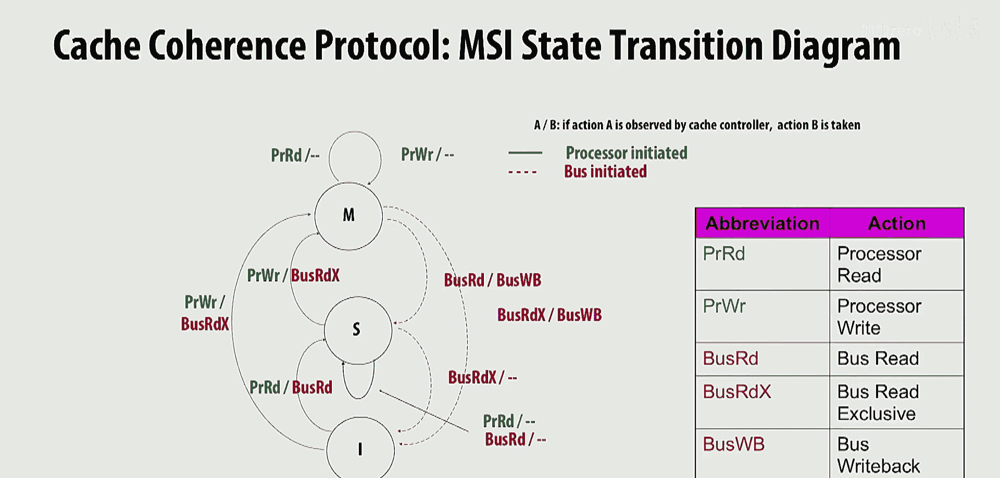

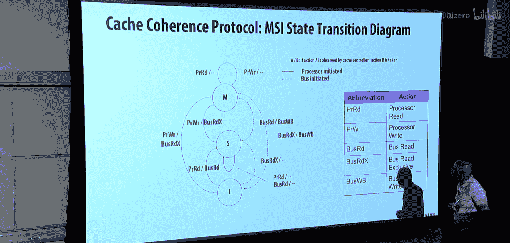

Green labeled actions are initiated by the processor and the red are initiated by the bus。Okay。

 so let's look at this transition diagram in more detail and dissect to all of the the different trans different transitions。

 Okay， so let's start with the， the processor in initiated ox。 So let's assume that， you know， the。

Cash line is not in the cache， or it's an invalid state。 right。 So if a processor does a read。

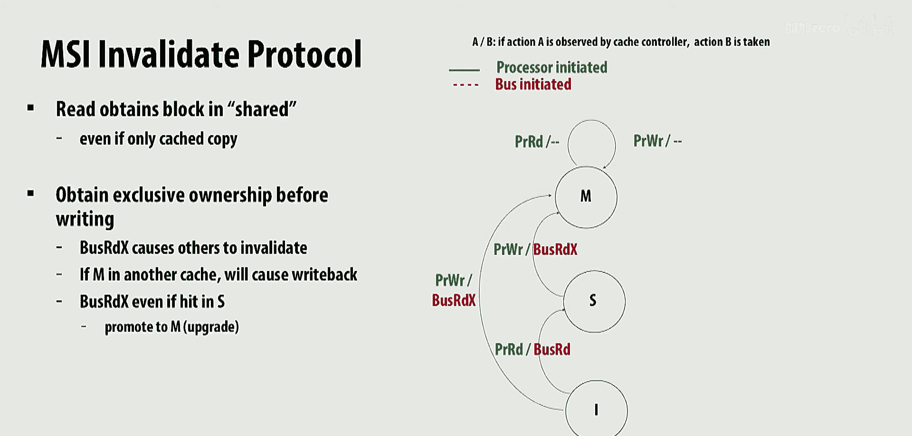

What is the action of the bus， what's going to happen on the bus。So， so， of course， if it's invalid。

 this is a myth， right， So it's a。 So you can think about any。

Action that the processes takes that results in a bus transaction。 Think of it as a miss， okay。Right。

 so we start out in invalid state and we。Issue a processor read。 And this results in a bus read。

 right， So get me the cash line because I want to read it， right， So that means that the。

 the line has to move from invalid to shared， right。Okay， and then if the。呃。

The application then does a right to， to， to that cache to that address which is contained in in a cache line in the cache line。

 Then you're gonna gonna issue a process of read。And what's the result on the bus is。

A bus readed exclusive right And so bus readeds exclusive says， hey。

 now I need to move the state of the cache line from shared to modified right and modified means that of course。

 that this is the only cash line in the system that is in modified state Okay So then if if we have the cache line modified state and we issue reads and rights from the process so what happens。

😡，Nothing， right， These are hits。Right， these are hits。 So that's indicated by。

 by but sort of nothing in terms of the， the， the B action。 and so。

You can do whatever you like in modify state。 And， and there are no bus transactions that result from that。

 right。Okay， so what happens if we go from？If the processor were in the cash lines is invalid valid and we issue a processor right。

You go straight to the modified。 Okay， good。 Alright， so this is what happens。

From the process' point of view and to on an individual cache， right， But then all the other。

Processor cash controllers are snooping on the bus。

 So whatever transaction show up on the bus of a single processor， Remember。

 all the other processors get to see and they're snooping on those。

 And if they see a transaction for an address contained in their cash。

 then they need to take an action。Right， so let's look at those actions。Alright， so， oh。

 we've got a few more processor in the shade。 Well， well， one more processor in the shade action。

 So if we're in the shared state and the process does the read， what happens。

You stay there and any bus transaction。No， okay。 so what happens if we're in the shared state？And。

We see a bus read。Transaction over the bus。Nothing， okay， it's a share state。 So what what。

 what what does that mean about the state of the， the cash line in the system。对呀。

Or that that have had that line in in the in share state。

 So any cash that that has that cash line and its cash is gonna have it in share state， right。Okay。

Is it possible for any of the those caches to have it in modified state。No， right？All right。

 so suppose we see a boss read exclusive。😡，Transaction on the bus for a cash line in our cash。

Then we need to make this transition from shared。To invalid， right？So that would be。

 that would be the case where some other processor wants to write this cache line。

 So what happens to the， the state of the cache line in my cache。It goes to invalid。All right。

 so if I see a bus read， I'm mean modified。😡，What has to happen。 So we know that if。

 if we've got the cache line in modified state and it is the right back cache。

 So we have the only valid copy of the line in the system， right？ So if you see a bus read exclusive。

 a bus read transaction on the bus， then what has to happen。 Well。

 I need to supply the data in my cash， right， So I need to。

I see the bus read and the response is a bus right back。Everybody follow that。 So I， yeah。Yeah。

 and then transition into shared state， right， because， you know。

 we know that it is not possible for cash for cash lines for， for anything。

 any other cash to have a cash line in itss cash if it's a modified state， right。

 So it's got to move to share。Yeah。Correct， right so update you're giving the data to the requester but you're also updating memory because whenever you're in shared state。

 memory is always up to date。😡，Yeah， if there's conventionion。

 what keeps us thring back and forth with mistakess？

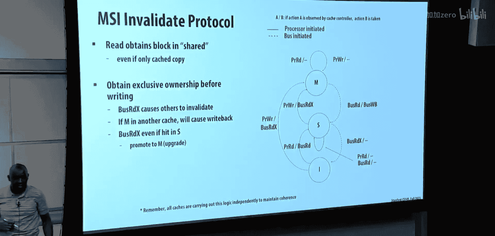

That's what you're going to do all day long， absolutely that's what's going to happen。And。

 and what are you going to see in terms of performance。It's going to be a lot worse， right。

 You're gonna to see lots of cash misses and we'll look at。

 look at a case like that in just a moment。All right， what about bus， we're in modified state。

 we see a bus read exclusive？RightThat means some other processor wants to read this cache line。

 We have it。 the only value。 So we have to supply that that the up to date to the most recent copy of the cache line。

 So it's got to be a bus ride back。 But then we also have to move to invalid state。Okay。

 everybody understanding that。 So let's do an example just to reinforce what we just。Talked about。

 All right。 So Caque's example here are the。呃。Processor actions by the different processes。

 theyre all which simplify things We just using one address。 Alright。

 And so what we want to look at is the state of the cache line in the three caches。

 the bus transaction that results from the processor action and where the data comes from。Okay。So。

Processor one does it read。 What's the bus transaction， I suppose I gave the game away here。 What's。

 what's the bus transaction。Bus read。 Okay， what's the state of the。Different caches。shared。

Shared in in processor one's cache and it's invalid or or or not there and in the other caches。

 Where's the data gonna come from。All right。Processor  three does a read of x。

 What's the bus transaction。What's the state of the caches？W。Okay。So。

And then where's the data coming from？Remember， shared， when you're in shared state。

 the data that always comes from memory， right。And it's just to keep things simple。 We could。

 can imagine some other scheme。 but then we'll see an example where。

Where should you get if two caches have it， Who should you get it from。Right。All right。

Process 3 does a a right。 What's， what's the bus transaction。Bus read exclusive。

 what's the state of the caches？😡，Modified in process of 3。And invalid in process 1。

 And the data comes from memory。 Okay， Pro of one does a read of X。What's the bus transaction？

What's the state of the caches？And where's the data coming from？Prosor three is cache。 Okay。

 Pro 1 does a read of， of X。Wheres the。what， what bus transaction occurs。AThis is a tricky one。

 right， There's no bus transaction here， right， It's a hit。Yeah。别的 coming块。

How does memory know that it doesn't need to reply to that retransa？How does memory know。

 Because it knows that the state of the it sees the state of the。Well， basically， processor。

 the processor that has the cache line tells memory to hold off。Yeah， that's the way to think about。

Yeah。What if you you want writing now？Where， this one？Here， if this is a right。

 you tell me what happens。If P1 does it right， what's the bus transaction？😡，Plus three。

And then what happens？時はかわ。Yeah， so in that case， it's the same thing， right。

 the data is going to come from P3， but what's going to be the state of the caches？😡，いいこで。Yeah。Right。

 exactly。But the data moves， right？Okay， so in this case。Nothing happens in terms of the state。

 We don't have a bus transaction。And where does the data come from？We its own cash， right。

 it was a hit。Okay， in process due does a right of X。 What's the， the bus transaction。

What's the state of the the cash flow。8月。Right。And then where' is the data coming from？

What memoryory， right？

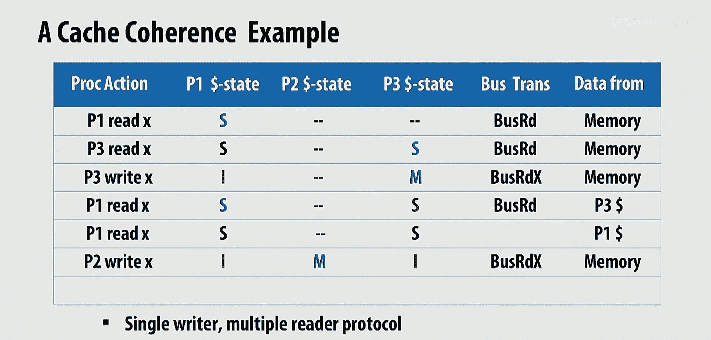

Yeah， is there functioning the difference between valid and images？Well。

Not D says we'd never saw it at all， but functionally as far as the process of accessing the gas line。

 it's the same thing。😡，So essentially， if it was a dash， then it would be a coldness， right。

 as opposed to， hey， it got invalidd。Okay， so so notice that。

 you know we do have the single rider multiple reader protocol and so the question is why do you need this transition from modified to sharedd？

😡，Why is that important？😡，Yeah， I guess to indicate that the patch is back in。

Back in memory and what else？Yeah。at another。processoror is the one that。

to share why do you need to modify， for instance， this case？

Why is that important？Right， well you need to。 remember， we can only have one。 remember。

 the invariant we're trying to maintain is single writer， multiple reader， right， So we。

 we need in order to。Track that transition。 We need the transition from modified to share。 Okay。

 so the other thing to know is that communication increases memory latency， right。

 So we saw that here is that， you know， because P3 did a right to X P1。

 which had had had X in its cash， now has to do a bus transaction， right。

 which is gonna take much more time than hitting in its cash， right， you know。

 this is the case where you had the cash hit， right， But if you had an intervening right。

 then it course， it causes extra cash misses， And so， of course， you're gonna lose performance。😊，So。

 you know， just to reinforce this idea of how the MSI protocol maintains cash coherence。

 let's think about the cash coherence invariance and so you know how do we maintain the single rid。

 multiple reader invariant？😡。

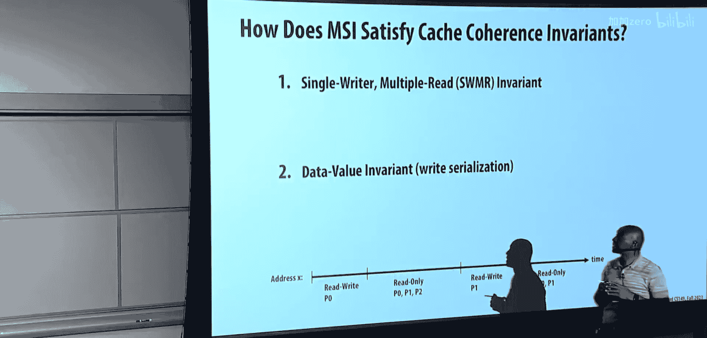

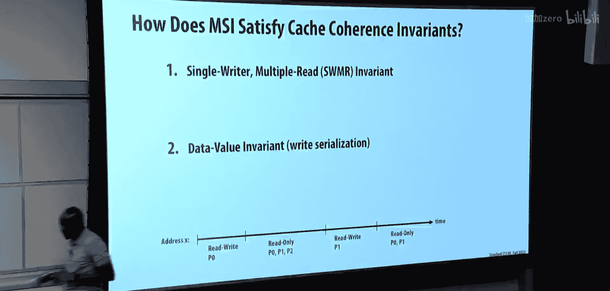

呀。I like the share that we're talking about， right？And then so that's how in shared state。

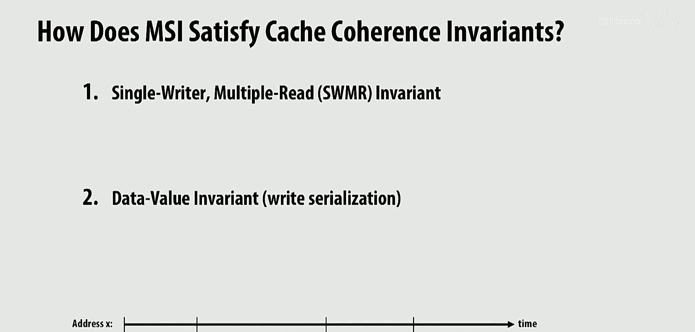

You have multiple readers。And how about， how about the single rider。おのま。

It only one cache can be in the modified stay at any any point in time， right。Yeah。それは。对。Okay。

 what about data value variant， tell me about that？😡，So how do we maintain the right serialization？

Go to the bus。The bus act like the see nice。Right。And what about the data value of how we make sure that the。

 the data is is， is， is moved from the。啊。Read， write epoch to the read only epoch。

We go to the certain state so we know that。You got the share say， yeah。

 I guess it's like you did use the cat the processor that modified it。The source of the data right。

 and that is maintained with the。The bus right back right so the bus right back when you whenever you come out of the modified state。

😡，You， as the， the cache that had the， the line in modified state have to provide the data for the cache line。

 yeah。Processor mixed right。U modified state and other processor tries to make this。You。Well。

 it's gonna it's gonna complete its right， you know， it gets， if it gets the， you know， the the line。

 you basically the bus is gonna serialize all the actions， right。

 it will complete modify its cache line。 and then it'll be time to。

 to write back to the next process that wants to write。

 So the the line could bounce all all way around。 but essentially。

 every time that you got exclusive access to the cache line， you get to do it right， yeah。

Like the logic process， this is hardware that's implemented， you know， in the cache controller。

 right？どしたで。Each processor has its own cash controller connected to the bus。There also maybe。Well。

 there's not logic across， but there is some access control logic that says who gets to go next。

 right。

All right。And the buslies in transaction。 So these are the two statements that we just made。 Okay。

 any questions about how this works。Alright， so in summary， then。

 you know the way that we're going to do MSI is we're going to keep these three states。

 we're going to make sure that only one process that can be modified state and in modified state。

 this is the only process that can can write in the system to a particular cache line and if you maintain this。

Invariance by by having this bus， which serializes all the transactions in the system and make sure that we。

 we move from one from the state in in one cache to the next。In a serialized manner。Okay， so。

This is the way the MSI works。 And you know， the result is， of course。

 it keeps the cache is coherent， but it has a downside。

 And that is whenever you want to read a cache line and then write。

 sometimes going from read from shared state to modify state is' called an upgrade， So。😡。

This is the term upgrade。Okay， but the problem is， is that you now have two bus transactions。

 You have the bus Re。Which is a miss。 And then you have a bus read exclusive。

 which is also a miss you know， to upgrade the cache line from shared to modify， right。

 And so the idea is that you can optimize the M I protocol by adding an exclusive state， right。

 This is called the messy invalidation protocol not to be confused with the Argentinian International So superstar。

😊，And and the idea is that now you're decoupling ownership from whether you have the line in modified state right So what does this mean。

 what does exclusive mean in this context。😡，What's another way of describing the exclusive state？😡。

Yeah， worry is just that the wine is not dirty， but all is that。Right， so so's it's clean， exclusive。

 right， So it's clean， but it's， but but only one cache has it。 right。

 And so the idea then is when you read a cash line。That is not shared by any other processor。

 Instead of bringing it into the cash in shared state。

 you bring it in in exclusive state because you know other cash has it， right。Okay。

 so you go from invalid。To。Shared is would be the typical case。 if the line was shared。

 but if the line were not shared， then you could go directly to exclusive state。And now the upgrade。

Can be made without doing a bus transaction。Right， so it's not a miss。 It's， it's a hit。 And。

 and in which case it's gonna be a lot more efficient。Right， and so， you know。

 given what you know about the MSI protocol， you can fill in the rest of the the transitions， right。

 And so I'll leave that for you to look at in detail at your leisure。Any questions on N， E， S I。

 messy protocol。 Yeah， why is it more efficient than just taking that。

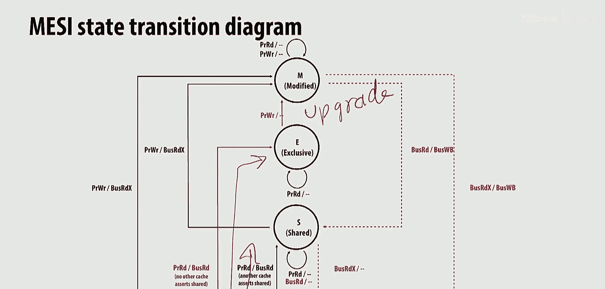

Plus3。Where for。Sorry。This one。So that's if you did a right first。😡。

I want to read first and then write。Yeah。

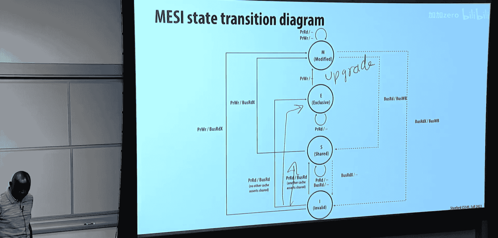

Okay， questions。Alright， so the problem with buses， of course， is they don't scale。 right。

 You've got a single set of why is everybody sharing。

 And so that means that every transaction is seen for every cash line is seen by all the processes。

 right， Even the processes that don't have that cash line。So that's one problem。 one problem is。

 of course， all the processes sharing this interface you know， between the caches and memory。

 And so you're gonna run out of bandwidth。 And so the other other issue is that you're serializing all of the bus you're serializing the transactions to all the cache lines。

 whereas we really only need to serialize actions to a particular cache line right And so one way to potentially make make a system that's more scalable is to use the idea of directory。

😊，Right so the idea of a directory is it stores information about which processors actually have this particular cache line in their cache right And then given that information。

 you can send invalidate or you can communicate with just a set of processes that need to know as opposed to all of the processes in the system And so this makes it possible to use interconnects that are more scalable。

 So instead of having a bus， you can have a network or a ring or something that doesn't require this ability to broadcast information and serialize all of the transactions in the system。

 you only need to serialize transactions to a particular cash line。So that's the idea of directories。

 And so that's what's implemented these days on most multicore processes。 right， For instance。

 the I 7 that's used in your myth machines， right， So you've got a ring interconnect。

 And the ring interconnect is not a broadcast interconnect。 And so snooping won't work here。

 And it's also， of course， more scalable。 But what we have is we have a directory associated with the L3 cache right。

 for this to work。😊，We have to guarantee that every cache line that could be in any of the L2s。

Will also be in L 3。 This property is called inclusion。Okay， so。So L3 is an inclusive cache right。

 and then we got a for each of the cache lines in the L3。

 we have a directory right and the directory in this case is you think of it as five bits。Right。

 so we have a bit for processor 0， B for processor 2， a bit for processor。1，2， and 3。

 and a dirty bit， right？ So the idea then is that if you're in shared state。

Then multiple bits would be on， right， So this would indicate that a particular cache line is in cash for processes 0。

1 and 2。 And so if a right came in， then we would know which processes to send invalidates to。Okay。

And then if the cache line were in modified state， then of course， they would be a bit set。

The dirty bit would be set and then just one of these bits。

 safe bits for a processor of three would be set。And the rest would be zeros。Okay。

 indicating that only one， we know that whenever we're in modified state。

 only one of the caches in the system can have the cache line。So the directory then is more scalable。

 but， of course， you need extra information associated with some place in the memory system that keeps a directory。

 right， And there are all sorts of schemes for， you know， implementing directories more efficiently。

 but， you get the idea。 right and with a directory based cash coherent scheme， you can scale to。

 you know， tens of processes， maybe even hundreds of processes。😊。

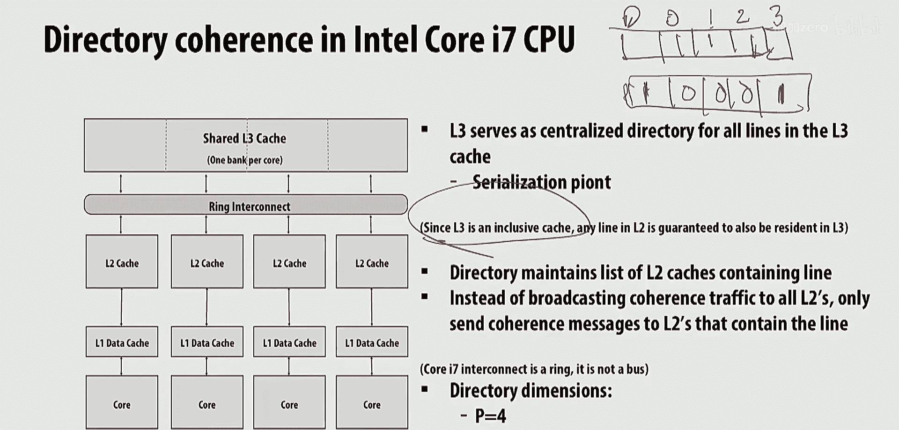

Okay， any questions？All right， so what are the implications of cash coherence to the program。

 programmer。So the issue， of course， as weve already talked about， is that when you have。

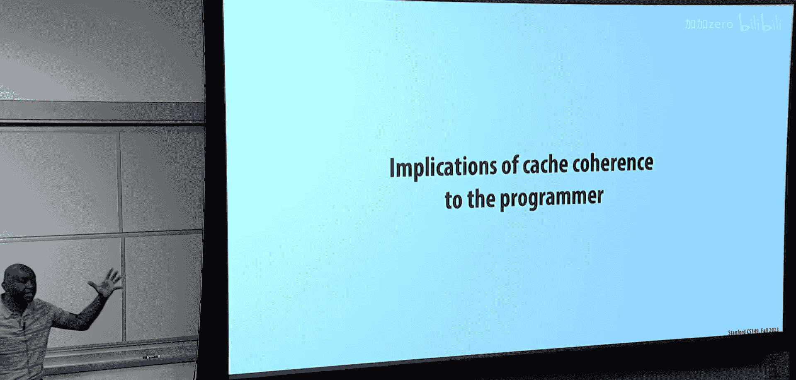

When you have communication in your application。Since you're sharing memory and the processes have caches and the way that the caches are kept coherent is by using coherency。

 cash coherency mechanisms， What's gonna happen is that that that the。Distribution of， of misses。

Of accesses in your system is going to change， right？

 So what's going to happen is that you're going to have an increased number of cash misses at the the different levels of the memory hierarchy。

 And if you have a pnema system。 If we talk about pneumous systems。Okay， so pneumer systems。

 So if you've got multiple chips or multiple sockets in your system。😡，Right， suppose socket ones。

 that's coalless。CPU。1 and CPU。2， and these are different sockets they have。DRA。

 D Ram associated with them。DRA1， D Ram 2， and then wait there's some interconnect。And and remember。

Inside these CPUs are multiple cores， right。So， the idea is that。

You have much higher bandwidth to your local memory than you have to。

 So CPU 1 has higher bandwidth access to its local D Ram than its remote D Ram， right？ And， you know。

 to a first order as as as an application programmer， you could care less because。You， you。

 youd rather not have to deal with this issue。 But you。

 if you actually want to get to maximum performance。

 then you may want to have the operating system allocate data such that you have better that data is accessed more often by the processor where that data is local。

But anyway， from the point of view of the access patents。Numa accesses cost you more， right？

 So if we're looking at， you know， for instance， instance， the core I 7， we see that an L free hit。

Is 40 cycles。If it's unshared， it's 65 cycles， if it's shared and it's almost 70， almost double。

75 cycles。 if it was modified in a different core， right so。Essentially， because， you know， you。

 you have communication and because you， you've got a got a cash coherency protocol that is managing this communication。

 communication means extra latency， extra time。 And it also changes the distribution of misses。

 right？ And so if you think about。😊，At the。Average memory access time of your program。

 It's going be the。Frequency of access of a particular part of the memory hierarchy times the latency of access and what。

Happens when you go from a unit processor application to a multiprocessor application is that you change the distribution of accesses such that you access levels of the of the memory hierarchy that have longer latency。

 right？ So the result， of course， is is your average memory access time of a multiprocessor or a multi parallel program is going to be larger than a a sequential program right。

 And and so that is the impact on the performance of your application of the communication overhead。

Right you can see the latencies as shown by the core I 7 data that I shown you here。

 If you want to kind analyze this， right， you can use system tools right。 So， for instance。

 if you're on an Intel processor， you can use Intel V2 and Intel Vtune will interrogate the performance counting a hardware on the processor and tell you about cache misses and to some extent。

 communication。 if you're on on an Apple M1 machine on the laptop you might use Apple Xcode instruments to get similar source of information to tell you about what data structures causing cache misses and then。

 you know， based on on your knowledge of the application。 you can you can improve the locality。😊。

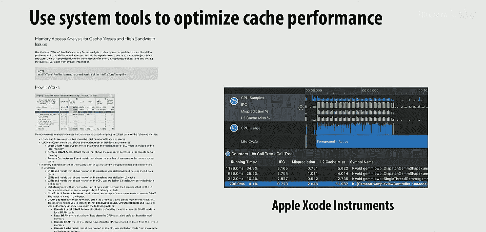

To improve performance。So one of the things that happens when you have caches and cache lines and and sharing is sometimes you get sharing where you don't expect it。

 This is called full sharing。 So let's look at an example of how and where this can happen。

 Suppose I've got a an array of of integers， right。

 based on the number of threads I have in my program。 And so the question is。😊，W？

I could allocate it the per third variable， as shown in the first instance。Or I could create astruct。

That looks like this in the second instance。 So can somebody tell me why this second instance might be more performant。

 yeah。こ。忘记了。Like you're sharing， I in the first one you。对对没。我认为这。あの。T to up the second。闭呀。来てます。

In the first case， you could have multiple instances of the countered like multiple locations going to the same catline。

 whereas as in the second one you're ensure that each one is exclusive program。

Students no contention， during in theory I mean interview as because we cross it into acknowledge in the first case。

Communic。Exactly right。 So we all remember a cache coherence does communication on the basis of cache lines right So ideally。

 if you could do it on a per word or per byte basis。 if you could do coherence on per byte。

 It would be very fine grain， it would be great for the application programmer。

 but a nightmare for a hardware designer， but but the result of using cache lines。

 is that we have what is called full sharing， which is sharing where you don't expect it right So for instance。

 if this is the worker function， which is essentially just going to you know add a increment the per thread variable。

 right and we could implement it you know so we far off a bunch of threads and we time the two instances and in the first case on a fourcore system。

 it takes 14。2。😊。

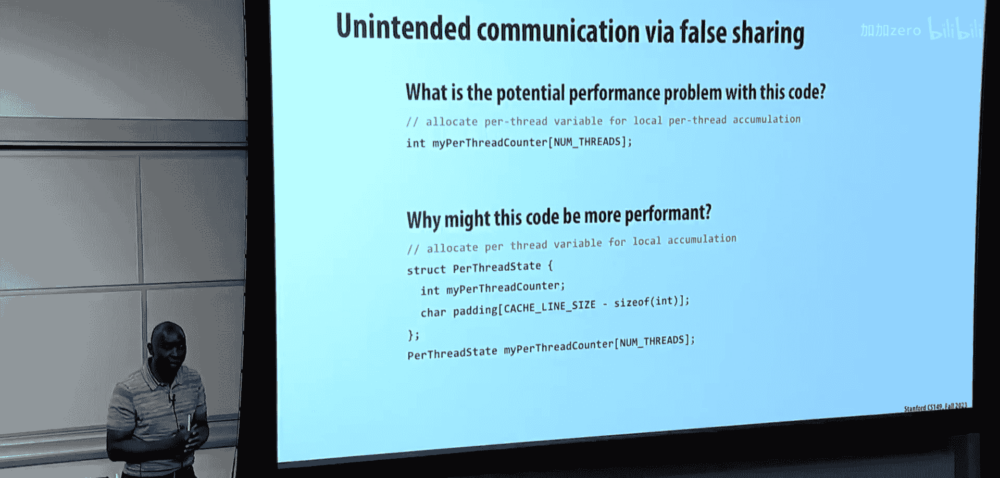

Seconds， and in the second case， it takes 4。7 seconds。 Right， So dramatic， you know， of course。

 this is a contrived situation， but full sharing can really impact your performance if it's happening a lot。

Okay。So， and that's the example where， of course， you know， these thread。

 the data is actually all independent。 But because of the fact that that the multiple threads variable。

 local threads variables are landing on the same cache line。

 we get this unintended communication called full sharing。

Full sharing also happens in numerical applications。

 if you've got some sort of grid application and you have cache lines that cross a grid boundary that's been assigned to different processes。

 then you can get full sharing。 Here's some data from some old benchmarks that were were first written at Stanford probably around 30 years ago。

 but are still being used。😊，And and so this is data we're showing is showing miss rate for different cache line sizes。

 for different types of of misses， right， So you've got cold misses， which we talked about。

 capacity conflict misses， which we've talked about。 then true sharing misses。

 This is where the data is actually shared。And full sharing misses where the data is only shared because it happens to land on the same cache line。

 Okay， so the first thing to notice is that， you know。

 there's a significant amount of spatial locality in truly shared data， right。

 because you see as you increase the cache line size， the amount of true sharing misses gets reduced。

 Okay， but take the example of radioity。 we see the amount of full sharing misses increase。😊，Okay。

With cash line size， right， which in is in， you know， you'd expect if， if it， if it was true。

 truly just。嗯。You'd expected to go down on it it was。Giving the increased cash line size。

 but it goes up because of full sharing。 The extreme case is rate salt where you have a dramatic increase in full sharing due to the way that the application is written。

Okay， so of course， the longer you make the line size， the worse the full sharing gets。😡，Right。

 so you can imagine if you got to a virtual memory size， line size。

The full sharing would be terrible， right， So remember way back when I said。

 So one of the ways of doing coherence is potentially using a virtual memory page and the operating system。

 So forget about the software overhead， your full sharing problem is gonna be horrible。

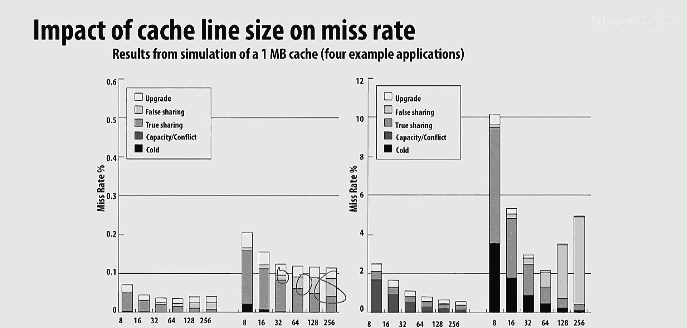

Yeah， the operation which were the size of the catch name。

Because it's simply then you would log have this problem。Well。

 the full sharing has everything to do with the size of the cash line and the data that's。

Being accessed by the different processes， what happens。You know， inside the processor is。

 is kind of not。Relevant。Right。Yeah， is it like， can you always tell me that even reduce default false sharing for largely reprogrammatic？

Or is it just like？Well， you can't always do it programly if you space the data apart such that。

You know。But you may be increasing you may be wasting space， right？😡，表明是受议了依据。

You certainly can make sure that you space things apart at such that full sharing doesn't occur。 But。

 you know， there may be other reasons， maybe， you know。You have phases to your， to your application。

 and at some point， you need to switch things around， and it may not be convenient to， to。

 to organize things in in ways that minimize full sharing。But。You should be aware of it。Okay， so。

So in summary， then， of course。The reason that we've got this coherence problem is that we have this shared address space being implemented by independent。

 separate caches and in order to maintain the behavior that we want。

 we want to be able to serialize accesses to any particular address such that all the processes see the serialized access see the same serialized access to a particular address。

 right？

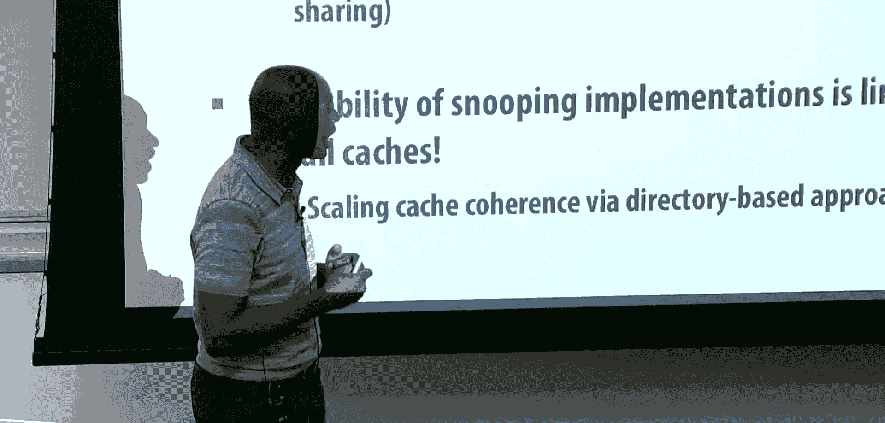

And we said that you could implement cash coherence using a bus as a broadcast notification mechanism and snooping。

 however， snooping doesn't scale。 And so what you'd like is is something that that scales and and directory mechanisms are much more scalable。

 And so from a software developer point of view， the impact of cash coherence you know。

 shows itself up most most in the ideas that you can have full sharing。 and that if you can kind of。

Think about changing your applications such that you can reduce the full sharing。

 Then potentially performance could be a lot better。

 And one way to kind of understand when full sharing is is happening potentially is to use some of these system tools to analyze cache behavior。

Okay， so。Now we're gonna， So，1s of all， I should ask， are there any questions about cash coherency。

 so you certainly there are some exercises in the assignment that cover the stuff。

We talked about directory toable， and then youd mentioned that you're going to track。

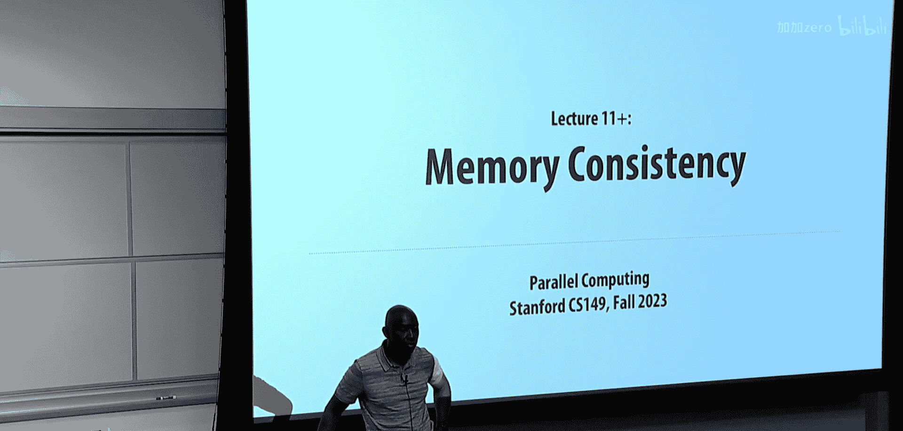

Look the different we happen right the size that was keep increasing。Yeah。

 absolutely and then then you might have some other other schemes for reducing that。

 but we're not going to get into those。It doesn't， it gets worse。やけ。Then there was a Uship。

 so it was decreasing。Yeah， so。

So we're looking at misrate， right？

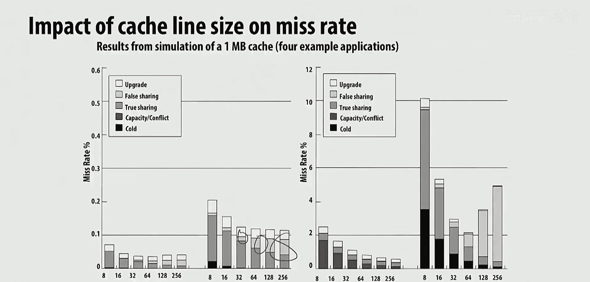

So you're saying why is it go down and then up， you tell me。Why do you think。Oh。Okay。

 so what we know about line size and spatial locality。😡。

well spatial locality is better exploited and so the impact of that is and then you have full sharing which is pushing things up right and so eventually the improvements that you get from exploiting spatial locality are outweighed by the detriment of full sharing。

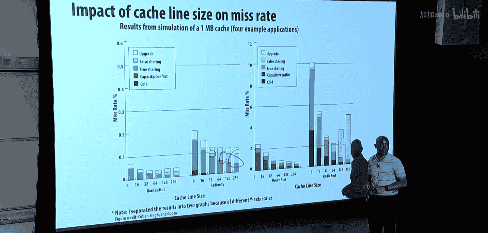

Yeah。Hes gig like the standard like cashline size and most。

It depends， but usually it's 64，128 cashlight sizes have been getting longer over time。Yeah。

 I was interested。 so going back to the。

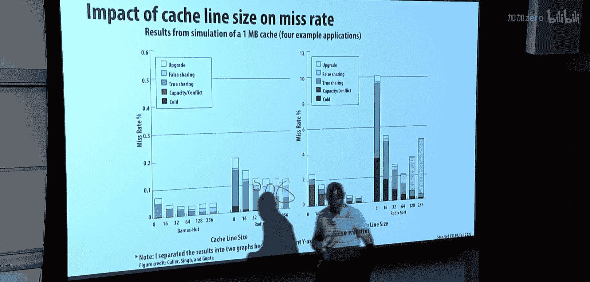

てて。football andI NSI so we're at inI and NSI primarily using the caches that didn't have them。

Certainly。Now like not that we have open know。 Well， so， so the。

 the directory mechanism is somewhat orthogonal to the， to， to the exact protocol you're using。

 right， is's just sort of a way of， I mean， you could still have modified， exclusive， shared。

And the question is， sort of， when do you indicate to the processor that， you know。

 you should pay attention to， to a transaction， right。

 you could do it with a bus where everybody is snooping or you could do it with a directory。

 which it has point to point messages and is more scalable， But you， you still keep the same states。

 right。The answer子对。All right， so。啊。Yeah， so let's talk about memory consistency， right。

 which is the kind of other side of the coin of dealing with memory and moly processes。All right， so。

 you know， we talked about how load and stores should behave intuitively you want to return the latest value written right。

 and we said coherence says we're just going to talk about a single memory location。😡。

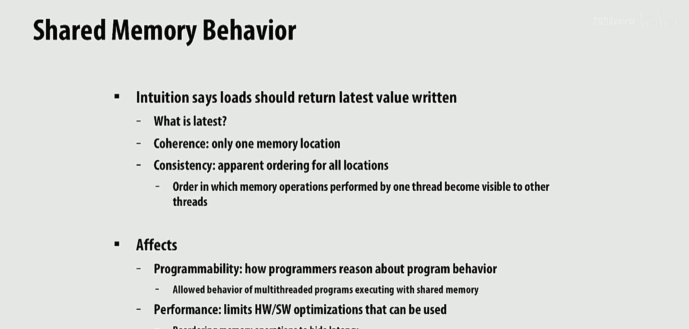

Memory consistency says， what about the apparent ordering of reads and write to different addresses by different processes。

 How should they be ordered and how should we interpret the behavior of of a program。

 a shared memory program that does this， right？ Okay， so this is gonna affect you know。

 how we interpret programs， What programs mean right， and by。

 telling us what is the allowed behavior of the memory system or the compiler and the memory system。

 ther and the memory system， Right， And so it's important because the way in which you allow。

Loads and stores to different addresses to be reordered is going to have a big impact on how perform our system is。

 And it's also going to affect， you know， what。I， as the programmer can do to。

 to improve the performance of my program。Okay， so what are we going to focus on？So let's see。

So why should you care So if you want to implement a synchronization library。

 you know you really need to pay attention to memory consistency and if you want to develop a compiler or low level OS code then it's important to understand about memory consistency you know it turns out that if you are an application programmer who does most of their development using you know compiler sort of a high levell language programmer or you are going to use kernel libraries or system libraries。

 then it's not so important to understand the details of the memory consistency model。

 but if you are kind of a low-lel system developer like potentially the people in this class。

 then it's important to understand right so memory consistency it differs from memory coherence because were。

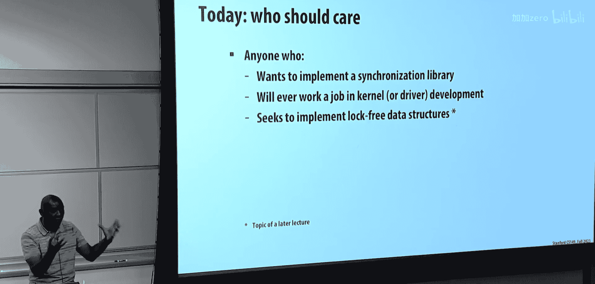

alking about multiple different addresses， right？ So what the memory consistency focus on is it its reads and rights to different locations as observed by different processes。

 Okay， so coherence says， hey， eventually， any rights made to a particular address will all be seen by all the processes in the same order and consistency says。

 you know， when write to different reads and write to different addresses get seen by reads from other processes。

 right， So says slightly differently， Gulf coherences ensure the memory system you know， is。

Behaves as if the caches weren't there， Right， So you imagine that any system that has。

Multiple has caches in the system needs to be coherent。RightIt's kind of fundamental if you。

 You don't want to work with a system that's not cash coherent。

 But even if you had a system without caches， you would still need a memory consistency model。 right。

 so even systems without caches need a memory consistency model because we need to define the allowed behavior of the memory system。

 whether or not there are caches in the system。 Alright。

 so to kind of give you a preview of you know， what we're gonna talk about， you know。

In in a modern multiproces system， memory accesses are going to get reordered right And the main reason for doing that is to improve performance。

 right， But then the question is what does that mean to the programmer， Well， you know。

 if you're an application programmer， you probably don't care so much。

 But if you're a systems programmer or a compiler rid。

 then you care a lot Because it's going to affect what you can do in your compiler。

 it's going to affect the behavior of your low-level system code。Okay。

 so let's define a few things here， Right， So there are four types of memory ordering memory orderings that we can have in the system。

 right， So， you know， you've got a program defines a bunch of of reason rights， loads and stores。

 And these happen in program order， right， And the question is。

 whether the memory system maintains this program order or not， right， So。呃。Well。

 for any particular thread， it's gonna maintain the program order。

 The question is sort of what it does to accesses from， from different threads， right？ So， well。

 so you have four types of of operation orderings。A right。Of x。To a read of why cold。

Is right to read memory ordering。So that says that the right of X has to commit and change the state of the memory before the read of y takes place。

 So that's a kind of right to read memory ordering。 There's read to read， memory ordering。

 There's read to write memory ordering。 and there's right to write memory ordering， right， so。

The key thing， of course， is that X and Y are different addresses。Okay。

So these are the four types of memory orderings。 And the question is， sort of， you know。

 what memory orderings are going to be maintained by the memory system。So in order to， you know。

 get our heads thinking about this， let's look at a very simple program。 So initially， A and B are 0。

And process of 0， we。Set a to one。 And then we print B and processor of one。

We set B to one and then print A。 So why't you discuss with your neighbor and tell me which one of these outputs are can be printed。

So I'll give you a minute to think about it。What do you think。Any。Any of them， so we have。

Often for any of them， do we have。Another view of what could be printed， Yeah， is it just one one？11。

Well， I think that's possible， so one one。What else？Near one。Yeah，0 one。Could 10 be printed？

Someone said yes， someone said no。Yes。Well。Not clear。

 but let's see so let's put in the double question mark by that。What about 0，0， is that permissible？

😊，No， okay。 So that's not。 All right， So in order to kind of understand what could be printed。

A useful way to think about it is in terms of happens before growth， right？ So what's required what。

 what has to happen before， what in order to allow the output that you expect。 So remember。

 when you are executing in a multi processorces environment。

The instructions of the different threads on the different processes can be interleaved in any manner in time。

 Okay， now， on any particular thread， the instructions are going be executed in program order。

But when they get inter leave into the global order， whatever that may be is gonna be dependent on。

 on on things that you can't control， right， so。Let's assume that that we want a particular output like 0。

0， right？ So that says that we would need to have the print of B happen before。B gets set to one。

 right？And we'd also need the print of A to happen before。啊。A gets set to one。

And we know the program order on any particular thread is。啊啊。

Statement 1 before statement 2 and statement 3 before statement 4。 So we put those arcs in。

 And then what we have is a cycle， right。So we don't and we've got to cycle。

 we know that that the outcome is impossible because an event must happen before it hell。

 before it itself。 And so that says we can't get 0，0 and we can't get 1，0。😡，Yeah。

If you have a store buffer and you're like out of order operating and rearranging like a read to occur。

Or right？It's big you have zero， zero。We'll see。That's a good question then we're going to investigate that。

Alright， so， you know， so the question is， what should the programmer really expect？ Well。

 one if I kind of asked you， you know， given， you know， what you know about shared memory so far。

What you would probably say is， hey， there's some global ordering to all of the accesses in the system and I want to respect that global ordering。

 and I also want to I want to have a global ordering that everybody sees that I can serialize all the accesses memory accesses in the system and also。

 of course， that global order would mean that any particular thread。

 the memory accesses are made in program order right So what you would be describing loosely is what was formerly defined by Leslie Laport in 1976 as sequential consistency。

😡，So sequential consistency， you know， for which she partly won the touring Award in 2013 basically says that all operations are executed in some sequential order。

 as if they were manipulating a single shared memory and then any of the accesses。

 any of the operations in any particular thread are always in happen in program order。Okay。

 and so that means that sequentially consistent systems maintain all of the four memory ordering。

Orderings that we just described write to read， read to read， read to write and write to write。 Okay。

 so， so we've got this sequential global order and notice that this。

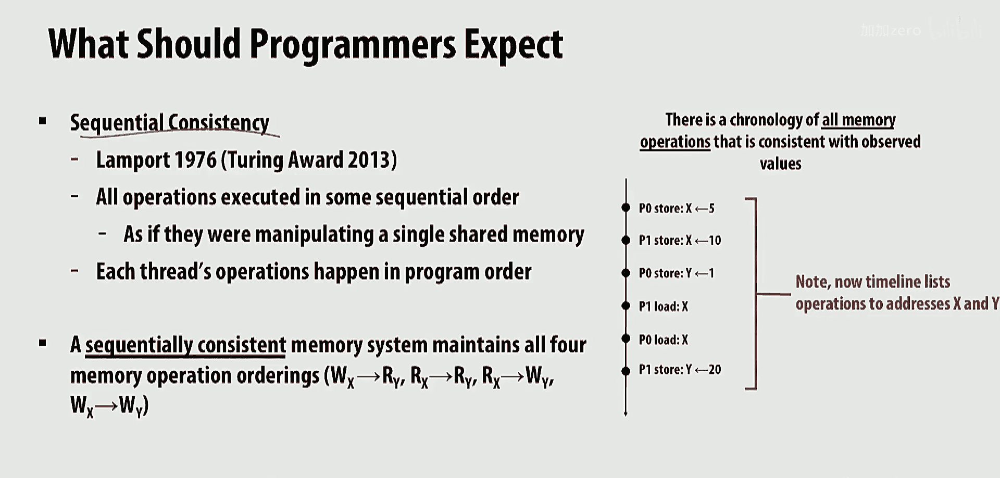

Diagrams slightly changed from the coherence example in that you know we now have multiple addresses。

 X and Y in the diagram。 and there's some global order， right。

 one way of kind of thinking about sequential consistency is this switch metaphor where you've got a single shared memory。

 you've got this pointer and this pointer， you know， randomly points to any of the processor。

 you know accepts a memory operation from the processor and then you know flips to another processor and takes you know。

 some random number of accesses from that processor。Okay。

 so we've got this idea of sequential consistency。 So here's the picture right， you know。

 we've got equals1 R1 equals B， B equals1 2 equals a on on processor 0 and processor1。

 We start by executing A operation from processor 0。😊，Followed by an operation from processor  one。

 followed by an operation from process 1。 And then finally， an operation from processor 0， okay， so。

So with a switch metaphor， then you can， you can kind of look at the interleavings that you might get。

 and you would see， you know， we go back you know， this is just another representation of that first example that。

 you know， both 0，0 and 1，0 are illegal。 You can never get it from sequential consistency。Okay。

 so why might we want to relax these orderings？😡，So do something other than sequential consistency。

 So from point of view of a programmer， right， sequential consistency is the most obvious and intuitive thing。

 right， If I look at a program and I think about it multi processorces execution。

 what I want to see would be sequential consistency。 And the question is。

 why would any system implementer want anything else。 right， And the reason is， of course。

 it's always performance， right， that's what this clause is about， right。

 So we want to relax the orderings， so we can get more performance in particular。

 there was some comment about， hey， what if I had a a write。

 which was gonna miss the cash and have to do all sorts of things。 It's gonna take a long time。😊。

Followed by a read。 And maybe this reads gonna hit the cache。 right？ They're two different addresses。

 They're unrelated。 Why shouldn't I do the read。Before the right。

Or at least maybe I want to overlap the two， right？

 So if you think about from the point of view of the application。

 the application wants to read its data as early as possible。 And who cares about the rights。

 can push them off later or try and overlap them with other reads。 Okay。

 so that would be the ideas is that sort of why wait for the right to finish。

 which would be sequential consistency， let's at least overlap and maybe reorder。 Okay。

 so let's see what happens when you do that。Okay， so so the problem with SC is of course。

 that you've got this case where you know。😡，These two accesses are unrelated and you'd like to have the read happen before earlier than the right because the right is going to take a long time okay。

 so somebody said right buffer。😡，Good idea。 Let's put a write buffer in， right。

 So the write buffer is gonna basically say， hey， you write。

 you're gonna go eventually it's gonna be sent to the memory system。 But in the meantime， hold off。

 don't use the bus， Don't use the， the resources because I'm going to issue the read first。

 because the processor is waiting for the read。 and and that's gonna gonna if I I get the read earlier。

 then I will get then a performance， right， So I'm gonna put a write buffer in。😊，And， you know。

 the problem with the right buffer is it's gonna to change my memory behavior。 Okay。

 so in the case of。Can r1 and r2 equal 0， We said in sequential consistency， that can't happen。

 The question is， how could it happen with right buffers。You ask the question。

 so you tell them if you have the rights just sitting in the right buffers and then you go ahead and execute the reads while that's occurring。

 then your would read the around。Right， so in this case， you'd read 0，0 and。You know。

 that's not sequential sequentially consistent。 It may not be obvious why this behavior should be。

 And the question is， okay， so I have a right buffer。 You know。

 we we said the reason that you want to reorder things is， is to improve performance。

 This just shows you a couple of examples where you can get， you know。

 performance improvement that's pretty substantial by having a right buffer between the processor and the cash。

 Well， maybe you can put put the right buffer on the other side of the cash between the cash and the bus。

Okay， so， you know， right buffers are important。 Every major instruction set architecture supports right buffers。

 right， And the problem is， right buffers don't fit within sequential consistency。

You need a weaker consistency model to have a right buffer because， and you want it because you want。

 you want the improved performance that that comes from that。 But now you need a weaker memory model。

 one like total store order or or process of consistency or。

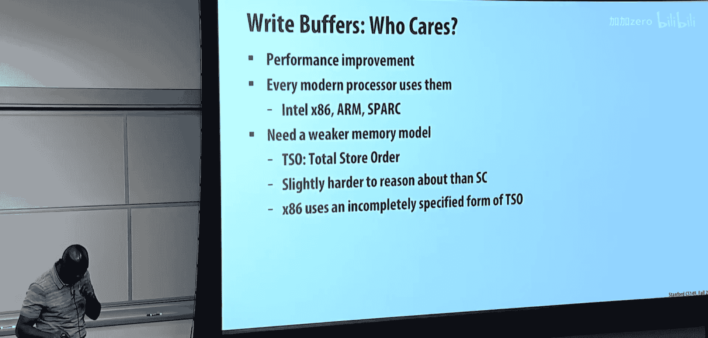

Partel store order and， and in total store order and partialcel store order。

 you are gonna relax the first ordering。😊，Case， right。 So right to read order。

 You're gonna allow reads to happen in the right to X followed by a read to Y to happen in a in a different order。

 so。Total store ordering or partial store ordering this should actually be。

Process of consistency is actually something different。Which is PSO。Alright。

 and so now we're gonna be allow you to overlap the， the， the。

The read were the right and somehow reduce the impact of the right latency。

 So hide the right latency， right。

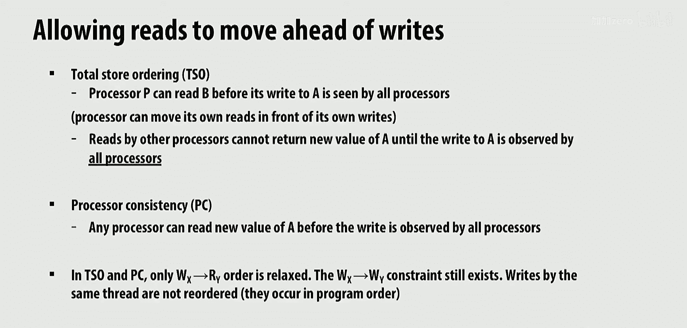

Okay， so total store ordering basically says。呃。Mm。Yeah， coastal ordering says process and read。B。

 before it writes to A as seen by all the processes。And the。Process of consistency， I thought。

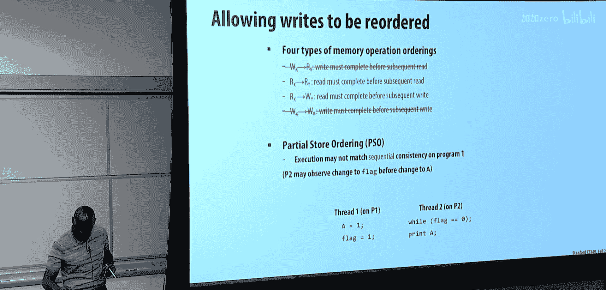

啊。I mixed them up。 Sorry， process the consistency。I can can remember。发。Yes， so I think anyway。

 I'll get it right， I think this is right。But so this is the one that says， hey， you can。😡。

Reorder the rights and the reason。 the question the the difference between total store ordering and process of consistency is when everybody gets to see the stores in total store ordering。

 everybody sees the stores in the same order in what I thought was partial store ordering。

Some get to see it earlier。 But anyway， I， I'll make sure that I actually， you know， get， get， get。

 you know。😊，There is a joke that says something like there are two hard things in computer science。

 naming things and memory consistency。 So this is the。Exactly， so anyway， all right。

 so coherency because we got caches。Consistency， because we need to have a way of understanding what our programs mean。

 we can do。Things that are even more aggressive than。All rights to bypass。

 allowing Re to bypass rights， we can reorder rights。And this is partial store order ordering。

 and in this case， you know， if we are protecting a change of a variable from a flag which trying to do synchronization。

 then things could get reordered and our behavior would be not what we expect。Okay， so again。

 we're gonna do this to improve performance the way that we， you know， we can。

 we can get rid of them all。 And by the way。😊，Who has a cell phone？

Arm uses what's called relaxed consistency。Right， so it doesn't have any of these orderings in its memory in its memory consistency model。

 And so how do you fix this problem。Well， you put fences in， right？

How do you fix any problem in parallel computing， you slow things down。Right？Locking。Is。

 is a mechanism for slowing things down。 You to you tell and fencing is even worse， right。

 So fencing says we're gonna wait for the memory system toquies， right。

 And everybody is gonna make sure that their memory the memory every all the processes are gonna make sure that that they have。

😊。

Isued all their， their memory， their operations before we allow any of them to go beyond the fence。

 right， So this is a hardware mechanism that gets implemented， yeah。

for some reason because of this or is it just simple。It's， well， it's both a simple。

 simpler implementation and also higher performance。

 But it means from a systems programme point of view， it's more tricky to deal with。 But， you know。

 the way to deal with it is， is to add fences， right， And you can have fences。

 you can have store fences and load fences and this all gets pretty tricky and refer you to lots of online documentation。

 If you want the details。Okay， so the problem is data races is that you've got。

Two accesses to the same address。At least one of them is a store and you don't have any synchronizing synchronizationization between the the loads in the stores。

 And so you have an unsynchronized program。 And whenever you have unynchronized program。

 then you can get data races。 And when you have data races， you can get unintended behavior。

 And so the question is， how do you make sure that you can run programs on a machine that doesn't support sequential consistency。

 but still have behavior that you can understand。

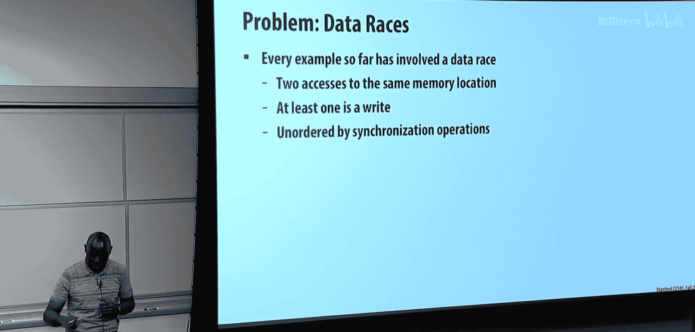

You make them synchronized。Right， so that's the whole idea behind to kind of data race free programming is。

 you know， don't write code that uses unsynchronized accesses to data。

Whenever you've got shared data， make sure you put in synchronization。

 and then the people who actually write the synchronization libraries have to understand the memory consistency behavior of the underlying processor。

 the people who who develop the compilers have to understand these issues。

 But you as the application programmer can kind of just rely on the fact that somebody who's much more knowledgeable than you has done the right thing and given you a library a call that you can just make。

Okay， so I think we're we're at time。 So we're gonna get just you know。

 turns out that the the memory consistency really needs needs to be dealt with at two levels at the hardware level。

 what the hardware provides。 But also at the language level。

 So we'll say a few words about that next time next week。

