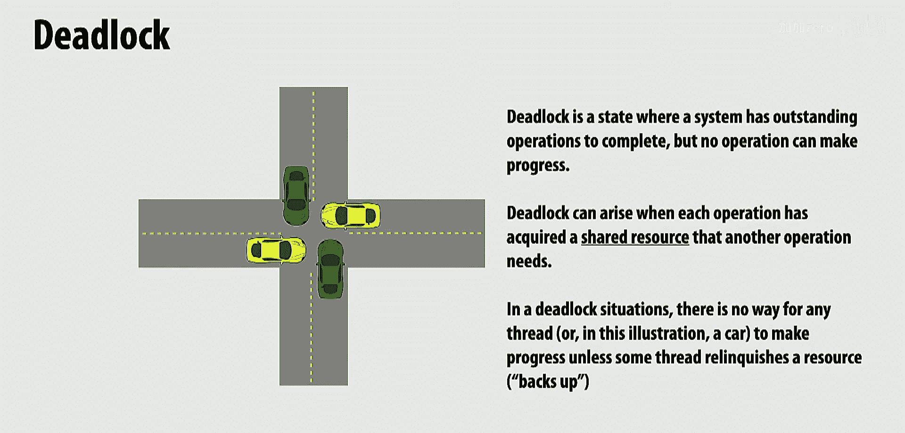
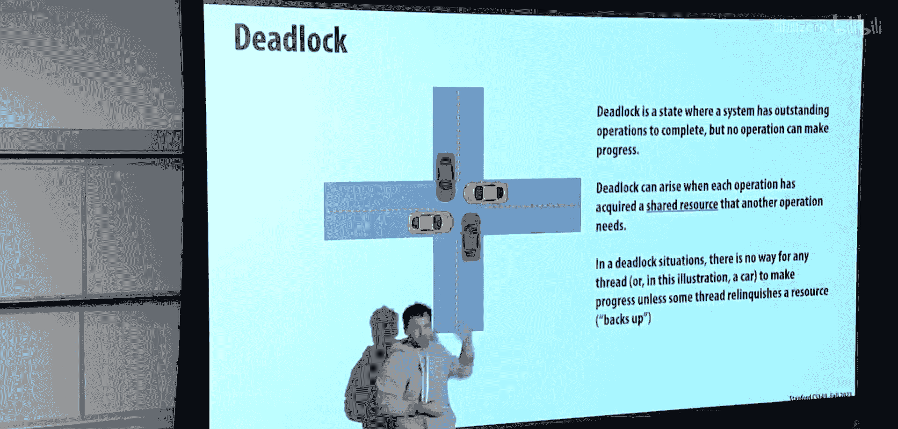
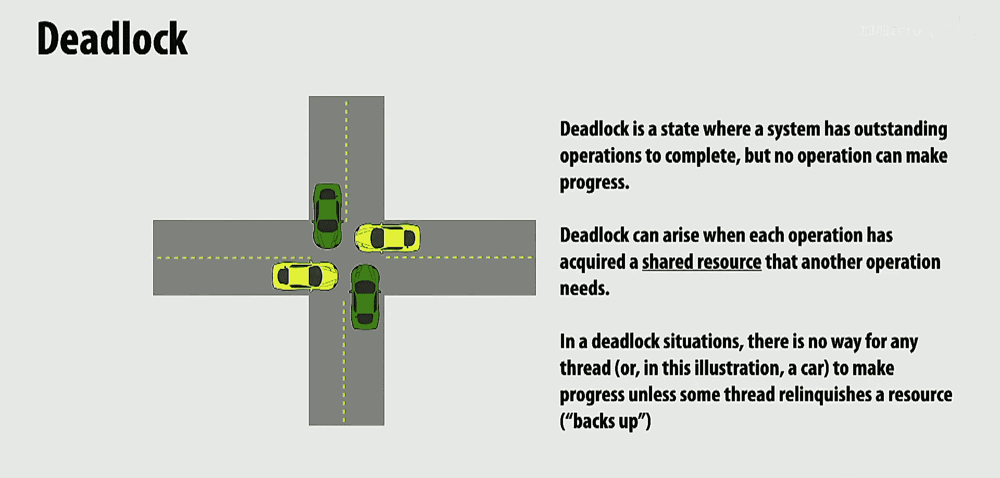
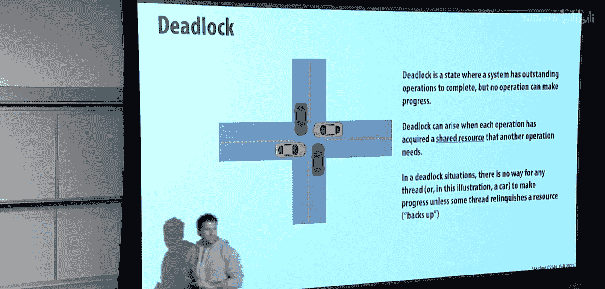
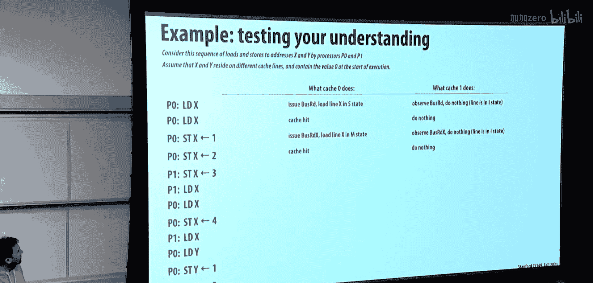
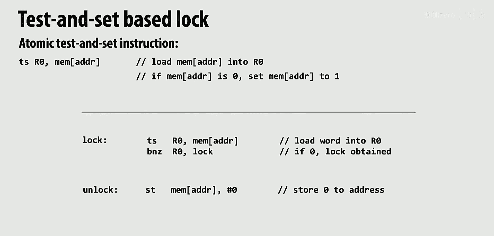
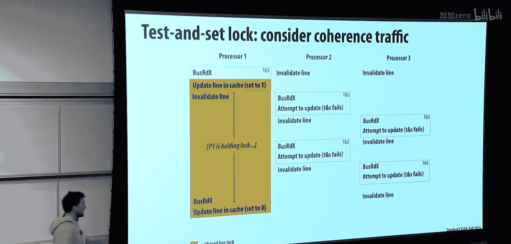
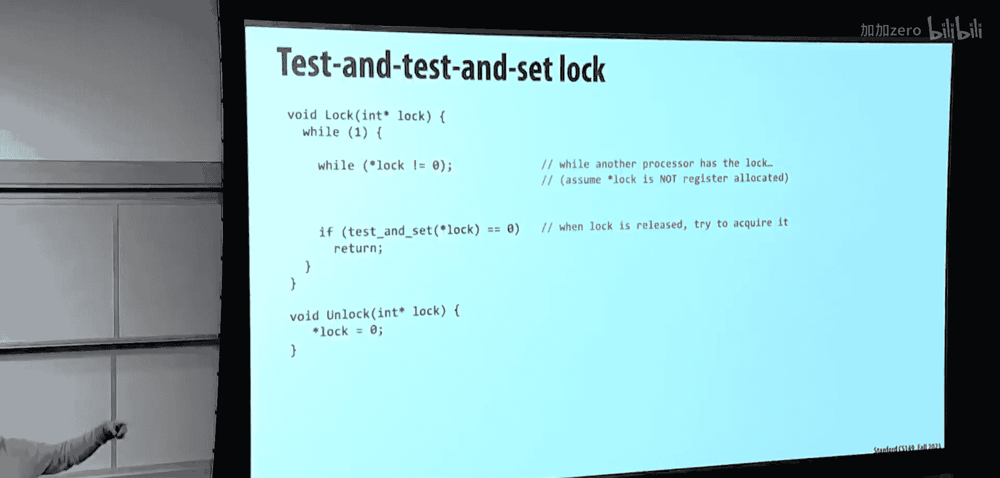
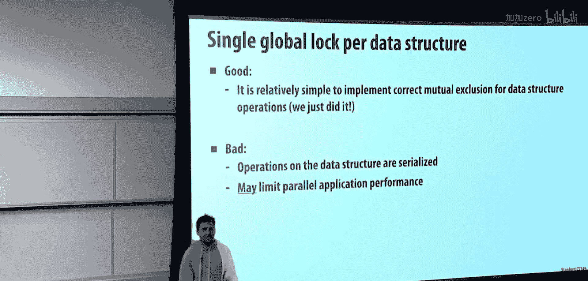
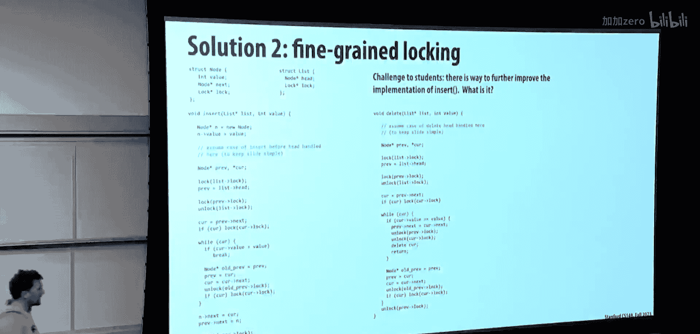

# 【并行计算 CS149 2023】斯坦福大学—中英字幕 p13 p12 Lecture 13 - Fine-Grained Synchronization and Lock-Free Programming -BV1du17YfE5G_p13-

So this is a good lecture to make sure you're sitting by someone you like to talk to。

Becauseuse you know， whenever locks get involved， there could be you some heads get started exploding a little bit and thinking about all of the cases。

 So we're gonna work through some of those examples a little bit， but to get started。

 let's just make sure we're all on the same page with a few terms and those terms are deadlock livelock and starvation so I just want to go through those because these are all issues that can occur when you have synchronization problems in your program。

 so I want to make sure I give some examples of these or're clear on the terminology and then we'll use that terminology later in the lecture。

😊，So deadlock。 And it's a term that I've heard people， you know。

 those of you in the audience have have said earlier in class。

 So it might be intuitive what it might mean。 Here's an example that I drew up。

 This is an intersection。😊，And， you know， I've got four cars on the intersection。

 And my claim is that none of the cars can make progress。So do you agree with the claim。And so if。

 if cars are not allowed to back up。What does every car need in order to make progress？It needs。

 it kind of needs the road in front of it to be clear， right。

 Like so this yellow car needs the road in front of it to be clear。

 But that that part of the road is not clear because it is held or or it's occupied by the green car。

 So why doesn't the yellow car just wait for the green car to get out of the way。

Well， the green car can't make progress because it depends on a resource。

 A part of the road that's held by the next yellow car and so on and so on。

 So notice what the conditions are here for， for this form of deadlock。 You。

 everybody needs to have a resource that they can't get and。

You can't。 And， And then the idea is that you don't relinquish that resource until you get everything that you need to make progress。

 So in this case， the yellow car is kind of holding onto or occupying this territory。

 but it needs this territory。 And it's not gonna let go of this until it finishes its job。

And then finally， the problem is that we have a circular set of dependencies。

 I can't go because I'm waiting on you。 You can't go because you're waiting on someone else。

 They can't go because they're waiting on me。

And so these are， you need all of these conditions to hold in order for there to be deadlock。 So。

 for example， here's a photo that I took。嗯。Of， of a deadlock situation in real life。

Which is very similar to the cartoon that I put Here's a bus and the bus made a little bit wider turn than it should have or you could argue that this car probably ignored a little something on the road that says please don't pass this line because buses need to turn here and all of a sudden the bus can't make progress because that car is there the car can't make progress because the bus is there and why is it the case actually that we get deadlock。

 we need the ability we need to be in a situation where we can't relinquish resources。

So relinquishing the resource here would be what。Would be backing up， right。

 And you can't see it from my photo， But， but neither of these folks can back up because everybody's kind of filled in behind them。

 And so ultimately， I mean， it certainly isn't actual deadlock because otherwise。

 if it was real deadlock， the road would still look like this。 So eventually。

 people start backing up。 But， you know， you have effective deadlock。😊。

Here are a few more examples of Dlock。For our more nature loving folks。

And so make sure you can convince yourself why these are deadlock。

Nobody is willing to to relinquish a resource because they don't trust the other party。

And since that's the case， no progress is being made。Now， of course。

 the reason why I'm telling you all this is this can obviously happen in computing systems。

 like a simple example might be， imagine we had thread A and thread B。

And thread A pulls data out of some work queue。And puts results in some output work queue。

And thread beef supposed to pull data out of this work queue and put the data back in the one on the top。

So you might be in the case with thread A says， well， I'm。

 I'm not gonna pull any new work because I have nowhere to put my output。

So thread A doesn't drain its input。And it's waiting on B。

 but B can't make any progress because there's nowhere for B to put its output。

That that's an example。 And the example of deadlock that we hit earlier in class is when we were talking about message passing。

 Remember， I said， oh， there's this subtle bug in our original message passing code。😊。

Where we said everybody was going to send and wait for their message to be received。

 and then they would turn around and receive。RightAnd so that was an example of deadlock as well。

 Everybody was blocked on， essentially the same call。And as I alluded to earlier。

 you need these four conditions for deadlock to actually occur。 We。

 we need to have resources that can only be held by one party at a time。 That's the mutual exclusion。

 Like only one car can exist in this part of the road or only one thread has data in its input， you。

 like this input queue is exclusively for this thread。

You have to have a situation where you can't back up。😡。

So once you kind of start this process and you acquire， you know like the road。

 the part of the road that you're in， we're assuming that you can't back up or relinquish those resources to free things for other people。

 The only way you can free up resources is to keep going and complete things， complete jobs。

Last is you know， no，3 and2 and three are kind of similar in that there's no preemption。

 like if you actually can take the threat off the processor and and relinquish the resources。

 that's kind of basically relinquishing resources。 And then the most important one is this fourth one。

 which is the circular set of dependencies。I'm waiting on you while you're waiting on me。

And since you know， like because if there wasn't a circular set of dependencies。

What would happen here， How would this resolve itself？

Imagine that there are only three cars in the intersection and not four。There are only three cars。

 someone would make progress， right， And as soon as they finish their task getting through the intersection。

 they would relinquish resources for someone else。 and then someone else can go and so on and so on。

Okay， so that's deadlock。 In Dlock， nobody is making progress。Like nobody's doing anything。

 no progress is getting made。That's a little bit different than the situation of livelock。

So in live lock， that's the situation where you're constantly doing things。

But no real progress is being made。So， for example。

 imagine that we have these cars in this intersection and they did have the ability to back up。

And so every car saw that they had sort of reached this sort of impasse where nobody can make progress。

 And imagine everybody backs up。And then everybody's like， oh， the intersection is free。

 I'm going go。Then they back up and so on and so on。 So this is a situation of live lock。

 So it's called live lock because everybody's making progress like there's not。

 you see operations happening left and right。 If you had like system logs， you'd be like， yes。

 stuff's happening， but then you'd be like but but nothing real is happening。😊。

So this is another problem that we can get into。 What's the most common day to day example of why block。

That you run into。或者。I thought I heard a mumer。What happens all the time when like。

 you kind of walk up to a door。And somebody else is like， you go， you go， you go。

 That was like the most common social live walk that definitely happens。

 Or where you're walking And both of you walk to the same direction and then you both walk this the other direction to let somebody go by。

 Those are all examples of real life live。Okay， so we have livelock。 And， yeah。

 So live lock is a state where we are actually doing stuff， but nothing is all that interesting。😊。

And then last， there's the condition of starvation。 And so here's another road example。

 Imagine that there was a yield sign here。 So the yellow cars on the horizontal road had a yield sign and had to yield to traffic on the main vertical road。

😊，So if this is a busy time of the day。And the green cars are just a steady stream of green cars。

 They're going make progress。We're gonna get a lot of stuff done。

 but certain operations such as yellow cars going are going to get completely starved out because if they have to yield to the green cars and the green cars never have a hole in the traffic。

 you're just gonna be sitting there all the time。😊，Right。

 for those of you that are go over to the beach very often。

 it's like trying to get on 101 or sorry get on highwayway 1 on on a weekend。

 when you're like stuck in half of bay and you're trying to turn on to Highway 1。

 you can just never get get on the road。 So it may look like you are like if you're debugging this thing。

 to you。 It might look like， oh， shoot。 Maybe I have deadlockca I'm not seen any yellow cars do anything。

😊，But you're， actually， we are completing useful transactions。 We are letting the green cars go。

 Okay， so those are just three things to keep in mind throughout the lecture。 Deadlock， Livelock。

 starvation， all things that we can， we can kind of mess up。😊，Alright。

 so before I start talking about locks， I think this is be a good time to review this diagram that Konley put out in front of you last Thursday。

 I think， yeah， last Thursday， so that was the first time we talked about about cash coherence。

 And so before we get into thinking about how locks are implemented。

 I want to make sure because you've only seen this once technically， and this is like the first。

 you know you're doing homeworks on this now that people have a little bit of of an idea about what's going on here。

 So first of all， if you had to describe the purpose of cash coherence。😊。

Why did we talk about that last week at all？What's the problem that cash coherent solves？就是。Great。有个。

Oh， okay， Well， yeah。 okay。 So it solves the problem of we want caches。 Yes。

 and if you have multiple caches。😊，They are copies of data。

And whenever you have copies of data and you have rights。

 you've got a real problem of you've got to keep those copies up to date。

That's the problem that cash coherence largely solves good。お。

I guess if you had to maybe building on that， if we had to say。

 what is the general strategy that these cash coherence protocols that Kume talked about。You know。

 if you had to give like a high level， like， what are they all what。

 what's the main idea of them or what are some of the key principles， Like。

 what does this diagram even mean， Yeah， like Okay， so， so one version of this is， is saying if。

You make copies of something， and you write to it。 You have a problem keeping those coffees sort of in sync。

Don't allow there to be copies if you're writing to something。Right。

 so then the first name of the game is the minute you write to something。

 all other coffees are going to have to disappear so that there's not a problem where you cannot access data that might be sta。

And how did that get insured。In other words， like what is this diagram actually？

I guess it's like you go to。three all it go。我们こ。Okay， it's also good。 and so。

 I'll repeat that in a second for people remote。 But the。

 the first idea that I want you to think about is that this cache coherency diagram is it's a policy。

 It's a rules of the game that all the caches have to be agreeding to。😊，So this is the state machine。

 This is the logic that every cash executes individually on their own。

To ensure that coherence is met and know， one of the biggest parts of coherence is to make sure that when one person is writing to the data。

 nobody else is。 and nobody else has has data。 So the way I want you to think about this is and K gave you an one of these examples before is I want you to think about a sequence of memory operations performed by different processors or different caches。

And then I want you to think about what would I do if I'm cash zero？In this situation。

And what would I do if I'm cash1 in this situation？Right， so just， to start。

 let's just say that the first cache loads a variable or load loads an address。

And what that cache does is， talk to me about it。 Like， what does that cache do。

 What does this text on the slide actually mean， There's like issue bus read， loan。

 line X and S state reserve bus read。 what， what does that mean。We have two caches。

 and let's just say on'mc zero。And I w to read from this address。 So what do I have to do。

What I wasson here is doing is it's broadcasting the fact that it is reading like this particular memory address to all the other caches so that if。

The other caches also have that line inside them， then they can kind like call the protocol and transition accordingly。

是。Good， so just keep in mind， the name of the game is that all of these caches are working together。

And whenever the state of my cash changes。I have to tell all the other caches about it。

Because they're making decisions based on knowledge of what I'm doing。So in this case。

 if I load address X。I have to shout out to all the other caches that say， hey， by the way。

I'm about to have a copy of this。Which basically is saying， if you ever get around or writing to it。

 you got to let me know。RightSo that's me。 It cache0 shouting out I'm loading line X。

 And now what allows me to load it into the S state。It's still consistent。

It's still consistent with memory。 Yes， yes。 So， so basically， first of all， Im。

 I'm loading it essentially with a permissions to say， I promise I'm only gonna read from it。😊，Right。

And that means that other caches know what。If I'm only gonna read from it。They， they。

 they can also read from it exactly。 So， so that's what okay， so， so that's what I did。

 And notice that cash1 did nothing at that point。

Why is that。Yeah， like， like I yelled out， hey， I've got the wine containing X and the other cash is sitting over here saying it's not in my cash。

 I could carry less， right， exactly。Okay， and so then I loaded， Yeah， I loaded to it again。

 I read the value again。 And what happens。Absolutely nothing。 Why does absolutely nothing happen。

Yeah， why do I not have to tell anybody about this？ It's a hit。 My cache state did not change。

 They already know what my cache state is， exactly， right。

So now let's say I want to write to the thing。Okay， what do I have to do？I have to yell out。

 but I'm about to write to it。And what does everybody else have to do？然后对。Yeah， and now in this case。

 the other folks don't care because they don't have it， right， So in this case。嗯。Does't do anything。

And now if I want to write to it again， again， same thing， if I write to， oh， and this is okay。

 So now the other processor wants to write to it。

What is the other process a good deal？So it's going to shout out， hey， I need to write。

 and what do I do？So 1st of all， I can't keep my copy。 And in this case。

 since I have written to the value， I better put the most recent value back out of memory， right。

 So I'm gonna flush my I'm gonna put the data back out of memory。

 So the other processor gets the act of the latest value。😊。

And then I got to drop because of why don't I just keep it in a shared state？

Because it's going to be stale， right， because the other person that's going to write to it， exactly。

So now if you another load by the other party doesn't matter to me because I'm like。

 I don't have the value if I want to bring it back and read it。I'm going to say， hey。

 I want to read this value now， the other processor is going to flush it out to memory and then what are they going to do about their cache？

😊，They could， Yeah， they could。 They could keep it in shared because they're like， well。

 I can't write to it anymore because there are copies around。

 but I I'll keep it around because if I want to read from it。

 I don't want to actually take that cash miss。And so I'll let this， you know， you know。

 we won't go into the to the rest of us。 But these are the things that you definitely need to be able to walk through and step through in your head。

 You did one last week。 I think there's one on the homework assignment and stuff like that。 Okay。

 so with that in mind。😊，Now， let's think about implementing a walk。And I'm gonna give you。

 cause you used to， to。To using a bunch of locks。 but we haven't actually talked about the underlying details very much。

 So what I'm going to do is I'm going to give you an instruction that's not a load or a store。

 but actually a little bit of both。 It's a load compare store。

So imagine that you have a machine instruction。 And just to keep it simple。

 I'm gonna call it test and set。 But， but in practice these these types of machine instructions are very different。

 They might be compare exchange or load link store conditional。

 But imagine you have this instruction called test set Test and set。

 which takes the value or reads a value from memory at a designated address。

 And if the memory's address is 0。 It sets it to one。😊，做点是老子。And sets it to one。Okay。

Now let's think about how I might use this to implement a law。

So here's my simple assembly code for implementing a lock。 Here's unlock。Let's start with unlock。

 actually。So imagine you had a variable that was one if someone had a lock。And zero otherwise。

If you're the thread that has the lock， how might you unlock。Go话。It's right zero。Makes sense， okay。

And。

Here。What is the lock procedure， The lock procedure is try and execute one of these testing sets。

 which says if。AndAnd it's storing the value of loaded from memory here into this。

 into this register。 Okay， so I'm gonna read the value from memory。 And if it's 0。嗯。

I'm going to set it to one all in one step。 This is one instruction， one atomic instruction。

And if the value I， I read from memory is0。What can I conclude。I have the lock。

If the value that I read for memory is one， what can I conclude。I don't have the lock。

 and I actually am going to branch if nonzero back up and try again。So it's basically， I'm saying。

 while the value in memory is not as one， keep trying this test set thing。

 If you ever see it to be 0 by the time you， you， you， you， you're checking to see， oh。

 that was I the person that set it to one。 If you're the person that set it to one。

 you have the luck。And then the minute you unlock， presumably somebody。

 some other thread can come in。And now succeed with one of their test sets。 Now， like if。

 for example， if you were running on an Intel chip， you wouldn't have test and set。

 you might have something like compare exchange。 Its a little bit more elaborate form of things。

 And offline， I think it'd be kind of fun to， to study this to say， basically， hey。

 can you confirm that essentially， this is a lock with test with compare and compare exchange。

 which basically is using some X 86 flags registers and things like that。

 doing basically the same thing。😊，Okay。Okay， now， here's why I spent some time talking about or reminding you about coherence。

 Imagine that we have three， three processors or three threads。

 and they're all trying to get this locked。Okay， so remember what they're doing is they're。

 they're saying， while test and set fails， keep trying。 And as soon as test and set succeeds。

 I know I have the lock so I can do what my critical section kind of thing。 Okay。

 so let's think about what happens， so。Processor  zero。

 let's just say that processor0 is the processor that first tries to get the lock。That test and set。

 I'd like you to think about as a right， at least from the coherence protocol perspective。

 it's a right because it's modifying the variable。So since it's the right。

 processor0 or processor one in this case is going to try to execute its test。

That test and set is going to cause an invalidation。Because that's a right operation。

 even if it fails， it's a right because it's an atomic operation that may right。Okay。

So at this point， if that test succeeds， I think you would agree with me that processor one is holding the log。

Okay。So let's think about what happens at the same time。 So processor 2， at some point in the future。

 tries to obtain the lock。And what is processoror 2 going to do to try and get the lock？

It's going to execute that test and set instruction。What's going to happen to the cash line？

Processor 1 and3， will have to invalidate。And the cache line containing the lock variable is going to move over。

To a processor2。Okay so keep in mind what's just happened。A lock is just a variable that has a value。

That variable is just in the address space。 It's cached。

And so even though processor  one has the lock。Processor 2 has a valid cache line containing the variable that the lock is。

 So having the lock。And having the cache line are two different things。

So there's nothing stopping from processor 3 from coming in and trying to get the log at this point。

 right。So that cache line is actually just going to bounce over there to processor 3。

And then all these tests and sets by processor 2 and 3 are failing， right？

Because they can't get the lock， which means the cash line is just doing this。So next sense。Now。

 what happens when processor one wants to unlock the lock？It's got to issue a bus readx。

 It's got to everybody else。 It gets the line in exclusive mode。

。

，It does the right to set it to zero。And then one of those tests and sets on one of the other processors。

 Let's just say processor 2 succeeds。 And now processor 2 has the walk。

So think about what's going on here is I'm a core。 I have a lock。

 I'm in my critical section trying to do this thing so I can release the lock。 And first of all。

 there's all this bus traffic flooring around between all the other processors as they spin。😊。

And second of all， actually， I have to take a cash mist to get out of the lock。Which kind of stinks。

 too。RightBecause that's time that other folks are not doing what they need to do。 Yes。Well。

 the test set is an atomic instruction。So there's a couple ways I could answer that question。

 One is the instruction may or may not update the line。

But you need to have right access if it's gonna go through。Right， so like。

 there's no way you could implement it as a atomic。Or I guess if you， if you implemented it as a。

 as a， let me give a bus transaction to read the value and then another bus transaction to sort of upgrade or。

 or get right permission， you're issuing two bus transactions。 So by definition， it's not atomic。

And at X 86， there's actually a lock prefix on on a number， a number of instructions。

 And that lock prefix basically kind of does that。 It says， sure， under the hood。

 this will be implemented as as multiple transactions。 But they've got like a lock flag on them。

 meaning that we're not gonna allow any transactions in between to the same。

 to the same thing or something like that。 So you can just effectively think about it as atomic independent of what the。

Implementation is going to be。Okay， so I already alluded to this。

 but I want you to be absolutely clear here that on the previous slide。

 what is the duration of time that the thread running on P1 had the lock。It was the entire slide。

What was the duration of time where P1's cache contained a valid copy of the line containing the lock variable was only for a second at the time of lock and for a split second at the time of unlock。

It's kind of interesting， right？And， and so like a simple lock like this has some properties that if we added more and more threads。

More and more processors are trying to actually grab this line。

It might take an increasing amount of time for the core with the lock to actually be able to grab it in。

 in the right state again。😊，And you actually see that in this graph where this graph is just kind of like the cost per lock unlock。

Which is actually going up as a function of the number of processors in the system。Because basically。

 like in order for me to get the cash line in the righttable state， I'm fighting。

 I'm contending with increasingly large number of processors。

 it might take me longer to get that exclusive access and might take me longer to literally unlock the lock。

 and so every unlocked unlocked period actually starts getting big and gets higher。Okay。

So now you might say， oh， wow， it sounds like we could do a whole lecture on how to efficiently implement locks。

 which we're not gonna do。 But you could think about some of the properties you'd like to have in your lock。

 Like you'd like it to be be fast。 You know， like low latency。 Like when you call lock。

 you don't have to wait for very long or you call unlock， You don't wait very long。 Youd。

 you'd like your lock implementations to not basically D S your system by generating a bunch of interconnect traffic。

 while everybody's waiting。 Everybody's spinning。 You might like it to scale the large numbers of cores。

 You actually might like it to be fair。 There was nothing about that previous implementation here。😊。

That guaranteed that all the processors would ever get the lock， right。

 like maybe processor  one and processor 2， just keep getting it。

 And there's nothing to ensure that processor 3 actually would。In this implementation。So。

 so implementing locks efficiently can actually become a pretty， pretty interesting thing。

 So let me just give you a few small refinements。 So here's a different lock that has the same test and set instruction。

 So now I'm just， I'm writing in C code to make it a little bit clear。

 Test and set does the same thing。 if the lock is if the it returns the value and memory。

 and if the value memory is 0。 It atomically sets it to one。 So this。😊，You know。

 sort of this if test and set is 0。 Well， that means I executed a test and set and their return value is 0。

 So I now know the value and memory is what。1， and I also know that I have the walk because it was 0 When I started a test set。

 I know it's one when I ended it。And I know that I executed the test set when nobody else had the lock。

 which means I have the lock。Okay， so that's what this is。 If test and set returns0 return。

 which means I have the lock。But what， what's this thing doing， Why。

 Why do I have like while while here。This is correct。 Like， there's not a bug in this code。

 This is correct code。But can you kind of back engineer what I'm trying to accomplish。Yeah。

As and staff， we try to get the right。Access to the。

RightSo this called a test and set is a read exclusive a request to write to the value。

What is this while value of lock is 0 doing。It's just saying， oh， just keep checking to see if it's0。

 because if's zero， if it's not zero， why should I even bother doing a test set。

So what's the implication of this。 So what happens here is while the lock is taken by someone else。

 I am going to spin on reading to see if it's still locked。 If it ever becomes unlocked。

 I'm going to try and jump in there and do my test set。

If I fail， I'm gonna go back to a waiting until， until it's unlocked again。

 Why might this be a better idea。Yeah， there a lot。

So I'm turning a bunch of write into a read or into a bunch of reads。 So let's go back to my diagram。

 Let's think about what happens。Same thing as before。 P1 grabs the lock。

 P1 does a write a test and set to get the lock。

All other processors are spinning on， is the value still 0。

If I'm reading over and over and over again， all the other processors are just holding that line in what state。

S state， yeah， the shared state， which means they're just taking a bunch of cash hits。

 So for the duration of the critical section， they're spinning， doing they're doing work。

 but that work is not creating global traffic out to everybody else。

Processor one still has to take a cache miss to get the line back in the what state？

To release the lock。Processor one definitely has to take a cash miss。

It's a cashmist to get exclusive access again。 That's where the right to set the value to 0 occurs。

 And then everybody else， all of a sudden invalidates their line because they had to。

 their next read back into the shared state finds that the value is 0。😊。

And then they all jump in and try and actually do a right。

So you're gonna get a flurry of if you have P processors， you're gonna get P -1 rights。

 So if you count this one， it's O of P rights on every lock relief。But during the critical section。

 you get no rights。So thiss kind of nice， right， Like。

 it also helps in that while I'm in the critical section。

 I would love to have an uncontended bus because maybe I'm doing reads and writes to other variables。

 and I don't want to wait on an interconnect。 So everything calms down during the critical section at the end。

 there's this feeding frenzy where everybody says， oh， I think I can get it。😊。

And that's actually where you take P in P different write ins。So we're， we're。

 we're pretty good that we， you know， we really we like what we did here， right， Like。

 like we got rid of this like continuous flurry of traffic whenever we're in the critical section。

 I'm still doing it with one integer。😊，You know， my lock variable is just one integer。

 I haven't tried it all to make things fair。There's no guarantee that anybody's gonna win。

 And I slow things down just a little bit because now， when the lock gets released。

 you have to do two things， you have to do a read and then a write or a read and then a test and set and not just a test and set。

 But I'm not too worried about that extra instruction of latency， to be honest。

Just to give you one more design， here's a different thing that echoes how it might work if you go。

 if you're gonna get a sandwich or you go into the deli counter， Like。

 how does that work in real life， right， Like you show up with the counter and how do you。

 how do you know when your turn is。You take a ticket。And so the butcher or whoever's。

 the deli person or the sandwich maker is like， okay， when they finish a job。

 they increment the current pointer。OkayAnd so that's what what's going to happen here。

 So now I have a lock that's not a single variable， but actually two integers。

 We're listening' to wrap around for now。 just to keep it simple。

 And I have an integer for now serving。😊，Which is。the thread that has the lock is the thread that has the ticket matching now serving。

And then we have N's ticket， which is when a thread wants the lock。

 it walks up to the counter and says， can you give me a ticket， a unique ticket I D。

 So let's look at lock。It's。My ticket， my local ticket is going to be an atomic increment of next ticket。

 Its just like， give me the next available ticket。😊。

And then I spin while my ticket is not now serving。And that is largely a bunch of reads。And now。

 releasing the lock。When the lock is released， the thread with the lock just increments now serving。

 so it has to get exclusive access to now serving。And doesn't write， doesn't update。

But now look what happens for if you have a lot of waiting threads。

 it's not like everybody tries to get the lock Now。 Only one thread is going to try and write。

And actually it doesn't even need to write at all， it just needs to do a comparison。

So now a locked release is actually only one right， this right。

And the thread that acquires the lot actually doesn't have to do it right at all。

It only has to do it right when， when it sort of enters the waiting queue。

So it's just another example of ways you can actually reduce contention。 And in this one， actually。

 this is fair。Because， you know， you get in line and the first person in line is gonna be。

 you're gonna be served in5fo order。So it's pretty cool。 You know， you dont。

 I don't need an atomic operation to acquire the lock。 I need an atomic operation to start waiting。

 but I don't need an acquire an atomic operation at the point where I get the lock。😊。

So that's pretty cool。 There's only one right for lock release。嗯。Now。

 what it did do is it required your hardware to provide something a little bit more sophisticated than Test and set。

Ha to the hardware had to provide an atomic integer operation， an Atomic ad in this case。

 So now you're asking a little bit more of your hardware here。嗯。

So here's a list of a bunch of atomic operations that you might find on any platform these days。

 Here are atomic operations that I took from the Kuta builtin library， Kuta standard library。

 So if you're running anything on NviIdia GPU。 you have all of these atomic operations at your disposal。

 so like a atomic increment， which is just what we have。

 it takes the value pointed to here at this address and increments it by this value。

 So that's a read， modify right， like read the value for memory， update its content。

 write it all in hardware guarantees that that's atomic with respect to all kuda threads。😊。

And I'd like to call special attention to this atomic comparison swap。

 So C A S isomic is compare and swap。So this is the logic of atomic compare and swap。 Now。

 keep in mind that even though I'm writing it here as C code， this is an instruction。

 This is what the instruction does。 So it's not like there are locks inside of this or something like that。

 So the hardware is providing some mechanism。Or this can be and what it does is it takes a pointer to an address。

 it takes a comparison value and a new value， and it says if the value in the address is the same as the comparison value。

So the value out of memory， if it's equal to compare。Please write this new value in。

 otherwise leave it unchanged。And I wrote it here in this syntax to kind of give you a sense that like basically a right is essentially happening regardless of whether or not it's unchangedchan bill。

 So I'm setting the value and address to either its previous value or this new updated value。

So given this。What if I asked you to implement something like atomic min。

This is something that's a common question that I might ask on， on a homework assignment。

 I don't think I did this year。 actually， this is a good one to study。

 So atomic compare and swap just says。Grab a value from memory。

 If it equals this value called compare， please update the value in memory to value。 I'll do nothing。

What if I said， I don't want this， I want to say much more useful。 Like。

 I want you to read a value from memory。 I want you to compute the min of this value and some other value。

 And I want you to write the new man back out to memory。😊，Yeah。Old is greater。Close。Clse。

What do I want to know in any atomic operation。What I want to know is that no other thread。

Has set the min lower。Then what I， So let's just say that the current value of men in memory is 100。

And I'm coming in with 90。So if there was nothing else on the system。

 my answer should update the minimum to 90， right。But what if after I read 100 from memory。

But before I wrote 90 back out， some other thread had the value 80， an updated memory to have 80。

And I come in and write 90。I've messed things up。Right。

 so I know that my operation can succeed if I can guarantee。😊。

That no one else has come in while I was trying to do this min operation。

And how do I know if nobody else has come in。I can， but we're not gonna use any walks here。

I don't really care if nobody else has sort of come in。 I only care if the Min has changed。

That's actually the only thing that matters to me。 right， So if I read the value from memory。

Compare it with my men。And then go， oh， if my men's lower， I'm gonna write it。

I'm going to write my value， but I only want that to happen if the value in memory is the same。

That what it was when I got this whole thing started。And hasn't changed， right。

 That's exactly what compare and swap is going to do for me。 So let's take a look at this。

 Atomic min is I read the current value out of memory。 I'm going to call that old。Then I look to see。

 okay， is my value， in this case， X， is it smaller than old。I'm going to put that here。

And then I'm gonna to say， okay。I want to update the value in memory。

If nobody else has changed anything。So I'm going to do an atomic compare swap on the memory address。

 and I want to make sure that the address and memory is still old。 And if it is。

 please update it with you。😊，Okay， and compare and swap always returns old。

 And so that's how you know you succeeded。So compare and swap always returns the value in memory。

So if the value in memory equals old， I know now that the value， I've updated it to new。

If the value in memory is not old。Try again。じあ。If you was like this question up。Yeah different。

r of like already written to this address is also being kept track of via the cash states， right？

If the cast state was invalid， then not you know。s a lot it's a great question Okay。

 so so let me answer in two ways。 first of all， the game that we are playing right now is the only primitive you have access to is Comp swap So in that game you don't know anything about the state of the cache。

😊，But what you're saying is that if I had the cash line。And for some reason， I lost it。

Then some other operation has intervened。Now， to be honest， in the cache coherence protocol。

 that operation could have been a read。Which would not have modified this at all。

 But let's just say I knew it was a right。 Like， let's say I。

 I invalidated my line instead of dropping it to the shared state or something like that。

If you had some way to get access to that， then you could provide me some alternative solutions。

 right， And there is in your practice problems， the non requiredqui practice problems。

 There's an instruction， a pair of instructions called load link store conditional。

And that's kind of what those instructions do。 Lo links says load of value from memory。

And at an address， store conditional says store a value to that address provided that it hasn't been touched by any other processor since the last load length。

Those two implementations can ride the coherence protocol really easily。 and in fact。

 theres a practice problem that I think I gave you which says， imagine you has MSI coherence。

 How would you implement loan length store conditional？So load links to conditional。

 I believe even to this day are kind of the preferred primitives on arm， yeah。Yeah， I mean。

 I'm not sure if they because they didn't have cash coherence before。 So lately， I mean。

 now they probably leverage the cash coherence protocol to implement them but before they probably just had some process or state or something right where they。

They probably。cashes。Yeah。Co yeah， because I remember reading the instruction manual just like a couple years ago is like you can have up to this many outstanding load length store conditionals or something like that。

 So on like some tiny processors， there's probably still some table or something that's like， yeah。

 okay， y， exactly。 So what you're proposing is a very common operation on on arm。

 And so it's exposed to you via load link store conditional。😊，Here's another great exercise。

 And I'm actually going to leave this one to you。Which is given atomic cast， build a walk。

And remember， how did we build a lock， We built a lock to say if the value in memory is0。

 make it one。And so it should be a pretty obvious thing to last to1。And then拦。Okay been make check。

 what if it was like 18。ないてじれします。はい。Yeah， so imagine I'm trying to I have the value 90 if you have the value 80。

And the current min is 100。Okay， so let's say I read 100 for memory。And I'm going， oh。

90 is less than 100。 I should probably write 90 Before I get around and writing 90， you come in。

You say 80 is less than 100， and you beat me to it。 You write 80。Now， imagine if you look at。

 that's weird。Now imagine that I go ahead and write my 90。We're incorrect。 Like。

 like the code is broken now。 So I need to know， like I， I've read a value。

 I've done some comparisons or whatever。 And then when I do my right， I have to say。

 I only want this right to occur if the value is still 100。Becauseuse my value my。

 the value90 that I'm writing in there is the correct answer provided that it started at 100。

But if you've come in and change that value， my， in this case。

 my atomic cast is going to fail because the value in memory is not old。 It's not 100。

 So whenomic cast returns to me， it returns to me 80， I go， whoa，80 is not equal to 100。

 Therefore my atomic cast must have failed。I need to try again。

 So I go load the value from memory again。 I now observe 80。 I compute a new min， and I go， oh。

 my 90 is bigger than your're 80， so it should just stay 80。And then， I try again。

update inefficient so let's say you have 90 and the current value was 80。

Why the word should even go Well， I could， I can make my program better。

 which says if the new min is not the same as the other one， just bail。 Yes， yeah， yeah， yeah， Yeah。

 I could definitely make my program more efficient。

 And that would be similar in spirit to like this test and test set lot。 right， Yeah， exactly。 Yeah。

 you could do that。😊，So the point here is， if you have an atomic cast。

You should be able to easily implement everything on this slide。Right， and moreover。

 you should be able to implement。Lock and unlock too。

 right because lock and unlock are just like atomic， If it's0， set it to one， right， And so。

 you know， the implementation of lock looks just like this。

Right and if you want to be a little bit more clever。

 the implementation of the test and test and set lock from the floor looks a little bit like that。

RightSo on the home， on an exam or on future homeworks。

 I will assume that you're familiar with compare and swap。

 Now we all will always give you the definition。 but it's very common exercise to say。

 given compare swap。 can you can you create an atomic primitive of some customized nature。

 given that。 And we already talked actually about load link store conditional as another pair of atomic instruction。

 So some systems give you atomic cast a lot of most systems actually give you load link store conditional and everything gets built up from that。

😊，So just a few other things， like for example， in some of your assignments。

 you've used atomic and C++， you might be wondering a little bit about what that means is just keep in mind that if you wrap at least in modern C++。

 if you wrap a variable in atomic， the operations on that variable are assured to be atomic。

So one way to do that would be， let's say if we had I plus plus automatically increment I。

 The implementation of atomic increment could be lock I plus plus unlock I be valid。 But you。

 you could believe that most implementation， say for certain operations on certain variable types。

 if there was an efficient hardware solution， it would， in fact， use it。

 So if there was an atomic increment in the system I plus plus on an atomic type event would actually translate into an atomic increment instruction for more。

 more expensive stuff。 It might actually be implemented under the hood as a lock。

 And actually any variable of type atomic。 You can actually query， is it lock free。😊。

And it'll tell you a little bit about how it's implementing that atomic operation。

So it's kind of kind of fun。 The other thing that it does and that we're not talking in too much about。

😊，Is。When you use these atomic variables or like locks。

 you have to be really careful about relaxed consistency。😊，Like when you。

 if you were implementing these things， imagine you had this lock implementation from， from right。

 right here。And your code called unlock， which is just write 0 to this address。

 And let's say that there was a an operation up above this。

 which would have been in the critical section。 right？ Imagine if due to relaxed ordering。😊。

Those operations got reordered， so another processor saw the unlock。

And then solve the right to a value in the critical section。 That would be very bad。

 Your lock would essentially be useless。 So I'm writing these implementations。

 assuming we have a sequentially consistent memory system， a real implementation of lock。😊。

On a relaxed memory system would actually have a memory fence here to make sure that everything that came after that walk or before that walk。

 for example， was not reordered with respect to other processors。 So I do want to point that out。

 Like， you will encounter relaxed memory consistency。 if youre in a job。

 like a driver or a less lighter or your job is to implement synchronization primitives。😊。

If you are just using synchronization primitives， you always assume that those primitives have properly inserted the memory fences to give you the strict ordering that you actually expect。

 And I think that's about all I'm going say， you know， really on this。

 So one the one of the reasons why you use atomic int is not just have atomic operations。

 but to make sure the compiler implements those fences around there。

 So you do not get unexpected relaxed memory consistency issues。😊，Okay， allright。

 so that was just like half a lecture just on。It's kind of interesting。

Kin of interestingly you see what happens And you call a lock or unlock。

 And there' there's a lot of complexity there。 And if you get it wrong。

 like the speed of these locks can be very， very different。이 questions。

And the cache coherence and memory consistency are are front and center。

 actually in the different implementations， for sure。Yeah。We meant a lot like which one is supposed？

Well， there's also a bunch of other ways to implement the lock that I didn't talk about that they almost certainly tell you in an operating system。

 So all of my locks are what you would consider to be spin locks。

 The processor is still just spinning。 You know， there's also the idea of actually sleep the threat。

Like literally sleep the thread pull it off the execution context。 My understanding。

 if you look at most lock implementations， the way， well。

 a there's a difference between mutexes and and spin lock sometimes in these libraries。

 So spin lock will do something like this， most sort of heavy weight locks will actually probably spin a few times to try and get the lock。

 And if you can't get it after a few spins then it does the heavier weight systems calls to pull you off the processor。

My I know P threads is implemented that way was it doesn't like if you try and get the lock。

 the first time you， if you fail to get the lock， it's not like they sleep you immediately。

 they're like， okay， maybe it'll be available in a split second。 try a few times。You。

 if you fail a couple times， then well take you off。Okay。

 so let's talk actually about using these things， which is equally complex。

 but a completely different topic。 So now I want you to assume that you have locks。Okay。

And here's a linked list。So take a look at this and just confirm yourself， maybe even， you know。

 like， and there's give you a lot of code coming up。That this is， in fact。

 your run of the meal job interview link list， which has insert and delete。

 I'm not even handling the edge cases Im inserting the front of the list just to keep the slide simple。

 We have a node which has a value and a next pointer。

 And this is insertion and deletion into a sorted linked list。

 So your your operation on insert would be create the new node and then walk forward into the list until you find the first node that is bigger than me。

😊，And I need to insert myself right before。 Yeah， so the current list item is current。And if。

If the current value is greater than the value that I'm trying to insert， then we quit and we move。

Yeah， yeah， yeah， we keep walking forward， and then we break。 And then if so。

 the new nodes next is the current。 the previous nodes next is me。 So in other words。

 I'm walking forward until I find a value in the list that's bigger than me。😊，Previous points at me。

 my next points at the note I just found。okay。So what I want you to think about a little bit now。

 and this is maybe， you know， like everybody's sitting around staring at me。

 this is where I'd like you to talk to yourself a little bit。

 I'd like you to tell me what could go wrong。If I run this in a multithreaded setting。

 there are no locks on the code right now。 So think about what could happen if you're deleting two nodes at the same time。

 Think about what could happen if you insert two nodes at the same time。

 Just think about all the possibilities of what could what could happen here。

 So I'll give everybody about 90 seconds or so to do that。Like， is there a way you could lose nodes。

 is there a way you could lose the rest of the list？Things like that。告 for了。And yeah。

 feel free to talk about what your neighbors， of course。All right， should we talk about a little bit？

😊，I see some people still puzzling over things， which actually is pretty。

 if you're not still puzzling over things， I'm impressed because even with suddenly as simple as a linked list。

 this can get kind of hard。 So let let's go maybe look through some visual examples that might help everybody here。

 So's， let's consider double insertion for now。 So let's say that I have this list 3，5，101118。😊。

And let's say that I wantan to， I want to attempt to insert 6 and 7。

 So I gonna kind of insert right next to each other in the list。So what's gonna happen， like。

 what's the right answer for thread1。Well， thread one is going to walk forward。

 find this point in the list where the six should go， and if there were no other threads involved。

 previous should point to6 and six should point to current。No problem at all。

We get something that looks a little bit。A little bit like this， patch it right in。Okay。Now。

 let's think about what thread 2 would do。 Like thread 2 would basically want to do the same thing。

5 should point to 7，7 should point to 10。Now， what's going to happen when。

Both of those are are going on at the same time。I think you might get like a double。Well。

 let's say thread1 just says， okay， five is going to point to6 and6 is going to point to 10。

And then if thread 2 comes in later。Later。5 is going point to 7。And7 is going to point to what。10。

And what just happened？We just lost an insert。And if it goes in the other order， that could happen。

 too。 So it kind of depends on which one we want to say wins。

 But assuming thread 1 updates previous next before thread 2。Then thread 2 is gonna end up winning。

So I just lost an insert。Let's， let's think about another case。 How about one insert and one delete。

 So let's say thread 2 is trying to delete 10。 So thread 2 is like， oh， okay。

 I want to get rid of 10。 So 5 needs to  point to 11。But。That's kind of interesting because5。

 according to thread 1， is pointing to 6。Which is pointing to 10。

 which is deleted that might no longer have a valid next pointer at all。

And now of a sudden I've lost the rest of my list。So and then we could do some similar things with simultaneous deletes。

 you know simultaneous deletes， you might get a double delete。

 you might actually delete memory that's already been deleted So if I go back to this code，😊。

And I said， in the spirit of do the simplest possible thing to make this correct。What would you do？

Yeah back。Can you tell me where you for the locks？Okay。

 so what you're going do is you get to put one at the beginning of insert and want at the end of insert and then is that it。

One more to the beginning of delete and the end of delete。Why is everybody laughing？Is good。It works。

 see sure。Are you sure it works？Look closer。Even the simplest color screen locking is busted。Well。

 yeah， yeah。 We're assuming it's the same walk。 Yeah， yeah， that that works。 look closer。

I claim deadlock。hu。😊，Now， of course， if you used one of these like you know。

 unique locks and C plus plus that automatically unlocked when it went out of scope， you'd define。

 but this is just like a little example of even something as simple as throw。

 throw your locks globally around everything with multiple exit points from a function can can kind of get you okay。

😊，So， you know， if I had to jump forward， you know， like if I had to be careful。

 it would look a little bit like this， right， exactly。 it was the same spirit of your solution。😊。

Okay。So what's good and what's bad about this， What's good is clearly that's correct Now， What's bad。

I the entire access to the data structure is serialized at this point。

 and that's going to be trouble why I even spawn these threads in the first place， right？😊，Good。

 okay， so that's， that's not， you know， May limit parallel application performance。 And well。

 if most of your performance was in the data structure， it's gonna definitely limit your action。

 You may not care if most of your， your。

あのは使わなんで。Okay， so what I'd like you to think about， you don't need to see the slides for this。

 I'll bring it back up in a second as soon as I is how would you do better？

So talk that over for a second。So clearly， different parts of this data structure can be edited at different times。

Okay， so， so just just for the sake of， of making sure we get through everything。I I， I mean。

 I am not surprised people are still puzzling over this。

 I should probably give you at least five minutes to try and figure something like this out。

 By the way， on exam one year， I decided to do this for a rotating binary search tree。

 And it was hard。 but I promise I won't， what's the gist of some of the stuff that you're coming up with。

 So，1t of all， I think， it should be clear that like。

 I should be able to do some insertion or deletion here while another thread is working on another part of the list。

 Like the data structure should definitely afford that。😊。

What are you thinking about and how you might accomplish this？

I would probably like a lock on a per node basis。 So many who's had a lock node drop okay。

 so let let's throw a lock in every node now， So there's no total list lock anymore。

 There's a lock per node。 That's okay， so that's a reasonable start。

 And now the question is is what's the order that you would take those locks to make sure that things were okay。

 Like let me give you a starting example。 One example would be I'm gonna take a lock on three。

And then I'm going to release the lock on three and put a lock on five。

And I'm going to release the lock on 5 and put a lock on 10。That's 1，1 example。 Another one would be。

 I'm gonna lock 3， and then I'm gonna lock 5， and then I'm gonna lock 10 holding all of these locks。

 and then I'm gonna do my thing。 and then I'm gonna release the locks。 So like， what how did you。

 did anybody start discussing like， like a policy for how you might。

Maintain as much concurrency as you possibly could， but also still got to be correct。So what's like。

 like， what about my simple example。 Let's take a lock on 3。 Let's release it， and let's lock 5。

 and then let's release it。 and let's lock 10。Yeah。Okay， so if I lock three。

If I release the lock on three and I don't have any locks。

That's the moment where I know nothing about the data structure anymore。 right， Like。

 that means that by the time I go to5， it might be gone。Right。

 so there can't be a situation where we have no locks。 Otherwise。

 like that's definitely going to be trouble。are responsibleSo if I'm holding a lock on three。

 what do I know？Nobody else has a lock on  three。 So that's true。

 How can we use that information to have guarantees。So if we lock 3 and then we lock 5 and 3， Well。

 we certainly know that nobody has got locks on three or  five。Okay。

 and then we also know that nobody has locks on 5 and 10。That's helpful。

maybe you only need to like walk the notes before and out。So there should be some notion of。

 I only need to keep the locks on the， the blast radius in some sense， right。

 Like I only need to keep the locks on things that。If someone else modified。

 it would cause me a problem。RightAnd so the real question is， how many walks is that here？

So one way， in this diagram， this， this， this gentleman on on American angel warrior。

 he's on the the the overhead bars， right？ And so this idea that like。

 if we ever lock and then unlock and then lock again。That is deadly。

 That's like basically what happens if he's never holding on to at least one bar。Gavity takes over。

 it's not going to work。Right， but he's doing the thing where he's making sure he's holding on to at least one bar at a time。

 And the question that we have now is like， how many locks do we really need。

So here's a scheme where that embodies this hand over hand locking idea where I'm inspired by what you're saying。

 I'm gonna to take the lock on 3， and then I'm gonna to take the lock on  five before。😊。

I released that lock on three。And then what do I do， Oh， yeah， I'm deleting 11 here。

So I need to keep going， right， So I need to take that lock on 10， release it， take that lock on 11。

Okay。And at this point， these are my thread zero's previous pointer and current pointer in the linked list Traversal。

So should I release the lock on 10 and then delete 11？No， what's the motivation behind that？

So if I' can' I I'm only deleting 11th and why do I care about 10。So I need to modify 10。Right。

 and so since I'm gonna be modifying 10， what am I worried about。That next pointer of1， really。

 what am I worried about some other threat doing。Another thread could delete 10。

 What if another thread inserts after 10。Yeah， so to delete。

 I want to make sure I always have a lock on current。And previous。Okay。

And so let's say if thread1 comes in and wants to delete 10， why are we protected？

Because if the rule to delete is I have to have a lock on the thing to delete and the previous  one。

 I know that nobody is deleting the previous one， why。Why can't thread 1 get in there。

Because I have the luck。Okay， so why am I not worried about someone deleting 18。Why do I need。

 Why don't I need the one in front of me。So if I have a walk on 11。

 nobody committed to leadinging 18。So why am I not？ now， let's think about insert。

If I have the lock on 11， how do I know that nobody's inserting。After 11。

because I'm gonna have a lock on 11。 How do I know that nobodys inserting after 18。I don't。

 but I don't care。Because it won't impact me。So this hand over hand，1，2，1，2，1，2，1，2。

 always keeping a lock on previous and current is actually gonna work out here， yes。

The way insert was set up， if you had， I don't know， thread to come in and start。

this be blocked this operation was to insert after 18。

 but it started after these two operations it stuck That's correct So thats that's a nice So this is not necessarily。

Maximum concurrency right， because I have a thread2 coming in。

 and let's say this is like way down the list， or actually。

 let's say it's a really long list and this is happening at the beginning。Thread 2 T 2。

 which is not on the slide， iss not going to be able to get past these。And get ahead。

 even if it's going to operate way over here on the list。

 And why do we have to make sure that it cannot pass things up。Because while it's traversing。

these T1 or T0 better not be deleting those nodes that it's traversing or inserting actually in places。

 right because we can lose the list with with inserts and stuff。 So， yes。

 like a link list is a very sequential data structure in some ways。

 And unlike some other data structures， you don't have as much concurrency in it。😊，Now。

 if we had a guarantee that T 1 and T2， T 0， were're not writing to this portion of the array。

Then we could think about it， like we could think about a different lock type that was like allowed multiple readers or something like that。

 but we have not discussed that here in this class today。Alright。

 so here's the hand over hand locking solution for， for this for this， this program。

 There's actually a few kind of tricky invaris in that。

 like what I actually had to take a there's actually a lock on the list。

 as well as a lock on the node。😊，The point being is remember our invariant is I need to lock on current and I need to lock on previous。

 If you're deleting the the first node， you kind of you either need a dummy previous or you need like an extra lock somewhere else。

 So this code is correct。 There's actually ways to make it slightly more performant where you more aggressively unlock things。

 and I'll leave that to the class to sort out on the discussion board。

Okay， so this is a， you know， good， you know， just just different things that you might come up with。

 like incorrect。 You actually could end up deadlocking。

 It's hard to deadlock a little bit in a link list because it's kind of one directional。

 But and then there's like the cost。 Like now imagine like remember your cost of a link list was like。

 just chasing a pointer。 now you're taking a lock on every step。😊。

That's gonna slow things down Big time， right。So it may be the case that that big course lock might actually be better。

 like limit concurrency， but get done quick。So who knows？ You'd have to perform its profile。

 If it turned out that taking a lock on every step to the list was too much。

 what are some ways that you might sort of， what's a middle ground between a lock on everything and a lock on。

Every node。Yeah， you could like say I'm gonna take a lock for every 5 or 10 nodes or something like that。

 Y， actually， so you can play。 So on your own time， a very good exercise would be。

 let's just go with a standard binary tree。😊，And a binary search tree。 And try and figure out。

 try and write the code yourself。And started and delete on a binary tree。

No rotations or anything like that。Okay， so I want to hint at one more thing that is not going be on your midterm。

 but we'll bring it back for the final a little bit is how to make concurrent data structures that are threads safe。

 but don't use locks。 And you've already seen one example of it in class。 Atomic men。

 I think you said just use locks， right？ And I was like， well， no。

 you can't use locks that compare swap implementation is an example of of a primitive that is safe。

But does not use locks， right， And the main idea was to say， I'm going to。Basically， speculatively。

Go forward with whatever operation I'm supposed to do。 And at the last second。

 I'm going to check to see if something's changed。And if something's changed。

 I'm gonna start all over again， right， And that's different from locks。 Lock say， I'm when I enter。

 nobody else can go。In these in this locked free way of thinking， your idea is to say everybody goes。

 but everybody can check it the last second to see if things are safe and if things are safe。

 they do their right， if they don't， they sort of abort and try again。

That's the big idea of walk free。Okay， so， and one of the reasons why people are so were lot free is。

People talk about it， I think a little bit more than necessary。

 but like all of your concurrent collections in Java are Lock free implementations， for example。

 And I want you to think about a case that in our class。

 most of the code you write is your application runs is the only thing running on the machine。

 You're using parallelism to run really fast。Imagine you're writing some big database or some web server。

 and there's hundreds of thousands of threads or something like that。

 Concurrent threading is being used to hide latency of network traffic or something like that， not。

 not necessarily parallelism。 Imagine you take a lock as a thread。And then you get swapped out。

By the O， you get context switched out。 All of the runable threads are sitting there spinning or trying to get a lock。

And the， the thread that has the lock just got swapped out in its critical section。

Those are the types of examples that really motivated lock free data structures because just because you have the lock。

 if you are not doing anything， you know， somebody else should be able to come in and do their thing。

 right And so that's the difference between blocking and non- blocklocking everything that I've shown you in this lecture so far has been except for the the atomic cast stuff has been blocking meaning that if you can't get the lock。

 you just stop。 And now everything I'm gonna to talk about is you just run forward and hope for the best。

 right And that's what lock free algorithms are called。

 So let me give you just one simple example before we here's a queue。

 This is very much like a queue that you would write at at a Microsoft interview again。

 this is like a big And so I'm implementing a queue as an array and as you push。

 you increment head as you pop， you increment or as you push you increment tail as you pop you increment head。

😊，And imagine you're doing it with just two threads。The pusher thread is just incrementing the tail。

The poper thread is just incrementing the head。So you don't have two threads ever accessing the same variables。

 And this is this code is thread safe with two threads。Okay and I'll， I'll stop there。

 I don't want to hold you any later。 But in the slides。

 what you'll find is you'll find I give an example of how to do that with allocation with like a link a queue that's implemented as a linked list。

 And I give you an example of a stack。So the idea of a lock free stack is you try and pop。

 you do all the stuff to pop。 And again， at the last second， you check to see as anybody else popped。

 And if nobody else is popped， which you can detect with compare and swap， you just go ahead。

And the nice thing is that if you're in the middle of a pop and you get swapped out。

Then all the other threadeds come in and they just do their pops。

 And when you get swapped back in and you complete your， your operation。

 you will detect that the world has changed， and you just try again。

So these lock free data structures are designed for highly concurrent situations when there's a bunch of different threads and tasks on the same machine to try and get around some of the problems that can occur in a blocking situation where you have mutual exclusion。

😊，So I just wanted you to know a little bit about them。

 We're not going to talk about them too much more in the class until we get to the modern day version of all of this。

 which is transactional memory。😊，Okay， I'll let you all go， sorry for going a little bit over。

