# 【并行计算 CS149 2023】斯坦福大学—中英字幕 p16 p15 Lecture 16 - Transactional Memory 1 -BV1du17YfE5G_p16-

Okay， so today， oh， I should remind you， if you have regrades。

 please get them in by Wednesday and I think we're going to be fairly stringent about that deadline。

If you've got regrades， make sure you get those in。Today。

 we are going to return to the subject of programming with shared memory。

 which you're all pretty familiar with。 And the the topic will be how we make programming with synchronization easier using a concept called transactional memory。

 which is pretty interesting。 And so let me introduce the the topic。😊。

By。Talking about what you've already know， right， So we've talked about synchronization primitives。

 low level synchronization primitives。And we said that the key hardware mechanism you need to implement synchronization is an atomic load and store。

 right， And these come in a variety of different types， right。

 You could have fetch and up test and set。

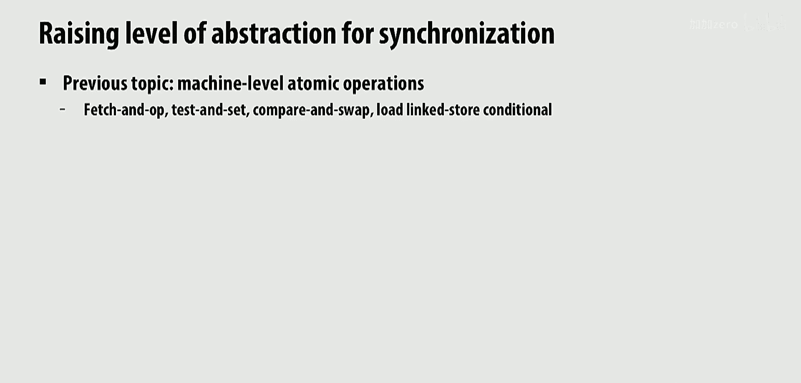

Compare and swap。 And then we said that on modern systems。

 they actually break these into two different memory operations， load linked and store conditional。

 and the coherence system you know， connects them together and makes them atomic。 Allright。

 So the key thing you need to implement synchronization primitives is an atomic load and store。

 right， And so once you've got this in your hardware。

 then you can implement various different kinds of atomic operations。

 synchronization operations like locks and barriers， you and of course， with locks。

 you can implement lock free data structures。😊。

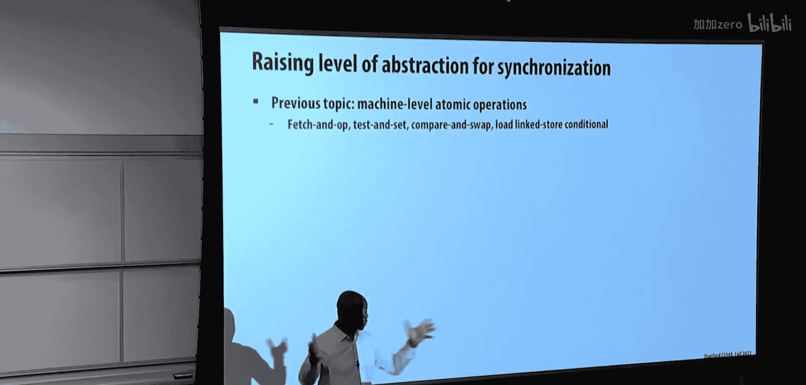

However， programming with these you know admittedly higher level synchronization primitives is still pretty difficult right so we've seen that。

 you know it's actually pretty challenging to develop lock free data structures if you're not careful and you do the wrong synchronization order。

 you end up with deadlock and so the question is sort of you know are there better ways of dealing with synchronization and in particular。

 can you raise a level of abstraction and make it easier for programmers to get both correct programs and high performance programs。

 which is what we're all after okay so the idea then is we're gonna talk about transactions we're gonna talk about the fundamental programmer' view of transactions。

 which is really basically pretty simple and then we're going to talk about how you know transactions differ from synchronization primitives like lock and unlock。

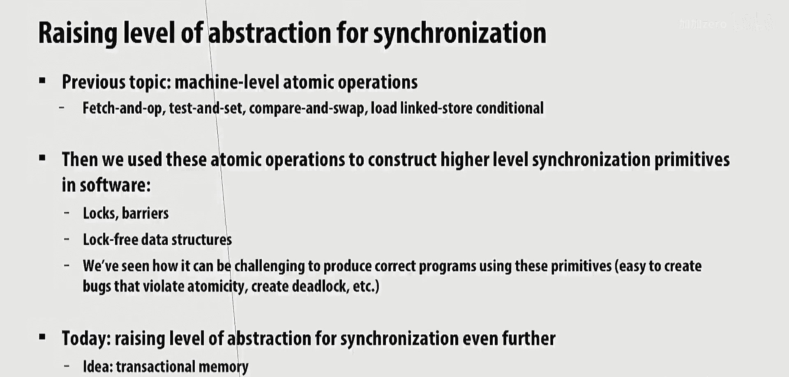

And then we once we kind of understand why you'd want to use transactions and how you'd use transactions。

 then we want to talk about how you implement transactions。

 and they're both software and hardware ways of implementing transactions with different performance characteristics。

 And so we'll talk about that。And before we talk about the details。

 we'll also talk about some of the basic design space tradeoffs that you have for implementing transactions。

 dealing with how you deal with the different versions that get created with transactions how you detect whether there are conflicts between transactions and the graularity of detection right so and then this will kind of you know remind you of discussion of cash coherence and when we talk about cash coherence。

 we talked about two levels at which you could do detection right we spent a lot of time talking about doing detection at the level of cash lines and what was the problem with doing things at the level of cash lines。

 something that of course you revisited on the midterm what happens。Yeah， you get full sharing。

 right， So what if you do the ground area of detection app， like the operating system page level。

Full sharing gets much， much worse， right， So we'll see this notion of granity of detection you know rear its ugly head again as we talk about transactions。

 Okay， so first of all， So you know， why is locking as we've currently discussed it difficult， right。

 the fundamental problems is this is this tradeoff that the programmer has to make between having a correct program。

 which is what we all all want。 and having a high performance program。

 which is also what we want right， I mean， the purpose of taking you know this course parallel programming is to develop high performance programs。

 right， So this is fundamental tradeoff that that one has to deal with。

 And this comes down to sort of the granity at which you do the the locking。

 So if you do it at a course grain then you get a low degree of concurrency， Right。

 So you imagine when we talk about locking data structures。

If have a lock around the whole data structure or even worse。

 you can imagine that I have a lock on all of shared memory。 Every time I touch shared memory。

 I have to grab a lock。 and that means that only one thread can be touching shared memory at any one time。

 So this is low concurrency And so of course， the opposite extreme is going to some sort of fine grain locking scheme And this can you have much higher concurrency because now many threads could potentially be touching the same data structure if you've got fine grain locking and however。

 the problem here is now you open yourself up to the potential for problems with with correctness So deadlock races and the such So the question then is sort of is there a better way of thinking about or implementing synchronization and that is the reason for transactions。

😊，Let's look at sort of an example。 So suppose I want to make a deposit into your account。 right。

 So the first thing I need to do is to get your account balance。

 and then I need to increment the account balance by the amount of money being deposited。

 right So first I do a get。From your account。 And then I increment the， the balance。

 And I put that back in your account。 You'd be pretty annoyed if in the middle of the get。

 some other， somebody else wanted to give you some money right And， and， and so they， you know。

 got the wrong amount because it， you know， you you， you you didn't have synchronization， right。

 So the way to fix that is to make the deposit method。

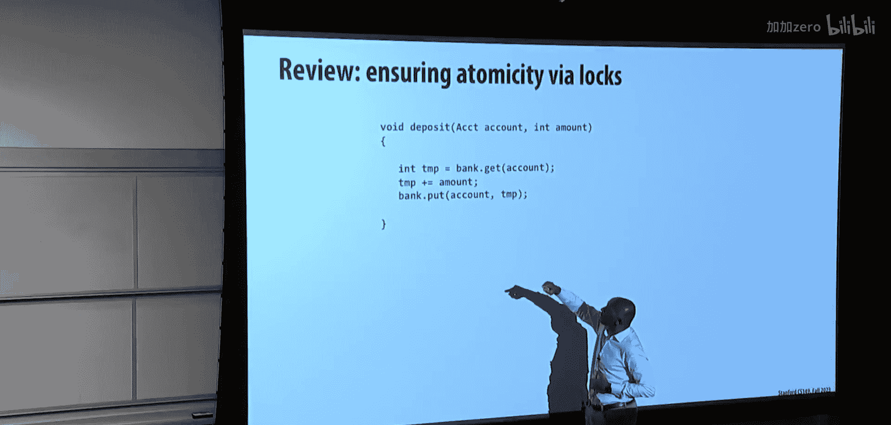

Atomic。By using locks， right， And so you you put locks around， you take an account lock。

 and so if you do this， right， then you're going to ensure that the deposit method is at。However。

 you know you could instead if you were using transactions。

 you would just wrap the atomic construct around the whole of the contents of the deposit method and declaring to the system that you want the sequence of statements to be atomic so the thing to take note of is that atomic is declarative。

 you're saying what you want the system behavior to be and you don't have to explicitly talk about how it's actually implemented So once you declare atomic。

 then it's up to the system to implement atomic in the right way So in fact， under the covers。

 atomic could be implemented with locks， but you as the programmer don't see the locks your interfaces this atomic declaration and then of course。

How exactly it gets implemented and how you make sure that you get good performance is the subject of the rest of the lecture。

 right， But it's important to， to note that Atomic is this declarative abstraction， right。

 You say what you want， not how to get it， right， And we've seen this in the past， right？

 So we've talked about declarative abstractions in which you say execute these independent thousand tasks。

 right， So what's an example of a declarative abstraction that we've talked about in this class。开。

Yes， so and Ipic for each， for example， that's exactly correct。

 as opposed to an imperative abstraction where you say explicitly how you want the behavior to work so you want for example。

 instead of saying， you know， launch a bunch of independent task。

 you say spawn and worker threads assign threads to work explicitly using some sort of shared task queue。

 right？So the synchronization analog to declarative versus imperative semantics you know。

 transactions says perform the set of operations atically， whereas if you are dealing with locking。

 then you have to explicitly acquire locks perform the operations and release the locks and so the abstraction is much lower level and and it's imperative。

 it says what to do as opposed to it says how to do it as opposed to to。What to do， right。

 so imperative is how and declarative is what。Okay， any questions at this point？Okay， so。

Let's talk about what sorts of semantics you have with transactions， right， So。

 so we're talking about transactional memory， which is inspired by database transactions。

 How many people here have taken a database class。Good fair number of you， right， so in。Databases。

 you hear about acid properties， right， So， so we have similar semantics for transactional memory。

 So you've got an atomic an isolated sequence of memory accesses。Right。

 so the first key thing that you want in your transactions is aimity， right， It means all or nothing。

 either all of the reads and rights inside the transaction take effect。 And in particular。

 the rights change the state of the memory system。 or it's as if none of them occurred at all， right。

 So you can imagine it's all or nothing。 And that means that you， you have this aimity property。

 The second property of。Transactions， this is notion of isolation。

 The fact that within a transaction， any of the reads or in particular。

 the rights that are made by the transaction cannot be observed by any other transactions in the system。

Okay， so the operations within a transaction are completely isolated， right。 And then lastly。

 the last property is serializability， which says that， hey， the the order I can。

 I can have a serialized order of the execution of each of the the of the transactions in the system。

 right， so I can order all the transactions in the system in a serial order however。

 the exact order is not specified by the programmer， right， that's left up to， to the system。

 but there is a serializable order that we can can。Imposed， the system will be imposed on。

 on the the order in which the transactions commit。 Okay， so we've got aimity。

 isolation and serializability。 We don't really have durability because， of course， memory you know。

 can fail， right？ So that that's the the D is missing in in the。

Semantics or the properties of transactional memory。

So the way to think about transactional memory then is a transaction is a sequence of reads and writes on various addresses that are both isolated and atomic。

 right， So you can think about the。

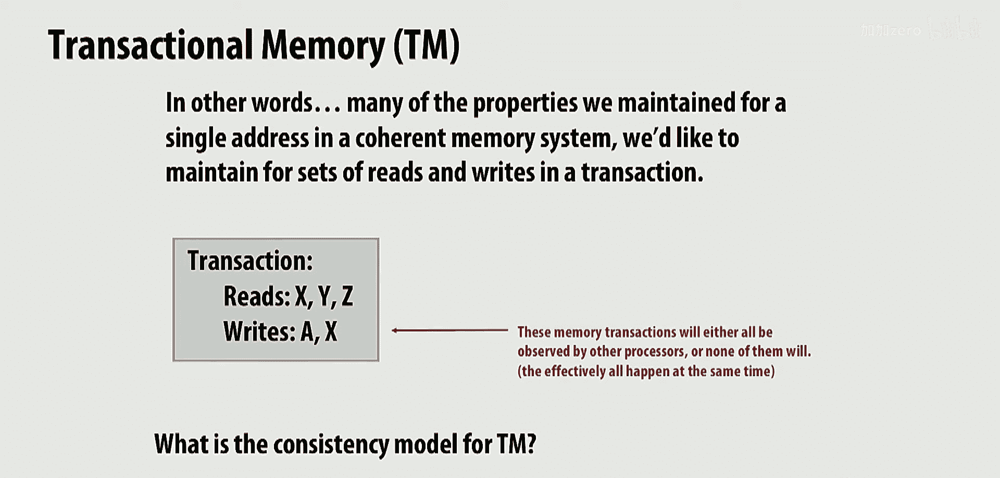

Operations that are made within the transaction as being the same as， you know。

 as a single operation that we talked about in in the context of cash coherency， right。

 so that each of the transactions then can be thought of as a single atomic memory operation that occurs and it can be serialized by the system。

So with this in mind， then， what consistency model do we have for transactional memory？

What consistency model。Does transactional memory give you？Yeah。

 it gives you basically sequential consistency。 So you can imagine。

 right you know that picture where the pointer points from one thread to the next in some random order。

 But in this case， every time it points to a particular thread。

 it takes a whole transaction worth of memory references， right。

 So it essentially sequential consistency， some people have called this transactional consistency to differentiated from the fact that you've got this bulk operation of memory references as opposed to a single memory reference that it's selected each time。

 but essentially is sequential consistency question。😊。

possible you can do whatever you want inside a single transaction because it's isolated， right？

So it doesn't matter for example， the organ in which I read XY z would that single well。

 you've got to match the whatever was stated in the program order， right， yeah。

 you can't mess that up， right？Well， in particular， the dependencies in the program order。

 right if there are no dependencies then of course you can reorder things if there are。

 you've got to respect them， right？Okay， so we basically have sequential consistency。

 So let's motivate a little bit more why you want transactional memory， right。

 So this is a Java hash map， right？ So we used to run this class in Java。 many of you。

 How many people actually know Java here。Good， al right， good。 So， so here's a job a hash map， right。

It you know， youve maps a key to a value。 you can look look at the code。 it's fairly straightforward。

 you get a hash bucket and then you find the element within the bucket。 but of course。

 if you want to use this in a multithreaded parallel context， it's not threads safe。Right， so。

You know， it's not threads safefe。 And so， of course， it doesn't have any extra overhead for locking。

 but you'd be a bad idea to use this in a threaded environment。 right。

 So if you want to use it in a threaded environment， what you want is some sort of synchronized map。

 which is what Java 1。4 gave you， gives you。 So it's essentially uses synchronize。

 which is a way for specifying that that this method will you need to take a lock before you you use it。

 right， However， you don't have to explicitly release the lock。

 but you do need to so the system does the acquisition for you。Okay， so synchronize it's easy。

 you make the whole hashmap synchronized and now it's threads safe。

 so you can use it within a threaded environment， however。

 you know the performance of this hashmap is may not be that good because you've got this single lock which locks the whole data structure。

 right？😡，Okay， so what should we do to potentially improve the performance of the Java hash map？😡。

What can we do。Yeah。Makeless to meet。Right， we can do a lock per bucket as opposed to a lock over the whole hash mapap。

 and this would potentially give us more concurrency and more performance。

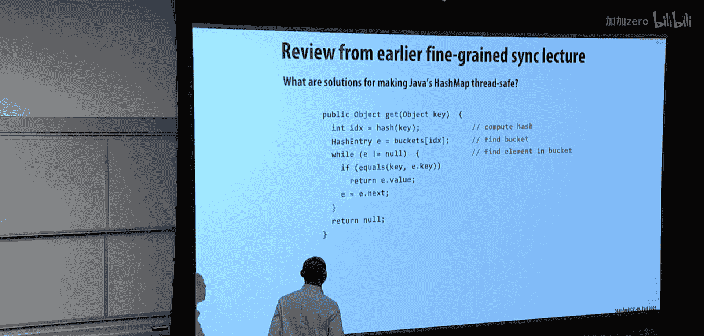

Alright， so so now is with this fine grain locking it's potentially threads safe。

 But but the problem is that now it's more complicated to implement， right。

 So it's much more complicated than just putting a synchronize around the whole method。

 Now you've got to dig into the details of the implementation of the hash map。 Okay。

 so in terms of performance things are going to look a lot better right， So in this case。

 where we're looking at the execution time。 So lower is better from one to 16 processes。

 And so the Java， the synchronized the whole hash map， doesn't really improve much， right。

 So you see performance。😊，Roughly doesn't improve with parallelization because you don't have enough concurrency。

 However， with fine grain locks， we do see this improvement in performance as we increase the number of processes。

 So this is all good， right， so。Thumbs up for fine grain locking， because it's always a win。

Is it always a win？What's happening here， So in this case， the core grain locks， you know。😡。

Give you this no concurrency。Line， right， which doesn't improve with number of processes。

 But what happened， what has happened with fine grain locks。

 So we're going from a hash table here now to a balanced tree data structures， data structure。

 And now we are using fine grain locks with the balance tree， So why at one processor。

 Do we have the execution time being so much worse than the course green locking scheme。 Yeah。

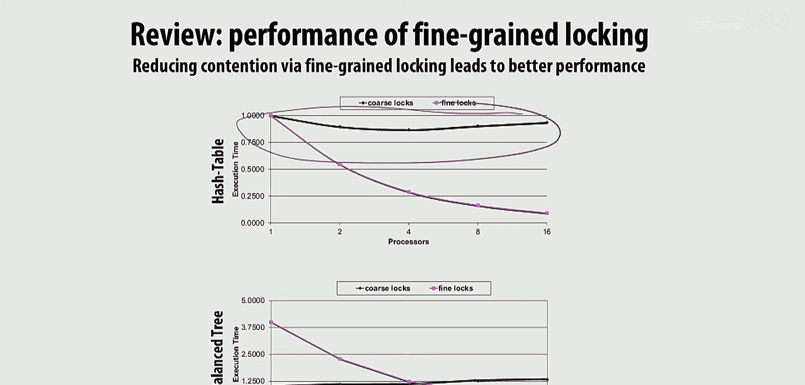

我嘅哥哥。were。Comp here to。The it will be here。す？Right。

 so you've got got to take if you do potentially doing hand over hand lock。

 you've got to take a lot of locking， lot of locks for very little work。

 And so you have a lot of overhead associated with the fine grain locks。

 and it takes you four processes worth of capability in order to overcome the overheads of the fine grain locks。

 right， So this is not so great。 I mean， it does scale， but there's。

 there's a lot of overhead that you have to overcome。 right， So the question is， you know。

 could you do better。And so with an atomic construct， right。

 you would just use atomic and say that you want the method to be。Atomic。And。Thought there's。嗯。

Sly missing。Ah， it's coming later。Coming later， I all right。 So。

 so the idea is that that with atomic。呃。I just。Specify that the whole hash map is operation is going to be atomic。

 So now it's good。In that it's thread safe。 It's just as easy as kind of locking the whole method with synchronized。

 And the question is， will I get good performance， So let's look at the performance of a transactional system in the context of a tree update by two threads。

 right， So in this case， we've got a tree。 And we want to modify nodes 3 and 4 in in a threads safe way。

 right？ And so let's assume that we're gonna use fine grain locking。😊。

So we can do some hand over hand locking， and so we need to lock the path to node 3。And。

So the red path is the path to node3 and the yellow path is path from from the route to node 4。

 and since you know it goes through nodes 1 and  two， both paths go through through nodes 1 and 2。

 you potentially have a case where the update of node 3 delays the update node 4 right everybody see that。

Okay， now the question is， you know。Should there actually be a case where we can actually。

Update nodes 3 and 4 at the same time。 They're independent， right。

 So potentially we should be able to do this， right， And so with transactions。

 you can actually make that happen， right， So the way to think about transactions then is that there's some state that you read during the transaction。

 right， called the read state and the state that you write during the transaction called the right state。

 right， So the read state for transaction A is nodes 1，2 and 3， right。😊，And what's the right state？3。

 right， so three is the right state。 and then for transaction B， which is going to update node。

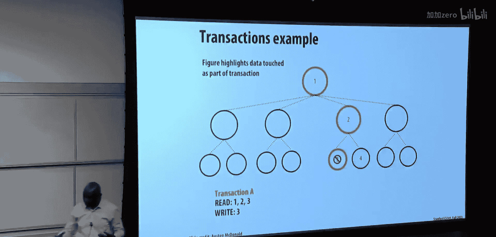

For the re state is  one，2， and4， and the right state is4， right and so。

What we're trying to figure out is whether the transactions conflict and they will conflict if there is an intersection between the read and the right states of the two transactions right and so in this case。

😡，There is no intersection， and also。that case there's no intersection and so there's no read。

 write or write， write conflict， and so these transactions can both operate concurrently and they do not conflict。

 yes。😡，打还毕。So what I was trying ask earlier it was in this case there's a course no conflict。

 but in a case where a two parallel director or whatever are writing the transaction A& and D they're both from writing this。

What would the behavior of the transaction？Given that there would be， okay。

 why do you think it should be？I guess one of them is given priority of the right。

 you got to serialize that those transactions because there there would be a conflict if you didn't so does the other one get flushed or does it still end up writing Well it's eventually got to execute。

 right？😡，And the question is， how we manage。Operation of the transactions。

 we're going to get to that。 But from the point of view of the abstraction。

 those transactions will be serialized。Right。Okay， so in this case， there is no read， write or write。

 write conflict， but in the case， you know that you just brought up。

 they both trying both the transactions are trying to update node three。

 Now there is a conflict and so we need to serialize them， right？😡，Okay。

 so this is the the graph that I thought was gonna come earlier， right， But we're just showing that。

 okay， now you have transactions with the right support。

 you're gonna get good performance in as good as fine grain locking。

 with transactions that that's the yellow line， which is labeled TCC。

 which is a transactional memory system that has hardware support。

 and that also even the case where you didn't do well with fine grain locks， you。

 you'll do well with transactions again， with the right sort of hardware support。

 So this is the motivation for transactions。 The idea that you can get。😊。

easyasy to use programming model， coupled with high performance， because。

You get to get get the performance benefit of fine grain concurrency， right。

 so transactions will only conflict when they will only be serialized when there are conflicts， yeah。

This is figuring out what data is be save。get to that。

 know this is just the abstraction and we can talk about the details。H on coming。All right。

back to the abstraction here。 So we've got this link w link list and we want to we've got this push left method and we want to make it thread safe with transactions。

 So the question is， how should we do that。 So I'll give you a couple of minutes to look at the code and you can consult with your your neighbor and then we'll ask for solution for how we make this code threads safe。

With transactions。嗯。Since somebody has a solution， let me know。Yeah。

 all the lines below the QN be equals be。That's correct， right。

 so just make all of the operations on the variables associated with the doubling atonic and then you go。

 right？None of the tricky hand overhand locking and figuring out what's what。 You just say， hey。

 I want all this stuff to be atomic and system。 Yeah， make sure that you do as， as you're told。Right。

Okay， so everybody get that the idea that it's fundamentally easier to program with transactions。

 Another benefit of transactions is what happens when failure occurs， right？

 So how do you deal with failure anity， right in the case of locking。

 you've got to remember to in your exception handler， you know。

 release any locks that you've acquired and and clean up things in the right way and restore memory or the state of the system to the way it was before the the method executed。

And this is much easier with transactions because essentially。When you a boughtort a transaction。

 it's like a big undo， right？ So you get the state of of the system back to the point at which you started executing transaction。

 Great， right， You don't have to worry about figuring out what state you need to put back。 You。

 have to worry about releasing any locks that you've acquired。

 And so it's a very clean and easy way of recovering from exceptions。Uh so。You know。

F around emacy with instructions right， So if you know， you're trying to do a transfer and it fails。

 you can。You the transaction， the transactional memory system will guarantee that that， you know。

 any memory updates that are undone and and， and you don't have any locks that you have acquired that that are lying around potentially causing deadlock。

Okay。A really important。呃。Idea in sort of software development is the idea that you should compose。

Smaller modules together to build bigger， more complex software systems， right。

 And so you want composability in your system in order to make sure that you can kind of build complex software from simple components。

 But the problem is， is that with locks， you know， this idea of composability breaks down。

 Look at this example， right， So we want to do a transfer from。From account A to account B。

 and so you know what we're going to do is we're going to use a nested synchronized in which we do we get a synchronized take essentially to take a lock on account A followed by a lock on account B right so this is fine So if we call transfer from a to B on thread0 and transfer from B to a on thread1。

 what happens。Well。We hit deadlock， right， We first thread one first gets。

A lock on A and thread 2 gets a lock on B。 And now we're in a deadlock the deadly embraced situation。

 right， So how do we fix this， So what's the solution to not having deadlock in this situation。Yeah。

That's one solution， what if I don't give you transactional memory and I don't only give you locks。😡。

いや。Do you。Jo be。呃。Synchronize a but want you want this to be atomic right Yeah have synchronize the right。

 so you need to order the lock acquisition by some global order， right？😡。

So maybe you could use always synchronize a lower numbered lock before a high numbered lock right so you need some global mechanism。

 but this global mechanism breaks composability right because now you need to know globally what to do in order to compose these simpler components together。

😊，RightAnd so this system wide policy， you know， breaks software modularity and and so what you want then is is transactions。

 right， So you want to wrap an atomic around the withdraw and deposit。

 But as we've already seen there are atomics inside with and inside deposit， right。

 And so now you've got nested atomics。But nested atomics， How should nested atomics work， right。

 If I told you nested atomics， what would you assume about the outer atomic。对。

Can you be more explicit？Most people that it assumes what happens in the inner atomic， right。

 So the outer atomic takes precedence and， and you assume that everything within the outer atomic is going to be atomic。

 right。Good， al right， so now you know， you， you declare your。

 your intent with this atomic and then the system will implement things and manage concurrency。

 And if it turns out that that you have no concurrency as in this first transfer between accounts。

 A and B， then the the atomic regions will be serialized， right。But in the second example。

 where we're transferring between A And B in one transfer and C And D account C And D in in the second transfer。

 now we get concurrency and the system should allow that and provide the performance benefit， yeah。

example of concurency， you wouldn't put it in an atomic frame。

Because whyhy would you not want to put it in atomic？Because like you said。

 if you have like a larger scale topic， only one thing。Then go back to the example of the tree。😡。

in this case， is there a conflict between this transaction and this transaction， no conflict。

 therefore they should be able to run concurrently， right？And sex workers if we specify the public。

 No， you are inside a transaction。 Both of them are inside their two transactions they're executing at the same time。

They're executing at the same time， and the question is， do they conflict？Yes。Then we serialize them。

 no then they should get to run concurrently。😡，Right。So in this case。

We serialize the two transactions。😡，All the two transfers。In this in this example， and in this case。

 we allow them to run concurrently。It's important that you get that。Other questions。All right。

 so we have this you know， that's the key benefit of transactions。

 the fact that you do allow this concurrency if there are no conflicts。😡，All right， so， you know。

 just to recap now， then about。呃。Transactal memory and why we want to use a construct。 right。

 So first of all， we've got this notion of it's an easy to to use synchronization construct， right。

 So， you know， we said it's difficult for， for programmers to get synchronization right。 You。

 you're stuck between optimizing performance with fine grain locking or getting correctness with course grain locking。

And so the idea is that transactions are as easy to use as coar grain locks。

 but potentially could give you the performance of fine grain locking and so you know the idea is instead of you the program and having to worry about how to implement the details of a fine grain locking scheme on a complex data structure such as a tree or a Wlink list。

 you let the system do the work for you and give you high performance。

And then a notion of failure atity and recovery， this idea that you can recover simply by aborting the transaction and letting the system recover the data and and not have to worry about releasing locks that you've acquired and lastly。

 a very important point is the fact that transactions compose right and so you can compose simpler modular components together to form more complex software systems and not have to worry about a global locking scheme。

Why is it。And use this。Well， you know， the question is that some in certain cases。

 you may be able to do something that's。you may know something about the data structure。

 which means that by just looking at。The read and write state。

 you could do something a little more optimized， right？😡。

And that's because you know something about the data structure。 right。

 So if I just look at Read and Wright state， I might say that these things can conflict。

 but you may know that something else that says， hey， they really don't conflict。 And。

 and that in fact， you could get concurrency here。Right。Yeah， I mean， it。

 it's usually extra knowledge that you bring to the implementation that would allow you to do better in the case of a pure transactional memory system。

 That's a， yeah。rate also used to do better in some cases， like if you put atomic on something。Als。

They're always going to have to be serialrelog。find involved。We' part of that would our。Yeah， maybe。

 yeah。 again， you might be able to get finer groundlarity than than you can with with a transaction。

 yeah。Okay。So it's important to understand that sort of there is this difference between atomic。

And locking， they're not the same， right， So Atomic is， again。

 is this declarative construct saying here is the behavior aspect of the atomic region and locks our way of implementing synchronization。

 right。And law to be used for purposes beyond aticity。

And just because you have atomic doesn't mean that all your problems are solved。

 you could still use atomic incorrectly。😡，And these are called atomity violations。

 And in certain cases， atomic simply won't work。 right， So here's the example， right。

 So what about replacing synchronized with atomic in this example， Will this work。

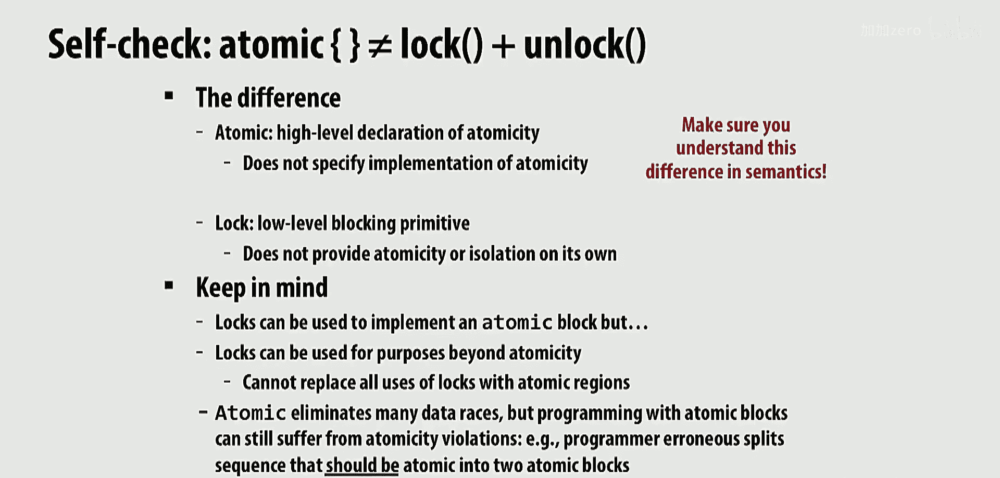

Sorry replaced。I replace synchronized。With。Atomic。You've gone fixed。Yeah， go ahead。No， yeah。

 it won't be serialized， but one has like up。That's really。Yeah， fundamentally。

 one are the semantics of atomic？😡，Con it's going to see。

If I gave you this code and given that I've told you about the synman of atomic。😡。

What would you expect to happen？There's two blockss to me。解说。Like a serializable。です。Revised one。外三年。

So if I ran this code， what would happen？😡，Don just。Or livelock group。Yeah。

This will be an infinite look， why？Likely so。What do we know about the semantics of atomic？😡。

Everything after to that life has to happen。All at once with respect。So atomic atimity。

 what's the second one？😡，SoIt's the second property we talked about。Adimity， isolation。

 So what does isolation say？Yeah， it says that we can't the right we can't observe the right。

 so we will never see anything that comes out of this transaction before it commits。😡。

So and it' the same for this。😡，Transaction， therefore。

 we're not going to get any forward progress with this code。Okay， so。You。

There's a case where replacing synchronized with atomic won't work， what's wrong with this code？Yeah。

You don't know a order in which the three atomics will run。

 and so if's like the pointer get set to know after pointers and A， then the last atomic will not。

老毕业的。But word we baby。So。So what might happen？I made dereference a down pointer， right。

 and how would I fix it？Right， so we wanted to。Get rid of that， right？

So this is known as an top animity violation， Right where you put atomic around the wrong。St of code。

 And therefore， your， your， you know， your， your。有。Behavior， your aimity behavior is incorrect。Okay。

All right。😀Yeah。😊。

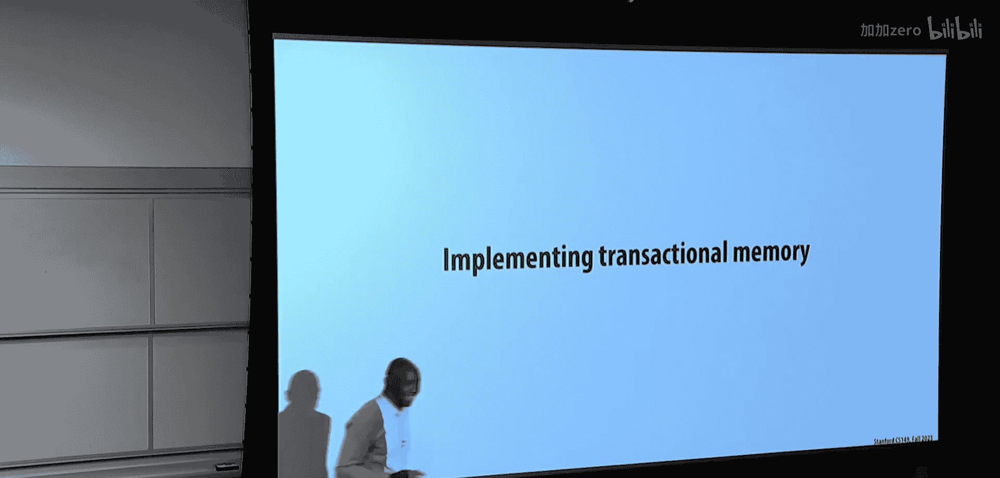

So any questions about the。Abstraction of transactional memory and sort of why it's useful。Okay。

 let's talk about the fun stuff。 The implementation of transactional memory。

 How do we actually make this abstraction work， okay。So you know， we've got to talk about the three。

😡，Components of the abstraction， aimity all or nothing isolation。

 which we just talked about and serializability， right。

 And so these are the properties that an implementation of transactional memory has to provide。

 And has to provide these things while giving you as much concurrency as possible， right。

 So that's the goal。RightAnd in thinking about a set of transactional memory implementations。

 there's a space， an implementation space that is defined by how you deal with their transactional memory state。

Which is called data versioning， so how you deal with the uncommitted state that we a transaction hasn't committed yet and the committed state that a transaction that's previously committed has already updated。

 So that's the data versioning policy。 And the second component of transactional memory implementation is how we detect conflicts。

When and。How we declare conflicts。 And this is called the transaction conflict detection policy。

 So data versioning policy and conflict detection policy。

 So let's start by talking about data versioning。So this is how we manage the state that hasn't been committed yet by the transaction and the state that has already been committed by previously completed transactions right there are two ways of managing data。

 one is called eager versioning。😡，And requires the idea。 It requires the， the。

A component of a undo log。 and the second way is lazy versioning where we have a right buffer as the key element in the system。

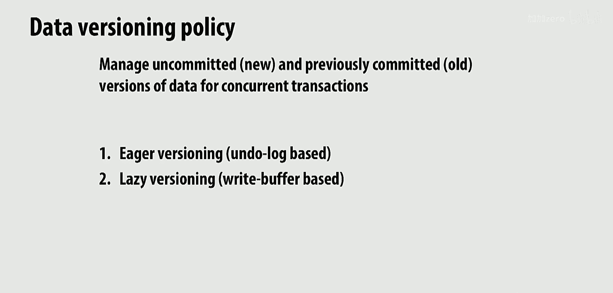

So let's look at these two kinds of doing data versioning。 First， eager versioning， right。

 It's called eager because you update memory as early as possible。

 and memory in this case could be the cache， right。 And as we said。

 the key element of the eager versioning scheme is an undo log because we need some way of undoing the data updates that we've made in an eager manner。

 right， So in this example， we're going to have a single。😊。

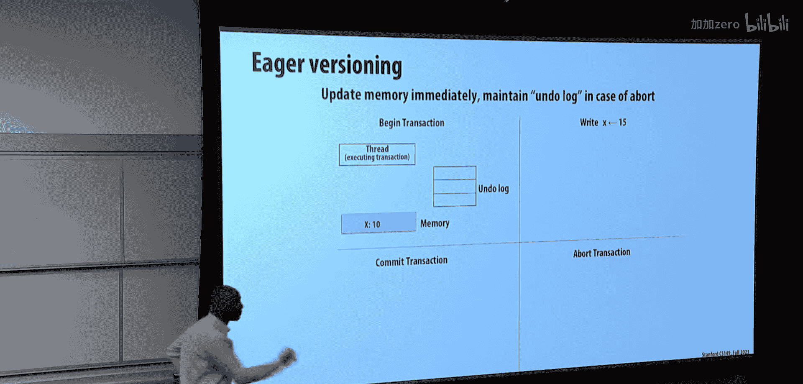

Variable X that we are updating in the transaction， and X initially has a value of 10 in memory。

 and the transaction is going to write 15 to x。 and so。

What we do then is we put the old value of x into the undo log。

 so X value of 10 goes into into the undo log， and we eagerly update memory。 So memory becomes 15。

 right。This is good because now memory is up to date。 and that is always good， right。Now。

What happens when we commit the transaction， what should we do？Yeah。Throw away the undo lot。

We're done， right， transactions committed， memories up to date。We're done。All right。

 what happens when we abort the transaction？Now we need to restore memory to the state before the transaction executed right。

 And so now this becomes a we need to apply the undo log to that and and we get memory back to its original state okay。

Yeah。やちょっとワクちお前。いやいやいや。

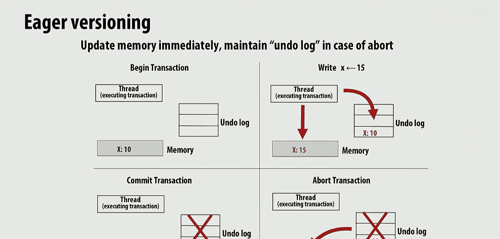

We're getting that。has all sorts of effects on the implementation of what you do。

 and we're going to talk about both hardware and software ways of managing this， right。😡。

To have this undo log， And we。We update memory。 We restore memory to。

 to the state that was before we started the execution of the transaction。 Okay， so that's eager。

 Yeah， question。Does this like for an error？We过 for。

Pull the abort cord and you could bail out of a transaction whenever you want， right。

 And you know that none of the state of the memory is being changed。 It's great， right。😊。

But the other reason that you might want to abort a transactions is because you detected a conflict。

 right？Yeah。どしか。Well， there， there is a， the system has to determine when to。

 you will usually just restart the transaction， right， You try again。Yeah。

If the under log is like a certain size，'s you off。Yeah。

 so it depends where you keep the undo log right， so you could have an explicit cash for the undo log or you could have just put it in in regular memory and。

Depending on sort whether you've got specific hardware mechanisms for handling it or you just put it in memory。

 which would be the most scalable mechanism right right。

 so you assume that there's locality in all your accesses and caches work for memory that you access here too。

对呀。えちょっと大とさであさん。まそとれ。这是好像。你哋一啲。So we're getting to conflict detection。

 so now we're just talking about how you manage data。

 the next topic will be how we detect conflicts of what we do。😡，Yeah。Good we're not keeping like in。

No， no， remember， you need to get back to the state before the transaction started executing。

So we only need to keep the first time you write to it。

 any subsequent updates don't need to be put in the undo log， right？Yeah。

One is if the un law gets corrupted or somehow， it like something goes wrong and does a lot before the transactions within your system is corrupted。

So this would not be realisticed to that kind of a。Well， I mean， corrupted how， right， I mean。

 you need some other mechanism for dealing with memory fault toleranceancy right if that was a problem it's a problem you wanted to guard against。

But let's assume for the sake of simplicity that our system is robust。All right。Lazy versioning。

 right， so everybody likes to be lazy， right？And in here we have a right buffer right。

 and as the key mechanism。And so again， in this example， we're writing to X。😡，So we。

Instead of updating memory directly， we write into the right buffer。 And that's why it's called lazy。

So now that we've done this。😡，You know， have we created some。

Complexity to what happens to the rest of the reads to X in the transaction。有这本人。Well。

 you may have dependencies clearly， and the question is。

 where should subsequent values of x come from？Memory。No。You have to come from the right buffer。

 right？Right buffer is the most recent value of any variable that has been written。 And so。

 so now we potentially have to check in two places。

So there is this extra complexity that that that occurs， depending on how it gets implemented。 But。

 but that's something to keep in mind， right， that by because we have an eagerly updated memory。

 we now have two places potentially where data that we that we may have to look for the latest value of。

 of data， right， I supposeupping the undo log， you never look in the undo log， right。

 you only use the undo log when you're trying to。To fix an aborted transaction。All right。

 so in the case of commit。We。Now have to update memory from the right buffer and then， of course。

 clear the right buffer。😡，What do we do in the case of a board？Just throw it away， right。

 We just throw away the right buffer。 We don't need to， we haven't changed memory。 so we're good。

Al right， everybody understands the difference between being lazy and being eager。Alright。

 so now let's talk about the trade offs between the two， right， so。In the case of eager versioning。

 we update memory directly， which is good and we maintain this undo log， so we've got faster commits。

 right， the data is already in memory and we only have to look in one place。😡。

But the problem is that we have slower as and because we've updated memory。

Managing fault tolerance is more is trickier right because now we've got to figure out how to restore memory in ways that may not be completely obvious。

嗯。Lazy versioning uses a right buffer。 We potentially now have multiple places that we need to check。

 It gives you faster aor because you just throw away the right buffer， but commits are。

 are slower because you now need to put the contents of take the contents of the right buffer and apply that to memory。

So that's data versioning。 So now let's talk about conflict detection。Yeah， question。And does the。

Lazy or sorry， the eager versioning scheme made isolation harder if there's another journal for turns back。

Which may have written memorymor in which later gets right。Yes。

The way that it potentially makes isolation trickier。Depending on how you do conflict detection。

 which won get to next。 So， so typically， okay， well， we'll get to to that。

 and it'll be clear as to what what what's going on， yeah。You have， let's say， legal。

You're going to be accessing the memory。G I was opposed to so the component of my majorization。大。

More conflict。Isn't that too very you。嗯。So the key elements of how you kind of make the decision about what data version scheme to use have to do with the combination really of how you do conflict detection and how you do so they're essentially go together and so once we talk about conflict detection。

 then we can come back and revisit your question， if it's not clear。All right， so conflict detection。

 right So we need to detect conflicts， right， So either read， write conflicts or write。

 write conflicts， right， So essentially youve got two transactions A And B that are either。

There's either a conflict because they。1 transaction wrote address and another transaction read that address。

 or both transactions want to write the same address， right？

 So we've already talked about the concept of a read set and a write set in the context of that。

Tree example， but to be explicit here now， reset all the addresses that have been read during the transaction and write set are the addresses that have been written during the transaction。

 right。So。Again， there are two schemes。 There's pessimistic detection。

Or encounter detection is another name for it where what you try and do is you try and detect。

 you assume that the transactions are going to conflict and you want to find the conflict as soon as possible。

 That's why it's called pessimistic。😡，Okay。So and then the contention manager decides whether you should stall。

Or abort the transaction。 And we'll talk。 We'll look at examples where we do， do both， right。

 And so let's look at。Pssimistic in this case。So。We in this these diagrams， we're going to assume。

An aggressive contention manager。That always allows the writerer to win。And so， so no。

 so other transactions have to abort。And， in， in。Each case。

 we want to be able to look at the pessimistic。Detection policy。 And so on every access。

 you need to do the the check for conflict。Okay， so in this case。

 we have a read of a by transaction 0， right， So in this。Case the reads set。

Of zero transaction 0 is a， right， and the right set of transaction one。

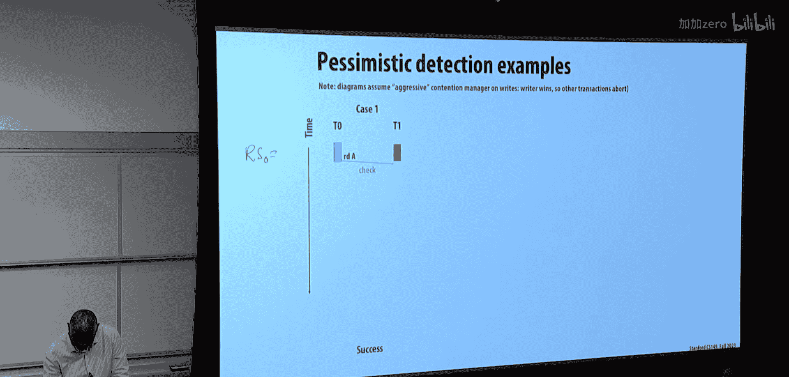

Is empty， right？So the check says no conflict， right？So we keep going。And here。With the。

This access the right set of transaction1 is B and the read set。

Of transaction0 is still a and the right set。I's empty so again。No conflict， right？And then on。

Right of C by transaction zero。The now we have a reset。0 is a and the right set。Of zero is C。

And here， we've got the。Right set of one is B。 So again， we do the check and there's no conflict。And。

Both transactions commit， okay？That's the first case。All right。Second case。Let's get rid of。

All right， so in the second case。啊。I've got a。Right of a。And I do a check。And then。

I do have a read of a on transaction 1， right， And so in this case。Right set of。A is。

Right set of0 is a。And。Read set of one is also a。 So this is a conflict， right？

 And so what are my options here。So。I could havebort。1， and restart it。

Or I could assume that at some point。The transaction zero will complete， and I can。Then。Commence。

So I can stall transaction1。 and what would， what would be the benefit of stalling transaction 1 as opposed to aboring。

对呀。Yeah， all this。Works done in transaction so， so far does not have to be flushed。

 I can just hold the state of transaction 1 until transaction。Zero complete。

And then I can resume transaction1 until it completes。 So this is an early detect and stole， yeah。

So我上给没去。

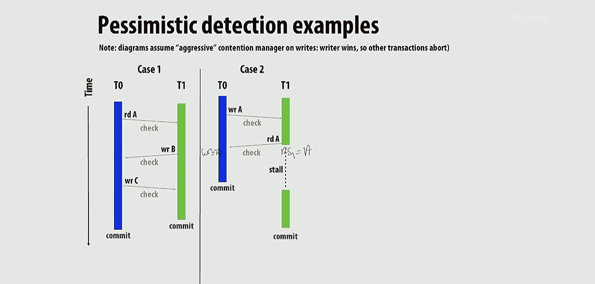

诶 which is。Right down。Well you got read it again。Yeah you go back and read it again。 Yeah， yeah。

 absolutely。 you have to。 yeah， yeah。まく。是还没必要。本来。That gets through into after you stole so basically like when you go to。

没意すよ。So you weren， like you have multiple conflicts。So。You're saying that that later。Later。

Transaction zero wrote B。😡，Multip things read been changed by T0 Well， so remember。

 every time you do an access， you're doing the check。Every time。

So if there was not a conflict up to this point。You would not have stall now。

 if there was a later right by T0， then it would cause T1 to aor yeah， yeah。Yeah。

We don't have savings since you come to it。Do check on like？我的就反。Well， yeah。

 the system has to keep track of the reef， state and right state of all the transactions that are in execution。

Yeah but like easy， don' say it's committed by transaction。

Once it's committed the transaction is it still sitting that still no then you've done right it's committed the state。

 it's committed at state， it's updated the state of the system and then every other transaction that's running will get the latest state that。

Like he said， B1 is already very like me， which is when you're getting someone named。Yeah。

 at that point， you know， so every on every。Pessimistic detection says on every access。

 I do the check。 No， no。 So， so if the case is suppose above here。I had read B。For example， okay？

And then down here。I wrote B。At this point。This would cause this transaction to a board。😡，哦。Right。

even though it's even a stall， yeah， the state's still around right and it's still doing the checks right so the stall becomes an a。

😡，对呀。Any other questions？Some of this can get tricky。It's going to get slightly trickier。

 but not much more。All right， so in this case， we do an early detect。😡，🤧。Instead of。

Throwing away the work that we've executed in the transaction so far。

 we stall and hope for the best and wait for transaction  zero to commit。

 and then we can commence executing transaction1。All right， so case three。

 we're going to do read of A。😡，Read set of zero is a。

The read set and write set of transaction one is empty， so the check passes。

And then we do a right of a on T1。So what happens in this case？对。T0 board as we just talked about。

 so it restarts。😡，And then we do a read of day。And then we do a right of a。Okay。Okay。Read of a stole。

 and then we。Keep going， right？Any questions？Remember？Aggressive conion matter on rights。

 right or win， so other transactions are poor。😡，So Rder always wins。😡，So at this point。

If there's a conflict between。A read write conflict， the writer wins。Right， so if。

 if you've already written and。Then you' doing if another transaction is already written and then you're doing a read。

 then you stole。😡，Okay， if you've read already， you've read bad stuff and computed based on that。😡。

And then a right comes along， then you have to abort。Remember。Up until this point。

You haven't done anything that would be conflict would be a conflict。

 right youve only you're checking to see whether this read will will cause a conflict。😡。

If it doesn't， you go ahead and do it。😡，If it does。You just stole because you haven't done it yet。

You're thinking about it， right？And then once the commit is done。

 then you go ahead and do the read because you know that the stall condition has been cleared， yeah。

So in case three， it looks like we start T zeros read eight。

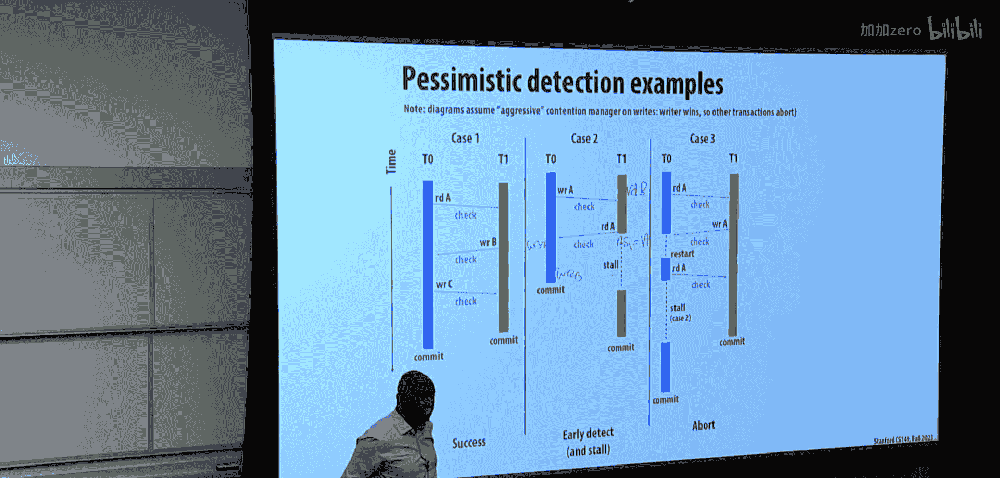

Before T1 is。嗯。I guess I'm just wondering， when does that research happen？で。Yeah。

 in this case you are bought and restart whenever you see a right read conflict。So youYeah， yeah。

 exactly。Okay。All right。Case 4。So do we have a right？Of a。So what happens， does this check pass？有。

We have a right of A on T1， does this check pass？No， so what should happen？Abort and restart， right？

And we have a right of A， so what should happen？😡，Okay。Okay， so we're not going make any progress。

 you know， with this scheme。 So the system has to detect this situation right and and allow one of the transactions to complete。

Okay， so you got to， you know， this is a live log condition And， and you need to detect。 Alright。

 so this is pessimistic。 Yeah， go。Des the memory system that would give the streetss precedence to deliver right。

Co right。Let me think。So the， the， so you've already。Written， so this case you want。

 you want to cause T 0 to ab in this case。Is this what you？On。I can't see why you'd want to do that。

But you know。Possibly。I've never seen a system that works that way。Yeah。

other than sort of allowing rights to。嗯。You could。You could allow the read to。To。

You could allow the transaction that's already running。To， I mean， you。

 you could have bought the transactions doing the right。Instead of having the right。

Having the reading transaction be aborted？Yeah， right？But yeah。mm。

There are many options for contention management and you know different systems have been implemented with different advantages。

 depending on sort of what the particular application scenario is。Alright， so optimistic， let's get。

 we I think in the last five minutes， we can at least make a run on opt optimistic， right。

 So optimistic is， hey。I don't think there are any conflicts。

 therefore I'm only going to check when the transaction commits。😡，Right， until that point。

 I'm going to assume that everything is hunky dory and there are no conflicts， right。

And so the nice thing about this is that you can always give precedence to the committing transaction。

So the committing transaction will cause all other transactions to a board。 right。

 So let's look at the example here。

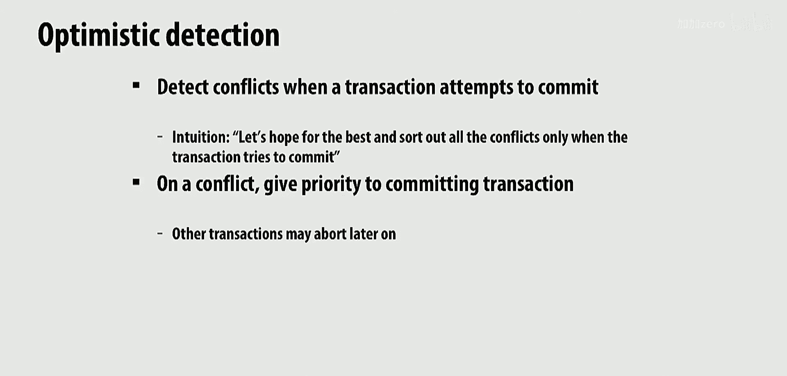

You know， we're not doing any check， so pessimistic is I detect as I go。😡。

Optimistic is I need to check the right set of the committing transaction。😡，Which is B。

Against the reset of all other transactions， in this case， just zero， which is a and C。

 there's no conflict， so the detection says the conflict detection says no problem and the commit happens。

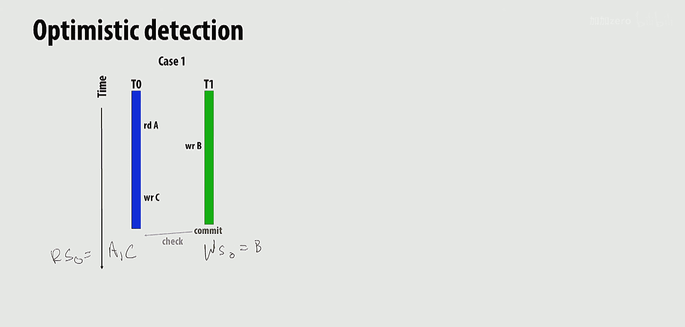

对。😡，Right。Is resetsect what of G0？啊， sorryorry。

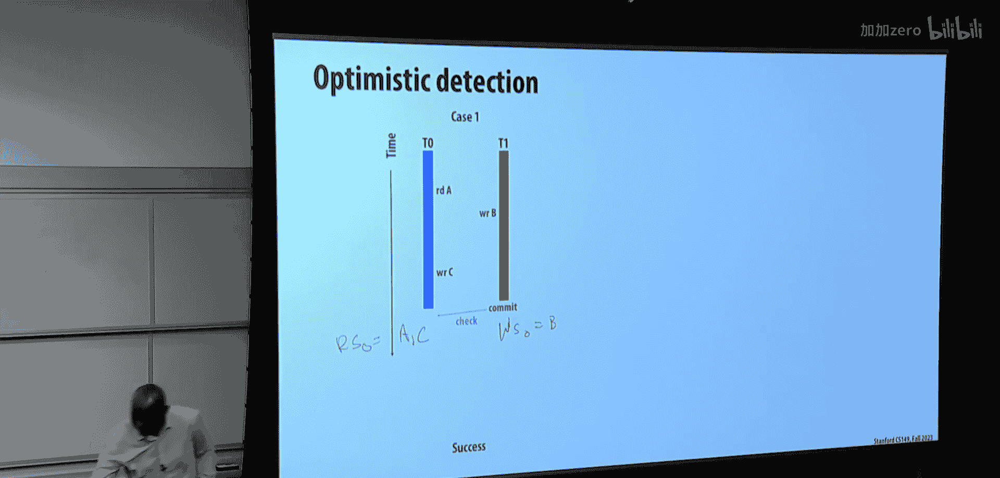

You're right， so right set of。Of zero is C， Okay， so you're checking against the right set of the committing transaction。

Versus the reset of the transaction that has been the other transactions in the system。Okay。And。Okay。

 I'll talk about the okay， so in this case。What happens？

The right set of the committing transaction is a， and the reset of the other transaction in the system T1 is also a。

So what has to happen？Right， youre bought and restart， right？And so， in this case。

You don't get to stall， right， so you got to don' don't。You don't detect early that this is gonna be。

 This is sometimes called a doom transaction， right。Because， you know。

 at this point that this transaction will not succeed because there's already a right in the system that's gonna cause a conflict。

And therefore， you waste all that work。In case three。We have a。Read of A so and write。And commit。

 right， So we read a。Of course， that rate of A could could happen anywhere in the transaction， Right。

 It could have happened after the right of A here。 It could be down here in time， right， right。

 It doesn't matter， right so， so。In this case， T0 is committing and its right set is empty right。

 So you're checking the right set of the committing transaction versus the reset of other transactions。

 right， and you say， go ahead， right。😡。

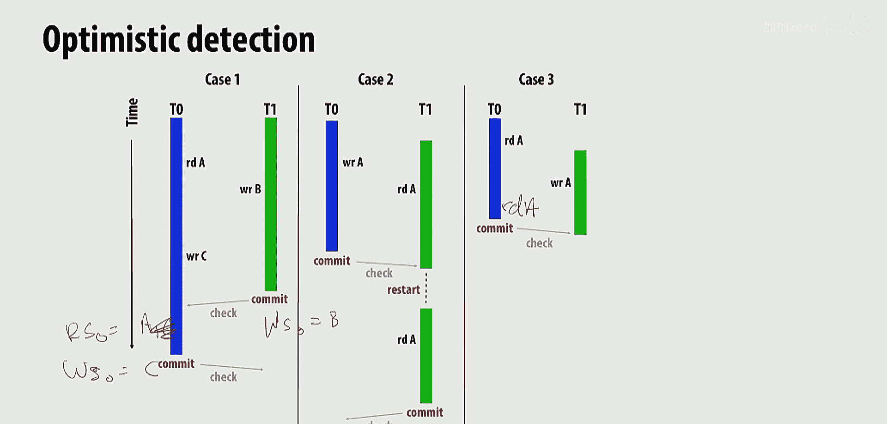

In some cases， and if I gave you an example， I would say explicitly。

 you might want to check to see whether the right set。😡，Of the existing transaction conflicted。

 but it really doesn't matter。Because。The serialization is such that。

The committing transaction is is is going to update the state of the memory。

 and even though there are other。

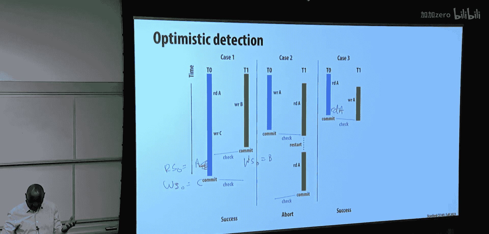

Rights。That。Exist there will be no conflict right， so in this case。We do the commit。And of T 0。

 And then we do the commit of T1。And， and in fact， the。The read of a， you know。

 you serialize these transactions， the read of a happens。

Before the right of a in the serialized transaction order。

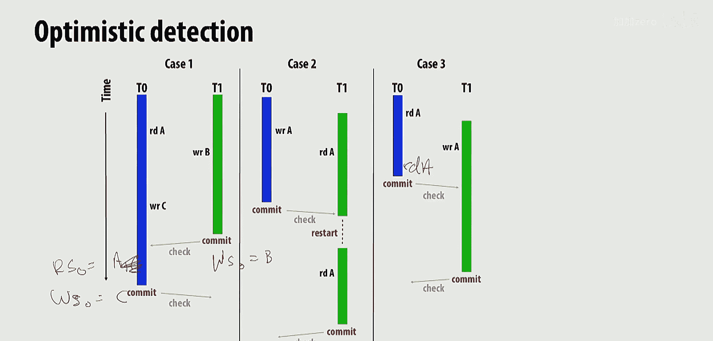

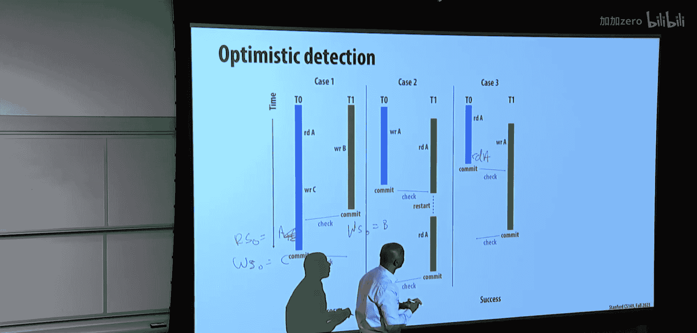

And so that means， of course， transaction 0 should not see any of the updates of transaction 1。

All right， so。

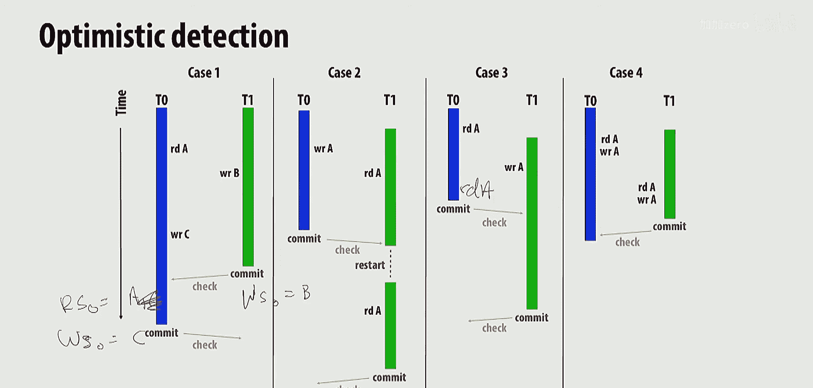

In this case。We have。Read and write here， and。What should happen？

So the reset of T1 and the reset of T0 are both。A and the right set of T0 and right set of T1。

Are both A。So what should happen here？对呀。T0 should restart。

Because we have a conflict between the committing transaction。And the。

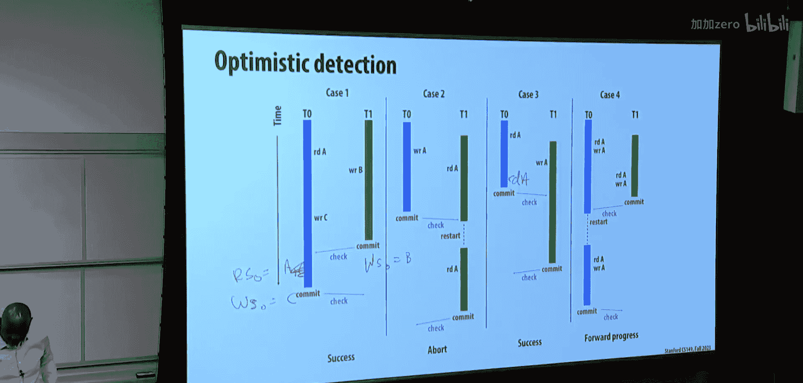

Transactionions already exists。And then we restart and then we go ahead and commit and in this case。

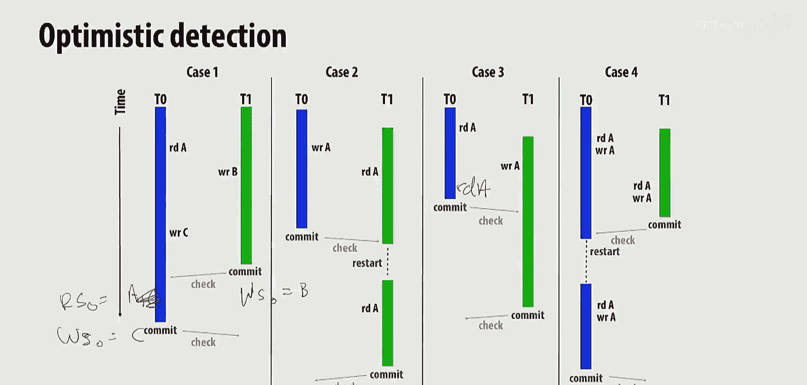

For the pessimistic detection， there was no forward progress。😡，But here with optimistic。

 you do get forward progress。Yeah。So the right to that T1 performs。

That value might depend on the fact that T0 had written to A before。

biggest T1 reads a after T0 writes to A so doesn't that mean that when we like aboard T0 and restart。

 but T1 is already committed， like the values that T1 has committed are committed assuming that remember everything's isolated until the transaction commits so there are no values being。

Communicated between transactions until commit time。So any values that？

T 1 and T 0 our reading at this point existed before their transactions commenced。

All were created inside the transaction themselves。嗯。Yeah。

 so eager versioning and optimistic detection don't go very well together。😊，Yeah。Wden in case。

we start， but in case where we do， what's the difference there？In this case。Remember。

 what's the rule for a committing transaction with optimistic detection？😡。

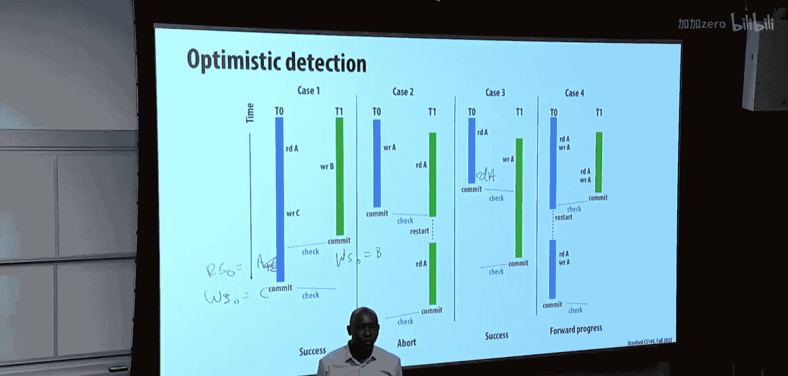

The right set of the committing transaction。Gets compared against the resets of all the other transactions。

What's the right set in the case of？Case 3。'F， right？There's no conflict。の way。

No， it's the right of the committing transaction。Okay， so I think time's up。

 So we'll pick this up again on Thursday and we talk about software and hardware implementations。

 and we might move into discussion of application specific or domain specific hardware。😡。

