# 【并行计算 CS149 2023】斯坦福大学—中英字幕 p17 p16 Lecture 17 - Transactional Memory 2 -BV1du17YfE5G_p17-

Today， we're going to continue our discussion of transactional memory。

 We'll talk about software and hardware implementations， just to kind of。

Remind you of where we left off at the end of last lecture。 You know， we talked about， well， you。

 during the lecture， we talked about all the the transactional memory properties that we wanted to preserve。

 and we talked about the advantages。And we talked about the different kinds of aspects of the transactional memory design that you needed to consider。

 One was sort of what data versioning policy you used to keep track of the old transactional data that had been committed and the new transactional data that is being created as a transaction execute and then how we actually detected conflicts between transactions。

 And we said there were two data versioning policies eager and lazy。

And then we said that there were two conflict detection policies pessimistic where you detect the conflict as the memory references are made and then optimistic。

 which， you know， assumes that there will be no conflicts and you detect the conflicts when the transaction when any transaction commits。

Alright， and so we， we did some examples， and we saw that in。

 in a certain case of case 4 and for the pessimistic conflict detection。

Policy that sometimes we had a situation where we had live lock and we needed to detect that and the transactional memory system would have to recover from。

 from live lock to make sure that the application could make forward progress。

And then we also did the optimistic case and we saw in the case where you had livelock in the pessimistic case。

 you didn't have livelock here and the reason is， of course。

 is that the committing transaction always wins and the committing transaction。

 remember the check was you compare the right state of the committing transaction with the RET state of all the outstanding transactions that are still in execution。

 if there's a conflict then those transactions have to abort and the committing transaction does gets to commit。

Okay， so any questions on what we've discussed so far as far as the way transactional memory is supposed to work and the properties that needed to be preserved。

All right， so let's。Discuss an explicit implementation or a couple explicit implementations。

 as you can imagine， you know， given that you've got a space of policies that you can implement。

 there's a wide range of different implementations that pick different the points in the design space of of the policies that you select。

 right So so you can have lazy optimistic， you can have eager optimistic eager pessim。

 as we've already discussed lazy eager optimistic doesn't work out too well。

 because at the point at which you detect that there is a conflict you may have already kind of modified the the memory and ways are difficult to recover from。

😊，So those the software systems， the software system that we're gonna to look at is， in fact。

 a kind of hybrid that is eager optimistic for reads， but pessimistic for rights。

 And we'll see how you can you can have both at the same time by treating reads and rights slightly differently。

 And then of course， we'll also look at some hardware TM systems。 first of all。

 we're gonna to motivate why you want hardware。 And of course。

 you always want hardware if you want to improve performance， right， And so， you know。

 there are performance overheads that we'll see from the software systems that can be mitigated by using hardware。

😊，And of course， you could have some sort sort of hybrid where you kind of mix hardware and software and you try and and attack the components of the software systems that are really gonna provide the most the most overhead and try and reduce those overheads by judicious use of。

 of hardware。Okay， so let's start by looking at software transactional memory implementation。

 And this is sort of you know， a canonical way of implementing a transactional system in software。

 But you could， you know， it's applied in this situation to transactional memory。

 but you could imagine implementing something like this for other cases where you wanted to keep data consistent in some manner。

All right， so given this atomic region， right， you've got read and rights that shown in the code here in the statements of the code and somehow you need to indicate to the to the transactional memory system。

 you know what actions are being taken place inside the program。

 and that is done by the use of what we call software barriers and software barriers are basically calls into the transactional memory system。

To indicate to the to the system， you know what bookkeeping has to be taken， right。

 so the idea is that you've got to rewrite your， the code that the program programming gives you and add these extra calls into the transactional memory system。

 So for everyrite， you need to you know put in a TM right and for every read。

You need to make that into a TMR。Okay， so， you know。

 these are called software barriers not to be confused with barriers for synchronization， right。

 This is just basically a call into the transactional memory system specified by these TM read and TM write functions。

So， you know， you know you need this bookkeeping， of course。

 to keep track of what's happening with the state of the transactional memory system as we'll see。

 a lot of these TM calls are redundant and you can kind of optimize them away and we'll see an example of that you know in just a moment。

😡，Alright， so we we've essentially now have to translate this code on the left。

 which the programmer wrote into something that interacts with the transactional memory system。

 And of course， if you have code that is both executed inside transactions and outside transactions。

 then you need two copies， one that doesn't have the instrumentation on the left and one that does on the right and you know。

 if you've got some sort of。Vectual memory system， you know。

 since if you're running in Java or in C sharp， then maybe you can do some of this what's called function cloning automatically。

 where you you clone the function and you add the appropriate software barriers to interact with the transactional memory system。

All right。Now， the question is， is， you know， what data structures do you need to keep track of the transactional memory state and make sure that everything operates correctly。

 right？ So you need some way of sort of mapping the。

Data that is being manipulated by the application into the。

 the data structures that that need to be used to track the transactional memory state。

 And so this is called a transactional descriptor。And this can be two composers。

 transaction descriptor， which is per thread right So this is you know information about you know undo logs right buffers conflict detection and the sort read so you need the resetet and the right set is also of the transaction descriptor and this is per thread or per transaction you need a transaction descriptor。

 and then you need a transaction record per data element and this could be associated with objects or with a fine graityity of data within the objects right And so essentially here with the transaction record。

 you're gonna you know essentially keep the metadata that tells you how the data is being accessed right And so if you make an analog to discussion of cache coherence right where we said you needed the cache。

😊，ateTo tell you whether the data was shared， by multiple CPUs or in this case。

 multiple transactions or whether it was exclusive。

 exclusive to one transaction right so as a direct analog between the way that we handle transactions and the way that we discussed doing cash coherency。

Okay so then the question is， you know， how do you actually map the data that is being used into the program。

 but by the program to the data？😡，To the。Transaction record。 And so you can do this in two ways。

 You can do it per object。Where each object has a transaction record。

 And so this is shown by the kind of the topic you need that you use some sort of table associated with the object tool。

 You have some， some hash into a global data table。Or you could do it， you know， per。

Individual data element， right， And of course， if in C O C plus plus where you you might have to do this based on address。

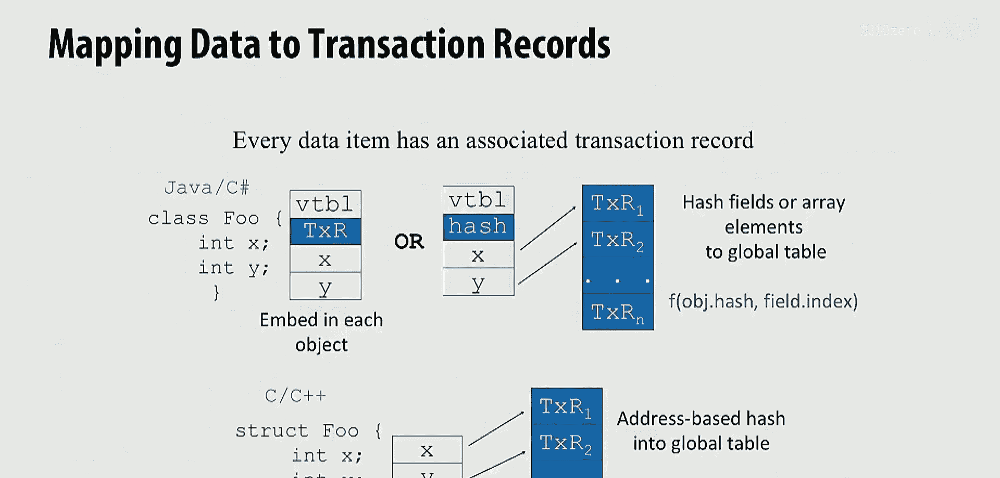

And so the question is， of course， this is a finer gra granularity of information about the data than than doing it per object。

 right， so there is some tradeoff to be had。 And as you're already， you know。

 thinking about this because you're making the analogy to cash coherence， you're thinking。

 So what is the tradeoff that we're gonna to see between doing things at the object level or doing things at a finer granularity at the individual field or individual。

😊，32 bit or 64 bit data element level。Yeah。I guess when you have like something that's at an object level you assume all of the properties are light。

Handled together even though they could actually be independent。

 like X and Y could be independent to prefer fire grid so what is going to be the impact of doing that？

It is not independent that the transactions that you solve previously the wing end Act whenworks。

 It will have unnecessary like for boards and restart exactlyact right。

 you'll have more conflicts than than really required right So this is exactly the tradeoff。

 And so object groundity you can have lower overhead of actually keeping track of the the data and you might have some opportunities for optimization if you are doing repeated you're using the same object than you can amortize the overhead of managing。

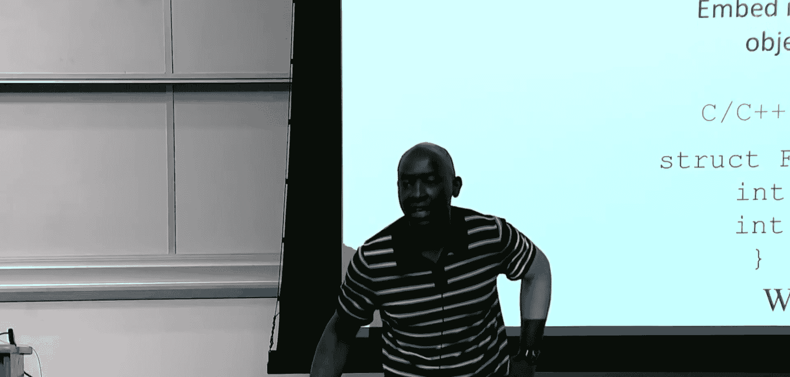

The data record for that object， but the key thing that you do get with this coarse of groundularity of these false conflicts。

 as you pointed out。Right so here's the example that then right。

 So if you've got element or field granularity， then you can reduce the incidence of false conflicts and potentially improve concurency and you know。

 you look at the example on the right here， we access the field X and Y from object A in transaction1 and we access the field Z in transaction2 And if you're doing things on an object level。

 of course， these two transactions conflict。But if you're doing things at a field level of granularity。

 then there is no conflict。 right， So that's the benefit。 And， of course。

 the downside of doing things at the you know， the element or field groundularity is increase overhead。

 And then， of course， you can imagine doing things at cash line because that matches what you might do in hardware。

 But then this doesn't have a direct analog with， you know， what you wrote as a programmer。

 so it might be difficult to understand what's going on。 And you know。

 if you're doing things in software， you can mix and match things， right， you might say， well， for。

 you know， objects， I'm gonna to do things I'm gonna do things at the object level and then for as。

 I might think about doing things at the element level。

 and this turns out to be a pretty good tradeoff。😊，Okay， so with that in mind， So we have a way of。

We have a way of thinking about data structures per transaction， the transaction descriptor。

 and then we have the data record for the individual data。

 so now let's talk about a specific STM algorithm algorithm and the one that we're going to use you know comes from Intel it developed quite a few years ago。

 go it's called McCarti。And it is an eager versioning。With optimistic reads， right。

 which means we'll say explicitly how the reads are optimistic in just a moment and then pessimistic rights。

 which means you're going to take locks in order to do the right。

And so it's based on this idea of versioning or timeting to determine what data is being shared by multiple transactions。

 And so the idea is that there's a global timestamp that is incremented when a transaction commits right So any transaction that commits in a system increments the global timestamp。

 and then there's a local timestamp which gets stamped on the transaction when it begins。

 and so this will be used for determining whether conflicts happen on data。

 and then there's a transaction record associated with each of the transaction。

 and it's each of the so associated with each of the data。

 I should say and it's a 32 bit value with a most significant bit。

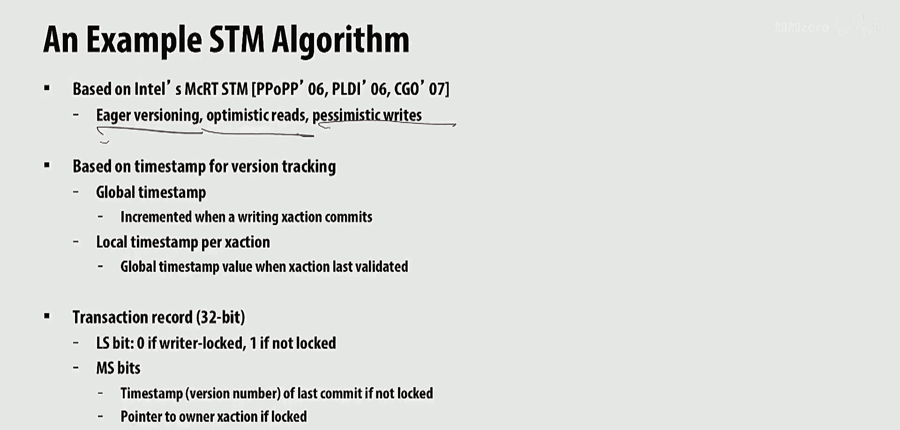

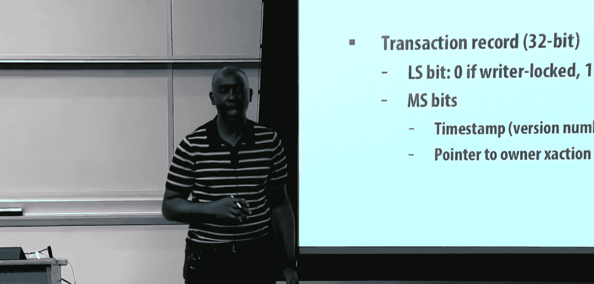

啊。Sorry， the least significant bits。Is either zero。

 which means it's locked and that means that this would be a transaction pointer。

And then if the least significant bit is a1， then this is essentially a version number。Okay。

 so by looking at the least significant bit of the transaction record， you can tell whether the。

 the particular object or or or the data element is is So you can think of this as when you've got。

A one。How should you think about the state of the data？Make the analog to cash coherence。Yeah。

 it's shared， right。 And when it's a 0， it's exclusive， right， And。

 and it's being written by this transaction， The one that says the point， right。

 So that's the way to think about things。 So we're either in shared or exclusive mode and the。

 the transaction break that indicates that。Alright。

 so now that we've got the notion of version tracking and transaction record。

 let's think about exactly what operations we need to perform in order to implement transactional memory in this software environment。

 right， So you've got。😊，You know， for every time that you want to do a read。

 you're gonna to call it STM read。 And this is optimistic in the sense that even though as we'll see。

 you， you， you do try and validate the data you are about to read once you've done that。

 your're golden until some other transaction decides to come in。Alright， so in this case， it's eager。

 So you just direct read from the memory location。 You validate the read。

 the day that you're trying to read by checking to see that it's unlocked， right， So if it's locked。

 then what you know about the day that you're trying to read。😊，Yeah。It could be valid。

What you know specifically that it it's that's about the data that you're trying to read。

It could be stay uncle someone else would be。Well， you have， let's suppose you that。To make things。

A little。More。Cl。Let's assume that you're at a point in the program and you're doing this STM read。

 and you have a direct read from the memory， but。呃。You could， potentially。Not read， right。

 you could do the check first。😡，Let's assume you do the check first。 Then what do you know。

If the data is locked， what do you know。

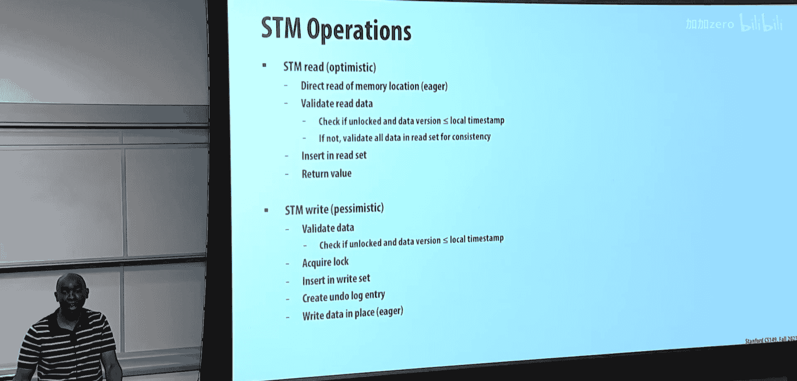

might you know that there is a transaction that is writing that data， right。

 So should you go ahead and read it。Probably not。 you should probably， you know。

 your content manager might say， well， let's just wait。😡。

Let's just wait for that transaction to finish。 and when it's done。

 then we'll read the data right So you can imagine at this point if it's locked that you just wait。😡。

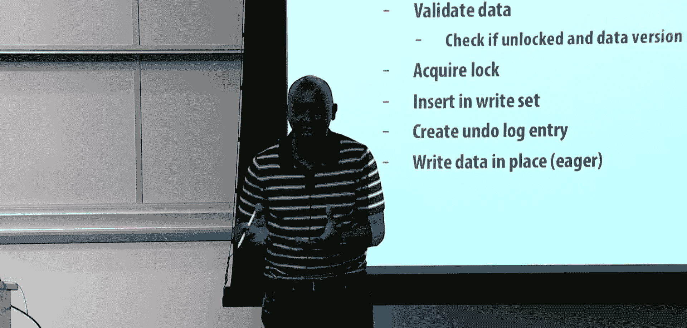

If it's unlocked， that means that， you know， some other。

 if it's unlocked and the data version is less than the local timestamp， what does that mean。Yeah。

 it's in a shared state that you can take it at least。Okay。

 what does it mean that the data version is less than the local times stampamp？😡，That means that。

report transaction study。After the transaction started。

 some other transaction has modified the day Now， does it mean that this transaction has read the wrong thing？

😡，Not yet。Because， in fact， the data has been updated。You know， it， it got the latest copy， right。

 But now it needs to make sure that all the rest of its data， you know， it is actually good。

 And so it， it tries to validate the whole of its reset again。

 And we'll talk about exactly what that means。 But just wants to make sure that everything is up to date。

Okay， so， you know， if we can， we validate the read data。

 then we can insert it in the read set and return the value， right， So clearly。

 there's more work to do with transactional memory than just reading the data， right。

 you need to keep track of the state of the transactional memory。 Now。

 STM right is pessimistic in that you now have to check and and grab a lock right， So you you know。

 you check if it's unlocked and the data version is less than the local timestamp。😊。

And in fact check passes， then you acquire the lock insert it in the right set。

 create your undo log entry and write the data in place because this is in fact eager right so you grab the lock。

And that makes this。Policy for doing rights， pessimistic。But it's。

Optimistic for reads because you didn't actually check to see that there were any readers that were had read this data here。

 right？😡，So the reader， the reader， the readers can compliively go， go along。

 It might turn out that later， when this transaction tries to commit that the conflict gets detected。

 but it doesn't get detected at the time that the right is happening。 So in that sense， it's。

 it's optimistic for reads。Okay， any questions？So how do we do resetet validation。

 where we get the global timestamp and for each of the entries in the REet。

 we checked that' if it's locked。😡，Or the data version is greater than the local timest that we have to abort。

What we know has happened if it's locked。😡，い、ま。Right you basically read the wrong thing and it's also true if the data version is greater than the local times。

 So that means that we've got bad data and we need to abort this transaction start again。

 suppose every element in the reset checks， then we can kind of update local timestamp for this transaction because as if it started executing at this point in which you just got the local timestamp as opposed to the original time that it got its local timestamp which was earlier。

 because you know you've completely validated the reset at this point。

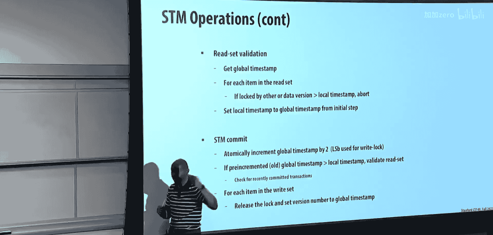

Okay， yeah。So both of expect lot further or。힘 무슨 때 거어요。No， what's the difference？

Can someone enlighten us about what's the difference between the data being locked and the timest being updated？

Yeah。I're prettyty sure as though that it's locked。Yeah，One is in the rights in progress。

 one is the right has already happened。😡。

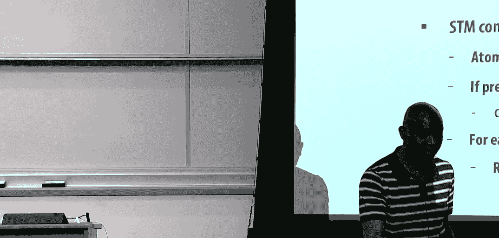

Good。Okay， so。STM commit， right， so now you need to increment the times stampamp you're going to do it by two。

 why do we do it by two？😡，不是。

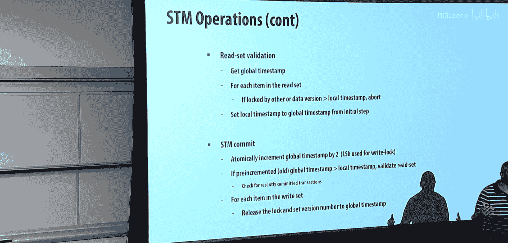

Yeah， because the least significant bit is actually。You know。

Keeping track of whether it's locked or not， right？ So。

 we always have to yeah increment it by two to make sure that that we can。

 can use that least least a significant bit。

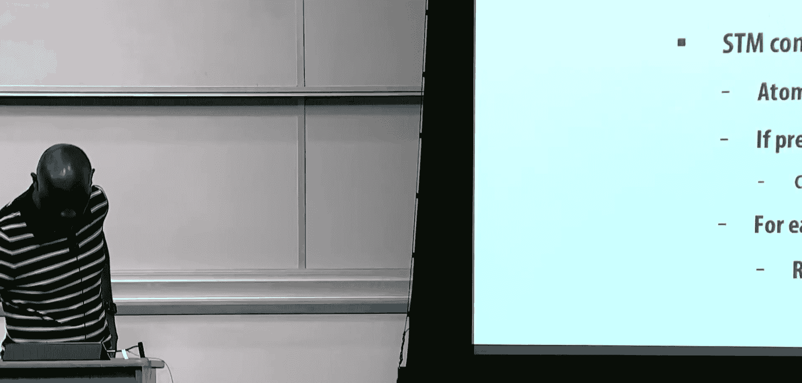

Okay， then we're going to take the pre incremented the old time stamp and validate the resetet。

Just to make sure that there aren't any recently committed transactions that that would cause us to abort。

 and then for each。Item in the right set。 we're gonna release the lock and set the version number to the global timestamp。

Okay。So， that's。So now let's look at an example， which is a slight modification of what I just told you。

 but it's close enough to make sense。 So here what we're trying to do is we have two transactions。

 X1 and X2。 And X1 is going to atically copy object to object bar。Right。

 and then X 2 is going to read object bar， and it should read also atomically， right。

 And so it should read either 0，0 or 9，7， right， It shouldn't see any partial updates to the object。

Backqui。All right， so let's see how this works。So， we stop by executing。The first。呃。Read of F。

 F the X element of fo， right， And so this needs to go into the read set。

So it goes into the read set as fo and the the timestamp is 3， right。

 So the idea is that there are no local or global times stampamps here。

 Let's just assume that each of the objects has， has a timestamp。

 and the initial object timestamp for fo is3 and for bar is 5， right。

 So we've got the read of fo in the readet。With timestamp three。

And then we have a read of bar and it gets timestamp five。And so that goes into the reset of x2。Okay。

 and then we get a right to bar。Right， and so what has to happen， right。

 we have to take the right lock， right， So we have。We have a right lock。

And that's indicated by the transaction point of to x1。Okay， now we need to。

Indicate that in in the transaction descriptor by having the updating the right set and the undo log。

 since this is a eager mode， right， So we have to have an un log。

 So we put the old value of bar X into the undo log， right。

We continue executing and we are going to read bar dot Y。 So what should happen here。Yeah， well。

 I think was like the granularity。Part of them， it should say that's invalid。So watch it after。Sts。

一个。Yeah， so maybe sos going to detect it's going to see that bar is locked， right？

So as it tries to do the validate for， for the。For the， for the read of， of bars， and say， you know。

 the the object is locked。 And so let's assume that we just wait， we stole。Okay。So x2 weights。Okay。

 so x1 continues， we have another read of fo。Food dot Y。 And that gets put into the。Reset。

And then we have another right of bar with that value， and that all gets put into the right set。Okay。

All right， now we need to。Commit， right， and so what do we need to do？On commit。Yeah。

Is that the first thing we do。后系。So what do we do before that validate validate the reset exactly。

 So first we're want to make sure that know the reads that we got are in fact valid and so we check and you know。

 the timestamp for F is still the same for both of the the reads of F and so we say， you know。

 Re validated we're cool and we can go ahead and commit。 and the commit is gonna。😊。

Increment the times stamp on bar by two。 So it goes from 5 to 7。Okay， yeah。So when we have。

2 separate。没意。也可以。Yeah。夜跑。Right。He just added。Yeah， that probably is incorrect。Yeah， yeah。

 we probably should add an entry to the right set for both rights to borrow。Although。Yeah。You know。

 you know， once， you know， since it's it's doing it by。诶。Yeah， you probably should。我不美女。I mean。

 it is at the object level ground irony。 And so once you know that。Yeah， in this case。The right set。

Isn't so important。😡，Right because you're doing pessimistic。Detection anyway。

 And you have an undo long， right。So。呃。Figure out。In this case。

 exactly what's in the right set isn't that important。You need， of course， to potentially on， on。

 on a conflict。呃。Use the undo log。 But， you know， to be completely correct。You're right。

 You should probably have another entry in here for the other right to buy。All right， so。We commit。

And。Now， we can。Rid of。Okay， so we're at the point， the x2 weights， we get to the commit。Allright。

 now what happens is we can now release the stool on X2。Right。And then we get another read。From。

The X2 transaction。 and this， of course， now has the new times stampamp。Okay。

 so then x 2 gets to the commit point。 And what do we do first。Validate the read set， Okay。

 so we validate the first read and does it validate No， right， so you have to abort。And。

Once you've aborted， you can re executeecute and then get the right values for the， the ball object。

 okay。Any questions on how this works， yeah？On the SCM operations slide。

 I don't think this really makes that much of a difference。

 but do we autoically update the global timesstamp and then use the old one to make the mindset foundation。

 or do we do it the way around？Well， let's go back to what was said。Yeah。

 soomically increment the global timestamp。And they use the old global times stamp to。

 to validate the reset。Right， yeah。Okay。Any other questions on that？Alright， then to summarize right。

 so we've talked about the various options for TM implementation。

 we can be optimistic so we can be optimistic or pessimistic in terms of contention。

 We can be lazy or eager in terms of data versioning and that with the software TM systems the compiler or the typically compiler or the virtual memory system adds these barriers。

These software transactional memory barriers or instrumentation code to call into the transactional memory system to do the bookkeeping okay and the basic data structures are the transaction transaction descriptor per thread or per transaction and transactional records per data that keeps track of the state of the data。

 whether it's locked or version number。So it turns out， of course。

 that these barriers add overhead and a lot of the work that gets done inside the barriers is in fact redundant。

 and so if you can decompose the barriers into the individual components， in fact。

 you know you got a log logging of the object opening it for right and you'll see that a lot of the operations composed in the barriers are redundant and can be optimized away and so you get lower overhead。

And。Then the question is once you've done with this kind of optimization。

 what kind of performance do you get， right， So this is some data from one of the papers that was published on McCarti。

 and it's looking at two data structures， hashmap and Tmap。 and for hashmap。

 I think it was sort of 80% Gis。And 20%。Puts。Right。And so you look at the different bars。

 the this is the overhead on a single processor， right。

 So trying to look at sort of how much overhead you get。

 And so 0% would be the non threadd safe code。 The blue bar represents the overhead by， you know。

 using a single corearse grain lock synchronized over the whole method。 And the。Kind of reddish bar。

 purple， purple reddish bar is what happens if you use a software transactional memory that does not have any compiler optimization。

 right？ So then you get 70% to 80% overhead on a single processor。 However。

 if you combine an STM with compiler optimizations。

 the overhead comes down dramatically is shown by this pinkish bar or pinkish orange bar。

 And then the overhead is roughly 40% over no concurrency control and 30% over a single kind of coar grain lotbased synchronization。

 yeah。regard to the percentage of all the work that children。

It's how much extra time it takes to run your code with these overheads in。😡。

RightAnd so if you have no extra code， then that's the time that you just got by running your code without any support for transactional memory or any synchronization at all。

 so it's not threads safefe。😡，So your code's not thread thread safe。

 You can make it thread safe with a coarsesp lock。 as we've seen， that's fairly easy。 Just in Java。

 just put synchronize around the home method， right。It seems that' be a lot faster than。あ。

Foster in what sense？I going。Yeah， yeah， it it is faster。 But remember。

 this is on a single processor。 It won't scale。 We saw that earlier， right， didn't scale， right。

 So now if you want something that's scalable， then maybe you have to go to fine grain locking。

 which is actually not shown here， right or you go to transactions。 And on a single processor。

 you're overhead is is is 30 to。40%， But， you know， you really should compare it to， to。

To the overhead of， of， of synchronization， since， after all， if you don't put anything in your code。

 then it's not threads safe。 And so you couldn't run it correctly in parallel mode， right？

 And now with transactional memory and compiler optimization。

 you get something that's both scalable with reasonable overheads。Okay。

So just to refresh your memory。Let's suppose that we have an atomic region and we are assigning 42 to the。

To object。Field of F1， F1 field of of the object。You know。

 what steps are required to implement the atomic region。

 assuming that there's some way of getting a transaction descriptor。

 and we're gonna do things at the granularlarity of an object。 What are the。The。

Operations we need to perform。Once we have the transaction descripture， what should we do。Oh yeah。

 it's optimistic read， pessimistic， right。Eager versioning， just like the one。

Example that we just described， we want to。Implement this atomic region。

What steps do we need to take？Yeah， if it's。Right。Like to validate。And那走。

You get the walk and your right side。Added to the undo log。Okay， right。

 so open to right is kind of your check。And you're gonna log it。

 and then you actually can do the right， since it's eager。Good。Alright， so， you know。

 if here's not some more data about the performance of STM。 But here， this STM is unoptimized， right。

 So it's not as optimized as the as the McCarty example with the compiler optimizations I just showed you。

 But the problem is that you've got this overhead in terms of performance or you know， in that。

 in this case， it's two to。8 times per thread due to the software transactional memory barriers。

 And if we decompose the time we see in this these two examples。

 vacation is this three tier server example， K means its just K means clustering。

 And you see that a lot of the time the white and the the black portions of the stack bar chart are due to the STM right。

 which is black。And the STM read， which is right。The STM barriers add a lot of overhead and sort of。

 you know， committing also adds a bunch of overhead， right。

And so the question is sort of how can we remove those overhead heads by judiciously using hardware。

 Well， we could try and attack the need to have barriers at all， right。

 And so if you have a hardware mechanism for doing transactional memory。

 then you don't need explicit barriers， right， you don't need to tell the transactional memory system。

 hey， I'm doing a read or hey， I'm doing a right， Why't you go take the necessary actions to implement the transactional memory。

 All I need to do is just do loads in stores and let the hardware transactional memory system do the correct thing。

And so as you might imagine， the way that we are going to implement this in hardware is were going to ride on top or exploit the fact that we already have a coherent shared memory system right and we already have caches and so we can do the data versioning in the caches。

😡，And we could do the conflict detection by riding on top of coherency。 Okay。

 so we already have the mechanisms for implementing transactional memory inside a modern processor anyway。

So we use the caches to do the right buffer or the undo log and the conflict detection can be done by enhancing the coherency protocol okay so the one you component that you also need in order to take a checkpoints that you can come back in abort is you need to checkpoint the register state right so you've got a context associated with the register contents of the processor and you need to hold those values around so that when you abort。

 you can come back and get to the same state so you need to checkpoint those away somehow and you know a lot of processes allow you to do that。

Allright， so let's look at a hardware transactional memory design。

 So what we're going to do is we are going to enhance our metadata on the cache line right So we're going to add for each cache line。

 we've got messy state bits right coherence bits that we've already discussed。

 and we're going to add two other bits， an oddbit and a W bit right。😊，What do these represent？

The read and right state， right？So if the R bit says， hey， this cache line is part of my read state。

 if the W bit says is this cache line is part of my right state。😡，Okay。

 so then now you can think about how you do the conflict detection， right。

 So if you see a shared request to a line that is in the has a W bits set， you know that is， in fact。

 a conflict， a read write conflict， right， so that you you've already written this line some other processor wants to read it。

And you know so there's a potential conflict there。

 if you see a exclusive request to a to a cache line that has the audit set。

 then you know that we had a right read conflict， right。

 you've already read the particular cache line and some other processor wants to read it。Okay。

 so that， again， of course， is a conflict。Another example would be， hey。

 the W bit set and you see an exclusive request it says hey， there's a right right conflict。

 I've already written this cash line and this is other processor that also wants to write it and we're currently both in ci a transaction and so something has to be done to make sure that we deal with that conflict。

Allright， so with that in mind， let's look at a example So we have in our CPU。

 the reddishes and the red state， you know， kind of is indicating the extra state that we need to implement transactional memory。

 So we've got a reddishister checkpoint that we need to take and then we have some extra state associated with you know aort handlers where exactly do you go in in the program to deal with theborts if there's any you know software cleanup that needs to be done。

And then the key elements that we've added are So we are our read R And W bits， right。

 which indicate to transactional memory state。Okay， so R says it's part of the read set。

 And W says it's part of the right set， so。Given an example now， this is a very simple transaction。

 loads A and B installs 5 to C。 And then we commit。All right。First thing that happens is we load a。

 the cache line becomes valid。 Let's assume。For the sake of。

 simplicityimp the the cache line size is， is a single word。

And we also have to indicate that it's part of the reset， Right， So we need to set the object。

Similarly， for B， we set the orbit for。The B。Address。And then， for C。Wei。You know。

 we probably want to put a five in here。Just to be。Correct， right。 So we， we。

 this needs to be part of the。Right set。Okay。So。Now that we get to the commit point， right。

 we need to。Let's assume that we did not see well。😡。

Well get to the commit point and assuming that there have been been no other conflicts。

 what should we do。So in particular， is this？Value that we wrote to C。 How do we need。

 how do we indicate to the rest of the system that， in fact， this is data that is actually。

Committed state。 So in the at the moment， it's inside our cash。

 We've indicated it's part of our our right set。 But the rest of the the other transactions and and threads don't actually know about it。

 right， Because then remember， the property of transactions that we want is isolation， right。

 that each of these transactions is isolated from， from each other。

 and the the way that we get that is that each of these transactions are operating on their individual caches。

 Okay， so now we get to the commit point and we need to publicize the fact that we have written to the address C。

 Okay， so how do we do that。对。You need to upgrade to the exclusive state exactly what has to happen？

We need to get up we an upgrade and so now we indicate that C is now in the dirty state so or exclusive state。

 and we send that out to all the other processes， and let's suppose that you know some other processor was doing commits of a transaction with rights to A and D before this transaction committed。

 what would happen right， well， if we saw an upgrade to a right。

 then we would say what conflict right。😡，Because A is in our cash。😡，And it's part of our reset。Right。

 and so。Noe， maybe you read A before the transaction started。😡，That it could be in the cache。

 but not have the the read orbit set， right？So， you know。

 just the fact that A's in the cache doesn't mean that there's going to be a conflict。

But if there is， in fact， the odd set then it says， hey， not only is it in the cash。

 but I read it during the transaction。Okay， and so now this would be a conflict。

And there's other cases where I get see an upgrade for D， what happens。

As far as this transaction is concerned nothing， right， D is not in the cash。 There's no， you know。

 no match with the entries in our cash。 and， and so there can be no conflict。 Okay。

 so let's assume then。That we， oh， going back to the commit， right， so。

We validate by requesting the right set lines， we commit。

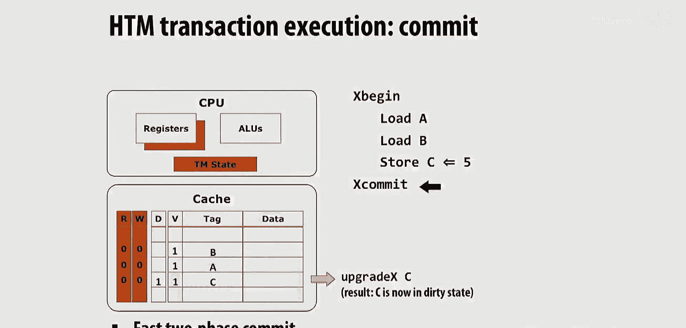

So as kind of described so far， what do we see？How would you describe the。嗯。

The policies in this hardware system。Think about it。 Well。

 in terms of the data versioning policy and the。And， and， and the。Conflict detective policy。

It's eager， right？Because as when the well， is it eager？😡，I辩。

When do the upgrades actually take place？啊对。So soundss off。And then in terms of the。The data。

Viersing。It's lazy optimistic。对呀。It what， yeah。そですのね。包。It's the right one。It's the right buffer。

It's buffering the rights。 And then at some at the end of when you get to the commit point， you say。

 okay， here are all all the things I wrote。 now I'm going to publish them to the world。 And you know。

 anybody else who happened to have So it's exactly the case that we described， right。

 which is you get to the commit point。 you have a bunch of things in your right set。

 you're going compare them to everybody's read set。

And how are you going to do that by sending out these upgrades？Yeah， yeah。

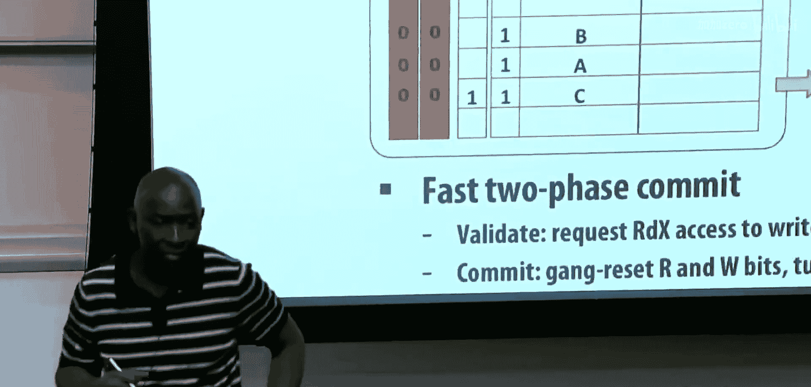

like now， when we try to store sea， in general， what we would do is we would go。

It was not present in any other gap， I think here we use the exclusive data as the way to indicate that。

Right， in this particular。あまな。Think about whenever you reach something itll go to the mod。

And then I'm just trying to think of from a broker perspective。 So， you know。

 as far as the state of the， the cash line。 remember， it's all。It's isolated， right。

 so you don't really participate in coherence。😡，Until you get to the commit point。Okay， right。

That makes sense。Yeah。For the cash lines that are in the RE， I know for the right set。

 we have to issue a read exclusive what do we have to do for the reset？

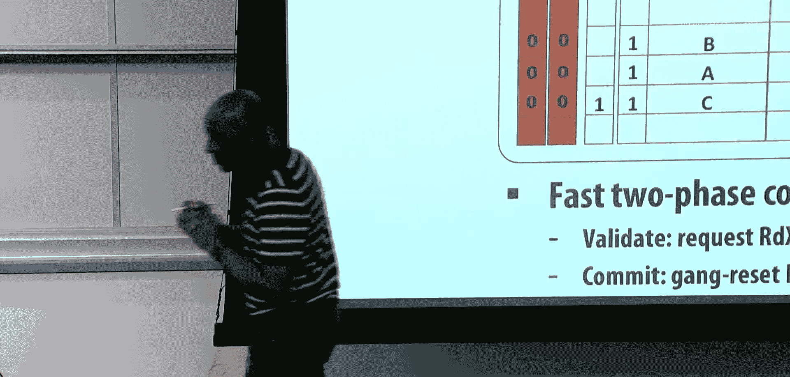

We just issue just like a read。Not exclusive or yeah， you just do a read right。

 let's assume that you go get it from memory， it's shared。Right。Or you do a read。

 you get it from memory or you get it from whoever commit， whoever had it in its modified state lost。

 right？😡，Okay， so we've determined that this is， in fact， lazy optimistic， right。All right。

We can do the review。 Let's do one more example， just to kind of。You know， really。This， this is。

 in fact， an explicit。Lazy optimistic scheme in which you're not。

The way that you do coherence is with the transactional memory system， Okay， so。

The idea here is that when you get to a commit point。

You take all the state that you have and you update everybody else。😡，Okay， which is classic。

 you know， lazy optimistic， but there， there are no other states， right， becauseuse all the。

 all that ever happens is transactions。Execute， they get to the commit point。

 and then they send out all the state that they've modified and update everybody else。 Okay。

 so that's what's happening here。 We've got a bunch of processes。

 three and then each of them is executing transactions that do reason and rights to to different variables。

And， you know， the assumptions are there's one commit per execution step across all processes。

And the reason you want that for simplicity is， hey， there's only one。

 it's kind of like a bus based scheme that only one transaction is committing at a time and it's updating everybody else。

Okay， and when one transaction causes another transaction to a board and re execute。

 you can assume that the commit of one transaction can overlap with the begin of another transaction。

Okay， so with that in mind， then the idea is given these processes。

 three processor and these four transactions。Wt you lay out the fill， fill out the。

Table as shown here， right？ So what actions， What's the read set on P1。

 the write set on P1 and the actions and and read and write sets on the other processes， right。

 And so it's partially filled in here， Right， So we started executing。

Transaction one on processor of one。 and at the point at which we do this right of C。

 A is in the read set。And A is in the right set， and C is in the right set for processor of one。啊。

As in the right set。Read set of processor 2。Using the and so on。 Okay， so now。We're at the point。

Which。Let's see。Which。C commits， okay， so what do we do？😡，In order to validate。で是か。Sorry。

 processor of one。 see。 Yeah， this commits。 C is the commit。 So yeah。

 transaction one commits on process of one。 What we need to do。Yeah。

I think in its resetet is someone else's right set。What's the rule for lazy optimistic？

What's the rule for lazy optimistic？We just talked about it。We saw。Lastst lecture。

A couple times today。Someone tell me。Okay， so what's the right set of this committing transaction？

Okay啊。What is the right set of？Reset of the other transactions。It doesn't have any。

So it looks like we were okay。嗯。I should。Come back to this last case。How about this case？

Transaction two is committing。Conception4 has to be started。Yes。

 transaction 4 has to restart because the read set of transaction 4 contains E， right so。So。

 you know， the rule says， hey， when transaction。Two commits。

We can overlap that with the beginning of transaction 4， which had to abort and restart。Okay。

 so anyway， you can go and look at the details。 But in general， you should be able to。Soold problems。

 something like this， right， given a sequence of transactions and， you know。

 you can figure out and some rules to follow。 you can figure out what happens， yeah。え全部なですこに。

I assume it's all exact1 times look at like the other processor is speaking the bus。Yeah。

 just assume that at the time that the commit happens， right？

It'sGly known what was in the the right state of the committing transaction or processor。one。

 can you have to watch production so simultaneously in that。I mean。

We could imagine systems that are not buses that in which that happens， and which case， you know。

 the problem would be a lot more difficult。 But with a bus。

 the nice thing about is only one you know Trans can beyond it at any one time。

 and that simplifies matters， right because you know。

 we always like to serialize things because serialization means it's easier to think about and easier to to reason about and and buses give you that serialization point。

Yeah， from an instruction perspective， So were atomic and then practice around， let's say。

For getting the big the event coming so is that an explicit instruction and hardware？From a nice。Yes。

 it would be， it would be。I'm just at this stage now， convention B1 is committing。

And it has a C in the light set and transaction P3 also has a C slide set。所以吃的方式。谁。あけるビ術さ。

I reads that matter it's like overriding its overriding。the question is who， who， who。

 who gets there first， right？ But the， you know， But from the point of view of the consistency of。

 of the of the， the data， it has never read it。It just overwrotede it。

So you'll still get the right result。What you said like bus analyzes use duplicate of the bus it's not kind of how you get the balance on the bus。

You could have multiple buses， right， and then if you have multiple buses。

 then you've lost a serialerilization benefit。And now you've got to think about different schemes。

Right。Yeah。I mean， all of these things are necessary if you want scalable performance and buses don't scale。

 right， We only think about buses because they're easier to talk about in classes like this where。

 you know， if you go back in time， Yes， the earliest multiport processes were， in fact， bus based。

 right， because that was the simplest to implement and， and。

 and and building hardware was very expensive。 But today， nobody builds anything with a bus， right。

 Its just doesn't， doesn't perform well。 yeah。At the end of this example， like on this very slide。

 if we just go to the end of the table， we see that when we're committing P4。We start I。

 if you just go to like one more next slide。So in this case。

 I just want to clarify that the reason for this is because。There is a conflict between。啊。

s it the conflict between E where would it like into？It's in the reset set for T4。

so the right set for T4 is。There's no E andC。But there's no conflict between the right set of T4 and the RE set of T3。

BegSo hold on。You said it was restarting， but I don't see the restart。For CT3 is that another， no。

 that's committing。So that is dog。Do6 cents。Yeah， that's。呃。Sorry， that was the。

W you see food and W eat fine basically。And video。But你 thing。YeahYeah， possible。Pity。

 there's no bugs in it。Yeah。Probably should fix that。Somebody's taking。Any other questions？All right。

Yes。All right， so， you know， hardware transactional memory support has been implemented in Intel architectures。

😡，For various reasons it didn't work out so well， you know。

 the software to use it wasn't developed as well as one would hope， and it was not all that。

Capable in the sense that transactions could abort for almost any reason whatsoever。

 And a lot of the times you had more aborts than necessary。

 But what finally kind of put the nailed in the coffin of the transactional memory support was it to opened up security holes that people exploited。

 And so you know， the still in the Intel you know， road map。

 there is the the plan to put in transactional memory。 But we haven't seen any implementations yet。

 You know， So if you look at the，Intel I SA manual， Then there are the definitions of a bunch of。

 of instructions to support transactional memory。 But the latest implementations don't have them in。

So just to recap then， you know， transactional memory implementation， you can do software， hardware。

 you have the ability to make these trade offs between the different points in the design space。

And that if you really want to reduce the overheads of software。

 then hardwareware is' kind of a key requirement。 And once you kind of understand cash coherence。

 it's， you know， a minor。

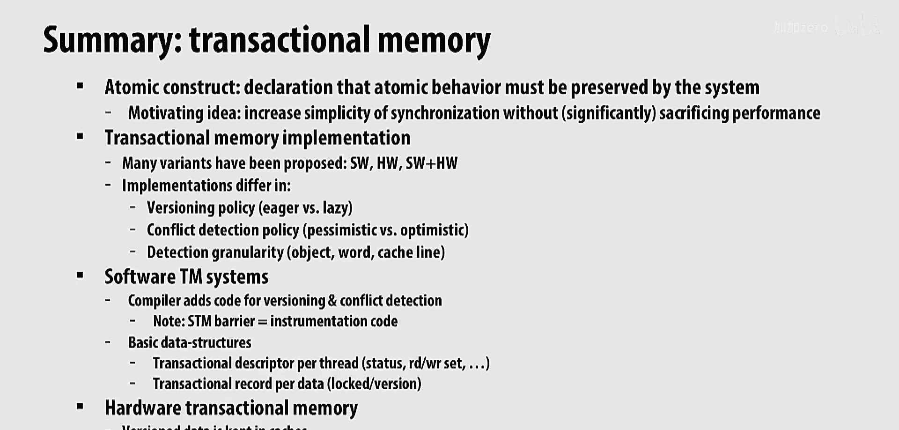

Delta to understanding how you would implement a transactional memory system。 Yeah。

 it is surprising that not it's not very。Wide use so this is with because about even supporting something like this it is。

 you know， you， you， is flexible and。that I could something you could add something to it if you wanted。

 Yeah， You know， IBM has also implemented processes that and so is， you know。

 sun before they got acquired by， by Oracles。 So other people。

 lots of people have experimented with it， You know， in terms of sort of。Commercial uses of it。

 there have been more software， but software where you。

 you kind of localize a transactional memory used to places that would be very difficult to implement with locking。

 Right， So the certain database system implementations that kind of use。You know。

 at the core of of the database， management system use transactional memory ideas in order to implement parts of the system。

 Yeah， I had a for that。 So I think one thing I realized the was one of the major problems was keep something goes。

you never want to specialize because if you specialize and you don't get to use that those resources other for programs are not usingex memory。

 so you'd like to reuse the same resources。I understand use these species there's lots of literature on every kinds of you know financial memory has been an area that has generated a huge amount of it。

 you know， give you go back。

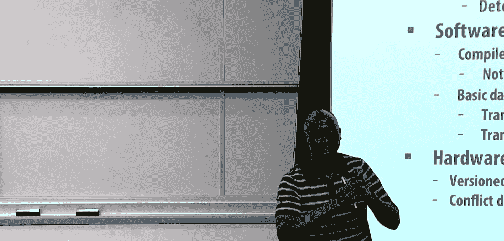

10 years or so and there's just a lot of work in this area and I can point you to it and you know。

 you's probably you know， just。Type in trans memory to Google。

 you'll see an unlimited number of ideas and papers。 So yeah。

 so I guess my takeaway is it seems that huge introduction。有。And fine。But fine。Pracice racially it's。

It's not used that much because you know。Well， it's not used that much because。

You have to have this transactional memory system implemented in software right and you need in order to really get good performance。

 you need compiler support right and you know， and then you've got something that is is is not。

Completely general。In the sense that now you now need to clone your code in order to make it work with a transactional memory system。

😡，And so that makes it the whole system a a little less robust。

 And so the right way to think about the ways in which transactional memory has really been used is people come up with data structures that are optimized for working with transactional memory。

And then they have part of their system that is。Being implemented with transactional memory。 But。

 you know， they're not using transactional memory over the whole of their， their parallel system。

 They just kind of localize the components。Localized component。

most of the commercial systems that use transactional memory use software based。

 almost nobody uses the hardware because the hardware is broken。对。系啊，即系应该。

Bing the future it is actually going to work。変るだ。That's a good question。 it's an open question， yeah。

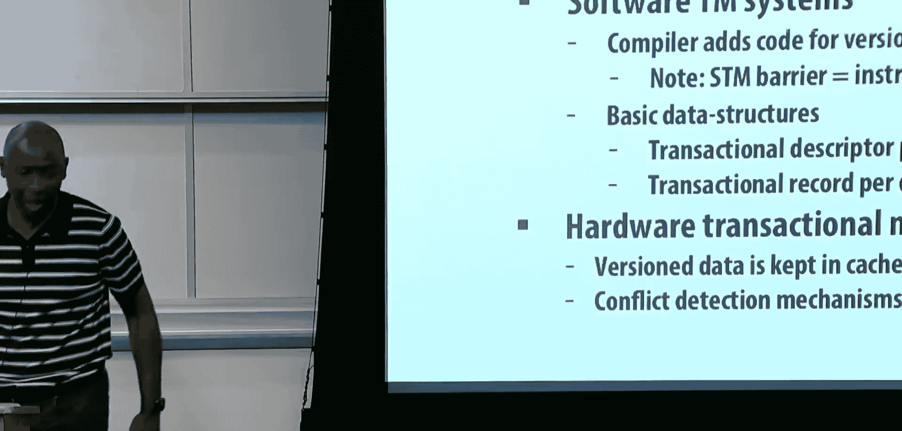

All right。I think we don't have much time to talk about heterogeneous parallelism。

 but let me kind of get going a little so。So far， we kind of talked about， you know， using。

Processes and GPUs and sort of CD execution to exploit parallelism。

And the focus has been on sort of general purpose computation and know writing parallel programs that are fairly general however。

 it turns out that if you want to get much better efficiency in use of in terms of the use of your your hardware。

 you might want something which is much more specialized and so what we want to talk about today or in the couple of minutes kind of just introduce the idea or sort of what can you do to specialize your CPU to make it tremendously more efficient So we've talked so far about given the current set of resources that you might have in a modern CPU or modern GPU。

 how do you use those most effectively but you can go further and say。

What if I've got something that I want to， some algorithm that I want to run very efficiently。

 How can I make that work much more energy efficiently， Okay， so。You know。

You kind of look at across most real world applications。

 They've got complex work load characteristics。 Some of them have parallel parallelism that you can exploit using multiple threads。

 Some of them have Cdy parallelism that you can exploit by using vector and Cdi execution if you look up the memory accesses。

 which， of course， are a key component to the performance of your application。

 Some parts of those some of the memory accesses that be made are predictable。

 And if they're predictable， then， of course， you can prefetch those accesses。

 If they're not predictable， then maybe they cache well， right？

 So hopefully you you can get one or potentially both of these characteristics。😊，Okay。

 and so the question then is sort of， if you want to be able to exploit the wide variety of characteristics of the application space。

 then maybe you want to specialize your your components to。

 to exploit the particular characteristics of your，Application， right。

 And so that's the idea of heterogeneity。 And it turns out that all modern processes are， in fact。

 heterogeneous， right， So take the Sky Lake processor that's the Intel core I7 core architecture in your in myth machines。

 right， They are， in fact， heterogeneous， right， So， you know。

 the focus of our programming has been on the CPU course right， and their associated caches。

 But of course， they've also got an integrated GPU and graphics and media unit。

 which takes a significant amount of the area of the chip。😊，And they've also got some other。

Specialized components， right， So the point here is that that this heterogeneity means that you can get greater efficiency in the use of the resources of the silicon and in terms of the use of energy。

 But of course， it creates a more difficult programming paradigm， right， we've already seen that。

 you know， you need multiple threads for the CPU cause。

 you need some sort of data parallel programming model like KUuda。

 for the for the GP and you might need a different programming model for the media components， right。

 And so next time we want to talk a little bit more about the types of heterogeneity that you might see in the modern computing landscape and talk about how you address some of these programming aspects。

 especially for you know，😊，Applications such as the ones that you're doing in your programming assignment so。

 so。Machine learning applications。 So we'll。Continue that next week。

