# 斯坦福大学《深度强化学习｜CS224R Deep Reinforcement Learning  Spring 2025》中英字幕 p01 -01- Lecture 1_ Class Intro.zh_en -BV1SvmxB3E5e_p1-

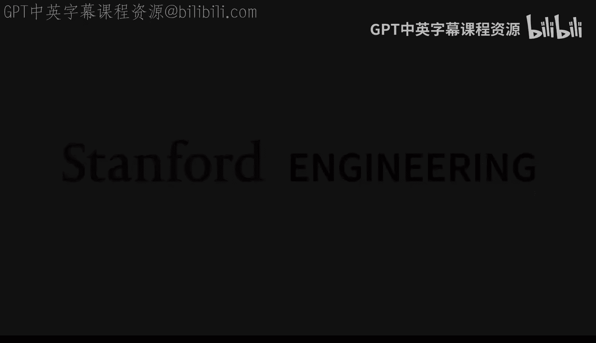

Welcome to Deep reinforceinforment Learn or CSQT4R。

Im really excited to be teaching it again this quarter My name is Chelsea I am the instructor of the course I'm an assistant professor here at Stanford I do research on reinforcement learning robotics and language models and a variety of other topics so the plan for today so we're gonna to be covering the course goals and some logistics hopefully this will be fairly short because all this information is available online after that we'll be talking about why study deep reinforcement learning and actually get into some technical content on modeling behavior and reinforcement learning。

The key learning goals for today is what even is deep reinforcement learning。

 how do we go about actually representing behavior in a way that we can optimize behavior and how do we formulate a reinforcement learning problem？

So what do we mean by deep reinforcement learning so first for reinforcement learning we mean decision making problems。

And these are problems where a system needs to make multiple decisions based on this freedom of information。

 so it'll observe and then take an action based on that observation and then observe again and take another act。

And we'll be studying those kinds of problems as well as the solutions to those kinds of problems。

 and that includes things like imitation learning， model free and model based reinforcement learning。

 offline and online reinforcement learning， multitask and meta up reinforcement learning。

 as well as a little bit of an extra focus on reinforcement learning for large language models and reinforcement learning for robots。

So that's kind of the crux of the reinforcement learning aspect of the course。

 and we'll be emphasizing solutions that scale to deep neural networks and we'll be spending a lot less time on solutions that don't pertain into deep neural networks。

Now， how does defarral differ from other machine learning topics？

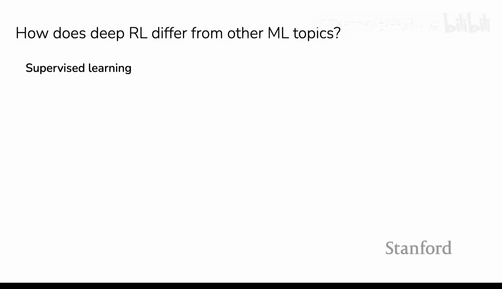

Hopefully a lot of you have some experience with machine learning and oftentimes in machine learning。

 you'll have some kind of input output pair of XY， and you'll have a bunch of these。In some data set。

 and then your goal is to learn something that can map from x to y。😡。

And another thing is that we kind of typically assume in these data sets is that these data points are sampled from some distribution and are sampled in an independent and identical way from that dispute。

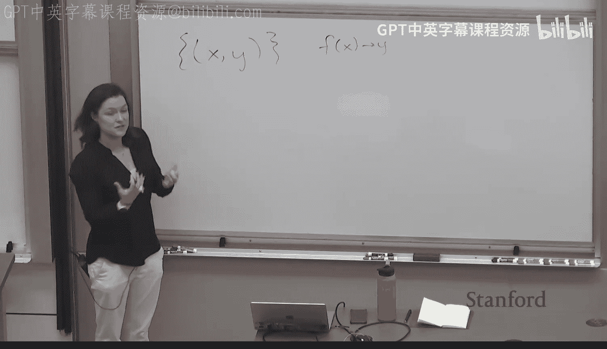

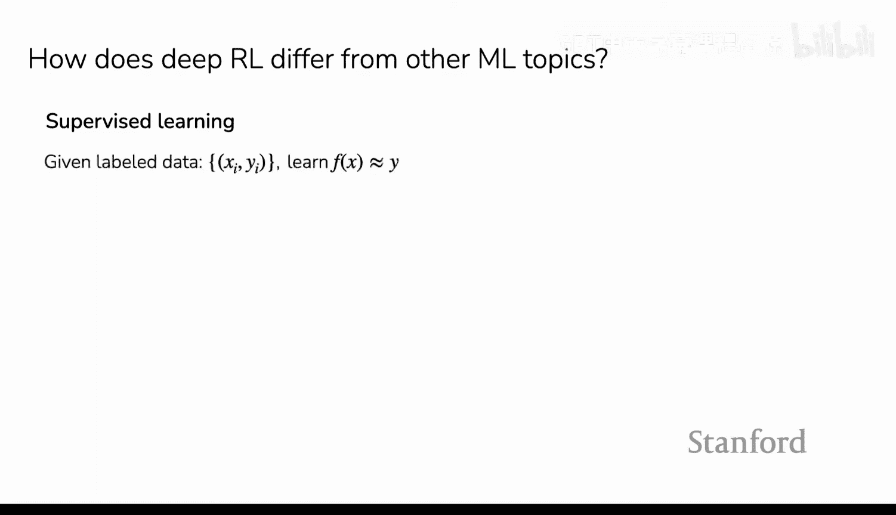

And this is actually where reinforcement learning differs quite a bit so in supervised learning we have label data。

 we learn the function， we're directly told what's to output。

 we're kind of told what the answer is that for that given input。😡。

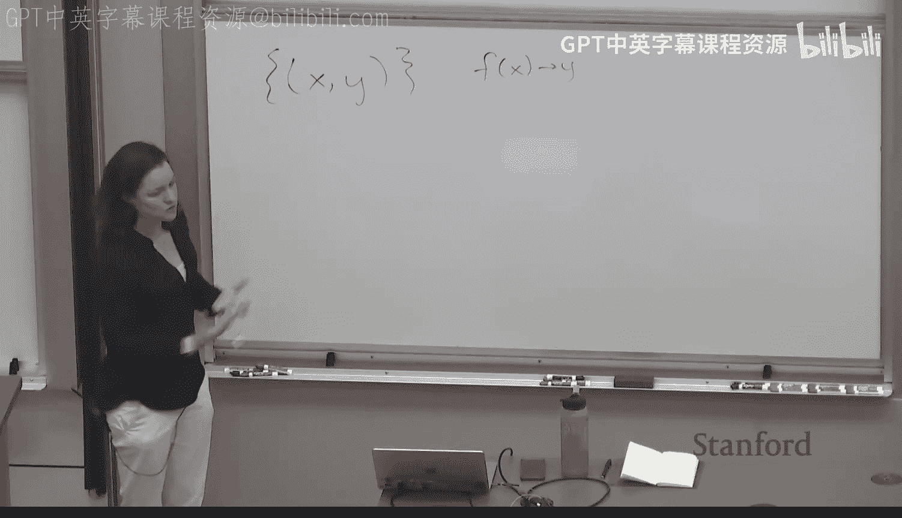

And the inputs are IID sampled。Now， in reinforcement learning， the picture is a little bit different。

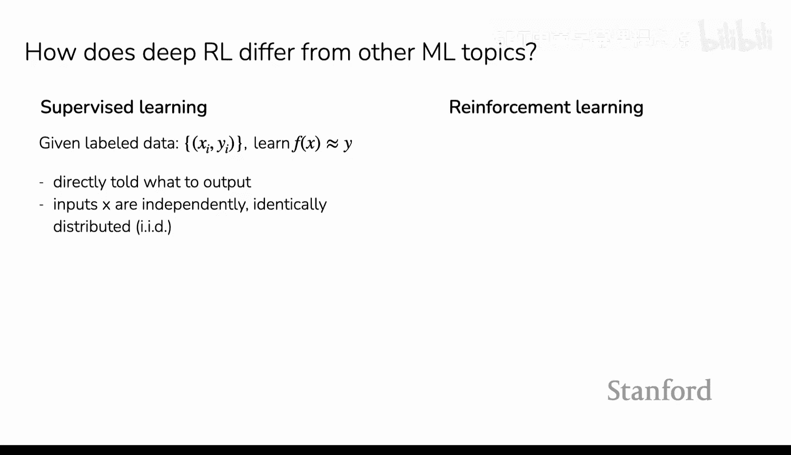

Ultimately， our goal is to learn behavior。And we'll actually use different kind of not to refer to inputs and outputs。

 So specifically， our goal will be to map from。

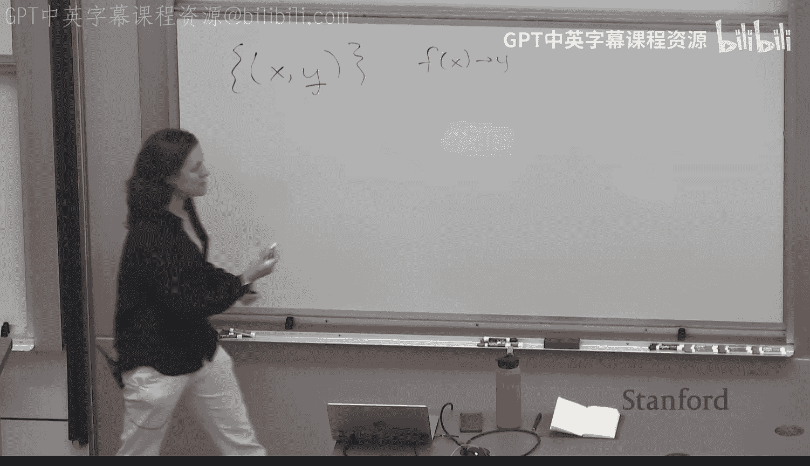

States do actions and we'll refer to the function that we do that mapping as T。And。

Unlike in supervised learning， we're not going to be directly told what the answer is。

 our goal will actually be to learn this behavior from much more indirect feedback。

And so in reinforcement learning， the goal is to learn this behavior pi of a given S。

And this will be from experience and actually experience often drawn from the policy that you're learning or this function that you're learning。

And the data is not going to be sampled from a single distribution。

 it's actually going to be sampled in a way that actually depends on the policy or the function that you're currently learning。

So these are the two big differences and what I mean by behavior is this could include motor control like controlling your robot。

 it could include a chatbot that is interacting with a person。It could be playing a game。

 it could be driving a car， it could be an agent that's interacting with the web and a wide range of other domains。

So that's how reinforcement differs from typical machine learning。

We don't have the ability to cover everything in deep reinforcement learning。

 and so we're going to try to focus on the core concept behind deep reinforcement learning methods so that you can then use those core concepts to understand more advanced methods should you choose to dive deeper into the topic。

We'll also focus on implementation of algorithms to get to the point where you feel comfortable implementing algorithms yourself。

😡，And we'll give examples in robotics， control， and language models。

 especially in lecture and projects， but a lot of the techniques will generalize more broadly。

And also just to focus on topics that we think are the most useful and the most exciting to cover。

If you're interested in more theory and other applications that are kind of beyond some of these。

 CSQ34 can also be an excellent point。Yeah， and then the core goal is really to be able to understand and implement existing and emerging methods in key reinforce。

😡，Cool， so why study do reinforcement learning？U。I'll list out a number of things here and then we'll dive into each one a little bit more。

 So one we already talked about is going beyond supervised example。

And there's a lot of scenarios where AI model predictions have consequences。U。

 and if we want to take into account those consequences。

 then we need a framework for thinking about those consequences and how to optimize the behavior with respect to those consequences。

So for example， if you like listen to music on Spotify， for example。

 and the Spotify algorithm is recommending a song for you to play。

That recommendation or even actually just playing it directly for you。

 that recommendation has consequences that the next time it recommends a song。

 it probably shouldn't recommend the same song and might want to also stay within the same genre and so forth and so if we want to think about developing AI systems that can take into account those consequences。

 that's what deep reinforcement learning allows us to do。

There's also scenarios where direct supervision isn't available， so for example。

 if you have a coding assistant like like cursor or coppilot and you want to give it feedback saying like that was a great that did a great job there or did a poor job there that supervision is not the output it's a more indirect supervision and that kind of learning from that sort of indirect supervision or really any sort of objective can be formulated as a reinforce the learning problem so it's a lot more flexible than supervised learning。

Reforcement money is also widely used and deployed in a number of performanceant AI systems。

Also learning from experience， in my opinion， seems kind of fundamental to intelligence and so just from a kind of a philosophical level in terms of building intelligent machines。

Figuring out how to actually develop algorithms that can learn from their own experience seems pretty fundamental to that。

 and it's fundamental to be able to actually make discoveries of new things rather than just mimicking the data。

And then lastly， there's also some pretty exciting open research problems as well。

 and so it makes it a pretty exciting area to do research on。And then lastly， I was also actually。

 last weekend I was telling a friend that I was making slides on why study deep reinforcement learning and how I was out of making several slides on it。

And they were like， well， why do you this question doesn't seem very hard。

 The answer is just 1 million in total compensation from open AI so maybe if you're not motivated by one through four this can be some motivation。

Okay。So typing intoBeyond supervised learning。Decision making problems are everywhere and can't be directly formulated supervised learning。

 any sort of AI agent is captured by this， also if you want your AI system to interact with people like chatpotts or recommenders or scenarios where it will affect decisions will affect future outcomes or observations。

 these kind of feedback loops， these are reinforcement learning problems。😡，And then， yeah。

 like I mentioned before， if your labels， if you don't have labels and your objective isn't just accuracy or it's non differentiable。

 these are scenarios where reinforcement learning is useful。😡。

Now I mentioned that DRL is used in a variety of different performance systems。

 what am I talking about there？Two examples of legged robots that have learned behavior with reinforcement learning。

 in this case， reinforcement learning and simulation and then transferred to the real world。

 so you can get some cool stuff like Puffy robots and dancing humanoids and these are actually like real robots in the real world policies that were trained with deep reinforcement learning。

Beyond legged robots and dancing， you can also get robots that can manipulate with arms to do tasksft using in this case imitation learning but so within the scope of this course so the left is a robot that is unloading laundry and folding the laundry on the right is a robot that can fold some simple origami so some pretty cool stuff you can do with。

With these kinds of messes。You can also learn to play complex games so several years ago。

Deep Minds use deep reinforcement learning to train a system to play the game of Go。

And it actually defeated the champion of Goat defeated Liidol。

 which was really impressive in its own right， and another really cool thing about it was kind of coming back to this discovery Falllon of AI systems。

 there was this move that surprised everyone that was an expert and go。

 it was called Move 37 and it kind of discovered a strategy that humans previously hadn't thought of before。

 and so this is an example of how reinforcement learning can be a tool to discover new solutions and this might be useful beyond games but if we want to for example discover curious diseases or discover things that require experimentation provides a tool for doing those he。

And this's not just robots in games， so nearly all modern language models use some form of RL for post training。

 especially for more advanced reasoning as well。There's also research on traffic control using reinforcement learning and finding ways to insert cars into human driven cars in order to increase the throughput on different roads。

Research on training jarrative models with reinforcement learning in this case， for example。

 trying to make the generations adhere to a particular prompt。What these are showing is on the left。

 if you asked the base standard of model to make a picture of a dolphin riding a bike。

 it'll give you this， which is not a very good picture。

 and then you can optimize the reinforcement learning to get a picture that is actually following the prompt more effectively and likewise for other prompts as well。

And this's also is being used for chip design， this is a paper that design chips that are used in Google's production TU。

 which is also pretty useful yeah。

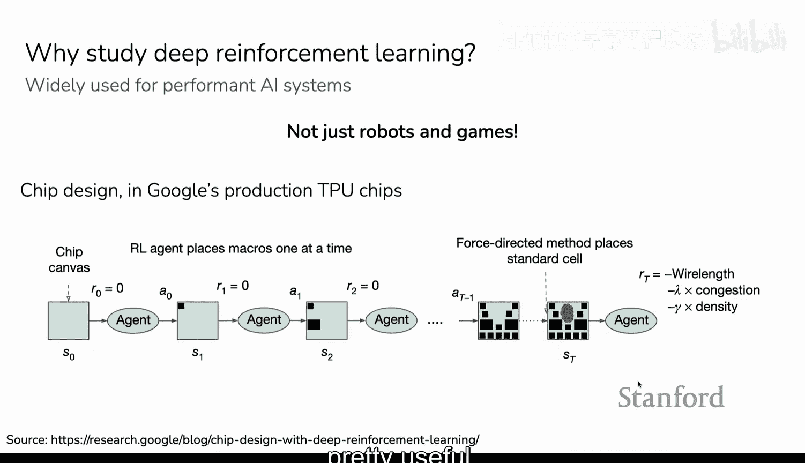

Great， so those are a few examples， there's a number of others that I didn't cover as well。嗯。

The next thing that I mentioned in terms of studying deeparrow is。

 it kind of seems somewhat fundamental to intelligent， and for this。

 I want to tell a little bit of a story。hich is that when I was starting my PhD。

 right after I graduated undergrad， I joined a lab that was looking at reinforcement learning for robots。

And right next to where I was sitting was this robot here。 and oftentimes。

There was a postdoc in the lab who was running experiments with reinforcement learning。

 and so I would look over at the robot and it would be doing things like this。

And the thing that really kind of fascinated me about watching this robot is you could actually see it learning over time and at the beginning it knew nothing about how to。

 for example， insert and kind of assemble these two parts of its toy airplane。

 and at the end it's actually able to do it quite performly。

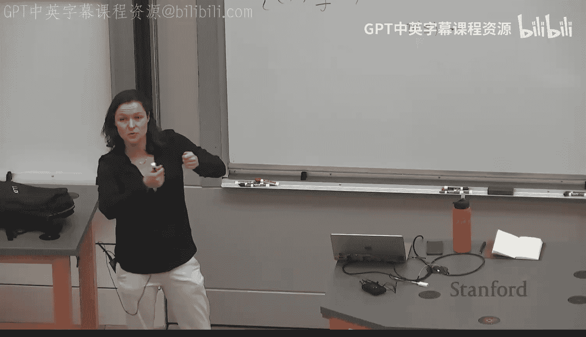

This is like really， really cool， you can actually see it learning from its own experience。

In the real world。So essentially reinforcement learning enables this kind of ability to get better with practice that isn't present in other machine learning systems。

😡，Now there was one caveat to this which was that this particular robot had its eyes closed。

 it wasn't using a camera essentially， and that seemed like a really fundamental limitation to me。

 and so I actually kind of then worked with the postdoc on a follow up project with vision with cameras and I was able to in this case then learn in the real world how to insert the redblock into the shape burninging tube。

And again， here。With experience is able to get better and better as it practices the task over and over again。

And then after the learning process， it's still learnings still improving。

 it ends up getting a success rate， I think around。95 or 100% success at the end。

And then I can hold the block out or at least a young version of me can hold the block out for the robot。

 and the robot can then put the right block into the sixth version。Now these are very simple tasks。

 this was in some ways a long time ago， and now we have robots that can fold laundry and do dancing and so forth。

嗯。But it's kind of one of the reasons why I like showing these videos is they really show the reinforcement learning process in the real world and the ability to improve with pressure。

At the same time， there's also a ton of exciting research problems that are open。

 and so if you're someone who's excited about doing research。

 this challenge is like how does this robot learn to represent what is good for the task？

Or how does an agent generalize behavior not just to one scenario。

 but to many different scenarios and can we apply such a system at scale with large diverse data sets and transfer from other tasks and other goals？

And can we use reinforcement lane long cr path， like cooking a meal or solving a really hard math problem？

Or and can robots practice fully autonomously and for this last point I showed you some videos of reinforcement learning that's not actually always what it looks like so sometimes if you run reinforcement learning a robot it looks more like this's where the robot is trying to hit the hockey puck into the goal and。

Every time the robot attempts the task， it then kind of needs to start over and re-attempts it and the robot doesn't actually know how to undo the task。

 and this is my friend Yvgen， you might notice that Yvgen is actually doing more work than what the robot is doing。

 which doesn't kind of quite seem like the right way of doing things it' is not practical to collect a lot of data this way。

Okay， so。And along all these topics， these are some of the topics that we'll be covering in this course as well so we we talking about reward learning and how to represent different rewards。

 we talked about offline R， multitask R and meta RO。

 hierarchy and reasoning and reset free R as well。😡，Cool， so any questions on why DL？

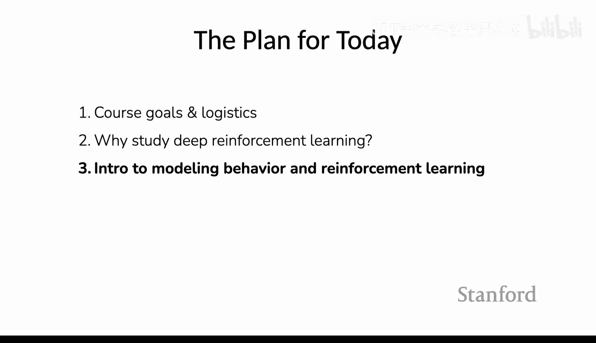

It is interesting to study。

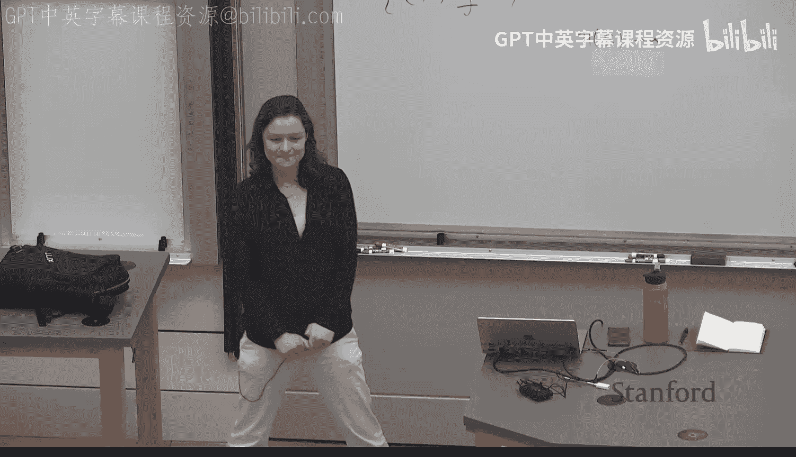

Yeah， so in the， the question was， how do you learn a reward when the robot is learning in the real world。

 And in that particular example， the。We represented the reward as the distance between or the negative distance between the kind of the position of the object and the goal position of the object and you might have noticed that in the case with the shapeframe cube the robot was actually holding the cube and so that segment that we could actually measure using the robot arm position。

 where the cube was as well now you can't do this in practice in many scenarios it's kind of specific to that task and in the hockey example there was actually a mocapt marker on the hockey puck that measured where it is where it is in the room and in general is very hard and that's why reward learning is kind of necessary in order to solve the problem in a more general way。

Good question。Okay， so now let's dive into modeling behavior and reinforce the learning。就。

We need to figure out how to represent experience as data so like as the robot was practicing。

 we need to think about how we could actually represent what was captured in that video as data to learn from and so here's another example of a robot learning in the real world we might also want to think about how to represent。

Text from like a chat bo， for example， we need in either of these cases， we need to think about。

Experience that to agent collect， how do we actually write that down in data？

So the way that we do that， typically in reinforcement learning is first we'll think about the state of the world and we'll use S to denote this current state of the world。

嗯。And for example， in the case of the robot， the state of the world might be like the position of the arm and the position of the towel and the position of the hook。

Or if you don't have access to information about the towel directly。

 it might just be an image captured from the robot's camera and the position of the joints of the arm is you have access to that。

Now you can't always。Represent like you can't always have access direct access to the state of the world and so。

Sometimes we' sometimes we'll refer to an observation O and use observations instead of states。😡。

And the difference between observations and states is that with observations， it may not capture。

All of the information you need to make a decision and you might actually need to think about past observations that you've seen before。

 so for example， for a chatbot， if you're interacting with it。

 you could think of the observation at a given time step as the most recent message that you sent to that chatbot。

😡，And then that most recent message doesn't help to top on everything it needs to know about what the next Ver font would be。

And so what you need is you actually need to give it the history of past observations。

 not just the current observation in order to make a decision。😡，Hman。

 we'll talk a little bit more about this state observation distinction in a couple of slides。

So this is kind of capturing what the agent is observing now we also need to capture how it's taking actions。

 how it's actually making decisions， and we'll refer to those decisions as actions。

And we'll use the letter A to denote actions。And then。

In terms of a given interaction with the environment。We will think of that as a trajectory。

 so that will be a sequence of states and actions or a sequence of observations and actions。😡。

This is kind of one way to represent。Behavior and。This will then kind of result in a data set of trajectories rather than a data set of X5 pairs。

And then we need to think about like what is actually the goal of the town？

And that's where reward functions come in and reward functions are essentially telling us how good is a given state in act。

In many cases， the reward function will only depend on the safe， and for example。

 it might tell you how close is the towel to being hung or is the towel hung or not。

 or in the case of a tappot it might be like how happy is the user or did they give me a thumbs up or a thumb down？

😡，And then this experience is kind of the trajectory and that trajectory might be augmented with the rewards。

So this is kind of each time you kind of roll out the policy。

 you'll get some sort of data in this form。😡。

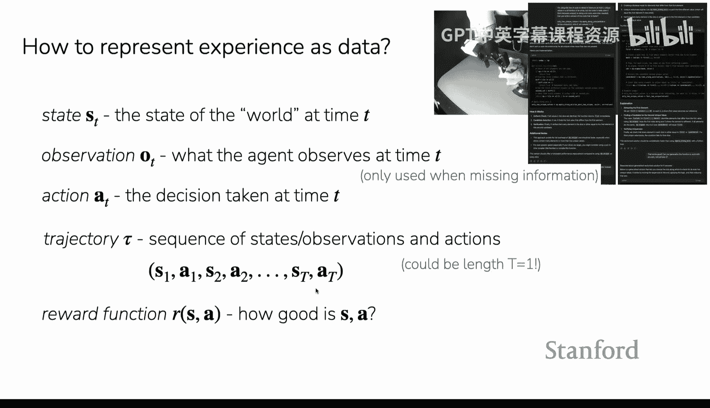

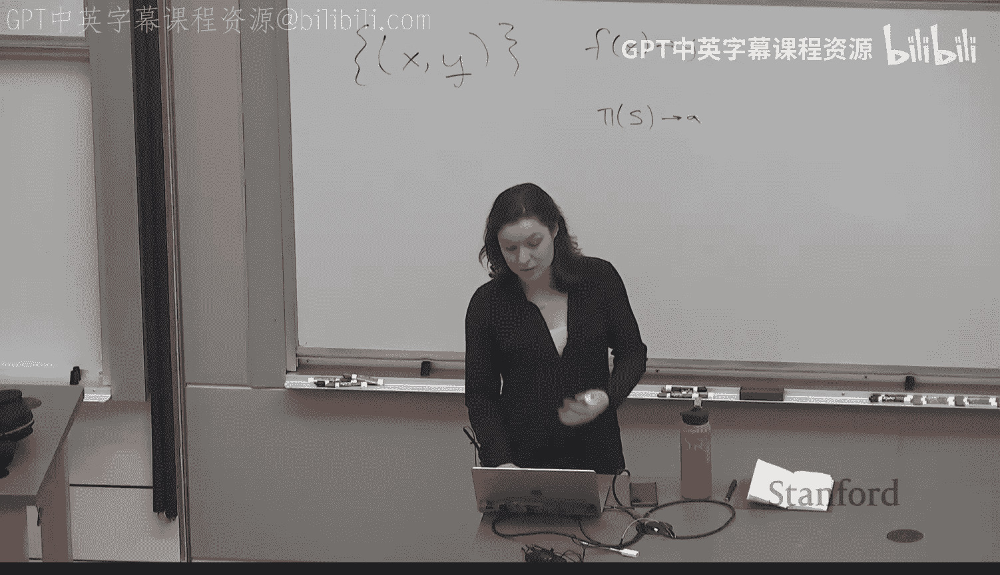

Let's talk a little bit more about states and observations first so the way that we'll we can then think about states and actions is in some ways a lot like a markov chain so we'll have say we'll have the first。

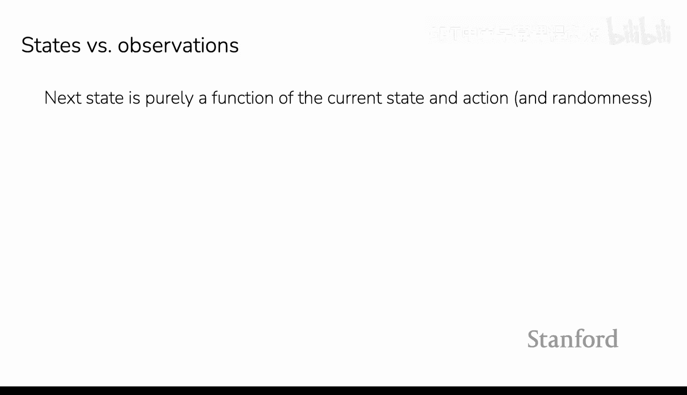

State of the world， this is for example， in the robot case。

 let's say the towel is on the table and there's a hook and the goal is to put the towel on the hook this first state is like the robot in some neutral position and the towel on the table。

And then the robot will。Take some action。This is like moving its arm to a particular location。

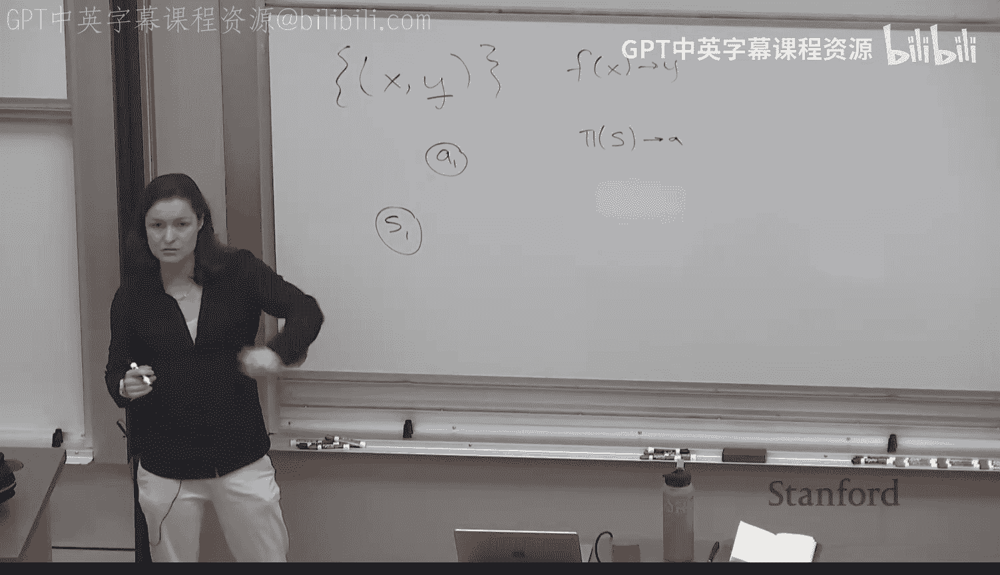

And that action and the current state will inform。What's the next state？And then from there。

 the towel will be maybe the towel is in the same position if the robot was just moving in free space or maybe the towel is moot。

And then the robot will then take another action and it will move its arm again。And。第。😔。

States and accidents will then inform the next state。Now， one crucial thing here is that。

We kind of can think of how the environment is changing under what's called a dynamics function。

 so you have like P of S3 given S2 and A2。This is kind of the dynamics of the world is how does the arm actually move in space and how does the towel move in space as a function of where it was before and what the robot did？

And the crucial thing to notice here is that。S3 only depends on S2 and AQ。

 and it doesn't depend on F1。And so。Like there's no S1 in this probability distribution。

And essentially， as three。Is going to be。嗯。Independent of S1 if you condition on S2。

And this sort of independence property is called the Markov property。

And it's one of the things that actually ends up being very useful in reinforce the learning。

 so it allows you to break up the problem into these scenarios where you don't have to worry about all the dependencies that come before it。

Now， if you have observations in set of states。Then things look a little bit different and the way that we can think about observations is the observation is a function。

Of the script， please。And it may not contain all the information that shouldn't state。

And so the observation at any given point in time for complete this， we'll draw each of them here。

And then if you don't have access， if you can't observe this space。That means now that。

O2 or sorry O3， it's not just a function of O2 and A2。

 it's actually also a function of01 if you cannot observe the C。😡，Cool， so on the slides。

 we can think about。This model where we have these dynamics。

 we don't know how the world is going to evolve， we can't directly observe like how the we can't predict the future。

So these dynamics are unknown and these dynamics are independent of ST minus1 in this case。

 and that's known as。The Markco property。Any questions on that？Yeah， so the question is in practice。

 how many past observations do we need to infer the safe， it is heavily domain dependent。

In like heavily domain dependent in a lot of robotics examples。

 you can often get away with just using like the current sensor observations。

 but it depends a lot on like what the sensors are like if you have tactile sensors for example。

 those are oftentimes don't contain as much information as like vision observation for example and so like how close you are to a table。

 you have no idea when you're not making contact and then once you make contact you know because that's a lot more partially observable than an image for example。

 then if you have the images in addition to that then that gives you a more complete representation。

😡，Yeah， so why is the reward function a function of both the state and the act and not just the state one example of this is we can go back to a robotics example so say that you are a humanoid robot and you're trying to learn how to walk and maybe like one natural reward function is just how much forward progress have you made so where is your body and that would be kind of dependent on the state？

One scenario where you might want the action is that scenario where if you don't want to be using too much energy because you don't want to be like pensing up all the motors for example。

 or I guess pensing muscles make more sense， but if you don't want to be exerting too much pushing too much energy into your motors。

 then you'll want to depend on the actions as well。

 and you could basically have some penalty on how much torque you're putting through the motors so that's one example。

 in many cases you can just depend on the state but there are some examples where you want to kind of penalize taking too much action。

😡，Yeah， so the question is if the observation is only part of the state。

 then why does kind of a future observation not independent of past observations and the reason for that is that we can actually go back to the tactile example so say that you are you make contact and then you stop making contact and then you make contact again in that case the most immediate past observation doesn't actually tell you that much information about the current state。

And whereas this observation actually tells you a lot more information about the state and so。

Then 03， you actually can learn more about you can actually figure out more about03 when you don't just condition on02。

 but also condition on 01。And there's also a way for folks familiar with graphicraphal models to actually think about if you kind of marginalize out these variables。

 youll actually see that in the Gphal model， I don't want to go into that today。

 but that's another way that you can see them。Correct， yeah yeah， so yeah。

 if you were to estimate and predict03， then you would you would need to use all of you need to use past observations。

 but the actual observation in this graphical model is kind of dependent on the state which might be unobserved or unknown。

酷。So let's walk through a couple examples of what this might look like。

 so in the robotics case the state could include three different things。

 one would be the RGB images from any cameras on the robot。

The positions of all the joints of the robot and the velocities of the joints。

And so this is like kind of a fairly common state representation for a robot system。

And like the images would be like would be actually a different dimensionality than the physician and you might need to actually configure your neural network in a way that can accept those different dimensionalities。

The action would then be the commanded next joint position so how are you going to kind of move your joint if your joint's currently like at 90 degrees。

 maybe you'll try to move it to 92 degrees。The trajectory then would be a sequence of states and actions。

 so a sequence of videos， a sequence of images， which is essentially a video。

 a sequence of joint physicians， and a sequence of command and joint to。No。

What does that sequence actually entail？Typically what we do is we'll discretize time and this sequence will then for example。

 be at 20 hertz， so you'll your video will be 20 frames per second and you'll have joint observations 20 times per second and you'll also have commanded actions 20 times per second。

😡，I always found this a little bit unintuitive when I first learned it because as a person。

 I don't really think about like making a decision 20 times every second。

 but it is oftentimes the most practical way to represent data and behavior on like physical systems like robots。

And then for the reward function， there's a few things you could use here。

 one could be one if the towel is on the hook。In state S and zero otherwise。

 you could also have some sort of penalty on like the forks that you're applying on the a or something like that。

That's a robot example now let's go to like a chatbot example。

 So here the observation we would likely wouldn't have like a compact state representation and so using observations and the observation could be the user's most recent message。

😡，The action would be the chatbot's next message， so this would be potentially a sentence or a paragraph。

 potentially connected be very large。And then you could think of the trajectory as the conversation trace。

So like the kind of history of the current conversations。And unlike in the robotics example。

 this won't necessarily be at like a fixed like 20 hertz frequency。

 it might take longer for a user to respond or something like that。

 and so this is an example of how trajectories might vary in terms of how time is represented。

 so in the first case time is represented as a 20th of a second，Whereas in the second case。

 time is represented as when the user responds connect。And then as an example reward。

 maybe it's one if the user gives an up votete， negative 10。

 if the user gives a down vote and zero if there's no user' feedback。😡，Okay。

 so here's an these are examples of how we can set up reinforcement learning now I would like to ask you to formulate a reinforcement learning problem。

And in particular。I'd like you to define the state or observation。

 the action trajectory and reward for either one of these three examples or choose your own example。

Yeah， so in this example the。

There's a question of basically the question is like why would this be it observation versus a state it could actually be formulated both ways potentially it kind of depends on the details of the sensor measurements。

 so as one example， if your sensors are just looking at like current like a LiIDar of like the current depths around you and like a picture of what's in front of you yeah maybe something along those lines。

 one thing that that would be missing is like how fast the cars are moving around you like the velocity of the cars and that's probably quite important for like what's going to happen in the future like if it's stopped versus moving at 60 miles hour now you could potentially try to include a history of like LiIDar information to get that velocity information and then represent your state as like three kind of a three secondcon history or for example。

 and this will kind of represent a theme which is that typically to represent to handle。

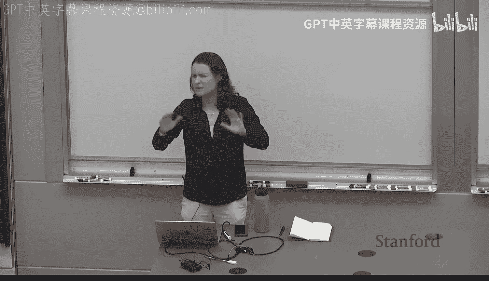

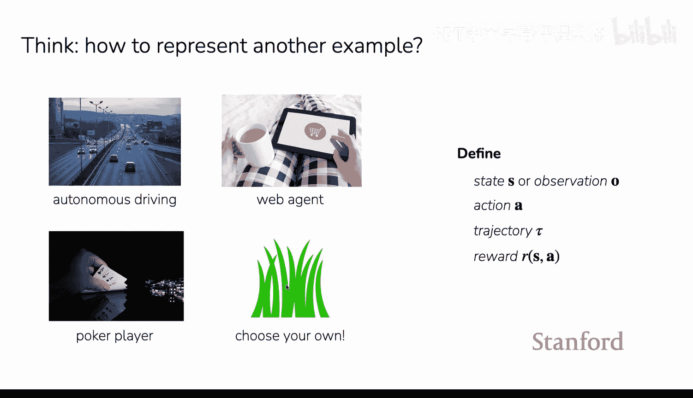

Observations will use a little bit of history and then that can form your state representation so it's a little bit ambuous in this particular case and yeah it comes down to the details yeah。

😡，Yeah， so the question is in the robot example， if the reward is one if it's on the hook and zero otherwise。

 how do you actually learn because if you're just like if you don't actually ever do that at any point。

 then you'll have very little supervision signal， you'll just have zero reward all the time and so in that actually in that particular video we initialize we actually showed the robot how to do it a couple times as initialization and that helped it with what we'll call exploration and if you have very sparse rewards rewards that have very little signal and are not kind of nicely shaped towards the goal。

 then usually that kind of data might be important for jumpstarting the reinforce the learning process。

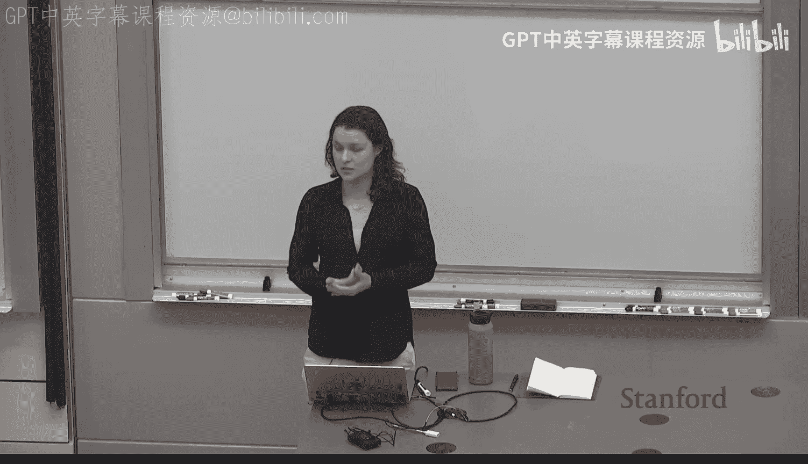

Cool， cool， yeah， so if folks couldn't hear that you'd have the state being something like the HTML and like the URL like information about the web page and where you're at。

 the action would be interacting with it and the reward would be like whether or not some tasks is completed。

Yeah， so the question is is basically everything in observation because sensors like may not be perfect。

 so you could always choose to model something as an observation if you're worried about like sensor noise or something like that。

 there are large in some ways potentially like large downsides to it if you need to add a lot of history and so sometimes we will kind of approximately approximate something as the state。

 even if it might be lacking information like maybe I don't know once every like 10000 times the sensor fails and give you like a black image or something like that。

 even though that would technically be like an observation case you might still use it as a state representation because of how it affects the algorithms。

Yeah， so if I understand correctly you're asking for observations it could either be like everything currently or it could be a delta from the previous observation。

 yeah， and the yeah it would come out down to different tradeoffs oftentimes if you are going to be including a lot of history then kind compressing it by using deltas could potentially make a lot of sense。

 but most begin into policies， maybe it'll also become more clear。

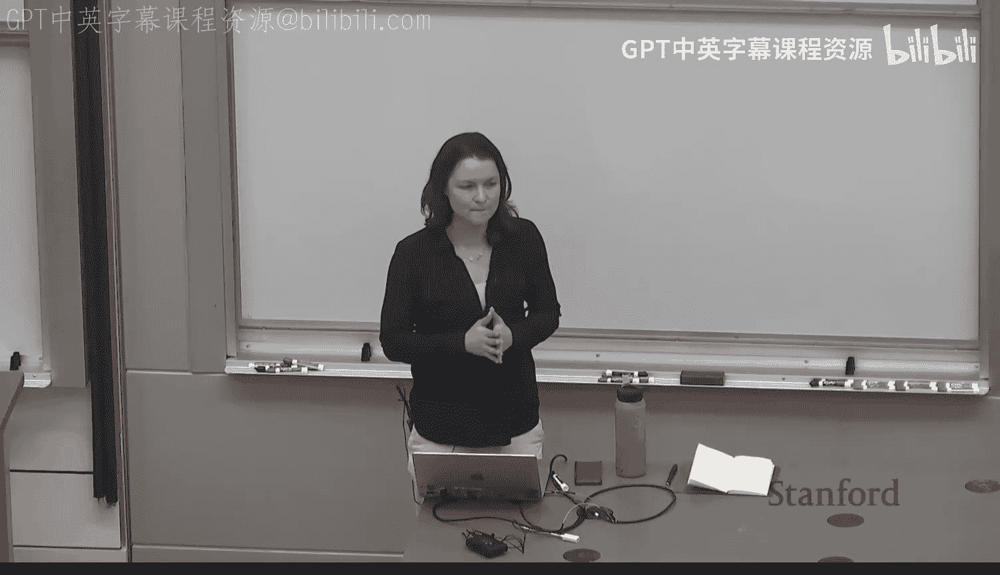

Okay， so now that we've talked about formulating the reinforcement learning problem。

 let's talk about actually representing behavior， so we want to map typically from states or observations to action and we will to do that we'll use what's called a policy and this policy will often use pi to denote a policy or basically almost always use pi and this can just be a neural network in this case it's a convolutional neural network。

 it could be a transformer， it could be like a simple fully connected neural network。

 it could be a linear function and this is gonna be mapping from the states or observations or the sequence of observations to action。

😡，We'll use typically theta to refer to the parameters of that neural network that you're trying to learn。

And so then when you're actually using a policy to take actions， will then observe a state。

Take an action and observe a next state， and when we take actions。

 we're actually going to be sampling from our neural network。

So we'll actually be running a forward path through the neural network to selection an action and then execute that action in the real world and observe the next state。

嗯。Cool。And so the result of this process is a trajectory and when we're using a policy to generate this trajectory。

 we often refer to it as a rollout or an episode you can think of it as like kind of one episode of learning one episode of learning is like one a attempt and then trying it again and again and。

I guess the terminology rollout is in the sense that you're kind of sequentially going policy dynamics。

 policy dynamics， and you're kind of rolling out this process to create a trajectory。Great。

 and then if you only have observations and you don't have states。

 the solution is to give your policy memory and so you can pass in multiple observations。

 whereas if you only give it a state you actually don't have to give it any memory and you can just give it as input state this is very convenient because if you have a large amount of memory it will take up a lot of memory on your computer or on your GPU。

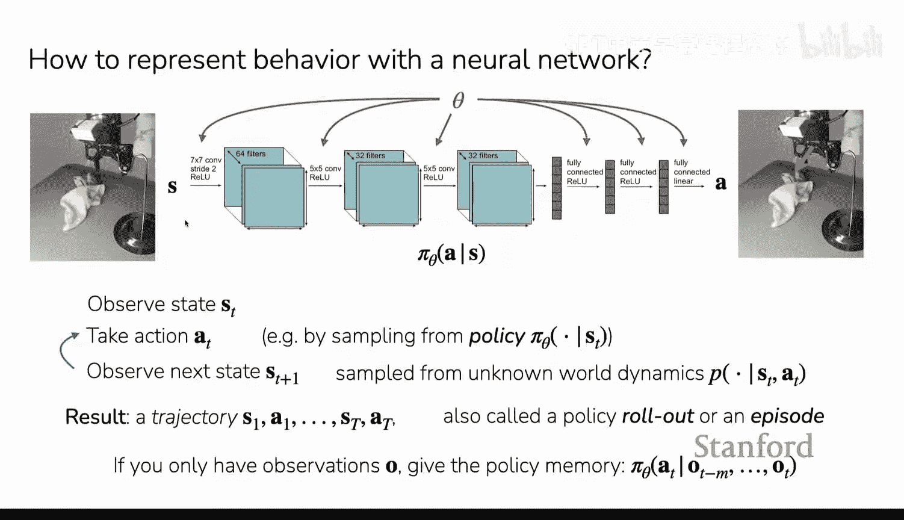

But if you only have observations， then you have in some ways no choice but to provide that memory to the policy and for this you may use like sequence models。

 for example， in language models you're going to be using sequence models that use the previous observations。

😡。

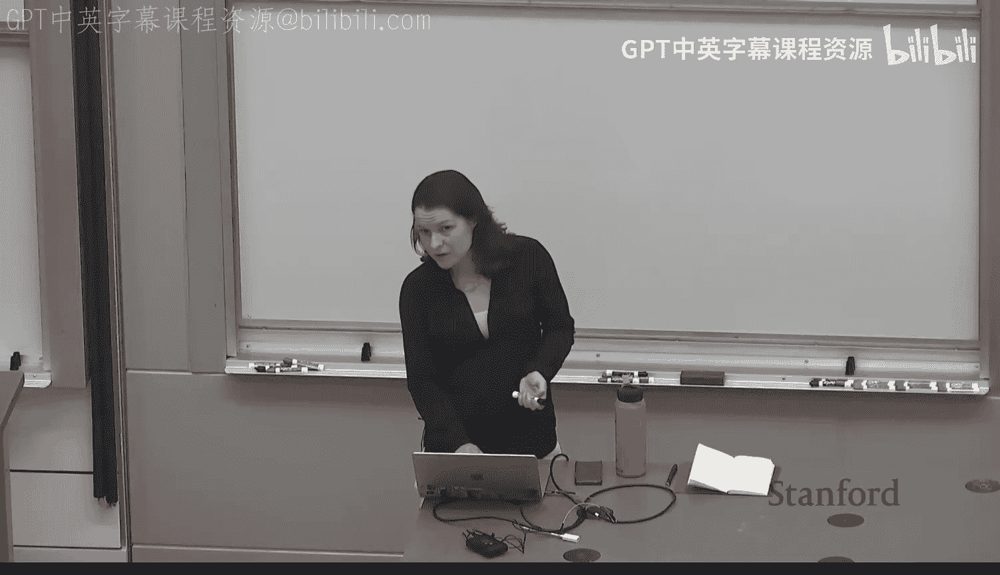

Yeah， so the question is is T like the current time step or is it kind of general from the beginning to the end。

 so this capital T I'm using to denote kind of the end of the trajectory so the'll blank the number of states and actions in a trajectory and then T I'm kind of referring to a given time step and this and kind of generalizing it so that you can think about this is happening at all time step from t equals from lowercase t equals1 to lowercase t equals capital T。

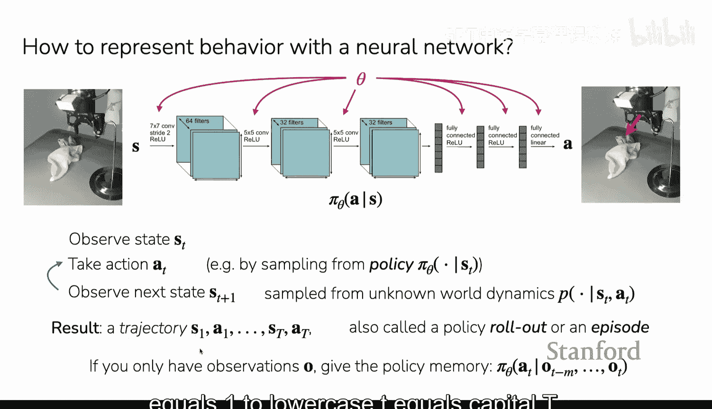

Is it ever useful to condition it on both the observation and the state so in this case the state has strictly more information than the current observation and so it isn't useful to add the observation if the state is truly the state that captures everything。

So if we go back to this diagram， if we have states， then we only need to provide the current state。

 whereas if we have observations， that's where adding history is helpful。

 so it's a distinction between states and observations。

Why is it having history of observation football？😡，Yeah。

 so basically the past observations will help give you more information about what F1 is。

And so if you only have observations and you don't know what the underlying state of the world is so as another example in like language modeling。

 if you are having a conversation with the user， each thing that the user says is a different observations and the past observations will actually tell you a lot about what the current state of the world is so if their first question was like can you write this piece of code to me and then you maybe wrote some piece of code and they gave you some feedback is actually very important to include all those past observations to actually capture the full state of the world I mean that might not be true in all cases but in like yeah many。

 many cases the previous observations will also be useful for。Yeah。

 so there also could be scenarios where you might want kind of a two stage process。

 one where you first infer the state， and then a second process where you then predict the action from that state。

 if you have some idea for like a good representation for the underlying state。

 then that sort of information could be useful in trying to model the underlying state。

 in other cases it's simple as just to go straight from observation stack。嗯。Okay。

 moving on a little bit。

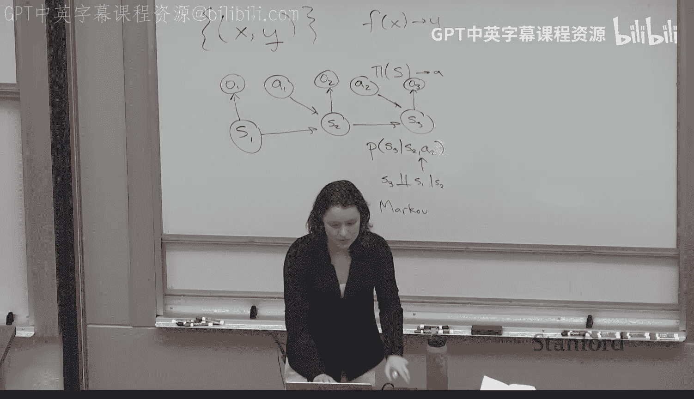

We've talked about states' actions， policies， what is actually the goal of reinforcement learning？

So our goal is to maximize reward and so if we have a trajectory。

 we don't want to just optimize for like the reward at one time step。

 but we want to optimize for having reward across the entire trajectory。

And so we can represent this as maximizing the sum of rewards。Now。

 one thing that came up is that this is actually not a deterministic quantity。

So if you have a policy。And you're executing that policy。In the world。

The reward that you get isn't always going to be the same every time you run your policies。

And so a question for you， why is this not a deterministic quantity and what are the sources of variability that might cause the sum of rewards to differ from one trajectory to another trajectory？

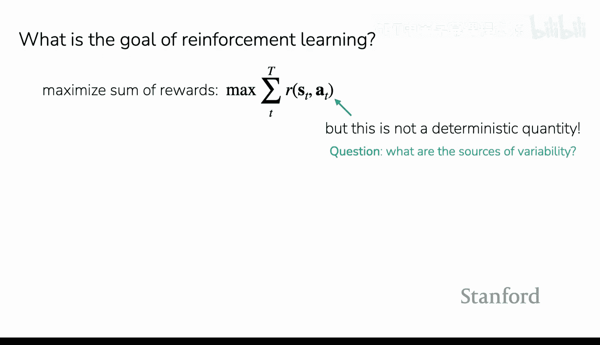

Yeah， so one source of variability is that the state doesn't just depend on the action in the state。

 but there's also kind of randomness that can affect the next state。Other forces of variability。

 yeah。So your policy may not be deterministic either， so there's kind of two really key sources。

Its a good question you might have a stochastic reward function。

 so typically we actually model the reward is a very interesting point。

 we often typically model it as deterministic as a function and kind of have the source of randomness come from states and actions now if you don't know the state。

 then it could actually be viewed as stochastic if you only have the observations。

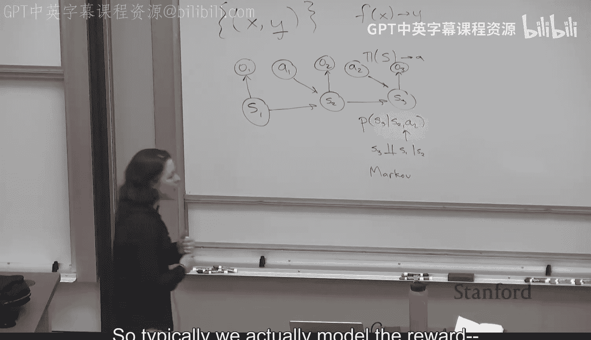

Right， so if you're doing reward learning， the question is is there schastic see there。

 typically you'll still model it as a reward function bulb。

 so you might have some you might not have full certainty over exactly what the reward is and perhaps you might want to leverage that uncertainty into like in some ways in the learning process。

That's maybe something take off line， there's some considerations there。Yeah。

 so the other thing is your goals might change over time and in that case the reward function will change we'll actually often model that as a different a whole different decision process at that point if the rewards chain rather than kind of having it being with within the same one。

Yeah， there are scenarios where you might want a nons stationary decision process， I guess， but。

And you can actually often put that randomness into the state instead of putting it in the reward function。

 like maybe there's some underlying goal that you can't observe that's in the state and then the reward function remains deterministic and so yeah generally without losing generality。

 you can push that into the state if you did。Quote， so。

The two main sources of variability that you have to worry about are the world is stochastic。

 so the environment， this these dynamic， this is a distribution， it's not a deterministic function。

And the second is that the policy is also not deterministic， and so in driving， for example。

 other cars are going to behave in ways that are random and your car might not make the same decision every time。

Cool， and so if we can， if you actually want to think about maximizing rewards。We can then。

Add in the policy into this diagram where there's essentially if if you have access to state。

 there would be an error from here to here that is modeling。

This distribution and likewise from here to here。Now， if we then wanted to actually write down。

What rewards look like？We need to think about a probability distribution over trajectory。

You have seen to think about like what is？Yeah， what is actually the kind of distribution over futures that we'll see？

The way that we can think about that is， we'll have。Some initial state。

 there may actually also be random neff fear that we haven't talked about。

 like the initial conditions of the world might change and if you're like playing a game。

 for example， like how the cards are dealt out， full varied。And then after the state， there is。

 you're going to be making a decision with your policy。And then once you make that decision。

 there is randomness that arises from。From the dynamic。

And then we if we want to think about the probability of a given trajectory。

 it's going to be the probability of the first state， then the probability of taking the next action。

 then the probability of taking the next observing the next state。

 then the probability of taking action after that and then the next state and so on and so then we can think about。

😡，The probability。Of a given trajectory as being。The initial state probability plus the product of the probabilities from the policy and the dynamic。

Where here at sea equals one to capital G。And then once we formulate this probability。

 distribution over trajectories。Then we can think about maximizing reward as actually maximizing our expected rewards under this probability distribution。

So。We'll kind of think about the expectation of trajectories sampleed from this distribution。

Of the sum of。Like state and actions in this trajectory。Of。The rewards of that state and art。

And then this is our goal， our goal is to maximize this and our goal is to find a policy pie。

That maximizes。He has expected some ofs。So that is。Written。Right here。Now。

 note that unlike in supervised learning， we this doesn't look like something that you can like。

Very like well pi actually doesn't even appear in this equation。

 but the way that it comes in is how it's affecting the trajectoryories。

 so this distribution of traories is a function of pi right here。And。

You actually want to find the policy that will lead to the highest for worry。

And a lot of this class will be figuring out how do we actually optimize behavior under this particular objective。

Yeah the question is does capital T have to be fixed， it does not have to be fixed。

 it can be variable， it's a little bit easier to write down if it's fixed。

 but yeah you can also think about it as like like basically the length of the。Yeah。

 so one other topic that will come up in depth a lot more is。When you think about rewards。

 this is weighting the rewards over the entire trajectory equally and it's saying that you care about immediate reward just as much as you care about future rewards。

And。In some cases， you might care about immediate reward more than future reward， so for example。

 if this T is like a thousand years， maybe you don't care so much about your rewards  a thousand0 years from now。

 then you care about your rewards today。And。So another way that you can actually formulate the reinforcement learning objective is not just this kind of vanilla sum of rewards。

 but you could actually weight your rewards by what's called a discount factor where that discount factor actually depends on teeth so you actually one of the ways we often do that is adding a discount factor that's raised to the power of teeth and this means that if a discount factor usually this is some value that's kind of。

Greater than zero and less than or equal to one， if this is one。

 it's the same as the original formulation and as you make it lower and lower。

 you're being more greedy， you're caring a lot more about near termm rewards than about farm rewards。

Yeah， we'll talk a little bit more about discount factors in a couple ofs。Cool， as an aside。

 we've talked about how。Our policy is a distribution。

 and so it's not determined as sick as sopathctic。Why might we want to do that？

So there's a couple reasons why we might want our policy to not be deterministic。The first is that。

If you want to learn， you probably have to try different things like if you're learning how to play tennis。

You probably shouldn't try the same exact technique over and over again。

 you need to actually explore and try different strategies in order to do it and so。

That can be represented as a stochastic policy that's trying a few different strategies and trying to figure out which strategy is that。

And then another case is there's scenarios where you collect data from people or from different systems and those people are taking different strategies and if you want to model the way that they're approaching a problem。

 you may need your policy to be srcchastic as well。Okay， and for this。

 we can also leverage tool from generative models where you're actually thinking about not just a neural networks that map from A to B。

 but actually a generative model over actions given states and observation。

I think this is the last thing we'll touch on and introduce， which is how do we decide how good well。

 second to last thing， how do we decide how good a policy is？

And this is really useful to think about because if you don't know how good your policy is。

 then you're not going to be able to make your policy better。

And the terminology that we use to think about this is referred to as a value function。

So we often think about the value function for a policy of a given state。

And we denote it typically as V pi。Of us。And essentially what' this means is it's the。

Future expected reward， if you start at S and then follow pi from then onward。

 and so it's basically this equation except starting at S under your current policy。

And similarly to this， another thing that we'll start talking about， not in Friday's lecture。

 but starting next week is Q value functions as well， and this is very similar to the value function。

 but instead of starting at S you're actually starting from S。

 then taking action A and then following pi where action A might be different from what policy pi might have taken。

😡，I'm not going to go into depth on what these two functions are today。

 but I wanted to introduce them because we'll be using them quite a lot and so it's good to start wrapping your head around what they are and as we start to use them more in future lectures。

😡，Okay， and then the types of algorithms well cover the idea behind imit learning is to mimic a policy that achieves high reward。

We'll then next week start talking about policy gradients that try to directly differentiate this objective and actually learn from practice and experience。

From there， we'll talk about acra algorithms that estimate the value of the current policy and use that to make the policy better。

We'll talk about value based methods that try to estimate the value of the optimal policy and then use that to back out a good policy。

And then lastly， we'll talk about model based methods that actually learn how to model the dynamics of the world。

 like try to predict the future and then use that to improve the policy or for planning。

Now you might be wondering why do we have so many different algorithms for optimizing this objective in supervised learning we like just have gradient descent。

 it works， it's great， it's simple in reinforcement learning things are less simple algorithms make different trade-offs and thrive under different assumptions and so it's going to depend on for example。

 how easy or cheap is it to collect data and if you're in a simulator for example it's really really cheap to collect lots of data versus if you're handwriting kind of kind of responses or handwriting。

Like actually interacting with a person that's writing things， that's going to be more expensive。

Also how cheap and in easier are different forms of supervision。

 do you have demonstrations do you have detailed rewards how important is stability and ease of use versus data efficiency maybe you have more time to to kind of。

Change some of the hyperparameter if it doesn't need massive amounts of data。

There's also some considerations with regard to what your actions look like。

 how high dimensionional are they， are they continuous or disc。

 is it easy to learn the dynamics model so yeah these are some of the reasons why we have a lot of different algorithms and we'll be talking about different algorithms and where they're applied in the later parts of this form。

😡，Okay， so to recap， there's a lot of terminology and a lot of notation in reinforcement learning and wanted to start introducing them today because we'll be starting to use them quite a bit in the following lectures so we talked about states。

 we talked about observations， we talked about actions， reward functions。

 and also initial state distribution and dynamics。These form what's called a Markov decision process or if you only have observations it's called a partially observed Markov decision process or an MDP or a PoMDP。

 I didn't want to bring in this notation until the very end because it doesn't actually really matter what it's called。

 but it's useful in the long term if people are referring to MDPs now you know what they're referring to they're referring to this formulation of a reinforcement learning problem。

😡，And then we also talked about trajectories， policies， the objective of reinforcement learning。

 value functions and Q functions brieflyly。

