# 斯坦福大学《深度强化学习｜CS224R Deep Reinforcement Learning  Spring 2025》中英字幕 p02 -02- Lecture 2_ Imitation Learning.zh_en -BV1SvmxB3E5e_p2-

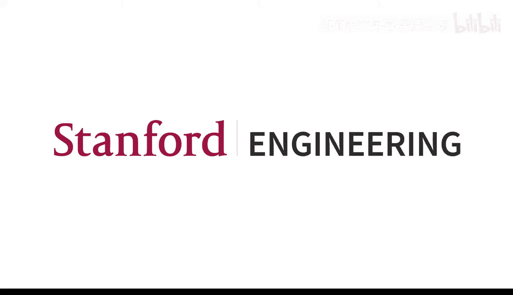

Today we'll be talking about imitation learning。Great。

 so as a partial recap from last time we started talking about some of the notation that we use for representing behavior and formulating problems as a decision- making problem。

 we talks about states and observations where we either have access to something that can fairly completely represent the state of the world or a more partial representation that we will refer to as an observation。

😊。

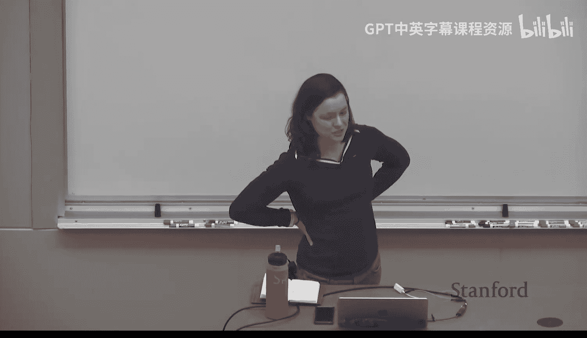

We also will be representing actions or decisions with AATT。

 and then we can think about a trajectory as an example of behavior that we've taken over time。

We also introduced this notion of a reward function， which is how good is a given state and action。

And lastly， this kind of notion of a policy， which is either conditioned on the current state。

 what actions do we want to take or conditioned on a history of observations。

 what action should we take， and usually this policy is the behavior that we're trying to learn。

mWe briefly mentioned how this kind of policy can be represented using a gerative model and we'll actually touch on that a little bit more today。

And the last thing that's not on the slide is that we talked about how the goal of reinforcement learning problems is usually to maximize the expected sum of rewards。

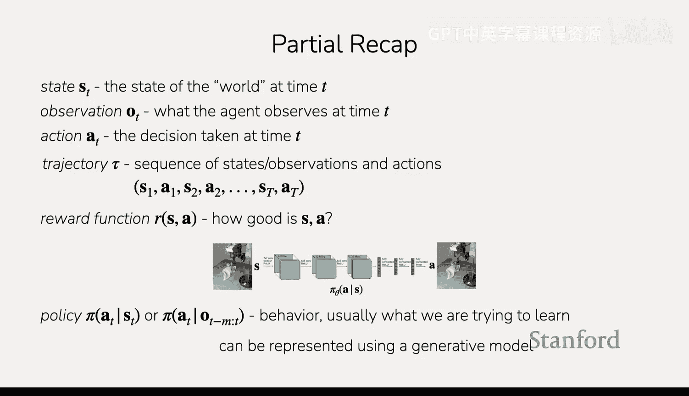

And today we'll be talking about one way to do that by trying to imitate a good policy。

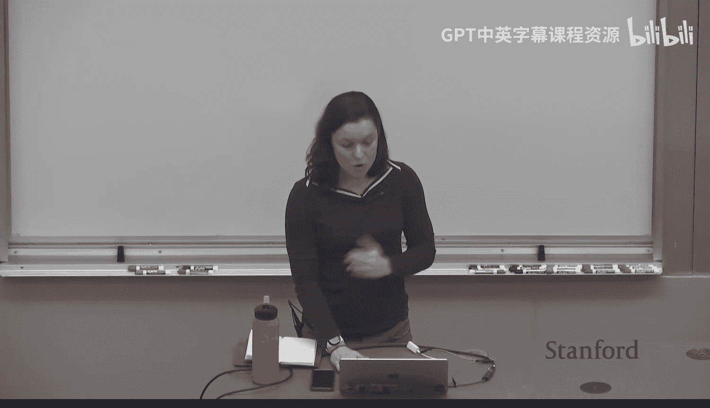

And in particular， the plan today is to go over some of the basics for im learning。

Then we'll talk about learning expressive policy distributions and why that's important for imit learning。

 then we'll talk about learning from online interventions and time permitting we'll talk a little bit about how to collect demonstrations in the first book。

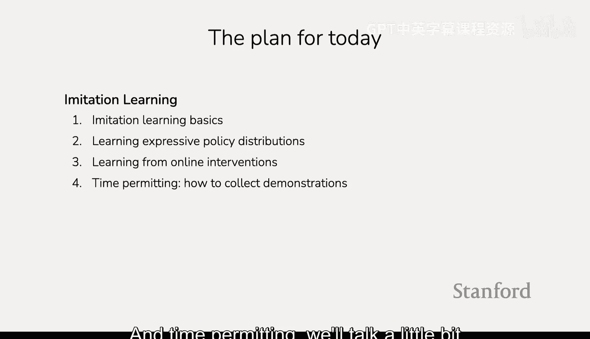

Yeah， so some of the key learning goals， this is a little bit in some ways kind of orthogonal to the main topic of the class。

 but it's actually very important to understand in order to get performant imitation learning systems。

 so we'll be talking about how to represent distributions using neural networks rather than deterministic functions。

😡。

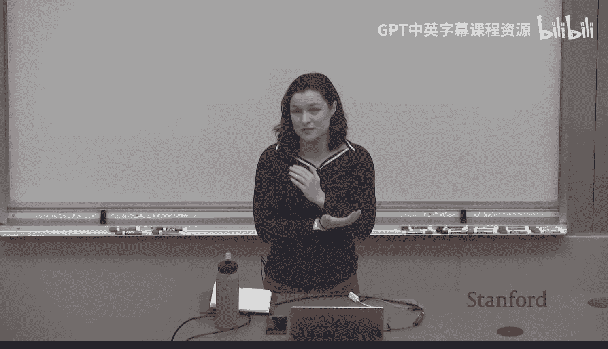

We'll also be talking about why expressive distributions matter for imitation learning。

And one challenge that can come up with imitation learning。

 which is compounding errors and how to address compounding errors。Great。

What is the goal of imitation learning like the goal of reinforcement learning。

 we want to try to achieve high reward， We want to get a good policy that can do the task well。And。

The way that we'll try to do that is we'll assume that we're given some trajectories that are collected by an expert。

 This is our data。And we'll refer to these trajectories as demonstrations。

 so it's kind of like a special kind of trajectory that is demonstrating how to perform the task。

And we'll use D to denote these demonstrations， like a trajectory。

 it'll be a sequence of states and actions。And as an example of what this demonstration data might look like。

If we wanted to learn how to autonomously drive a car。

We could have demonstrations that are in the form of people driving cars because people are pretty good at driving cars most of the time。

 and so we could record the record from the sensors on a car as well as record a kind of steering commands。

 acceleration and so forth and using a data set of human drivers driving。

 we could then try to mimic that in order to train an autonomous driving agent。Now we don't know。

We don't know exactly how humans drive， we don't know the policy that humans are using in order to drive。

 so we can think about this demonstrations data set as being sampled from some unknown policy pi expert。

And then the goal is to learn a policy that performs at the level or similar to the level of the expert policy by mimicking what's present in the demonstration data set。

Cool， so this is the problem setup。Now， let's think about kind of version zero of how we could try to do this。

So。Kind of a very simple way that we could do this is kind of first， we're given our。

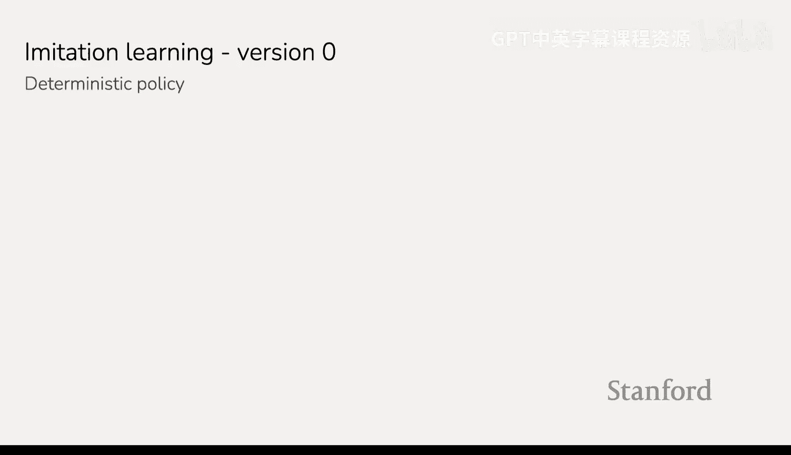

Our demonstration data set。So this is some data set that contains state action pairs。We can think of。

 yeah， these are each of the state actions in each of the demonstration trajectories。

And then we could say that we want to。Train some policy to mimic the demonstration。So， we。

We'd be training some policy。And in particular， we could think about。

The actions that this policy is going to take。 So if we were to take one of the states in our demonstrations and run it through our policy。

 that we would get some sort of。Predicted action a hat。

So let's say that this is sampled from pi Theta。Given a state in the demonstration。

And then we could try to basically say， we want this predicted action to be as close as possible to the action that the demonstrator took。

So we could then。Minimize。L。Difference between the predicted action。And。The action in the data。

And we could do this minimization。Over all of the states and actions in our demonstration data。

Once you train a policy such that the predicted actions are as close as possible to the actions in your data。

 then。You can just deploy your policy， this is a policy that should be mimicking。

The actions in your data set。This is version  zero of imitation learning。

So given demonstrations collected by an expert。

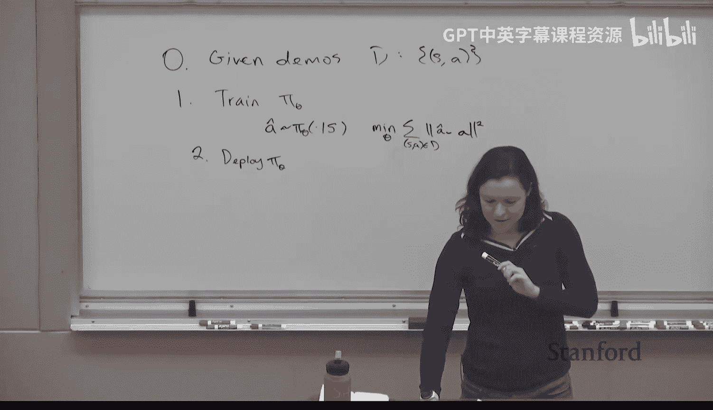

You essentially do supervised regression to the expert actions if your policy is a neural network。

 this means doing a forward pass on you sample a mini batch from here。

 do a forward pass on your neural network to get the predicted actions。

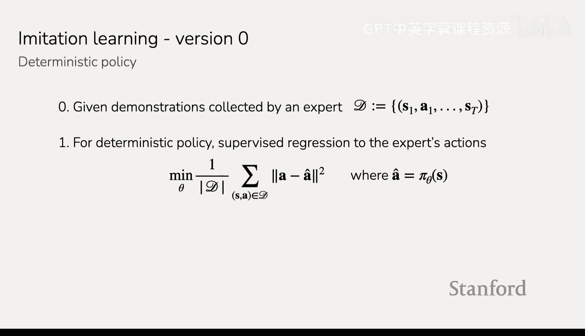

Compute the loss and then back propagate the loss into the parameters of the neural network。

 and you do that iteratively with your favorite optimizer。

 some form of stochastic gradient descent in order to optimize your policy。

So it's essentially a form of supervised learning。

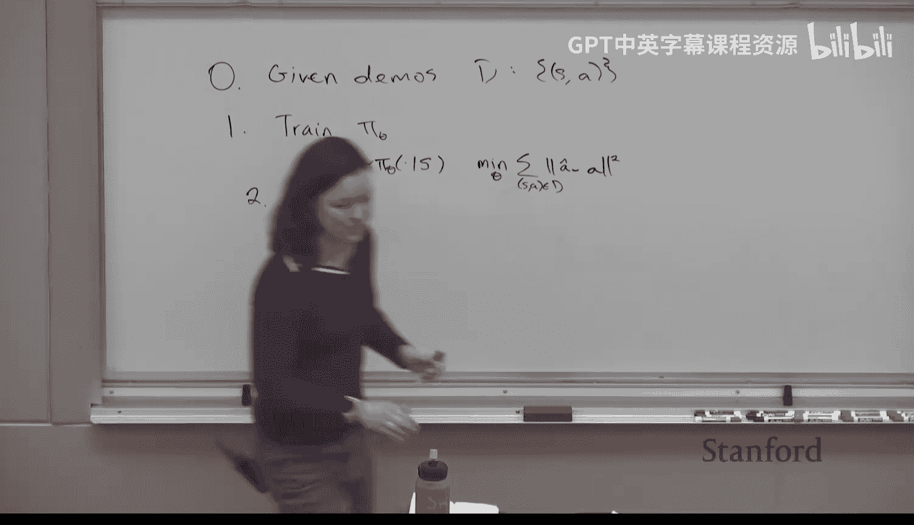

And then from here， you can then deploy your learn policy and it should be able to mimic the expert and do something。

三次不。

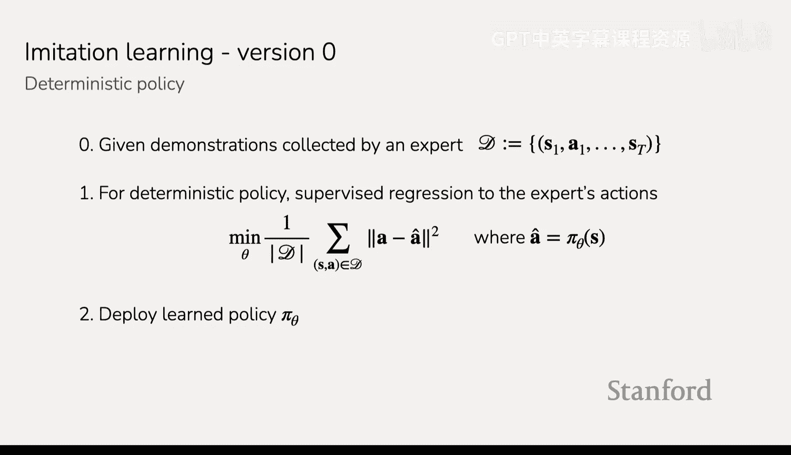

Yeah， so in this case， this case we're considering a deterministic policy， yeah。

 and we're just essentially yeah doing L2 regression， I guess here I wrote it as a schastic policy。

 but let's yeah， let's correct that and let's have this be a deterministic policy。

The expert might not be deterministic and that might lead to some issues so let's actually talk about that a little bit so what could go wrong let's go back to our driving example so we have a data set from human drivers and we recorded the states or the observations we recorded the steering commands on any other actions that we might want to use。

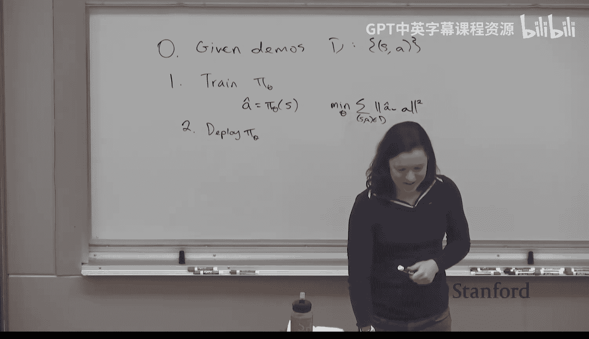

And let's say that for this particular car， in some cases the。

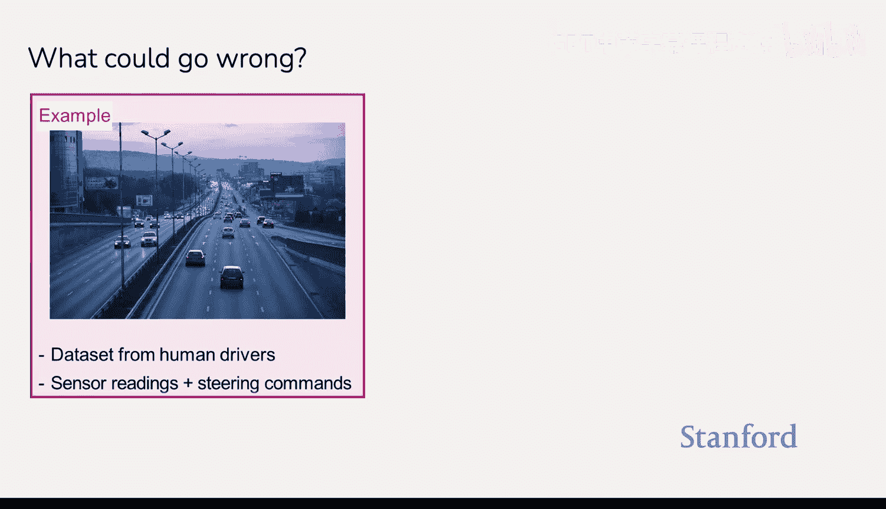

Some human drivers might decide to go straight。And other drivers might decide to merge left。

 maybe because they want to move to a faster lane。So our data set might contain both examples of going straight in situations like this and examples of merging left in situations like that。

No。

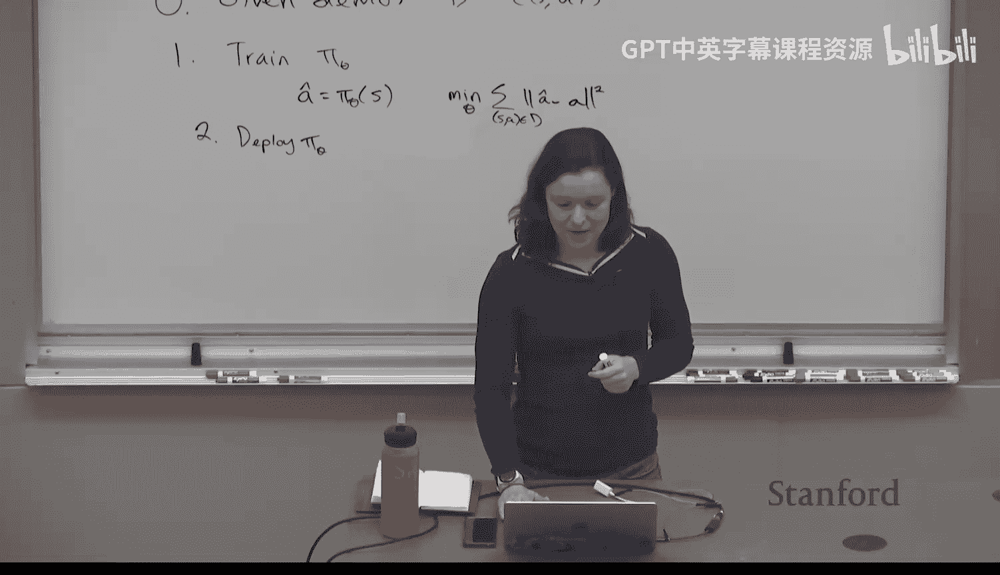

A question for you。If you train a policy with L2 regression on a data set that has these kinds of examples。

What would a policy that was trained with LT regression do in a situation？

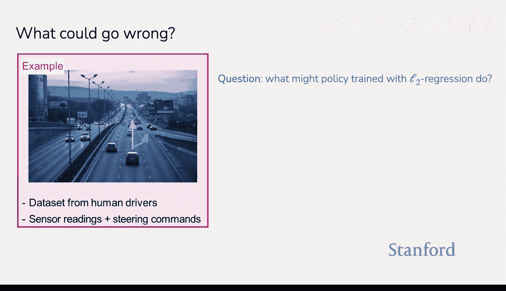

Like this。Yeah， so the palsy might go to the middle of the tulate。

And look let's see why that is so we。In this example， say we have。Li。Steing command。

And if we thought about the distribution over actions that are covered in the data set for drivers that chose to go straight。

 their distribution of actions would look maybe something like this where this is like zero steering command。

 this is like kind of staying straight。And。For the drivers that chose to merge left。

Their distribution over actions for this steering command might look。Something like this？

So this is the probability over actions。And then， if we think about the。

These are kind of the two examples， this is if they're deciding to merge left。

They maybe have a steering command of negative 2。 This is if you stay straight。

 that might have a steering command of zero。And then you're in your data。

The kind of overarching distribution over actions represented in the data。Might look something like。

This where maybe more likely people are to go straight than to merge left。

 but you get this kind of multimodal distribution that has two peaks。

 one at going straight and one at merging left。And then when you use L2 regression to try to fit this data。

 what it's going to do is it's going to predict the mean， so it's going to predict the mean action。

 and in this case the mean action would be something like here。

And that would be probably not very good action to take because that might kind of straddle the lines on the highway。

And also we can see that this action actually has very low probability under the data distribution。

 so it's also kind of objectively or mathematically a poor choice because it had low probability under what the data was doing。

Yeah， so L to your question is the equation from the previous slide so basically minimizing this squared loss between the predicted action and the true action and then the other question was what is the difference between the green and the red here so essentially what I'm drawing in the green is this is the。

😊，Distribution over kind of expert actions， maybe I'll use expert to refer to that conditioned on only the data that chose to go straight。

The blue is the distribution over expert actions。If they choose to merge left。And then the red is。

The distribution of actions。Represented in the data set for a given state。

So this is the red is actually what your data looks like and this is I here just showing this is what the distribution looks like for kind of one part one subset of drivers and the other subset of drivers。

You're asking can you sample from the data and do what was in the dataset basically Yeah。

 so the tricky thing with sampling from the data and doing what's in the data is that that would look kind of like a nearest neighbor's approach kind of within the realm of machine learning and it is in some ways a viable approach to a number of machine learning problems but one big challenge is that ultimately when the car is driving or when you're kind of have some sort of autonomous driving agent it's going to face scenarios that are different from what's in the data and the。

When it's it's in those different positions， you won't necessarily have examples in your data set that you can just。

Pick from。So you won't necessarily be able to say like， oh。

 I saw what the expert did in exactly the situation because ultimately you'll be evaluating scenarios that are different。

So what would you do if the actions are not numerical， we will also in like a slide or two。

 we'll talk about discrete actions as well。

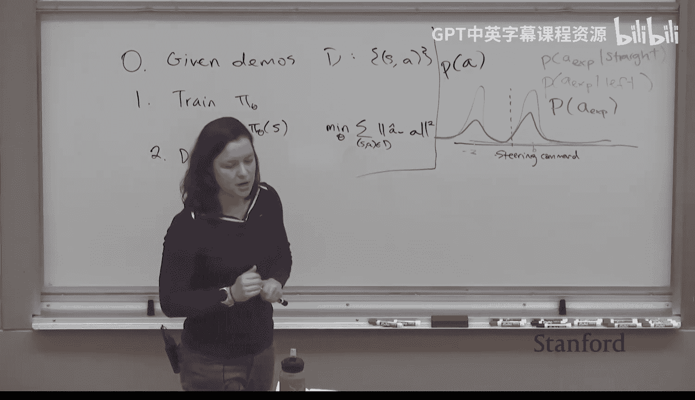

So to go over this example on the slides， we can say that the data for staying straight is in yellow。

 the data for merging left is in blue， the combined data set maybe because more people decided to stay straight is shown in black。

 the black dotted line， and then if we train a model to minimize the L2 error。

 then it will the deterministic policy will choose to take an action that's right here。

 which is the mean of the black distribution。😊，Which has low probability under the data。

Now you might be wondering how often does this actually happen in practice。

 so like this is kind of maybe maybe you might think that this is kind of a contrived example where there is kind of variability in what people would do。

It turns out that this actions actually happens all the time。

 people and demonstrators often do things in different ways。

 not just in driving and not just in like key decision states。

 and this happens especially when data is collected by multiple people。

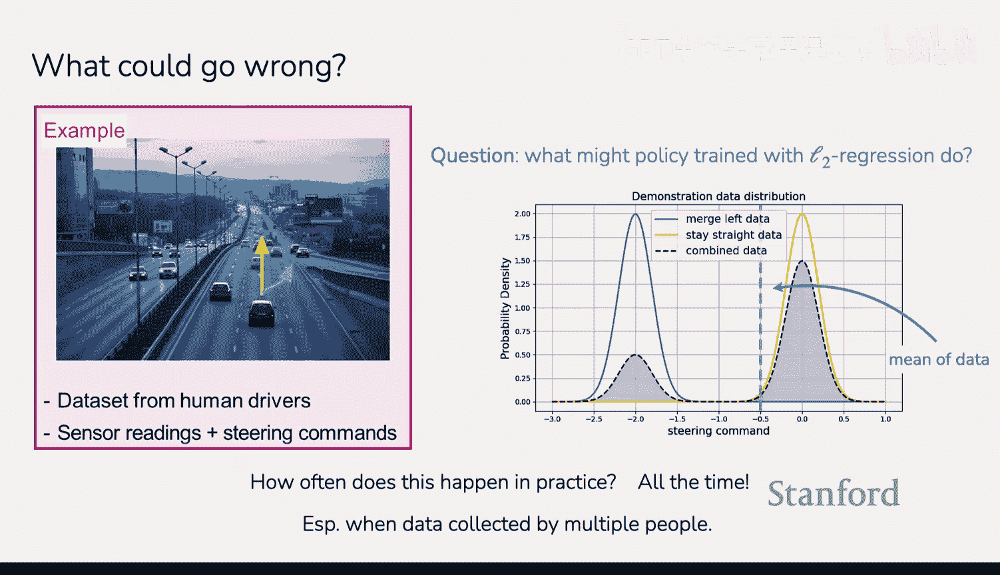

Because。People have different preferences， they have kind of underlying ways that they like about doing things and you can't directly observe all of those preferences and all the things that might affect their behavior。

And so as a result， there are some scenarios where if you have like one expert policy that's kind of always takes a consistent strategy。

 it's okay to use a deterministic policy， but in many other cases。

 it's actually very important to make sure that you account for this kind of multimodality in the data。

And so the natural question that arises from here is instead of just learning the mean。

 could we actually learn to represent more of the distribution？

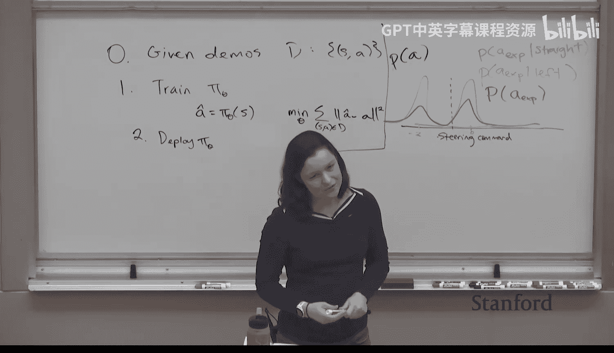

Of the expert data and not just the mean。Cool。And so this is where kind of learning distributions with neural networks。

Comes in。And in particular。Let's see。 Let's start a new。New whiteboard， so。

In the case of the deterministic policy， we had some。

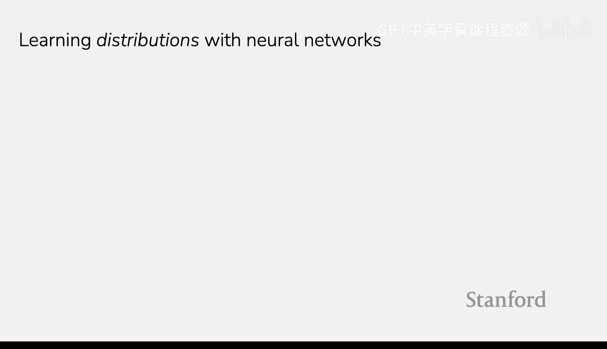

Neurural network。I will use a box to represent a neural network and。

We just were taking his input some state and we're outputting the mean action。

 kind of the mean of a distribution and so because it's only representing the mean it's hardly a distribution at all。

😡，And instead， what we like to be able to do is have this neural network actually output the。

Kind of parameters。Of a distribution。Over action。And those of if you can output a distribution over actions。

Then we should be able to capture more than just the mean。

CoSo this is often the way that we try to learn distributions with neural networks is we actually output the parameters of those distributions。

 so you can think about it as this， you have a neural network outputs parameters。

 if the distribution class that you choose is very expressive。

 then you should be able to get expressive distribution as output。

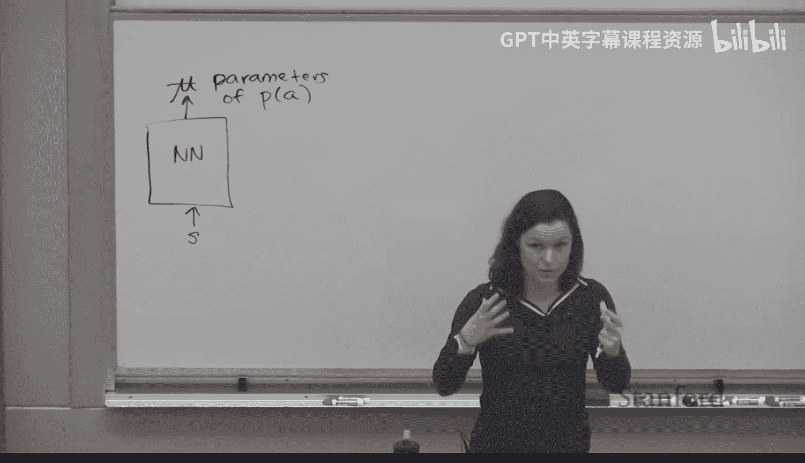

Now let's think about a couple examples of what this might look like。

 so if your actions are not continuous and instead they are discrete actions。

So maybe you're trying to train a policy to play a video game like Super Mario。

Then the actions might be something like up arrow， down arrow， press A， press B， right arrow。

 something like that。

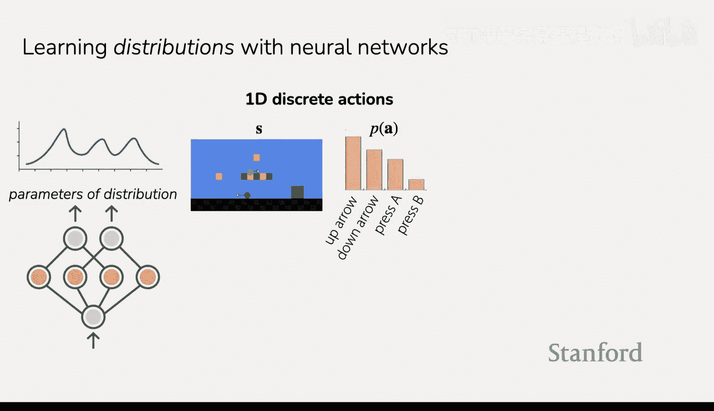

And what you could do is what the neural network could output is basically this categorical distribution over actions where it's going to in this discrete case。

It will output the probability of the first action， the probability of the second action。

 the probability of the third action， and so forth。

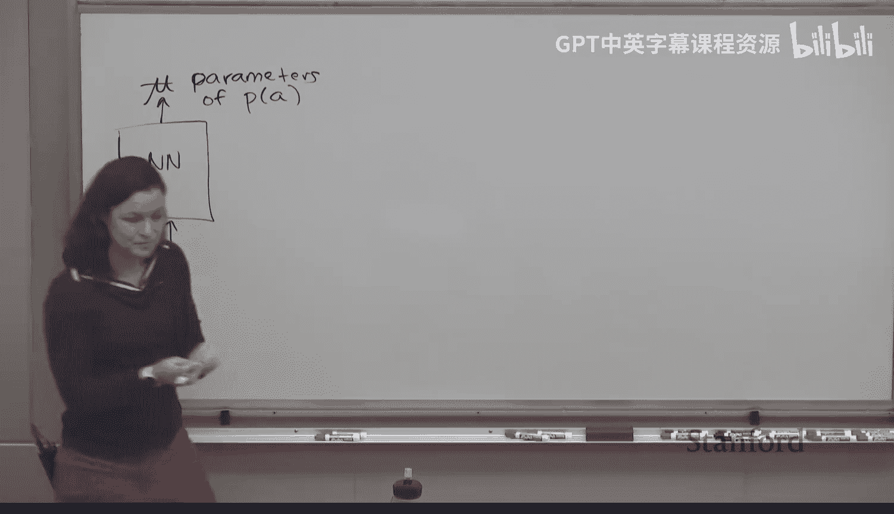

And so you can think of this sort of as a classification problem。And。

This distribution is actually maximally expressive。

And what I mean by that is that there isn't any distribution。Over actions that this cannot represent。

Because it's a fairly simple kind of。cateategorical or a pretty simple set of discrete possible options。

So this is actually really nice we can get a really expressive distribution this way。 Unfortunately。

 a lot of the world is not just。

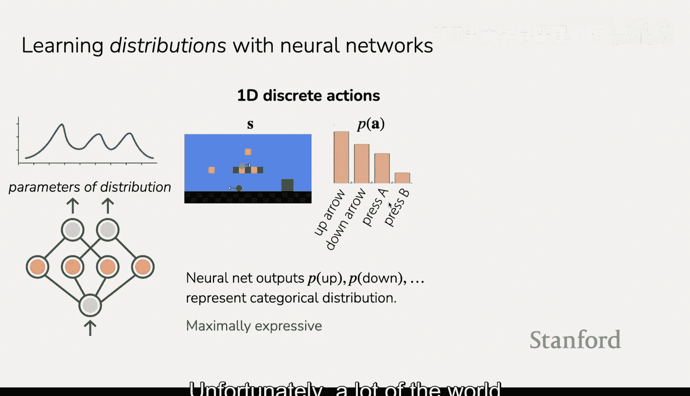

One dimensional discrete action choices， we often have much more complex actions。

 and that's why we need to think about how to model distributions over those actions。

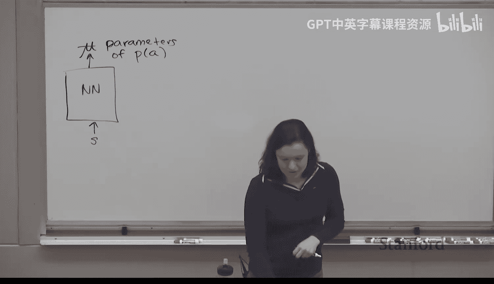

So if we move towards continuous actions。Like in a driving scenario where you have steering commands。

 for example， natural thing to the most natural thing to do is to use a Gaussian distribution。

 we talked about outputting just the mean of a Gaussian distribution which corresponds to minimizing the squared error。

😡，But you can also have the neural network output。The variance， unfortunately。

 if you haven't output the variance， it's not going to do anything particularly helpful in this example。

 it'll just output a wider variance Gaussian in order to try to cover more probability mass。

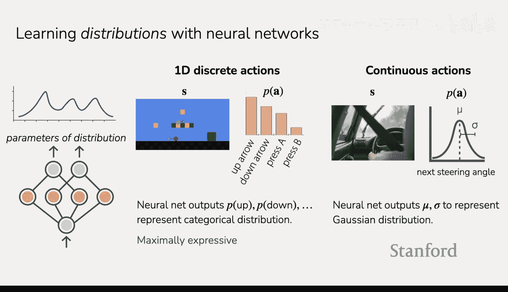

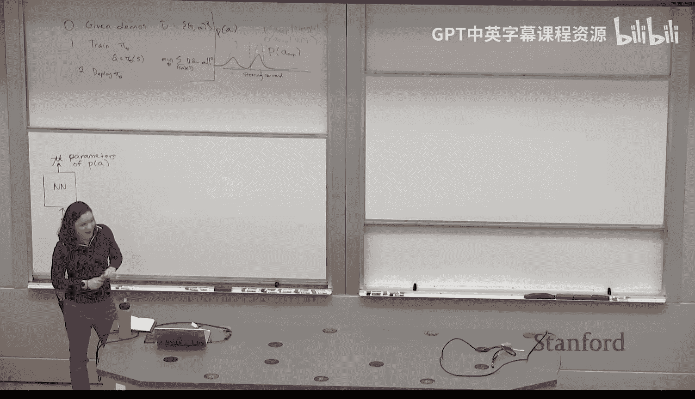

And it's not very expressive and so we want to be able to use distribution classes that are。

More expressive so that we can try to ultimately get actions that are high probability。

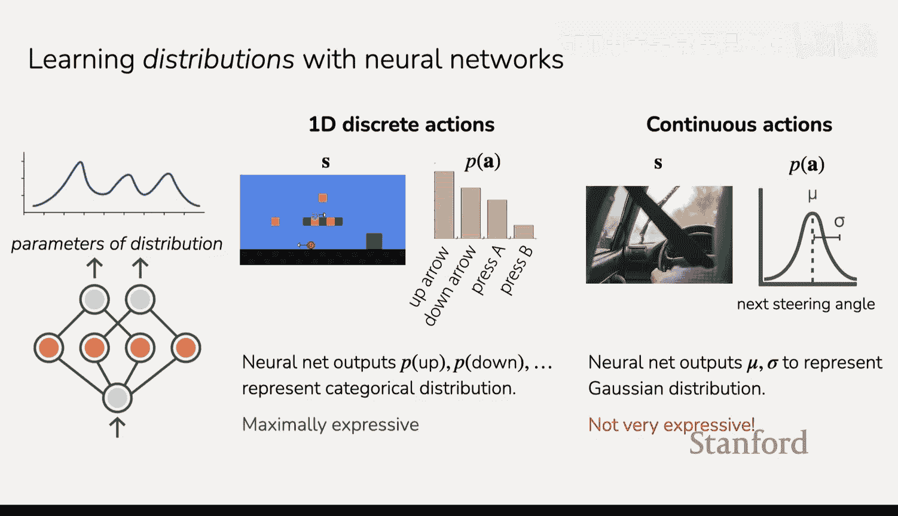

Yeah， so the question was， if we have some action distribution that looks like this， for example。

 would we be happy if we can perfectly model this or would that still lead to issues where you might have like an indecisive policy that chooses one mode and then chooses another mode？

The answer here is that。If you have a good state representation。

 then you should be happy and in particular， say you modeled this perfectly and for example you chose like this and then you merge left。

 you start merging left， then if you know that you've started to merge left and your velocity is moving left。

 then the data should continue moving left and so then at that point the distribution over actions should look kind of something more like this。

Once you are in that state at that point。So if you have a good demonstration data set and a good state representation。

 if you perfectly model the demonstrations， you will get a good policy out。So the question is。

 is the goal is it only goal in imitation learning to mimic the expert or is there some assumption that the expert was maximizing some reward generally you kind of assume that what you're trying to imitate is good。

But it doesn't necessarily need to be the optimal policy and in many cases like many real world practical messy scenarios getting the optimal policy is like hopeless in some ways。

 so yeah generally we assume that you're trying to mimic something good and really the focus is on trying to imitate that。

Yeah， so the question is in this case， like are we happy if we do this perfectly and are we happy with sampling a mode that is underrepresented。

A scenarios where you might want to try to essentially do better than the expert and maybe in some cases this mode is actually better or maybe in some cases this mode is really better if you want to outperform the expert。

 that's more where reinforcement learning comes in and other tools come in you could also try to curate your data to try to contain more of the stuff that you think is better but yeah with imitation learning generally everything that we'll talk about in this lecture is tried to meet expert performance or meet the demonstrator performance and not exceed it。

😡，Yeah， so the question is should the parameters of the distribution over actions be state dependent and yeah absolutely I've been writing this as kind of the parameters of P of A。

 but everything here is implicitly dependent on the state because this is the output of a neural network that was conditioned on the state and so in some states it might choose to output a distribution that's really multimodal in other cases it might choose to output a distribution that is much more unimmodal。

😊，Cool， so let's talk about some more interesting expressive distributions with neural networks and some of these will build upon tools in generative modeling。

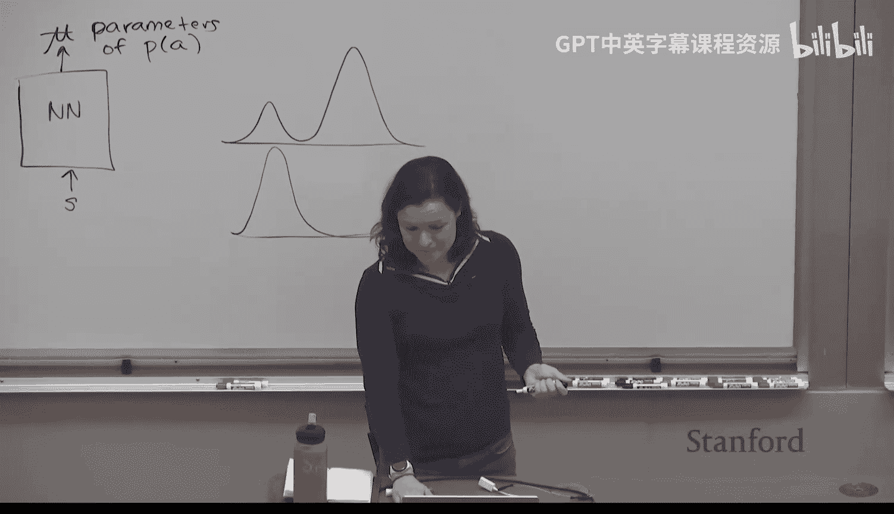

And in particular， if we think about。Some examples of generative models。

 we won't go into all the details of these， but one example of a generative model that you might have seen before is called a diffusion model and this is a model that can output and generate images of different people can be used to generate videos and so forth is's very popular for generative models over visual data。

And the thing that's really cool about these kinds of image diffusion models。

Is that they are able to represent a very diverse distribution over images。

 including images that are completely different from one another。

Another example of a jarative model is an autoaggressive model。

 you can think about this as essentially like what happens with language modeling where you're predicting one kind of token or one word at a time。

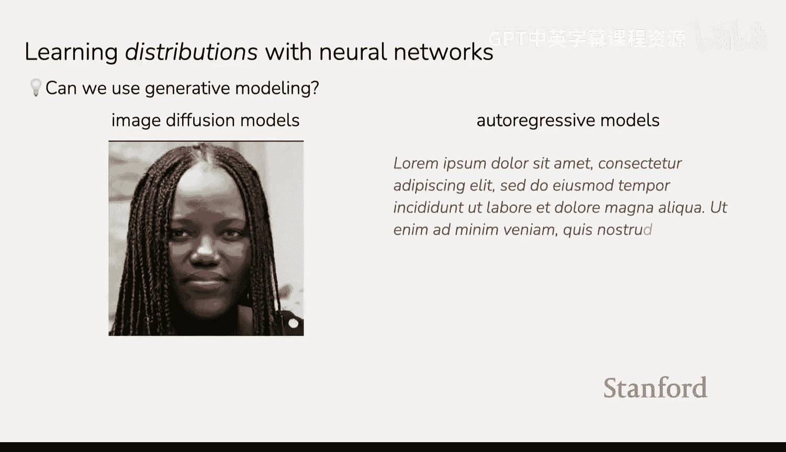

And this is also a really powerful model and it's much， yeah。

 much more powerful than just outputting the distribution。

 the distribution like the mean invari of a Gausian and much more powerful than the outputting。

 for example， the categorical distribution over one dimension。

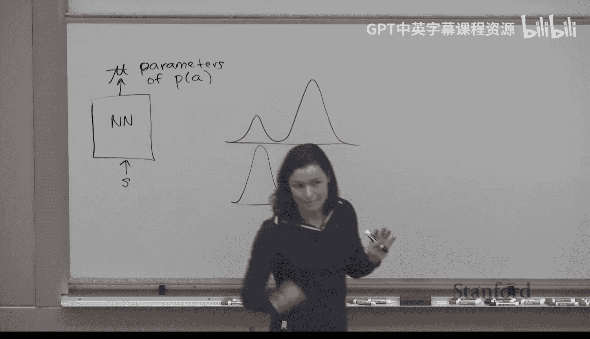

So you can think about these two as most typically used to represent either the probability of an image given a text description or the probability of the next word given the word so far。

And the reason why they're often used in these contexts is because they people。

 these are very common problems that people work on a lot and also because they're very well suited for addressing these kinds of problems。

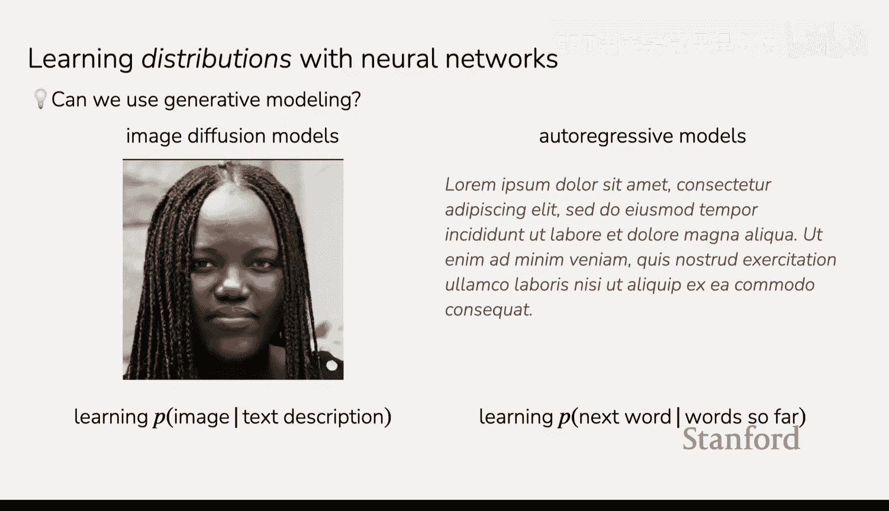

But you don't like the underlying technique behind image diffusion models and autoaggressive models is extremely general。

 and you can use the same idea to learn a distribution over actions given observations or given state。

😡。

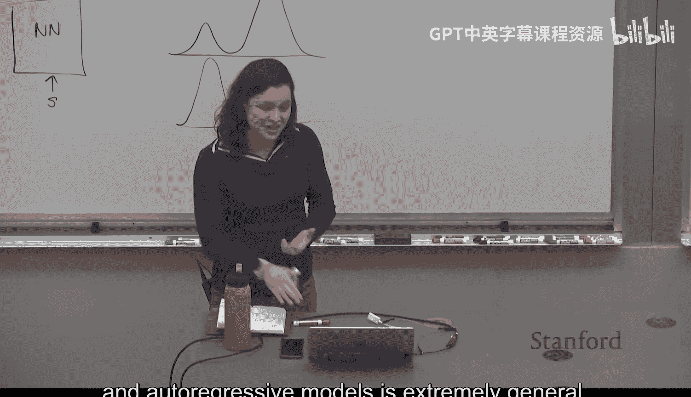

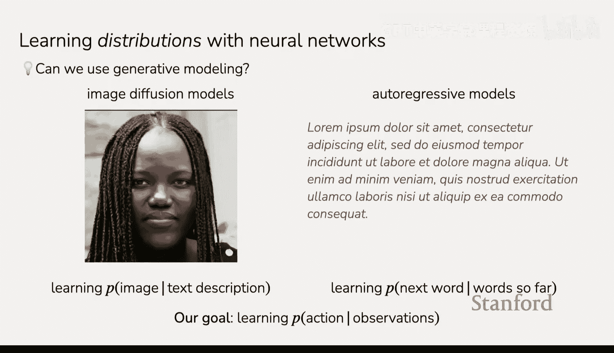

So let's talk a little bit about how we might use some of these tools to learn that distribution。

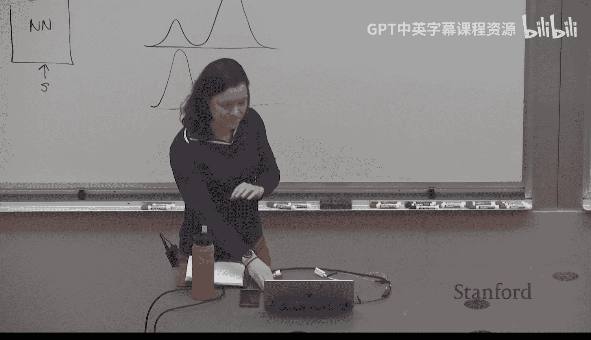

So our goal is to approximate P of a given S。 one example， one kind of。

Maybe form of generative model that's simpler than those two that we'll start with as a mixture of Gausians。

And a mixture of Gaussians is already a lot more expressive than just a single Gaussian。

 and so it's a case where we're trying to model a distribution as a combination of Gaussians。

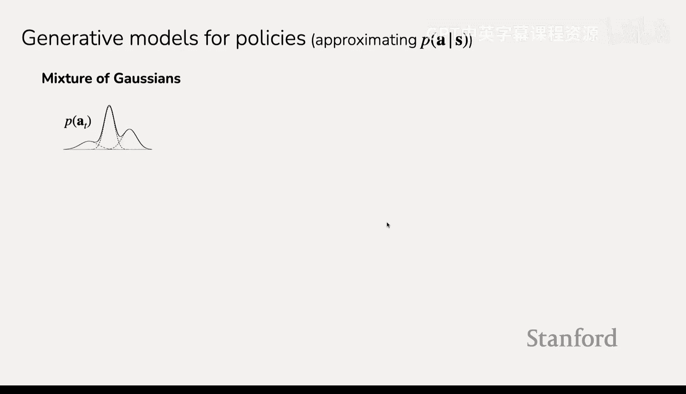

And so in this case， instead of just having the neural output the neural network output in mu。

 we'll have it output the parameters of a Gaussian mixture model distribution and so in the case。

Of a DM。It will output。The mean。Stair in deviation and weight associated with one Gaussian。Also。

 the mean staoid deviation and weight of a second Gaussian and so on。

 and you might if you have n different components， it will output n different parameters for different Gausians。

Yeah， so the question is， can we elaborate more on like what does it mean for these distributions to be more or less expressive Yeah so essentially。

It is referring to if you have some underlying distribution， it like how。

Maybe I'll actually rephrase it slightly differently。

 so one way to think about it is it's essentially the number of different distributions you can capture。

Like perfectly with with that chosen representation。

 And so if you only use a Gaussian there then you can only perfectly model Gaussian distributions。

 whereas if you use a Gaussian mixture model， you can represent any individual Gaussian。

 but you could also represent any other any distribution that is can be represented perfectly as a combination of Gaussians And so it's strictly more expressive than using a single Gaussian。

 Now， in some cases， it can be difficult to。Like compare two different distribution classes because in some ways some might be more expressive or less expressive。

 but in the case of Gaussian mixture models it's like strictly more expressive than a Gausian。

Yeah the question is do you need to pick the number of Gaussians ahead of time， yes you do。

 you can think about it as a hyperparameter and you could experiment and look at how well are you fitting the data with different numbers of mixture components？

Okay， and then there's two other examples of narrativeative models that we could use。

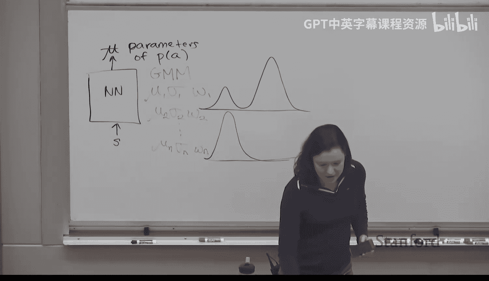

The second one is discretized and autoaggressive， which is just like language models。

 and the third would be to use something like diffusion。

 but diffusion over actions instead of diffusion over images。

And so we talked a little bit just now about mixtures of Gaussians where we'll be outputting basically the parameters of a Gaussian mixture model。

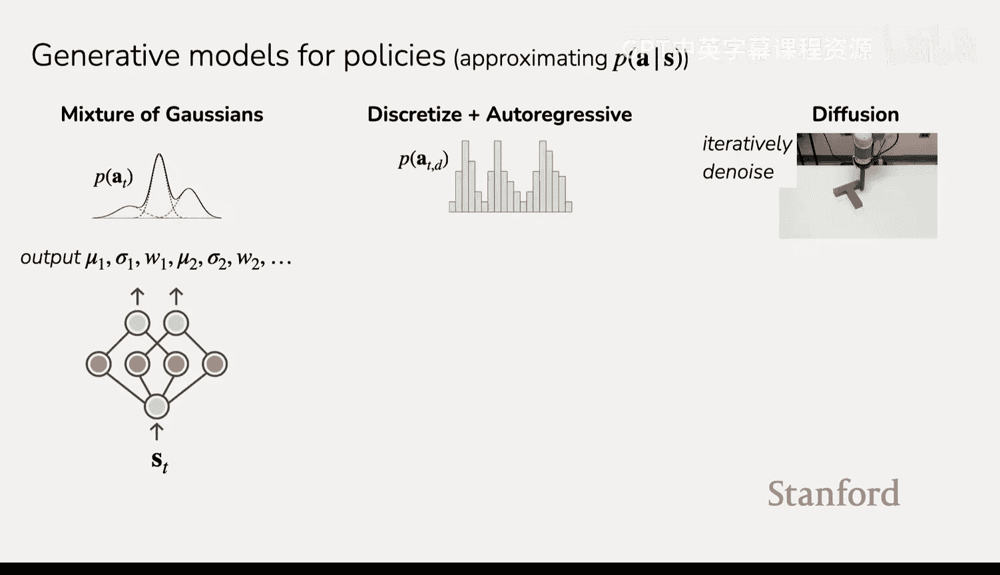

Now let's talk a little bit about kind of the a scenario where we could try to use an autoagive model。

Like a language model in order to generate action。So in this case。

There is a couple scenarios where you might want to use this。

 so you might have you might be in a scenario where your actions are already discrete。

And you actually don't need to discredtize in that case。Or you might be in a scenario。

 but where it's multidimensional， or you might be in a scenario where they are actually continuous and multidimensional。

 and then you need to discretize or tokenize first and then use an autoaggressive model。😡。

And so if we think about this back in the driving example。So， this will be。If we use。Disretize bus。嗯。

Autoregressive。In this case， let's say that we're in the driving case and。

We'll just consider a simplified driving case where the first action is the steering angle。

And the second action is the acceleration。So if we wanted to represent a distribution over these actions。

Using an autoaggressive model。There's two things that we would want to do。

The first would be to discretize and the second then would be to formulate the auto aggressiveive model and。

😊，In particular， when we use autoaggressive models。

 it means that we're going to be essentially predicting one dimension at a time。

So if we first want to model a distribution over the first dimension of the action。

What we would do is in the case of steering， so we have。嗯。Peace steering。

Say that we wanted our prediction to look something like this。

Now a Gaussian can't represent this and so we would choose to discredize it and represent a discredized distribution and what that would look like is essentially kind of。

Creating bins。For the different steering angles。And you would then output a probability for。Each bin。

And then。This kind of。Something that looks a little bit closer to like a staircase。

 these bars would be the distribution that you're actually using to approximate the original distribution。

And so。You could then， in this case， output， so for the first dimension。

 you would be outputting each of the probability values for each of these bars like the height of each of these bars。

So this gives you a fairly expressive distribution over angle。

 and then you could choose to have a more fine dispartization or a more coarse disretization。

 and if it's more fine， you get more expressivity in terms of what you can represent。

 but you also have to output more numbers so there's a trade off there。

And then once you output a distribution over the angle。

Then you would want to output a distribution over acceleration。And in particular。

 in the case of merging left versus going straight。If you're merging left。

 probably you would be accelerating more because there was a car kind of back into the left。

 whereas if you're going straight， you're probably more likely to be more likely to be kind of keeping your current speed。

And so there's essentially kind of。嗯。They want our distribution of our celebration to be conditioned on which angle。

 which steering angle we chose。So what we'll do is we'll predict。Kind of P angle。

And then we will sample a aster angle firm this。 We'll refer to this。

For now is A1 because it's the first dimension of the action we'll sample it from this distribution here。

And then we want to get a distribution over the second dimension。Conditioned。On the first dimension。

And to do this we'll then pass our predicted action or the sampled action back into our model and then have our model output another distribution and in this case。

 if you if you are conditioning on。AT1 equals maybe an angle that's like negative two so something more left then you might output a distribution over acceleration。

That is。Kind of more。A。Has more probability on higher accelerations versus if you condition on。

And it's a steering angle that is something more like zero。

Then you might output a distribution over accelerations。That is。Smaller。Yeah， so the question is。

 how do you build your training data when you are discretizing like this？So。To do this。Let's see。

 So when you build your trading data， you'll have the state action pairs and you'll be sampling state action pairs and the。

In order to kind of convert it into something like this。

 what you'll do is you'll sample a state action pair。

 and then you'll bin the action according to your bending strategy。And then， you'll apply a。

A loss to that is between the model's predicted distribution and the sampled action。

 which would be like one of these bins。And the loss you can actually just use the cross entropy loss here。

 and so you can think about it as you're doing a classification problem for each dimension of your actions。

One other diagram that I think would be helpful here to think about how we go about doing this is。

When you have a model that's kind of auto aggressive that's predicting actions。

 you often use a sequence model。And so if you think about。Kind of a sequence neural network。

 something like a transformer or something like that， you would pass as input your state。

And then you pass and then you're kind of predicting a distribution over the first。

Dimenssion of your action。So this is kind of a distribution over steering angle。

Then you would then kind of sample。From this distribution。

And then you'll pass this predict this sampled action or your kind of chosen steering command back into your model and then output。

The next the distribution over the next action this is exactly how language models work where you'll have some sort of kind of beginning token。

 you'll predict a distribution over the next word， you'll sample a word from that pass that sample to word back into the model and then predict。

A distribution over the next word， except now we're doing it over dimensions of our action sequence rather than over different words in a sentence。

Yeah， great question。 How do you determine the order of these different dimensions in language models it's very natural because like there's a natural ordering to like words in a sentence。

 for example， although even across different languages there's some variation there it's something that generally you kind of pick by hand you can also in some ways treat it as a hyperparameter in other cases there might also be somewhat natural choices for the ordering so if you're controlling a robot arm for example。

 you can kind of go down what's called the kinematic chain of a robot arm where you start with the kind of the base dimension and then you go to the next joint and the next joint and so forth。

 the good news is that in principle the kind of the expressive power of this distribution doesn't change with the order essentially your goal is trying to represent the full joint distribution over all dimensions and the only reason why you're doing kind of an ordering here is because。

If you tried to represent kind of a joint distribution over all the dimensions at once。

 there's a lot of kind of pairwise probabilities that you would have to predict and it's a lot more efficient to do it one more kind of one dimension at a time to represent the full joint。

Yeah， so the question is， in the case of like a video game that was pretty disc here we're in a more continuous case。

 are we discredized like whenever we want to use an autoregressive model。

 does that mean we should be discretizing， right？Cool。

 so there's actually kind of two reasons to be using。

Dccrtization one reason to use discretization is it allows you to model a very multimodal complex distribution and so you can these the kind of these bars can be any height that you want and so it actually can model things that are way more expressive than a mixture of Gausians up to how fine your discretization is。

The challenge with discretization is that if you have like a lot of bins like you might have 100 bins for one dimension and then you're trying to represent like I don't know 10 dimensional action or something like that。

 then the dimensionality of your discretized actions is going to blow up if you try to model all like that full10 to the fifth matrix over probabilities and so using an auto aggressivegress model helps you deal with that dimensionality you could in principle also use an autoaggressive model with like a mixture of Gaussians for example。

 and that would be like completely fine as well this is。Yeah， it's not like a common choice per se。

 because if you're going to go through the trouble of using an auto aggressivegressive model。

 usually discretization is like a pretty powerful choice。But yeah。

 you can also use it with like a Gausian mixture model or Gaussians or something like that。Yeah。

 so the question was around how we actually kind of train this and maybe let's just like walk through how we go about training this。

 So it's actually going to look。帮。Yeah， let's let's walk through how we train it。

 So we're given some data set so we're given。Some data set that has state action pairs。And。

We're going to want to train our neural network and we're going to follow a typical way of training neural networks。

 which is to sample。To sample an example from your data set or sample a mini batch of examples。

 I'll write it up for a mini batch size of one just for simplicity， but you can kind of extend it。

 So we're going be sampling a。😊，State action pair from our dataset。And。Once we sample this。They。

We will essentially be running a forward pass through our network and a backward pass through our network and the key question that comes up is like doing the forward pass is kind of fairly straightforward and when we do the forward pass we'll be getting kind of some probability over the actions of each dimension。

And then we need to figure out what should the objective be？

And the objective that there's actually kind of a common objective that we can think about for all of these gene models。

And that objective is that we want， we're output these kind of probability distributions。

 we want to be maximizing the probability of the actions represented in the data。Or equivalently。

We'll write this as minimizing the。Log probability of。All right， this is pi theta。Of a give it S。

And this is with respect to theta。And so what this means is we're going to be evaluating how likely is the action that was sampled under our policy。

And then we'll be trying to。Make the probability of the action in the data set as high as possible or the negative log probability as low as possible。

Now in practice what this log probability looks like is going to be different for different models for a Gaussian mixture model。

 what you'll do is you can write down the probability density function for a Gausian mixture model and then just differentiate with respect to the mean variance and weight that is outputted by the neural network。

And for the case of a kind of the autoaggressive model。It's a little bit different， so we will。

What this looks like for the auto aggressive model is we will have we essentially get like the probability of。

嗯。H81。And the probability of AT2， given A1。And so forth。And this probability。

For this first dimension， it will just be the cross entropy loss。

That corresponds to trying to maximize the log probability of this value for a discrete categorical variable。

And for the second dimension， that's where things get a little bit more complicated because you'll have this will just be the cross entropy loss。

 but you need to figure out which action you want to use here。

And oftentimes you will use the action in the data。

 so for the inputs you'll often actually passes input the state and the dimensions that were chosen in the data。

 and then for each of these probabilities， you'll be applying the cross entropy loss and back propagating the cross entropy loss back into the network。

And then at test time， you'll then actually be using your own predictions and passing your own predictions into the neural network。

But this is really this objective right here is really the core loss function。

 and this corresponds to a form of cross entropy loss for discretized distributions and for Gausian mixture models。

 you write down the PDF and differentiate。Yeah so the question was it seems a little odd to discredize and do a categorical distribution over a continuous variable。

 especially given that a loss function like cross entropy won't take into account the fact that two bins are like that sort of error is probably less costly than an error that is for two bins that are like very far apart from one another this is kind of one downside to using discretized kind of disc discretized actions and practice often that sort of distance is something that is fairly quick to learn and so the outcome is often still pretty good but you might need you might need more data and how fine your discretization is a really important hyperparameter because if it's too fine then you'll be very hard to get signal because if you're off by one you'll get like zero loss function。

 there are also other things that you can do to try to smoothen out the data。

And smoothing up the labels so that。The label isn't just like a one hot vector。

 you can kind of smooth around it a little bit， so that's one thing that can also help with that。

 although it's a little bit more advanced。Oh yeah awesome question I didn't actually get to write the third example and so yeah so when you are outputting the probability over the third action。

 it will be conditioned on everything so far and often the way that you do that is if you're using a sequence model you can then output the prediction like a sample from this distribution so A T2。

And then output the probability over the third action right here。

 and if you have a sequence model that that takes into account everything from the past。

 then it will already condition on all the actions so far。

So how does back propagation handle this when it's discrete so only the output is discrete and so you can think about it as a classification problem and so if the weights are discrete that's bad for back propagation but when it's only at the labels。

 you're only just computing the loss function on those discrete variables and then that loss is you can yeah。

 back propagate in a direct way。

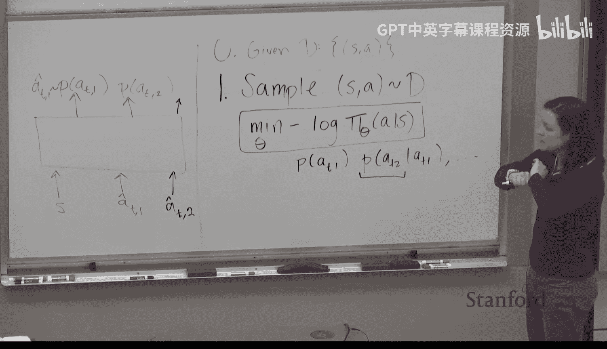

And that's because you're comparing the output it's outputting a probability and computing a loss on that probability。

 and then you can back propagate that loss on that probability。

So the outputs are actually still continuous values because you're outputting the height of each of these bars。

Cool so this is a visualization of this kind of discredized case where're outputting the first dimension。

 the second dimension， given the first dimension， the third dimension。

 given the first two dimensions of the action， and so forth， and this is very scalable。

 it allows you to handle like fairly long sequences of actions similar to language models。😊。

The last thing that I put up on here is diffusion， diffusion is also a very appealing choice。

 especially for continuous actions。It can model very complex distributions over continuous variables。

 including high dimensional continuous variables like images or actions。

 and it does so by using this kind of denoisising process where you start with complete noise and dennoyise it iteratively to make it a less and less noisy version of the action to ultimately generate hopefully a clean action prediction。

😊，And one thing that's kind of notable is both this model and diffusion models do have some sort of iterative process in the case of autoaggressive models it's iterative over the dimensions of your prediction and in the case of diffusion。

 it's iterative over this denoising process。

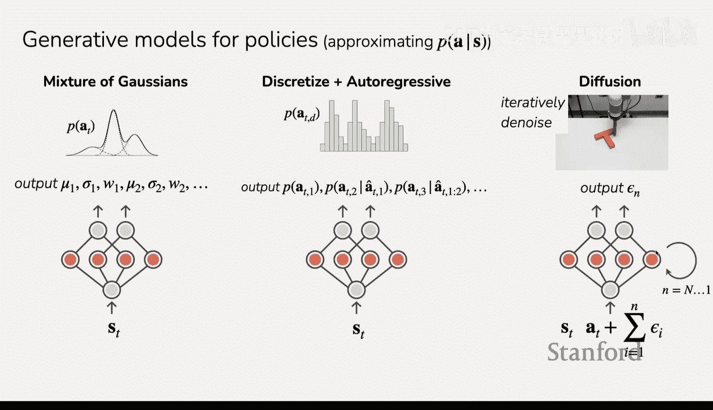

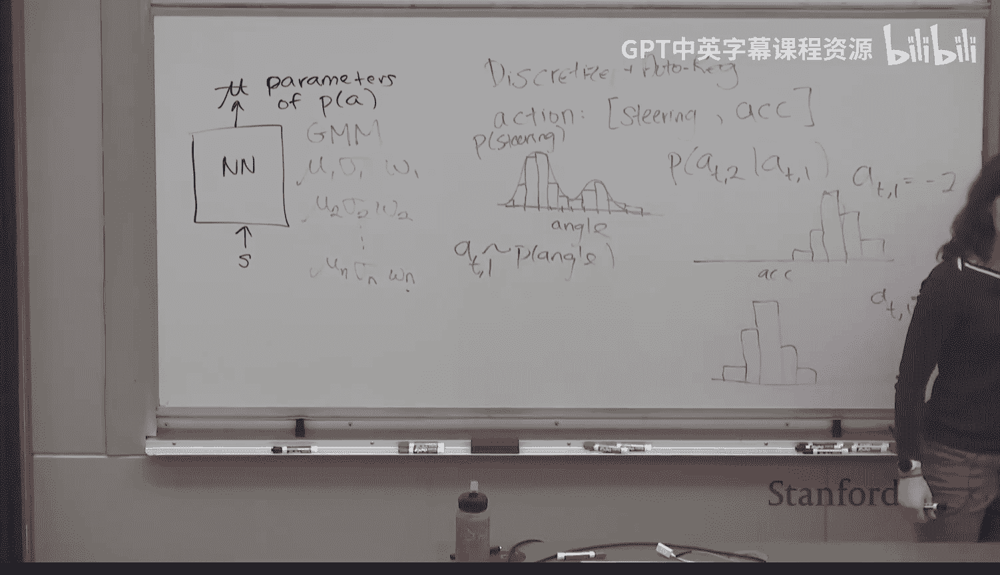

Now one question I have for all of you， so we've talked about these more expressive。

Distribution classes。Um， and none of what we talked about has actually like really changed the architecture of the model。

And。I'm curious。One very important question is instead of。Having these more complex distributions。

 we could just still use the L2 error like the L2 norm as the loss function。

 but just make the neural network bigger。And bigger neural networks are generally more expressive than smaller neural networks。

 So does anyone have thoughts on how。What we talked about here is different from just making the model bigger with the L2 law。

Yeah， so in the driving example， even if you make the network like really， really large。

 it's still going to output just the mean， it might output the mean very， very accurately。

 but it doesn't actually change its ability to represent a more complex distribution。

And so the expressive power of a distribution that you're trying to represent is actually。

In many ways， like separate from the expressive power of the function itself。

 and if you think about kind of this picture again， where you have a neural network。

 that's outputting parameters of a distribution， there's the expressive part of this function of like how many functions can you represent that go from S to parameters。

 and then there's the expressive power of this top part that how many different distributions can those parameters even represent in the first place？

And this is a really important point where kind of neural network expresssivity is distinct。

 often distinct from distribution expressivity。Yeah， so the expressivity of the of like this output。

The expressivity of the distributions that it can represent is kind of captured by what kind of distribution you're allowing it to represent。

 and if it only outputs mean invari， it can very expressively represent functions that go from state to mean invari。

 but it can't represent anything more complex than a Gasian。Okay， so we we walk through this a bit。

 so we are given some demonstrations。 we're trying to train a generative model over actions。

 and this is trying to minimize the the log likelihood of the negative log likelihood of the experts actions given。

Given the states in the demonstration。And so this equation looks， I mean。

 maybe a little bit complicated， but the log pi is the log probability under the policy。

The blue part is the demo actions that are sampled from the demonstration data set。

 and this probability is under the policy that we're trying to learn。Cool， and then once we fit this。

 we should have a policy that's better at actually matching what the expert is doing and as a result。

 it should be better at performing the test。Okay， so now why do we learn all this。

 how well does the generative model work compared to just using an L2 laws？

There's a couple of works that have evaluated this more explicitly。

 so here's a transport task where you need to have one robot kind of transport a tool to another robot and the policy is controlling both of these robots。

And we'll be comparing diffusion and a Gaussian mixture model。

 diffusion is actually is a lot more expressive than what you can even represent with a Gaussian mixture model。

And we'll be looking at two different demonstration data sets。

 one was a data set that was just collected by one person。

 and then the other one is a data set that was collected by multiple people。

 and we'll look at success rate。And when use diffusion。

 we see that on both datasets iss able to do pretty well。

 although it does degrade with multiple humans in the data。

 which means that as you add more diversity in the data， performance can go down。

And with the Gaussian mixture model we see that it well first it does worse than diffusion。

 so expressivity is very helpful， expressive distributions is very helpful。

 and second it actually goes down a lot more for the multihuman data set。

 which means that like the expressivity of the distribution is especially important for data sets that have more different kinds of behaviors in them。

We can also see this on a real task on a real robot so this is a task that's actually pretty difficult hanging a shirt on a hanger it was collected by the data set was collected by lots of different people because it's actually a pretty large data set and once you scale up it's very hard to have a single person with one consistent strategy collect all of your data so it has different people on different strategies。

😊，And it compares using either diffusion， which is very expressive or an L1 loss。

 which is a deterministic policy。And what we see first is not as successful as the simple or simulated task。

 but here we see again that having a expressive distribution is really critical for being able to do the task successfully and if you just use L1 loss。

 the success rate of the policy drops by nearly 50%。😊。

Is there any scenario where you'd want to use a mixture of other models instead of a Gaussian。

 oftentimes other models are might already like be quite expressive， so not to my knowledge。

 but it's without not like completely inconceivable yeah。Okay。

 now if you actually look at some of the like big models that people have been developing in robotics。

 they build on what we covered so far in lecture， and so these are kind of foundation models trained on lots of different demonstration data sets by companies like NVDdia figure Pi and this kind of open source vision language action model using expressive distributions when you have large scale data sets is a key component of these models。

And if you look at some of the big models that people have been developing for autonomous driving at Waymo and Wave。

 the first one uses discretized and autoaggressive prediction。

 and the second one also uses discretized actions with auto aggressivegressive prediction。Great。

 so a summary so far， what we've talked about， if you have data from one consistent demonstrator。

 you should learn a unimmodal policy distribution。If you have multimod data for multiple demonstrators。

 you should learn a distribution， you need an expressive generative model when you have data for multiple people。

 very important。And。One other thing that I'll mention here is that the algorithm is fully offline。

 and this is getting into a notion that's very important in reinforcement learning more generally。

whichhich is。Offline algorithms are a bit different from online algorithms。

 so offline algorithms use only an existing data。And they don't use any new data from what you're learning。

And online means that you're using new data from your Learn policy。

this distinction is important in a couple different ways online means that。

The you're going to have to actually kind of recollect data as you run the algorithm and so this is can be expensive。

 it can also if your policy might be。Like under traineded in some scenarios。

 it might be unsafe to run your policy， like if you're in like a medical domain， for example。

 you might want to not want to collect online data from a policy that doesn't work fully yet。

And so there's there's kind of u thinking about offline algorithms and online algorithms is generally。

 yeah， it's a key distinction and a key way to think about different algorithms。

So for what we've covered so far， we also we don't need any data from the policy， so this is offline。

 we also don't need to define find a reward function。

Last time we talked about defining reward functions for examples。

 for some examples and we talked about how in some examples it might be kind of hard to write down the reward function。

 so this is pretty nice like in driving you don't have to write down all of the ways in which you might want it to drive。

The downside is that you might need a lot of data for reliable performance。

 you might need a lot of demonstrations。And that ties into how we might try to learn from online interventions。

Yeah， so the question was for the kind of previous videos that I showed imitation learning seems straightforward like what is like the research in it and is it just doing what we talked about today there are a couple I guess there's a number of different things that went into those different examples the。

😊，So I can walk through I mean maybe a couple examples so in the case of the first demonstration。

 a lot of things went into curation of the data and also the architect of the model and so those were two kind of things that were novel about this in the case of the NVDA example a lot of work went into trying to use data from simulation。

 especially because collecting data on humanoids is quite challenging and trying to figure out how to leverage that simulation data in the case of the figure example there was also some architectural design choices that made it helpful especially in terms of running models at very high frequency and in the OpenVA example that was also an example where there was a lot of architectural choices in terms of the models。

And so it's not just exactly what we talked about， so there is a bit more to it。

 but what we talked about is a huge driving factor behind these different examples。

And these two a lot of that also went into different like co training objectives and architectures。

So we talked about a lot about how to。How to train models with imitation learning and there's one important thing that we haven't covered yet which is what can go wrong and why imitation learning is kind of challenging so for this it's helpful to look at supervised learning so supervised learning we have some data and it's usually kind of trained from one data set that stays fixed and we try to and kind of the the inputs to the model are completely independent from the predictions that the model makes。

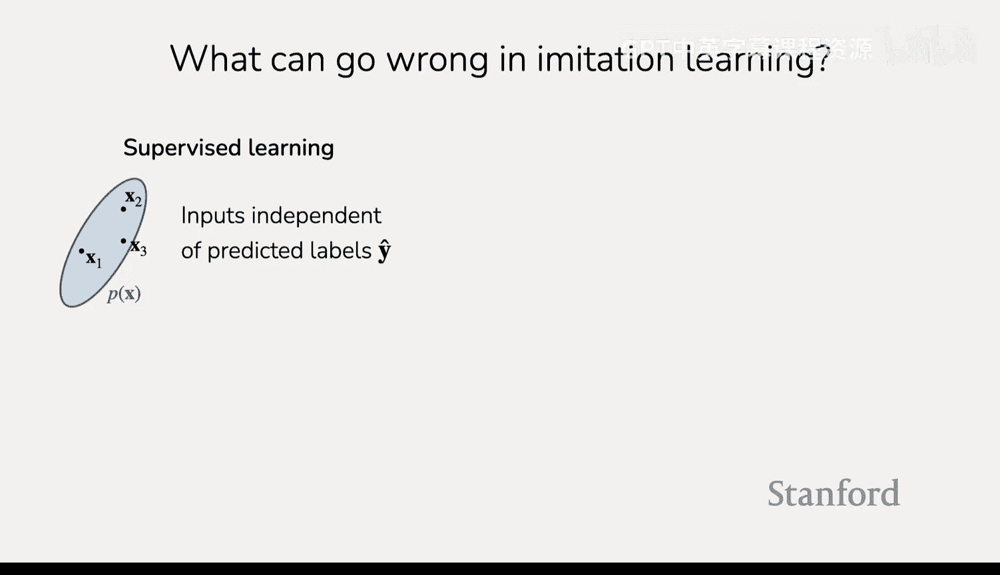

Now， this all changes in imitation learning， so say you have a demonstration。

That is in your data set。 And so each of these dots is like a state and then an action， state action。

Something like this， and now you're trying to mimic this demonstration。

If you're trying to mimic it and then you roll out your policy the starting from the state。

Maybe at the beginning of the trajectoryy， it's able to do pretty well。

But at some point it might like make a mistake the policy isn't going to be perfect。

 and so if it makes a mistake， maybe it kind of ends up over here a little further from where the demonstration covered。

And now from this state， it's possible that it actually doesn't have that much data。

From where it ended up after it made this mistake， even if it was a small mistake。

 it's going to be kind of potentially underrepresented in the data。And if it's underrepresented。

 it's actually even more likely to make a mistake。In the future and so if it's more likely to make a mistake。

 it might actually kind of drift away from the distribution even more I mean at that point maybe here is actually very far away and it makes maybe an even bigger mistake。

So this is often referred to as compounding errors because these mistakes。

 because you can start drifting off the distribution when you make mistakes。

 those mistakes can then compound as you roll out your policy。And as a result of this。

 and kind of one thing that you see here is that the distribution of states， this pencil。

The distribution of states that are visited by your policy。

Is actually different from the distribution of states that's visited by the expert。And。

This means that you actually， it kind of it differs fundamentally from supervised learning。

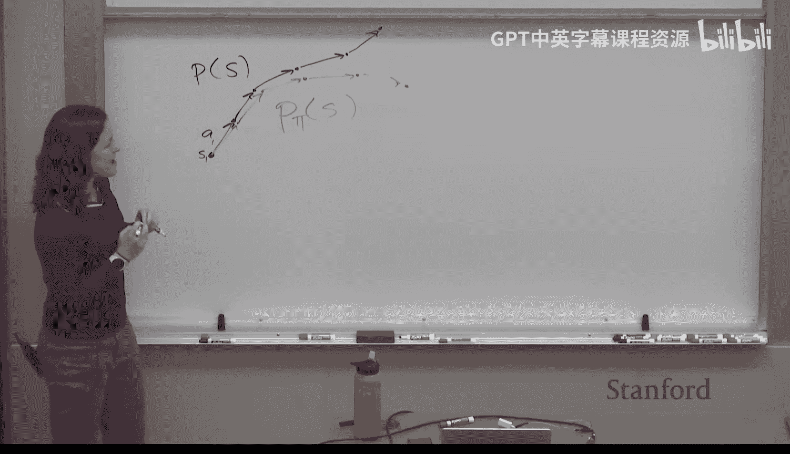

So errors can lay way from the distribution， errors can then compound。

The states visited by the expert are different than the states visited by the Learn policy。

 this is referred to as covariate shift， so it's a kind of distribution shift。

And that sort of distribution shift can lead to worse performance。

And also makes it different from super B learning it。

So this is one of the reasons why fitting the distribution really well is very important because if you don't fit it well and you learn only the mean。

 for example， then you're even more likely to have these kinds of compounding errors。

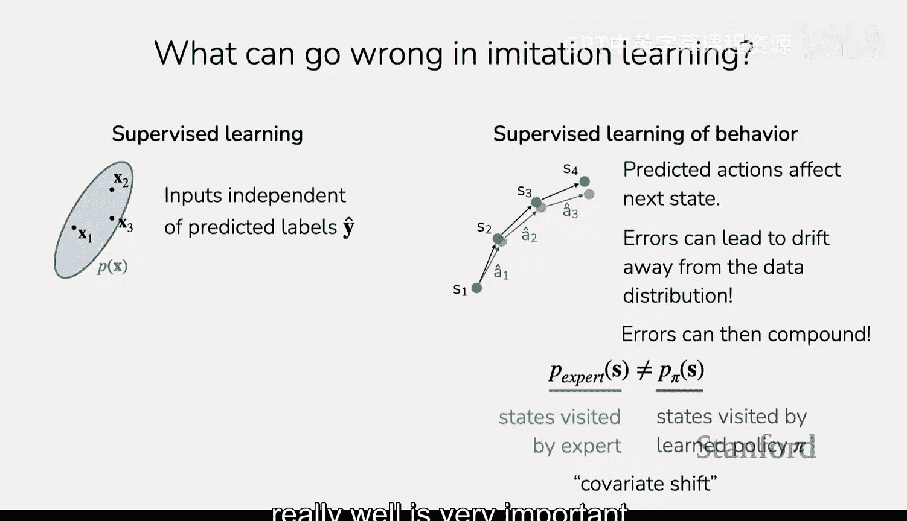

But then even if you do fit it well， you might still make mistakes and might drift off the distribution。

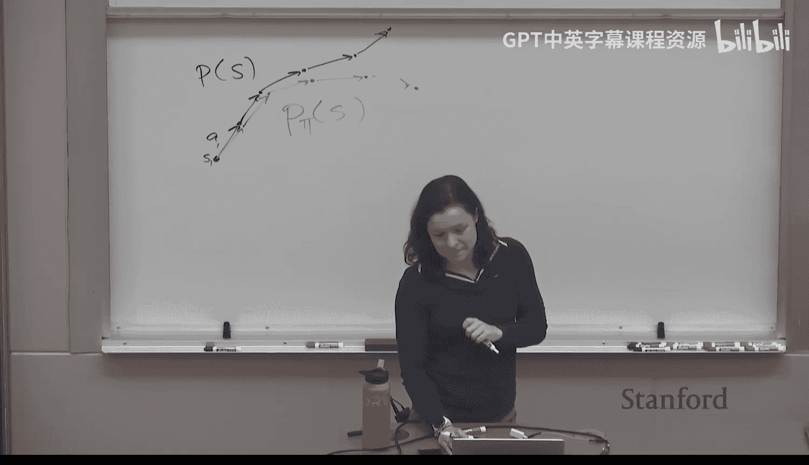

So how can we address this？嗯。One solution is just to collect a ton of data。

 train for as long as possible to fit the data as well as you can and hope for the best。

 if you have the capacity to do this it' not a terrible solution。

But there's also some other solutions。These solutions are actually quite popular in practice。

 and one of this basically the key alternative solution is to try to collect corrective data。

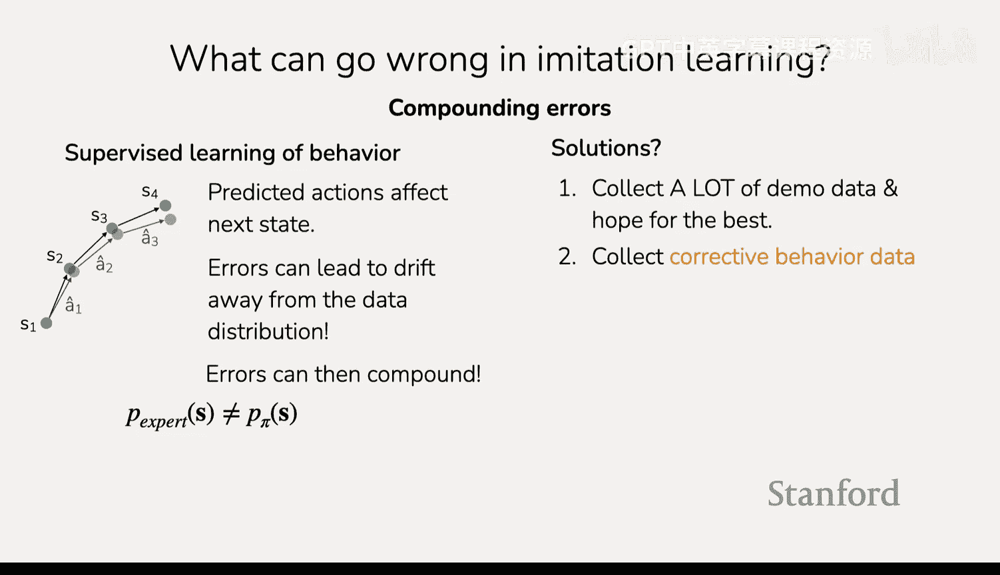

And so if we're in this scenario。What we can try to do。Is。If as a policy starts to make a mistake。

 we could try to say， okay， if you're here， the correct action。Is to do this。

And this kind of green data。Can be very， very helpful to allow the policy to recover from mistakes that it made。

So the corrective behavior data would be kind of ideally you would learn kind of something like this that tells your policy exactly how to recover。

 and then if you collect this corrective data， then you could combine the data in green with the data in black。

 train a policy on that combined data。😊。

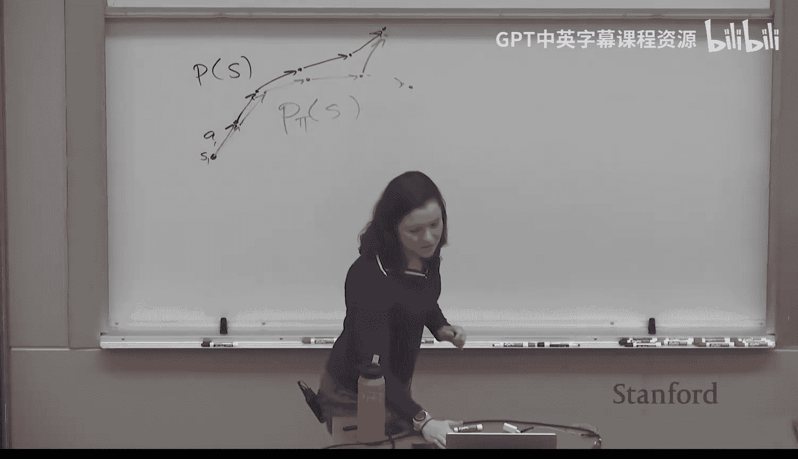

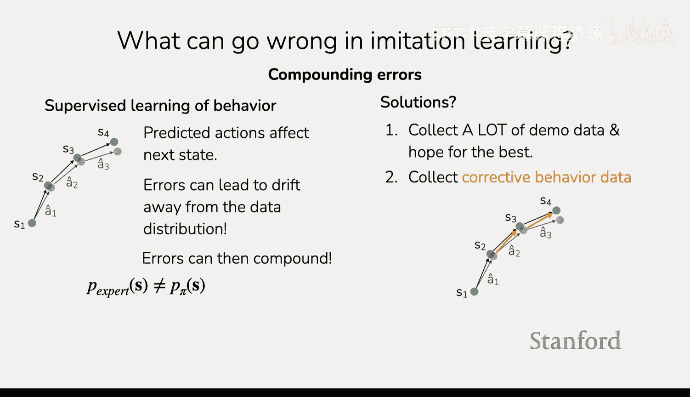

And then if it makes a mistake， it should actually have examples of how to recover and get back to the distribution because we're actually running our policy and then getting examples of how to recover after running our policy。

Does this not overfit the model and make it less generalizable。

 you would need to make sure that when you collect online data。

 you collect it in diverse scenarios and not just very narrow scenarios。

 if you only collect it in a very small amount of scenarios。

 then these corrections won't be as diverse as your original data set。Yeah。

 so the main difference between the learn policy distribution and the expert distribution is just kind of how the actions led to particular states and the reason。

 yeah， and this is I'm kind of using this as shorthand for the states visited by the policy and when you start to incorporate these corrections you're kind of expanding the distributions of states that you have data for and you're kind of making your data。

 your distribution of states seen in your data wider to include kind of both P ofS and the states that your policy might be likely to visit if it makes mistakes。

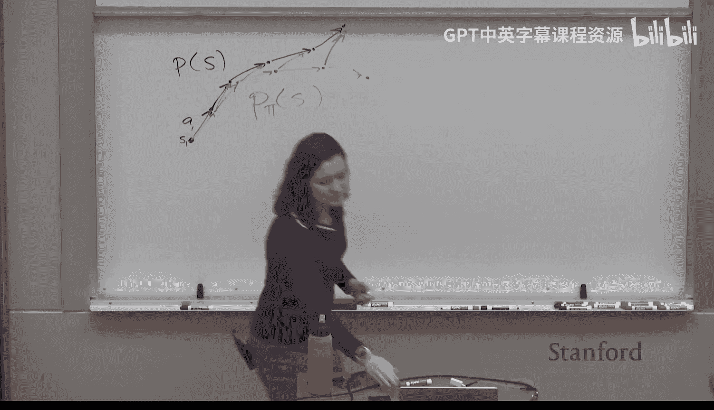

So in terms of what this looks like as an algorithm， we will first roll out our policy。

 so this is what's shown in blue here。

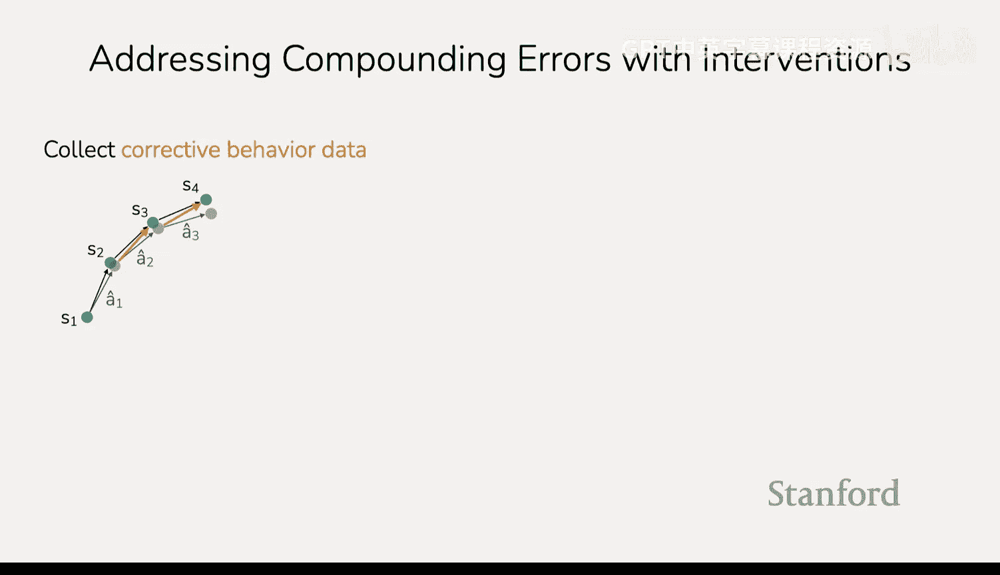

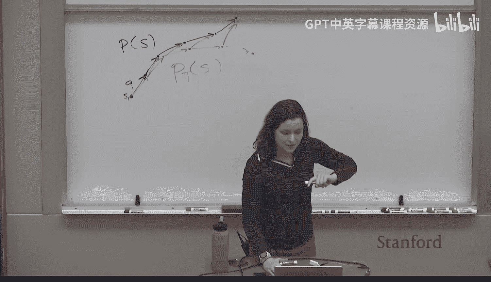

Then we will query an expert。At the states that you visited。

And these actions in green are the same as kind of the orange a star on the slide。

And then we will aggregate the corrective data。With the existing the first demonstration data set。

And then we'll update on the policy on the aggregated data set。

And this updated policy you could kind of fine tune the policy， so kind of warm start it。

 train on the original data set and then update it with fine tuning。

 you could also train from scratch if you're concerned about。

 I don't know some biases or something like that oftentimes you might fine tune。

And then you can actually repeat this process so you can train on the corrective data。

 get a better policy and then maybe your policy actually starts making you have kind of another policy and maybe it makes mistakes in a different way and in that case you'd want to then kind of collect some corrective data from that second policy if a new failure mode or new kind of mistake emerges。

And so this sort of this is sort of repetitive process this name has a terrible algorithm because it's not very descriptive but it's called data set aggregation or dagger because you're aggregating data it's important to helpful to know terminology but this is I think was a bad choice it's a data efficient way to learn from an expert but it can be hard to query an expert and so getting these green actions can be a little bit tricky so you might have to actually ask a person like okay this is what my car did on the road like what steering command should have done instead in those scenarios。

And so this sort of data actually can be potentially very hard to。Yeah。

 so how do we get the corrective data what this would look like is you would run your policy to get this blue trajectory and so this would be a this trajectory is like a sequence of like。

😊，S1， A1， S2， A2， and so forth。 And then you would basically like this is not possible in some scenarios。

 but you'd ask a person like for this S， what should the A have been and for this S。

 what should the A have been and for this S， what should the A have been now there are scenarios where you can't do that and where this algorithm is just not possible to run。

And that kind of leads into。Potentially a scenario。

 like another way that we might be able to collect corrective data。

 we might not be able to tell exactly like this is exactly the steering command you should have done because that's very hard to do。

And so what we could do instead is。Instead of saying for each of these actions。

 we want to query what the expert would have done， we're actually going to let the expert take full control at some point and so what this would look like is something where you start drifting off。

 the expert notices that a mistake was made and then takes full control for example。

 starts driving the car rather than letting the policy drive the car。

And then in this case， you can then add that those kind of。

Partial demonstrations to your data set instead of trying to query the expert on the policy states。

And so here you would start to roll out the learn policy。

 the expert intervenes when the policy makes a mistake。

The expert provides a partial demonstration from the state that the policy visited。

So it would take full control and then aggregate this partial demonstrations with the original data set in order to then update the policy and again。

 you can kind of repeat this process so that you can cover different potential failure modes of the policy。

Yeah， so in all of these cases， the best performance of the policy is upper bounded by the expert。

The question was if we're detecting a mistake is that mostly if youve play with something or something else。

 this is something that's subjective and is kind of up to the up to the demonstrator in many ways the oftentimes you want to be a bit more proactive and before the car hit something you would want to take control and so one of the downsides of this algorithm is that it can sometimes be hard to catch mistakes quickly like if the policy decides to like。

I don't know， drastically changed the action and it was unpredictable that can be very hard to proactively prevent and you want ideally this to be in a scenario where you can predict like if the policy is started to drift into another lane kind of recentering it that sort of thing this is actually something that companies do in driving where they let the policy run。

 they have a safety driver and then the safety driver will take full control if it seems like the policy either doesn't know what to do and it's like stalling or it's starting to make a mistake that we've seen failure modes of that。

 we've seen cases where safety drivers were not able to prevent a mistake that was more major and so there's downside to this kind of kind of relying on the demonstrator to proactively prevent a huge mistake from happening but it is a more it is a practical interface for providing corrections in a lot of scenarios and can help in performance significantly。

Yeah， so the question was if you' can you explain again why if you're correcting a narrow corrective data。

 why that would lead to overfitting， so let's take the driving example。

 if your original driving data was like all over the United States and then your corrective driving data was only on Stanford's campus then when you combine the data it might only learn kind of that corrective behavior in a more narrow set of scenarios and might also overfit to the Stanford data leading to a policy that is perhaps less generalizable and ideally when you corrected collected corrective data。

 it would be in a broader set of scenarios than campus。

