# 斯坦福大学《深度强化学习｜CS224R Deep Reinforcement Learning  Spring 2025》中英字幕 p03 -03- Lecture 3_ Policy Gradients.zh_en -BV1SvmxB3E5e_p3-

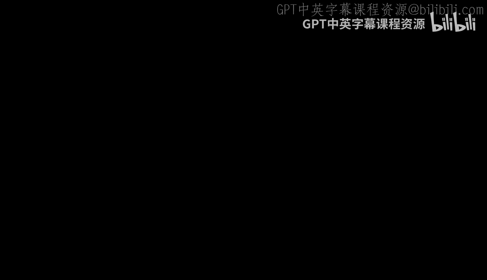

Okay， let's get started。As a recap of some of the stuff that we've talked about so far。

 we've formulated this reinforcement learning problem where we have states and actions。

 we have some kind of trajectories that we might be collecting。

 which are sequences of states and actions， we have a reward function which tells us how good is a particular state and action。

And also a policy which is usually what we're trying to learn。

 and this is representing the behavior that we're trying to learn。

And then the goal of reinforcement learning， which we talked about in the first lecture is to try to maximize the expected sum of rewards。

 so we want to。Produce behavior that leads to positive outcomes。

And we can actually mathematically write this down as an expectation over the probability distribution over trajectories。

 where this probability distribution is a function of the policy， which is acting in the world。

 the environment dynamics， which might be stochastic， and of course， the reward function。

Last week on Friday we started talking about one way to do this。

 which is if you have expert demonstrations， you can try to imitate the expert by trying to maximize the likelihood of the actions that the demonstrator did so trying to actually produce a policy that leads to actions that the expert would have taken。

 this is a very simple and scalable approach， but it cannot outperform the demonstrator and doesn't allow improvement through trial and error。

We also introduced the notion of an offline algorithm that only uses an existing data set and no new data from a Learn policy and an online algorithm that uses new data from the Learn policy。

And today we'll be talking about ways in which we can use reinforcement learning to outperform the demonstrator to improve from practice。

 and specifically we'll be starting to talk about online reinforcement learning algorithms。

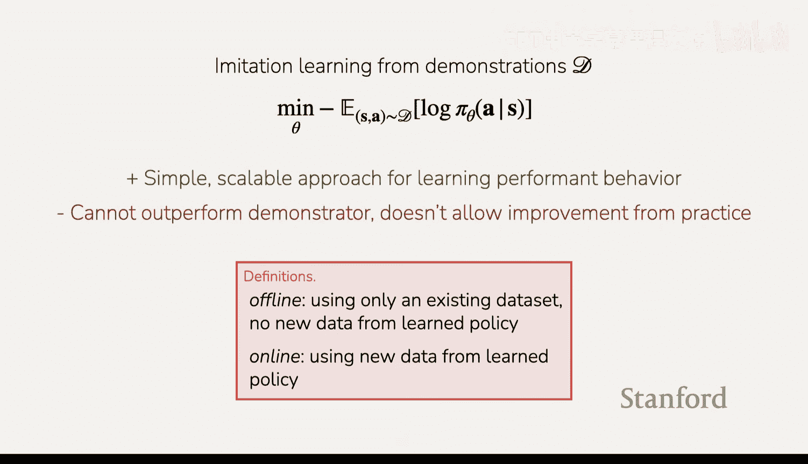

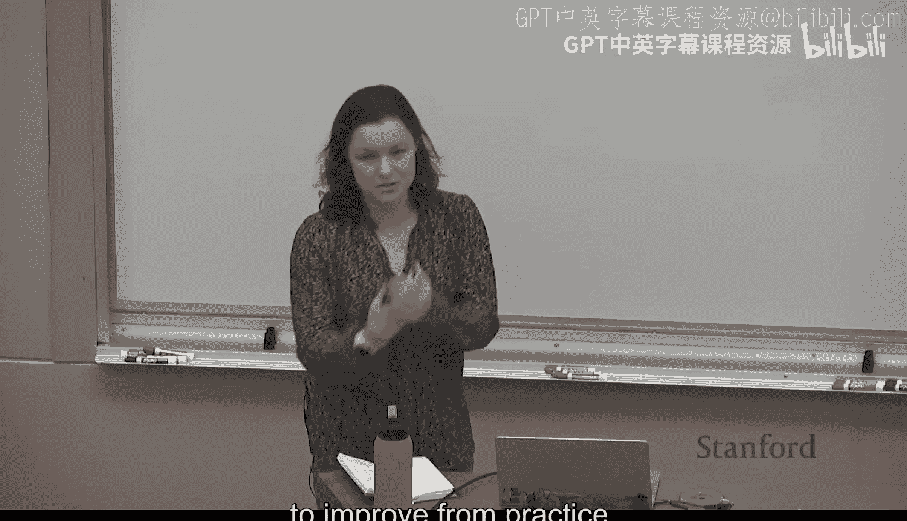

Particular our first online oral algorithm will be policy gradients。

 we'll talk about a couple different variants of policy gradients and introduce both kind of the mathematical derivation for it as well as some of the intuition behind it。

And policy gradients are the basis for some popular reinforcement learning algorithms。

 including ones that are used to train legged robots。

 use algorithms that are used to train language models。

 and are also kind of part of the default project。We won't get kind of the complete algorithm that was used to train these today。

 but well get like most of or' like halfway there， basically and by Friday。

 we'll have most of the algorithm for it。Yeah， and then the key goals will be to try to get the intuition behind policy gradients。

 how to implement them and when to use them。Okay， so the outline of an online reinforcement learning algorithm is going to look something like this。

 so first we need to initialize our policy in some way as we like when you train a neural network you need to initialize its weights we could initialize the weights of our policy randomly。

 we could also initialize it with imitation learning， we could also use heuristics。

 it depends on the problem setting。And after we've initialized our policy。

 we'll run our policy to collect some data so actually。Try out different things in the world。

Then we'll use that batchchelor of data to improve the policy。

And then we will repeat that process wellll then collect new data with our updated policy and update our policy again using that latest batch of data。

 so we're going to attempt the task and try to get better so what this might look like is the first iteration。

 we kind of attempt whatever some kind of simple 2D navigation task。

 the reward for some of them is bad the reward for other trajectories is like okay。

And then after more iterations of this， we might have a policy that's a bit better than is able to get higher reward。

 but isn't perfect， so sometimes it gets higher reward， sometimes it still gets low reward。

Then we'll use that to improve the policy again and after more iterations。

 hopefully we will get a policy that is able to succeed。

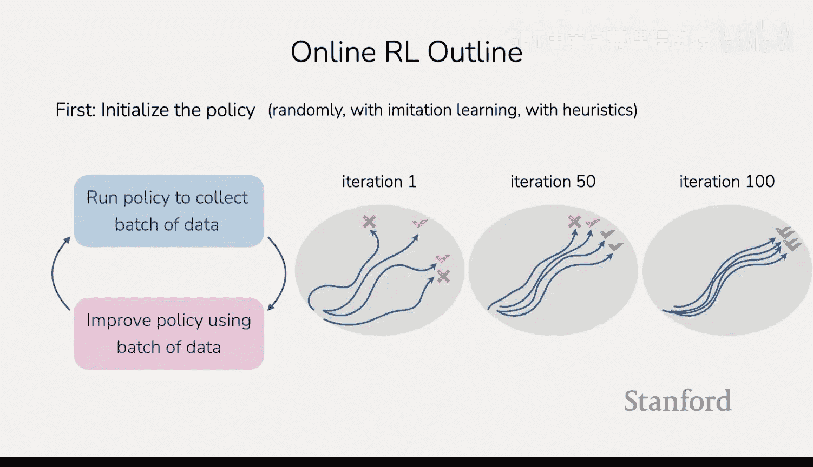

So this is kind of this notion of online reinforcement learning where we're collecting data online and improving using that data。

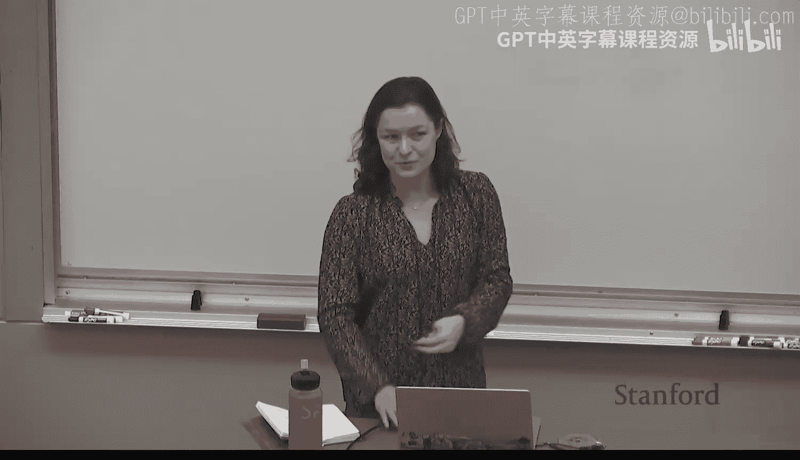

So we talked about this reinforcement learning objective and the say you have some policy and you want to actually understand how good that policy is。

To do that， we can't just actually look at the weights of the neural network。

 we actually have to run the policy to understand how good it is。

And so what we'll do is to estimate this expectation， which is a function of the policy。

 we could actually just run the policy multiple times， observe the resulting reward。

And then compute the average over the observed reward。

 and that's an estimate of how good our policy is。So we can then sum over the samples from our policy。

Now， let's start to think about how we actually like so we have this trial and error process。

 we collect some data and we improve our policy。

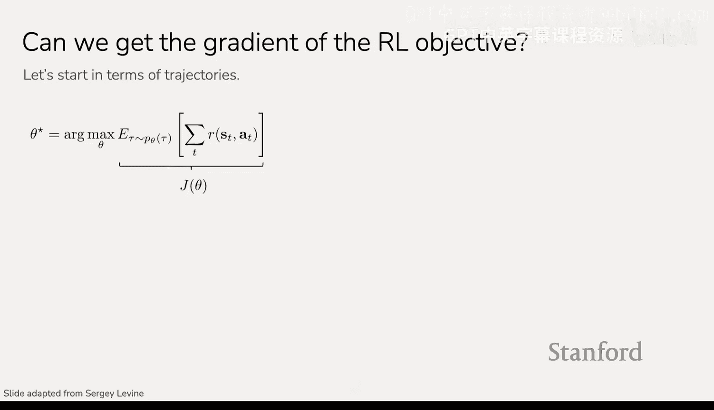

Coecting the data is straightforward we've talked about how to run a policy to get a rollout in the environment。

 we can kind of sample an action， observe the next state。

 then run that through a policy again to get a new action and repeat that process。

 but how to actually then improve our policy after we've collected that data。

So we have our objective and this can be written down as we have some policy P Theta and our goal。

Is to maximize the expected rewards when we sample from that policy。

 so we can consider the trajectories that are sampled from the policy as being drawn by some distribution。

That'll write as P theta of tau theta because the distribution over trajectories is a function of the policy that you're using。

And our goal is to maximize the sum of rewards。I'm going to use shorthand here。 Im。

Use shorthand for R of the trajectory， where this just means are like the sum of the rewards along that trajectory。

So our goal is to maximize the rewards， we're going to maximize this with respect to our policy parameters data。

Now， how do we actually optimize this， so if we want to use gradient descent because we typically train neural networks with gradient descent。

 we need to figure out the gradient of this objective with regard to theta。And we'll refer to this。呃。

Term right here as J theta。To be able to write it， this is the objective that we're trying to maximize。

And it's a little bit challenging to try to get a gradient of this thing directly because the relationship that this has on theta is through the trajectories that we sampled。

So we can't just like differentiate through this sampling process and that sampling process also depends on the dynamics of the world。

 which we also don't know。So if we're going to think about trying to get a gradient。Of。Of J theta。

It's helpful to write down this expectation as an integral。So this expectation can be written。

As an integral of。P theta。Of Tao。Times。R of Tao。Detail。

So this is just from the definition of an expectation。No， because。

An integral is a summation and that's kind of a linear operation。

 we can bring the gradient inside the integral。And so in particular， what that looks like is。

The integral of。A。The gradient。Of P theta。Of Tao。Are of health。

Now this doesn't really help us directly at any， because we don't want to have to evaluate this integral in order to take agree。

And at this point， there is kind of a trick， a convenient trick that we can use to try to put this into a form that's more useful。

And in particular。The trick is that。we'll write it over here。Is that if you think about？

P theta of tau times。The gradient。Of。A。P theta of tau， actually， sorry。

Time is the gradient of the log。Does anyone remember what the gradient of a log is or the derivative of log？

One over right， so then what this is equal to？s this is equal to。P theta。Of how times one over。

Kith Theta of Tau。And then we need to use the chain rule to apply the gradient to this。

 and so with the chain rule， we'll get the gradient of P theta of tau。

And these two will then cancel out。And this is equal to。The gradient。Of。K theta of tau。

And the reason why this is a convenient equality between gradient of P theta。

 and this is we can actually then replace the gradient of P Theta down here with this first thing right here。

If we replace this gradient of P the of tau right here。You replace this？We now get an integral。Of。

P theta of tau times grad。Log。😔，Key Theta of Tao。Times our of Ta。皮头。No。

 this is something that's useful because we can now represent this as an expectation this this first term right here。

 And so this is equal to。An expectation of tau sampled from P Theta of tau。Of。Grad log。

P theta of tau。Times。R of2。So what we did there is we use this log trick to then get the P theta out here and then get an expectation and we're starting to get to something that's actually more like what we can evaluate and in particular this expectation is something that we can estimate with samples and now theta is actually appearing on the inside here。

And that means that this kind of this is actually getting closer to something that we can evaluate if we still have this term right here。

 which just doesn't look like pi of a given F so this is not this we need to kind of work on this term。

 but we're starting to get towards something that we can evaluate。Yeah。

 so the question is how is this more useful than the first term because we still have the sampling and we need to the issue with the first case was that we can't differentiate through the sampling now the thing that's different here is that theta actually appears inside the expectation now we're not going to be able to differentiate through the sampling still but the thing that's useful here is that we will actually be able to differentiate with respect to theta and we're still not going to differentiate in this part but we'll be able to get an estimate that's still useful and we could potentially draw many。

 many samples and then measure this quantity to get actually a pretty accurate representation of the gradient。

In a way that actually depends on theta。Okay， let's talk a little bit about this term right here。

So and actually maybe in case it's useful in terms of where we're at right so far。

 we can show that on the slides as well， so we looked at this J of theta。

 wrote it down as an integral， we found this convenient identity over here where P grad log P is equal to grad P and then we can use that to derive this second equation right here。

😊。

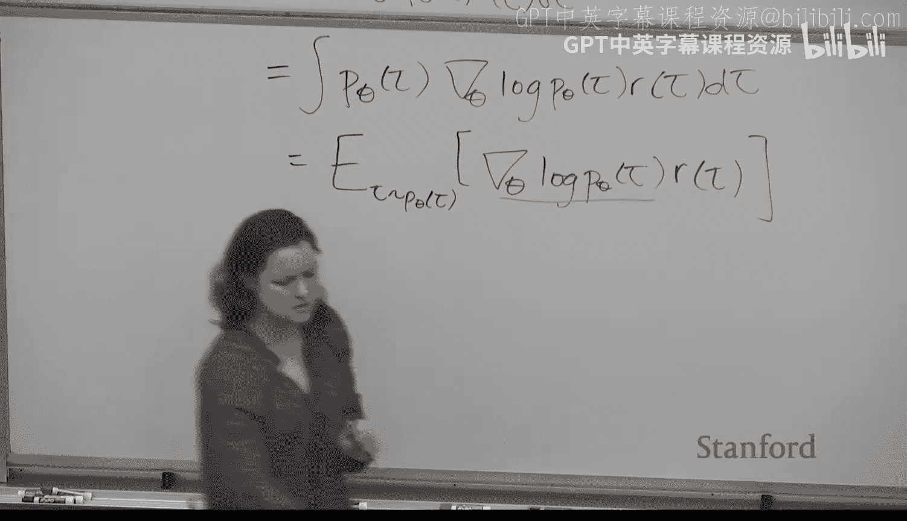

U。

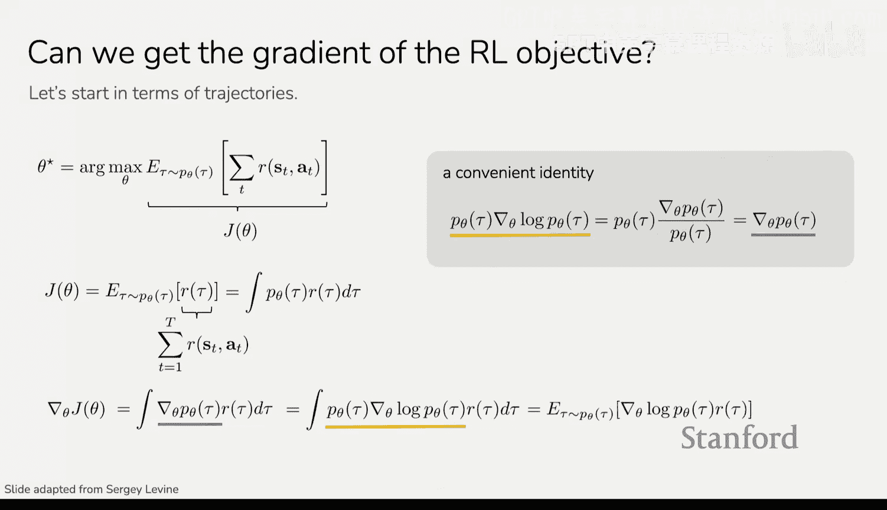

And now we're right here。So for this part for Grad Lo P。This is something that we can write out。

 And if we use， if we remember that。P theta of tau equals p of S1 times。

Pi of A given ST and P of ST plus 1 given S T A and then。With a product over to。

Then when we take the log of this as is over there。The log。Of。P theta of tau。Is equal to the log。

Of P of S1。Plus， the。Some over tea。Of the log。Of pie。Plus， the log of。The dynamics。

And then once we actually take the gradient。Of log piece。How。

Then the gradient of this with respect to theta， theta doesn't affect the initial state distribution。

 it also doesn't affect the dynamics in any way。And so。The gradient。Of log。P theta of tau。

Is equal to just the gradient of this term right here。The gradient。Of。U。Log。Hi， data。Of a given us。

And so this is really useful because this means that we could actually plug in。This over there。

 and this is actually something that we can evaluate。

 We can evaluate the gradient of or the log the gradient of log pie。

And this is just taking a backward path through。The log of the output of our neural liver。

And so then we actually get a gradient that we can。Evaluate so。U。

The gradient that we get when we plug things in。The gradient of J theta。

When we plug this in is we have an expectation over。Trajectorory sampled。Per policy？

And inside that expectation， we will have we can bring the gradient inside that summation。

And so we'll have a sum over time steps。Of grad。Log。Pi of A given ST。Right here。

And then we still have our RFFT。Right here。 So we can write that as R of Tu。

 We could also write it as。A summation of R。Of S T。Com一。

So this is what's called the policy gradient or the vanilla policy gradient。

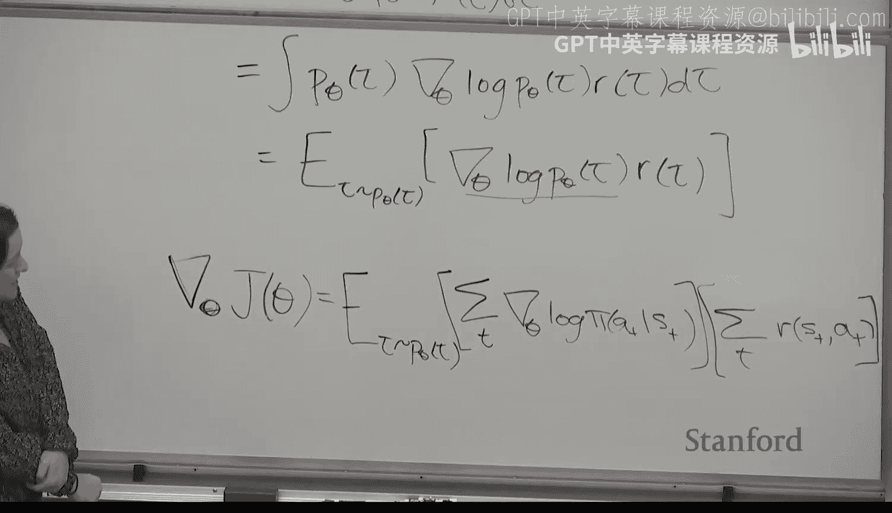

This is a lot nicer than the version up there because we can sample trajectories from our policy。

Compute their reward， also compute the gradient of each of log of pi for each of the actions。

And then。Sum those together， multiply， and we can get a gradient that we can apply to the weights of our neural network。

That's actually leading to higher reward。So again， on the slides。

We wrote down what the probability of a trajectoryy is， if you take the log of that。

 you get a summation instead of a product。And the log each of the individual terms。

Then if we plug that into our gradient。And we take the。Maybe we take the gradient of log Pau then。

The first term and the last term go away because they don't depend on theta。

And then we get this final term when we plug it in。So this is the gradient。

 when we do run policy gradient， we'll collect data and then we'll evaluate this equation。

And then we'll use that to represent the gradient of the weight of the policy and then run gradient descent。

 apply that to our policy， and then repeat the process。So yeah， we also talked about this verbally。

 but in order to estimate this gradient here， we'll run the policy to collect some data。

 we'll then improve the policy using that data in particular。

 you can think of this the first summation as collecting end samples。For that expectation。

 and ideally n is larger because the higher n is the better an estimate you're going to get of the expectation of the integral。

And then once we evaluate this gradient that we're estimating the samples。

 we'll then take a gradient step on our policy parameters。

And so the full algorithm looks something like sampling trajectories from our policy。

Evaluating an estimate of the gradient using those samples。And then。

Applying that to the weights and then repeating this process to collect a new batch of data。

 recomputing the gradient and improving the policy。

So the question is what does it look like to use the data to estimate this kind of gradient term。

 right like this first term or the second term？Cool， the first term。Yeah。

 so when we're using the data to compute this first term， the。

What we're doing is we're getting a bunch of states and actions， a bunch of trajectories。

 we're getting n trajectories that each in this case have like T time steps and we'll be taking the states and actions in those trajectories。

 passing the state through the policy。As a forward pass to get the probability over actions。

 we'll then evaluate the action in the data， the probability of that。

Of that action and the data under the distribution， that the policy output。

 so if it's like a categorical distribution will then get the probability。

 we'll take the log of that probability。And then we take the gradient right here。

 which will just be a forward pass through sorry， a backward pass through the network。

After taking the log of the policy output for that action。

So this is called the reinforce algorithm or the vanilla policy gradient algorithm。Yeah。

 so this came out， this is just R of Tau so I'm using R of Tau as shorthand for this just because I didn't want to write this summation five times。

But yeah， this is exactly RF of how。Yeah， exactly， so this is an estimate because we're only going to be taking n samples to estimate this expectation。

 if you took infinite， then would be this would be exact。Of course。

 taking infinite samples is not profitable。Yeah so the gradient right here this is going to depend on the architecture The question was do you compute this by hand you can use automatic differentiation so like whatever library Piytorrch or whatever that can compute that for you so you don't have to yeah write it out。

Great， so let's talk about some of the intuition behind this， so there's the math。

 but what does this gradient actually mean？So if you look at this， this， maybe let'll start。

 look at the first term， the first term， if we kind of think back to imitation learning。

This first term is actually the same as the gradient of the imitation learning objective。

 so in imitation learning， we are trying to mimic actions from some demonstration data set by maximizing the log probability or minimizing the negative log probability。

😊，And if you take the gradient of that， it's similar going to be the gradient of the log probability。

 So you can think about this first term as saying I'm going to。

IBas try to increase the likelihood of the actions in the online data。But then for the second term。

 it's weight that by the reward of that trajectory， like how good was that trajectory？

And so you can kind of think about this as the imitation gradient。

 but weighted by the sum of rewards seen in the data。

And so essentially you're going to increase the likelihood of actions that had high reward。

And decrease decrease the likelihood of actions that were taken in negative reward trajectories and so you're actually going to be imitating your own data。

 the data that was collected by the policy but。Depending on whether it's high reward or low reward。

 you will be you actually might actually be have a negative gradient if it's negative reward。

 it's actually going to push you away from the bad stuff and push you towards the good stuff。Yes。

 yeah， so this is inside the first summation you can see the eye comes up right here。

 so we're sending you a bunch of trajectories and then yeah this is all within the summation over in。

So the question is， is the difference between this and imitation learning where like imitation learning。

 you're kind of either right or wrong or here you're like this amount of right or this amount of wrong？

So you can apply this。Well in principle you can apply this in scenarios where the reward is very sparse and so you can actually apply it in scenarios where the reward is just like one if you succeeded in zero otherwise now this algorithm may not do very well in those scenarios and we'll talk about that one of the key differences with imitation learning is that you're actually doing this on your own rollouts because so you'll actually the policy is collecting its own data and then doing this applying the subjective to its own data and so that's one of the differences and then second is we're actually using this reward whereas an imitation learninger you're just blindly imitating all the data without any notion of how good the data is and it kind of assumes that it's good data。

Yeah， how do you sample the first state of the trajectory the this is something that's typically defined by the problem setting。

 so in some problem settings， like if if it's like you're trying to train an agent to play like pinball or something。

 then the initial state will just be given by the pinball machine。The in other cases。

 in like language modeling， the initial state or observation might be the first question that the user ask。

 so it's kind of usually thought of as a property of the environment。Yeah。

 so the question is can you use this to improve imitation learning by weighting the trajectories by reward yeah you could definitely do that we will also talk about some of the。

😊，Good thing and bad things about this objective in the coming slides。Yeah。

 so the question was in practice does it makes sense to start with imitation learning。

 run that for some in number of iterations and then switch to this that can definitely make sense if you start completely from a randomly initialized policy。

 it will do random stuff and if you have a very dense reward signal that can be okay but in other scenarios。

 if you have access to demonstrations， then initializing it with demonstrations can also can be like a very good fit and then it will allow you to improve on top of your initial policy。

So the question is if you don't have a good conception of what's good and bad like what the reward function should be。

 can you use imitation learning just to kind of get an initial sense for that。

 we'll talk about reward learning in a few lectures and how you can potentially use expert data for that。

In practice， it's challenging， yeah。So we talked about how this kind of is intuitively increasing likelihood on high reward trajectories and decreasing likelihood on negative reward trajectories。

 if we actually look at this visually say that we took a few trajectories。

 one of them had good reward， one of them had bad reward and this red is kind of showing our initial distribution over trajectories what this gradient is going to do is it's going to increase the likelihood on the green part so you'll get something that looks like this and then it'll decrease the likelihood on the red part so you'll get something that looks like this and it'll encourage the policy to take actions that are more like the high reward trajectory。

嗯。In like even more brief terms， you can think of this as like trying to do more of the good stuff and less of the bad stuff that you observed。

Okay， and then you can also think about this as kind of a formula formalization of trial and error where you're actually going to try to do different things and if you see。

Good stuff happening then you'll try to do more of that and if you make a mistake。

 then you'll try to stop doing that。Cool， so now I have a question for you。

 so let's look at an example， say that we're trying to have a humanoid learn how to walk in simulation。

And we'll define the reward function to be the forward velocity of the robot。

 this means that the reward function will be positive if it's moving forward。

 it may also be negative if the robot is moving backwards。

 it might be zero if the robot is not moving。First full sample from our policy。

 say we have a policy that's not very good at the beginning。

 so in the first trajectory maybe it falls backwards and this second trajectory。

 maybe it falls forwards， which will actually technically give it positive reward。

 so the sum of rewards will be positive。maybe another director it manages the stamp still。

 so the rewards would be zero for that。In another trajectory。

 maybe it takes one small step forward and then falls backwards and so the initial reward at the beginning of the trajectory would actually be getting positive rewards and then later on it would be getting negative rewards and the sum of rewards would be negative。

And then maybe the last trajectory is it takes one large step backwards and then a small step forwards。

 in this case， it would have kind of negative rewards and then some positive rewards。

 but the sum of rewards would still be negative。Now， my question for you is what will the gradient？

That we defined here， what will it encourage the policy to do if this is your data set。

 if these are the five trajectories that you sampled。

And going be one of our simpler examples and then we'll move to more complex examples in a couple more slides。

 so I'd encourage you to pair up for a minute， discuss it briefly and then we'll come back and share in like one or two minutes。

Okay， let's come back。If you want to share your answer， can you raise your hand？

Okay so the gradient will encourage it to fall forwards and potentially stand still so cool that's mostly correct so if we think through each of these trajectories。

 the first one the reward will be negative here it will also be negative thats kind of some of rewards over the entire trajectory will be negative for one。

4 and five and should be about zero for three and for two it should be the sum should be positive and so what this means is it will you'll get negative gradients for any actions that were taken in one4 and five you'll get positive gradients for all the actions taken in two and you'll get roughly zero gradients for all the actions that are taken in trajectory three and so this means that it will encourage it to fall forwards and it'll encourage it to not do the things that were in one。

4 and5 so it will discourage it from taking steps backwards or forwards and will also discourage it from falling backwards。

Cool so yeah so we encourage the policy to fall forward and not take steps this is distressing because we don't want our policy to fall forward。

 we want to take steps and so this is a kind of example of how how the gradient that we're getting is noisy high variance it means that depending on what these trajectories are。

 the gradient might vary drastically so if you do actually have some trajectories that are walking forwards you might actually get a very different gradient estimate from this set of trajectories and so that's kind of the definition of having noise or having high variance。

😊，Yeah so the question is why are we getting multiple directories from the same policy like why not just get one There's two reasons for this one is that the policy is not deterministic and so if we want to explore different strategies we will get kind of different samples of different strategies because it's not deterministic and the second reason is also the environment might be stochastic and so even if you have a deterministic policy you might see different outcomes and that will this will help you learn about those different outcomes yeah。

There's one thing that we can do about this that we can like already kind of directly improve the gradient in a fairly simple way。

And in particular， one observation that we might make is that if you're in the middle of a trajectory and you take an action。

That action has no influence on previous states。And right now。

 the gradient that is using the rewards at all states in the trajectory to update in the gradient update and even telling us to take actions later in the trajectory。

 if your reward before earlier in the trajectory was good or bad。And so。

One of the things that we can do is if one of our traories was to take a large step backwards and then a small step forwards。

 and we should actually be able to learn from this trajectory that taking a small step forward is it's good。

And the way that we can do that is instead of。Having this be a sum from t equals 1 to T。

What we can instead do is we can actually have this summation start at T。

And so we can have this essentially the。Let's use a different。A different letter。

 so we'll have T prime that is starting at T and going to capital T and now this is reward of ST prime A prime。

And by having it only by having it only look at future rewards。

 this means that we're now kind of incorporating the fact that current actions can only affect the future and not affect the past。

Oh yes， sorry， one other thing that you have to do here， yes。

 good point is to actually move this summation inside this summation here。Yeah， why can we do this？

 So the reason is that we know that our action at a at。Let's say our action that time equals 100。

 so let's say like。If T equals 100， so we're looking at like a 100。

 we know that this 100 is only going to influence rewards in the future and this isn't going to have any impact on states in the past。

 so like this is going to be completely independent of like S50 or sorry S50 so this doesn't affect like S50 or S51 or S99。

And this means that the yeah， because of that independence， we can then drop the rewards。

We can kind of drop that from the equation and。Yeah。

 and only look at can like when looking at like increasing the likelihood of an action at time T。

 only use the future rewards in that influence。It's a little bit hard to write out mathematically why you can do that。

I can maybe think about whether's there's like a nice mathematical expression for that。

 but it's really just about kind of。Casualality in the world。

And so basically policy behavior at time T is not going to influence rewards at earlier T。

Cool I think that this equation， okay， I don't have the typo in this equation so yeah。

 we're bringing this summation inside the other one and is' only going to be a factor of the future time steps and this means that for this example right here we will be kind of decreasing the likelihood of actions at the beginning of the trajectory and then the future summations will become positive because you took a step forward and then you'll actually start to be increasing the likelihood of taking a small step forward。

Yeah， so a very good point is it still doesn't help you if you take a step forward and then you take a step backwards and the reason why it doesn't。

The reason why that's actually a little bit difficult to handle is that it's possible that this step forwards actually cause you to fall backwards or cause you to take a step backwards。

 you don't really know like a big part of reinforcement learning is thinking about。

Like what influence does actions have on the future and you need to learn that from experience and you need to if you take a step forward。

 it means it could from the algorithm's point of you actually have caused something bad to happen in the future and so we can't like drop those rewards。

So the question was if you say that you had like a lot of really bad stuff at the beginning and then you took a good action later on in the trajectory would you have enough time to accumulate that now so in your particular example you started getting kind of capital T was equal to 10 and you started seeing you did something really good at time step six now at time step six what this will look like is you'll have。

Grad log a6， given S6， and then you'll have a summation from T prime equals 6 to 10 of RT prime A prime。

 and so if you did get a high reward from that action immediately or in the next four time steps。

 then you would actually increase the likelihood on that action。

 now it's really going to depend a lot on the reward function。

So you're saying that for short horizon for kind of fixed horizon problems you're actually going be giving it a the gradient will be different if you're summing over 10 rewards versus over four rewards so one of the things that's important if you have a fixed time horizon T is for this to be a proper state and actually the truly Markovian you need it to contain information about like the future dynamics and so the。

And if it's fixed at 10 and you don't actually and the policy doesn't know if the H is about to finish。

 then it's actually not a truly Marovvian state and you need to actually give it information about how many time stepsps it has left to succeed。

 and then you could incorporate that into the state。

 and so you would actually have different states in those different circumstances。Okay。

 so I have now another example for you and this actually comes back to the question that came up earlier。

 although it's actually to be slightly different。Say that the robot。

 we now have a version that is only depending on future rewards we have the same version of the problem。

 but now our policy is a little bit better， one of the  traories falls forward。

 one of the traories kind of slowly stumbles forward。

 one of the traories steadily walks forward and one of the  traories runs forward。

My question for you is what will the gradient encourage the policy to do in this case and we can use we can use this version。

 the kind of updated version。Yeah， and so I'll encourage you to pair up again and discuss this and then we'll come back in like two minutes。

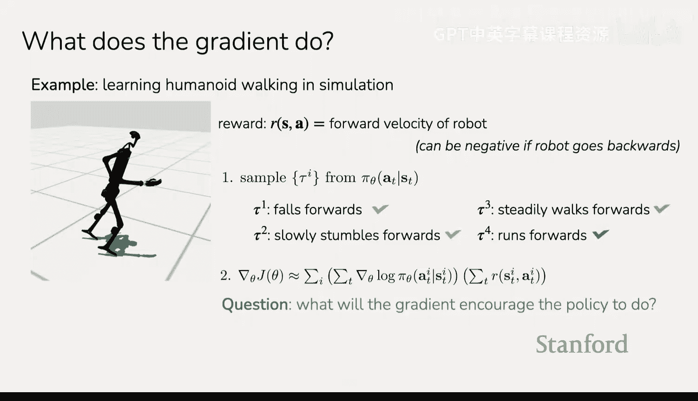

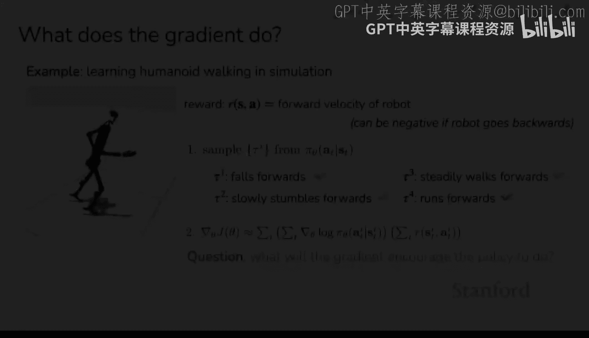

Okay， let's come back。Please raise your hand if you want to share your answer。

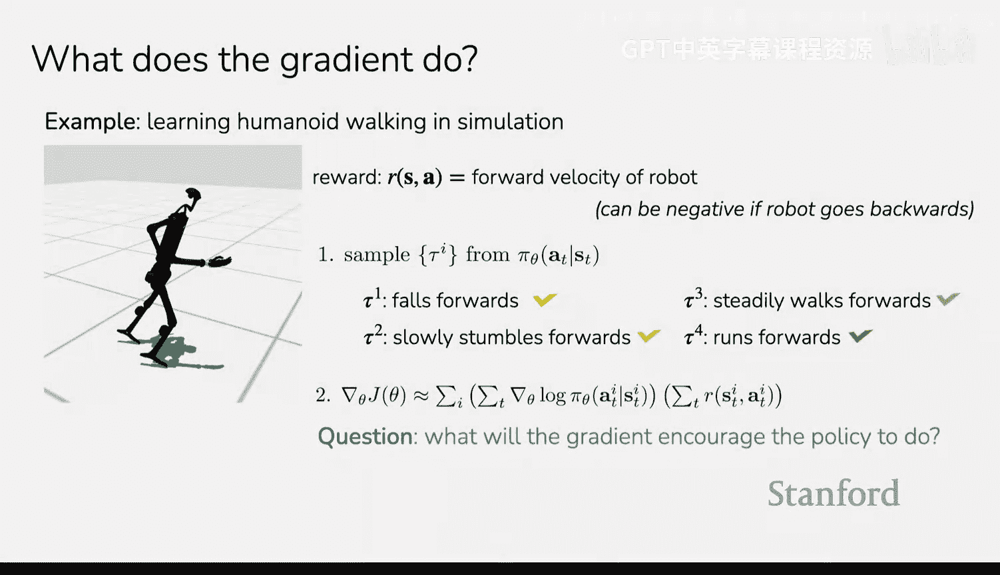

Okay， yeah， so the first answer was that like it's going to get highest reward for the stuff that is moving forward at higher velocity so it's going to encourage it to do that the highest velocity stuff the most and you were saying that even if it makes any sort of forward progress and it'll still encourage it to do that。

Yeah， so another hypothesis was that if you kind of go back to the previous example。

 it might encourage it to fall forward and then get back up again and then fall forward and get back up again。

 especially if it's like easy to fall forward now getting up again is actually a little bit more challenging so that might also be a little tricky。

so the thoughts there was that the fourth one， if the reward is it might dominate if that one has a much higher reward than the others。

s if they're more kind of even in terms of velocity and it's just like move forward。

 then it won't necessarily dominate and you'll do all four。Yeah。

 so all of the rewards in these cases will all be positive and so even so the kind of I think what aoc of Larga is that the kind of reward of this last one will be the highest and so it will be encouraged to do this but because all of these like one two and three also have positive rewards the policy is actually also still going to be encouraged to do those things because basically the witness term is non negativeg when it's positive you're still going to be increasing the likelihood on the actions in these trajectories now won't do it as frequently as running forward but it will still be encouraged to do that and that might be a little bit concerning because some of the time it will actually be encouraging it to stumble forward and ideally we would actually in this case want a policy that can actually have the policy run as fast as possible。

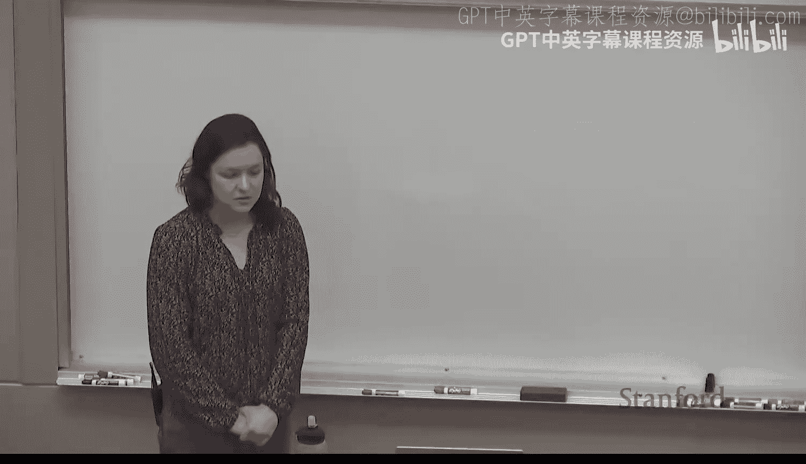

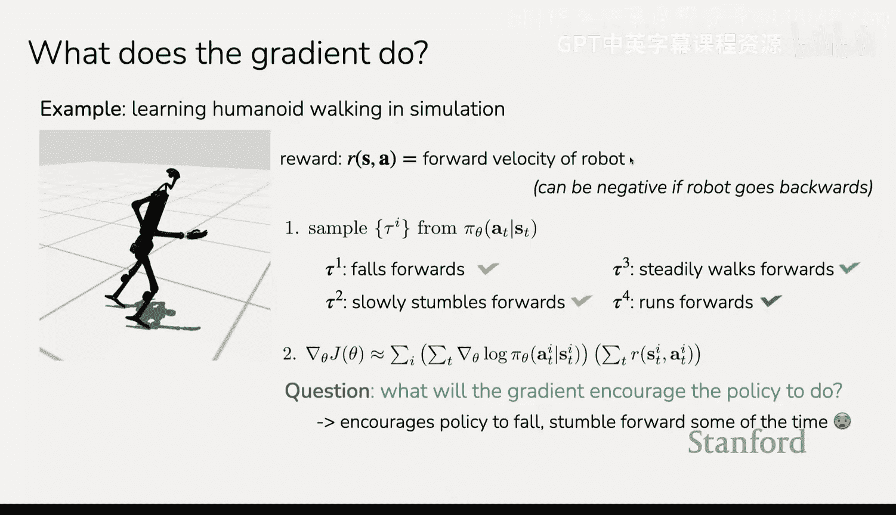

Yeah so the question was is this because of local minimum like it seems like with this reward function like it really the best outcome is to run forward and so like why are we getting this kind of objective the reason for this is because the gradient is noisy it kind of comes down to variance and if you do have a policy that runs forward it will encourage it to keep on running forward but when you have other data in there kind of that other data will influence in some ways and so it won't necessarily converge to a local optimum because at this point it will encourage it to run forward more and then the next batch of data will run forward more they'll encourage it to run forward even more so eventually it will converge to the global optimum but。

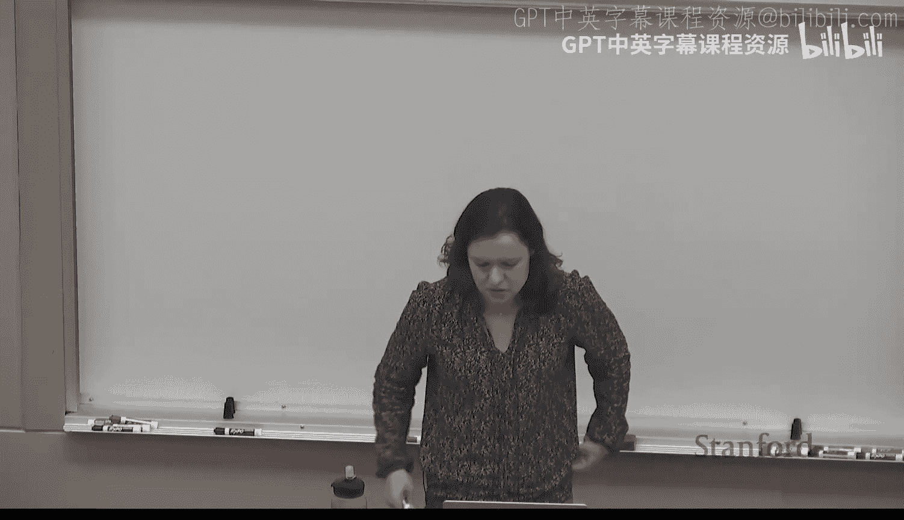

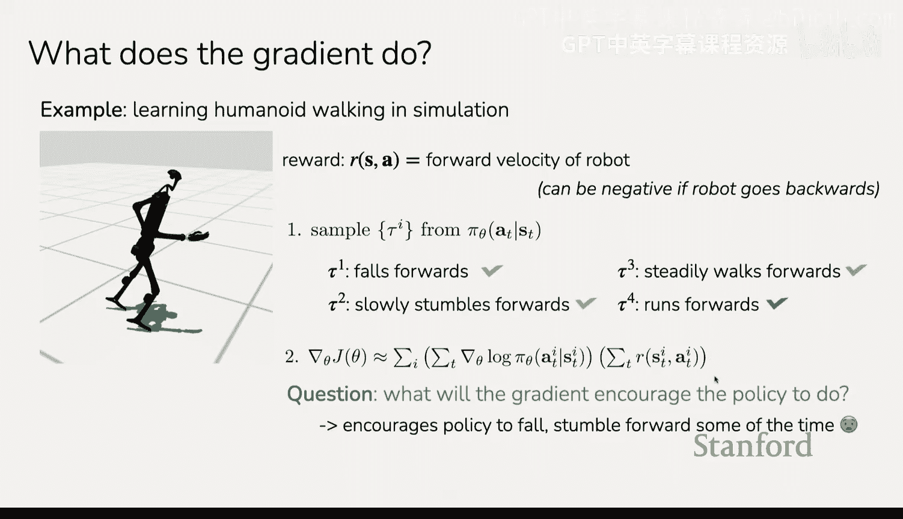

It will get there more slowly because the gradient has a lot of variance depending on the samples that you select。

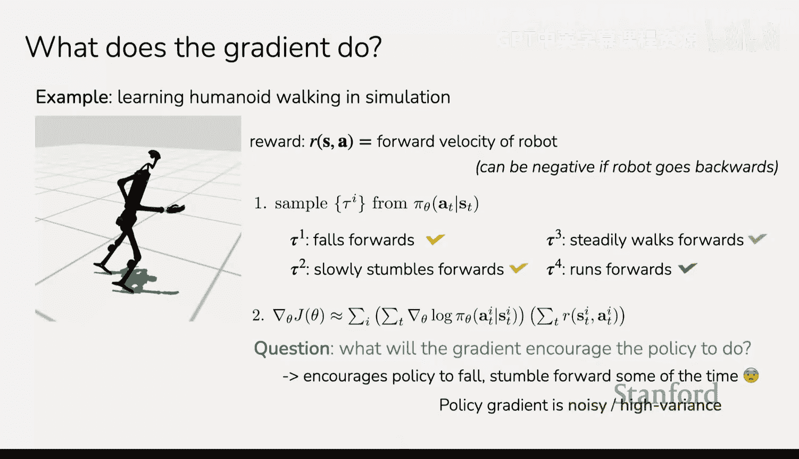

Well， this encourage the robot to roll forward。With this data。

 it will not encourage it to roll forward unless some weird combination of gradients causes that。

 but yeah， generally it will not， if you had data of rolling forward then it would encourage it to roll forward。

The question is can their agent learn from a subset ofjectories instead of the whole trajectory。

 in this case it will learn from all future steps in the trajectory so that is a subset but it might not be。

 and I guess in the next lecture we'll talk about like more sophisticated ways to estimate this that might are smarter basically。

Cool， so the thing that we saw here is that things are sensitive to the scaling of the reward function and on the flip side if everything was negative like came up in the question before。

 we would actually only be getting negative gradients to our policy and not no actual positive gradients and that's actually a big problem with with this kind of approach is that it's very it kind of depends on the scale of the reward。

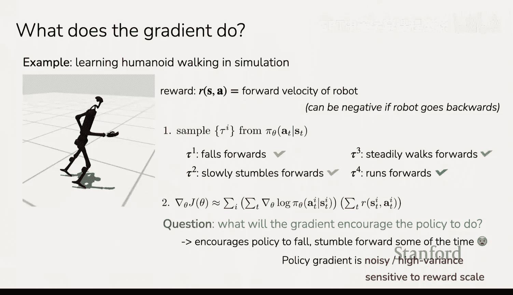

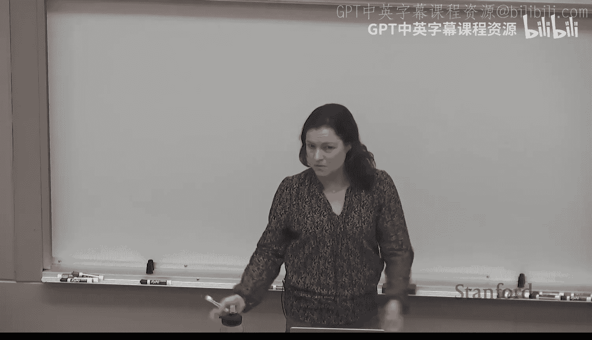

And there's actually a very simple thing that we can do to fix this and so in particular。

 what we can do is when we are using this gradient of which is kind of the expectation of P of tau of I'll maybe do the kind of the first version just to make it a bit shorter。

 but we get the gradient of，😊，logg P of tau times R of tau and what we can do is instead of having this V R of tau。

 we can actually subtract。A constant。Where that constant。Could be equal to the average reward。

And if we subtract the average reward from this， this means that things that are better than average will get a positive will get kind of will increase the likelihood and things that are。

Below average will actually lead us to decreased likelihood， so this will be negative。Now。

 you might be wondering。Can we just add this be here。

 did I just like make that up like why can we do that， why are we allowed to do that？

We can see what the effect that this has on the gradient。And。

What we can show is we can actually show that if you subtract a constant。In expectation。

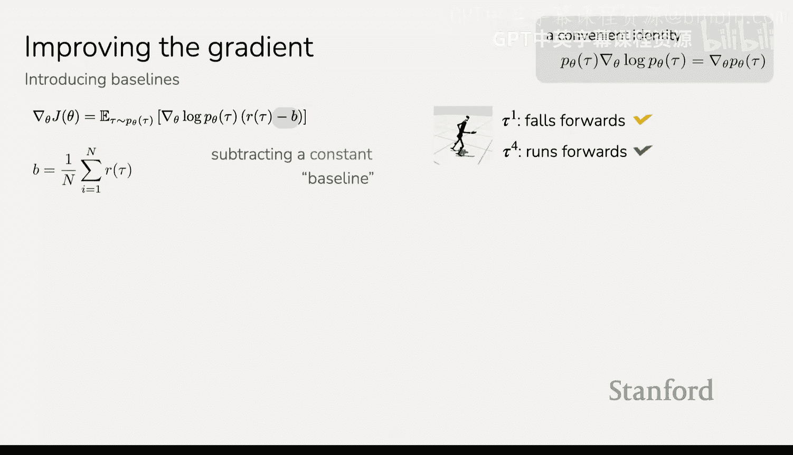

This has zero effect on the gradient。And in particular， so this is the gradient。Oh， J。

And if we look at what effect this has on the gradient in expectation。

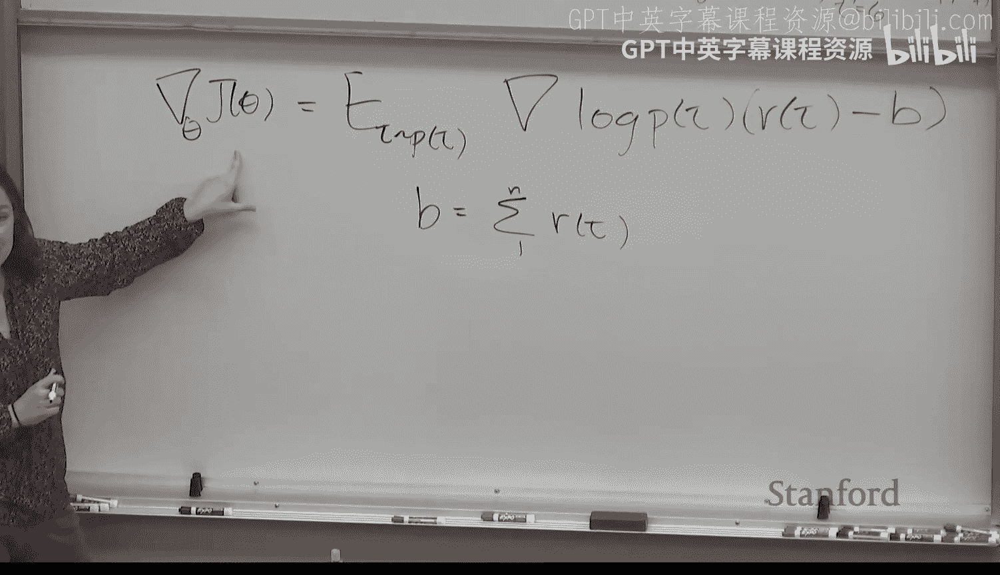

We can look at essentially the expectation of。Grad log P。Times times B。

And it's possible to show that this in expectation is actually equal to zero。And in particular。

 if we。Write this out as the gradient of or sorry， the integral。

 the expectation is the integral of P of tau times。Grad log。Pe of towno。Times B。Do you tell？

The we can then use the same kind of use the same trick that we used before， but in reverse。

 this is equal to。The integral。Of。UGrad。Pi。😔，Theta of tau。Times B。Do you tell？I'm a little bit。

Out of space， but the gradient can be moved to the outside of the integral because because of kind of this is a linear operation。

 we can also move B outside the integral because it's a constant。And so。This is equal to。U。L。

Graient B times the gradient of the integral。Of。He did。Of Tau D Tau。Now。

 this integral is just equal to one。And the gradient of one is zero。So。This is one。This。

Is zero and b times zero is0。And so this means that kind of the expectation。

 this is going to have zero effect on the gradient。

And so just to maybe write that a little bit more cleanly。The expectation of the gradient。

Of log P times v， so basically the effect that this baseline is having on this gradient。

 we can write that out as the integral。😊，We can then use the log trick and reverse。

We can move B and the gradient outside of the integral。U。This integral is equal to 1。

 the gradient of 1 is 0， and then we get 0。So this means that we can add this baseline。Yeah。

 so the reason why this constant term， the question was like this constant term wouldn't be helpful if we could actually truly evaluate the expectation and yeah that's correct so if we had this expectation and it could measure this exactly that we wouldn't need this the reason why this is helpful is because we have this expectation and basically you can think of it as reducing it's a way to reduce the variance of your estimate of this expectation and it's an unbiased way to do that so in particular as long as the baseline is a constant。

tThen it won't change the behavior of the gradient and expectation， this means that it's unbiased。

 this is a term from statistics talking about like effect on random variables and you can show that it reduces the variance of your estimate of the gradient。

Yeah， so the question is B really a constant and seems to depend on the trajectories。

 we'll use the same value of B。For an entire batch for all of the examples and so we'll collect a batch of data。

 then we will compute B and we'll use B for all of the updates。In on that batch of data。

Yeah so how does it reduce the variance of the gradient you can write down so this is the kind of the expectation of the gradient you can write down the variance analytically and show that it reduces the variance you can kind of I don't want to go through the math because we have some other stuff to get through but kind of intuitively you can think about it in terms of this example of。

😊，It will like， yeah， encourage it to do more of the good stuff。

 more of the above average stuff or less of the below average stuff。

I can also mention that average reward is actually not the optimal baseline you can actually。

Derrive the variance and then find like then take the derivative of the variance side equal to zero to find the optimal baseline。

 but average reward is pretty good， the optimal baseline is something like kind of it's very close to average word but there's some additional weighting terms。

Cool， so we have one more episode of what does the gradient do and we're going to look at a different example in this case。

 the robot is folding a jacket。And the reward is one if it's neatly folded， 0。

5 if it's folded with some wrinkles and zero if it's not folded。

We're going to again sample from our policy， we have some samples of not touching the jacket。

 folding only the sleeves， but not folding the full thing， flattening the jacket。

 but not folding it and one character where it does hold the jacket。

And my question is with the baseline in here this time， what does the gradient look like？

the rewards for one2 and three will be zero and the reward for four will be positive and so this means that because of our baseline the gradient for four will be positive and we'll encourage this behavior and then we'll discourage all the behavior for one two and three now in some ways this is good because it means that we are encouraging the good behavior but there are also some things that are a little bit disatisfying about this the first is that the gradient for one two and three is going to be identical for all of them and there isn't any differentiation between them and some of these are actually better than others this is kind of in some ways a result of the reward function that we're using which is more sparse than it could be and the other thing is that we'll actually see some techniques in Friday's lecture that would actually be able to leverage some of the good parts of these trajectories because there is a good thing about folding the sleeves and it would be nice to be able to use that data to encourage the policy and right now it will actually。

Discouraged and have negative gradients for this trajectoryory so in some ways， this is good。

 so it will encourage folding， but the gradient is constant for trajectories one， two and three and。

😊，We will on Friday we'll see ways to make this a little bit better and kind of one of the takeaways here is that policy gradient is still noisy and is still high variances and it really is going to work best if you have dense rewards rather than rewards that are sparse and it'll work best if you have large batches of data because if you didn't actually sample this fourth trajectory and you only sampled failures。

 then you would have zero gradient and you wouldn't actually be able to improve。

So the question was can we just improve the reward function Yes。

 so if we had a more dense reward function that would definitely help in these cases。

 there are actually scenarios still where where that could do we could do better so especially if you for example folded the sleeves it got positive reward for this and then like dropped it on the ground or something after that then that still dissatisfying because we wouldn't use the first part successfully and we'll actually see how to do that how to get good gradient for that first part on Friday。

 but yeah if you had a more dense reward function for this particular set of directorories that would work a lot better。

Oh， so the question here is when we do the baseline are we also using this trick to only use future rewards。

 you can combine them， it's you need to be a little bit。

 you need to think a little bit potentially more carefully about what the baseline will be。

 because some of the rewards you'll be summing over fewer things or more things depending on where you are in the trajectory。

 but you can definitely combine them。Yeah， so the question was for if we're using average award as the baseline。

 do we need to keep updating the term you need to use data from the policy， so yes。

 you'll want to keep on updating it because as the policy gets better。

 what's above average and below average will change and you'll want to recompute it on your latest batch of data。

Cool， so one more thing on this version of the algorithm and then we'll move on to one last version in terms of how to implement it。

 we talked about we kind of derived a gradient like this。And to actually implement this in practice。

 you could， in principle， actually just run a backward pass for all of these different terms。

 but if you computed all these individually， then you'd have to do n times t backward passes and this would be rather inefficient。

And。It'd be nice if we could just actually do automatic differentiation on the full objective and only do one forward pass and one backward pass。

And we can do that so it's possible to implement essentially a surrogate objective whose gradient is the same as this objective I'm calling a surrogate because it's not the same as like the very first objective of maximizing expected rewards。

But you can write down a surrogate objective for this particular example。

 this is what the surrogate objective looks like， note that I actually do have a typo on these equations where this second sum should be inside the first sum that's maybe a small note。

 I'll see if I can fix that but yeah you can implement a surrogate objective and then use backpro and AutoDff software to just do one backward pass。

Okay， and what this actually looks like in practice is this would actually look like a cross entropy loss for a discrete action policy or something like squared error for a Gaussian policy you could also use more sophisticated policies like diffusion or something like that as well。

😊，Okay， so summary so far we showed how to estimate the gradient of the RL objective using this log gradient trick this corresponds to weighing the policy likelihood by future rewards and we found that subtracting a baseline like average reward will also further improve the gradient even with these two things the gradient is still noisy and so it's best with large batches and dense rewards this is also our first online reinforcement learning algorithm where we iterate between collecting a batch of data with our policy and improve our policy and it kind of formalizes this trial and error。

Learning process。And kind the intuition for everything we've done so far is do more of the high reward stuff and less of the low reward stuff。

Okay， now the last thing we'll talk about today is what else is troublesome about policy gradients and。

One thing that we haven't really talked about that much is the details of the sampling process。

And this is what our gradient in our algorithm looks like。And note that。In this gradient。

 this assumes that we're sampling from pi theta。And。We changed data in step three。

And this means that。Every single time we take a single gradient step。

We need to recollect data to estimate our gradient。

And this is kind of sad because usually we do like thousands and thousands of gradients on neural networks。

U。And so yeah， that seems like a problem and what this is called it's called on policy。

 it means that the gradient that we are measuring is like requires data using our exact policy and we can think about this as an attribute of an online oral algorithm where on policy only uses data from the current policy and off policy means that you can reuse data from other past policies。

So can we derive an off policy version of the policy gradient and it's only give me a little off policy and by that。

 I mean we're just going to try to be able to take more than one gradient step on a single batch of data。

And to do this， we can use important sampling。And important sampling is actually a really cool technique that's useful outside of reinforcement learning as well。

 and it's kind of thinking about this this scenario where you want to estimate a quantity and expectation when you don't actually without actually sampling from that distribution so say you have。

😊。

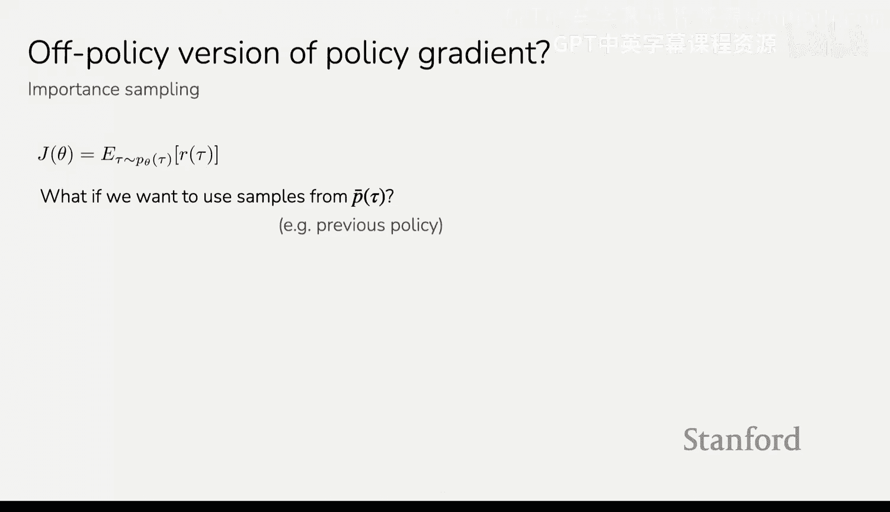

Some expectation。Using samples from P of x and you want to estimate。

Some function F of x using those samples。But say that you only have access to the ability to sample from Q of X。

So this is usually called like your proposal distribution that's able to kind of propose samples to use。

 this is like your old policy， we have samples from our old policy。

 but we want to be able to estimate a function of samples of our new policy after we've taken a gradient step。

So what you can do in this case， if you write down this expectation as an integral。

 it looks something like this。And。As long as Q of X has reasonable support。

We can write this as we can kind of add in。This term that equals one。Into。Our equation。

And then we can now actually write this as an expectation with respect to Q。So this is equal to。

An expectation。With respect to Q。Of。A。P of x。Divided by Q of x。Times Fex。

And so this means that we can actually estimate we can like get this expectation。

By sampling from Q and then weighting the quantity by P over Q。

So that's pretty cool and this means that we can use principle samples from our old policy。

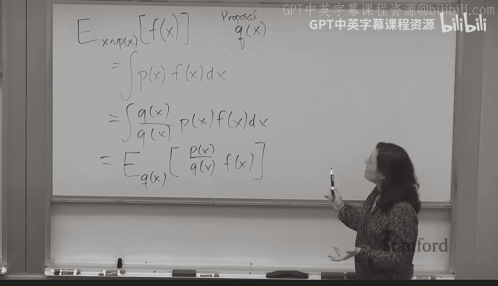

Q。Weight them by the probability of the sample under our new policy divided by the probability under the old policy。

Times the quantity。So we showed this for kind of this simple case of P of x and Q of x in terms of actually applying this。

To。Our policy。We can take our expected rewards with regard to P of theta if we instead have some previous policy that we've collected samples from。

 we can then measure our objective in terms of the samples from that policy where we weight the reward by the new policy divided by the old policy probability。

Now note that this requires the your proposal distribution to have non zero support in scenarios where the。

where your new policy has probability， it is actually very important for it to work if QX is zero。

 this is not poorly defined， but that's really the only catch here and in general is this important sampling technique is really going to work best when P and Q or when your old policy and your new policy are very similar to each other。

Now， there's some details。 we've shown this in terms of P of tau。 Now。

 how do we actually do this in terms of pi of a given S。 that actually gets a little bit trickier。

 We can write down。P of tau and this ratio as the product of these different probabilities。

And fortunately， some of the probabilities cancel out。

But when we then try to put this put these probabilities into。Into our update。

 we're going to get something like this。Wherere we then？Have this product of these ratios。

 these probability ratios。And no， unfortunately， this product can actually become very small or very large。

YouThe length of your trajectory is very large because you're going to be multiplying many。

 many numbers together like if you have 100 numbers that you're multiplying together。

 if they're above one that might start to get very large。

 if they're below one that might get to zero very quickly。😡，And so in practice。

 we often will consider the expectations of our time steps instead of trajectories。

And that also has a little bit of a hitch， which is that this needs to be over state action pairs。

Rather than actions given states， but we can often in practice。

 we can approximate this ratio as equal to one， this is incorrect。

 but it's kind of the best that we can do and then we can get some final form where we get this ratio of new policy over old policy。

嗯。Cool。The full algorithm looks the same except now we can take multiple gradient steps on the same batch。

 this is good， and then we have this new form for our gradient。Okay。

 we'll talk a little bit about some tricks， we don't have time to cover KL constraints today。

 but to review things， talked about online Ar， it's an on policy algorithm。

 we talked about baselines for reducing variants and we also just derive this off policy policy gradient which uses important sampling and allows us to apply multiple gradient steps。

 the intuition is to do more high reward stuff and less low reward stuff and the gradient is still very noisy and best large batches and dense rewards cool and that's it for today。

 next time we'll talk about a critic methods which will build closely on what we talked about today including PPO。

