# 斯坦福大学《深度强化学习｜CS224R Deep Reinforcement Learning  Spring 2025》中英字幕 p04 -04- Lecture 4_ Actor-Critic Methods.zh_en -BV1SvmxB3E5e_p4-

Okay， let's get started for today。

Let's start with a recap of what we covered last time because we're going to be building very heavily on Wednesday's concepts。

 so we talked about online reinforcement learning where we collect a batch of data with some policy by running that policy in the environment and then we try to use that data to improve our policy and then we repeat this process in order to get kind of continue to improve from practice。

We talked about an online reinforcement learning algorithm called policy gradients and the update for our policy looks something like this where we first take samples from our policy。

 this will give us n different trajectories sampled from our policy we will evaluate the log likelihood of the policy and so this pie here is representing a distribution over actions given states。

 and so this is looking like the gradient of the log probability of the actions under the policy。

And this log likelihood is weighted by the reward that the agent got and so if you have higher rewards as an outcome of your actions in the future。

 then you're going to be encouraging the policy to increase the likelihood of those actions。

And then lastly， we introduced a baseline which was。Wwhich we could define to be the average reward。

 such that were increasing the likelihood on futures that were above average reward and decreasing the likelihood on futures that on actions that led to futures that were below average reward。

So you can think of this sort of as doing encouraging the policy to do more of the above average stuff。

 less of the below average stuff， and then repeating that process to get better and better。Cool。

 we also talked about how this algorithm is fully on policy， so we need to in order to evaluate this。

 we actually need to have samples from pi theta from our current policy。

 and this meant that we could only take one gradient step per batch of data。

 which is disappointing because then we'd have to collect a ton and ton of data in order to improve。

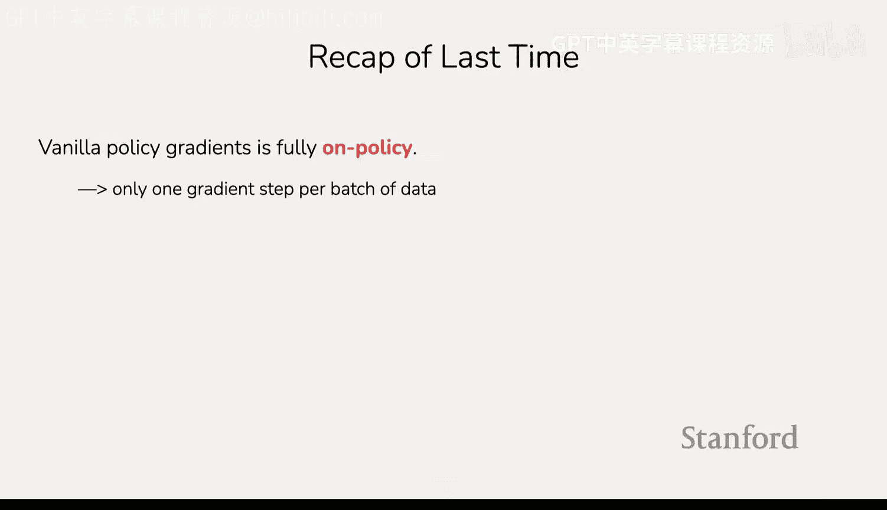

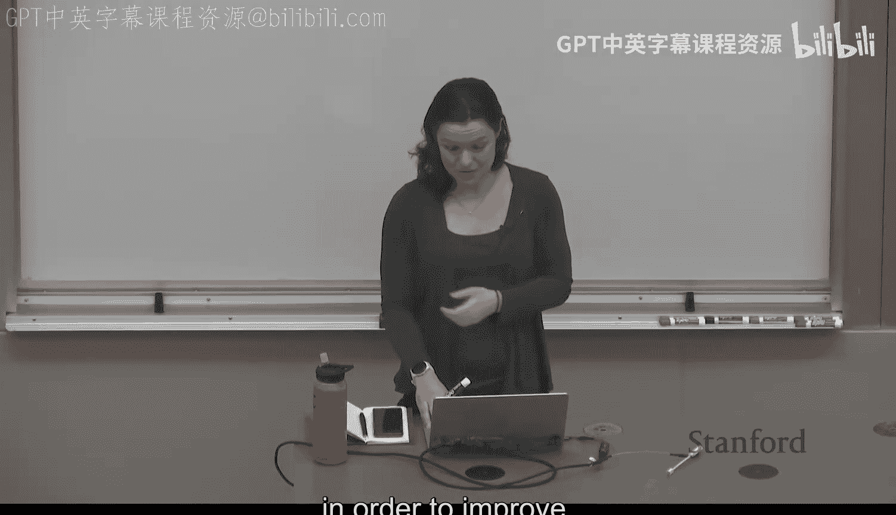

This kind of brings up this notion of having on policy versus off policy algorithms that can reuse data from other past policies。

And we started to look at ways to make an algorithm off policy。

 and in particular we talked about using importance weights where if we weight the objective by the probability of the actions of the new policy divided by the probability of the actions under the old policy。

 this is a way to get a estimate of the gradient for the new policy。

I should also mention that importance weights， the math behind it is very simple and very nice。

 but it's important to remember that this isn't a silver bullet。

 this sort of approach is only suitable when the policies are very similar to one another and if the policies are very different。

 then this ratio will get very large or very small and you'll also just have a worse estimate of your gradient。

Okay， so today we're going to be talking about a form of algorithms called actor critictic methods that build on policy gradients。

 and we'll talk about as part of this， we'll be talking about how to estimate the value of a policy and then we'll introduce an off policy variant of the algorithm。

 and these actor critictic methods are the basis for algorithms like PPO。

 which are used to train language models and that are used to train like humanoids in simulation and so forth。

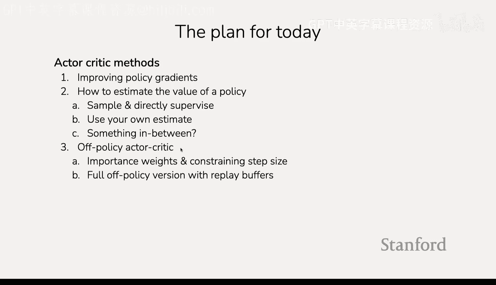

Some very， very useful R algorithms。

And then the key learning goals for today is how to estimate how good a state in action is for a policy。

 this is called policy evaluation， it's very a critical aspect of a critic methods but also useful more broadly and then also talk about how to use those estimates to form a better reinforcement learning algorithm。

酷。U。So let's get started and to talk about these algorithms。

 we need to revisit some very useful objects that we talked about in the first lecture and specifically this is value functions。

And so。A value function is representing how good a estate is if you're going to follow a policy starting from that state and you can think of it as the sum of rewards。

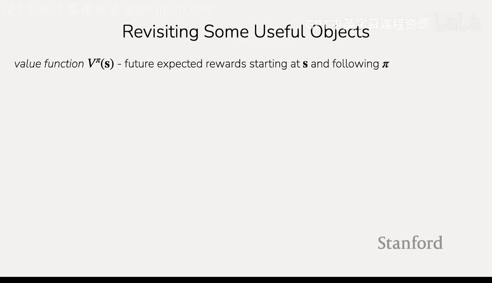

Starting from used to write ingredients， starting from some states。 So we'll write this as。V pi of S。

 this means that we're going to be starting at state S and then running pi。And for a given。State。

 this is equal to the sum of rewards， if we were to。Start at a。State tea。

And go to the end of the trajectory。And here's the sum of。Rewards， no。

 this sum of awards is going to differ depending on what state we start at and depending on what policy that we're running。

 And so this is going to be。An expectation。Of。Under our policy。

 actually maybe it's easier to write this as the expectation on the inside。

 so this is an expectation over the state's ST prime and actions A prime that will be visited under our policy。

And conditioned on the fact that we're starting at state ST。

So we can think about the value function as this， just in terms of math。

 what you can think about this as is or just in terms of like conceptually or in terms of intuition。

 if you have some trajectory and you're thinking about the value of this state。

You can think of it as if we were to collect a lot of different trajectories starting from that state from our policy。

And then we just。Summed up the rewards from this time step to the end and then averaged over these trajectories that would define the value of the state or how good the state is for the policies。

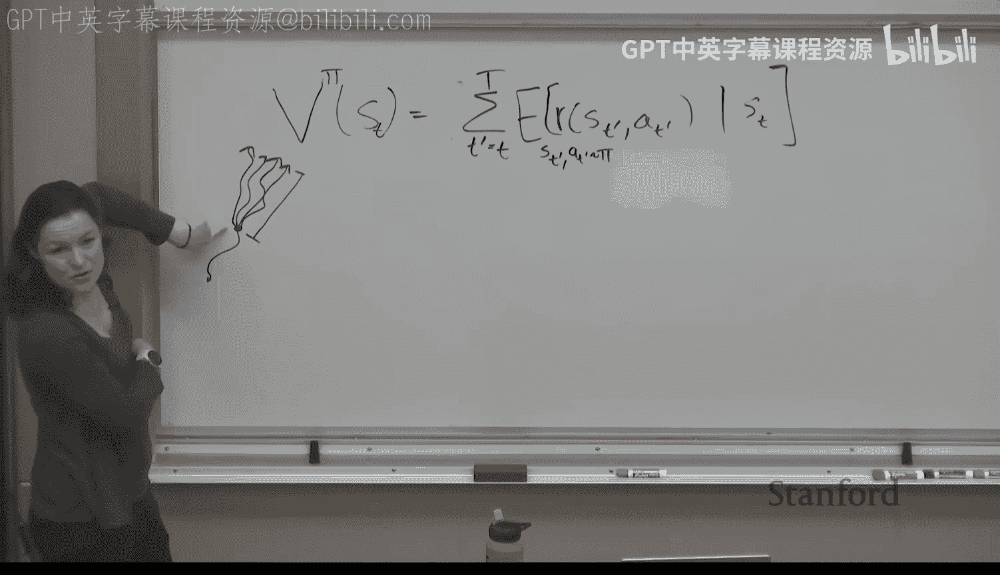

Another useful quantity that we'll be making use of is called the Q function and this is slightly different from the value function but very closely related and the difference is that instead of just thinking about the value of a given state。

 we're going to be thinking about a value of a given state and action and what this is referring to is if you were to instead of starting at S and then running pi from there。

 if instead we were to start at S， take a particular action A and then run the policy。

 what is our expected sum of rewards。

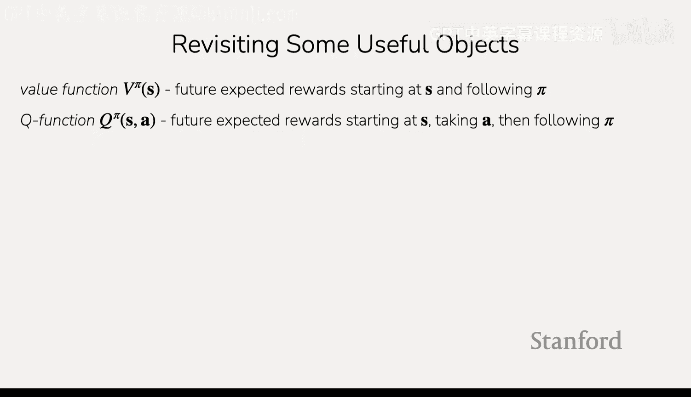

And so then you can think of this as instead of。If a picture like this。

 say we had some state s that we considered and first we're going to take some given action。

 this may or may not have been what the policy would have been likely to choose。

This action could actually also lead to different states if the because the the。

Environment is stochastic。 and then it's。The sum of。These rewards on average。

So this is what V looks like， this is what。Q look like for a given accent。

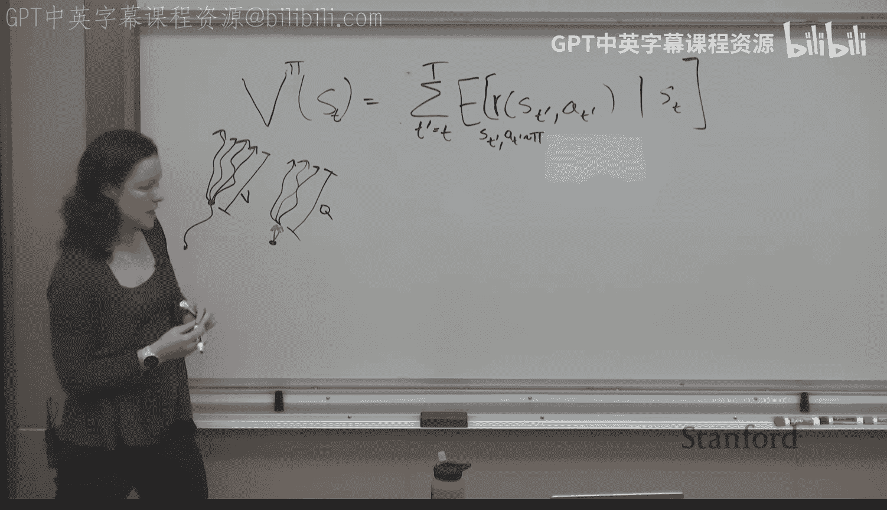

So here are some pictures on the slide。 so if we take start from state us run our policy， we。😊。

Compute the expected sum of the rewards along these trajectories。

 then that gets us the value of a state。And then if instead we take action A first and then ReI。

 then we get the key values and it's just the sum of the rewards if we had started with action A。

Now one last one thing that's useful to think about in terms of how these two relate to each other is you can think of the value of a state as if you take an expectation over the actions that the policy would have taken。

 you can think of it as the average or the expectation of the Q values over all the actions that the policy would have taken。

And then one last object that we'll use today is thinking about。

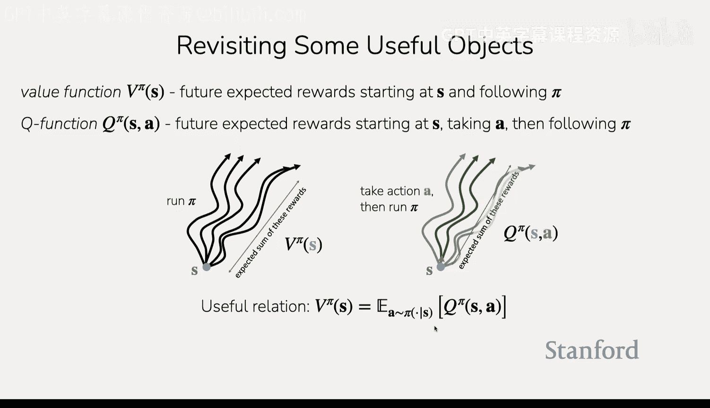

How good is a particular action relative to other actions that we might take？

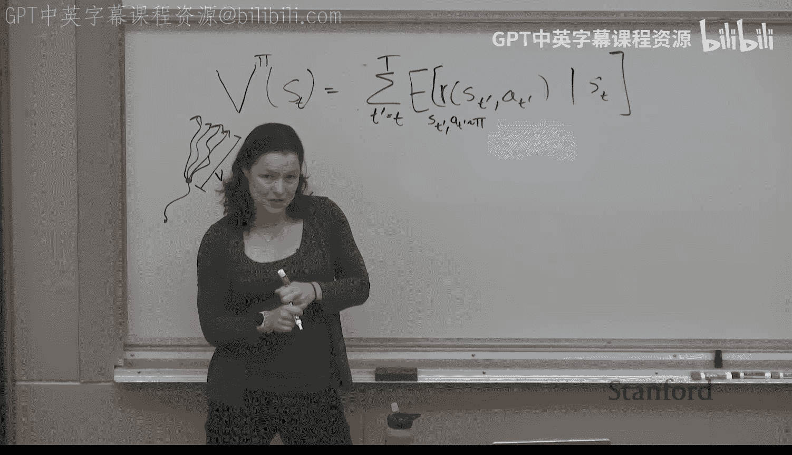

And for this， we can think about。Like， what is if you。

If you consider the Q value minus the value function。

 that's going to tell you like how good is it to take action A versus following the policy at a given state and this kind of like what is the advantage of。

Of taking one action versus following the policy。

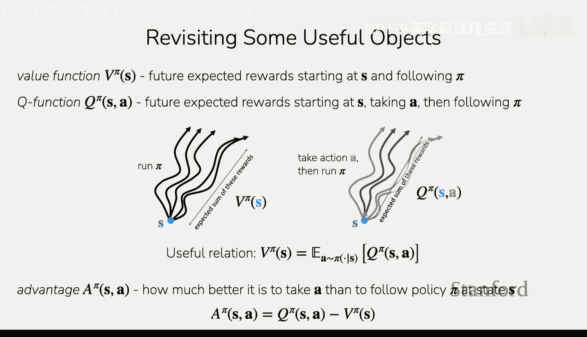

Great question， so the question was is there a normalization between V and Q？

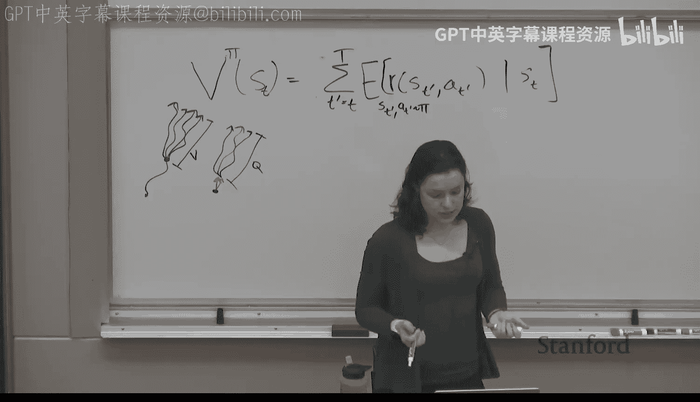

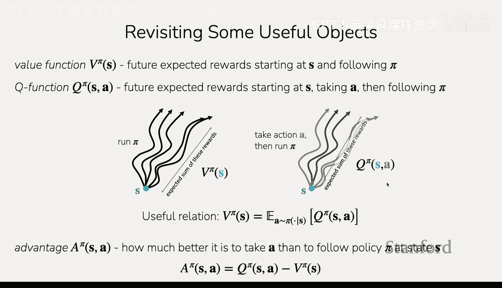

You can think of an expectation as an average， and so in that sense。

 there is going to be a normalization because if you were to like， for example。

 try to estimate this expectation with samples， you would take some number of samples if you only use these two samples to estimate Q。

 then you would divide by two versus here if you're using five samples， you would divide by5。

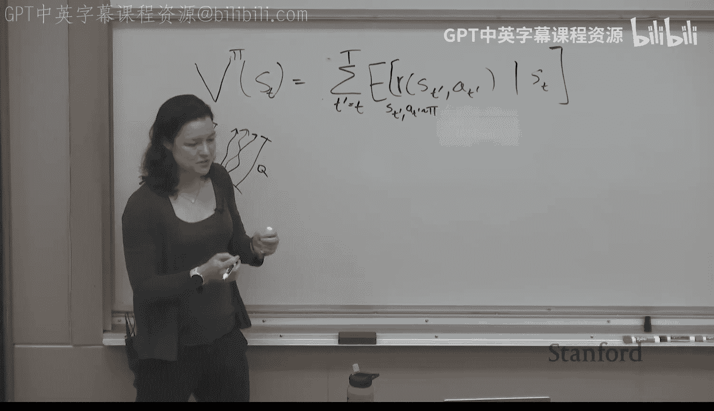

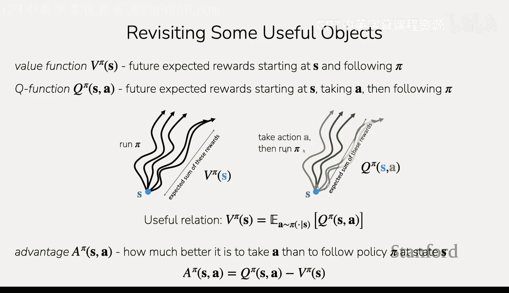

Is there a way that you can get from this equation to the useful relation on this slide？

That would you asking。Yeah， so the， if you write out。The so if you write out。

 we can write out first what Q pi looks like， so。Cupie of。A given。State and action。

 We're gonna assume that we， we're going to condition on S T A， because that's where we're starting。

 And then this is the expected sum of rewards， if we。So a sum over t prime equals T to T。

 and then we're going to have an expectation of running the policy。Here and then a sum of rewards。

And then in terms of seeing。The like how to get between these two things， this is a。

You can think of this as a sum of rewards of under A sampled from or kind of future actions sampled from pi whereas this one A is not sampled but from pi but all future actions are sampled from pi in this case we're kind of conditioning on on the action that's kind of provided as input and this case we're sampling from the policy and so if instead you sample the。

The action from the policy and then feed that in to here， then you'll get the then you'll get。

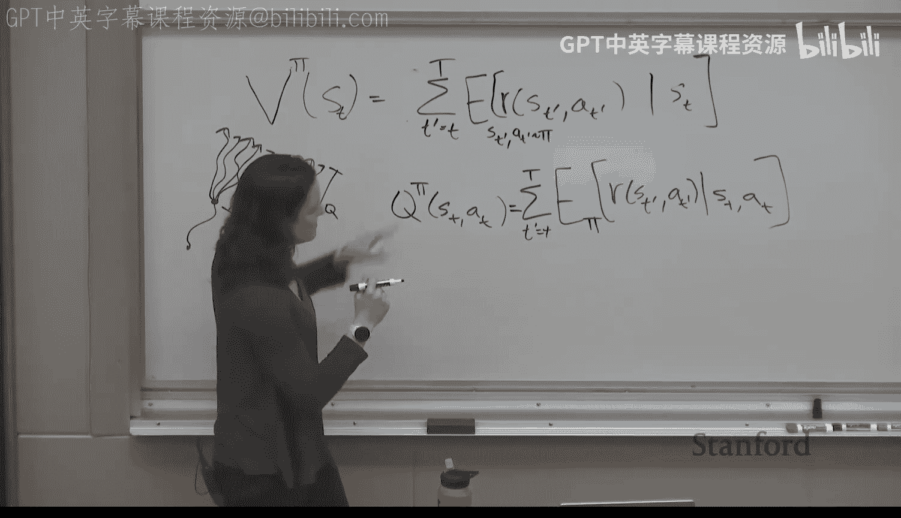

This right here。Okay， so to help you start thinking about some of these quantities。

 let's look at an example。 and so say that you are this。Person right here。

 you really want to learn how to play the drums and your reward is one if you can play the music in a month。

And zero otherwise。 so capital T is a month from now。And your action space。

 you have three different possible actions in your action space。

 one action is to like sit on the beach， another action is to watch TV and another action is to practice playing the drums。

And say that your current policy right now is just to sit on the beach and you do that for all states。

Now， my question for you to think about is。What are each of these quantities for？

The action of a1 for the action of a2 and for the action of a3。

 and so specifically you want to think about what is the what is the value function of your current state for this policy。

What is your Q function？For if you were to follow each of these actions and once and then follow this policy。

 and then what is your advantage function。for the current state that you're in and for each of these actions and you can assume that in the current state that you're in。

 you do not know how to play the drums what was described is for the value function for this particular policy it does always sit on the beach。

 the value is zero because the person would not learn to play the drums so that's the sum of expected rewards for this policy for VP for the Q function if you sit on the beach at the current time step or watch TV the Q function will be zero for those actions whereas if the Q function for playing the drums at the current time step would be one if that amount of practicing is sufficient。

 it's also possible that it would be a bit lower than one。

 if you for example practice for like like an hour and then sit on the beach by following the policy afterwards。

 it kind of depends a little bit on what the time。

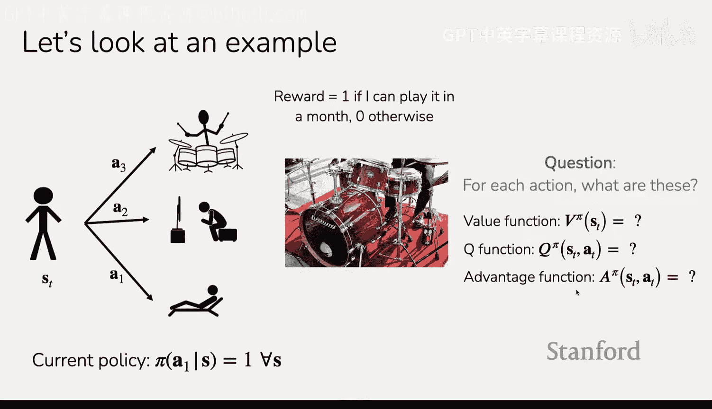

kind of how long a given time step is， and then the advantage function is going to be Q minus v。

 and so it's going to be a positive number for the action of practicing and it'll be zero for the other two actions。

😊。

Yeah， so the question is， if practicing is like not enough to actually learn would it be one。

 would it be between zero and  one， would it be zero？

It basically actually represents the probability in which you would be able to play this given that you had practiced for that amount of time and that probability it could be zero like maybe this is like really really hard after just practicing once it could also be like maybe for someone who's like extremely talented。

 they only need to practice once is that could be a bit higher for someone that's like a bit more talented it depends on various factors like that。

 yeah， kind of along those lines if you think about the value function for like if you're playing like a game of chess。

 for example， the value function is the probability that you're going to win。

for a given person and for a given game state， so it's kind of evaluating how good is the state for a particular person that's another way to think about it。

Okay， cool， so those are the objects that we're going to be using quite a bit today。

Now let's go back to policy gradients and see how we can use value functions to make this algorithm better。

So we talked about a couple examples on Wednesday of some scenarios that were dissatisfying about policy gradients and the first was that if we are trying to learn how to walk and we have a policy that takes a small step forwards and then falls backwards we will push down the likelihood of taking a step forwards because we don't necessarily know that might have led it to fall backwards。

Now if we actually had some understanding that taking a small set forward was making progress was actually good was advantageous。

 then we might be able to actually increase the likelihood of that and so this is starting to hint at some of the intuition behind actor critic methods。

And likewise， we talked about this example of trying to fold a jacket and we found that if you have a sparse reward where and you only do part of the task like folding only the sleeves or plating the jacket but not folding it。

 you aren't really utilizing the trajectories that are getting zero reward。And。

K of similar to this case， if we instead kind of understood that these actions are advantageous for making progress on the task。

 then we might actually be able to figure out how to use these trajectories in a positive way。

And so kind of to summarize here， policy gradients don't always make an efficient use of data that we've collected。

 and if we can try to figure out what actions are advantageous versus not advantageous。

 we might be able to make better use of that data。

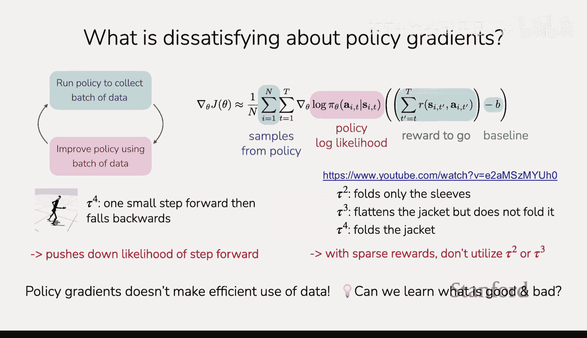

So the question was if it's not clear if a step if a step forward is helpful or not。

 is that going to be negative or neutral in the case of the policy gradient。

 in case of this policy gradient algorithm。ThisThe trajectory that we considered here in the context of the batch of reories was kind of net negative was below average because the reward to go is quite negative。

 it's actually making backwards progress in this trajectory。

And so it actually is going to be pushing down the likelihood of taking a step forward because the future of reward to go is negative and what we'll talk about today is algorithms that in principle could actually increase the likelihood for taking the step forward and decrease the likelihood for falling backwards。

Okay。So how do we do that？A lot of what we'll focus on today is this piece right here。

 This is what's actually telling us that we should push down the likelihood if we have negative rewards in the future。

嗯。And this quantity， it's estimating the future rewards if we。Take action A and state that。

And so we can kind of think about it as in this picture right here。

 it looks a lot like what is the sum of rewards if we started right here with state S and action A。

And then if we think about this picture。We were looking at this quantity in terms of like what we observed in trajectories。

 but what would be an even better version of this quantity would it be to actually use the Q function？

And if we can replace this with a Q function。

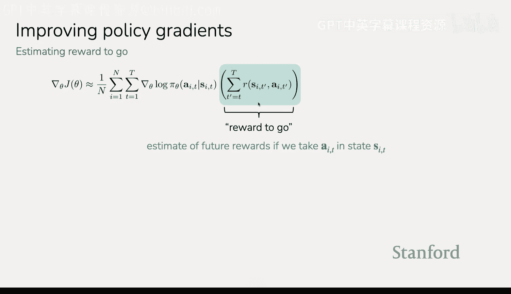

Then we would be able to get a much better estimate of whether or not we should push up the likelihood or push down the likelihood。

And so looking at the slides right now， what we do is we for like a single trajectory。

 we sum together the rewards that we saw， which was in the case the example before。

 the rewards were negative because we took a small step forwards and then fell backwards。

But if instead what we could do。Is actually run the policy many， many times and get a Q function。

For this state。That would be the true expected rewards to go under the expectation of our policy。

 and this would be way better。 We'd be able to get a much better sense for how good。

How good it was to take that action in that state。Um so。

Essentially the form of the gradient would be able to get a much better gradient if the form of the gradient looked like this。

 where we increase the likelihood of the actions for things that have high Q values。

 and we decrease the likelihood of the actions for things that have low Q values。

So that's kind of a first step。Now， taking things one step further。

We also talked about baselines in the previous lecture where the baseline was the。Average reward。

 should we use a baseline here？So before the baselines were the average reward。 and so in this case。

 if we were to introduce baselines， we could think about what we might use and。

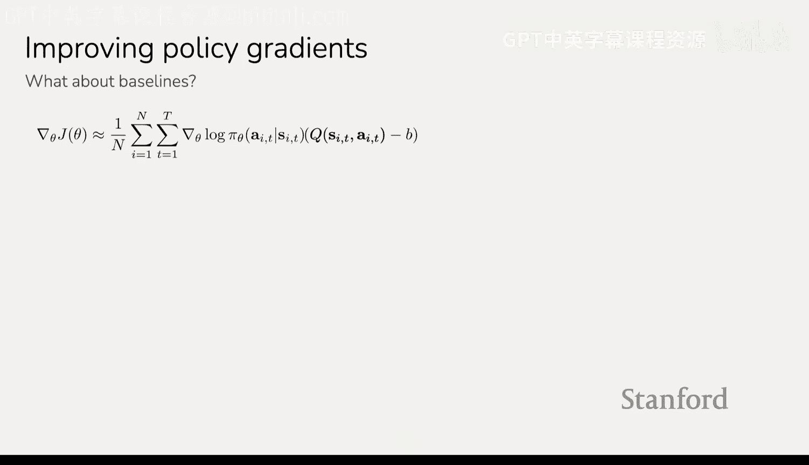

If we use the same thing that we used before， we could use like the average。Q value in this case。

 so we could use。A。An average。Like maybe we sample some SI and AI and we average。Over those。end。

What we had talked about a few slides ago is actually this is actually looking a lot like。

The value function， so we talked about the value of a given state is an expectation over actions sampled from the policy for that given state。

Of the Q function。For those actions， this is VP。And so。

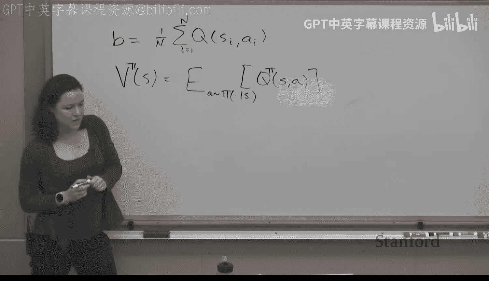

A natural baseline would actually be to use the value function。And so。

We could have instead of having this V Q values， we could actually use Q minus v。

And P minus v is what the advantage function is。And so putting this together。

 we would be increasing the likelihood。For actions that have a high advantage and decreasing the likelihood for actions that have a low advantage。

And so then if you think back to the example of learning to practice playing the drums。

We would be increasing the action of practicing had a high advantage relative to the current policy。

 and then we would choose to increase the likelihood for practicing and decrease the likelihood for the other actions。

Co， and another way to think about this is that better estimates of this advantage function will lead to less noisy gradient。

And if we knew the true advantage function that we would be able to get a very， very good gradient。

 unfortunately we don't know the true advantage function。

 and so the next question that we'll talk about over the next several slides is how can we estimate the advantage function？

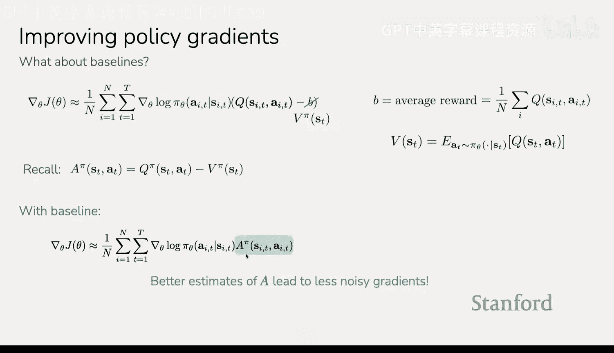

Right， so the question was like like how is this different different from like how we're sampling in the original policy gradient and so what we're using before is we were doing this like we would take kind of one sample and then for like a given state in action。

In that trajectory， we would sum the rewards just for that individual thing。

And now what we're saying is that instead of and this is going to be like a very noisy estimate because we just have one trajectory here。

 we just have one data point to estimate these rewards and now what we're saying here is that we're going to try to get a sense for what the advantage of this action is。

No。One way well we'll actually start to talk about how we do that in a minute， but if you。

 if you want to think about what is the true advantage of this action conceptually if you were to。

Take this state in action and then roll out the policy an infinite number of times for this action versus for following the policy and other scenarios。

 that's what would give us the advantage。Yeah， so the question is in policy gradient we were we got to where we were by optimizing the expected sum of rewards does this also optimize some objective so this is also optimizing the expected sum of rewards it's actually optimizing the same exact function。

We haven't talked about how to get A yet， but if you had a perfect A。

 this would also like this would be giving you the correct gradient for that objective。

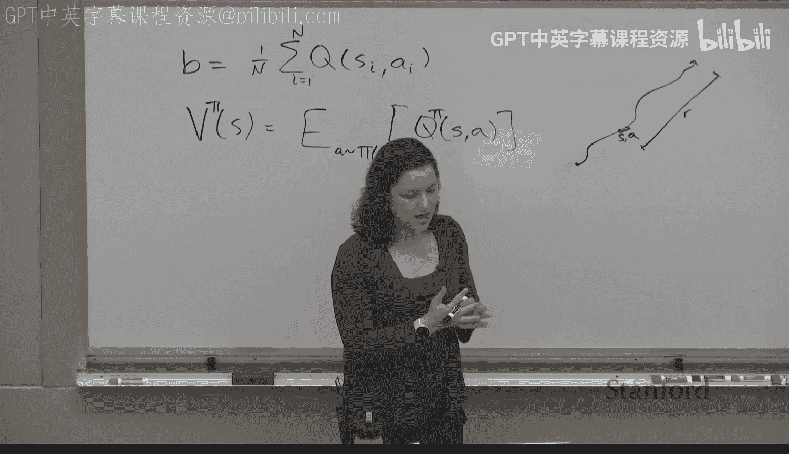

Um。Modullo kind of the sampling here being used to sample states and actions。

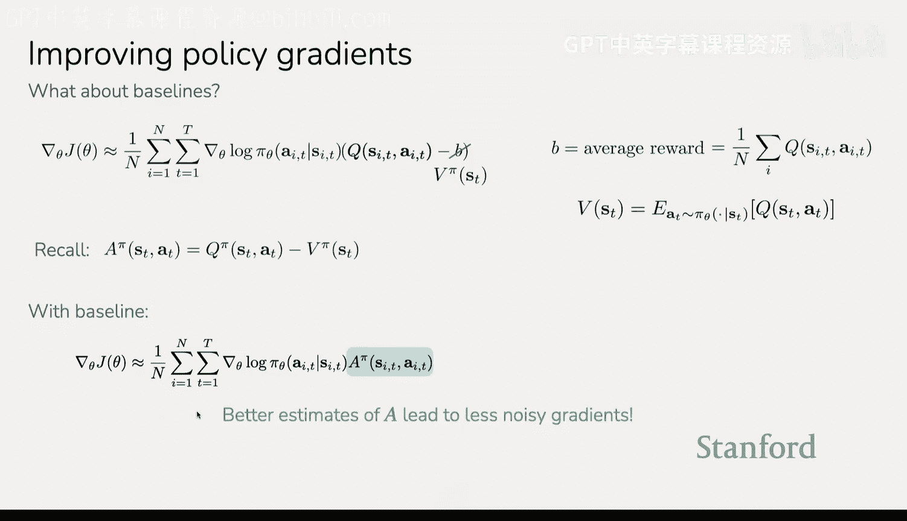

Is the baseline an average over the current trajectory or an average over all trajectory？

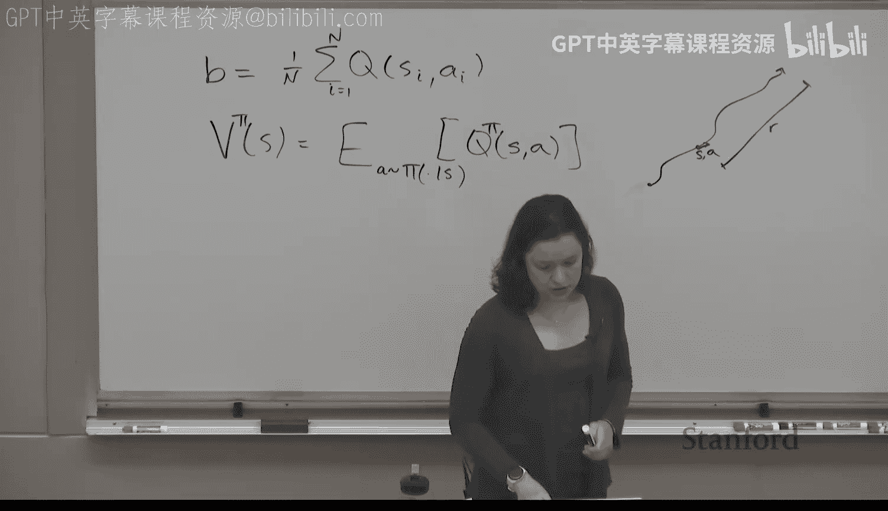

Yeah， the for the。So if we set it to be the Q function the value function V that would be like an infinite number of samples。

 we haven't yet talked about how we're actually going to estimate a or estimate Q versus V so we'll talk about that in a minute。

 but yeah4 v like if the conceptually that would be like over an infinite number but I'm talking about like this is the true value so far we haven't talked about how to estimate the value yet。

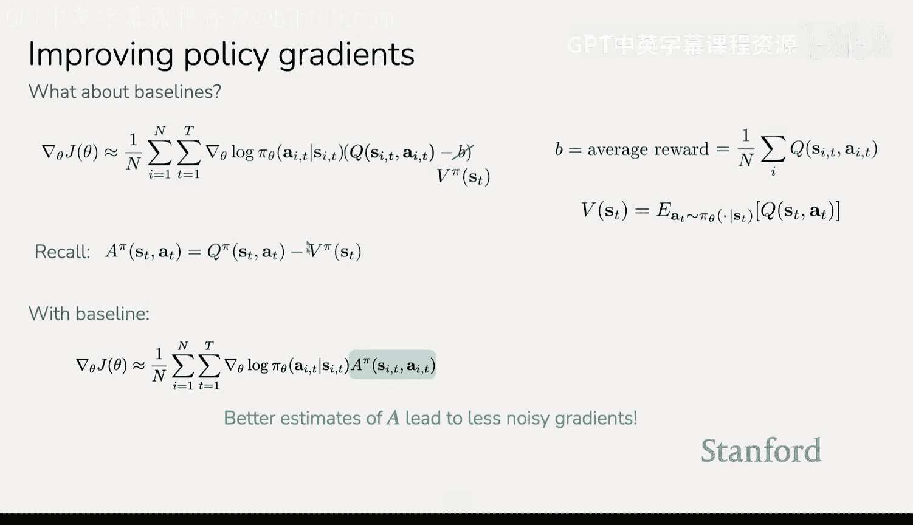

Yeah， so the question is is this unbiased， it isn'tbiased， you can go through the math。

 I won't go through that today for the sake of time， but yeah。

 this is an unbiased estimate of the gradient if you have the true advantage now we will see things that are biased later today。

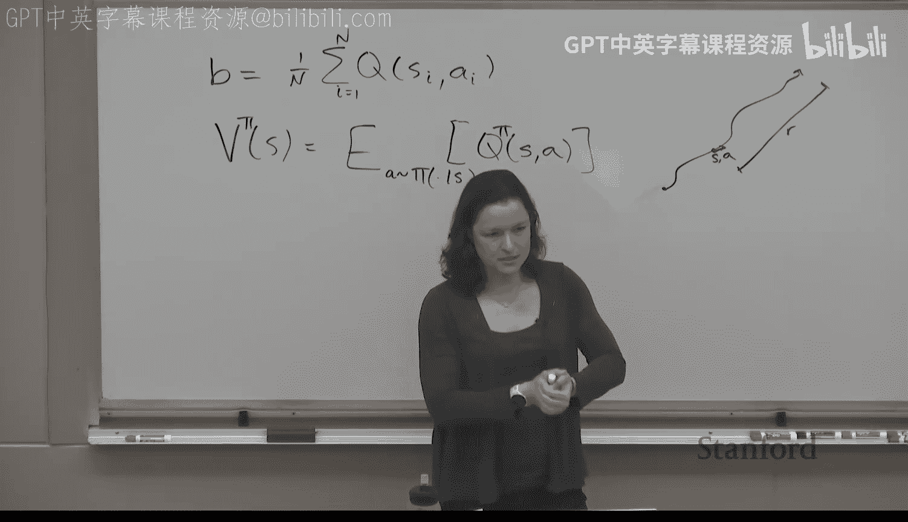

Okay so let's actually talk about how do we use this and actually just as a quick overview of what the algorithm will look like for this form of algorithm before we had this loop between running the policy and improving the policy。

 now we're going to have an additional step。Where we're going to fit a model that's going to estimate the expected return。

 And essentially is's going to try to estimate this A right here。

And so our new algorithm will have a few different steps， one is to run the policy。

 one is to try to estimate values， and then the last will be then to use that estimate and the data that was collected to improve the policy。

And so this step will involve estimating either V pi， Q pi or A pie。

And this step will be kind of similar to before， except it's going to use these estimates right here。

Okay， so let's get how do we actually estimate these values？

So we want to estimate this this quantity right here and。To start out。We need to think about。

How we want to get to Api？And we could try to directly fit a pie。

 although it's actually a little bit challenging to get direct supervision for the advantages。

And so we're actually going to try to。Fit V P。 And the way that we're going to get there is。

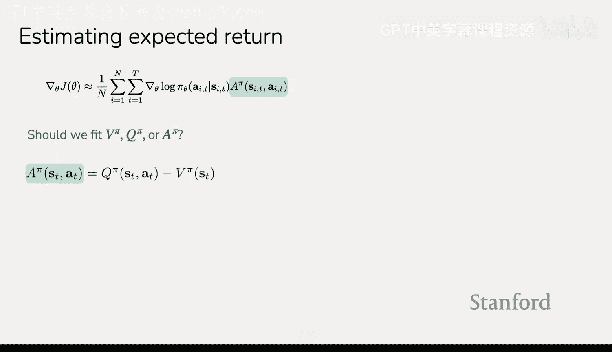

We let's see， where do we want to go？U。We know that Api。Of ST A。Is equal to the。Que value。

Minus the value。And so。One option is we could try to estimate these two。

 although then wed still have to estimate two objects and。

There's actually a way to turn this into an equation that actually only depends on VP。

And that would be nice because then we could just only fit V pie and then derive a pie from there to get the gradient。

And so to do this， we can think about。呃。Ce pie right here and。This Q function。This is the。

 the value of starting an at S， taking a and then summing the rewards。

 And so you can think of it as the。Reward at。The current time step that you got。Plus。

 the rewards that would come after that。And in terms of the rewards that would come after that。

You'll have some next state S plus one。And so you can think of it as。There's some next state。

 you don't there's actually some this next state could be a few different things depending on your environment。

 so this would be sampled from。The dynamics of the environment。And。Then。After this state。

 it's essentially going to be the sum of awards starting at ST plus1 and following your policy。

And the sum of rewards starting at sorry， this should be S plus1。

 the sum of rewards starting at S plus one。That's equal to the value， right， the value of S T plus1。

So we can。Write the。U。This Q value is the reward at the current time step plus the value at the time step after that。

Now， we can't sample from these dynamics。 but when we ran our policy to collect data。

 we did actually see one outcome，1 S plus one。 And so we can approximate this as。

The reward at the current time step plus the value。At the next time， so。

And then if we want to estimate the advantage， we can write it as the reward at the current time step plus the value at the next time step minus the value at the current time step。

And so。Maybe I'll give this a different color to differentiate it。Now， a pie can be written as。

Of ST80。Can be approximated as our。The reward that you saw。Plus。

 the value at the next time step minus the value at the current time step。

And so if we then have an estimate of V。For our policy。

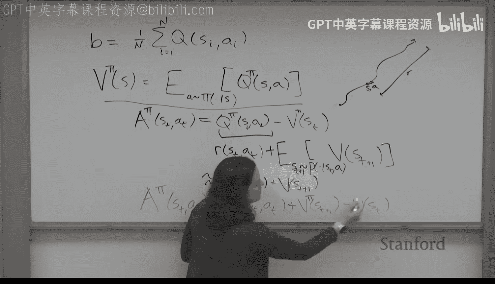

Then we can estimate the advantage and we can just try to directly fit the。

And so on the slides what this looks like， we have Q。

 Q can be written as the expected future rewards and which is the reward at the current time step plus the future rewards。

 these future rewards are can be written as the value。

 and so we can think of Q as the reward at the current time step。Plus， the value at the next1 step。

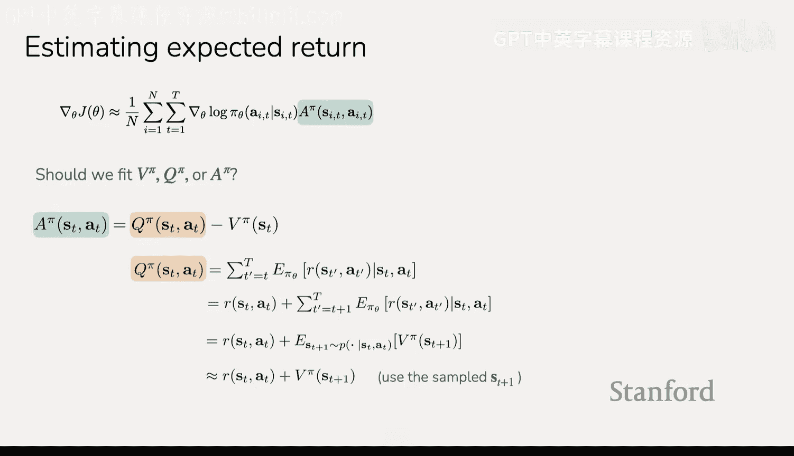

Um。Yeah， so why is the second to last line， why is this an approximation the reason for this is that the next state。

 there's actually multiple possible next states and we're just going to use one sample from this expectation。

 which is the sample that we saw when we rolled out the trajectory in our data and if you wanted an exact thing you would need to estimate this expectation with like infinite sample。

How good of an approximation is this So it is going to be a single sample approximation。

 the the good news is that later on we'll see ways to use lots of data to do this and so。😊。

It's in general， well so I guess the first thing is that if you're if this is very deterministic。

 it's going to be first it's going to be a good estimate because there aren't that many futures。

 if it's more stochastic then it's going to be a worse estimate and then we'll see ways in which we can use data and take lots of gradient steps in a way that makes it not too bad。

So the question is is there any new interaction with the environment so I guess we haven't yet talked about how to fit VPI。

 so we will talk about that in the next slide。Yeah， so you'll have some， if you have some trajectory。

 the this will be like the S T A and S T plus one in your trajectory from the same trajectory。 Yeah。

 so you need to use the same trajectory for this and I。

Sometimes I forget to put the pie on here and there is a lot of reinforcement learning work that drops the pies just for simplicity。

 but it is actually in some ways very important to have a pie there because it is estimating a value for a particular policy。

 not for any policy。So the question is why are we choosing to estimate V versus Q versus a。

 It's just a little bit simpler in practice， but you can also。

There are also ways to directly estimate Q， and actually we'll talk about some of those ways next week as well。

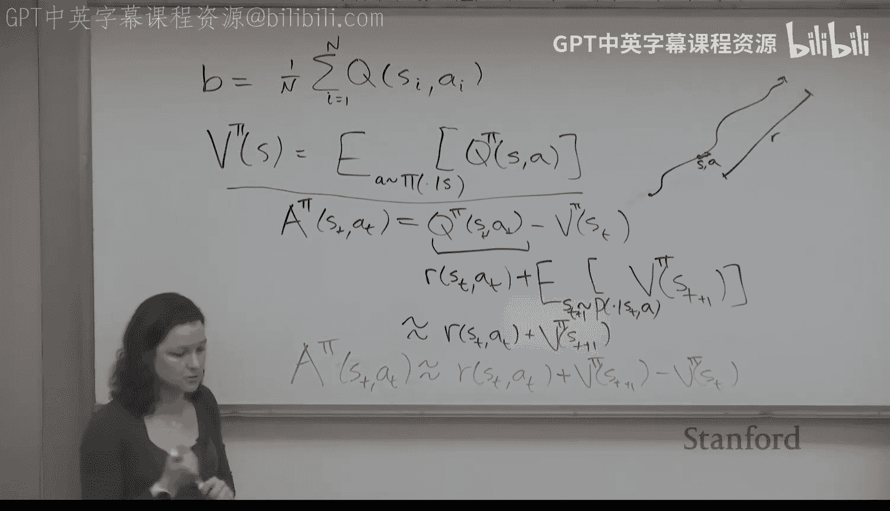

Okay。Cool， so we're just going to fit V P and then once we fit VI。

 we can get the advantage and then plug that into our gradient for our policy。

you can represent V P as a neural network and what this will look like is we'll pass as input a state and then it will output a single scalar value。

 not as pictured here， that's a single scalar value that represents the value of that state for that policy。

😊，This neural network will have some parameters。So how do we do this。

 So there's a few different ways to estimate。B5。嗯。The first version。So in the very。

 very initial version， like of vanilla policy gradients， we just used a single trajectory。

 a single sample， and we kind of。Instead of actually learning a model， we just use that sample。嗯。

In principle， we could also。Use many samples and then。And then yeah use many samples。

 unfortunately if you were to try to go to a particular state and then take many samples from that state。

 that means that you would have to be able to kind of reset the world to that state and。

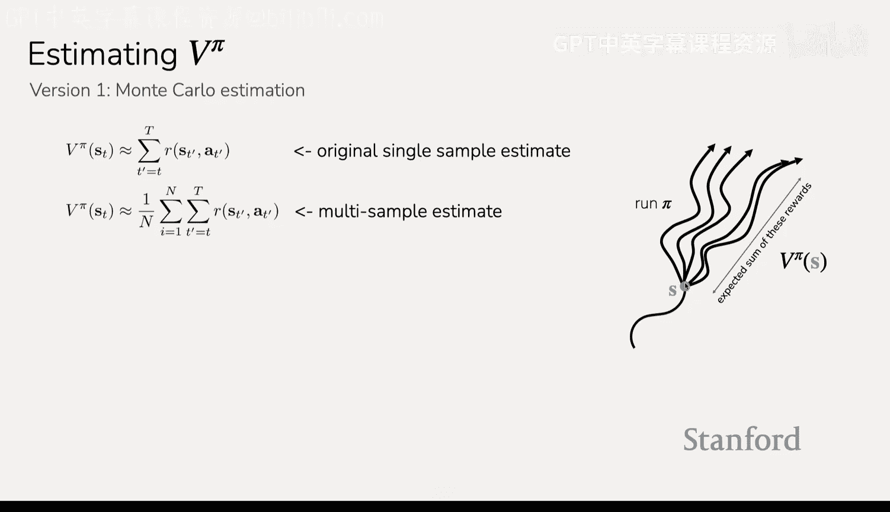

Kind of see what happens if you took many different rollouts from that same state and unfortunately in many scenarios it's very hard to reset the state if you are in kind of simulated settings sometimes you can actually reset the simulator so there is sometimes scenarios where you can do this。

 but in practice we typically don't do this。

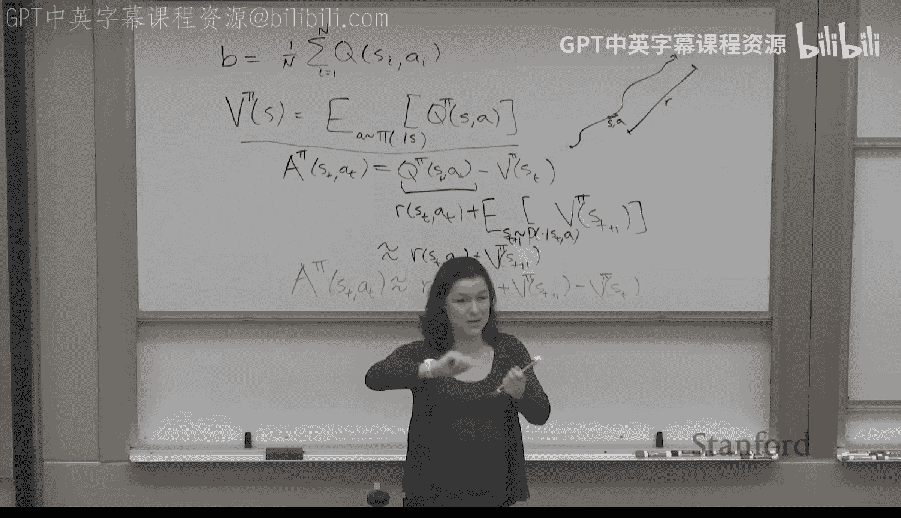

嗯。So since we can't like kind of directly reset and take lots of samples。

What we can do is we can use multiple  trajectories that we had sampled and just train a single model on the original single sample estimate。

And because our kind of the trajectories that we have。

 they will have some states in them that are similar。 you'll be able to。

Essentially learn how to kind of like amortize the the data。

 so you'll see you'll see some examples in the environment that have very similar states and have kind of corresponding。

fuuture rewards in them and with that repetition in your data。

 a neural network can actually learn kind of have a little bit more density in terms of the rewards that you'll see for a given state。

And so what this is going to look like？

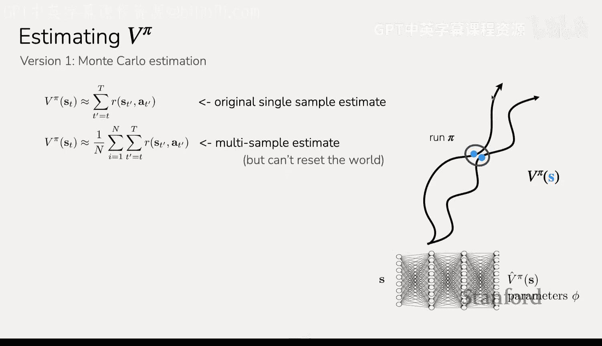

Is you can take your data set？And。For all of the。Um，You'll have like。

I equals one to n trajectories and each trajectory will have time steps in it。And for all of those。

Introjectories and time stepss， you'll also have some sum of rewards that you observe for that。

So you'll have。Some some of the wordss that started。T to the end。Of the。Wewards of the states。A。

And actions that you visited。And for if you aggregate kind of all the trajectories in your data set。

 you can train a model to go from the state that you saw to the sum of rewards that was observed when you ran the policy。

And you can with this， you can kind of form a supervised learning data set。Where this is。

The label in the data set。And you can train with supervised learning a model to take as input this and output this quantity right here。

And the number of data points in your data set will be the number of trajectories times the average number of timets。

Yeah so the question is each time your policy changes。

 do you have to kind of recollect the data and refit this with this approach， yes。

 we will see approaches later， this is like the simplest and kind of dumbest approach you can use to fit a value function。

And we will see approaches where you can kind of reuse other data。Yeah， so the question was。

 if we're going to be running a lot of kind of simulations or rollouts of our policy。

 is it like unreasonable to try to learn some estimate of like future states given the current state in action the。

Two things here， if you have a very simple state space， a very small state space。

 you might be able to kind of store some things and kind of form an estimate just from story things。

 you could also principle train and neural network to predict what future states would be given current states and actions there are a set of approaches that use those that do that and they're called model based approaches and that they're learning a model of the world and we will talk about those approaches in a few weeks。

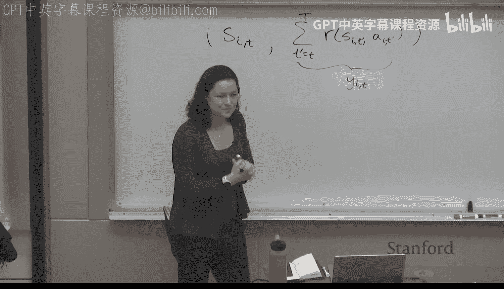

Okay， so。This first approach is just to aggregate well kind of run a bunch of samples。

 aggregate a data set of our future rewards。And then run supervised learning to fit an estimated value function where you can form a kind of an L2 error between your predicted value and the observed sum of reward。

And then minimize that with respect to the parameters of your value function。

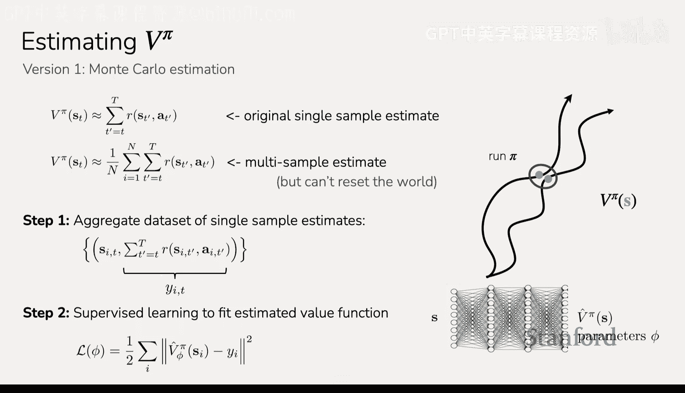

And so。What this objective looks like is。Minimizing with respect to your parameters。

 the difference between。Your。Predicted value and。The example or the sum of wordss that you saw in the data set or a given eye。

And you'll do this。For all of the。Data points in your inner data set and so this actually can also be a sum over INT just for completeness。

So that will be kind of the objective and you can run gradient descent on this objective to fit a value function on your data point。

Do we need to train a neural network for every gradient step in this case so this is actually different from policy gradient where we when we change the gradient steps here that we take are going to be trying to fit a value function and the value function isn't changing the policy and so you can actually take many gradient steps on this objective to learn a value function without having to recollect your data。

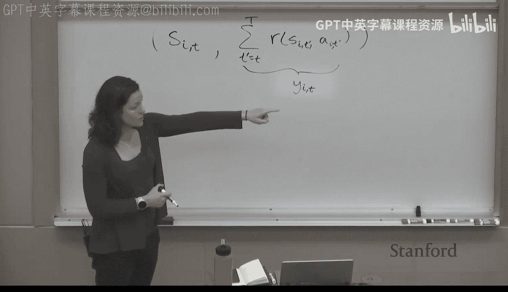

Cool， so this is the simplest approach for training of value function。

 it's called Monte Carlo estimation where essentially you're just， yeah， running lots of simulations。

 running lots of rollouts， and then trying to learn how to predict the outcome of the future rewards。

😊，Now， there's actually an approach that's better than this。And in particular。

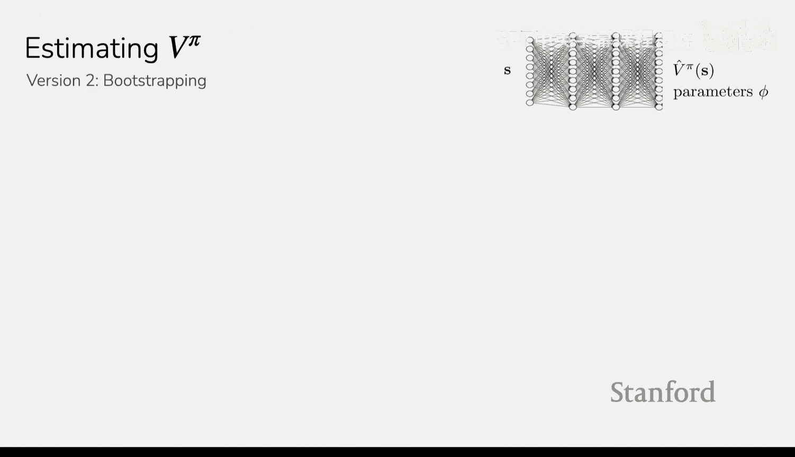

When we think about these summer rewards， maybe it's helpful to draw a picture in this case。

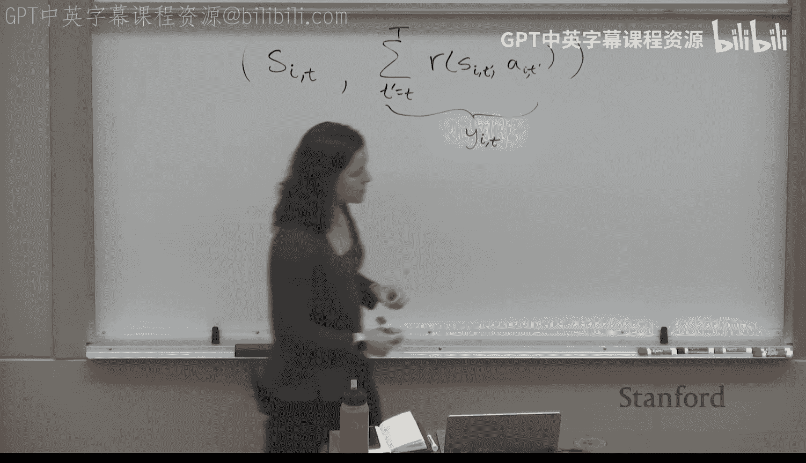

U。So we have like a bunch of trajectories。That we have sampled。And。In this case。

 what we're doing is when we have a kind of a state right here， we are。

Summing the rewards here as the value。And。As we're learning this。

 we're kind of starting to learn what the value is， what the value of a given state is。

And this means that。The like maybe halfway through training when we're regressing to future rewards。

And if we start to get kind of what is a good value of like this state right here？

That we could actually try to use our own estimate of this value。As the supervision target。

in particular， if we know that the reward， we got a reward at this time step right here to then get the here。

Then we could actually use that reward plus our estimate as the supervision target rather than just using the sum of futureture reward。

And so in particular。A。The ideal target is the sum of like the true sum of expected rewards。

 this is equal to the reward at the current time step plus the expected rewards at the next time step。

And。This is equal to the sum of rewards of the next time step is equal to the value of the next state。

And so in principle， what we could do is instead of trying to regress to future rewards。

 we could regress to the reward。

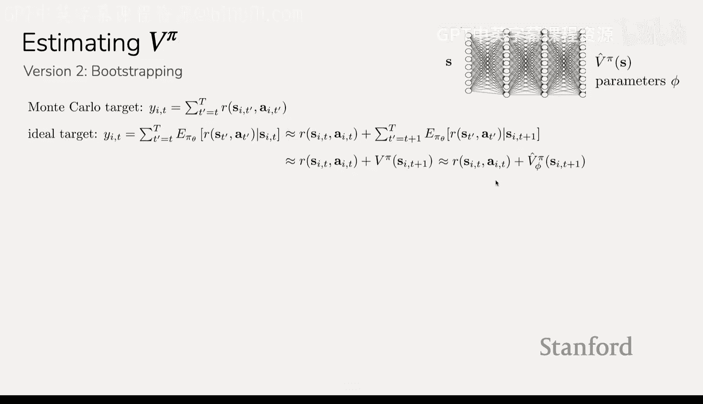

At the current time step， plus the value。At the next time step。

And so we're actually going to be in this case， using our estimate of the value at the next time step as part of the supervision target。

 So this would be。These are all for a given trajectory and this would be。Your new。

Label for your data set for a given。6。Yeah， so the question is how often do you update these VPs in practice you can update them like every single iteration if it's like really expensive to update them。

 you could update them less frequently like if you have a really huge neural network。

 but in practice typically we update them every single every single gradient。

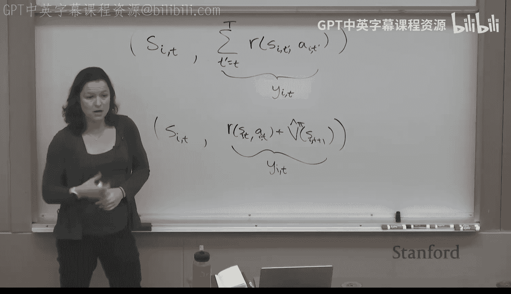

And so。We have these kind of bootstpped estimates， we refer to this as bootstrapping so we're actually kind of bootsshopping off of our own estimate of the value function as part of the learning process。

We formulate our training data， we're then going to use the same exact objective to fit a value function。

 just regressing to these targets， we just have different labels in our data set now。

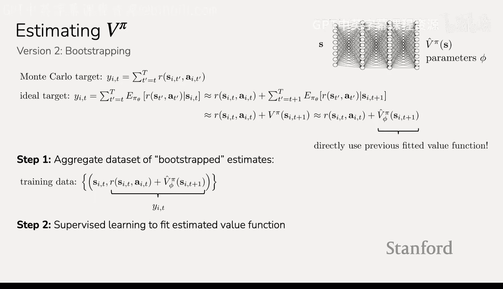

And these labels are changing as we。Our changing our as we kind of run gradient descent are our objective。

 and so you often will update your labels every single gradient update。

The question is is this based on like one trajectory or is this based on kind of multiple multiple trajectories where things are close together so this data set will be over multiple trajectories where I is indexing over trajectories and T is indexing over time inside those trajectories the in terms of this label this will be for a given data point and it will be。

😊，And it will be you're not going to be running multiple simulations from that data point。

 but you're going to be kind of estimating what would have happened from your future state rather than a single sample of what happened in that trajectory and so with this you're actually able to get a better estimate of all of the possible outcomes that might have happened at the next state rather than just one outcome。

😡，So you're asking， why is the input to the value function just S and not including previous tens？

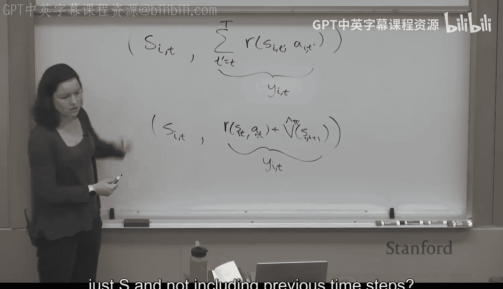

Oh， so in this expectation， this is representing so for。

The ideal target for our value function is the sum of future rewards and you can think about this sum of future rewards as the reward at the current time step。

 which is a deterministic quantity plus the future rewards for conditioned on our current state and so this is conditioned on the current state because the future rewards is a function of where we are right now。

 and it's actually only a function of where we are right now and not anything。

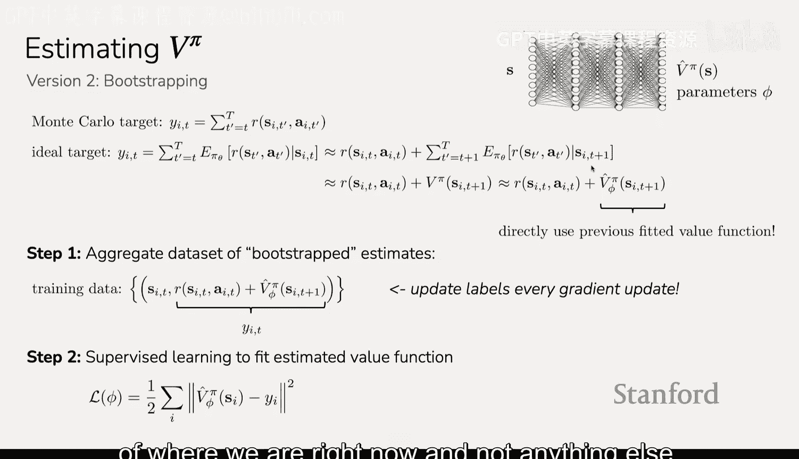

Yeah， so the question is does this require that you have like a good initial value estimate because if it's really bad at the beginning then your targets will be really bad there are some considerations when initializing it although oftentimes you don't need to do anything like super fancy to initialize it and you can just get started training on this directly you probably don't want to initialize your neural network such that like the values are like negative 1000 or something like that would be bad but usually we don't initialize our neural network that way anyway。

If I don't know if I've had practice seen any issues with this， but in principle。

 you could also start with a Monte Carlo objective just to get it in the right ballpark and then continue with this update after that。

So is this part of back propagation and is there a better way to than updating the labels every step so we'll be using back propagation to optimize that objective right there。

 you could also think about this as like propagating information backwards in time。

 which is distinct from like propagating gradients through the network。

 the one other name for this is called temporal difference learning where we're like looking at the difference between the kind of future time step and the current time step。

 the but it is like generally like kind of propagating information through time is like fairly distinct from back propagation。

😊。

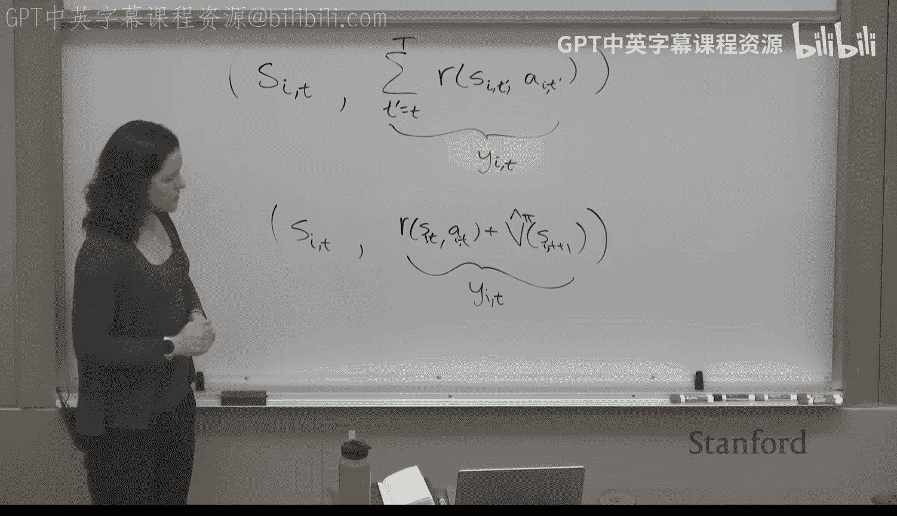

To summarize what we've talked about so far， Monte Carlo were supervising with the rollout sum rewards。

 whereas bootstping， we're supervising using the reward plus the current value estimate of the next state。

And if we look at an example。And actually， yeah， I'll give another kind of exercise for you to figure out。

 so let's look at an example。 so we have we've run the policy。

 maybe we just have two trajectories in practice we'll have more than this。

 but say we have two trajectories。One of these directories， the final reward was negative one。

 the other trajectoryy， the final reward was one。And along as directory before the final state。

 the reward is zero。My question for you is。What estimate would we get for two different states for the value function and in particular if we were training on just these two trajectories and we use Monte Carlo versus using temporal difference or bootstrap learning what would we estimate the value to be for the blue state for these two and what would we estimate the value to be for the pink state for these two Yeah so for Monte Carlo in the blue state it's going to average out the minus one and the plus one and so this prediction will be zero they want want to share another one？

Yeah， so for the Monte Carlo for this one， this will be negative one because it it will be kind of supervised to predict the sum of rewards for the future for this trajectory。

Anyone want to share？But we should wait maybe before we do that， let' let's talk about。

 do you I you do this one？I's a little bit more intuitive to go this far。Okay， yeah。

 so this will also be zero。And then does anyone want to do the back right？😊，Yeah， so for this one。

 it'll see this kind of blue one in the future， this will have a zero and then this will also be assigned the hot of zero。

😊，And so this is an example of where Monte Carlo and the Boshoprap estimate are going to be different。

 and arguably we get a more accurate estimate from the kind of bootsstrrap value because it's able to kind of look at its estimated the value and actually aggregate information across trajectories more effectively。

Why the Monte Carlo is minus one by the top right yeah。

 so the value for this one is going to be minus one because the Monte Carlo objective is supervising to the sum of future rewards that are observed for each trajectory and so for this trajectory which is black。

 it only sees the sum of future rewards along this trajectory but it only sees negative one and anything over here along this trajectory for Monte Carlo would have a target of one because it only sees the future trajectoryjectories here and it doesn't use it it doesn't bootstrop off of its estimate that was using all of the trajectoryjectories。

Yeah， so the Monte Carlo blue state， it's going to be that exact state is in the buffer or is in your data for both trajectories and so it's going to average the reward for them。

 but this is like the only scenario where Monte Carlo is going to is going to of get information from both trajectories because you have the same exact state in your data sets with two different labels。

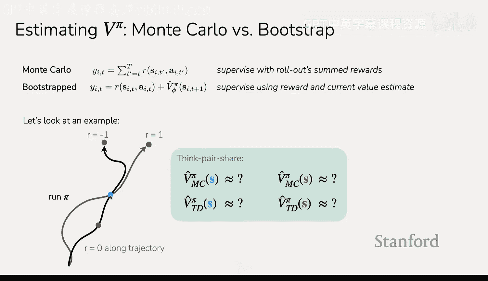

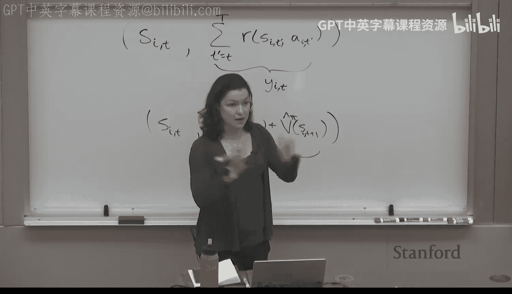

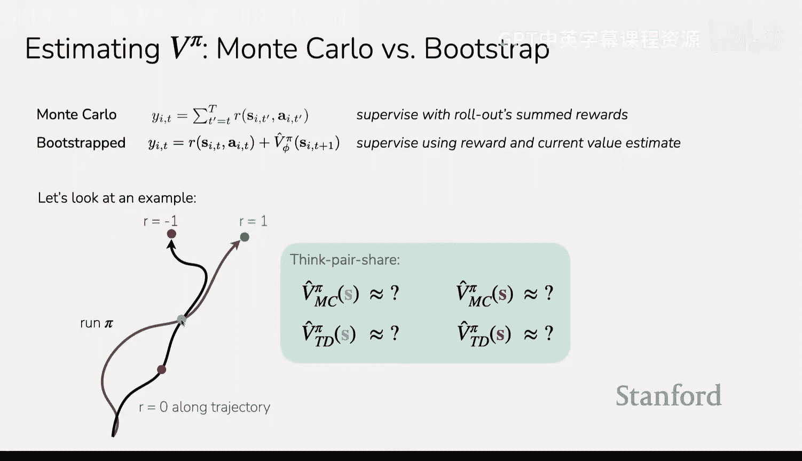

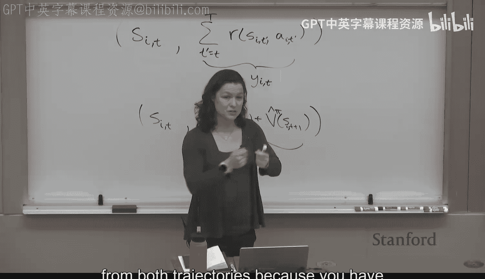

Why is the bootst blue state zero so this is also going to be averaging the future rewards it doesn't have anything necessarily special to boots droprop off of and so kind of for the same reason that Monte Carlo is zero this will also be be zero。

So basically， everything after the blue state will be have a value estimate of negative one here and everything after the blue state on the black trajectory is going to have an estimate of negative ones。

Okay， we should move on。Kin of one question you might ask kind of looking at this is there might also be a middle ground so Monte Carlo is going to be have high variance。

 but it is completely unbiased， whereas the bootstpped estimate has much lower variance。

 but it actually can be incorrect because your current estimate of the value function is going to have inevitably。

 at least a small amount of error in it。And so maybe there's a way。

There might be a way to potentially balance this bias in variance a bit more。

And one way that we can think about this is if we have our trajectories。

 we can think of the Monte Carlo version as using the sum of rewards average over those trajectories。

Whereas the TV version is going to be looking at the first reward plus the value right after that。

 so it's kind of R plus V for like just like a temporal difference of just one time step。

And you can actually sort of like interpolate between these two estimates and instead of using just one time step。

 you could use end time steps so you could look at the reward for end time steps。

 some of the rewards for end time steps in the future before the variance has increased substantially。

And then use your value estimate after those end time steps。

And what this would look like is an equation like this。

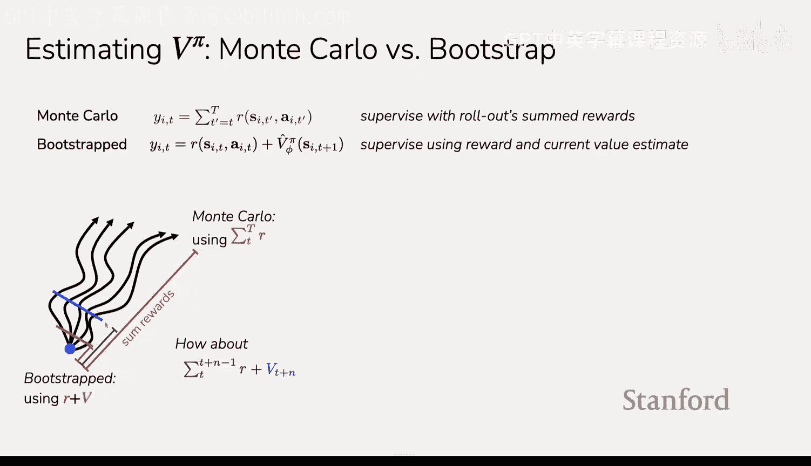

Where instead of summing， instead of just using one reward right here。

 and instead of using all of the sum of rewards， you can sum over。

You can sum over the next n minus1 rewards and then use your value estimate at T+ n。And so。

This looks like。A sum over from T to T plus n minus-1 of our。

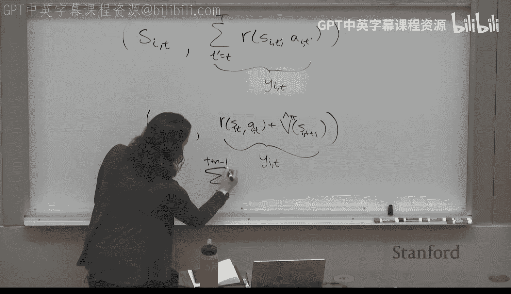

Oh。S。8。Plus， you're estimated of the value at。T plus N。And this would be， in this case。

 it's going to have less a lot less variance than the full Monte Carlo。

 especially if you have smaller n。And it's going to be potentially a little bit like less biased than just using a one step temporal difference bootstrap。

And so you're essentially're going to have more information about the rewards that were directly observed。

So this can be written as this and in this case， this now becomes your target for supervised learning。

Um， and yeah， this is often called end step returns because you're somethinging over end time step。

And practice often using if you set n equals one， this is just the bootstrap version。

 if you set n equals t， this is full Monte Carlo， oftentimes something in between one and T works the best in practice and this can be especially useful in scenarios where you have very small time steps because if your time step is like I don't know 10 milliseconds or something like that。

 then very little will have happened in between those time set。

If you have a very long time trajectory， can you use like both of these you're asking？Oh， yeah yeah。

You could also like， add to your data set， like。

You could add all of these to your data in principle。

 I think that typically like the high variance like labels。

 like the things that are like high variances can deteriorate learning because it yeah at leads to more socasticy and likewise like having like if your values are like not very good then this can also be a challenge and so in practice you'll usually just pick one of these versions and supervise with that。

In principle， you could combine them， but yeah， in practice usually you don't。Okay。Oneon aside here。

 so so far we've been summing rewards and we actually talked in the first lecture about how in some cases we might not。

Want to just blindly sum all awards in the future and in particular。

 if you think about scenarios where the length of the episode is like like infinite like like or very very long then。

Your estimate of the value can get very large in those cases。

And so you might not want to just be summing over all of the rewards in the future。

And so a simple trick to handle the fact that your estimates of the value can get very big is to。

Wt your objective， wait the sum of rewards to be biased towards the earlier rewards。

And the way that you can write this is instead of having R plus V， you can add。

A coefficient right here where if this coefficient is one it's the same as before。

 but you can set it to something like 0。9 or 0。99 and what this is going to do is it's going to say that I care more about the rewards at the current time step and less about the rewards at the future types steps。

嗯。

Adding this discount factor that's discounting future of rewards actually can be viewed as changing the decision process slightly。

So it's actually equivalent to saying that。There is kind of some probability that you that the agent will kind of die at any given point in time and so this is equivalent to saying that with some probability。

 so say like say gamma is like 0。99 in this case， using this form is equivalent to saying that there's a 1% chance that the agent will enter some state that has zero reward and stay there forever。

And so if you have like some original MDP right here。The way that。

That this discount factor would change the MDP is it would say that with some probability with a probability1 minus gamma。

 you enter this kind of death state that doesn't where you't start you can't do anything else after that and the probability of the original probabilities and the rest of the MDP are all multiplied by gamma。

The question is， is there a relationship between gamma and like these end up things like if that gamma is small。

 would it would that change like what you do the。Yeah。

 the way that you would modify this objective would be gamma to the end。Possibly， I mean。

 I think that the they're all interconnected in the sense that the choice of gamma might depend on the environment and。

And generally， if you're going to be looking further into the future。

 maybe that's because you're going to be in an environment that's more deterministic or a smaller time steps。

 and that would also affect the choice of gamma。So the question was terms of choosing how far you look ahead does that affect whether you're prioritizing short versus long termm in this case the it is more a factor of so it doesn't actually affect like how greedy you are because the value function is representing the sum of rewards and so these are still estimating the same exact quantity it's more a factor of like how far in the future are you looking ahead in terms of the rewards and it's more a factor of like how much is the variance increasing and if the variance increases kind of somewhat slowly then you can look further ahead in the future if it increases very very quickly than you might want to use a smaller end。

Co so let's walk through the full algorithm now so we talked about estimating value functions。

 Now let's actually like put this into practice。 So what we can do is we can sample a batch of data from our policy。

😊，Then we will fit our value estimate to the sum rewards in the data and we can use we can do this by looking at the rewards for a short period of time and then the value so this would be the equation for N step returns。

And then when we fit this， we'll run multiple gradient steps on this subjective that's trying to minimize the difference between our estimates and the observed future rewards。

Then once we have our estimated of the value， then we can use that to estimate the advantage of a particular action by looking at the reward plus the value at the next time step。

 minus the value at the current time step， this is telling us how according to our value function in the reward we saw how good is the action that was taken in the data。

And then we can use this to get a gradient for our policy。

 where we will be increasing the likelihood of actions that are estimated to be advantages and decreasing the likelihood for actions that are not advantageous。

And then lastly， we're update our policy by applying this gradient step to our policy parameters。

 and then we can repeat this process to then sample a new batch of data for our policy。

Now note here we have two neural networks， one is for the policy and one is for the value function is is called an actor critic algorithm because one of the networks is to the actor。

 one of the networks is the value function which can also be called a critic because it's criticizing how good a state and policy is。

😊，Yeah， and that's her algorithm。And coming back to the examples that we saw before。

 this is something that's able to actually make use of data， for example。

 that takes a step forward and then falls backwards， because you can actually learn from the data。

 especially when you use bootstrarappped estimates that taking a step forward is advantageous and has a positive advantage compared to other actions that you might take and so this is going be making much more efficient use of the data that we've thought in。

Cool， so review so far， we've talked about policy gradients。

 which is trying to do more of the good stuff， less of the bad stuff based on what you observe after critic are learning to estimate what's good and bad and then doing more of the good stuff according to your estimate。

And we can get a better estimate by using a neural network to try to explicitly estimate the value function。

And then we introduced kind of this third step where we are fitting this model as part of the improvement process。

We talked about three different ways to estimate value either directly looking at some rewards。

 bootsropping off the value function and this hybrid。

 and this is often referred to as policy evaluation。

