# 斯坦福大学《深度强化学习｜CS224R Deep Reinforcement Learning  Spring 2025》中英字幕 p05 -05- Lecture 5_ Off-Policy Actor Critic.zh_en -BV1SvmxB3E5e_p5-

Let's recap what we've talked about the last couple lectures to lead into today。

 so for policy gradients we started with our first reinforcement learning algorithm where our goal was to run a policy to collect a batch of data and improve the policy using that batch of data and then repeat this process so that your approach can get better and better with experience。

And the way that we actually improve the policy using this data is this equation that we've looked at where we collect samples from the policy。

 we then try to increase the probability for actions in the data that have a high reward in the future and then we found that if we subtracted a baseline that's the average reward that encourages us to。

Have the policy do more of the above average things and less of the below average things。

And we also talked about a way right now， everything here requires that the data be sampled from the exact policy that you're going to be taking a gradient step on。

 and we talked about how we can use important weights to this term right here to in order to do multiple gradient steps so that so that we don't have to be collected new batch of data every single time we want to take one gradient step。

We also talked about value functions and we talked about how a value for a policy of a state is the future expected rewards starting at state S and following P thereafter。

And we talked about a Q function， which is very similar to a value function。

 except instead of starting at state S， you're going to start at state S and then take action A and then follow the policy。

And we can kind of think about these as follows， so if we have a given state that we want to estimate the value of for a policy。

Then we can run that policy and the value is capturing the expected sum of rewards。

 so basically the sum of rewards of each of these trajectories average over these trajectories for that state and that policy。

And and we can write this as the。Sumation over future time stepss of our reward if we're starting at ST and following our policy pie。

And then for the Q function， instead of starting at S and running the policy， we'll start at S。

 take a and then run the policy， and so we will then be averaging over the trajectories that averaging the sum of rewards over the trajectories that were kind of a result of running the policy after taking action A at state S。

We can write this as this， again， the sum over the future of the future rewards。

 conditioning on starting and state us， taking action A， and then running the policy in the future。

Great， then we also talked about the advantage function and this is essentially how much better is it to take one action than to follow the policy and we can think of this as the Q function for that state and action minus the value function at that state and these are all for a particular policy pi。

😊，Now to think a little bit more about kind of intuitively what value functions and Q functions mean。

 we can take a look at just one quick example。 So I think I mentioned in lecture one。

 this example of how。DeepMd developed an AI system that could outperform and beat the kind of the champion at go。

And this system was called Alphago and they used reinforcement learning to do this。

 and if you were to think about this example， say the reward is the outcome of the game so it's whether or not Alphago won or lost。

And then the value function you can think of as the expected outcome given the state of the board and the policy that's being run。

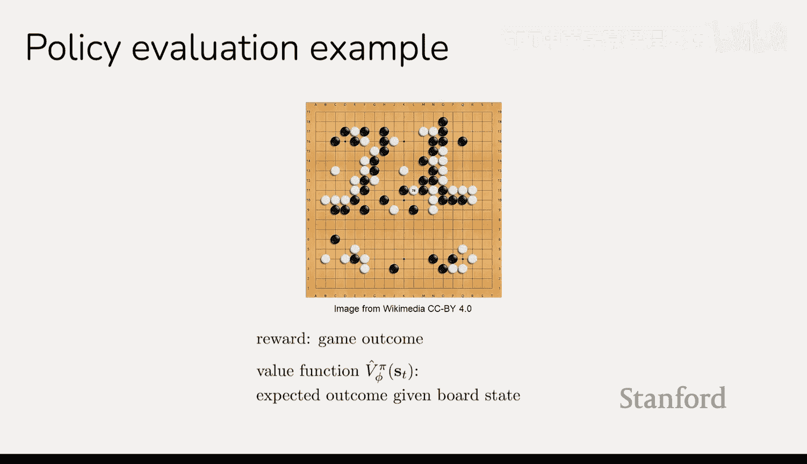

And so if you have a better policy， the value function is going to be higher。And likewise。

 if you're in a board state where things are looking good for that policy。

 then you're also going to have a higher value function so the value function is influenced both by the policy and by the state。

And。Yeah， so that's kind of an example of what a value function looks like and likewise。

 a queue function would be similar except instead of running the policy from the state。

 you'd be considering a particular action first before running the policy。

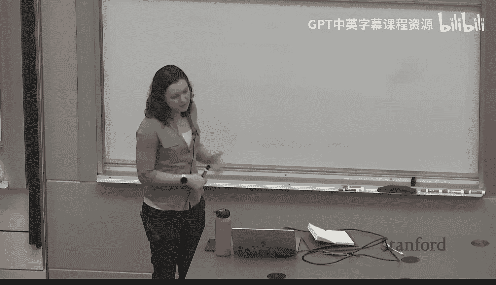

Okay， so we talked about actor critic methods on Friday last week and。we introduced this equation。

 which looks a lot like policy gradients， where we're summing over examples。

 except now instead of using the sum of rewards in a given trajectory。

 we're using our estimate of how good an action is or the advantage and this comes from the sum of reward。

 which is the Q function minus the average sum of rewards， which is the value。

And you can think of this as being different from policy gradients in that we're estimating which actions are good and bad。

 and then encouraging the policy to do more of the stuff that we think is good。

And then we talked about how do we actually estimate this like what's good and bad。

 this is referred to as policy evaluation and we can fit a value function。

 a neural network that takes input the state and outputs a scalar value。And。

And we fit this as trying to predict the either just the sum of rewards or the next reward plus the value function where we're bootstrapping off of our own estimates or the sum of a set of a short trajectory of rewards plus the value function after that。

And then this advantage function is equal to the ro plus the next value function minus the current value function。

Okay， so let's get into the main topic of today， which is that when we talked about a critic methods last week。

 we're primarily considering on policy a Cri methods。

 and today we're going to get into two like real algorithms that people use PPO and S。

 and we will start from the a critic formulation and see how we can make them off policy to be more efficient。

And then we'll at the end， we'll talk about how PPO， S and imitation learning compare to each other。

Yeah， so the key learning goals is like really the key concepts behind practical algorithms like PPO and S。

Okay， so we have our actor critic method， this is these are the steps that we go through for an on policy actor critic method where we sample data fit rewards with our value function。

 then we estimate the advantage with this equation here for all of our states and actions in our buffer or in this set of data then we。

😊，Estimate what the gradient of our policy is and update our gradient。Now。

 if we want to be able to take multiple gradient steps， we need to be able to evaluate our gradient。

 not just our at the current policy that collected the data， but after we've taken a gradient step。

 for example， after we take step five， we're now going to have a new set of parameters that were different from what was collected the data in step one。

And so what we're going to do is we're going to use importance weights。

 which we saw in the policy gradient lecture， and so our new objective is going to our new gradient。

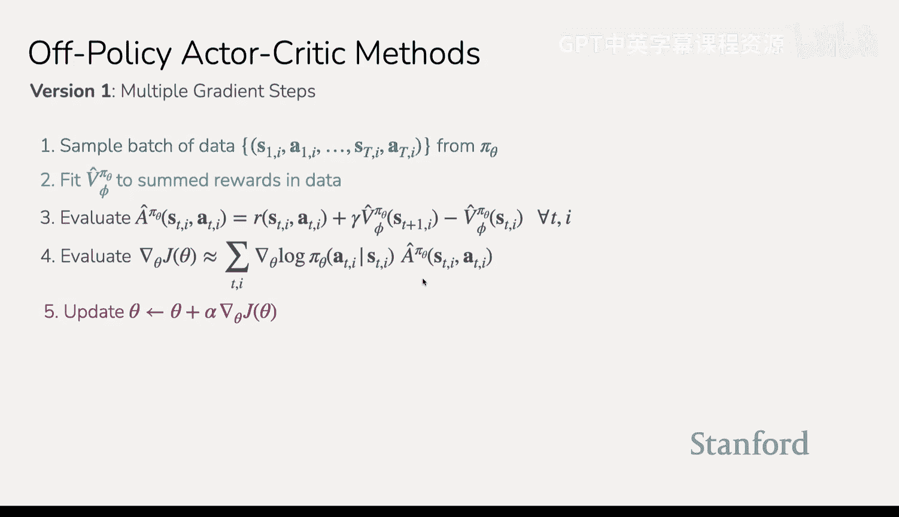

Is going to look a little bit different so say that we collected data with pi theta now we've taken a gradient step and we have pi theta prime。

So we want to be able to evaluate the gradient of the objective。At theta prime。And to do this。

 we will reuse the data that we collected。From P Theta in step one。And we're then going to。

Use the same gradient step as before， but we're going to weight the gradient term with an importance ratio that is a ratio between our new policy pi theta prime and the policy that was used to collect the data。

 which is pi theta。So we have this is our important weight term right here and the rest will look the same as before where we'll be。

Evaluating。The gradient of log pi times。The advantage or advantage estimate。

 this advantage estimate will still be for our the policy before taking a gradient step pi theta。

 and this will be for a given。As an a pair。For the essay per here。Okay， so this is our new gradient。

So that's here。No。In principle， once we've done this。

 this means that we can take multiple gradient steps so we can sample batch of data once， and then。

Fit our advantage estimates。And then compute our gradient， take a gradient step。

 and then recompute our gradient， take a gradient step and so forth。

 and the only thing that's going to change as we take more gradient steps is this important weight here and of course we'll be doing back propagation on our new parameters rather than our old parameters。

And our advantagetage estimates will still be based off of the old policy。No。

There's something that can go wrong here。嗯。And to see what can go wrong。

 it's helpful to actually look at the surrogate objective right now we're looking at the gradient that we're going to be applying。

But when we actually implement this in practice， we'll be having some surrogate objective that we construct in order to use auto differentiation to get the gradients per free from pipetorch。

And so if we were to write down the surro good objective for this。

 we need to formulate some objectives such that the gradient of。Our surrogate objective。

Is equal to this right here。No。To do that， we can remember。

That we have this kind of convenient identity where。

Where a probability times the grad log of a probability is equal to the gradient of the original probability。

 this is kind of the same kind of log trick that we've been seeing we use to formulate the original policy gradient objective。

And the way this comes in handy is that we actually see this like pi grad log pi right here。

And so this means that this is equal to the gradient of pi theta prime。

And if we want to then construct a surrogate objective。Such that its gradient is this？Then。

The surrogate objective。Is simply。Going to be we can replace this with pi theta of a given s。

And then we'll still have the other terms pi theta。And the advantage。Right here。嗯。This is these well。

 let's just say this is just over eye， all the examples。Inner about。

And so the way that I formulate this is the surrogate objective is the gradient of this surrogate objective is equal to this right here。

And we see that if we take the gradient of this with respect to theta prime。

 we get grad theta prime right here and the gradient of theta prime of pi is equal to pi theta prime times grad log pi theta prime。

So you can see this on the slides。So here's our surrogate objective right here。Now。

 if we look at this very good objective， so the policy is going to be trying to maximize this when we take gradient steps on our policy。

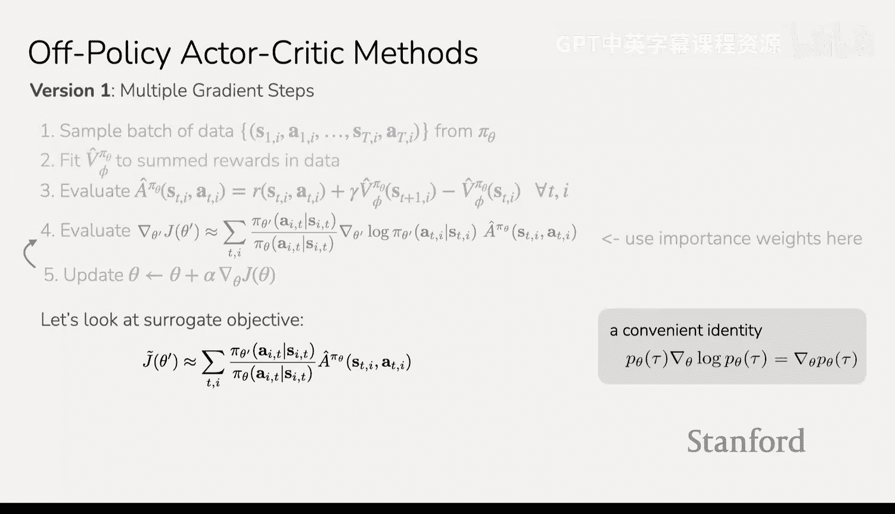

And。If we look at this， if we're trying to maximize this objective。

We have our advantage estimates and so the thing that the policy will want to do is it will probably want to take the advantage estimates that are positive。

And increase the probability of our actions for those。

And especially if there were actions that had very low probability that we want to increase this a lot so that we can get a very high ratio here。

 such that we kind of increase the likelihood actions for high advantages and then for negative advantages。

 we'll want to decrease the probability。Now， this all seems reasonable here。

The thing that's a little bit tricky is that these advantages are still based off of the old policy and they were estimated based on kind of a single batch of data。

And so if you take too many gradient steps on the surrogate objective。

 it means that you might actually kind of， in some ways overfit。

 you might be using these advantages at some point when they become out of date and may no longer be applicable to your new policy。

And so basically the challenge that can come up is you might get really unstable alert。

As a rough visual for what this might look like。Is if you were to plot the。

Let's say that this is the number of examples of like state actions that you've collected。

And then the Y axis is like the。The rewards that your policy is seeing over the course of learning like as it collects more data。

If you take only one gradient step。For every batch of data that you collect。Then you're learning。

Will be。Might look something like this where it learns very slowly because you could only take one gradient step for each batch of data and that means that it's going to take many。

 many data points in order to learn。So this is for。One gradient step。Now。

 so you maybe increase this a little bit so you take like five gradient steps。

 then you should learn a little bit faster， so maybe you'll learn something like this。

Because you're taking more gradient steps per data point and so with respect to the amount of data that you're collecting。

 your reward should increase more。But then if you try to get a little bit greedy and do a lot more gradient steps on this objective。

 you might start to overfit your advantages and you'll get something where maybe you'll actually kind of start to increase reward very quickly。

 but then learning might be unstable and at some point it might even collapse。

Because your policy will overfit those advantages， you'll get some kind of really bad policy or a policy that has like like increased the probability to one for some advantage。

 but then so in a way that makes the policy performance poor。And so this would be like。

I don't know exactly how many gradient up this would be。

 but this would be having more gradient steps than the others and this would be too many gradient steps essentially。

So the question is what does the behavior of an overfit policy look like in practice？你。As an example。

 it really depends on the problem。As one example， if it's overfitting quite a bit。

 it might be assigning try to be assigning like a very。

 very high probability to like one particular action that has a high advantage in the data。

 and when it does that it might actually also increase the probability of other actions around it just because like neural networks are somewhat smooth。

😡，And when you do that， it might。It might be a very deterministic policy that no longer explores and also it might kind of like。

Well， maybe it's like a。

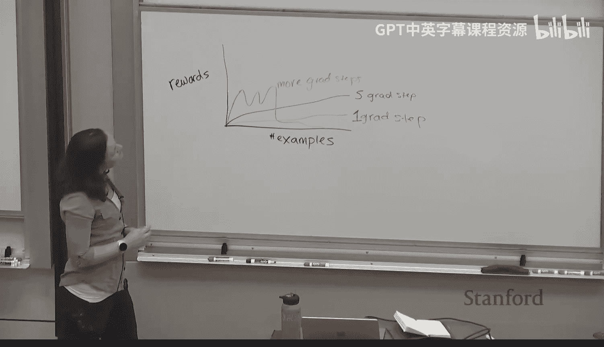

It's a little bit hard to to I don't know exactly what would happen。

 but the if you had like a 2D agent that's like moving around in a grid and maybe you're like your goal is to get here。

 then a good policy would like would go here and a policy that's overfit I would expect a potentially like。

Maybe maybe for example， it learns that like going right is good but doesn't figure out that like you need to stop here and doesn't figure out that you need to like go up then what the overfit policy might do is it might like take a straight line here and then like keep on trying to go like roughly in this direction and then end up in the quarter because it's kind of overfit to one batch of data that told it to go this way but didn't figure out that it needs to stop。

Yeah， exactly， so this is five gradient steps on kind of five loops of this before you then collect a new batch of data and then refit your value function。

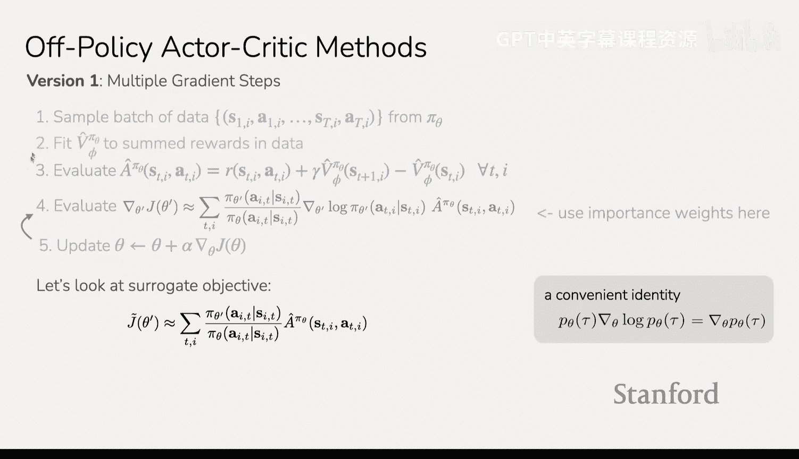

Currently it's reit only on the current batchoucher of data later this lecture we'll see how we can potentially reuse previous batchuches。

So the question is what is the importance of using the surrogate objective versus the original formulation this is the same formulation the I found it helpful。

 I think it's a little bit more intuitive if you look at the surrogate objective to understand that it's like these importance weights are really trying to like make it like it's very easy to increase the probability you could also see that with the gradient as well where it's going to be like trying to increase the probability I think it's just a little bit easier to see with the surrogate objective we also in a minute see how we can change the surrogate objective and it gets a little bit more complicated like PPO looks a little bit more complicated if you look at the gradient versus if you look at the surrogate objective。

Yeah， so the question is， why are we using the importance weights to evaluate the gradient So this importance weight term is is what is allowing us to do more than one gradient step in the first place。

 And if you it's kind of what it's what's allowing this kind of blue curve to do kind of better in some ways。

 if you don't have the importance weights， then it's essentially。

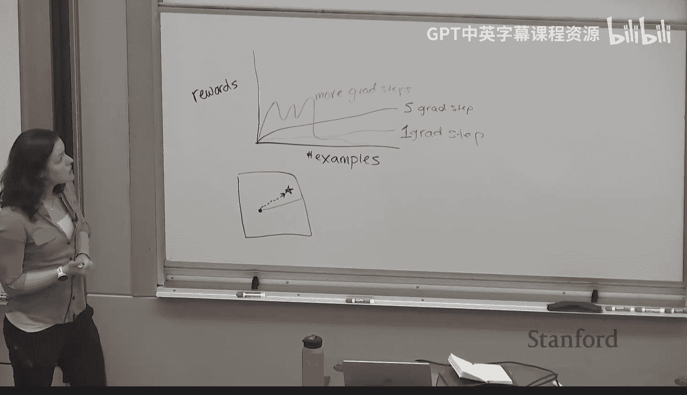

it's， yeah。It is not allowing you to actually accurately estimate the gradient on the old batch of data。

Yeah， so what happens when the a network is too old。

 So if the advantages the advantage estimates are going to be based off of like some batch of data。

 it's not like infinite it's going to be a batch of data that might be。

 I don't know around like a few thousand time steps of data and those advantage estimates will be they're also kind of under the old policy before we took any gradient steps。

 And so if you take a lot of gradient and steps on this objective， those advantages are not like。

They're only true for the old policy and they're also only based off of a limited batch of data and primarily because they were based off of the old policy。

 the when you're actually after you've taken like I don't know 50 gradient steps or 100 gradient steps they become out of date and the policy like for example。

 maybe your old policy in this example it's possible that your old policy right here。

 like maybe it did actually decide to like go up， for example。

 so then you learn that like if you're over here， you should like go this way because later you will go up。

Because that's what your advantages are telling you， but then in practice。

 once you have your new policy in the future you'll be doing something different and so those advantages over here are no longer like accurate。

 no longer valid and you need to collect a new batch of data under your new policy in order to have accurate advantages。

Okay。So。The policy is going to increase probability on actions with high advantages。

 these advantages are based on the old policy and so they'll get out of date and so if you take a lot of gradient steps the policy is really it's I guess the other thing that I didn't mention is that when it's increasing the probability。

 it's also inherently like trying to differ significantly from the old policy。

 like it's not only encouraged to increase probability on advantages。

 but that is going to cause it to change very different change drastically from the old policy。

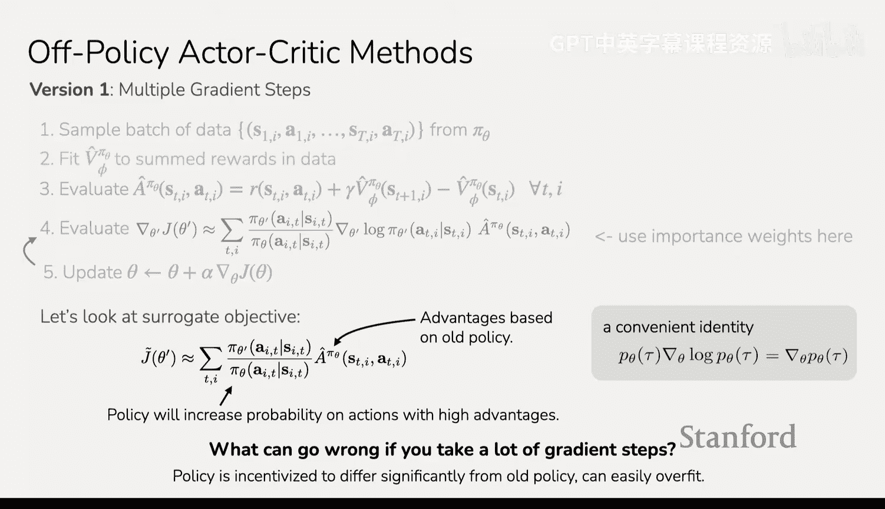

And this means that you're also like because you're also changing a lot。

 these advantages are even less likely to be up to date with your current policies。And so。

There's a question of like how do we address this and there's actually a couple things that we can do in order to actually be able to stably take more gradient steps。

And the key idea is if we keep the new policy to be a little bit more close to the original policy。

 then those available estimates are more likely to be valid。

And there's two ways in which which we might be able to encourage the。

The new policy to be similar to the old one， one would be to add a term to our surrogate objective that explicitly is going to try to encourage the policies to be similar。

And these policies are representing distributions over actions。

 And so one way that we could do that is to add a term to our objective。 So we'll have like。

We have J。We have our surrogate objective right here。

 If we have it be equal to the same thing as what's written up there， maybe I'll call this like some。

Let's call this。I don't know。CON for constraint， this is going to be equal to the original surrogate objective。

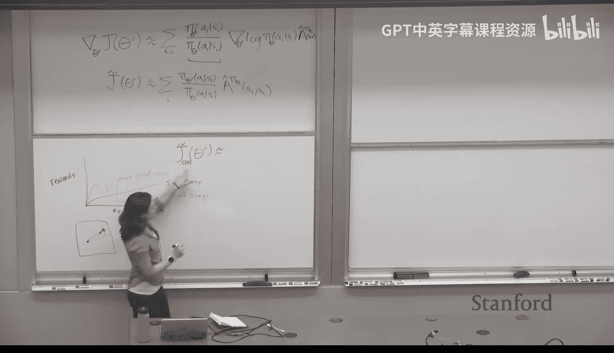

That we're trying to maximize， and then we can add a penalty that discourages you from changing too much from the previous policy。

And that penalty could take the form。Of the kale divergence between two distributions。

So this could be the scale divergence between the new policy distribution。And the old policy。

Distribution。And so if we add this to our surrogate objective， what this will do is it will it。

 itll encourage the policies to stay close to one another while you take more gradient steps and so your advantage functions will be more accurate。

 and this will allow you to more stably take more gradient steps。

Now it will still be constraining your subs and so's like it's like a little bit of a balance。

But essentially， the result of something like this in principle should look， I'm out of colors。

 maybe should look。Kind of something like this if you add if you do more gradient steps。

 but with this kale penalty。So the comment was's trying it's incentivizing because of this ratio right here and it can make this。

 it's controlling the upper part， the lower part is fixed， this is the old policy。

 it's controlling this new one and so it can make this like very large or very small and that will cause these weights to like either go to zero or become or or potentially be infinite depending on how small the old policy probability was when we constrain how different these are then we're encouraging this to be closer to one so you can't just like like push this to like infinity or can't just push it to zero。

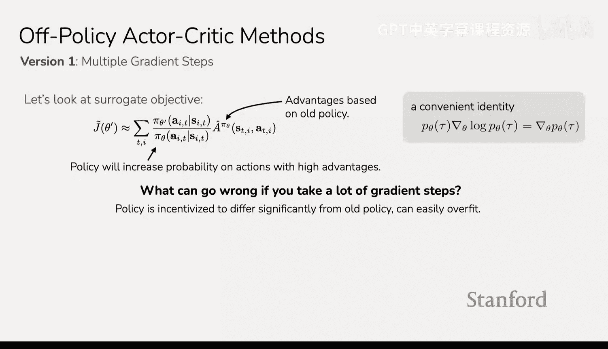

Yeah， so a couple comments were here so the first was that to do this kale constraint we actually need to keep around our old parameters in memory this can actually be kind of annoying to do it increases your memory costs and this is actually not uncommon to do with large language models and you'll have to keep around the full set of weights for your old language model in order to do this that said there are ways to potentially cache this so if you you potentially could just keep around the probabilities that were assigned to different different states for a given batch of data and then the second note was that for this surrogate objective this ratio is initially going to be one for because yeah and then once you take one gradient step that's where this starts to potentially divert。

Yeah， the goal is to basically constrain how far how much you're changing the policy and only to change the policy a little bit rather than like a ton yeah other example one other way to think about this is like if your policy as a neural network this tick isn' input like images。

 for example， you you need a lot of gradient steps in order to change the features of those images and so you want to be able to take a lot of gradient steps but without substantially changing the action distribution that the policy is going to take so that you can still refine your features without like causing the subjective to overfit too much。

Yeah， so the question was how do we， how do we。Encourage it to change a little bit。

 but not too much oftentimes you'll have some hyperparameter that is in front of this kale divergence that needs to be tuned。

And so and so this beta is like a hyperparameter and this will control how much you're allowing it to shift the this ends up being oftentimes a fairly important hyperparameter when you use kale constraints at the same time I dont you don't need to tune it like usually people tune it like within an order of magnitude rather than like very carefully finding like 0。

423， whatever。Yeah， so the question was how does this look like for the kind of original gradient and not quite understanding the surrogate so the surrogate objective is kind of what we're plugging into ptorrch in order and then then ptorrch or Tensorflowlow or jacks will then compute the gradients for us and the when they compute the gradients for us they will get the first line and so these are。

😊，The gradient of the second line is equal to the first line。And then for this。

 you can then plug you can if you would implement this。

 you have your original surrogate objective and then you just plug in this term as well。

 you can look up the expression for k divergence between like two categorical distributions or two Gaussians。

 which in the Gaussian case it will be a function of the means and variances and then just add that to your surrogate objective and then have Pytorrch give you the gradients。

 you could also if you write down the equation for a particular distribution。

 you could also get the gradients yourself if you want to take a look at that。

What's the difference between J theta and J Tilde theta so。

I'm using J Tilda to refer to the Sorogan objective because it's technically not the true objective。

 the original J Theta objective was equal to like the expected sum of rewards。

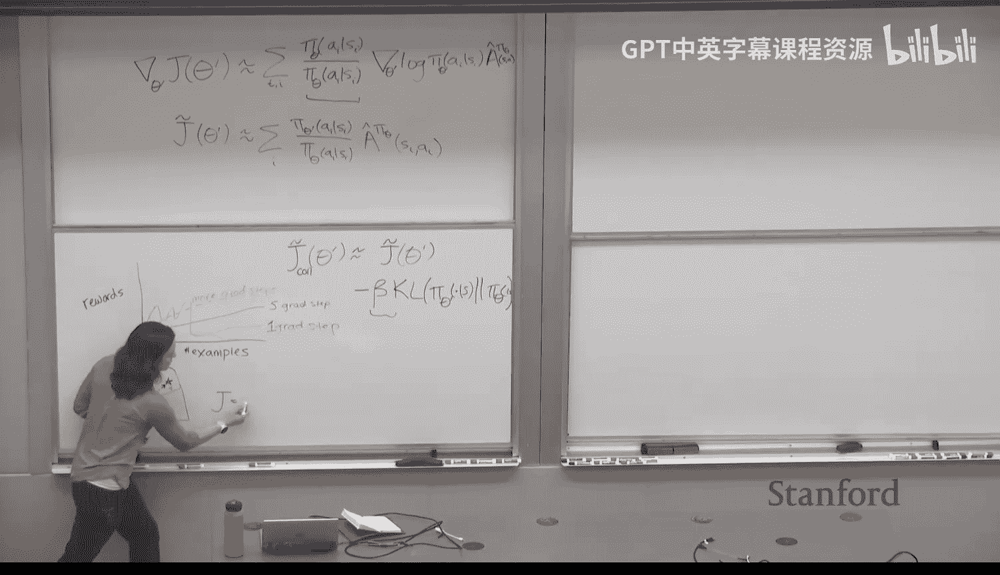

So it was like。The sum of rewards here。Yeah。Yeah， so this is an estimation for that， yeah。

Okay so the first idea is use a kale constraint it iss actually very common to do。

 we will leave it at this for now we actually won't use kale constraints。

 there is actually a version of PPO that uses CAale constraints but it's not the most common version but it's also used a lot in preference optimization so we'll probably see it again in a couple weeks。

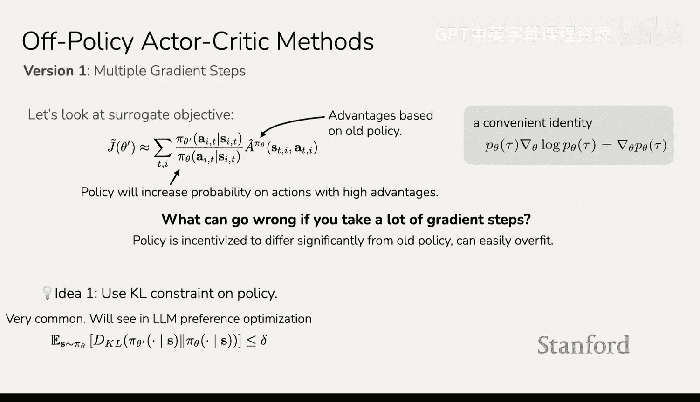

And then there's actually a second idea， so we could add this at kind of constraint in the objective。

The other thing that we could do is we could。For this ratio right here。

We could simply remove the incentive for the policy to change this ratio a lot and the way that we would do that is we could actually just clip this ratio so that the ratio never exceeds some value and never goes below some value。

And so what that would look like is。嗯。This is like， I guess this is version one。

What version two would look like？

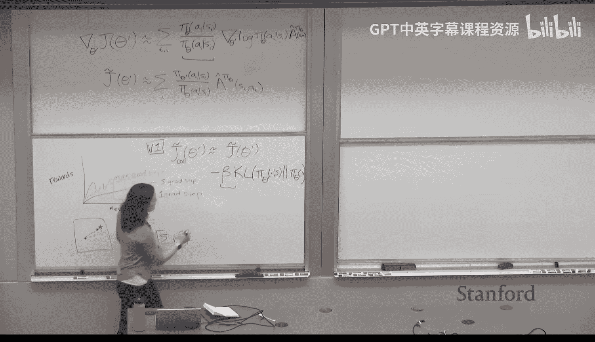

Is。We would be taking these important weights， and we would be。Clipping them。

 so we have the importance weights pi theta prime divided by pi theta。

And we would be clipping these to be between。Some lower value， 1 minus epsilon and some higher value。

1 plus epsilon， epsilon could be something like 0。2， so you're saying that if it goes below 0。8。

 then it'll just be 08， and if this goes above 1。2， we're just going to leave it as 1。2。

Now this clipping this is a little bit informal if I were to write this out mathematically。

 what this would look like， say that let's call this W， this weight right here。

Then if we wanted to clip it below by one minus epsilon， then we would be。u。

Taking the max between W and1 minus epsilon。 And if we wanted to then clip this above by one plus epsilon。

 then we'd be taking the min between this。N1 plus Epsilon。And no。

If we use this clipped importance weights in our objective right here。Then。

Once the policy changes the ratio to be like above 1。2。

It's no longer going to be able like increasing the probability any further isn't going to help it。

 It's no longer going to be incentivized to increase the probability further because the objective will just stay as 1。

2 times the advantage。And so it isn't actually explicitly constraining the policy not to change。

 but it's removing the incentive to change significantly from the old policy。Yes。

 so it cannot be below 1 minus epsilon and it cannot be above one plus epsilon。

 a value of epsilon that's like used in practice is something like it might be like something like 0。

2 so it's not tiny， sometimes you refer to epsilon as tiny numbers in this case it's going to be concerning it to be like between 0。

8 to 1。2。Okay， so this sort of idea of bounding the importance weights is actually one of the key ideas behind PPO。

 which is a popular RL algorithm。And。So let's see。If we were to then put this clipping into practice。

 we could take our surrogate objective and then replace the importance weights by the clipped importance weights right here。

In order to get a modified surrogate objective。Now， there's a couple more tricks that PPO introduces。

To try to get stable reinforcement learning improvement。嗯。

So in this first rig is no longer incentivized to deviate significantly now。

One thing that's a little bit funky about these importance weights is that there is actually a possibility that the。

That it might actually。I。The clipping in some rare cases might actually make the objective better if。

 for example， the policy ended up assigning a very a very low probability to like a negative advantage and it went below the advantages and then you're clipping it to a higher weight。

And so。One thing that PPO does is and kind of the final objective of PPO is to take this clip objective。

 but take the minimum with respect to the original objective。

 and this minimum is just making sure that the clipping will never make the objective better and it formulates a lower bound。

 it ensures that this is a lower bound on the original surrogate objective。

And this means that we're going to be maximizing a lower bound on our objective and usually if you're ever going to be like。

If you're ever going to be optimizing or maximizing something that's different from your original objective。

 it's good if it's lower bound because it means that you're actually going going to be。

 you're not going to be like maximizing something that you could maximize beyond the original objective。

😡，Cool， so this is the final PPO so good objectives。The motivation behind trick one or trick two。

 trick two， So the motivation behind trick two。I'm not actually sure how often this happens in practice。

 like how critical this is， but the motivation is that if you are in a scenario。

 you might actually be in a scenario where maybe like increase the probability on a lot of the good stuff。

 it decreased the probability down a lot of the bad stuff。

 but in some of the rare circumstances where maybe increase the probability on a good stuff。

 let it there was another advantage that had a similar state that was actually really bad and maybe it increase the probability on both of those。

In that case， theping clipping it at 1。2 for that second one is actually making it better。

 is actually like making the objective better because you're then saying， okay。

 maybe it assigned a really high probability to this bad action， we're then going to clip that at 1。

2 or something like that。And so if we take the minimum with respect to the original objective is at the state action level at the data point level。

 this is going to ensure that those situations aren't happening。I guess explicitly that you have。Say。

 you have。

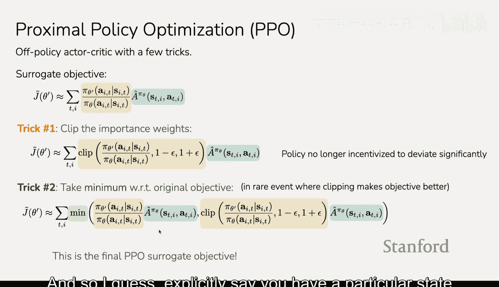

A。A particular state and action pair where the advantage is like。I don't know。

 negative 100 or something like that， so something really large。Then， and say that you're。Your new。

Your new policy。For this state and action decided to give it like a probability of like 0。

9 or something very high and the original policy maybe gave it。

A probability of whoops if the original policy gave it a probability of like 0。1。Then in this case。

 the ratio between these two is nine， and then when we clip it， then would be clipped to 1。2。

And then that's actually once we clip it to 1。2， we'll multiply 1。2 by negative 1000。

 and so that's actually going to be making the objective better than if we hadn't clipped the objective。

And so what this trick number two does is it means that it actually doesn't get to do the clipping for this particular data point。

And this will disincentivize it from making these kinds of accidents， which is a good thing to do。

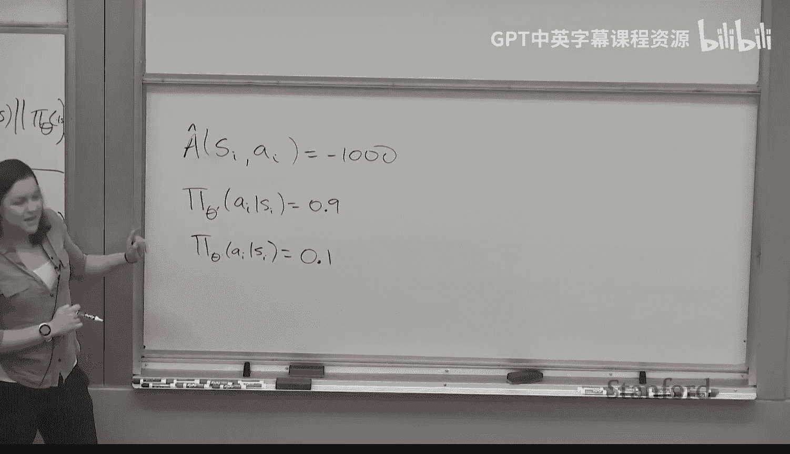

So you're asking， why don't we just clip above and not clip below？

So there is actually an analogous version of this， if you just make this negative and flip these where the clipping could also make the objective better。

 like for example， if a hat is forgiven state and Auction pair is positive 1000 and the new policy assigns 0。

1 and the old policy assigns 0。9。Then now if you do this by accident。

 then or if it happened to do this as part of the when optimizing other data points。

 then now the ratio is going to be one over  nine which is very small， you multiply that by 1000。

 if you clip the one over 9 by 0。8， that's actually be making the objective better and so generally clipping on both sides and then taking the lower bound it prevents like both of these kinds of scenarios from being encouraged through clipping。

Okay， this is the final PPO surrogate objective。The last thing。

 the last trick that PPO does is on estimating the advantage。So。To estimate the advantage。

 there's a third trick that's used。 This is actually a trick where I'm not。

I'm not sure how necessary it is myself， I haven't done a ton of comparisons and the way that it works is you you still can be fitting a value function VP in the normal way。

 either with Monte Carlo or bootstrapping。But then once you fit that value function。Previously。

 the equation for our value function was the reward plus the next value minus the current value。And。

Instead of just using kind of a horizon of one。It's actually going to use a varying horizon。

 so you can think of。Before we were estimating the advantage of a given state in action。

 we were using the reward。

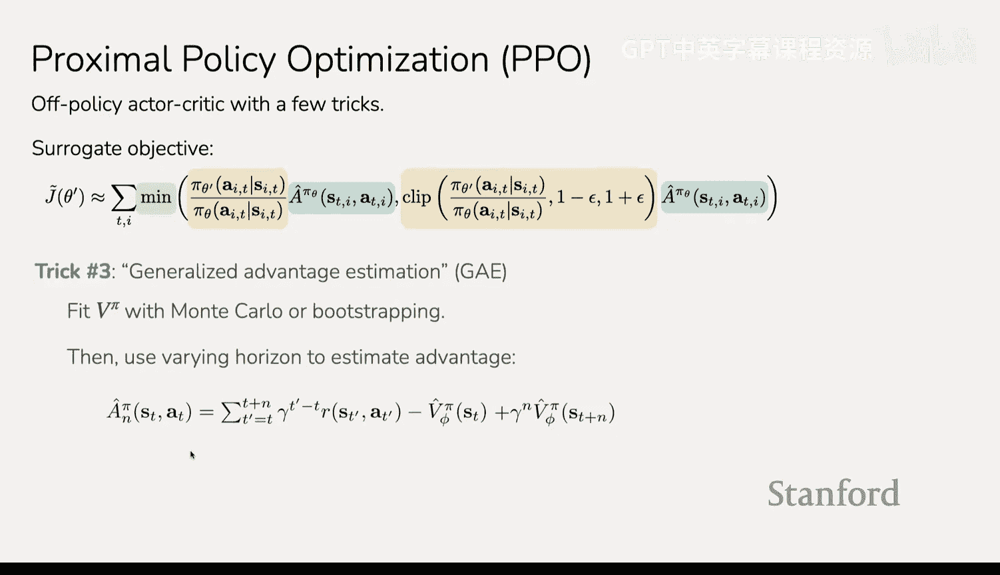

At that state plus the value at the next state minus the value at the current state。

 these were all for pi and then we're。Had hats on each of you。

But you can also estimate the advantage using something that kind of looks like end step returns where you're actually going to be summing over multiple reward functions。

 multiple of the rewards into the future， and subtracting that future or adding that future value instead of adding just one step into the future。

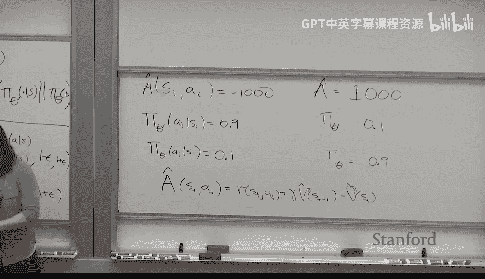

You can sort of think of this as like。We were talking about bias andvariance before if you use。

 if you calculate these different advantages with varying horizons and then weight them accordingly。

 then you can get advantage estimates that。That have kind of varying varying variants and maybe have less bias than the if you just use the one step estimate right here。

I think that there's some argument in terms of bias andvariance that can be made。

But it's also like not 100% clear if it's necessary in my opinion。Right， yeah。

 so there's now going to be a hyperparameter here with regard to how do you choose these weights with regard to the different the different end up returns the。

Generally you'll mostly use the earlier ones so that you have less variance and usually you will choose it to kind of decay very quickly as the horizon increases you're mostly still going to be using the like t equals one or n equals one。

Right， so if you're using these whites to you use set gamma to one or do you use them together。

 you'll actually you'll use them together and you'll get if you write this out。

 you'll get a term that multiplies gamma and Lada here。😡。

So the question was this is the same as like taking a weighted average of different end step returns for different ends so the one thing that's different is we're still going to be fitting the value function in the normal way and then this is this is in terms of how we estimate the advantage。

 but otherwise it's it's very you can think of it as end step returns。

 but averaging the different the different ends in order to get an。

What's the benefit of using GAE I think I'm not。I think it's a little bit hard to motivate。

 I think one way to view it is that if you just use this one step return。

 especially if the time steps are very close together。

 then this might be if this estimate is like if your V's are not completely accurate then this estimate might be a bit off and if you increase this horizon。

 then you'll get potentially a better estimate， now why not just use like one value of n versus a mixture perhaps it helps you hedge a little bit if you're not sure which value of n is correct。

 but。I don't have like a great motivation myself for it。I'm actually not。

 if you use it and don't use it， I'm not 100% sure what the performance is like。Okay， cool。

 so the final PPO algorithm， we sample a batch of data， we fit a value function to that data。

And then we evaluate this generalized advantage estimate that we just talked about。

 and then we will update the policy by taking M gradient steps on your surrogate objective。

 where the surrogate objective uses these clipped importance weights using the GAE estimate of the advantage function。

And then you can repeat this process after taking M gradient steps。

 then kind of set sample a new batch of data， fit a new value function to that and repeat the process。

In order to get it like a rough sense for like what this looks like。

 here are some example hyperparameters now generally hyperparameters are something that you had tune per domain。

 so this is not like my recommended hyperparameter necessarily but just to give a rough sense for what this looks like the batch of data might have around 2000 time steps in it so if you have like a long horizon problem that has like a thousand time steps this might actually be only a couple trajectories if you have a shorter horizon problem this might be more trajectories。

When you update the policy on step four， a common hyperparameter is something around 10 epochs on the data set that was collected in step one。

And so this would be if your batch size is 64， this might be around 300 gradient steps。

 and so this means that in comparison to before we're actually because we introduced this clipping。

 we're actually able to take 300 gradient steps without having really unstable improvement。So。

 that's good。Clipping range I mentioned like 0。2 is something that that might be reasonable。

 and then you might run this around like 500 times this this full outer loop 500 times in order to get around a million total timets of experience。

If you run this algorithm， if you're on PPO， we'll see some other examples。

 actually some cooler examples at the end of the lecture。

 but if you run PPO on this very simple simulated half cheetah like the right half of a cheeah or something and you look at as you collect more time steps of data。

 what does the reward look like there are a number of algorithms here。

 this beige one is vanilla policy gradient， it's a slightly smarter version of vanilla policy gradient but is basically vanilla policy gradient where you're not fitting the advantage function and you're not doing the clipping。

And then PPO is up here， and you can see that it's able to。

 with less experience able to improve much fasters because it's fitting the advantage function and because it's doing the clipping on the gradient in order to take many more gradient steps on a single。

データ price。Yeah， so can I explain the arrow from four to one and how are the parameters being updated so this error is just saying that after we finish step four then we're going to go back to step one and collect a new batch of data。

When we do that， we're not going to we're going to kind of keep our policy as it was at the current time step。

And yeah keep on iterating and so at this point actually theta will become the previous data prime and you'll be sampling about to data from your latest policy。

😡，And then the other thing here is that for this value function。

 you could warm started at the previous value function or you could train it from scratch。

 depends a little bit on the domain。So in terms of these plots， the question is。

 do you fit the best set of hyperparameters and then run it？Yeah。

 so each of them will have its own set of hyperparameters and the best practice is to figure out good hyperparameters on like one environment or maybe two environments and then apply those hyperparameters to the remaining environments in your experiments。

 there are scenarios where you might need a new set of hyperparameters for a different domain。

 for example， if you are controlling something at like1 hertz versus 50 hertz or optimizing a language model versus a half cheetah the hyperparameters will be different。

 so there is some variability there。It is like one good practice is to not tune your hyperparameters per environment because then you're essentially using more like more data。

 more samples in order to get those hyperparameters in the first place。

 and that wouldn't be reflected on this curve right here。Okay， we should move on。

 but happy to answer it after after class so so far we've talked about using one batch of data for one gradient step that's the fully on policy version and we've looked at using one batch of policy data for multiple gradient steps and this is off policy。

What I'd like to talk about for the rest of the lectures is can we be even more off policy？

Can we reuse previous batches of data rather than recollecting a new batch each time？

Like all of the past trial and error experience。And there's two， ideas for doing this。

 one is that we actually need to retain all of our past data。

We'll call we'll use a term called a replay buffer that you actually saw in homework one where。

We will have a data set of past past data we'll keep on adding to it and at some point we might also remove some like very old data from it this is called a replay buffer because you're sort of replaying your past experiences。

And then the second idea is we actually need to adjust some of the equations to remove some of the on policy assumptions in order to be able to actually use all of our past data。

Okay， so what this looks like is we'll take our actor critic algorithm。

 but to make it off policy will。We can think about as getting one time step of data。

 then update error policy， getting another time step update error policy and so forth。

 so rather than getting one batch and then doing updates so well be we can actually do this much more online。

And when we update our policy， this will actually be coming from a replay buffer。

 we'll be actually doing gradient steps using all of our past experiences rather than just our immediate past experience。

And so。In particular， when we collect experience， we wanted to them add this to our replay buffer。

And when we then update our policy， we want to use a mini batch sampled from all previous data rather than just our last batch of data。

So that's kind of like the modifications we need to make in order to use a replay buffer。

So walking through this， we start with an empty replay buffer。

We then collect experience from our policy， we add that to the replay buffer。

And then we sample about a transition state action reward and next state from the replay buffer there's a small probability this could be exactly what we just sampled。

 but otherwise it'll be something randomly sampled from our previous experience。

Then we'll update our value function。Using the batchcha today that we just sampled from the buffer。

We can update our value function with the same objective before。

 but now we're going to be averaging over our mini batch。And then we can evaluate the advantage。

And then take a gradient step。O our policy。So that's kind of the mechanics of replay buffers。No， in。

Yeah， finally update the policy and then kind of repeat this process。Unfortunately。

 this algorithm right now is currently broken。It it's broken in two different ways。

 the first way that's broken is right here。Say that we're using bootstping to update our value function。

Then our target would be the reward at the current time step plus our value estimate for the next state。

And so I have a question for you。And the question is。

 when we're fitting a value function on all of the data in the replay buffer。

 So this is the data from all of our previous policies。The question is。

 what policy are we learning a value function for when we fit the value function this way from data in our replay buffer？

And so I'll give you kind of two minutes to discuss that and then we'll come back。Okay。

 let's come back。I also should have maybe mentioned that this question is the answer is not as clean as some other questions。

So the the response there was that the so for our latest policy。

 we actually don't have any what we have。We have maybe one data point from that policy but most of the buffer is not like the rest of the buffer is not from that policy right and so we don't actually have any really much data at all from our current policy so it's not our current policy and that's why this is incorrect and in particular when we collect kind of trajectories from previous policies the actions will be different and that means that the next state will also be different when you took that action as well as the reward。

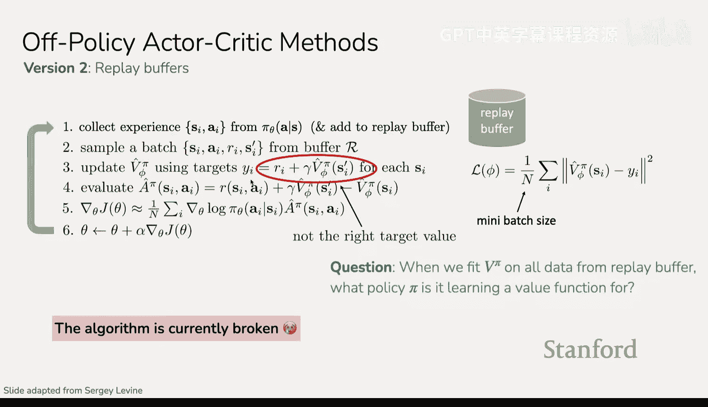

Yeah， so the policy that you're going to be learning a value function for。

 I'll phrase it slightly differently。 the policy that you'll be learning a value function for is sort of a some sort of mixture of all of your past policies。

嗯。It's actually like not trivial to write it down like if if things were collected in a particular way。

 the policy might look something like a like an average over like your previous policies。

If you had N previous policies now it's actually a little bit different than this because in some states you might like one policy might have kind of gone over here and another policy might have gone over here and so then in this state it's going to be a mixture of policies but in this state iss going to be more this policy in this state it' going to be a different policy so it's actually a little bit messy but the thing that's definitive is that it's not going to be a value function for your current policy and we would like to get a value function for our current policy using data from previous policy so that we can actually estimate this advantage for our current policy and get an accurate gradient for our current policy。

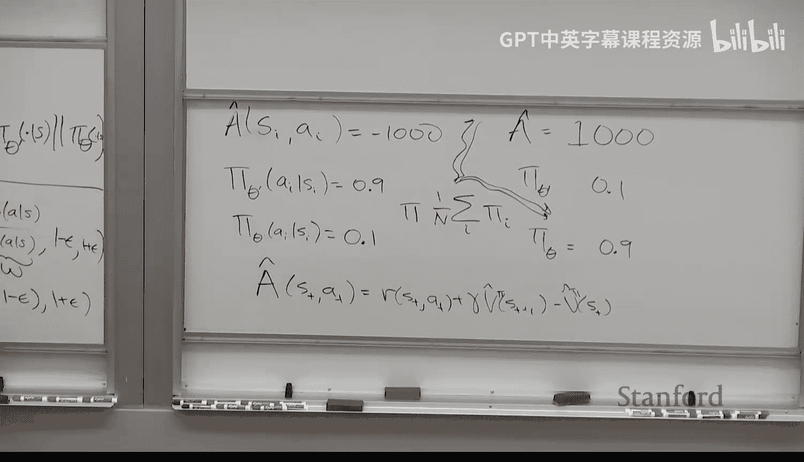

It's a little bit messy， but it's a policy that is kind of a conglomeration of your previous policies or some kind of mixture of your previous policies。

 it's not something that you can very cleanly write down， but it's a mixture of your path policy。

Okay， the other thing that's a bit wrong about this is that the here this is also not the action that the policy would have taken and likewise when you pass the action into the advantage that's also not the action that the policy would have taken and so we'll also see how we can fix that part。

But first let's talk about the value function and we have this key question of how do we fit a value function for our current policy using a replay buffer of data from past policies？

So。One idea here is instead of trying to fit V， what if we try to fit Q instead of V？

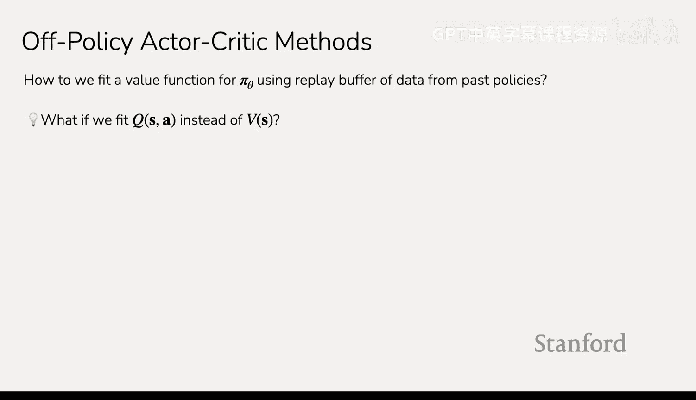

So。We can remember that Q。

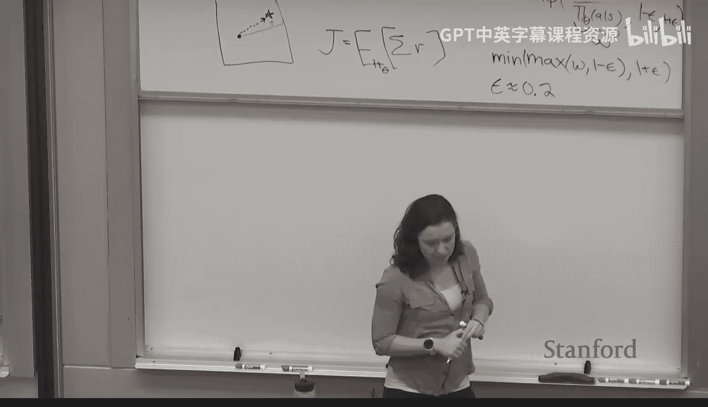

The Q function is very similar to the value function。

 but it's the sum of rewards if we start at S and take action A。

 so you can think of it as the sum over， say this is S T and atT。

 this is the sum of time steps starting at T maybe the end of the trajectoryy。Of the reward。

R of ST T prime A prime。嗯。Under the expectation that we're running our policies after taking state S T and action IT。

 and so it is under the expectation of pi theta conditioned on。S T 80。

So this is just the definition of the Q function。U。

We can now if we kind of so we have the summation over future time stepss。

 we can actually break this， we can kind of start to write out the summation and in particular if we write out the first time step。

The first time step is that we like the first date in action is actually just S A， right。

 because that's what we're passing into the Q function so we can write this as。😊。

We know the reward of the first state in action that we took。And then we could have a summation over。

Things starting at T+1。Of the sum of future rewards。Now for the sum of future rewards。

 this would now need to be an expectation。After like after ST A。And so for this one。We would need。

An expectation， if we were starting from。呃。Asked he plus one。Under the dynamics。And。U。

And the remaining a end state sampled from high theta。This is for Py Theta。No。

This is starting to look also a lot like a value function， but for the ST plus1。Right。

 and so you can actually also write this in terms of Q and in particular， you can write this。

 This is equivalent to。The reward at the current time step。Plus。

If we then kind of try to take this one step further。

 then we'll have S plus one sample private dynamics and A plus1 sampled from our policy。A。

So if you have the expectation over。ST plus 1 and A plus 1 sampled from our policy。

Then the current time step is the reward plus this expectation of the next Q。

And we can essentially define Q recursively。Like this as the reward at the current time step plus the future Q at the next time step and the thing that's really nice about this equation is that this equation。

Holds for any state in action We haven't made any assumption about which state in action。

This data was collected for。And so if we walk through that on the slides again。

We have we have data points that are state action reward next state。

 this is sampled from some other policy， and we also have the future reward these is kind of a trajectory collected from another an old policy。

This action was taken from the past policy and this future reward depends on the past policy's actions。

We don't want to use the future reward part because this is going to depend on the past policy actions in a pretty complicated way。

but if we， if we're fitting Q of SA， that we're actually passing the action as input。

 and it's actually okay if that action is a bit different from what our policy would have taken。

And so because that's okay， and because we have this equation that represents this recursion that we could actually try to fit QA。

😊，To a target that looks like this。And so we have our definition of the Q function of the future rewards condition on the state in action。

 and for any state in action， we have this equivalentvalence where。😊。

Q for P theta of SA is the reward at the current time step plus the Q function at the next time step where the next time you have an expectation over the next time step and an expectation over the next action for a policy。

Yeah， good question。 So the question was the for this data。

 we have this action and for the Q function， it takes an input in action， but it's still like。

K of the rest of the trajectoryy was still following a different policy right and the queue needs to be like you need to be sum the rewards for a current policy。

 not the other policy。And the thing that we've done here is that。

If we represent this Q in terms of Q for our current policy。

 actually this second term right here is actually not using the future data at all。It's it's using。

 well， the S prime we will be using the data， but is' not using anything after S prime。

And in particular， we using our we're using our kind of bootstpped estimate of Q。

At the next time step and。for the next action， instead of using the action that was taken in our data。

 we can use the action sampled from our current policy。

So we're recursively defining the Q function here and the。The only things that will。

 maybe we could actually just kind of go through the next part。

What we'll do here is we'll sample an SAS prime from the buffer is a was from an old policy。

 but the dynamics are constant， right？And then we'll sample an a prime。From our current policy。

 this is sample from our current policy conditioned on S prime。

And then we can estimate the Q function as the reward at the current time step plus the Q function for the next state in the buffer and an action sampled from our policy。

and because this action is sampled from our policy rather than from the data set。

 then we're actually getting an estimate for our current policies Q function。So yeah， good question。

 So the question was， does this require that we see data from all possible state action pairs the。

There is a very good insight there we don't actually need to see data from all state action pairs。

 but it means that for this target to be accurate， we do need to have data that covers actions that are similar to what our policy would be taking and if we haven't seen that data this Q function is going to be inaccurate and you'll need to kind of collect data from from your current policy in order to get that so this isn't like。

We're not getting a like really good estimate over Q function for free based on past policies。

 we still need decent coverage of what our policy would have done。

 but it means that the this does actually provide somewhat of an means to use old data and so。

I guess just to finish this slide and then come back to that point。

 we'll be using R plus gamma times Q as our label。And then we can use supervised learning to pass this input a state in action into a neural network and an output try to output this label right here。

Um， and again， we can use kind of the similar like L2 error between our prediction and the target。

 just like with the value function。And to be accurate， the targets why。

 these targets need to have sufficient action coverage and need to have like the action taking from your policy can't be wildly out of distribution。

 otherwise these targets will be inaccurate。Yeah， so we'll need have taken that action from that state yeah and so if the this does make it like you need to have if you don't have cover like if you don't have any data from that state that's a problem and then if you have data from that state but only for like very different actions is also a problem。

 the some of this is also going to be relying on like neural networks can generalize kind of kind of interpolate reasonably well and so that helps this but you do need like sufficient coverage for this to be accurate。

Yeah， so the question we actually didn't quite get to this equation on the board there we have this expectation here over the next state and an action sampled from our policy and we're going to this equation estimates this with a single sample where we use。

We have ST and8 and then we're going to use the ST plus one from our data set。

 which is just one example to estimate this part and then in this equation we'll use one sample A plus one in order to estimate this there are actually methods that you can use kind of multiple samples to estimate this to get a better estimate of this expectation。

 you could also like as you're taking if you take。Like in a batch you'll be kind of sampling from your current policy and so if you sample like each data point will get a different sample。

 so you also get kind of multiple samples in that way。

 but yeah even for a single state next state you could also sample multiple actions here。

Yeah yeah so we've been kind of we mentioned that we need sufficient action coverage here and the question was if we use a KL constraint or something similar to encourage it to stay close to the previous policy。

 would that be helpful here and the I think that like one of the algorithms that we'll see doesn't do that but like。

It's a good idea and in general we'll see that those kinds of kale constraints come up quite frequently in reinforcement learning because we'll often be assuming that we're not deviating too far from our previous policy。

Yes。Possible that the pretty algorithm that we'll see could make it better in some circumstances。

 too。Okay， so to walk through。Okay， well， so I guess what we talked about is we'll be updating Q hat with our targets y where the target is R plus plus the Q and critically the state SI will be sampled from the replay buffer。

 but the next action will not be from the replay buffer。

 it will be sampled from our policy conditioned on that next state from the buffer。Cool。

 so that'll be our revised step three for the algorithm。The last thing is what we want to do here。

 so we have instead of estimating the value function， we estimated the Q function。U。

There's a couple things that we'll do here for this update。

The first is that it'll be convenient to use Q instead of A。

And this means that we're not going to use a baseline this is going to be higher variance。

 but that's going to be okay because we're going to be using a lot more data。

 like all the data from our buffer， not just the data from our current policy。

And then the second is that the current policies actions are likely better than the past policies actions and so for this update right here。

 we'll be sampling an A from our current policy and instead of from the action taken in the buffer。

And then this will be the gradient update on our policy where。

We'll be looking at log pi of a given S timesq of SA， and these A's will be sampled from our policy。

 though essentially using the same trick as what we did with the Q function。

 except now for the current state instead of the next state。So here's our full algorithm。

 there's sort of one remaining problem which is that the state the states and our buffer didn't come from our current policy。

 there isn't really anything that we can do here， but it's actually not necessarily a bad thing。

 it means that we're going to be getting a policy on a broader state distribution rather than just on the state distribution that our policy would visit。

Okay so this is this is essentially the soft actor critic algorithm。

 there are other ways to estimate this gradient that we don't have time to get into today but we might go over in future lectures There are also some fancier ways to fit this Q function that we'll see in the next lecture。

But the algorithm here that this is very， very close to is called soft tech for critic。More S。

And if we compare S and PPO， the more off policy version that uses a replay buffer is shown in orange and the less off policy is shown in brown。

 and so we see that we're able to get much more data efficient learning with something like S than with something that's less off policy。

So you can be far and far more data efficient when you use this replay buffer。

 the downside is that it can be a lot harder to tune hyperparameters and generally it can be a bit less stable when you're using these few functions than compared to PPO。

Cool， and then lastly， when you're fully off policy you could actually be efficient enough to run reinforcement learning on real robots。

 so in this example in about two hours the policy learns how to walk forward just with the algorithm that we talked about。

You can also learn some kind of cool manipulation tasks with reinforcement learning。

 this was suited with demonstrations is a very precise task and you can see that actually if you compare the performance of this RL method。

 it actually gets 100% on all of the tasks that they tested。

 whereas if you use imitation learning you'll get a much lower success rate。😊。

And reinforcement learning is also leads to a faster policy than with imitation learning。

And then PPO is a common algorithm that's used if you want really stable learning but less data efficient learning and so if you're in simulation for example。

 data is not a problem， you can collect tons and tons of data in simulation and you can learn a policy in simulation and then if you carefully tune your simulator that policy might be able to transfer to the real world and then there is also an example of in general for manipulation Sim to rail transfer is a lot harder we're learning how to do a rubbik's cube that was trained in simulation and after about five minutes of this rollout you get a rubbik's cube that has been completed。

That was with PPO。PBO is also a common choice for language models we'll start to discuss them next week。

