# 斯坦福大学《深度强化学习｜CS224R Deep Reinforcement Learning  Spring 2025》中英字幕 p06 -06- Lecture 6_ Q-Learning.zh_en -BV1SvmxB3E5e_p6-

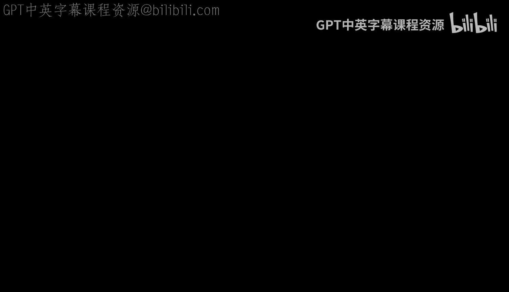

So as a reached for the last couple lectures， we talk a lot about value functions and Q functions。

 we'll talk about them more today and as a reminder。

 value functions and key functions are representing for some features。😊。

This list starting at sub and study function will be feature fixed rewards to start the state policy。

 and the key function is started the state to get action and best policy。😊，啊 so。

You can write down methodically in respect teacher award。

 and we've seen these diagrams a couple of times where you can think about value as from serve award as people folks as color away。

😊，We've talked about a couple methods so far， the first method that we talked about was policy variables where we alternate cluster data and including our policies。

 and we can think of it as trying to cancel to our policies and increasing the long life of actions that have a higher reward in the future。

 where we should factor based on in order to encourage the policies to more about average things than the visible and less of the below average。

😊，We then started to talk about after Cri Me。And in this part。

 we introduced an additional step of the loop where we are first going to estimate the expected piece reward for our policies and use that to improve the policy so it have this revised form for our gradient for our policies where we are still taking samples but increasing the likelihood on actions that we think are good and decreasing the likelihood on actions that our best。

😊，So these are the methods that we've talked about so far。

 we last semester focused a lot on how to do this access critic algorithm in an off policy way。

 so instead of only using the data from the current iteration。

 trying to be able to use all of the past data from all past iterations and do that。

 we needed to be able to estimate a Q function from past policy data。

And do that we you can use a neural network， passes them put a state in action and output the value。

 and we derive this equation that's defining the Q function recursively。

 or we can think of the sum of future rewards as the reward at the first time step plus the Q function starting at the next state and S。

😊。

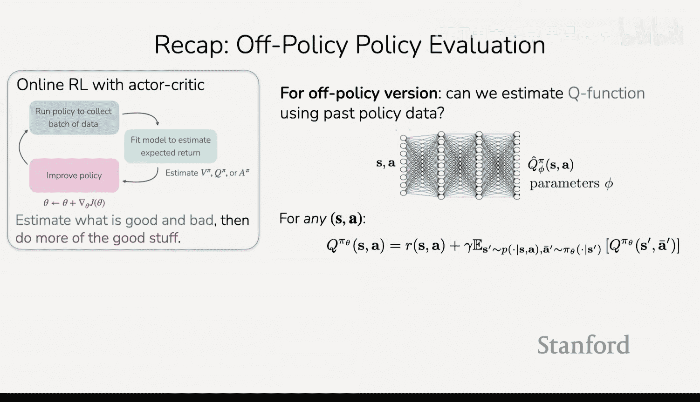

We found that this equation holds for any patent in access。

 and that means that we can use previous state action index state pair in order to try to learn a key。

 and specifically the way that we did that is we would sample a state action next state from our buffer of previous data。

 then we'll sample index action from the current policy rather than from the past policies。😡。

And then we will try to do supervised learning on these targets where the targets are using our estimate。

 our current estimate of the two function for our policies， and we passive input the state。

 the actions， the next state and the next act that was sample。

And so once you formulate with objectives using out these scraps guns。

 then you can use super right learning as it help to try of not to something we also talk about first these YIs be accurate you to have sufficient coverage in your data set discover actions that your newest policy。

😊，So today we're going to be covering valuebased RL methods and statistically we'll be talking about what I think arguably was the very first key reinforcement learning method and it was based on the Q learning algorithm and so we'll be talking about Q learning and they'll also be talking about how to implement key learning and practice。

 how to make it stable， and the goal to today is to think about how key functions relates policies。

 how to do RL without learning and explicit policies and how to stabilize key learning if your activities that。

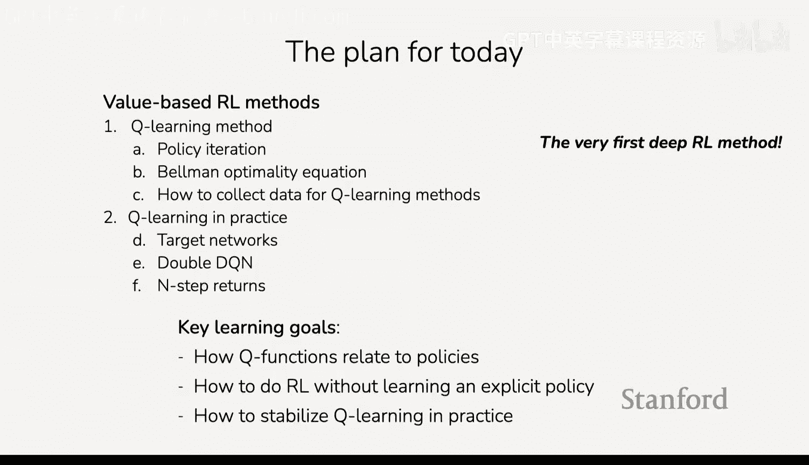

Cool。We to start out with a thought exercise and a question for all of you to think about， so。😊。

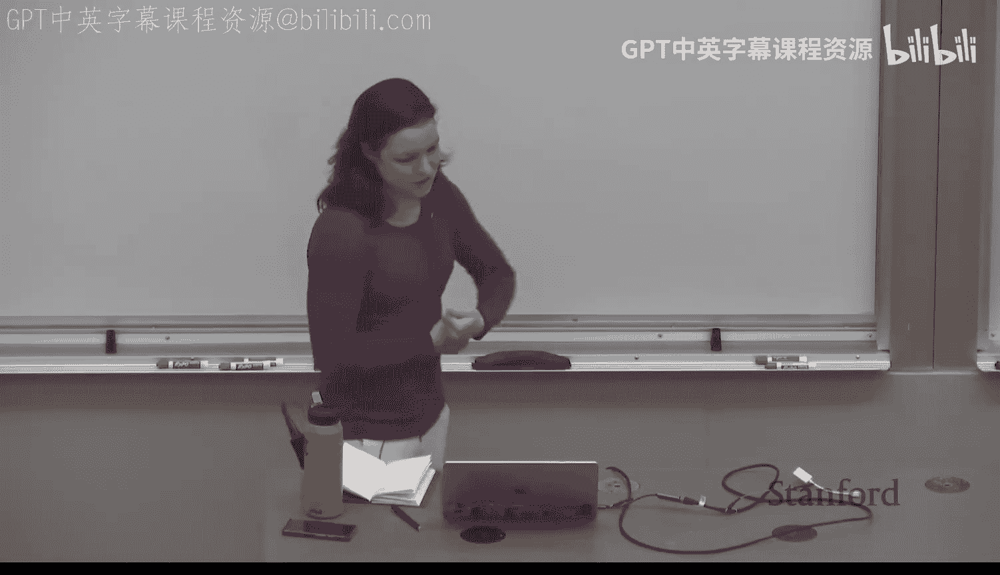

，Maybe you have some policies and for your policy， you have a pretty good estimate of the two function。

And as a reminder， the， well， I'll put the definition of a few values up here with the future awards for state and action。

And an object that we're going to be thinking about a lot today is if you have some estimate of the two function for in this case for a policy。

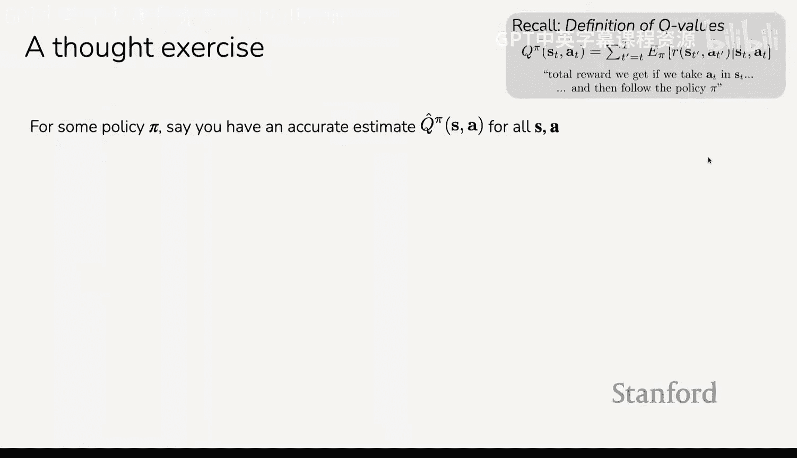

Then。One thing you could do is you could try to， instead of following some policy that you've already learned。

 you could potentially formulate a policy by using the access that maximizes your。

So if you have a bunch of different candidate actions at a given state instead of following your policy。

 you could take the candidate action that has the highest data。

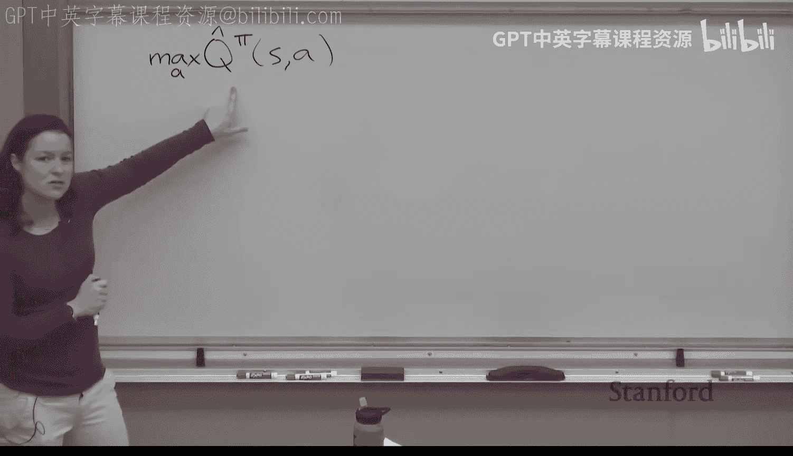

So。To continue on this thought said well define a policy that does exactly that。

 that policy has a probability building of one for taking the action that maximizes the C value and has a probability of zero otherwise。

 there is just a deteristic policy that always follows what the C value is telling you is the best。

And then we'll look at this in the context of an example。

 so say that we have some 3D navigation problems， we're going to be starting somewhere in this blue box and our goal is to reach see the star。

 we can move like we can move in 2D the reward is one at the star and0 L first so very simple and let's say that our current policy always goes to the right。

😡，啊。And as more than additional point of detail， if you're going to move up。

 it takes one time step to move about this distance and it takes about two time steps to move distance。

So my question for you is if you define this new policy。

 you have this current policy that always goes right。

 you have an accurate estimate of few values for that policy。If you define this new policy。

 is that better than the current policy， is it worse than the current policy。

 is it the same as the current policy， is it the optimal policies， and why or why not？😡。

So I'll give you well， first any questions about this example。Okay。

 so I'll give you a few minutes to talk to your neighbor about these questions and then we'll come back and talk through again。

It seems like people are talking a little bit less so maybe you can come back who wants to share their thoughts。

行。😊，So let's summarize that and then we'll talk about whether it's the optimal policy so summarize the old policy is going right and so that is not optimal so if you're starting here。

 then you're not actually going to hit the star and and if you think about what s pi is or the old policy kind of everything in this region right here is going to have a S pi equals to1 for all of these for all of these state in action also the yeah。

 and then if you start to think about what what sI looks like right here。

 this is actually where it will。😊，Well， actually sorry take that back D pi is equal to one for everything in this row。

 it actually depends a little bit on the action， what theq function actually is if for this row。

 if the action is the same as the policy it the smooth right， then theq value is one。

 if it actually does something else， if it goes like up for example。

 then it might actually miss the star， if it follows the policy after that after taking that action。

😡，Now if you look at this row for this row。Q pi of all the states in this row where the action of going right is going to be zero。

But then if you look at the Q Pi for all the states here for the action building up。

 what is the Q value to that？😊，可以。One full， and it's not because if you follow up and then follow the policy。

 we'll have a award of one。And then lastly， if we go to this row， if we have S and then going up。

 what is the key value？😊，Here。And so what this means is that we're going to get the new policy。

 what it's going to do， is it's going to be going right here。And then for everything in this row。

 it will be going up because it's going to be using the action that has the maximum value of Q。

But then for this row， all of the key values are zero because all of the key values for the next one are also zero。

 and so if you default to the previous behavior， it'll stay down to the right。😊。

And does anyone wants to discuss the second question， like， is this the optimal policy？

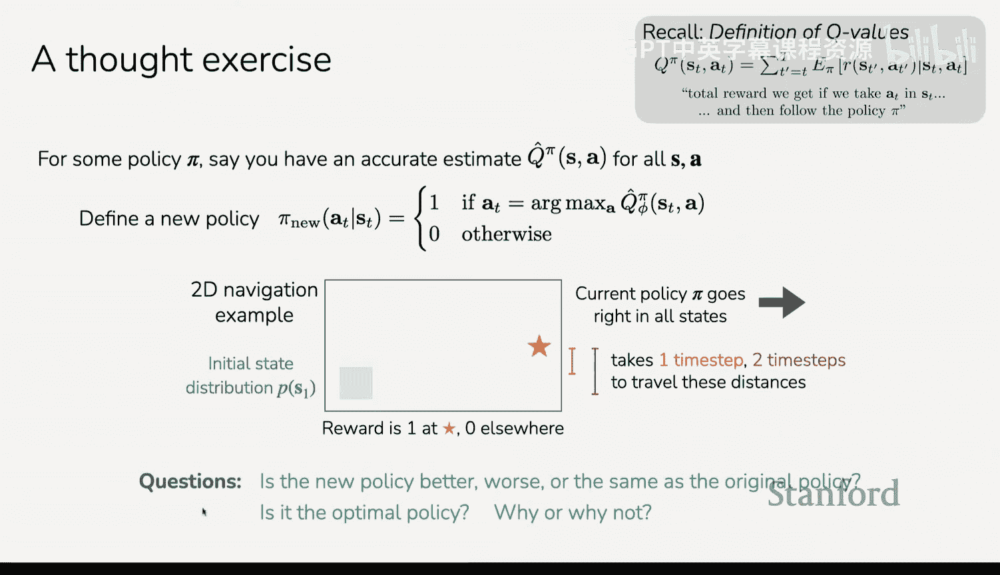

Yeah， so this policy， the new policy is better than the old one。

 but it's not the optimal policy because in these states， the optimal。

 like the best policies to be the one that also is going up in order to。

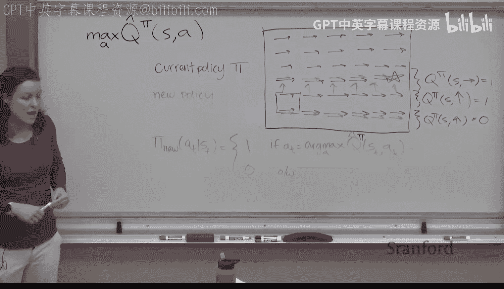

Yeah， so the first was if we iterate this and do it a couple times。

 this will become the obstacle Paul right and yeah there are a couple slides ahead。

 but we'll talk about doing this iterly。😊，Yeah， so we can get a reward of one the question is wise it's not the optimal policy。

 so we'll get a reward of one here which is great， but if we're starting at this initial state。

 we actually will just keep fun going right， we won't go up after defining this new policy and so therefore it's not going to get a reward of one from all states。

Yeah， so the question is is there a sense of like if you're getting closer to the star the Q would be higher versus not。

 I actually didn't explicitly define this， but if you have a discount factor that is below 1。

 then it will get higher as you get closer everything I've shown here is with a discount factor of  one for simplicity but if you use a discount factor of like 0。

9 for example， then the Q value here would be1， then it would be 0。9 here then 0。8 here 0。

7 here and so forth and then it would be it would still be like 0 for this entire row just because the。

😊，Because you're not， you're kind of still somewhat of a split。

The other thing potentially to note here is that if your reward was Venr。

 it's like the reward function instead of being won at the star and zero elsewhere， if it was。

 for example， the negative distance to the star， then you would actually。

 I won't go through that I won't go through that on the board， but if you go through that example。

 you'll actually see that even in a single step。😡，Regardinging from this policy。

 you would actually get a policy that those students are from policy。The question is。

 if I wanted to get the off policy， I would need to iteratively do this and reconsider the P for the latest policy every time。

 so yeah that's correct。Yeah， so in this example， the question is。

 is it always better in this example， the new policies was better than the current policies。

 and this is actually always going to be the case， so it's always going to be at least as good as the previous policy and it's never going to its assuming that QI is accurate。

 it's always going to be as simple as it's never going to be。😊。

And now if P is already the off policy， then it will be the same。😡。

This is started to think about like can we actually start omitting policies so give is the expected reward。

 when we do this Rm， we're going to be taking the best action from state S if you then follow the policy afterwards。

And this is going to be at least as good as any action that the policy would have taken。

And regardless of what the policy is， this is going to be at least as good as what that policy is。

And you can do that because of taking the a that has the maximum especially reward。

So potentially we could actually just forget using policies and just do this rather than actually explicitly learning a neural network for the policy。

And so what this looks like as an iterative algorithm is we would run our policy to collect data。

 then we would fit a model to estimate P according to that latest batchS of data。

 you could also do this in an off policy way， like we talked about in the last lecture。😊。

And then to improve your policy， you can just define the policy to be the policy that maximizes the keep up。

And then once you find that new policy， you can collect some new data and then estimate， again， QI。

 but this case， PI for your new policies and not your op。The policy pie is equal to this。

 And so we're not learning a neural network for the policy pie。

 We're not explicitly representing it as a model， but we。

It's helpful to have some thoseations to refer to the the。

The only thing that's the only neural network here， the only model here is thats too something。😡。

Yeah， so the question is how do we generalize this to use continuous actions or more expressive access spaces。

 So this is generally going to be easiest when you have kind of a discrete set of actions that you might take like going up going to the right if you have continuous actions。

 you actually can still use this algorithm。😊，Although you need to figure out how to perform that max operation。

 there's a couple ways that you can conceivably run this operation right here， in principle。

 you can use something like gradient descent， although that turns out not to work very well。

 you can potentially there's a variety of reasons why it cannot work for you。

 And if your actions are not very high dimensionsal。

 then you can it might actually be better just to simply try to sample a bunch of different actions and fix the one that has the highest key value。

 you can also there's other kind of sampling based optimization algorithms or you can iteratively sample and refine your estimates from there。

 the。Yeah， so there's a couple things you can do there if you have a discrete action space that that's like like text。

 for example， in principle you could do some sort of like discrete search over things where the Q value is what you're trying to maximize not。

😡，Yeah， how does this work in cases where the rewards are very farrse so we saw one example where the rewards are sparse and it can still work in this scenario。

 the thing that you need to be aware of when the rewards are sparse is that you may need to do this loop of ringttting the policy potentially a large number of times because each time you do this you're actually like the first time we only got a good policy here and now if this environment was much bigger。

 that means that you need to kind of keep on doing it as you go down and。😊。

What is often referred to as a backup， you're sort of backing up the reward from here to the other states and you will need to do those backup for as long as the。

 especially full for as long as the horizon of the problem is so you need to make sure that you're doing many iterations。

Okay， cool so。😊，Let's see we can write this down as an algorithm and so we can take our off policy apher algorithm that is fitting P and then instead of using this policy gradient update。

 simply define a new policy that's taking actions according to。😊。

You can think of this as really having two key steps like what we talked about， one is asim PI。

 this is often referred to as policy evaluations， if you're learning how what the values are for a policy。

And note that you can， you can do multiple gradients up here because this isn't like on policy。

 we're just trying to fit our target。And then the second step is improving our policies。

 because you refer to it as policies。And this sort of two step iterative stick here is often called policy iterations。

It's kind of on the way to an algorithm like you。So， on the。

Torite this out on the board what this looks like is。Having a first step where you collect data。

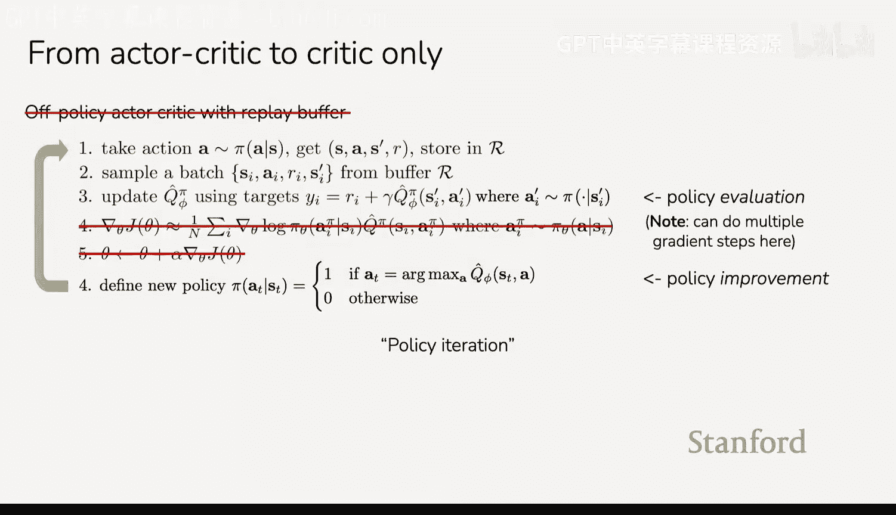

Oftentimes you might collect data from high， it might also be it connection potentially density from other policies。

😊，Then you have an next step where you're going to try a fit。Your estimated dysfunction。

For that policy？And next you can use the targets that weve defined in the reference。

Of R of SA plus gam。And we。Where these are from the buffers， and this is sampled from。Our policy。

And then lastly， we'll improve our policies by defining。The new policy。Yes。Oh。

Being one if that is not necessarily G value in zero。The question is is this policy deterministic。

 I guess this policy deterministic， this is actually one reason why you might not want to collect data from this policy because they's not going to have that main de favor senior As and we'll talk in a couple slides about what policy you might want to select data from。

Yeah， so the question is， when we're fitting these targets。

 why are we sampling from a prime and why not do a maximum over action？For an average， so the。

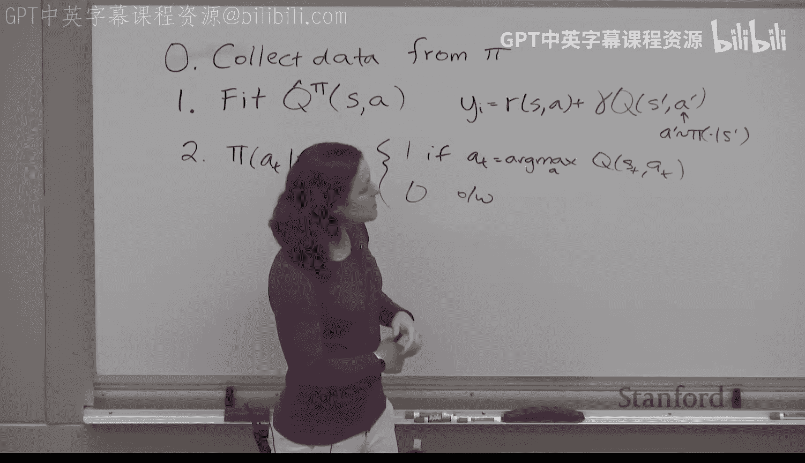

So there's a couple of things here so first you can do an average and sample multiple1 and that can give you a better estimate of the target value The second thing is that you can actually instead of sampling this from P。

 you can actually do this improvement that in the Q function target itself。😊。

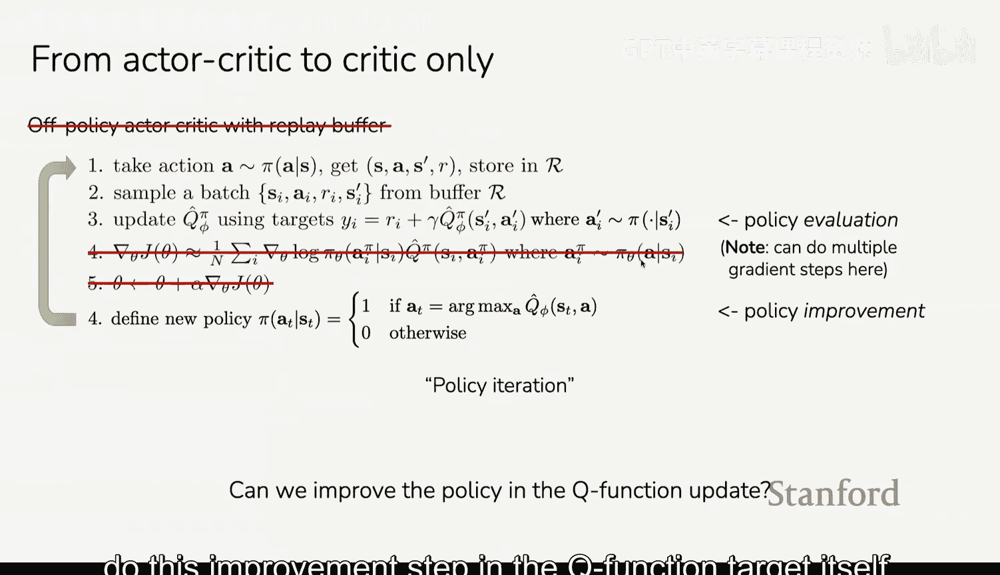

So you can actually instead of defining whyI this place。You could consider。A target for your c。

To be the rewards。What demo time。The map over a。

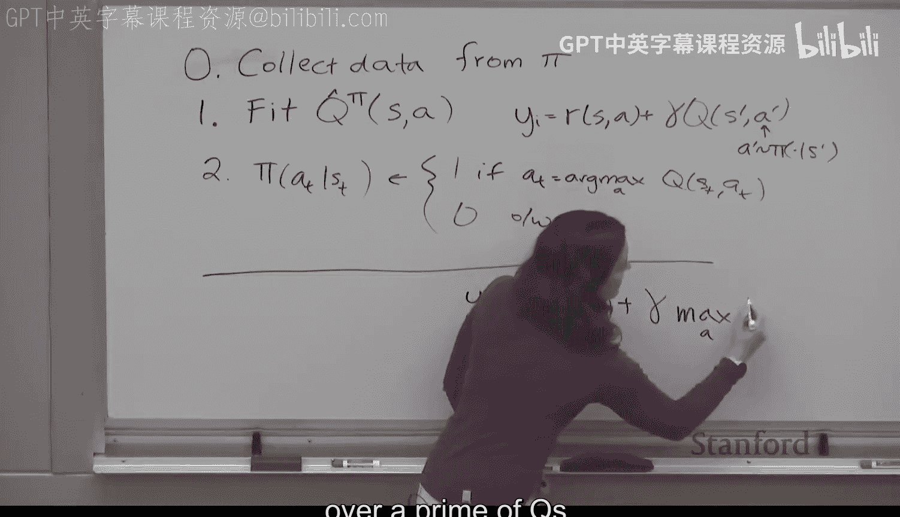

Time to。Oh。And what this looks like？Is something like this。And this actually is what gets us here。

One way to think about this is a couple ways to think about this。

 the first is that these targets are actually your key values for your new policy。

So you're actually you're already putting the improvement steps in your coupon function update and you're actually learning the Q values associated with the new policies that you're going to be defining。

😊，And there's actually another way to look at this as well。So。

We previously defined this equation that's true for all state productions。

 so we define that the fu equals the reward plus the dysfunction that domestic。

This is true for all states in us。And it's actually also the true for any。Including the office。

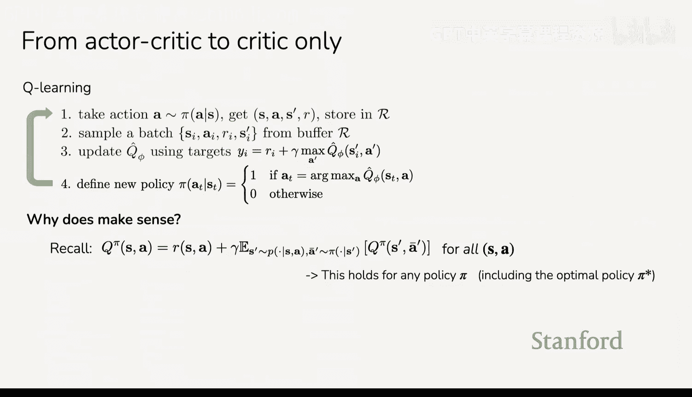

And you could actually write out another equation that is specifically for the optimal policy。

And in particular， we know that the optimal policy is always going to be taking the actions that maximize our future rewards。

The off policy is always going to be the action that it fixs is always going to be the one that maximizes the design。

And so we can write down an equation that holds dust to the optimal policy。

 which is the same equation。😊，I。The one there， except instead of an expertise over the next action。

 it's the maxim over the next。So what that looks like is。

We're defining the P function as the award at the current time plus the sum of teacher awards and for that sum of these awards。

😊，We have some expectation over。The next state that will happen。And then。

Because we know that the optimal policy or the best policy is going to be taking the action that is maximizing the key value。

 and we can write this as the map。呃。To at the。Yeah。

 so the question is why where are we talking all about few and why not be so you can actually also write down these equations for these the same in like a very similar way。

 the thing that's very nice about few is that we can actually get a policy out it。😊。

So we can if we know what Q is， then we can do this Rm over action to get a policy that's better than our previous policy。

 whereas if the value comes in， if we only know V of S。

 then we don't know which action will lead to higher to。In principle with the value function。

 you should try to do some sort of look ahead， like if you have a sense for what the dynamics are。

 you could try to then。You can try to predict what F prime is and pick actions that are maximizing that and so what that would look like is。

😊，Trying to like。Sick actions that lead to。In expectation。I a like。A high deeper value。He。

DoYou see the principal do something like this。With with， but。

We don't know what these dynamics are and we can't necessarily predict what the next state will be as a consequence of our action。

 and so in general it's a lot harder to get a policy out of the value function and to improve our policy ultimately with the value function that is。

😡。

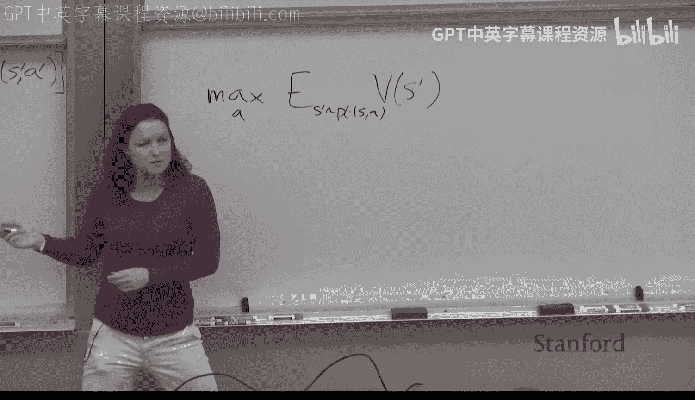

So now going back to this equation， this is true for the optimal policies。

 I'm in right to for the optimal policy here， where I'm writing high stars as the optimal policies。

And。If you look at our update right here。😡。

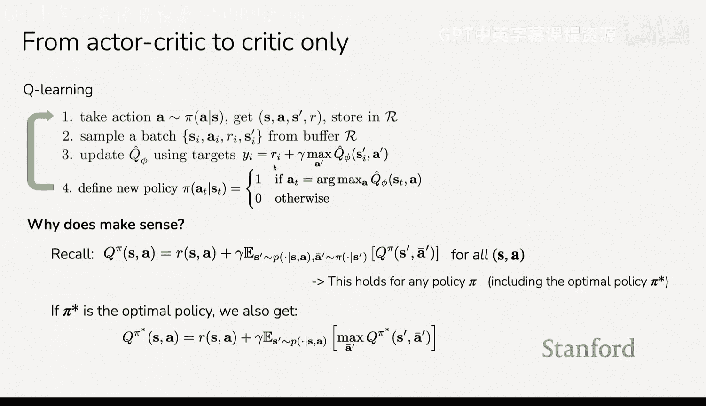

We're trying to get a Q function that is predicting this。And。Essentially with this equation。

 you can think about it as this update， I actually try and to make this equation。

So we're trying to make the left side of the equation equal to the right side of the equation。

And when this equation is true， that means our policy is obstacle。

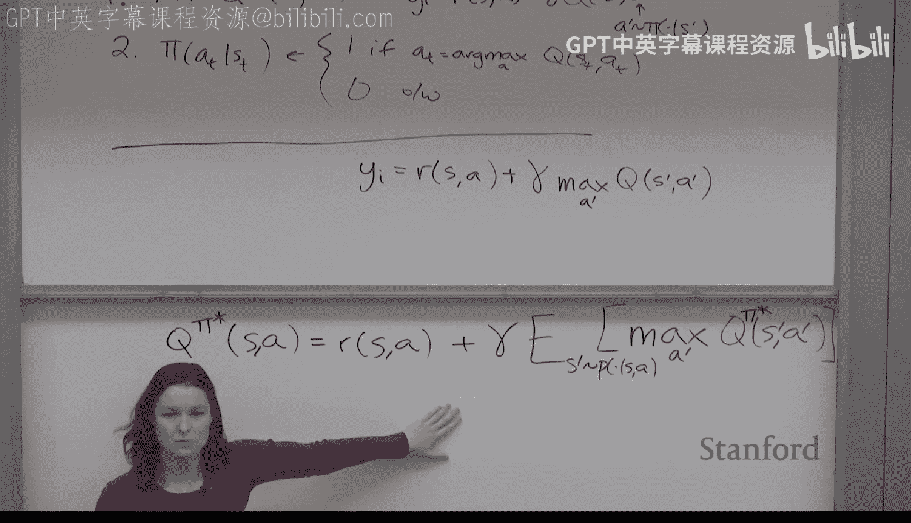

So essentially one way to think about key learning is that when we're optimizing step three。

 we're trying to find a cube function such that it satisfies this equation。

 which is only through the optimal。

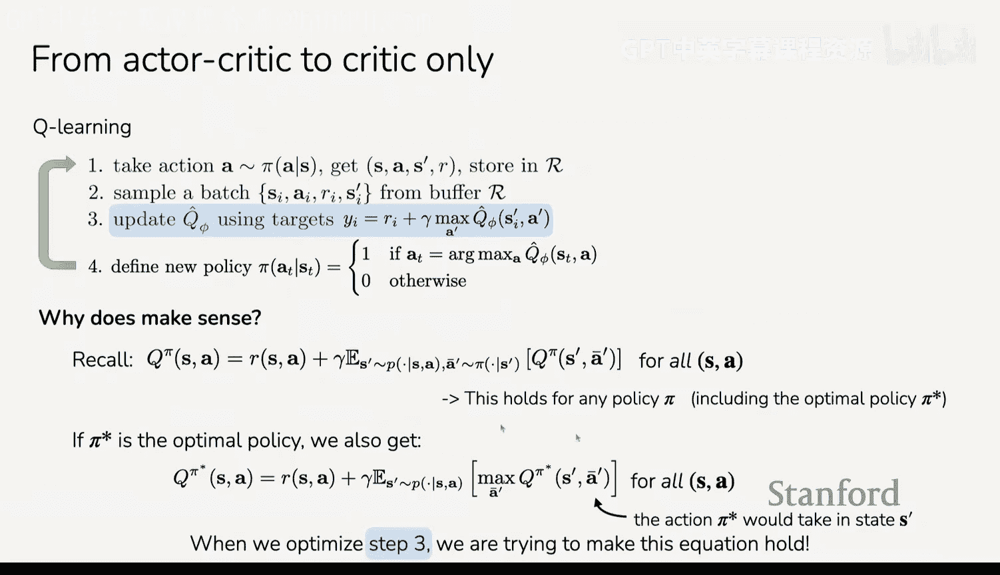

Yeah， sorry this is like it's an only， so this only holds the actual policy and if you have the actual policies in。

Yeah， great question。 So the question is， if we have really good estimates of Q， will this inverge。

 we'll talk about this in one minute。 So let's first let's talk about some terminology really quick。

 We unfortunately has a center of terminology。😊。

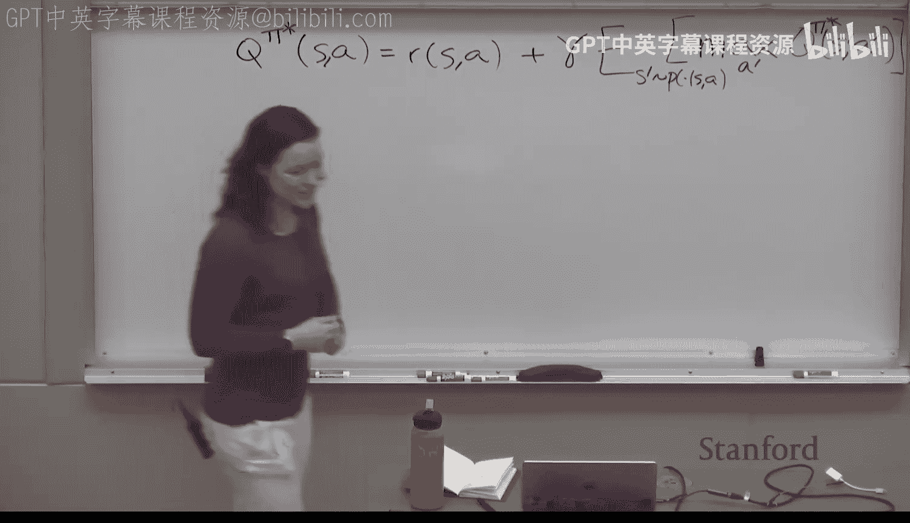

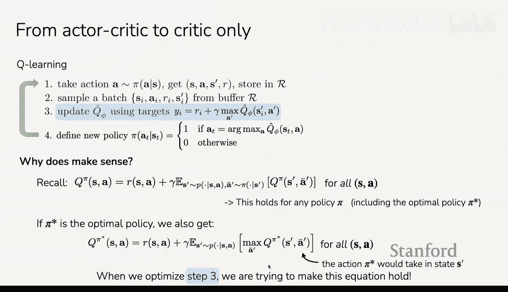

It's useful to know some of it so that if someone's talking to you about reinforcement learning or you're reading a paper。

 you know what they're talking about it， this first equation is often referred to as the development equation。

😡。

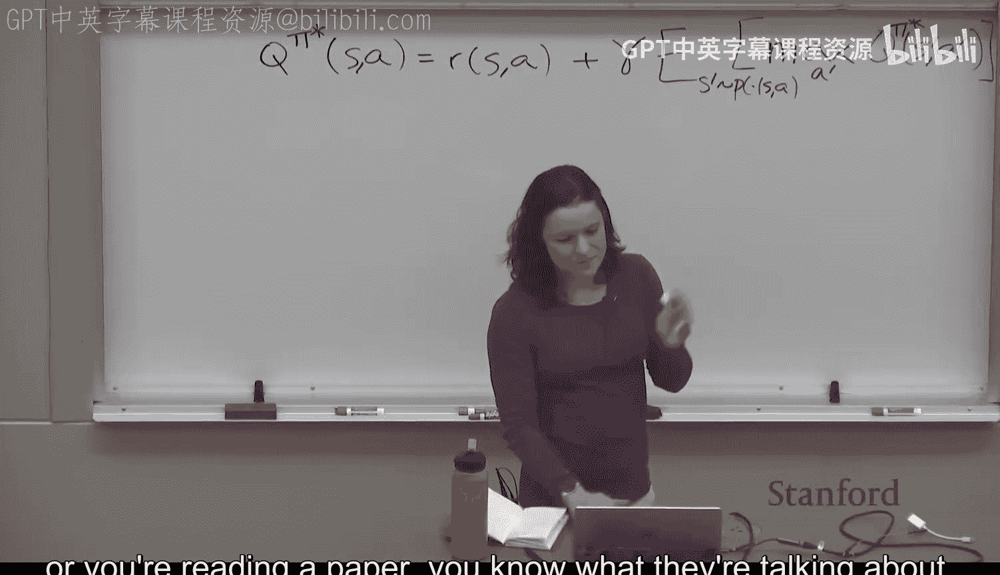

Very useful objects， and it's what we were using to try to do policy evaluations for a policy。😊。

And the second equation is called the Bel Ophthalmology equation because it's vividly for optimal policies。

😊，啊。Sometimes， people also like。Informally might call the second one a bemony equation as well。

 but yeah， officially the first one is Belmony equationaz， second one is Belmon off melany equation。

 you can derive ones that are equations like this that are also for the value function B instead of the s function and people also refer to those as like Belmony equation and Belov。

😊，Okay， so getting back to the question， if we do this iteratively， will we convert？To。Leical policy。

There's good news and bad news here， the good news is that if you're in a very simple setting where you can actually store all of your key values in a table for every single state and action。

 this would be like for a very small discrete state and action space and if you have sufficient exploration。

😊，Then this algorithm will convert。😡，So that's the good news。

 the bad news is that basically in any other scenario it is not guaranteed to words and you can construct scenarios when it diverges even with this linear two。

 which is kind of sad。I guess the flip of that is that even though it's in divergent scenarios。

 it can be made to work very well and we'll see some examples of it working very well at。😡，Yeah。

 so the question is like what does this if this mean。

 like what does the statement mean that it is a bit vague。

 so specifically it doesn't necessarily have to do with the accuracy of your key values because you're actually going to be fitting your key values like through this process。

 it's more a statement of the size of your state and action space and if it's small enough that you can maintain this table and there's also a condition on exploration where you actually need to have full coverage of the state and action in your data set。

 than it will complete。😊。

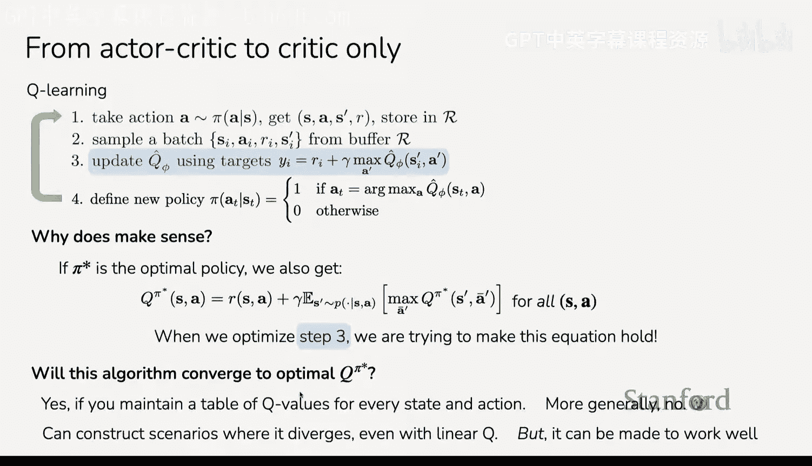

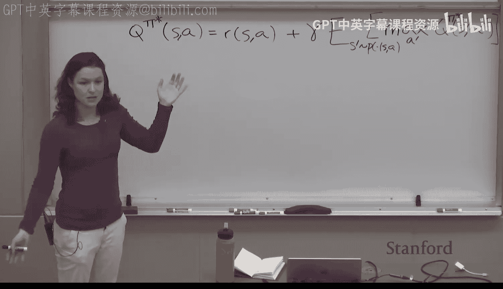

Okay， so one note about this is security is off policies and in particular this。😊。

Equated holds for all state masses， and it means that we don't have to have the actions coming from our current poll。

And in particular， it might actually make a lot of sense for it to be broader than our current policy because we're going to be doing this maximization over our key values and so this when we do this maximization。

 we're going to be considering a lot of different possible access and if you have a discrete action space might actually just consider all of the possible actions。

😡，And when we do that， we would want our key values to be accurate when we're considering all of them。

 and if there's one action that we haven't collecteded data for that we're going to be considering in the optimizationization。

 it might be erroneously high because we didn't flush any data for it。

 and then you'll get an inaccurate target value when you're fitting or。

And so instead of taking collecting data from our current policies。

 it'd be useful to collect data from some exploration policies and specifically a policy that's collecting a broader set of actions than our determinants。

We weren't covered for a lot of different actions， specifically sort as terms。

 and there's a couple of choices here。One point is。

And mostly follow our like follow policy most of the time， but with some small probability。

 take a completely random action。And so what that would look like is a policy that。

With some probabilities。I would say maybe can write it as like take our random actions。

With probability。I think。And follow， maybe we can call this high exploration and follow the action。

 follow your current policies。😊，With probability 1 minus。And。

You can write that out slightly more formally up here。

And this can be a good choice because it means that when you take it' actually uniformly random。

 it means that you'll get very good coverage of the actions that you consider。

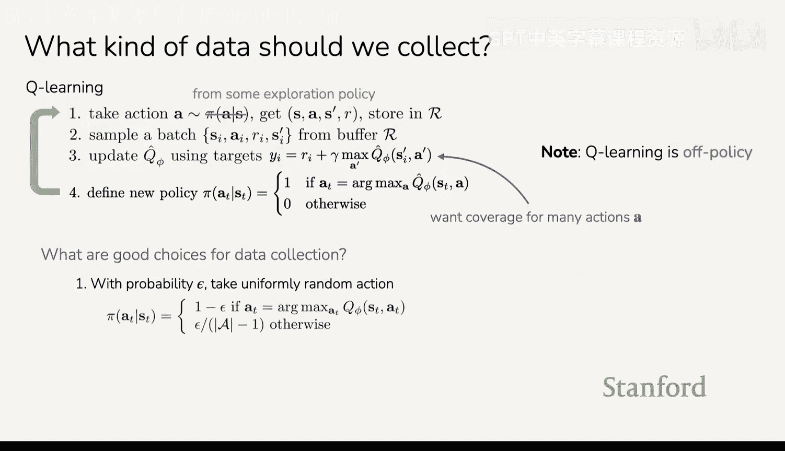

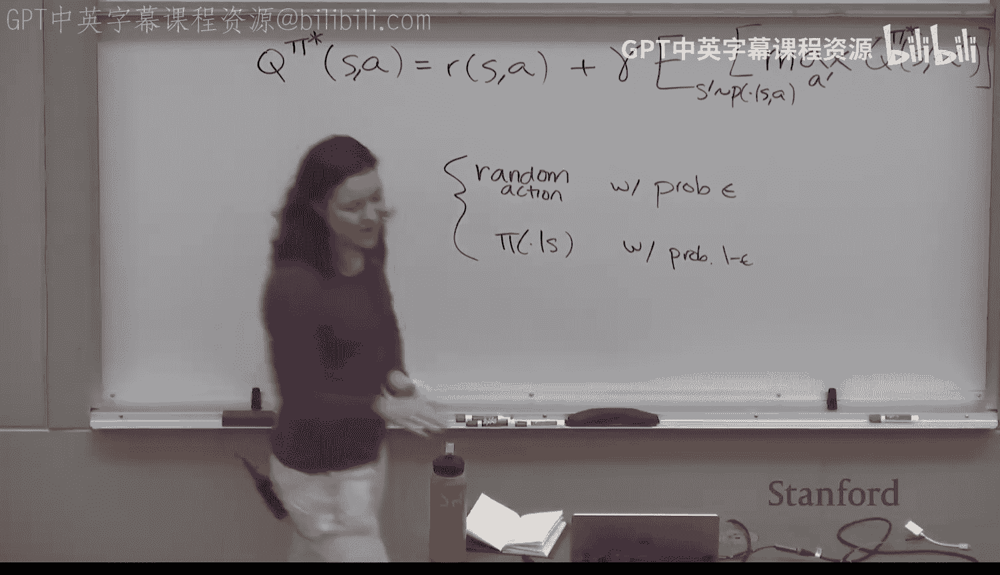

Oftentimes during like as you proceed through training。

 you might start with a larger epson so that you have more exploration at the beginning of training and then as your policy is getting better and as you're getting a better estimate of your Q function。

 you can then make this smaller and explore less as you go through fit。

So this is called epsilon greed because you're being greedy some of the time and epsilon probably of the time you're not being greedy and just taking your risk。

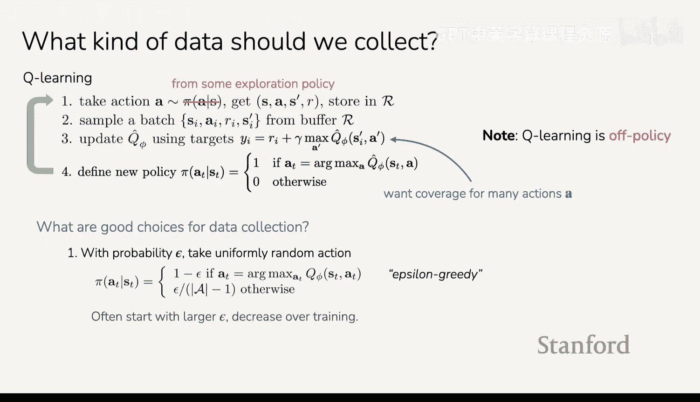

Okay， and then another choice that's also somewhat reasonable。

 although a little bit more complicated is to take actions with probability that is proportional to six key values。

 and so if you have actions that have a higher key values， then take those actions more frequently。

 and if you have actions with lower probability， then take those actions less frequently。

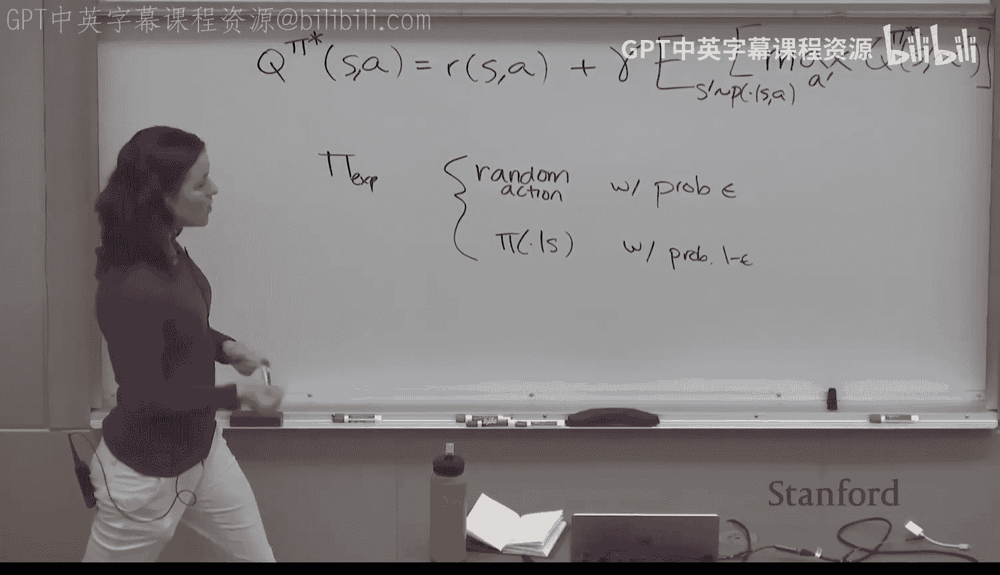

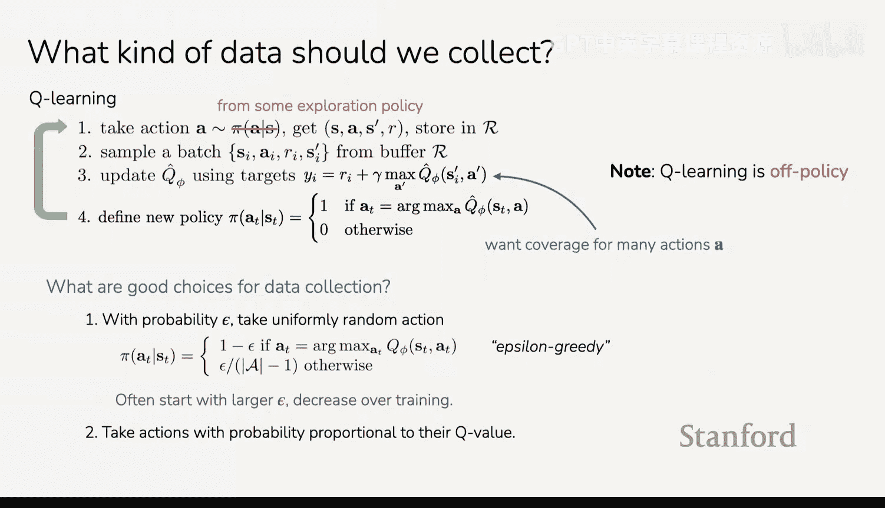

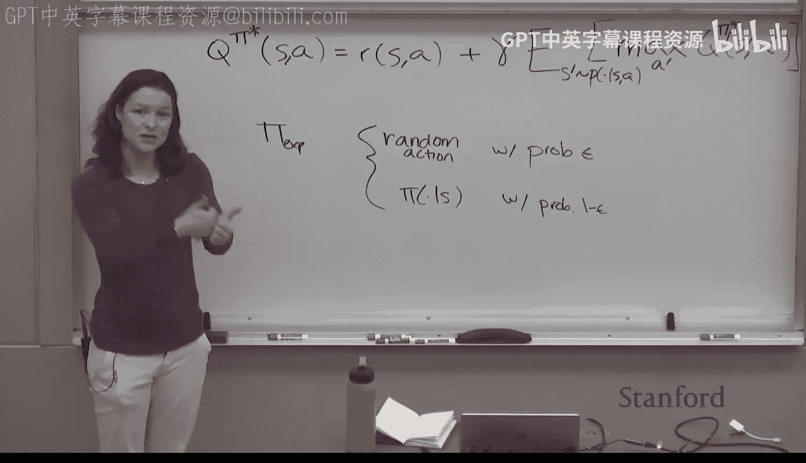

One way to write this is you could expentiate your key values so that they're all positive and then normalize in order to get a distribution over a probably distribution over。

Sometimes this is called Bolin explorationlor named after the Bolin distribution where you exponentially among them。

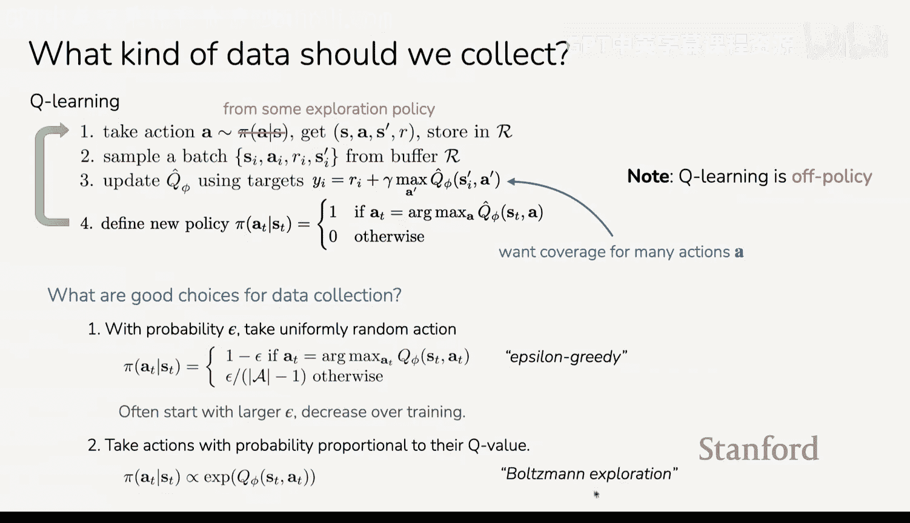

Yeah the question is how do you if you have it's straightforward to do this with discrete actions。

 how do you do these kinds of approaches when you have continuous actions the first one is indeed a lot more common with distance actions you could still do something like this with continuous actions but you would need to define some some uniform is distribution over your continuous actions and for that you would need some sort of range or something instead you could also use like a Gaussian distribution with a wide standard deviation in principle where you sample from that I think in continuous action phases。

 the second option is a more a bit more common in terms of sampling from it。😊。

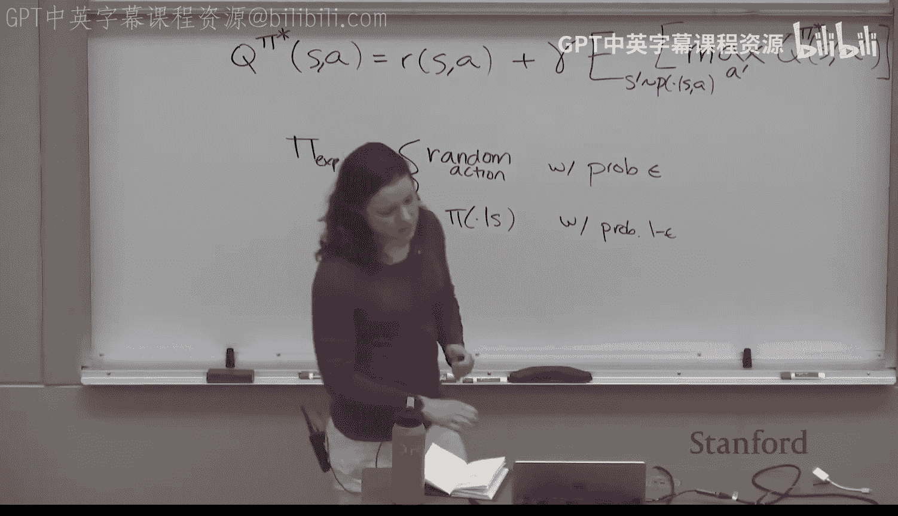

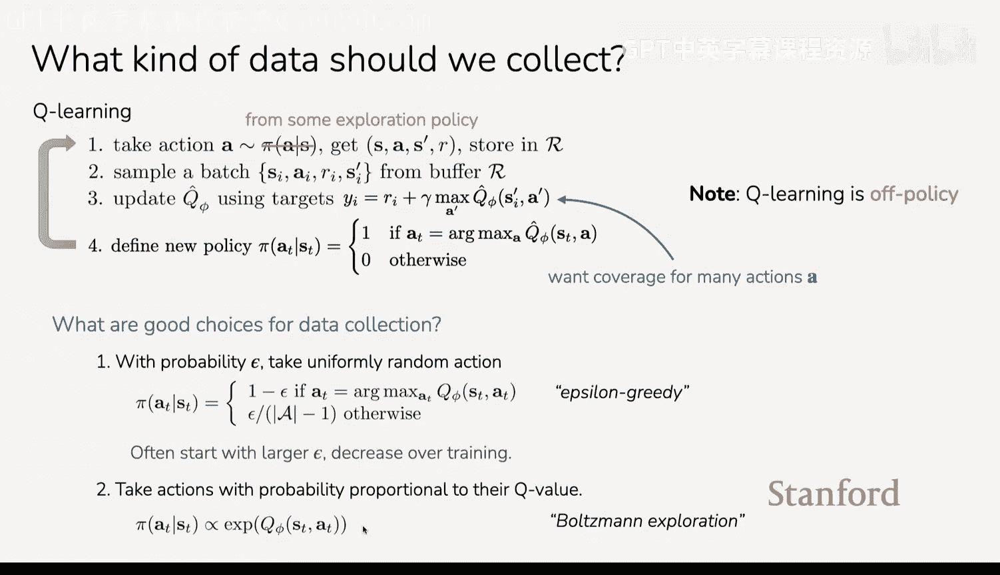

public head， I actually can' can't remember the details of how you would sample from this。

 but we can close off Ed。

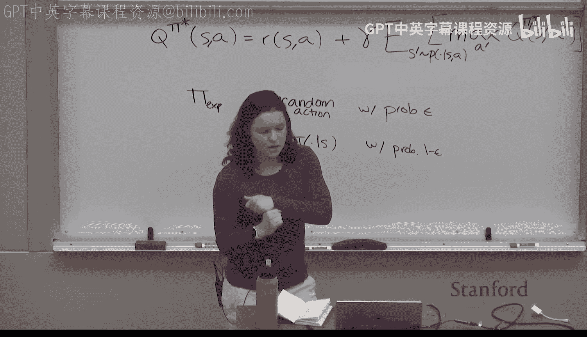

It's possible that the way that you do it is actually the try to set of policies， but yeah。

 you could talk about it。Okay， so putting the pieces together。

 what a full security learning algorithm looks like is we'll collect data using some policies。

 we'll add that data to our replay buffer。😊，Then we will sample batch of data from our replay buffers。

Uniformly， and this iss useful to sample that kind of separately from what we just collected so that we are decorelating and sampling IID from our replay buffer。

😡，And then we will update our twounc by taking the greatest of the LP loss for dys disease target。😊。

And so if you write that up， you'll get a gradient that looks like this。Where yeah。

 if you're taking the else loss， then on the inside， this is the inside of the e loss。

 and then use the same rule to get this second term right here that's stock propagating into your plant。

You can repeat these multiple times， so you could actually kind of take multiple gradient steps。

After collecting about the data。And practices is actually pretty common is that k equals to one。

 but you can it's more efficient， you're going to be more data efficient if you have a larger pay to take more gradient for a given batch of。

😡，And then you also iterate this process after you're done taking these pay gradient steps。

 then you can select some more data and。

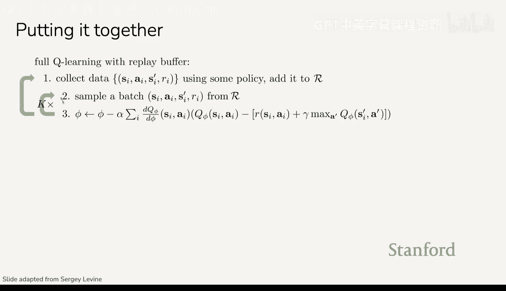

Yeah， so the question was， if you're collecting data from any policy。

 wouldn't that be less optimal than than like using a good policy or at least using your current policy。

 Yeah， so the the reason why you might use a different policy is。😊。

The reason why you might use a different policy is specifically to learn a more accurate s function and so it's actually going to help you learn a more optimal policy later and essentially there's this trade off between collecting less optimal data at the beginning to help you be better later on and one way to think about this is if you are say your reinforcement learning agent is trying to help you pick a restaurant。

 if you haven't really explored that many restaurants to know what is a good restaurant at the beginning probably you want to explore and actually few restaurants that might be suboptimal。

 in order to get a good estimate of like what good restaurants are for a particular person and then later on once you have a good function。

 what you have a good estimate for what good restaurants are。

 then you might want to then explore less。

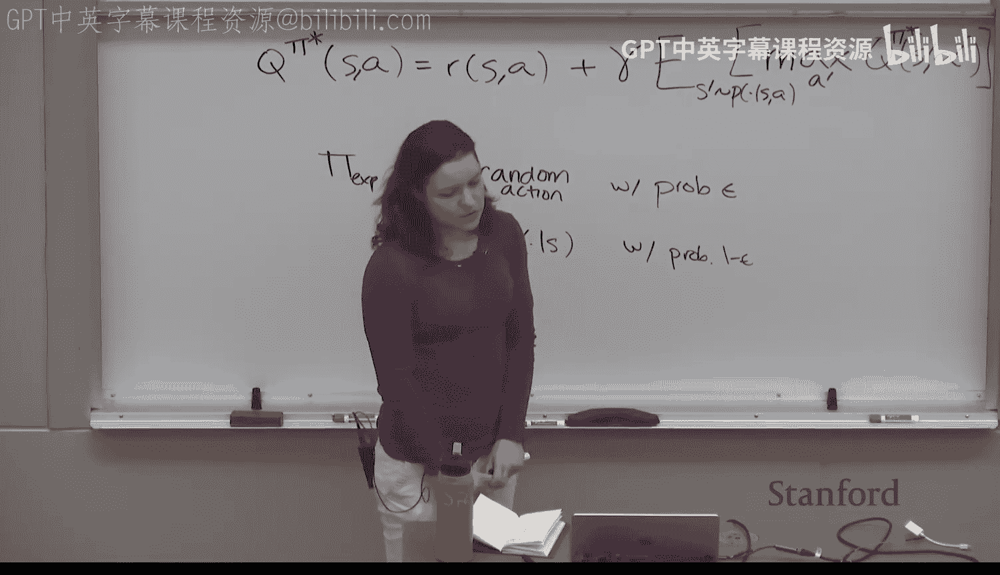

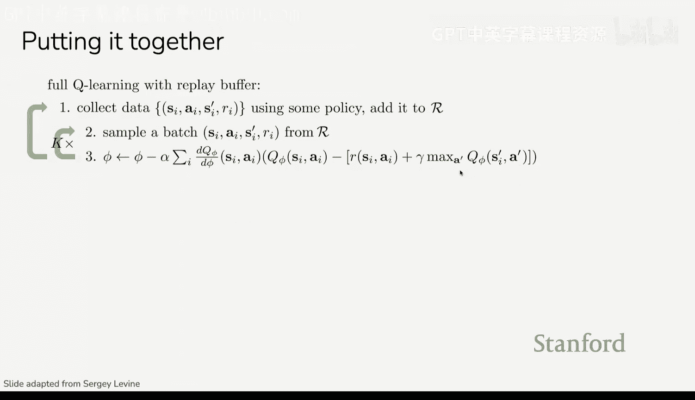

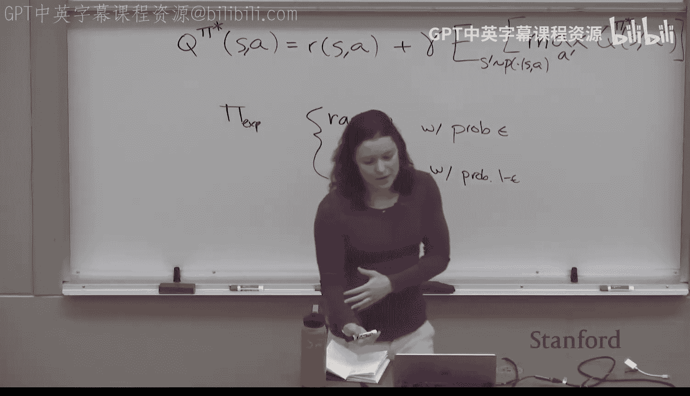

So kind of visually what this looks like is you have some environment。

 you'll initialize your replay buffer as MP。And then at the first step。

 you'll run your policy like the Up on3D policies that's exploring in the environment。

 you'll then get some transitions that you've put into your replay buffer。And then for this part。

 you'll then use your replay buffer to update your dysfunction function on the data that you see with the goal of trying to get something that is not saying the dysfunction function of the office。

So the question is， when we combine this with one like do we still call this off policy because we are collecting data from potentially from a policy that's very similar to our current policies。

 because we're using a replay buffer of essentially all of our past experience。

 when we do these updates， it's referred to as off policies。

 that doesn't mean that none of the data is from our current policies。

 some of the data in the replay buffer will be from the current policy。

 but essentially what off policy means is that you're not only using that data。

 you're also using data from other policies。😊。

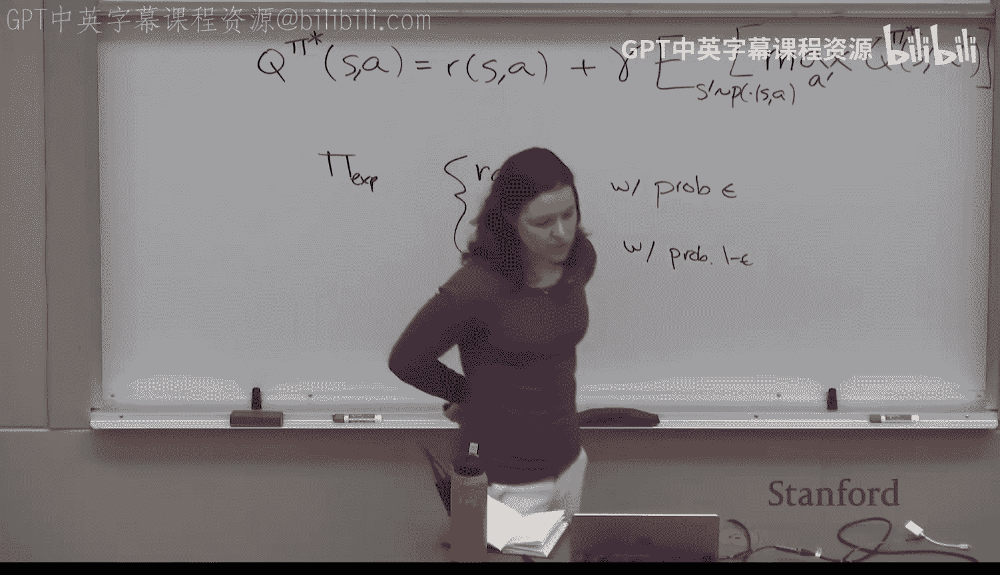

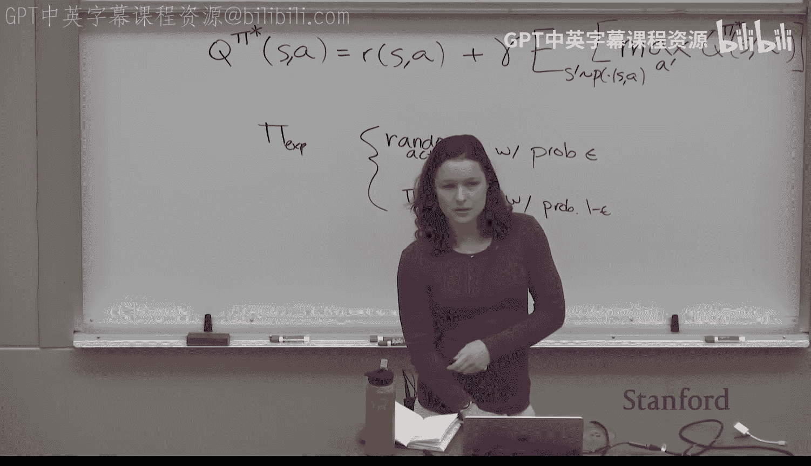

In practice， what is the sum policy？

Yeah， so in practice it's exactly what we talked about on the last slide。

 so it would either be something like e ingredient， where with some small probability。

 you're taking a random action and otherwise following the policies or something where you're taking actions in proportion to the people。

😊。

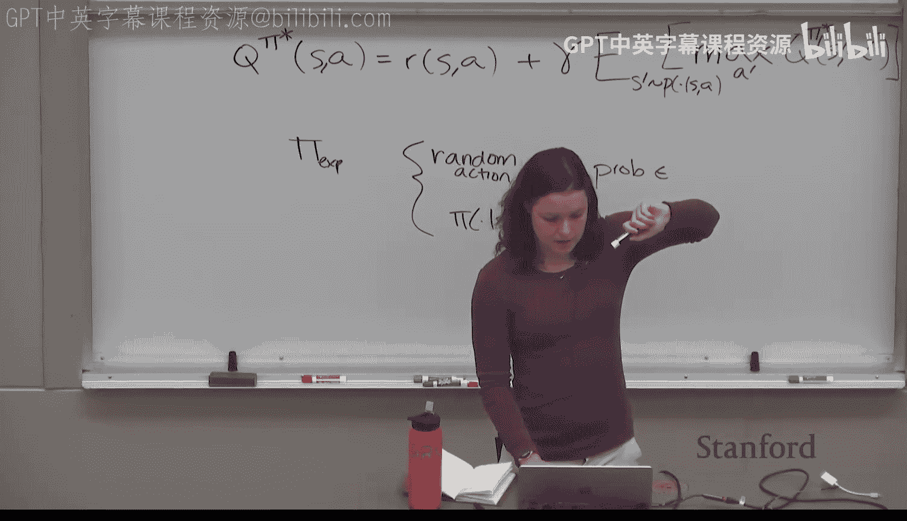

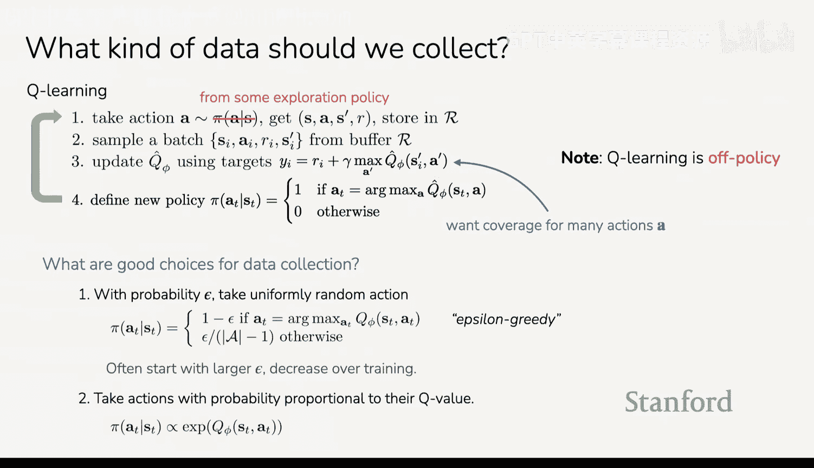

And you might just might actually as we talk about it might actually change during training。

 you might actually change to uppon during training so that you're doing more explicit at the beginning and less exploration。

😡。

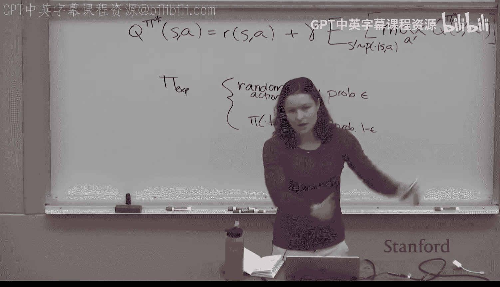

Yeah， so the question is， are we resetting our learning of these iteration。

 oftentimes you'll keep your old speed parameters around。

 kind of warm start them and keep on training on top of them。😡。

One important thing for the result of this algorithm is。 and then to extract a policy out of that。

 the final policy that you would send deploy is a policy that is acting according to the supposed to the actions greedily where it's taking the actions that maximize your。

😊。

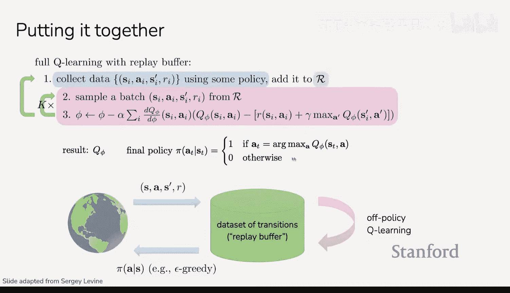

Oh， so if the size that replay buffer is one， then like like it's like yeah one like one data point。

 then that would be on fault so it's like if it's tiny then that's fully on policy in practice the re buffer is a lot worse。

😡，Oh， oh oh sorry， right， if the replay buffer size is one。

 if this policy is not the same as as this， then that's still off policy because the policy is different the good point。

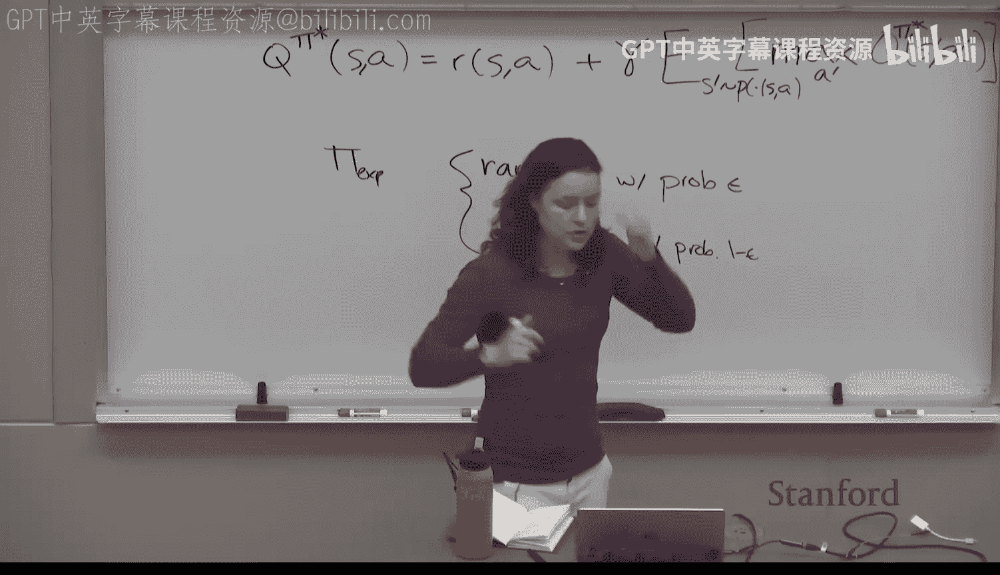

So yeah， this policy might be different from the one that like you're。

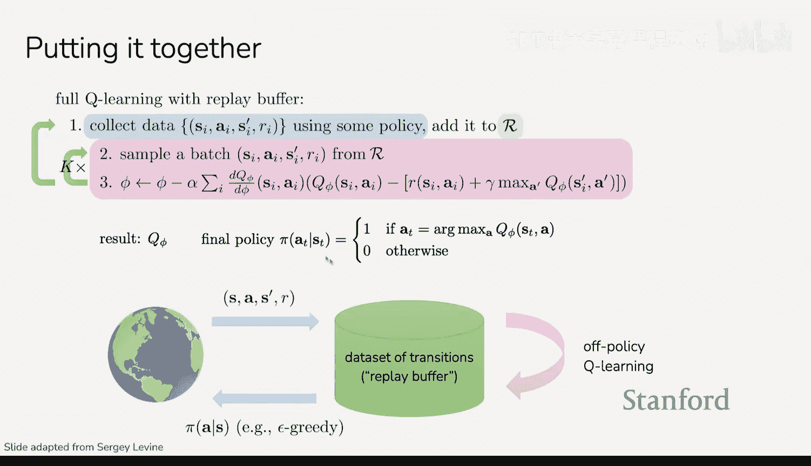

Yeah， so how do we manage our replay buffer， make sure that we're not overtling states and so forth。

 this is generally it actually an important consideration with fe learning algorithms and usually you will discard old data so you'll have like a first in first out sensible where this buffer is not infinitely large。

 oftentimes sea learning it is pretty large but you will you can just take a fixed size and then once you have filled it to that size。

 start discarding data and discard the oldest data first。😊。

One other consideration is that it's the very beginning of training that replay buffer might be very small。

 sometimes to handle that you might try to collect more data the very first generation。

 but they populate it there are all algorithms that you won't quite cover that do eightynchronous data collection and updates the data collection takes time updating a neural network takes time and you could actually have some threads that are actually adding to the replay buffer and other threads that are running updates on your two function with those asynchronous algorithms is actually especially important to think about how the replay buffer is advantaged so that you're not running like like 1000 gradients up on one data point and one gradient step。

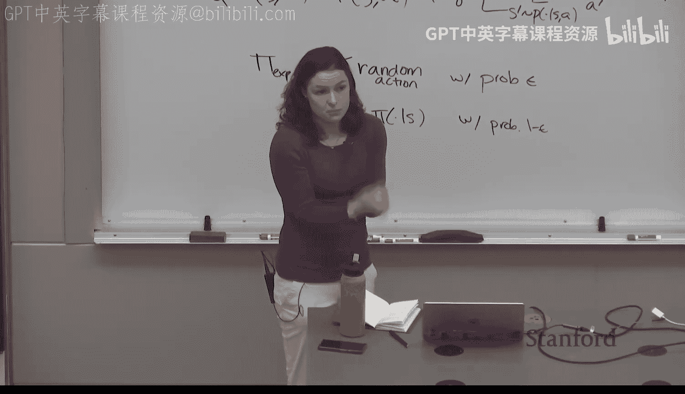

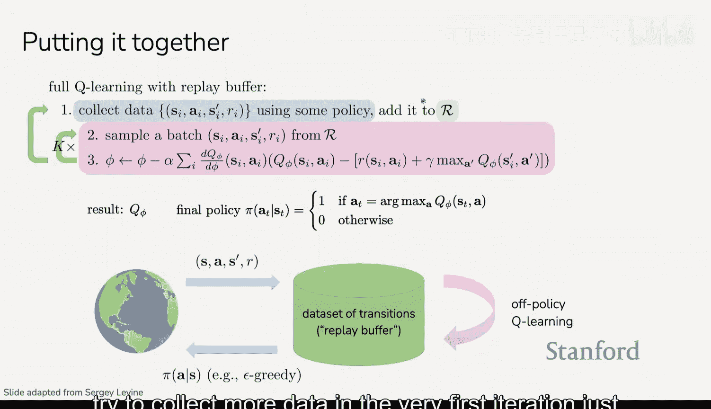

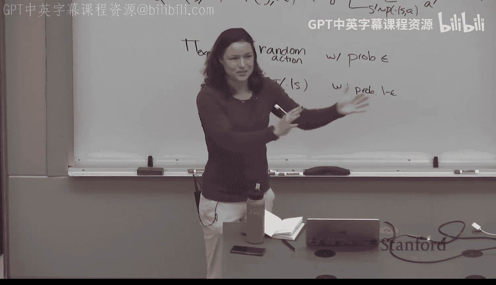

过。Let's do， let's talk a little bit about what happens in practice when you use session。

So we talked about how flu learning can diverge and in general。

 when you run flu learning with neural networks， it can be unstable and one of the reasons for that is you have this moving target。

 this max as po。😊，And the things that are optimization process is very nons， especially if K is one。

And。One trick is to try to slow down how often things the target so instead of having you targets change every single time you change your parameters。

One idea is you can freeze the parameters of your target network and only update them kind of periodically。

 only update them once every 00 gradient steps。So what this looks like is we can save。😊。

A separate neural network。's another copy of our two functions parameters。We'll call this five prime。

And when we save this out， then when we just for this target right here。

 we can use these new parameters。You five front in our target。These parameters will be frozen。

 and so it means that inside that interlo， the labels will not pin。

And so this interloop is essentially going to be doing supervised learning with some data being added to a by buffer。

This would be a lot more stable， people provides learning is a lot more stable generally。

 and then only periodically then update our target network parameters be the same as our latest people。

So once we use a target at work， this is referred to as a GQN algorithm was introduced in 2013。

 was basically like the first PRL method at least。😊，In my opinion。

 and they found that you could actually train neural networks to play a variety of different Atari games and it was。

 yeah one of the first examples of using reinforcement learning is train neural networks to do a pretty complicated。

😊，And they were actually frame it directly from like the pixel observation from。

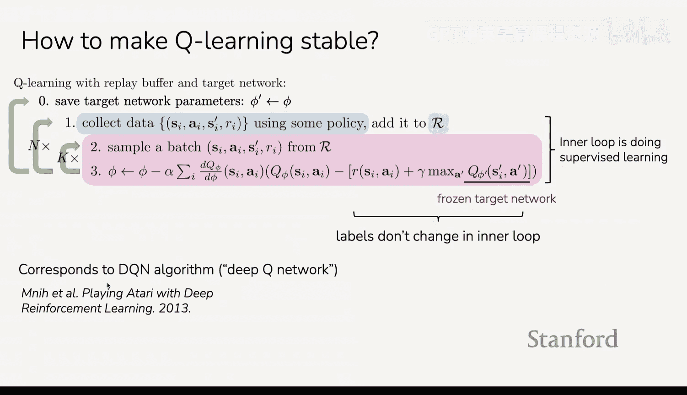

And prior to that， a lot of the reinforcement learning examples were on like like very to settings or very low dimensional settings。

If you save two values， a few tables of two values， will that be the same it。Yeah。

 so that's actually not quite the case because you will actually be collecting new data in the suite and so you can't just store all the two values。

 you actually do have to store the parameters so that you can then compute the key values for the new data。

😊。

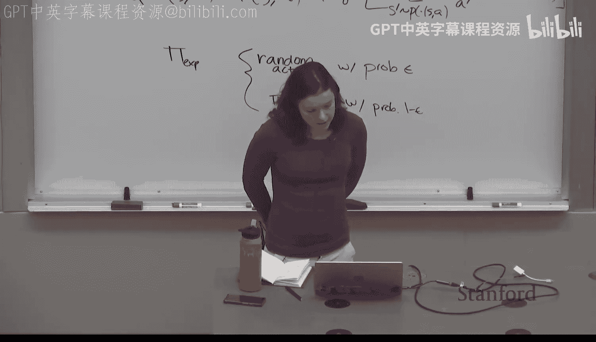

The party。So you can't just story put just。那不是。so this is one of the algorithms that youll implement in homework school。

😊，Okay， so that's the first trick is use the target Network that you only geologicalically update。

 there's two more things that make your learning work a lot better。

And the first one is actually looking at the accuracy of the feedback guys。 So if you。😊。

If if you fought the reward over training。The award goes up， that's good。

 this is a reward on the game of breakout and the game of pizza。

And if you also thought the key values over the course of training they're also going up and so that is that's actually what you expect because the key values is representing your average reward。

 that's good， one of these things to note actually is like a practical tips is when you're looking at the loss function on your key values during training。

 when you strain with D toN， the loss values will actually often go up through training。

This is sometimes a little bit alarming because you're use to loss values going down。

 but the reason for that is you're collecting new data and that new data has higher Q value and so the scaling of your loss funds can is easy。

Yeah。And at the very beginning， if you're getting like zero reward everywhere。

 it might be very easy to get a lawsuit。So yeah， don't be alarmed if your lawsuit system is going up。

 sometimes that means or the policy is starting to。

So cool this is pretty good are the predicted toing features， so is the return。😊。

You can also look at the value over screening and you see that right in the first case。

 the values right here are fairly uniform， but once you're in a state where you like really have to go up then the key value for this action of up is higher than going down or a no op likewise right here it's really important to go up and so the key value is higher for going up。

 then the actions is going down or noO in the right case it doesn't really matter because the ball is on the other side on the opponent side and so the key values is a more uniform so when you visualize these key values they look3 reasonable。

😊，This is good。But then you actually thought like what the true returns are。

The true returns are shown in red here on this red horizontal line and the estimate of the values according to the S network are shown as this upper line。

 and you have to see this very huge gaps between the estimate where the estimate is always a lot higher than the true value。

😊，And。So it seems like working a lot of what was called overestim。

For our people is overestimating how good our policy is。

And then there's an algorithm that this piece called doublele B2M that's able to get a much more accurate d function is able to。

😊，Overestimate far， far less than。So let's talk a little bit about double DI。

 so an overestimation in general。So our target value。Is。

But we're taking a map over action right here。And when we take this map。

 we're choosing an action that maximizes its key value and you can another way to write this。

You can think of it。As。嗯，系要。You can think about this quantity as。You of I。

Of F evaluated at the action。That is maximizing。A计团。

And so we're both using an action that has high key value and evaluating the key value of that action using the same people。

😊，And this means that if there is noise in our s function。Then it's very easy。

 this noise it's very easy to basically pick actions that are using that noise to get the hi done。

And so this last term right here is what are the overestimations？It's not perfect。

 it has the noise in it as neural networks generally do。

Because the action selection that according in execute is the same as what's being evaluated。

Then you could really exploit that noise and use actions that are have higher value than they actually do because of。

No。If you instead use a differentq function for picking an action and evaluating it。

Then you could decoorrelate the noise if you had two different key。

 they would have naturally different。They written noise in different errors as。

And so if you have a way to use different key values。

 we can actually then eliminate this problem of overestimation by essentially deorating the noise by using a differentq function to estimate the axis here as to evaluate the axis。

And so the key idea behind double two learning is to have used two different networks。

 one network network A for picking the action and network B for a value。

And then if they're noisy in different ways， then we're not going to then be kind of exploitding noise in ourq and then as a result。

 not overestimate oura。

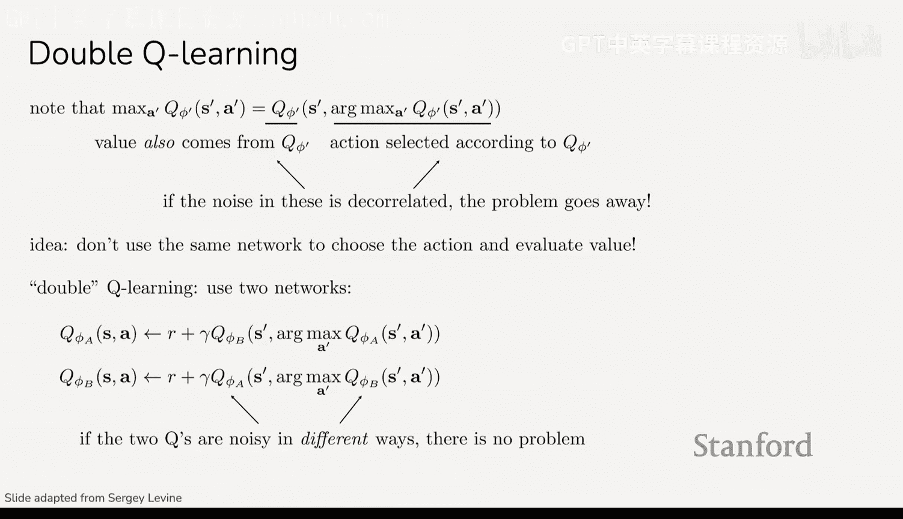

The question is， can you guarantee that they don't have the same noise？

I guess you definitely cant guarantee it and there might be some noise that a result of like the architecture of the network。

 but in practice this ends up making a really like if you are using different neural networks for this。

 it generally does a very good job， theres still some some overestimation and if we looked at the at these values like here in this game。

 the key values are still an overestimate still an overest here， and also here as well。

 but it helps substantially compared to not do， so it's not perfect but it helps quite a bit。😊。

The question is， what if you did like tripleple DCcoN or otheripal DcoN like use even more network？

The good question， I could see that like gap， perhaps is that it's the noise correlation if you're able to get like even more samples and noise that can help。

 if you seem to try that in practice， if's the noise is coming from if isn't instead coming from a source that's like kept constant like like the architecture of the neural network or something like that。

 then it might not help， and so youve start to reproduce those and then in practice using more than two neural network is very helpful。

How do you ensure that they don't emerge。 So let's like you talk about what we， what we actually do。

 so。We're actually already using two neural networks。

 we're using the current neural networks and the target neural networks that was just periodically frozen。

And so what we can actually do is。When we do our two updates， we can use the target network。

Use by prime for evaluating and the current neural network for PC else。😊，And。He。And yeah。

 so that's essentially what double Q learning looks like where instead of using the target network for both of these。

 we're going to use the current network to take the action。

 take the best actions and then the target。

Yeah， so you're always previous is always going to be your previous you so you can't set this。Yeah。

 so question is why does this help especially if the previous few is the same noise so the previous few will be outdated and the new few will have gotten a lot of gradient updates since then and they've seen like new data points recently and so oftentimes the noise isn't just about likeization but also has do is what up gradient updates were applied and so yeah help。

😊。

Okay， the last trick we'll talk about， which we've already talked about in after Critics methods。

 is NS return。So。Our key learning target looks like this a reward， plus the max of s。

If your Q values are good， then this term is actually going to be really。

 really important in playing like most of the roles in the Q learning update。😡。

but if your sequence is bad like at the beginning of training。

 then these are really the only values that are going to matter and these are the values that are going be getting your learning algorithms。

And if you just have a single reward function here。

 then that might be a bit troublesome because just a single reward function might not tell you that much about how good your key value is。

So if you remember when we talked about aritic methods we talked about using NSEP returns。

 so we use this onean curllo， we would use the sum of rewards， if we use bootstping。

 we just do R plus B like are at the current time step plus the be at the next time step and instead we talked about this thing that we could do in the middle where we sum the rewards over the next end time steps and then use the value at the time step after that。

 we talked about how this says less variance and lower bias and lower bias in the sense that is your target are bad the reward function going to be more accurate。

😊，So we do this for C values and what this would look like for C values is instead of having something like this。

Theus is the target for。We're planning to get the target for SAP。Then you would define Y I these。

Are the current time step plus our the next time step up until are at。😊，E plus L minus1 sensor。

And then。At the time that after that， use the maxs。呃。Q of SE plus N。😊。

Where this maximization is over8。This is what NSE returns to book like for sewers。

Does anyone see any issue with using this target？Yeah， so if you're doing this off policy。

 these Rs will be coming from whatever policy you used in the leaf by buffer rather than like the off policy of what you're trying to estimate。

So there's some pros and con， one is that it's a lot more bias， a lot faster we'll learn on。

 especially early on， but the downside is that these rewards are。

For the policy that collected the data， not for the O policies。

 and we're trying to estimates the key function into the O pole。

So this is a kind of a downside when using un return risk learning。

Now and this is not an issue with n equals one because there the reward will just be function of S andA and we're。

S value of SA。Now， what do we do about this？Maybe the unsatifing answer that most commonly just ignore this。

 Preend it isn't through and still use an end greater than once。

 and end returns truly are often like。Really like very often improve the performance of the algorithm。

 despite siteing in。That said， there are other things you can do。

 you could dynamically choose N and only use data that follows the current policies。

Basically looking at what actions were taken and seeing at those actions actually agree with the max C value。

You could also in principle， dynamically chooseN and have ND smaller layer in training where your key values are likely to be more accurate。

😊，Now， for this particular excuseing event end， you really would want to do this only if the action space is small and the data is mostly ony。

And you can also do important sampling as well and weight these rewards by some important。Great。

 so those were the kind of three strikes for two living in practice。

There's a couple examples of shoe learning that have been very successful that I put on this slide。

 I think there's other examples too， but one of the most prominent examples was for playing games and if you want to train an agent to play a game for either just for they could see how well you can do or to play against a human to learning was able to out before most people on Atari games so this far right here is like everything above as far are the game that it is at human level or above human level performance and everything below is worse than human level performance。

😊，And then it also was used to train a robot grasping system。

 So this is actually a case with continuous toxin。 and the the robot on the right is a。😊。

I using a few functions that was bring to learning。

 and then it is doing a kind of a continuous optimization over actions that will try to find a good way to grasp the office。

😊，And we talked a bit last time about how with RL you can get much higher success rate and more reliable policies and we see that hereer too where this system was able to get like a 96 success success。

 so quite high at being able to grasp profit。The other thing that's nice about using RO for this application is the。

You end up if in order to graph， you need to not just like go down and pick something out but you have to need a like move around the object。

 it's also able to learn how to do that using the reinforcement。😡。

Because it's reading it as a psychological。Oh。One of the last things I figured I would cover is some of my advice on wheny use one online oral algorithm versus another。

 since this is the last online URL method that we'll talk about， so you talked a bit about PPO。

 SAT and G2M there's like some of the three main tactical algorithms we talked about so PPO this is great when you care about stability and ease use generally doesn't require to much screening but it's very data inefficient and so it's great to use when you care about stability and ease use and you don't really care about data that。

D2N works quite well when you have just three actions or low ofment symptoms use outcomes。

 and so in those cases it can be a great choice， it can be fairly data as depending on some of the details of how off can you make it。

😊，And then softri and variants of it are great when you care most about data efficiency。

 but require a bit more tuning and are a bit less stable than as simply was。😊。

So what we talk about Q&， also Qing in practice， the threefi with target networks。

 double DQN and separate terms we defined as like the Belman equation and the Belman Ophthy equation yeah and that was like essentially how to do RL without learning an explicit policy。

😊，We're done with online reinforcement learning algorithms for now。

 and yet we covered a lot of the basics of different online reinforcement learning algorithms。

