# 斯坦福大学《深度强化学习｜CS224R Deep Reinforcement Learning  Spring 2025》中英字幕 p07 -07- Lecture 7_ Offline RL.zh_en -BV1SvmxB3E5e_p7-

Okay， let's get started。Okay so now let's talk a bit about a recap of the online RL methods that we've talked about so far。

 so we started with talking about policy gradients where our goal was to collect data from our policy than increase the likelihood on actions that led to above average outcomes so encouraging the policy to do more of the stuff that led to good outcomes。

 less of the stuff that led to bad outcomes and then we started introducing this notion of a value function which can then estimate we can use a value function to estimate how good an action is and then when we fit a value function。

 we can use that to then encourage the policy to do more of what you estimate to be good and less of what you estimate to be bad and we saw a couple algorithms like PPO and S that use this sort of actor critictic approach。

U。We also talked about a few different ways for fitting value functions and I want to quickly go through these different ways again because it's actually going to be play a pretty important role in today's lecture so the first thing we talked about is if you have some state in your data and you want to estimate the value of that state one way to do that is to take the sum of the rewards over the trajectory in the future and estimate the value that way so the target would be be trying to fit some V pie。

😊。

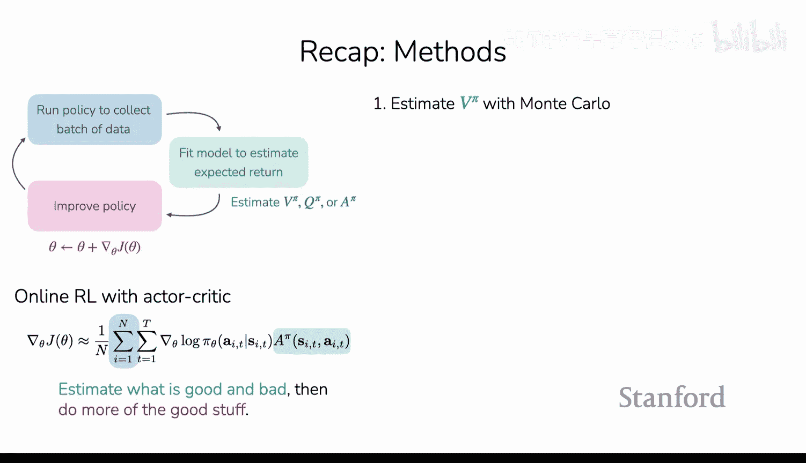

Of。S and your target would be the sum of rewards from that state onward。

 so it would you'd be trying to contrast this with。

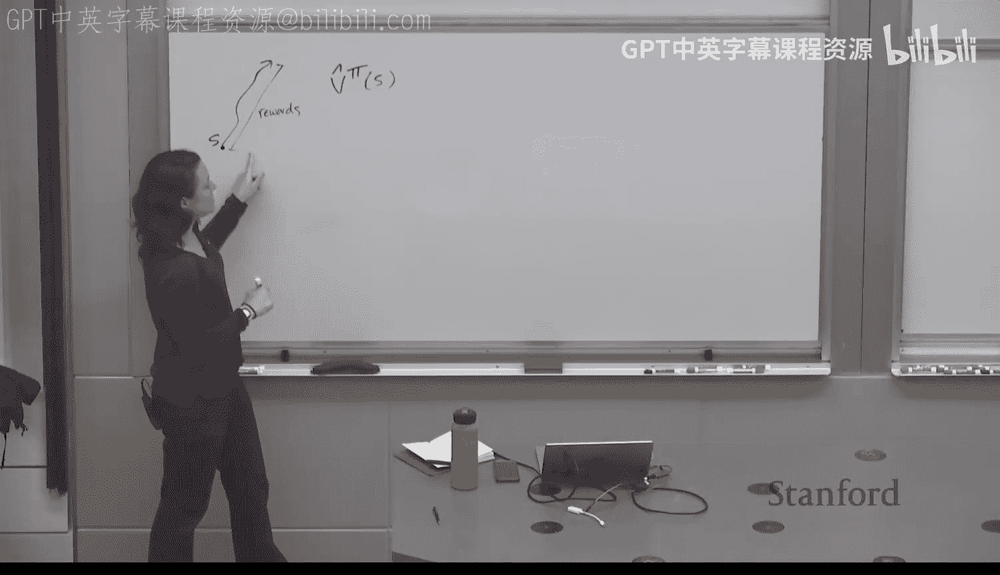

With the sum of los。At future time stepss from future time steps from T to T。

 and then your objective for your value function， which would looks something like this where you're then trying to minimize。

TheThis over the states and actions in your data set。

So that was the first simplest way that we saw to estimate a value function。

 and then we saw a way to potentially get a better estimate because instead of just summing all the rewards。

 you could actually look at your estimate of the value at an intermediate state。

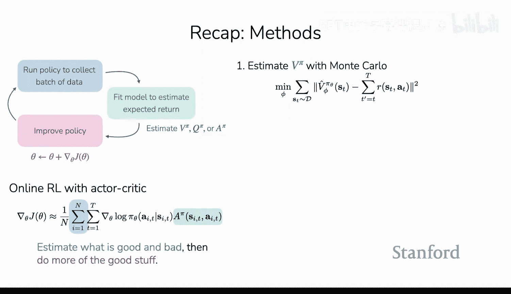

So say that this is。S prime is your next state right here。

Instead of looking at the sum of rewards from there。

 instead you could look at what is the reward at the next time step plus the value。

 my estimate for the value at the next time step and use that as your target where instead of being the sum of rewards。

 the target would be。

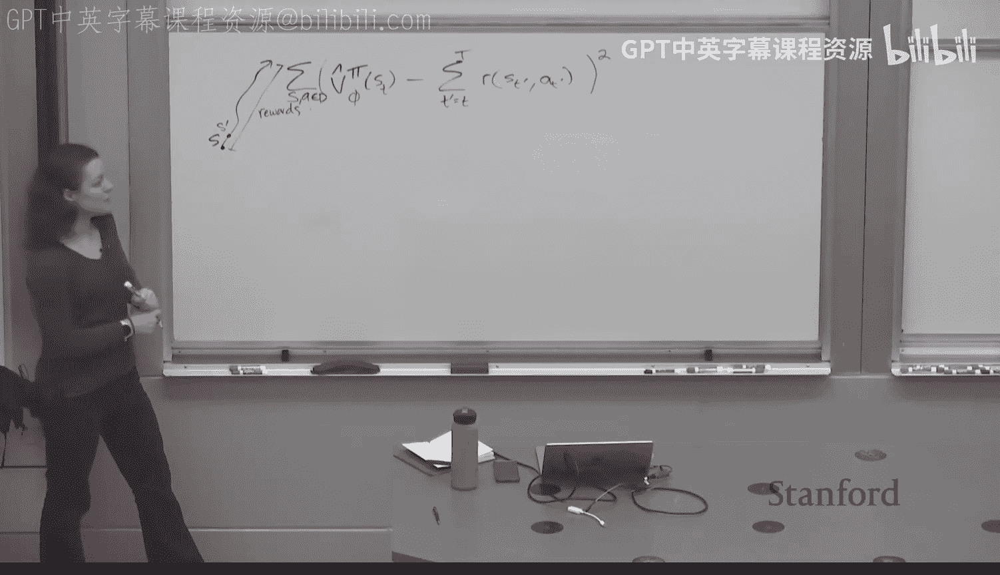

The reward at the current time step。Plus， the value。At the estimated value at the next time step。

And this is alternative。Target for fitting a value function。And so the full objective would be。

Whoops。The full objective。Would be something like this？And we're trying to。Minimize this。Over。

Our data， we could say our value function has parameters5。

We called this kind of bootstrapping or TD updates， temporal difference updates。

 that was the second way that we saw for estimating a value function。

And then we also saw a third way， so in these two scenarios。

 the data set is sampled from your policy， these were on policy methods for estimating the value of the policy。

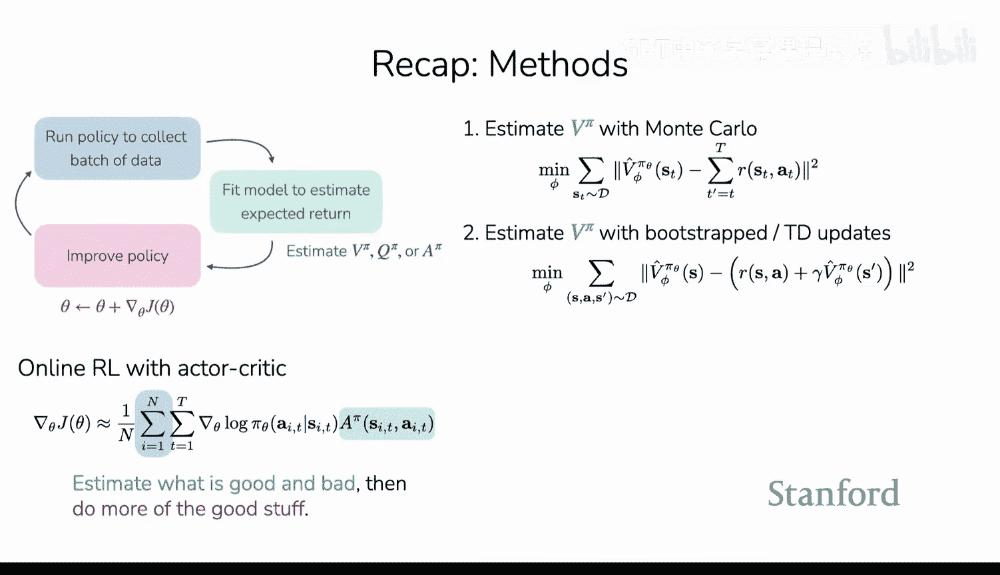

So these worst scenarios were your data set。Was sampled from the policy that you're trying to evaluate？

And we then started to look at a scenario where。What if your data set is？

Like sampled from some mixture of old policies。Could we use that data in order to fit a value function？

And to do that， we started looking at Q functions and。

And with Q functions we can again use something like bootstrapping where in principle we could use something like Q hat pi of phi of STAT。

 we're trying to estimate this， and then we could also use this as our target。😊。

With the caveat that this value function is going to be for the policy and the data and not for the policy that we're trying to learn and the policy that we're trying to learn a value function for。

And so what we did instead is we changed our target to use the Q function。So we used。

We had the target as S T plus 1， A T plus1。And。The key difference here was that S and A and S T plus1 are sampled from the data。

 but A plus1 is going to be sampled from the policy that we're trying to learn a value function for。

So。Yeah。Yeah。Cool， so that's a quick recap of some of the things that we talked about and these are the different ways of estimating value functions with the key difference of this last one。

 being something that we can use old policies data from old policies for now one really important aspect of this last one is that because we're bootstrapping and using our own estimate of the value function at a given state as the label we need this Q function to be trained on actions that actually would resemble the actions that we're going to be evaluating it on and so if our policies very different from our set of old policies。

 this label will not be accurate and then we won't be able to learn an accurate Q function。😊。

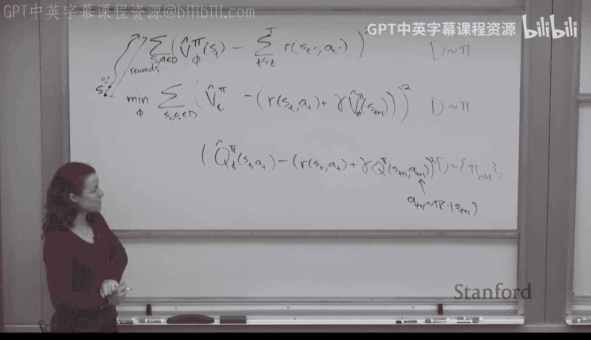

So it needs good coverage over action。Cool， and then。

Those were the different ways of learning value functions。

 the full off policy actor critic method looked something like this where we took data from our policy。

 stored that in the buffer that had a number of data from a number of past policies。

 sampled some data from that buffer， updated our Q function with these targets。

 and then updated our policy to encourage it to increase the likelihood on actions that had a high Q value。

😊，And then we can repeat that process。Okay so for today we're going to be building on some of those ideas and specifically we're going to be talking about offline reinforcement learning and in offline reinforcement learning we're trying to learn from a data set that was given to us not collected by our own policy and we'll then talk about two different methods or two different classes of methods for doing offline reinforcement learning and the key things that we'll try to see is I talked about is first the key challenge that arises in offline RL。

 second two different approaches for offline our own why they work and lastly how offline reinforcement learning can improve over just imitation learning which is another way to learn from offline data sets。

😊。

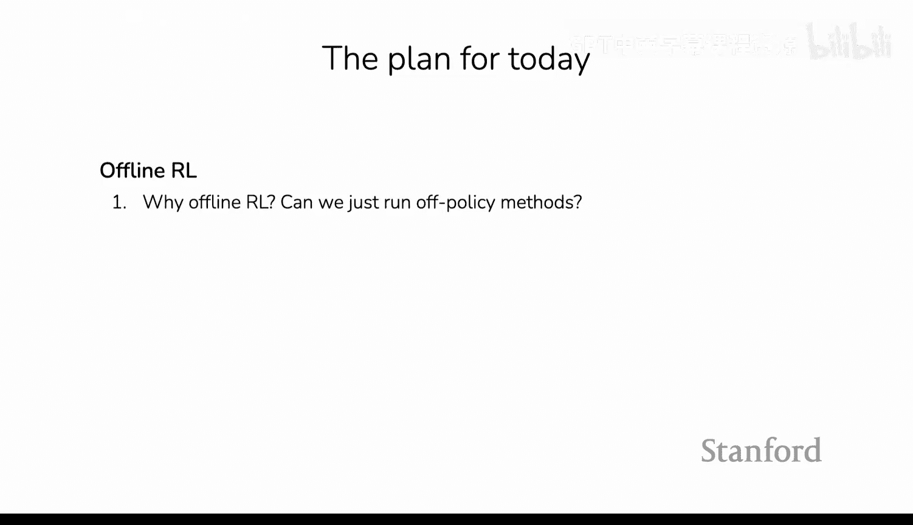

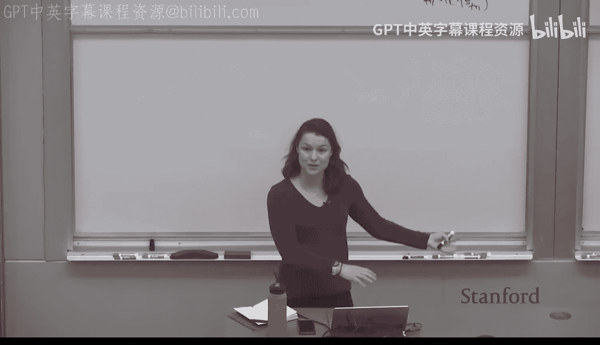

The question is is this Q learning this is actually two lectures ago this is like soft a critic the in Q learning there is one last change to this so in this case we're trying to learn Q function for the policy that we're learning the difference that we saw in Q learning was we are actually trying to learn the Q function for the optimal policy and。

😊。

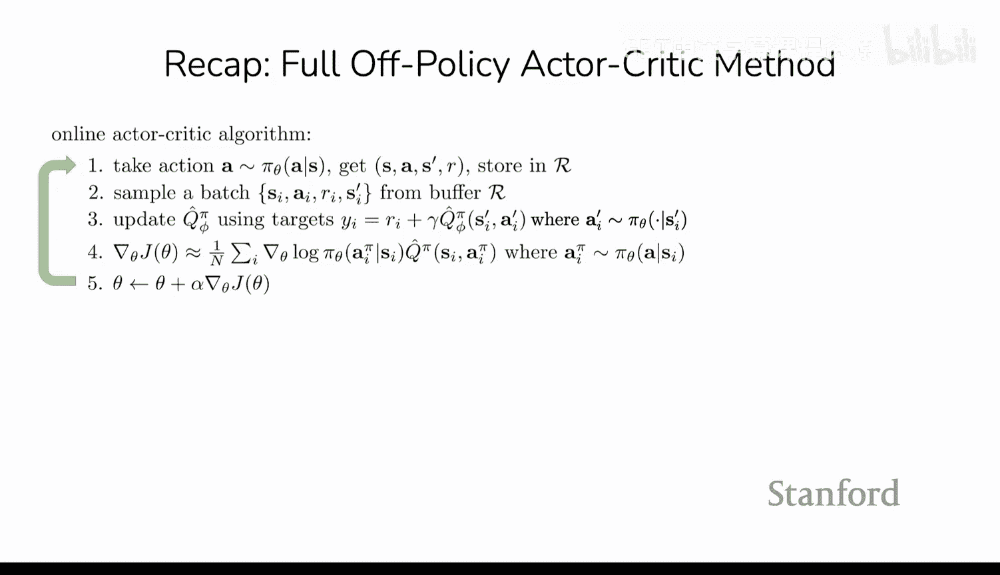

。In key learning， this red marker is not。Great。Our target was instead instead of sampling from the policy that we're trying to learn a value function for。

 we tried to pick an action that was the best action according to that key function。

 and so our target was our of STAT。Was。Gamma， and then we were taking a max over。

Over the next action so that we are actually。Trying to。

And our goal here was to try to learn the Q function for the optimal policy。

And this was also something that can be done off policy， like without data from the optimal policy。

 as long as your estimates have good coverage。So in offline reinforcement learning。

 actually first why offline reinforcement learning。

 so the process offline for online reinforcement learning is you collect data。

 then you update the policy either using the latest data or the data so far。

And then you repeat that process with offline URL， you're actually just given the data set in advance。

 and then you want to train a policy on that provided data set。

So you're not actually iteratively collecting data。

And there's a number of circumstances where offline reinforcement learning might be more useful than online reinforcement learning。

呃。The first is that when you're trying to approach a problem。

 you might already have a data set that was collected by an existing system or by people。

And collecting data from your current policy might be riskier or might be unsafe。

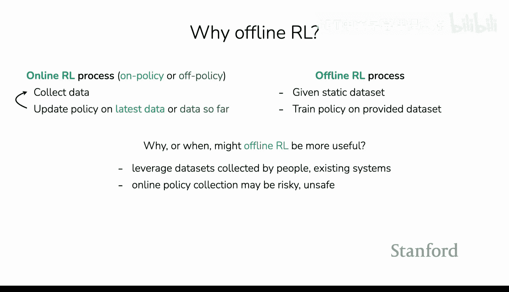

So for example， in if you're trying to learn a policy for controlling a car to drive on roads。

 you might have a lot of data of people driving that could be very useful for learning a good policy for driving。

 and it might be unsafe to actually try to deploy your policy。

 especially a policy that is not very good at driving。

In other circumstances there people have looked at using reinforcement learning for figuring out good ways to treat people in medical scenarios。

 so for example， there was a really cool project on kind of a seizure prevention use case where you're trying to learn a policy for figuring out how to prevent seizures。

 it is a scenario where if you have an offline method of some existing system。

 then you could use that to learn a policy without having to collect data from a policy that is not good in the first place。

😊。

And then the last point， which is actually a little bit more nuanced is that。

If you actually run online around multiple times， you might actually already have a data set from your policies and it'd be really nice to reuse that data rather than trying to recollect data every single time you try to run an experiment。

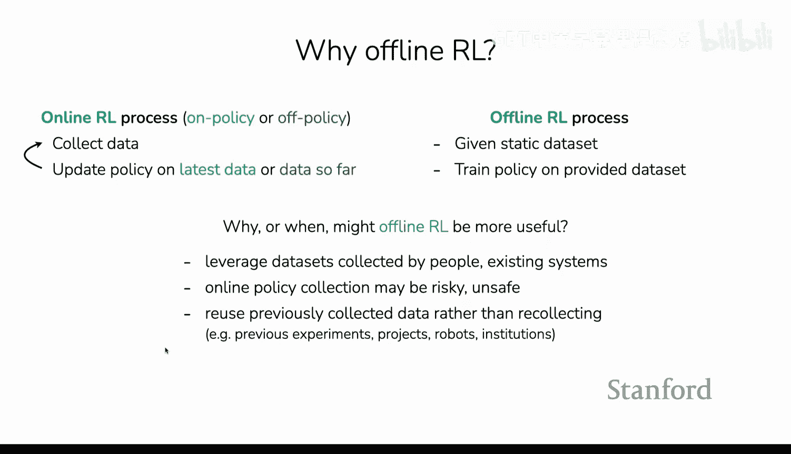

If for example， you're training a robot to do something and you want it to learn how to grasp something。

 then if you have a pure online oral method， it means that every single time you need to run your algorithm。

 you need to recollect data from your policy。And that can be pretty inefficient because probably the first time you run the algorithm isnt kind of still room for iteration on the algorithm itself。

And generally， online data is more expensive than offline data for that reason。

 because offline data you can reuse。Many times。

Also worth noting that you can blend offline R and online R where you have some existing data like in autonomous driving。

 you have a data set of people driving， and then you want to you train a policy on that and then you try to improve it with some online data collection。

 perhaps with a safety driver after you have a policy that's pretty good and there's a number of real- worldor use cases where you will want to blend it because if you actually are deploying your policy。

 then it's great to be able to improve it after you deploy your policy。

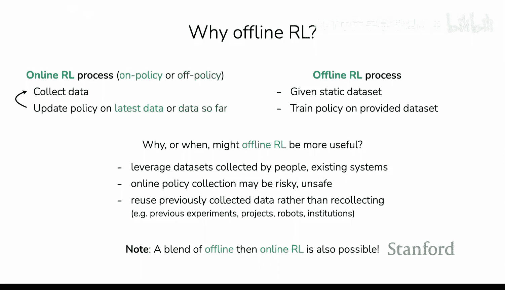

Yeah， so the question is can you view offline R as a special case of online but off policy URL but where you don't know the data and in certain in like that's like definitely one like very that's sort of a correct way to view it one thing that is like a very strict requirement in offline R in like pure offline URL is that you have no ability to collect more data and in that sense it's not really a special case of online R because in online off policy URL you can collect more data that said we'll see that some of the techniques will we'll kind of draw upon some of these off policy techniques from an algorithm standpoint because。

In these scenarios you're able to use data from old policies。

 and that's very useful when you have an offline data set from some policy that you don't know。Okay。

 so now let's talk about this a little bit more formally。

Say that you you're given some data set and the data set。Maybe has some trajectories in it。

 maybe if it's a driving scenario， then you have some car and you have data sets of people driving in a number of different ways in a number of different places with a number of different cars and we're going to say that this kind of。

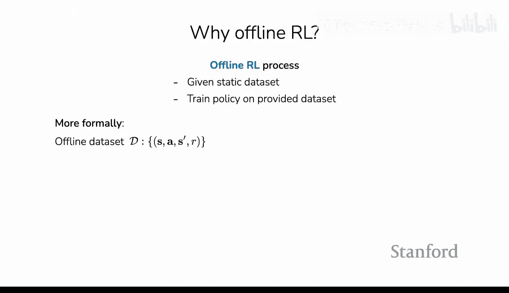

Constitutes some data set that were given。And。It's helpful to think about kind of formally think about the policy that collected this data。

 Now， we don't know the underlying policy。 So， for example， if this was collected by people。

 we don't know what。 Well， first， it was collected by multiple people that is sort of multiple policies。

 We also just don't directly have access to that。 But it's useful to think about that policy just from a kind of a mathematical standpoint。

 And so we'll say that this data set was collected by running some policy that we'll refer to as the behavior policy or pi beta。

嗯。The and if it's collected by multiple policies and you can think of P beta as a mixture of policies and you can kind of define that mixture as some like。

Kind of。Average or weighted some over some constituent policies。

So we don't lose any generality by saying that it's collected by a single policy。Cool。

 so that's the data set sample from some unknown policy， the maybe a mixture of policies。

 if we were to think about the。

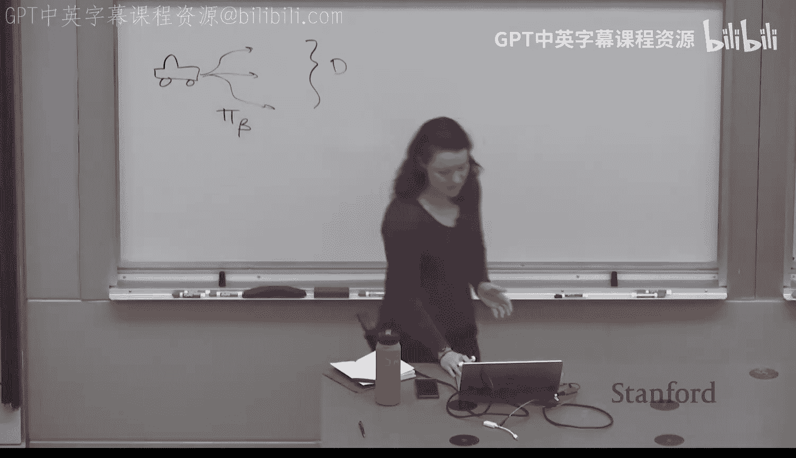

The kind of distribution over this data， we could think of it having some underlying state distribution corresponding to this policy。

 and action distribution dynamics， a reward function。And then。

Our goal is to learn a good policy that maximizes reward。

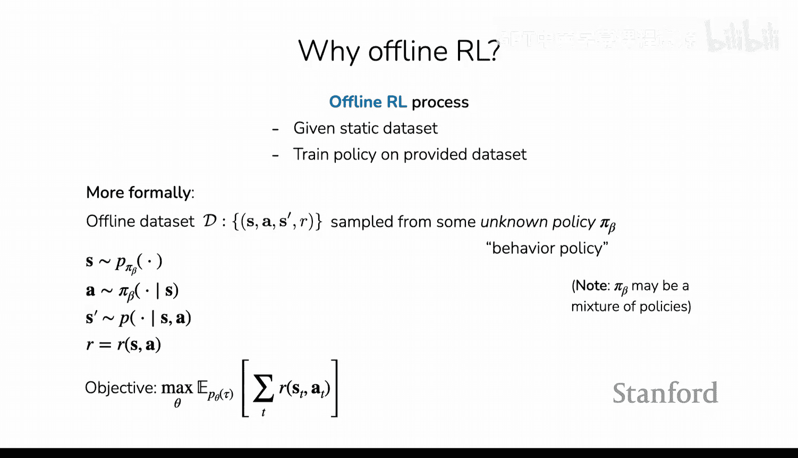

And so ideally， we would be able to take this data set and。

Be able to learn some policy that can control the car and ideally it's like maybe a pretty good policy。

 maybe some of the time that does merge into another lane。

 but generally we want a policy that we'll refer to as pi theta and we want to。

Be able to ultimately maximize an objective corresponding to the sum of rewards for how good this policy is and so you can think about that as maximizing the parameters of this policy and trying to maximize for trajectories sampled from。

From this policy maximizing the sum of rewards。Or both。Either。

 I guess I'll write it of our objective where this is kind of the sum of rewards。

For individual states。In that trajectoryductory。Now。

 one thing to note here is that this objective is。An expectation over this policy。

 whereas our data was collected by a different policy。

And so we can think about this as there being some distribution shift between the policy that collected the data and the policy that we're deploying。

 and we don't actually get to sample from that policy。

 and so that's one of the big challenges in offline reinforcement learning。😊。

So there's a kind of distribution chip because this expectation is under the learn policy rather than under the policy that collected the data。

😊，And then it's worth mentioning that the like the dynamics of the environment are going to be constant between。

The data and the learn policy。 So the distribution shift is only。

For these trajectories is only caused by the shift in the policies。

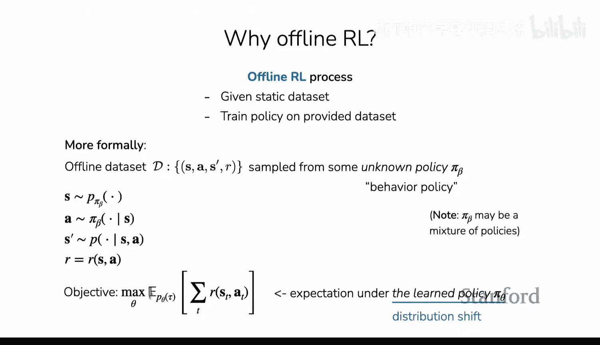

The question is， if the data is comprehensive enough。

 can it turn out that the learned policy and the behavior policy distribution are identical？

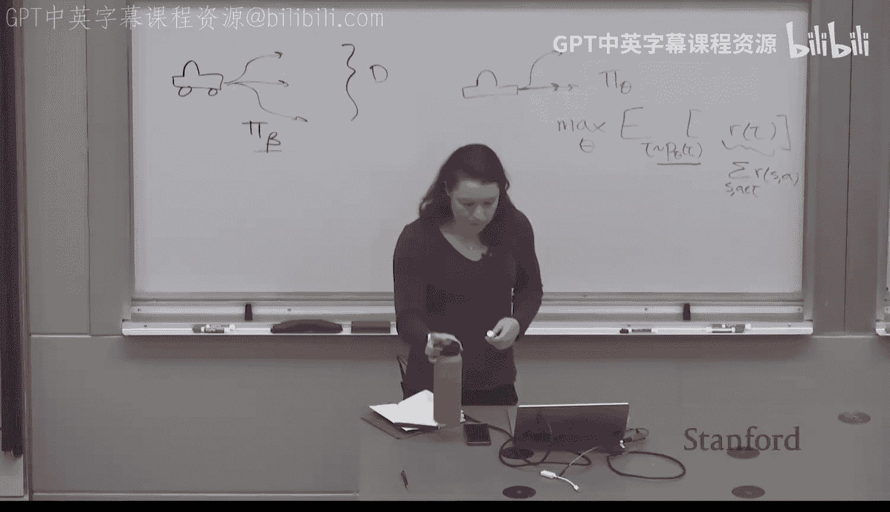

，Generally， that's extremely rare， generally that doesn't happen。

 and the reason is that the usually will first。You often want to improve over your data and learn something that's better than the average driver and so in that case your you might actually end up with a narrower distribution here than your original policy in the case where your original policy is very good then you're somewhat more in an imitation learning like setting and you might still diverge and kind of drift away from the distribution of。

😡，In the data set。Where does the data come from， it could be human collected from some hand design system or controller。

 it could also be from previous reinforcement learning run that you want to reuse。

 it could be a mixture of these sources， lots of different places the data could come from。😊，Okay。

 now there are some comments about how this offline reinforcement learning relates to off policy reinforcement learning and one natural question is maybe we could just reuse an off policy algorithm and。

Just run that off policy algorithm， but using the offline data set rather than recollecting data with our new policy。

Does anyone have thoughts on what will happen if you use an off policy algorithm like Soft actor Critic on an offline data set？

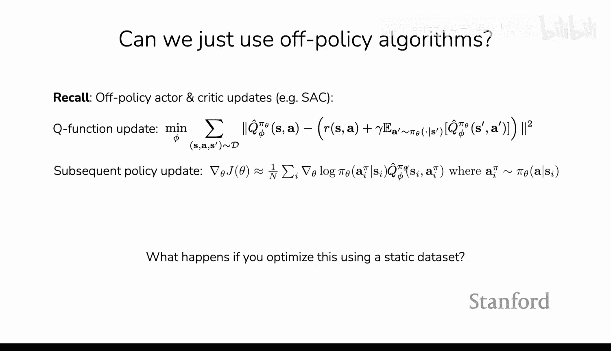

Yeah， so the thought there was that we have this this we're evaluating our Q estimate on actions sampled from our policy and our policy is also trying to increase likelihood on Q values。

 that have actions that have high key values and if we have an offline data and we're learning a policy that's different from the policy that collected the data。

 then this Q estimate that we're supervising， we're using to supervise our Q function may not be accurate。

 because it didn't actually necessarily see actions in the data that come from the policy we're learning。

And so we might actually end up learning an accurate Q function。

 and if you don't learn an accurate Q function， then we might get a bad policy as a result。😊。

And so to walk through that a little bit more， let's say that we maybe again， have。

Well we have a little bit of space here。 So let's say that we have。

Our our data set and some of the data here are a few of the actions in the data。

 like maybe this is a1， this is a2， this is a3。And there's other actions that the car could take that's not in the data set。

 so for example， maybe the car could go in on adventure over here， maybe that's a4。

 the car could also like make a U turn， that's a5， the car could also go backwards， maybe that's a6。

 so there's all sorts of actions that the car could do。And。

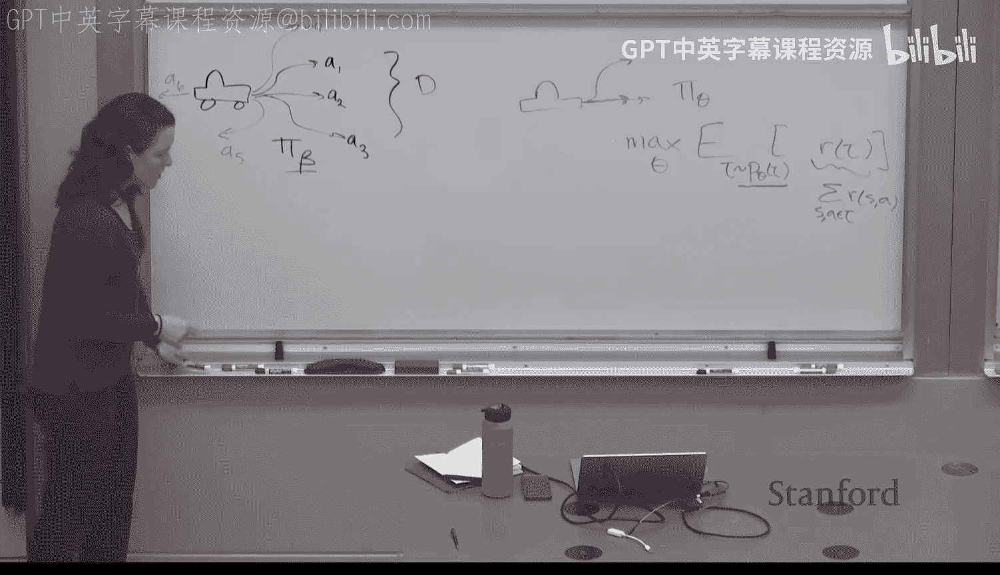

At the beginning of training， we're going to be randomly initializing our Q function。

And so if you think about some like randomly initialized Q function for a given state。

Maybe it kind of looks like like somewhat random。And this is for different actions。这是做。Then。

Only some of these actions are present in the data。 And so maybe A1， A2 and A 3。

 maybe they're all kind of。Within this range。So this is kind of what's like in distribution in the data。

 and then outside of that， your Q function is somewhat arbitrary。

And you don't actually see any data for outside that。And then when you do a policy update。

 your policy is going to say， oh， maybe let's let's try to increase the likelihood on action on actions that have a high key value this is。

啊。Actions A， Q of s comma A， then what it will do is it'll say， okay。

 for this randomly initialized Q Q value， maybe something like this looks good。

And then if that's outside your data， then it will still continue to think that that's a good action because it'll never actually know what the proper Q value for that action is。

And so walking through that。Basically everything， maybe another way to think about this is that here's your data。

 here are some of the actions that are out of distribution， including like a4， a5， it never saw。

A car that for example， like makes a U turn on the highway and so the key value is randomly initialized for that。

 some of those actions that are out of distribution will arbitrarily have higher key values。

 some will have lower because it's randomly initialized and then your policy will exploit those inaccuracies on the out of distribution actions。

😊。

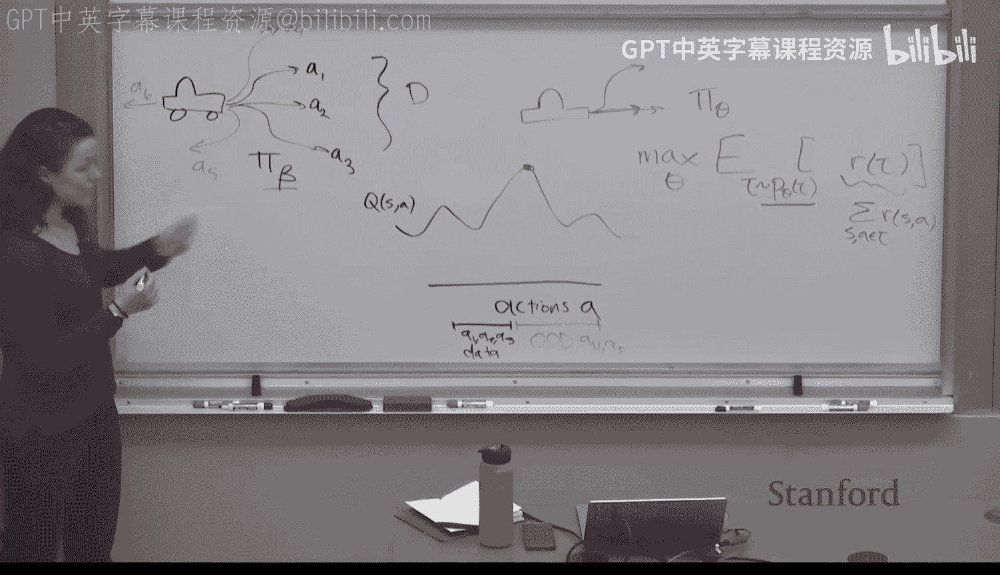

So on the slides。We have this term right here。When you evaluate this Q function on a prime that's not in the data set。

If you have some randomly initialized Q function。For that state。

And your data support only covers part of that， then on the auto distribution actions your Q function will be unreliable and then when you do your policy update that's going to seek out actions where the Q function is over optimistic。

And then after the policy update， these key values will be。

Overestimated because now you're going to keep on reinforcing that that was good behavior。

 even when it's not in your data。Another perspective on this is that this is kind of will happen in scenarios where your learning policy is deviating too much from your behavior policy because these other distribution actions。

 these are things that are very different from what the behavior policy did and if we stayed closer to the behavior policy。

 then we wouldn't have this issue。😊。

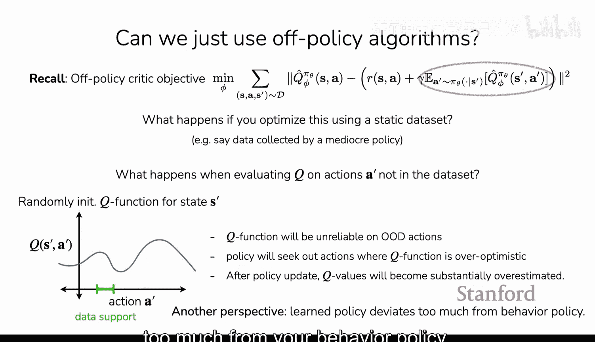

The question is what happens if you have a discrete action space。

 so basically everything will be the same you it's possible that your data set。

 if in all the states in your data， it has full coverage of the actions。

 then you won't have this problem because everything will be in distribution。

 but in practice usually there will be states where you don't have full coverage of all actions。

 and you can still see overestimation in those states。Yeah。

 so the question is can you just exclude out of distribution actions when you're updating your Q function yeah and there are approaches for doing that now the unfortunate thing is we don't actually know what's in distribution and out of distribution so we have just samples of states and actions and for a given state you might have one state that then chooses a1 then you might have another state that's not exactly the same but very similar and that takes a2 and so in that case a2 by' like technically not be seen for the first state but you don't necessarily know like you don't know for a given state what's in distribution and what's out of distribution。

😊。

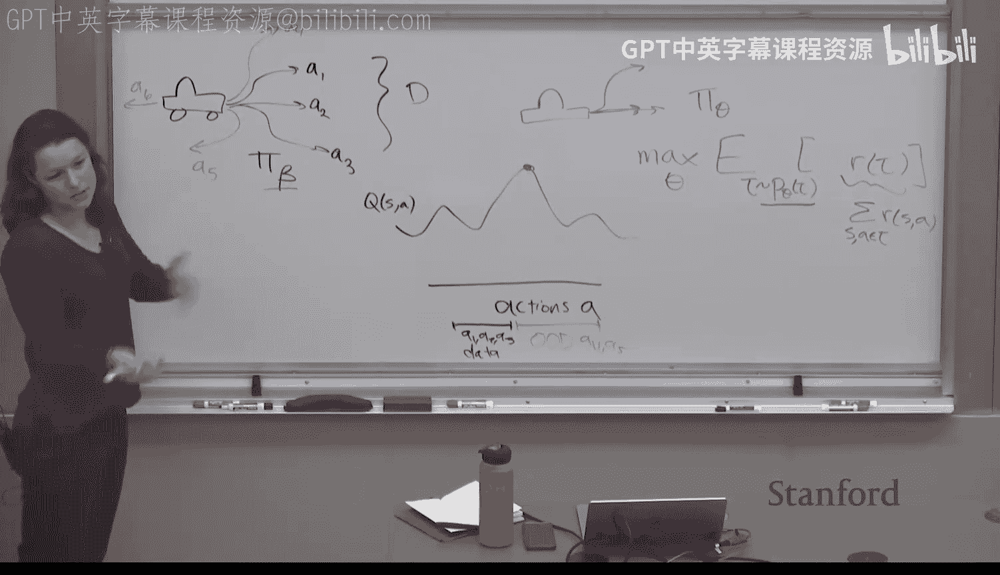

And yeah， we'll basically see basically a key idea behind offline oral methods is trying to avoid。

 well， first trying to think about how do we deviate not too much from the behavior policy。

 and second， can we avoid out distribution actions？Okay。

 so let's talk about mitigating overestimation， this is really the core goal。

Behind offline neuralal methods。So。The one approach to offline RL is basically to do imitation learning and the reason why imitation learning works is that you're only supervising with actions that are seen in the data and so any sort of approach that uses imitation learning is going to be avoiding out of distribution actions somewhat implicitly because you're only going to be supervising with actions that are in the data。

Now we don't necessarily want to use vanilla imitation learning because the offline data may not be optimal。

 there might be human drivers in your data， for example。

 that don't drive in the way that you want your autonomous vehicle to drive。

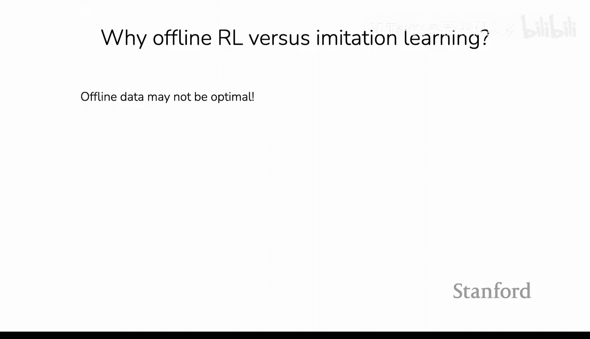

And often neural methods should provide a way to be better than the policy that underlies the data by leveraging reward information。

By leveraging the fact that maybe you can kind of go through your data set and say that this was a behavior that was good。

 and maybe this was a behavior that was like not as good。

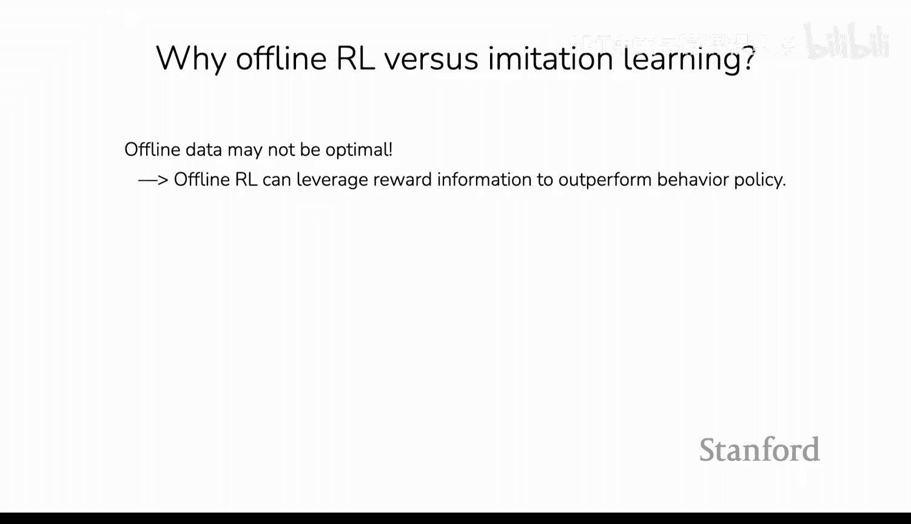

And that reward information can allow you to get a better policy。

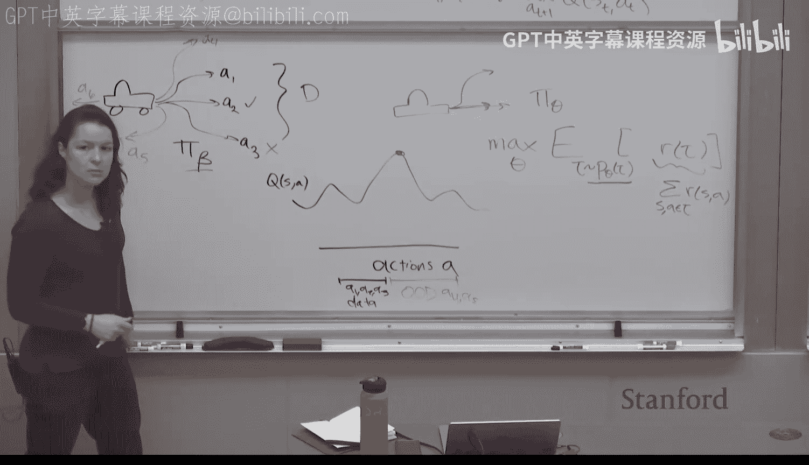

And then yeah， vanilla imitation learning can't outperform the experter what provided in the data。

The other thing that I'll mention is that。Not not sure if there's an analogous situation。There is。

 I think probably some analogous situation in driving。

 but a good off literal method can also stitch together good behaviors。

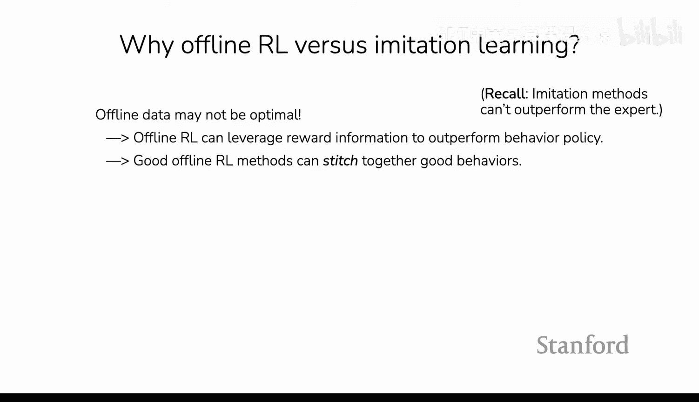

So if you have。Where to put this。 So you have。Maybe let's put it over here。

So say you have some trajectory in your offline data that looks something like this and another trajectory in your data that maybe looks something like this and say that this one got a good reward at the end and this one got a negative reward at the end。

Then a good offline neural method should realize that。

This is a good behavior and also the first part of this trajectory if you continue along the green trajectory at the end is also can be a good behavior and a good off oral method should realize that。

That when you're in these states， you should essentially be able to stitch together the first part of this trajectoryy and the second part of the green trajectory。

And if you use vanilla imitation learning， you won't get that kind of behavior instead what it will do is it will in this state it will take the average between these two。

Action distributions。So what this could look like is if you have a couple trajectories like this。

 then we know that S1 to S3 is good behavior， we know S7 to S9 is good behavior。

 and so offline reinforcement learning methods in principle can actually learn how to get a policy that goes from S1 to S9。

 whereas imitation learning methods won't be able to do that。😊，Okay。

 so before we get into methods that can do that kind of stitching。

 let's first talk about like a very simple baseline method。One idea is， if you have a。

Offline dataset。You could also just take the trajectories that have high rewards and only imitate the stuff that is good and don't imitate the stuff that's bad。

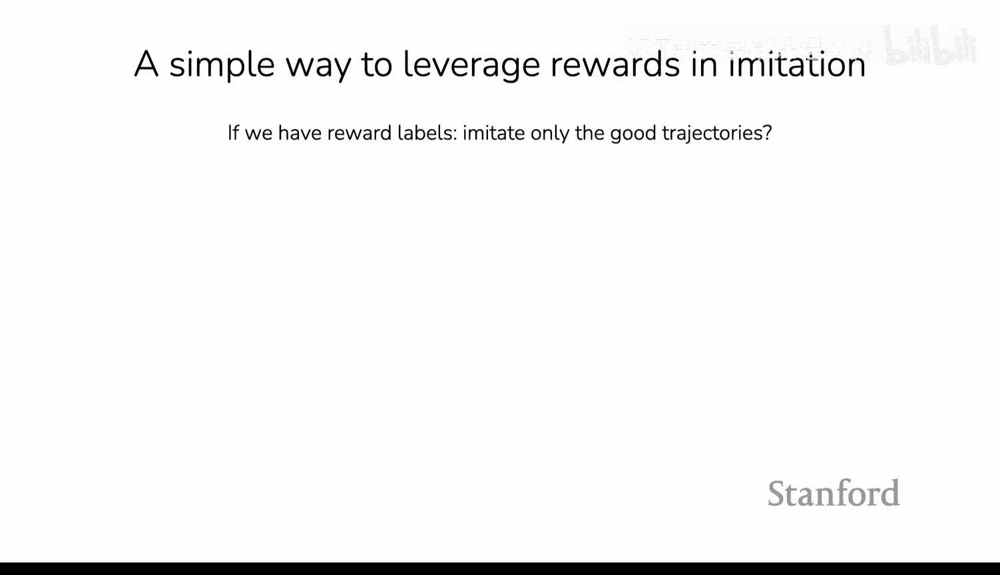

And that seems like a reasonable method。You have some offline data that contains a variety of trajectories。

Then what you could do is you could define a new data set that has only trajectories that have a high reward。

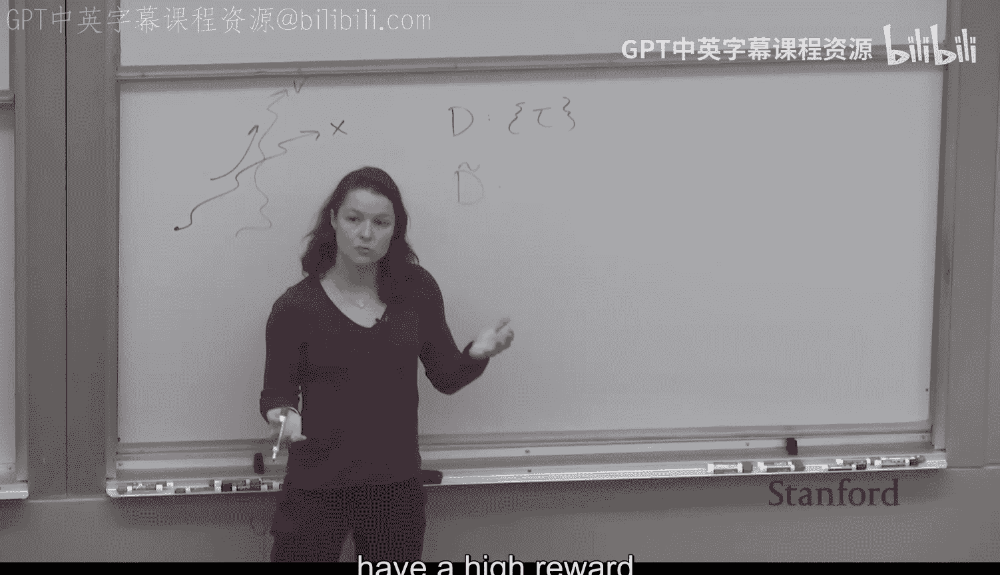

And so what this new data would look like is it would be all of the trajectories in your original data set。

Except conditioned on the reward of that trajectory being greater than some threshold。

 and that threshold could be some percentile of the rewards in your data set。The 70th percentile。

 for example， like only taking the top 30% of trajectories。And then from there。

 you could learn a policy that maximizes the。Likelihood of the in this modified data set。

So that would look like taking mistakes and actions in this modified data set and maximizing。

The log probability of the actions given the states。

 so this is the typical imitation learning objective。Cool。

 this is our perhaps our first offline oral method， I guess very， very basic。

fililter the data set to do the top K% of data and then imitate the filter data set theres a very primitive approach for using reward information and it's worth noting that it's not able to do this kind of stitching behavior because what it will do is if this is like a bad trajectory it might just filter out that trajectory entirely and it won't actually learn how to take this good behavior in this good behavior and figure out how to get from here to here。

😊，That said， it's a good baseline， so if you're going to be trying out any offline R method。

 it's good to try this first and see how well it does and use that as a benchmark and make sure that or Idely try to make sure that your offline R method is doing better than this。

Okay， now one of the reasons why I introduce this is that arguably some of the best offline Earl methods。

Are actually doing something that's not all that different from this in that they do have an imitation learning component to them。

And the idea here is that。The instead of。Just taking the good trajectories。

 we could imitate the data， but weight our imitation learning objective based on how good the action was。

In that transition。No。If you remember what we talked about with regard to value functions and advantage functions where the advantage function is。

 how much better is AT compared to？What what your policy does。

 this advantage function suggests that if we weighted our imitation learning objective by the advantage function。

 then we could get some measure of how good that action is and get a policy that is able to learn effectively。

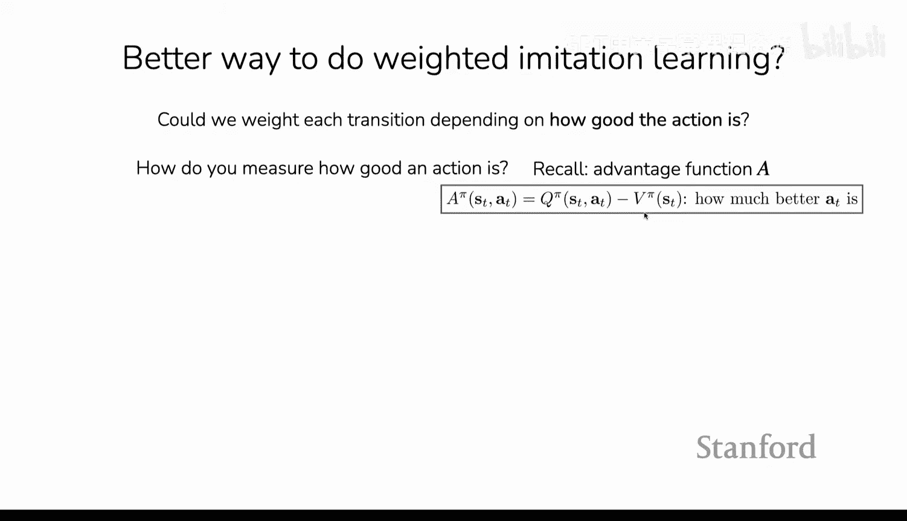

And this will kind of form the objective of our first offline or method。 And in particular。

 what we'll do is we will。Maximize。An objective for a policy that will be。

Taking the standard imitation learning objective。But just waiting it by。

By the exponentiated advantages。And this will be sum overstate and actions in our data set。

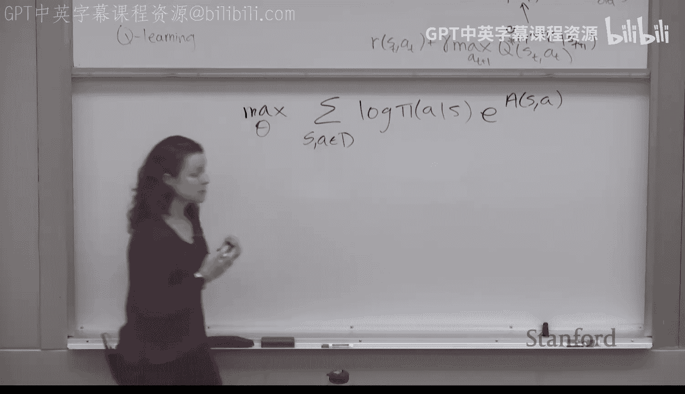

in terms of the choice to exponentiate them， there's actually a way to derive this particular objective。

And I'll mention that on the slides， we won't go through the derivation， but if you're interested。

 we can see if we can post it after lecture。😊，And。In terms of this objective。

 if we have a good advantage function and we go back to the stitching example。We。

For this particular state right here， we know that the advantage。Of this action。Is。Is high right。

 because the value， the Q value of this is one， the Q value for going this way。

 at least in the data is zero and the value of this state is will be the average of those two outcomes and so the advantage for this one will be positive and the advantage for going this direction will be negative。

😊，And so when we then take our imitation learning objective and weight it by the advantages。

 we're going to be telling our policy that in that state。

 it should go to the good outcome rather than going to the bad outcome。And so this objective。

 if you have a good advantage estimate it， is capable of kind of stitching together good behaviors in an offline data set。

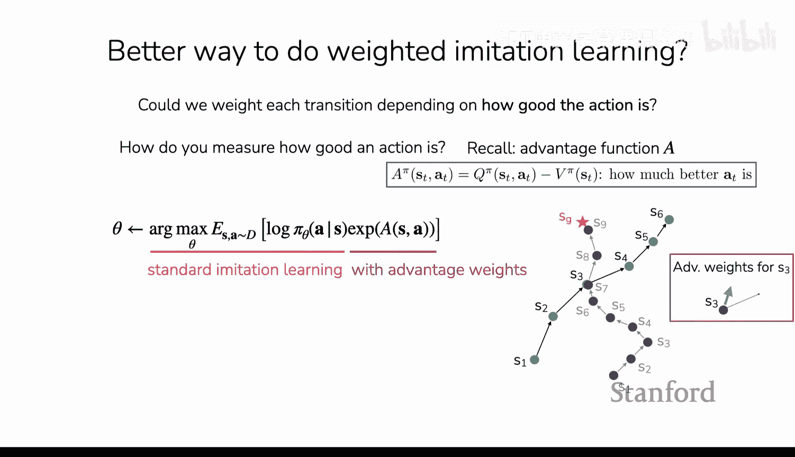

So in terms of the derivation， you can show that this advantage weighted imitation learning objective is approximating a Kale constraint objective where you can show that it' maximizing the future rewards as measured by your key value subject to the constraint that you're staying close to your behavior policy and。

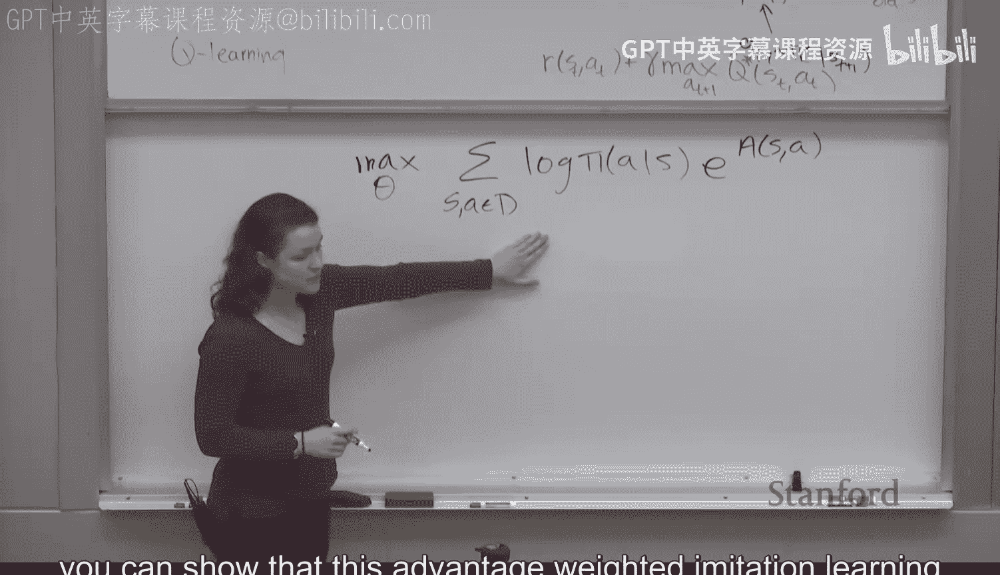

A pretty reasonable objective for offline Earl， because if you're too far from your behavior policy。

 then you won't be able to。

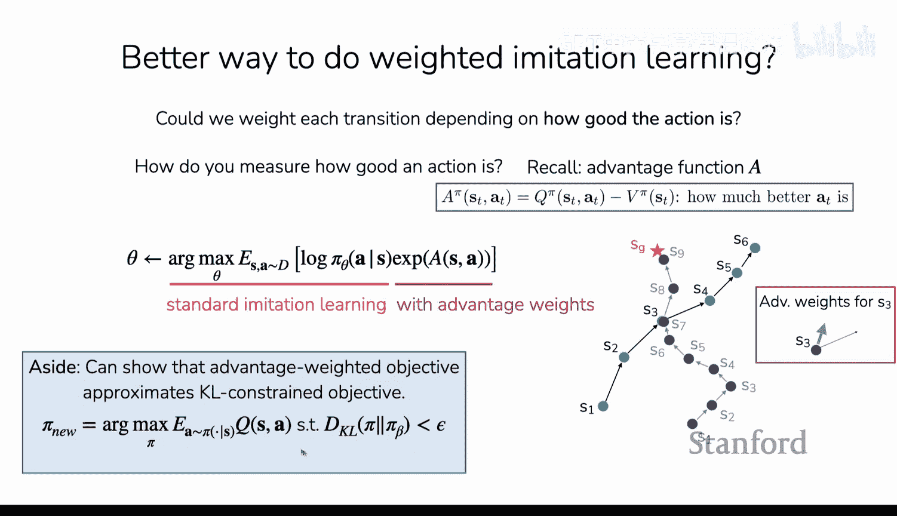

You won't be able to actually get good information about how to improve your policy。Okay。

 so before we talk about how we estimate the advantage and what this advantage will be。

 any questions on what this objective looks like？

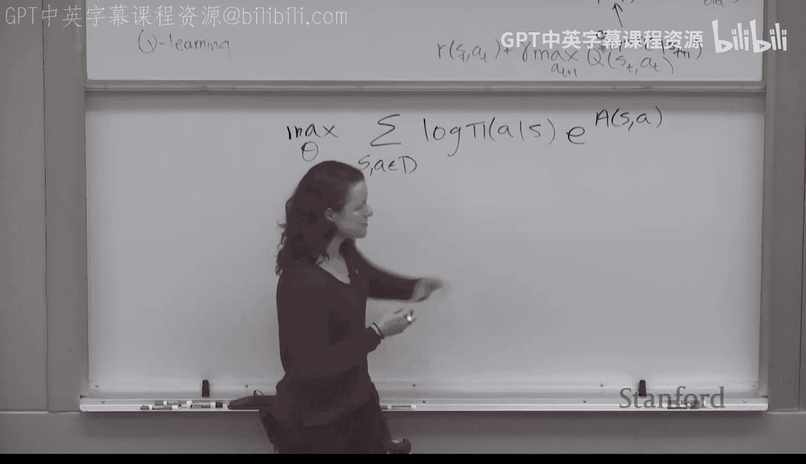

Yeah so the question is for this to like improve of imitation learning。

 do we need to assume that our trajectories have intersecting states and the brief answer is that no we generally don't have to assume that and in this diagram I actually tried to have S7 and S3 like not be exactly the same state and the reason why we don't need them to be exactly the same is that if we're using a neural network to represent the policy in the advantage function。

 then it will naturally like states in actions that are very similar to each other will naturally have similar outputs from that neural network and so it will be able to it should be able to generalize if the states are similar to each other but not exactly intersecting now the degree to this work to how well this works will depend on like how close those states are and how large the data set is such that it can learn a representation that is collapsing those。

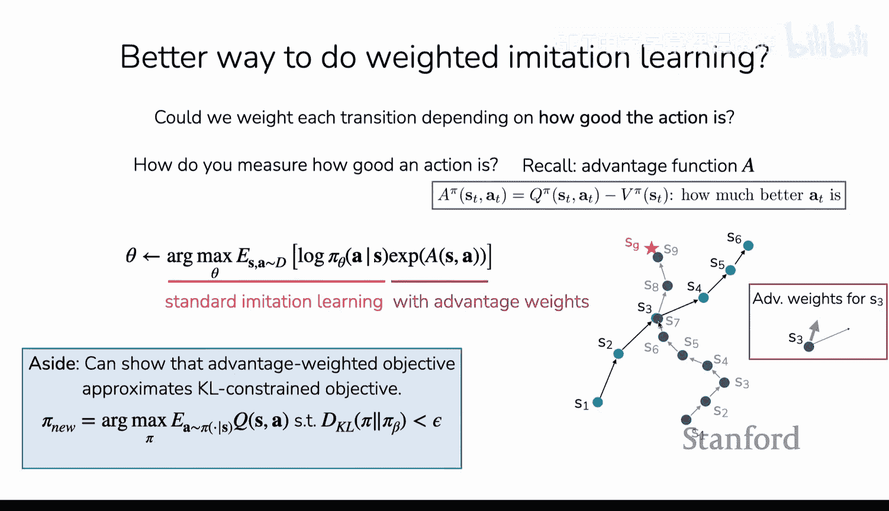

Representations to something that looks similar。The question is in practice do we need to worry about the exponential term exploding when we look at a practical implementation of this。

 we will actually add a hyperparameter that corresponds to the temperature of this and so the practical algorithm will have like a one over alpha times the advantage and that can help prevent this from getting extremely large。

Yeah， and then it I guess it depends a bit。Maybe we'll talk about also a bit more when we get into fitting advantages。

Yeah I knew this question would come up so when we talked about actor critic methods。

 the objective looked like kind of similar to this except instead of expentiating。

 we just had the advantage here the other key difference was that here we're sampling from our offline data set and in the actor critic objectives the action well。

 there's different versions but we're sampling from an online data typically and in the。😊。

In soft vector Cr， this action actually comes from your policy， not from the data set。

There isn't like a very quick way to kind of derive where those differences come from。One。

I don't want to confuse you， but the one way of thinking about this is oftentimes。

Offline online or objectives will be optimizing kind of a reverse scaleale objective and offline are looking more at a forward scaleale objective but。

It's a longer explanation， yeah。

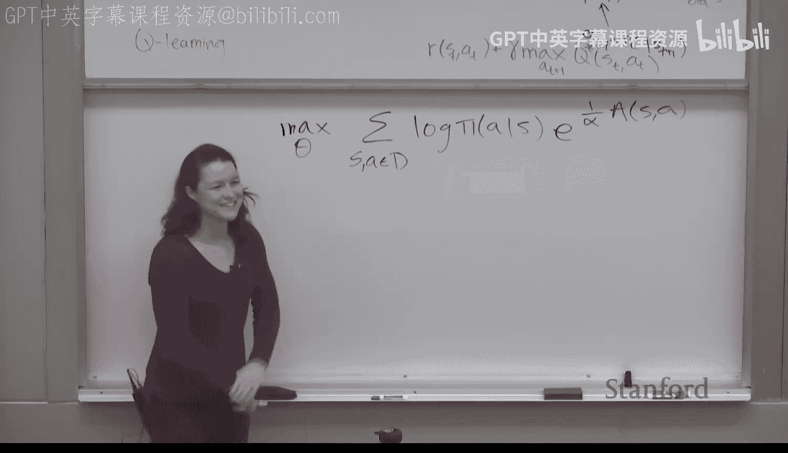

Okay。And there's also some references here as well。Okay， so we've talked about this advantage。

 Now advantages actually have some。Policy associated with them it's not。

It's the advantage of taking action A in state S and then following some policy and so the question is the first question is like which policy are we trying to estimate the advantage for？

For now， we can use try to estimate the e of the behavior policy。

and then a key question comes up is how do we want to estimate this advantage function and ideally in a way that prevents the overestimation that we saw before。

😊，Okay， so。The first way that we can estimate the advantage function， I mean。

 generally it will look very similar to what we saw before when estimate the advantage function。

 but there's a couple other considerations。

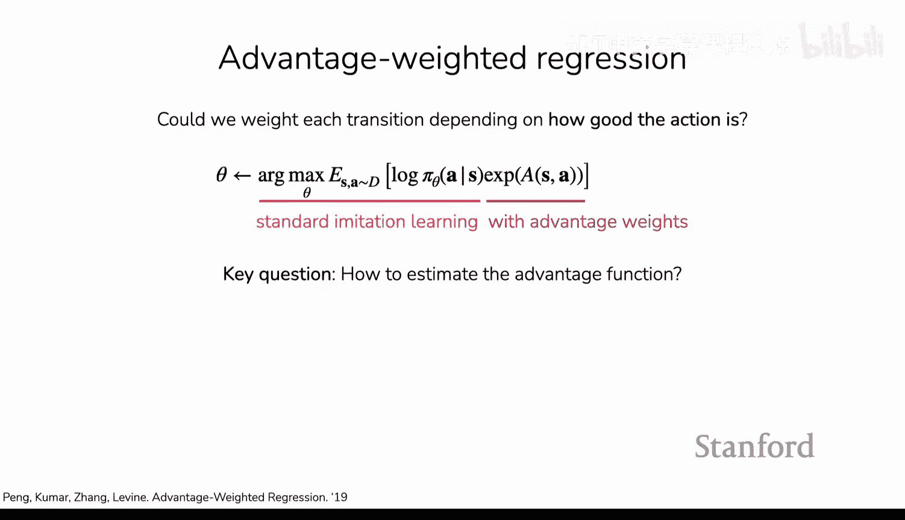

So。Let's say version， maybe I'll do this。In a new color。 So let's say version 1。Oh， it's V1。Viion1。

 we're going to use the simplest thing that we had before， which is to use Monte Carlo returned。

So we can first fit a value function。And because we're fitting the value function for the behavior policy。

 we don't need to。It is coming like the data is coming from the policy that we're trying to evaluate a value function for。

So， the。The if we want to fit a value function with monocol returns， then our objective looks。

We're trying to regress to the sum of future rewards。So our objective looks something like this。

So this is something that you can basically supervise learning to the future rewards。And then。

Once we do this， which is fairly straightforward， then the question is。

 how do we get the advantage out of this？There's a couple ways you could do this in the the first time that we saw this。

 the way that we got the advantage function。

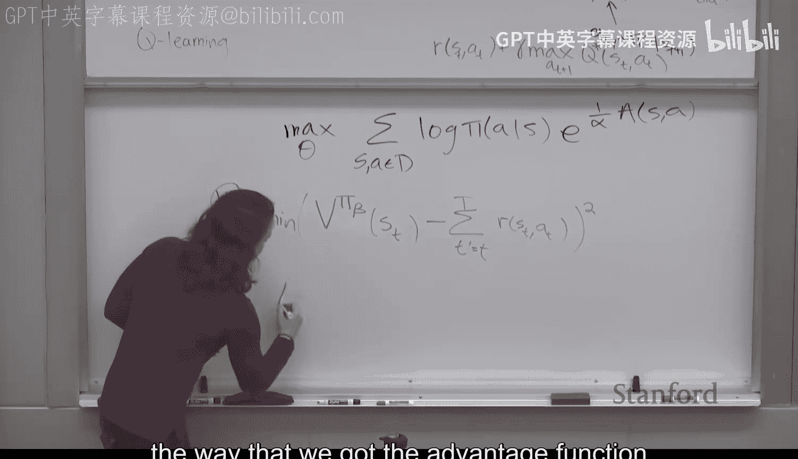

For a given state in action was to use the reward。Plus the value function at the next time step minus the value function at the current time step。

 and these are all the value function。That we just estimated。So you could use this。

The one alternative boom do you could use this this is going to rely on having a value function that is fairly accurate because you're doing this kind of one step kind of temporal difference between the reward post value here minus the value at the current state and so one alternative thing that you could do is instead of using。

😊，This。Estimated this reward plus value， which is basically the estimated future rewards if you start state T and take action A。

Minus。Your current value is instead you could simply use the empirical sum of rewards into the future。

And so this could simply be the。And this isnt going to be a little bit simpler。

Doesn't rely on having a good kind of temporal difference between the two。And so specifically。

 we can first estimate the value function by trying to minimize the difference between our value estimate in the sum of rewards and then to estimate。

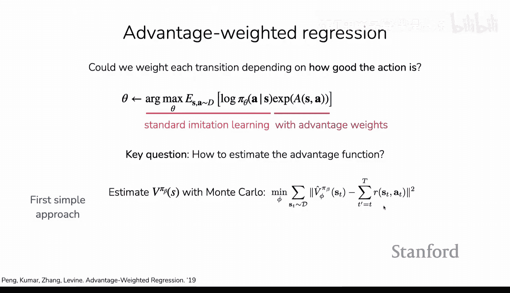

The advantage function， we can。Take the sum of rewards for that trajectory and subtract the value。

In terms of。This particular advantage estimate corresponds to a fairly simple and fairly popular algorithm called advantage weighted regression。

Yeah， and。I should emphasize that the way that we did it previously where you use R+ V of STT+1 is also valid。

 this simply corresponds to a method that is used pretty commonly and seems to work well in practice when you have an offline data set。

The question was we talked about before how this is somewhat high variance and GAE is better you could also use GAE here definitely this is。

😊，Going to be a little bit simpler， but yeah， you could also use generalized advanced estimation here。

😊，Yeah that's a good question so the question is are we bringing up this Monte Carlo because with an offline data we have enough data that some of rewards is more accurate and we don't have the variance issues that we saw before that's definitely one reason like when you have a large offline data variance is a bit less of a concern and these are more accurate that said a big part of it is also just simplicity and it's nice there's。

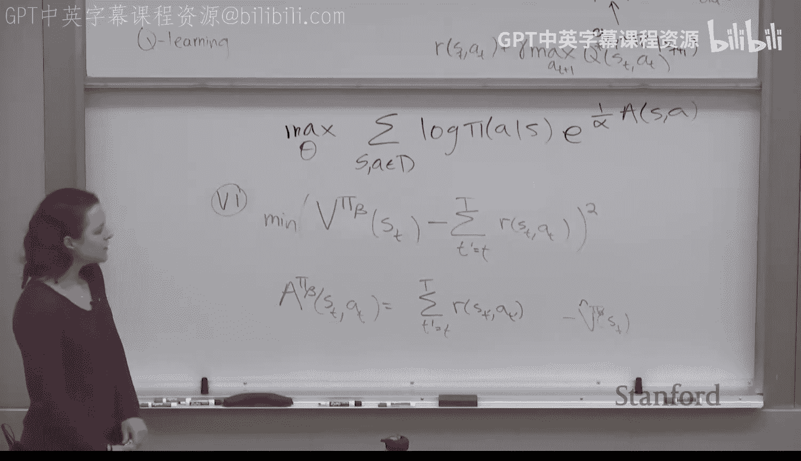

Yeah，'s very nice to have an algorithm where you're doing kind of supervised learning to fit the value function and then you're doing weighted supervised learning to fit the policy and it's just a very。

 very simple algorithm Next we'll talk about slightly more complicated algorithms that。😊。

Then kind of this version one right here that can also do a bit better。

 so it's still even when you have an offline data there is like variance。

 more variance in this estimate than other estimates that we'll see in a minute。Now， one question。

Just to get your brains thinking a little bit。

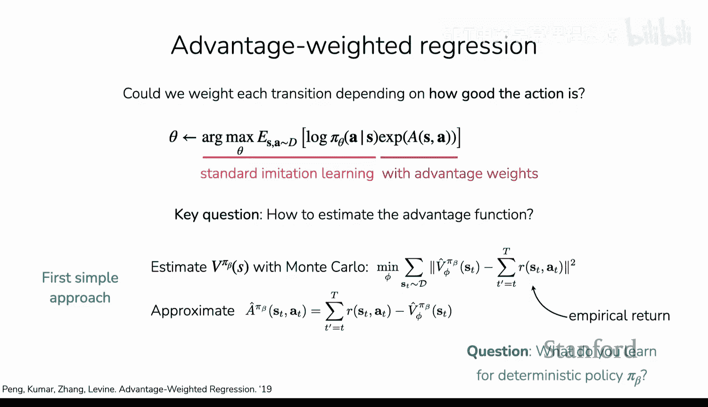

And the question is what do you if you did this for a deterministic data set or a policy that was deterministic underlying the data set？

What do you actually learn？And so as an example， let's say that we have。

Let's say that we have the car again。Maybe the car if it's like。Like in some lanes。

 maybe you just always goes straight。And you never actually see it like turn left or turn right。

My question for you is yeah if you were to run this algorithm where you are fitting your advantages in this way on the data。

 what advantages will you learn and I'll let you talk about this for like two minutes and then we'll come back to talk about this with your neighbor。

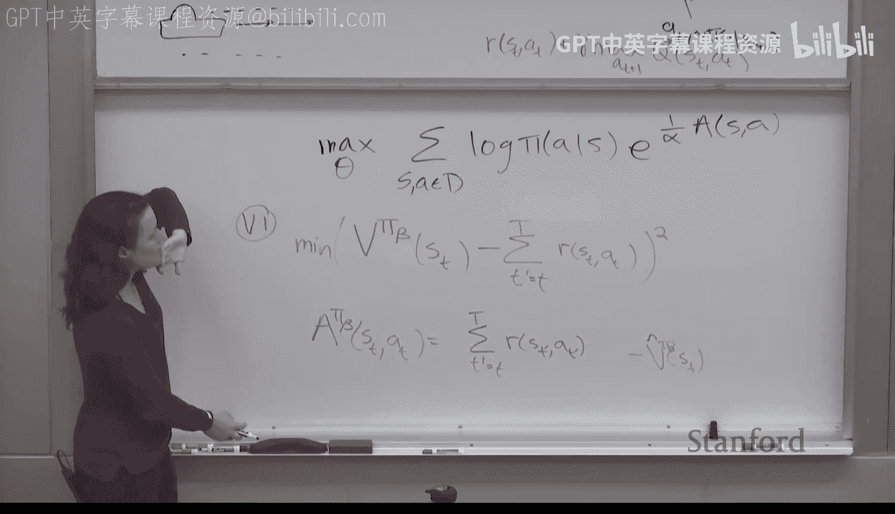

Okay， let's come back。Does anyone want to share what you discussed？

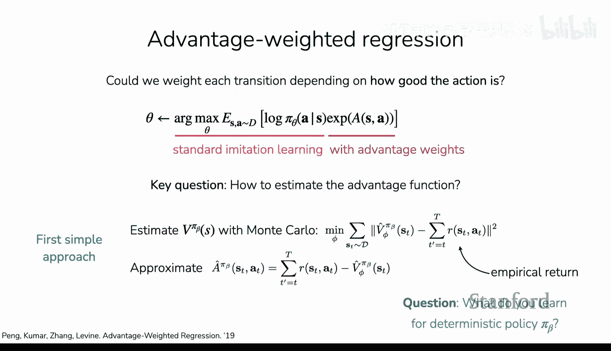

Yeah， so what was said is that the if you're always taking the same action。

 then the sum of rewards will be the same as V because you don't actually see any kind of variability in your actions。

 and that means that your advantage estimates will all be zero。And then taking that one step further。

 if you then kind of plug this into this equation， if all your advantage estimates are zero。

 then this expent term is going to be one and then you actually just get back kind of vanilla imitation learning and that's actually it's kind of nice that you get that back because it means that for this sort of policy like you actually can't really do better than the behavior policy in that scenario because you don't see any variability in different actions you can take and so this algorithm then kind of falls back on imitation learning in that scenario。

Yeah， so the question is when collecting data from off federal。

 does this mean that you should kind of sometimes deviate from the expert policy just to see more example actions and yeah generally having more diverse。

Actions represented in your offline data is good for offline R。

 especially if you think that your expert is not like the optimal thing to do。

 then you definitely want variability because then you can actually have the potential to outperform the expert in your data。

😊，Yeah， so the question is like is it does happen very often in practice where your estimates are zero。

 so the true advantage function for this policy is not zero for other actions it's just that we don't see those other actions in the data and in practice if you have variability in the actions that you will get advantages that are very different from zero and so yeah you will actually see a good amount of variability。

 it really depends on how broad your data set is。😊。

Yeah so the question is how how do you like what would the advanced function do on actions that are not in the data so in this objective we're actually only evaluating it on actions in the data and so you don't have any issues with with kind of going outside the support now if you did evaluate it on actions outside the data for a different reason then it would be not accurate it'll just be whatever was the result of like the neural network optimization if it's close to the data it might be reasonable if it's far from the data it might be like arbitrarily incorrect。

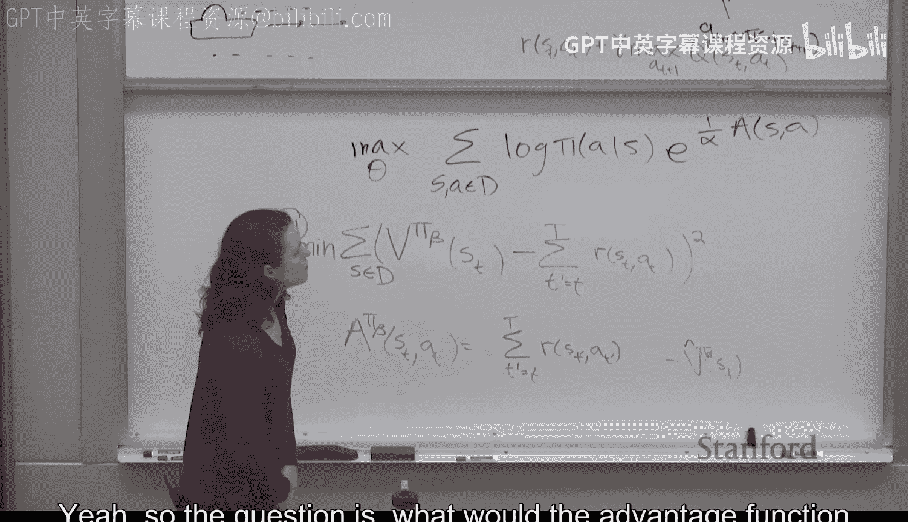

Okay， so the full algorithm is we first fit a value function using Monte Carlo regression and then we trade a policy where we wait the probability of taking an action or the likelihood objective by the expd advantage estimate where the advanced estimate is given by the sum of rewards minus the value function and we have this hyperparameter here that kind of controls the temperature or how spiky this distribution will be。

😊，One of the upsides of this is this algorithm is very very simple， it's like yeah。

 probably the simplest thing that you can implement that has the possibility of improving over like filtered imitation learning。

 it also avoids querying or training on any auto distribution actions which makes it more stable。

 that said Monte Carlo estimation can be noisy and we're learning an advantage estimate for the behavior policy not for the policy that we're learning and so this is going to be like we can only improve so much over the data set as a result。

😊，Yeah so the question is like is this always close to zero and why not because you're trying to fit your value function to the sum of empirical sum of rewards and then we're taking the sum of rewards and subtracting the value from it now the reason why if you have a broad data set that it won't always be zero is that from an individual state you will see diverse actions and your value function is going to be maybe sayus gets like plus 10 this gets plus one this gets like minus5 your value function for this estimate is going to be the average of these numbers so that is three I think。

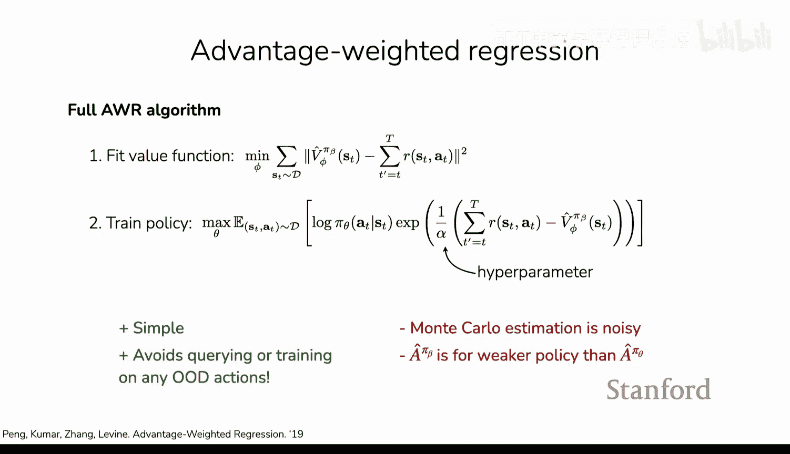

And the sum of rewards for taking this action is going to be 10。

 and so then the sum of rewards minus your value estimate will be seven。So。For this action。

A is equal to seven for this one， a is equal to negative 2， and for this one。

 a is equal to negative8。And so when you have variability from a state or a state that's very similar to states in your data。

 that's where you see kind of differences in outcomes and that's where your advantage functions will differ。

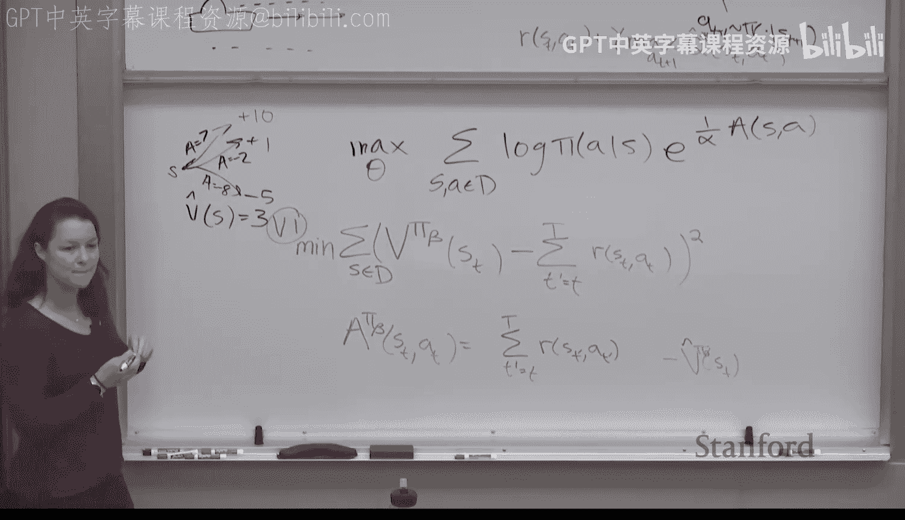

Cool， now itd be really nice to be able to not just use Monte Carlo and be able to use TD updates or use bootstrapped updates without having to query queue on out distribution actions。

And the issue that we saw with our previous objective right here was we were query the actions。

 querying the Q function auto distribution actions right here。Now。

 one very simple thing that we could do is instead of。

Quering action sampled from the policy that we're learning。

We could just sample a prime from our data set。And。This is yeah。

 a very simple modification and this will prevent this will make sure that the A prime that we're seeing is actually always seen in the data and we will actually have supervision targets for this S prime A prime。

😊，So this is a very simple modification to this objective and the。😊。

If you estimate the advantage function in this way or estimate the Q function and then use that to estimate your advantage。

 you get an algorithm called advantageage weighted actor critic。

Now note this is getting rid of one of the weaknesses of the original advanced radio regression algorithm。

 which is that we're able to use bootstrapping， but we're still going to be estimating the value function。

For Pi beta and not for the policy that we're learning。

 So that's still one downside with this approach。So from here。

It'd be good to think of it if we can estimate a cu for a policy that's better than the behavior policy。

And one of the ways to think about this is that。When we're trying to minimize this bootstpped objective。

This target right here， this is sort of like a sample from the of S prime， so like we saw here。

 the of S prime， it's not we're estimating kind of the mean the average of the outcomes。

 the average of the expected future rewards。

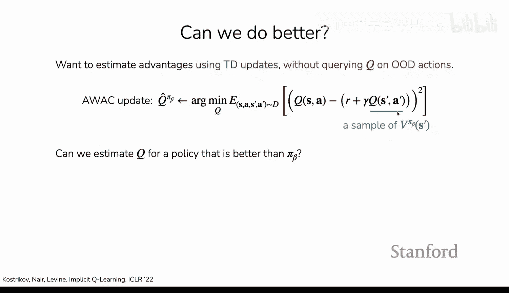

But's actually there's kind of a distribution of outcomes that's represented in the data。And so。

 if we think about。That distribution。So we have our value function。

And if we thought about the value function。For a given state。When you are taking different actions。

 you see different sums of rewards。And so there's actually kind of some underlying distribution。For。

Kind of in your data for a given state。 So like one state or maybe a bunch of states see a。

See a reward that's like at this value， maybe like a smaller number have a higher sum of rewards in them and so forth。

And then when we do Monte Carlo regression。If this distribution like has a mean。

 maybe like right here。Then this is what would we do like。

When we're trying to fit like that Monte Carlo estimate of。For our behavior policy。

 then we get this average right here， we're kind of averaging over the rewards that we're seeing。Now。

 if we wanted to try to learn a value function for a policy that's better than pi beta。

 we could then like we could think about maybe instead of trying to fit the mean of the outcomes that we see。

 maybe we could try to fit some other percentile so this is like the the。I mean。

 but maybe if instead we could try to fit like the 70th percentile or something like that。

 then maybe we could actually get a value function for a policy that is。

Better than our behavior policy。So how do we do that？

Maybe let's go through this on the slides so we have when we're trying to estimate rewards plus feature key functions is a sample of。

The values， if we think about a histogram of the values for a given state。

When we are using this target， we're using an average of the value。

Also the L2 loss all right here is giving us that value。Now， the VS for the policy。

 the best policy in the support of the data is going to be right here。

And so maybe there's some way to try to use a different loss function other than the L2 loss to get a better policy。

Now， an idea for how to do this。

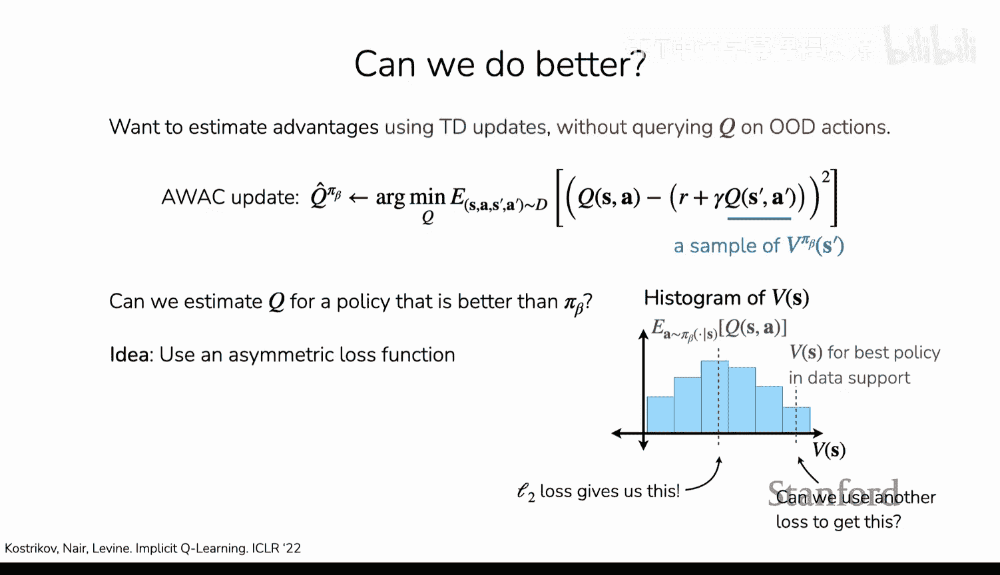

In。Would we use it L2 loss？嗯。We have some， like， error。

And so this is like the error plotted on the x axis and then an L2 loss。

 we have something like this right， where maybe let's call this E， this is e squared。

And if we instead wanted to get。If we instead wanted to try to get a value estimate for this。

What we could do is if we instead of having this kind of symmetric loss that is yeah， symmetric。

 if you're less than zero and greater than zero， you could instead。嗯。News。

A loss function that looks like this。And。You could actually show that loss functions like this will actually。

Instead， try basically， you'll be penalized less for making errors in a particular direction。

 And this will actually give you a。A value function that looks。More like this。

 that's actually better than your behavior policy。Now。

 specifically what this looks like is if you think about。

You have some loss function we'll call this there'll be some。Maybe let thisre to error？

This loss function is going to behave differently if the error is less than zero versus if the error is greater than zero。

And the。Let me just remember what the direction is， so if it's less than zero， so we will have。

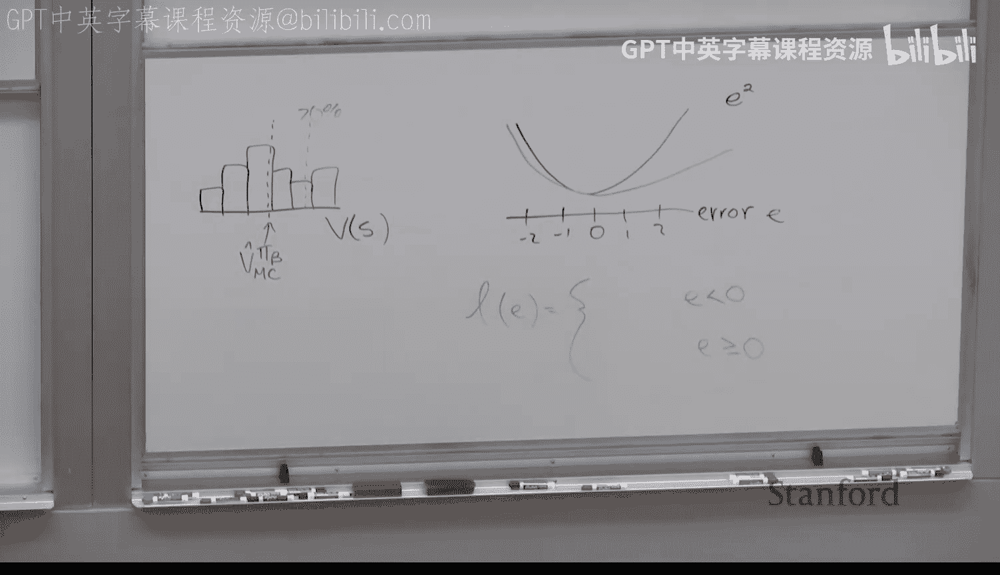

And the base case is just x squared or e squared。Then we'll have some hyperparameter that weights our loss by some value and if lambda is 0。

5， then this is the typical like L2 objective because it'll be e squared both less than 0 and above 0 and if lambda is less than 。

5， then it will be。Kind of down weighting the loss when it's greater than zero and upweighting it when it is is sorry。

Downwining it with about zero and upwiing it was less than  zero。

 and the reverse will be true when lambmbda is greater than 。5。So what this looks like is instead of。

 I guess I drew it slightly wrong there， instead of using a loss function that looks like this。

 you can use an asymmetric loss function that is penalizing errors less in one direction。😊。

This is called expectile regression it's kind of a cool trick if you can think about it in terms of like rather than just like error or some arbitrary random variable x and if you define different values of this lambda term then you get these asymmetric losses that look like this where if again if lambda is greater than 0。

5 then you see it as asymmetric in this direction versus it is less you see an asymmetric in the other direction。

😊，And here's kind of another visualization where if you're trying to。

 the mean of this random variable is shown in the red curve。

 but then you can get different exiles with different values of lambda。😊。

So then kind of coming back to our algorithms， if we want to fit our。Our value function。

 we can use this expectile loss and。Basically fit a value function that is trying to estimate a value function that's better than for a policy that's better than a behavior policy。

 and this will be penalizing you for overestimating and underestimating。

 but it won't be penalizing you as much if you overestimate a little bit。

Basically if you're off by a little bit and this means that when you have these different outcomes and these different kind of outcomes right here。

 if you get the mean， you get three， whereas if you have。

I haven't written out exactly what the optimum would be， but for some value of lambda， you might。

 it'll be optimal instead instead of outputting the mean youll get it'll be more optimal to output something like like six。

 for example， where you're penalized less for，For kind of overestimating this value and yeah。

 the outcome of the loss function when you sum things together will be something that's higher than the mean。

So in particular for this algorithm， we'll use the expectile loss to fit the value function。

 we'll actually also fit a Q function with the typical mean squared error loss。

 and we'll actually use the value function as the target。

So we'll be fitting both a value function and a Q function。

 and we'll just be using this expectile loss for fitting the value function。😊。

And then once we have our Q function and value function。

 then we can estimate the advantage as Q minus B and use the same kind of AWR method to get a policy where we're weighting the likelihoods by the expentiated Q minus B。

Yeah， so the question is will we be overestimating the value in this case so one thing to note about this algorithm is we're never going to be passing as input actions that are not in the data and that was one of the major sources of overestimation before。

Now， depending on how you set Lambda， if you set Lambda to be like zero。

 then you will overestimate probably， and there is a typically you'll choose some value that's kind of maybe 0。

2 or 0。2， something like that's more in the middle that's not so aggressive and you will be getting an overestimate of v pi beta。

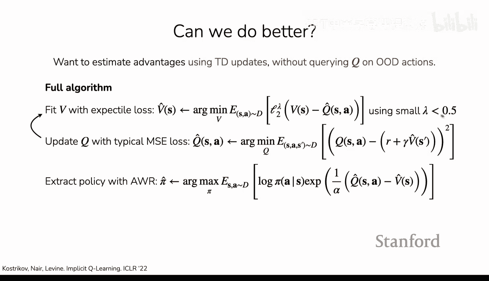

And the reason for that is you're actually trying to estimate the value of a policy that's better than pi beta so you're trying to estimate。

D pie for a policy pie that's like。Better than pi beta。

So you're kind of purposefully overestimating V P beta。

The question is because we're going to be gradually improving our policy。

 would it make sense to gradually decrease Lambda so we're not actually collecting data from our policy and so all the data is coming from our offline data and in that case it makes sense to keep it constant because you always want to be a fixed amount better than your behavior policy now if you did in principle actually do start collecting some online data then then things will change a little bit because then you'll actually be skewing your data to a better policy and in that case it actually might make sense potentially to bring Lambda closer to zero because or closer to 0。

5 because you'll then have data from a better policy， a policy better than your behavior policy。

So pros of this algorithm， we don't need to query out of distribution actions。

 the policy is still only trained on actions in the data。

 and we're decoupling actor and critic training， so we just do this these critic training。

 we're fitting a value function and a Q function on our data and then once we're done with that and that's kind of converged or we've done enough training。

 then we train our policy。CoSo this is an algorithm called the implicit Q learning yeah so the question is why are we fitting Q so we could also use Monte Carlo returns with this and use the expectile like objective with this term it's nice to use Q because Q is lower variance then this sum of rewards right here and we can fit a Q function using kind of the bootstrapped backups so all these ideas are applicable to Monte Carlo as well。

 but using Q functions like when you can use the sort of bootstrapped objective which you could only do with Q functions then you'll get a lower variance target。

And then I guess to summarize kind of the point of offline R。

 so online data is really expensive because we have to recollect it every time we run our algorithm and it's really。

 really useful to reuse offline data， one of the big challenges with offline URL is this shift between your behavior policy and your learn policy and we talked about a filtered or weighted imitation learning method as a baseline and we talked about how we can actually explicitly constrain the policy to the behavior policy by only supervising the policy on actions in your data and so that allowed us to kind of get rid move away from this distribution shift problem。

And then this sort of trajectory stitching idea that we talked about before allows us to improve over vanilla imitation learning。

This example applications for the algorithm we didn't cover if you want to train offline filter behavior coding and implicit key learninging are both good approaches。

 but implicit key learninging is going to be probably work better if you have especially if you have a broader data set and if you want to do offline pretraining and online f tuning IQL is actually a very good algorithm for doing that。

 it could also be used with online data collection quite effectively and it works quite well there。😊。

There's also a variant of IQL called IDQL that uses diffusion policies for your policy class right here and it also works quite well。

 and so if you're interested in diving more into IQL like algorithms。

 I would encourage you to check out IDQL， it is actually beyond using diffusion。

 it also is a bit different in terms of how this update is done。

