# 斯坦福大学《深度强化学习｜CS224R Deep Reinforcement Learning  Spring 2025》中英字幕 p08 -08- Lecture 8_ Reward Learning.zh_en -BV1SvmxB3E5e_p8-

Okay， let's get started great， so for today we're planning to finish offline reinforcement learning and along the reward learning front。

 the key goals today are to figure out why is task specification hard。

 why do naive methods for trying to specify rewards fail？

And what are some methods for learning reward functions from human supervision？

CoolSo to start off with finishing offline reinforcement learning。

 we talked about this problem on Wednesday where our goal is to learn a policy from a batch of existing data without any online data collection。

 and we assume that the batch of offline data is collected by some unknown policy that we referred to as the behavior policy or pi Beta。

 and our goal is to maximize rewards under P theta。

 and so we have this challenge of a distribution shift between this prior policy that collected the data and the policy that we're optimizing。

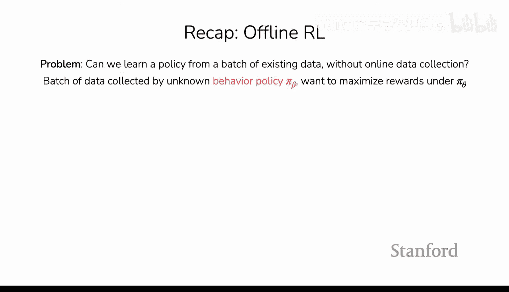

One of the challenges that comes up if you try to use traditional reinforcement learning algorithms in this setting is that if for example。

 you're trying to optimize a Q function to then improve your policy。

 then you might query your Q function on actions that were sampled from your learned policy and those actions might not be covered in the data and that can cause overestimation and it can cause your Q function to be inaccurate。

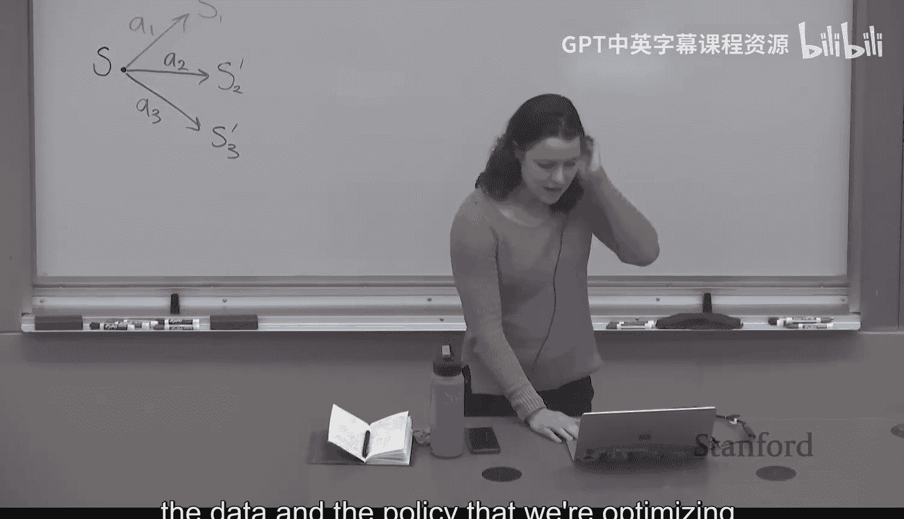

We talked about this picture where if we had randomly initialized some Q function and the data only covers actions along this range for this given state。

Then we might then when we try to actually learn a policy that optimizes a key function。

 then it will start to query actions that are over here because they randomly have a higher Q value。

And that's one of the key challenges in offline RO。

Now we talked about one algorithm that I talked about a couple algorithms。

 but the main algorithm that we talked about last time was this IQL algorithm。

And IQL addresses the offline error problem by actually avoiding 。

 any sort of function queries beyond the dataset set actions altogether。And it did this by。

By actually just learning a value function in a Q function using the states and actions in the data。

 now if you just do that with the normal updates， then you'll learn VPI and Q piI for the behavior policy。

 so you'll learn a value function for the behavior policy。

 and that won't allow you to improve very much over the behavior policy。😊，And so instead。

 when learning the value function， it uses this asymmetric loss to try to learn a value function for a policy that's better than the behavior policy。

And then it learns both a value function and a Q function for the Q function it uses a standard L2 loss one thing I didn't quite go over with regard to IQL is why use an asymmetric loss for the value function but not for the Q function and one way to think about that is you could think about when you're taking actions there's when you're kind of rolling out a policy。

 there's two sources of variability， one is that the different actions that you might take and one is given an action the state that you end up in and if you think about for example。

 the Q function after taking an action and separately the value function of the state that comes after that。

😡。

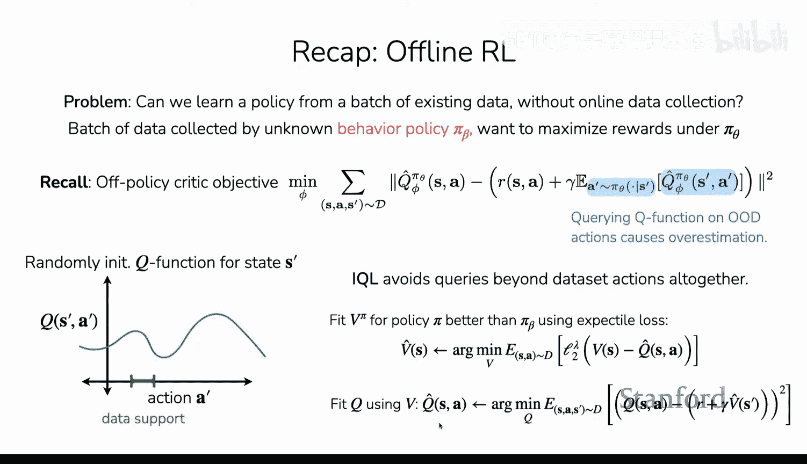

These might be different， so because you actually because there's randomness in the environment。

 the value function for the next state， maybe it's something like eight because maybe you got somewhat unlucky in terms of the next state and it might be less than the Q function after taking this action。

And likewise， for these kind of other states and actions， you might have some variability。

 so maybe Q of Sa2， maybe that's equal to5 because this is an action that's worse than a1。😊。

Whereas a。Perhaps when you actually rolled out A2 in the environment， the subsequent state。

After taking that action has a true value of maybe a true value of eight。

 maybe you got lucky this time， maybe this action is really bad in that case。

 then Q hat Sa3 maybe it was a very risky action so it has a Q value of negative5。

And then maybe when you actually took that risky action in the environment。

 maybe it wasn't quite as bad as what could have happened， and so in that case。

 the value for that next state maybe is something like zero because it didn't turn out as bad。😡。

And the reason why I'm writing out these different numbers is that we could think about the asymmetric loss function when learning the value for IQL and the first loss function when learning the value is trying to regress to the different key values and we could either learn the average Q value or try to lean towards the larger key values。

 and if we lean towards the larger key values， that corresponds to actions that are better。😊。

And so that corresponds to a policy that's better than the behavior policy。

Whereas if on the contrary， if we instead used an asymmetric loss function in the Q function。

 that the targets for the Q function correspond to the next value。

 and if we instead if we use this L2 loss， we'll just be optimizing for the average value here。

If we instead use an asymmetric loss， then we'd be trying to regardgresss to the future state values that are higher。

 which would actually be optimizing for not a better policy but a more lucky policy。

 and that's something that you can't control with your actions。

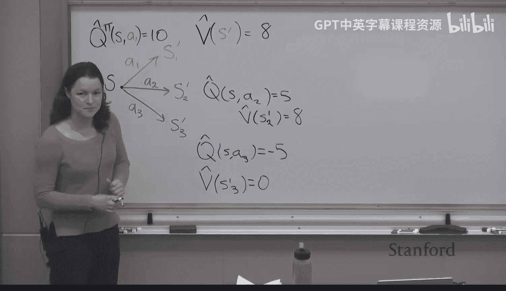

Yeah， so in the IQL objective， we're actually training both a value function and a Q function and the reason for that is because we want to be finding the goal is to fit。

😊。

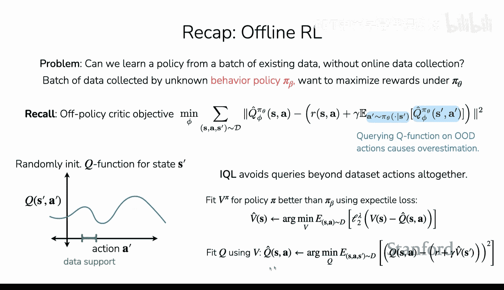

V hat。Pi for a pi that is better than the behavior policy or better than the policy that underlies the data set and as we see here if we do that by reing to these key values then we we'll lean towards instead of the average lean towards the key values that correspond to better actions and so that's learning a value function for a policy that's better。

 this takes better actions than the behavior policy。

 now we can't just use it's useful to have a Q function and then not just a value function because the Q function is what helps us figure out which actions are better when we when we use like advantage weight regression and so forth and so we also learn a Q function as well but for that we use a symmetric loss so that we're not optimizing for being lucky。

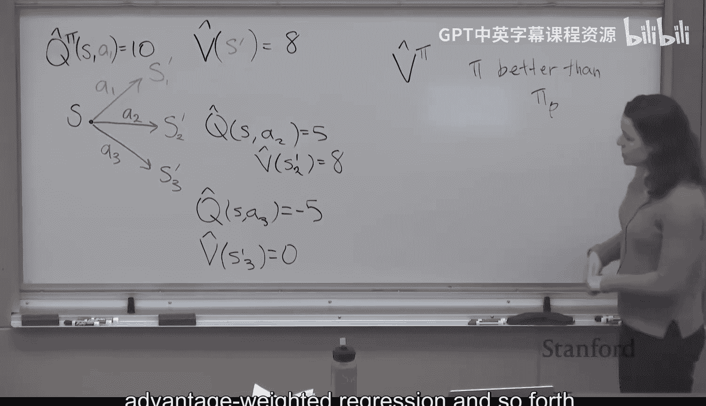

Okay。So IQL was one way to learn a policy from an offline data set。

There's also some other ways to do it， and in particular we'll talk about one more way。

 one more algorithm。And in this case， we're still going to try to estimate the value。

 we're still going to actually query actions from our policy。And。

We want to think about how to discourage overestimation and discourage the R algorithm from taking actions that you think might have high Q value and because they're on a distribution。

And so one idea is。What if we just outside of the data support try to minimize the key values what can we just basically like take this part and try to push down on the key values that are out of distribution？

😡。

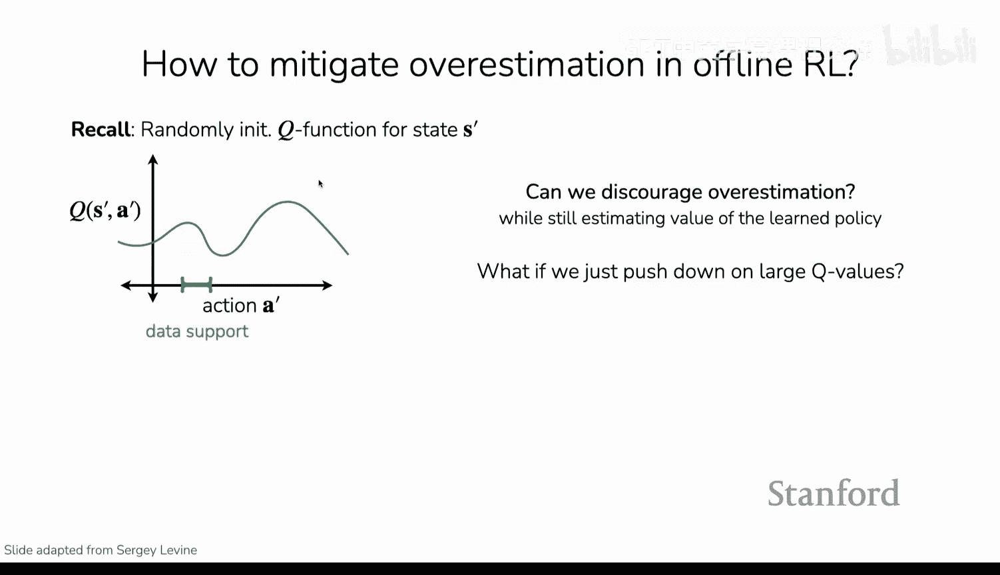

And if we did that， then we would be kind of pessimistic or conservative with regard to everything that's out of distribution and。

Not as conservative when we're actually in the support of the data。

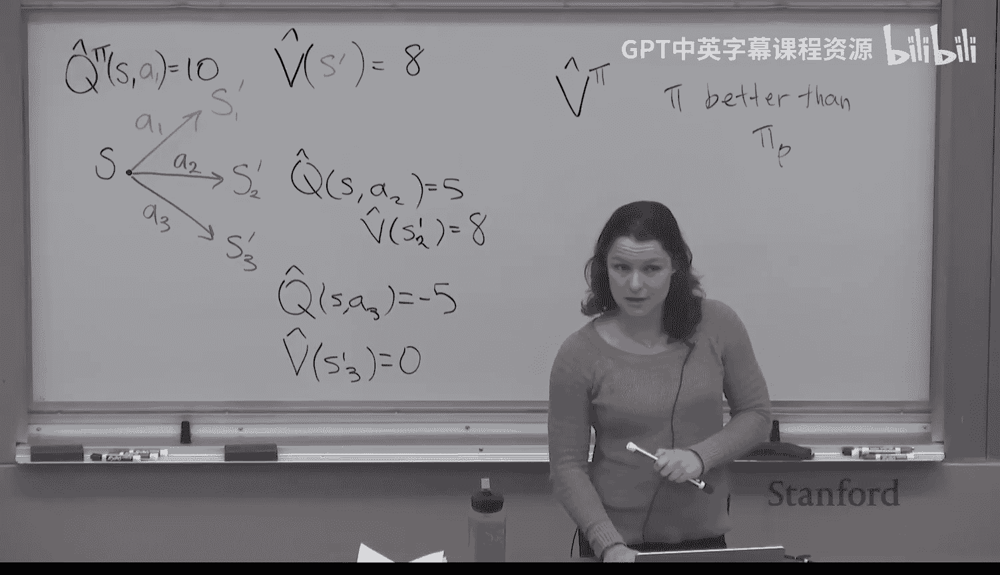

And so we could formulate some loss function。That does this。 And what this would look like is。

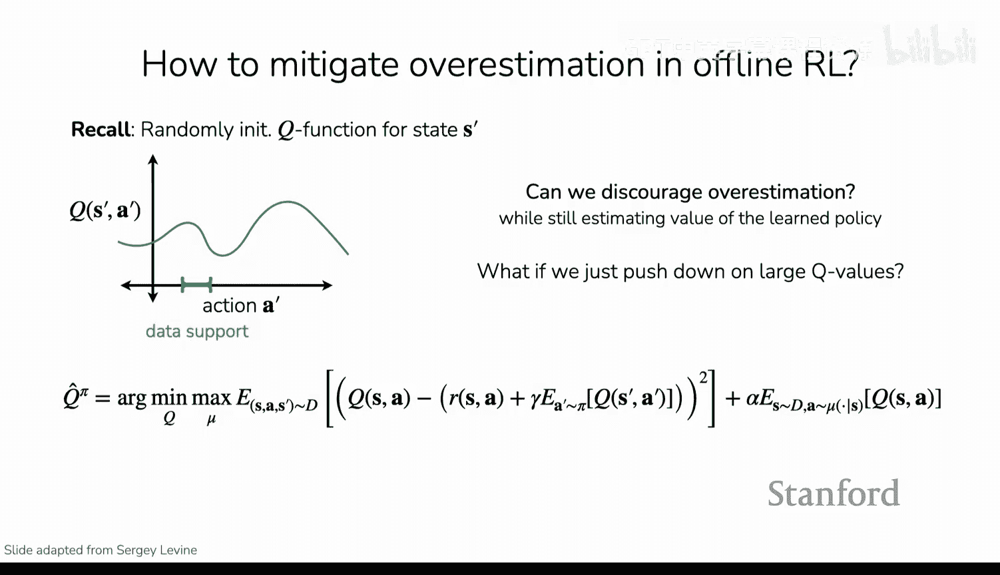

You。You're trying to fit a Q function， and you will have your kind of standard。

Your standard loss for your critic。For your value function， I'll call this L critic。

Then we could also add a loss function。 This is for we're trying to fit。The Q function。

 so maybe that Q function has parameters five。And then we could add an additional term that is trying to additionally minimize the key values on actions that are out of distribution。

So we would try to be minimizing our。Qey values。And。In particular。

 we want to minimize key values for audio distribution actions。 And so this would be。

An expectation over states sampled from your data set。And actions。

Sampled from some other distribution， that's not the data set。And ideally。

 this distribution would cover the out distribution actions that your policy might be considering。

So this is some other distribution， that distribution would probably be a function of S。Now。

 if you want to think about which out of distribution actions your policy might can be considering。

 your policy is going to be considering the out of distribution actions that have high Q value。

And so。One kind of initial version that we could do here is we could pick a mu。

 pick this distribution such that it has high Q values because our policy will be trying to take actions that have high Q values。

And so what this would look like is minimizing our critic parameters。And。

Choosing a mu such that it's maximizing the key values。

So what this will do is it will have it will try to optimize a critic and then minimize the key values for。

Four actions that have a high key values。

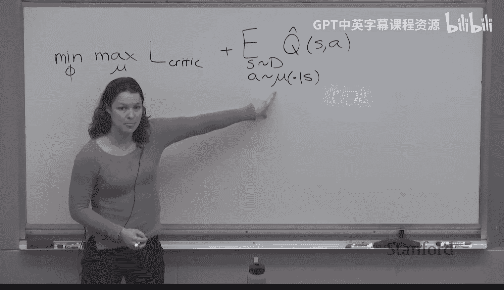

Now this is version1。Um。Where you be pushing down on large Q values。

 you can show with this version that if you have a large enough alpha if you you don't necessarily。

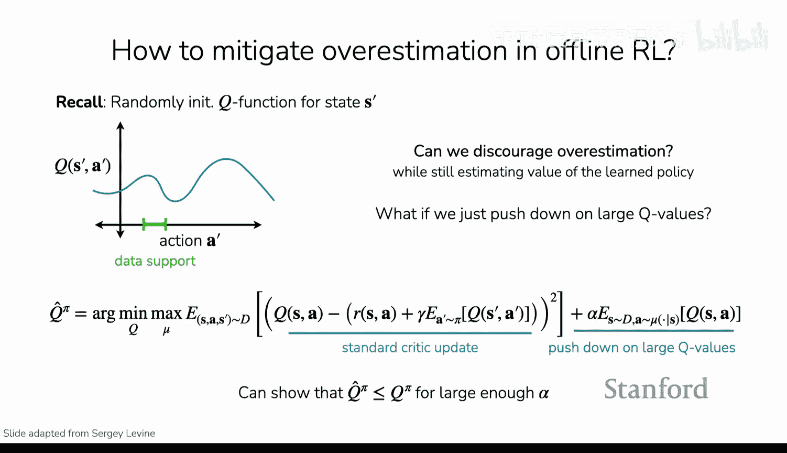

You want to have some sort of weight on this objective。

 this is going to be a hyperparameter if you have a large enough alpha you can show that the critic that you learn from this is going to be a lower bound on the true Q function。

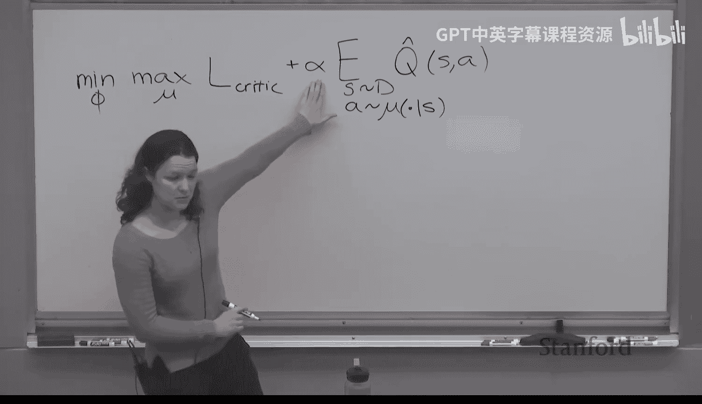

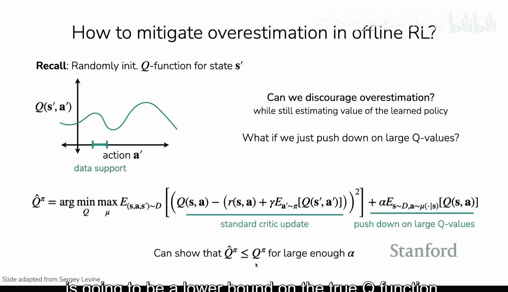

And so then what this would look like is。If you have some kind of。

plot of your Q functions for a different action， and if your data support is maybe something like this。

 something that you might learn is kind of a lower bound on the true Q function where this latter one is going to be Q H。

😊。

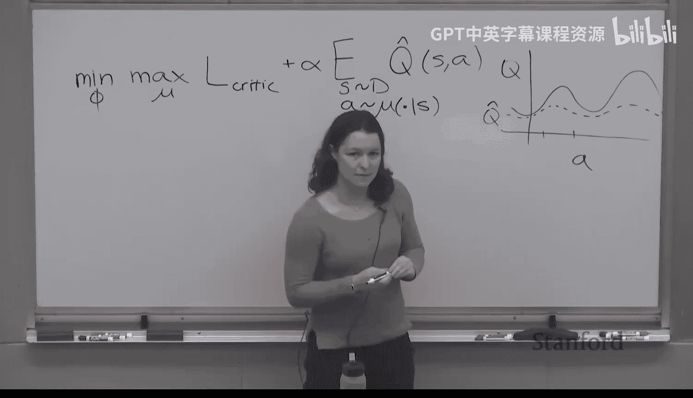

Now， one downside with this is that you might be。A little bit too pessimistic because this is actually going to be pushing down on all key values。

 but we know that for the key values for the actions in the data set for the part that's in the support of。

Of our data set。These actions we have more data for。

And so we don't necessarily want to be pushing down on the key values for those actions。

And so what we could do is we could add a term that basically cancels out this term for the data sets in the action。

😊，And so what that would do is just what that would look like is simply taking this same exact term and subtracting it for states in the data。

 but also actions in the data。So we're going to be minimizing the key values for actions from this distribution and maximizing for actions in the data set。

And this will hopefully kind of the goal of this。Would be to get a Q function that inside the support of the data。

It's not a very good marker that's inside the support of the data is maybe very accurate and then for the things outside the support of the data has low Q values because we know that outside the support of the data。

 we aren't going to be able to learn an accurate Q function。😊，Yeah。

 so the question is does this affect your ability to generalize outside the support of the data。

 so certainly it does It's going to cause you to be basically more pessimistic outside of the support of the data。

The how like this hyperparameter alpha is going to control how pessimistic you are and if you think that you're in a regime where you might be able to generalize better。

 then you could choose an alpha that is smaller so that you're using more of the original critic objective and less of this regularization term。

Yeah。The question is， should it be Q or Q hat， right？

It should be Q hat phi so this is like our this is the Q function that we're learning right here。

 the notation on the slide is slightly different， sorry for the difference there so on the slides we're treating Q as the thing that we're minimizing and if we view it instead is like minimizing these parameters then this is how we would write it。

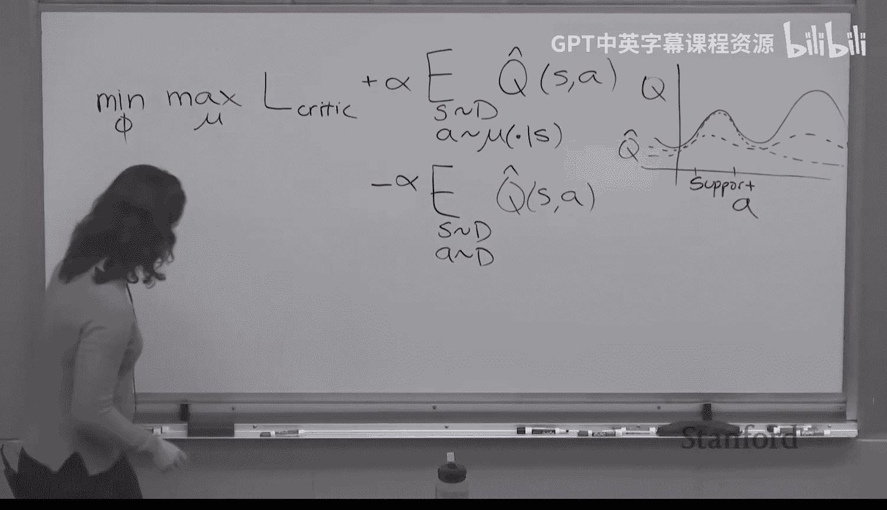

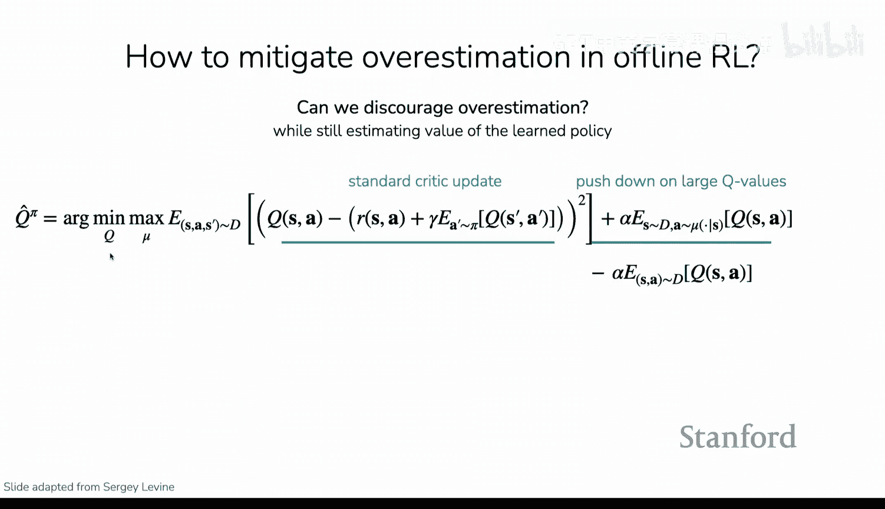

Yeah， so the question is， what is mu， Is it this fake policy that's outside the support。

 You can think of mu as。Sort of as a policy， it is not actually the policy that we're going to be running。

 but it's essentially going to be something that is trying to seek out the key values that have the key values that or the actions that have high key value so that if for example you're over here。

 you would kind of minimize the key values there， and yeah basically something that's trying to seek out large key values either or outside the distribution。

 once it gets inside the distribution， you're then going to be canceling out with this term and so then you'll have a more accurate estimate inside and support of the data。

The question is does it mop out the queuee for the actions outside the sport and yeah。

 that's basically what it's doing。Oh in terms of the question is what does it mean to maximize mu in terms of the distribution。

 it basically means that we're going to be picking a mu such that that has high Q values in practice we'll actually see in a minute we can actually not have to explicitly represent mu for some choices but we'll talk about that in a second。

The question is if our goal is to minimize Q for things outside the training distribution。

 why not just do normal behavior coding？So one of the things that's nice about this algorithm is it has the potential to do better than behavior clo so any sort of RL method will be leveraging the reward information to learn a policy that has high key values and so you can actually use this method to do considerably better than behavior clo and then we also talked on Wednesday about a method that can also do better by behavioral cloning just by ranking things generally methods that try to train the policy on only the actions in the distribution are generally a valid way to do offiedL this is thinking about an alternative way to do it。

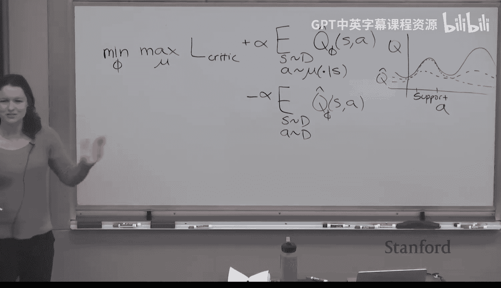

Okay。So。In terms of when we introduce this last term。

 we're actually no longer guaranteed to have a lower bound on the Q function for all states and actions。

 but we're actually guaranteed an expectation to have a lower bound for all of the states in our data set。

 I'm not going to go through the derivation for this。

 but it's a nice it's kind of a nice property to have that you will。

Get some sort of lower bound on the true Q function。

 and it suggested it's kind of a reasonable objective to use。

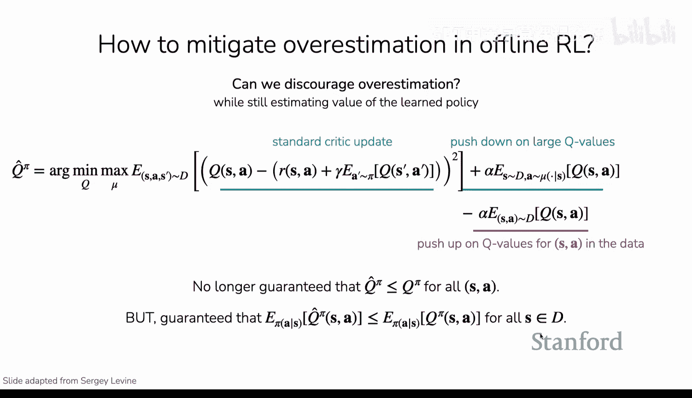

If Al is zero， it does not hold， Al does need to be large enough。

 I can't remember the exact conditions on alpha， but you could take a look at the CQL paper for the proof。

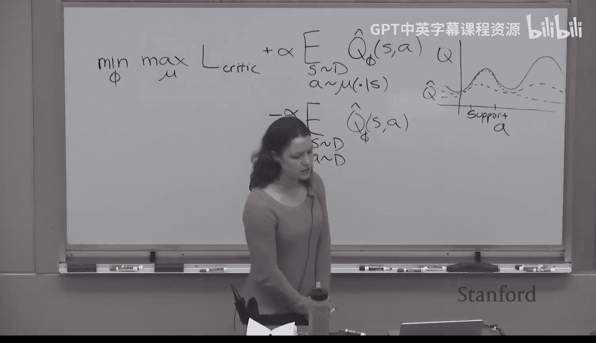

Cool so this is an algorithm called conservative keye learning。😊，In terms of the full algorithm。

 we will optimize the objectiveive using our data。

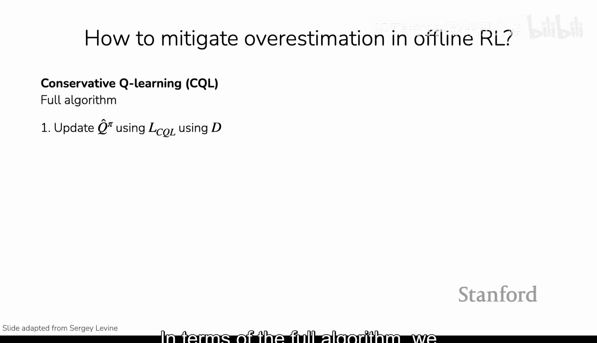

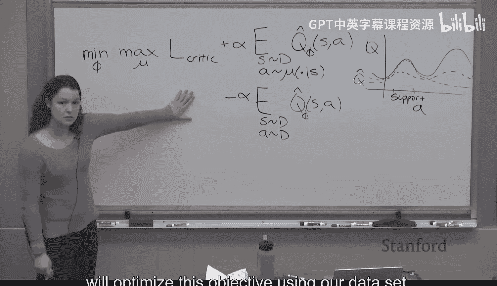

And then we'll get a cube function as a result of this。And then after we optimize our Q function。

 we can then update our policy。And then repeat that process。To and。Yeah二。

The if your actions are discrete， then you can just。

Then you can just kind of in some ways read out the actions by picking the actions that have maximum probability。

 if their continuous， then you'll need to use some sort of update to optimize your policy and you'll be wanting to optimize your policy such that you are picking actions that have high Q value。

Um。Cool， and then so we talked about this new term and in practice。

 if we had to construct this new term， that would be like kind of annoying and it would add a moving part to the algorithm。

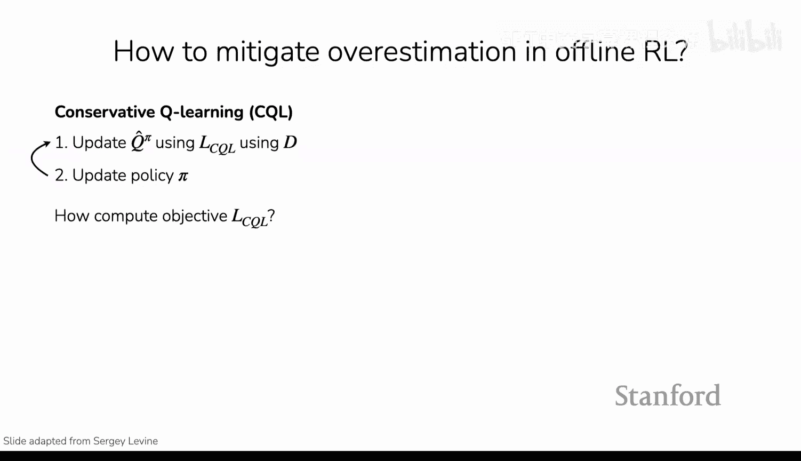

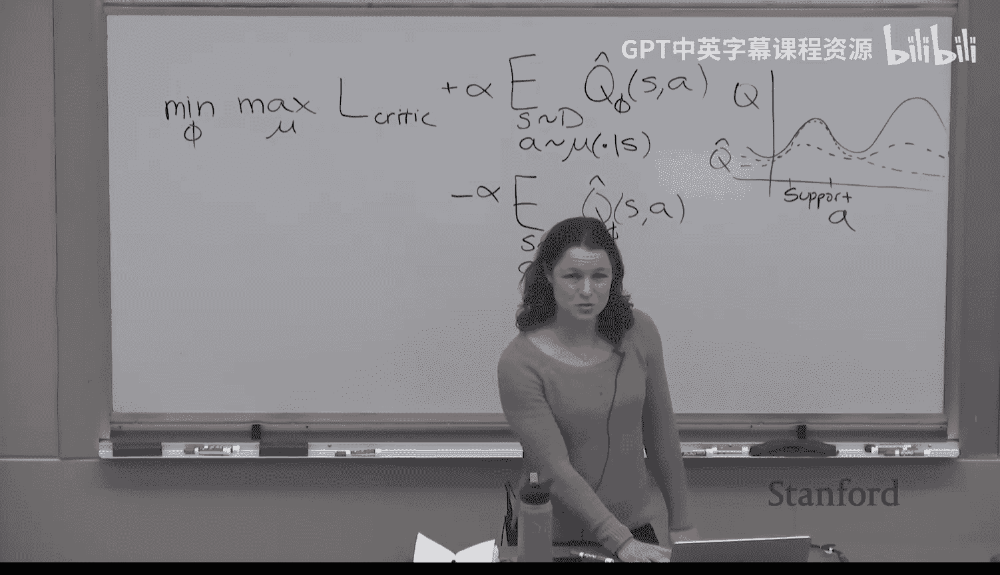

And。So in terms of thinking what this new should be。

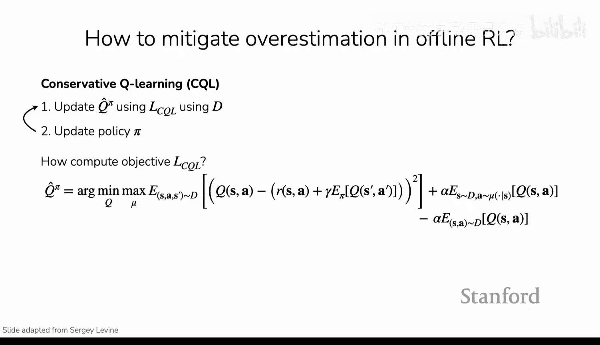

，You want to pick a mu has that is going to actually have high key values because that would allow it to push down kind of erroneously large key values and when you apply it on things the small key values is's not really going to have a meaningful effect。

But you also don't want to like。You you want to be considering actions that are not just like exactly the one largest key value and as written。

 this mu term might actually collapse to to be very deterministic and just pick like the one action that has the largest key value。

😡，And so。You can think of in this case， you can think of instead of just maximizing mu。

 you can think of adding a regularizer to Mu that encourages it to consider a broader set of actions。

Specifically you can think of that as choosing a mu that's maximizing Q。

 but also has some entropy to it。

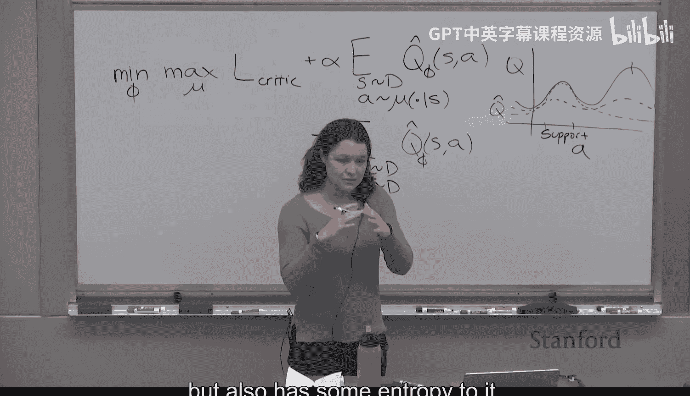

If you viewed this as adding a regularizer， then you could choose a mu that has high entropy。

 meaning that it is a broader distribution。And it turns out that if you。For this equation。

 if you're trying to choose large cues and choose a distribution that has wider， like larger entropy。

 then you could actually write down。You can write down what this looks like in closed format and in particular for kind of maximizing Q and maximizing entropy。

 you can show that the optimal mu is proportional to the expiated Q values won't go into the derivation for this。

 we possibly will post something on Ed after lecture if you're interested。😊。

And then this term turns out to simply come out to a log some x over your key values without having to construct an explicit mu。

And so then the final objective is going to look something like。

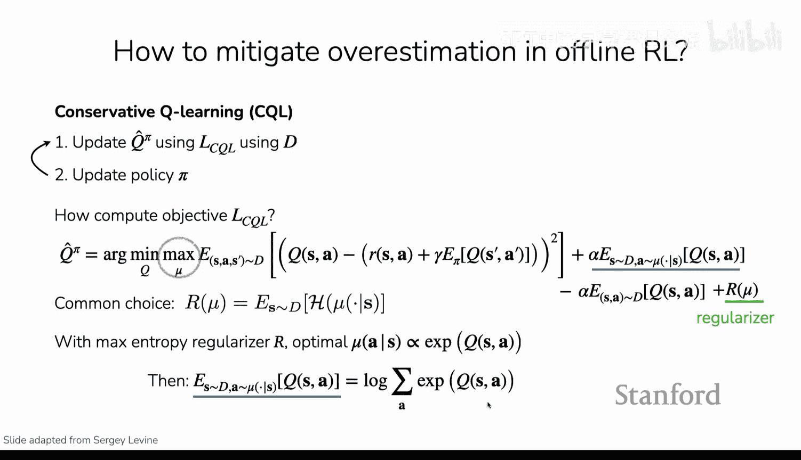

Well， look something like the loss function for the critic plus。The log。Some acts of。Q of S。

With an alpha term here， minus alpha times。The expected key values for states and actions in your data set。

Yeah。And you will this means that you don't actually need to construct mu directly。

 this was the only term that depended on mu and we just replaced this with this term right here。Yeah。

 so if there's a continuous action space， then you'll want to like sample test this。

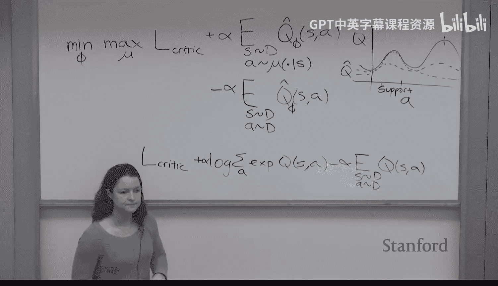

Okay。Cool， so for this algorithm called CQL or conservative Q learning。😊。

I figured I chose one application of this just as an example。

 we've seen a lot of applications in robotics and talked about driving and so forth。

 it turns out that some folks at LinkedIn use this algorithm to optimize a policy for sending notifications like email notifications for example。

 and usually when you send notifications you want to optimize for things like how much people are clicking on it because that means that it is something that they're potentially interested in but also want to minimize the total number of times that you're sending them a notification so that you're not kind of spamming the user might also care about weekly active users。

😊，And they took the double DQN algorithm， they also had their existing system。

 which is the baseline here， and they also tried applying the CQL terms to a DQN objective。

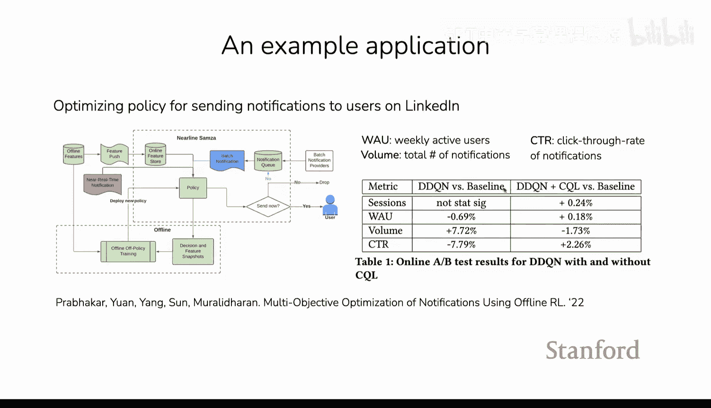

And they found that when you added CQL using an offline data set from and then ran that policy in an online AB test。

 they were able to get a higher click through rate。

 a lowered number of total notifications and also kind of a slight increase in user usage。

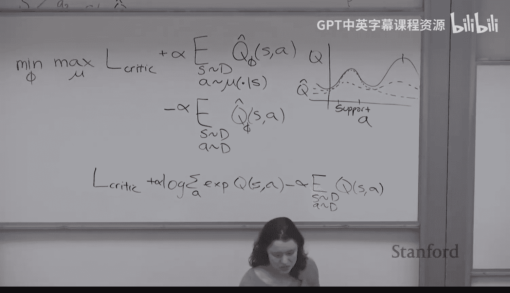

So yeah， there's just one example of a scenario where offline are all。

 and specifically this algorithm was used in like a fairly real world scenario。

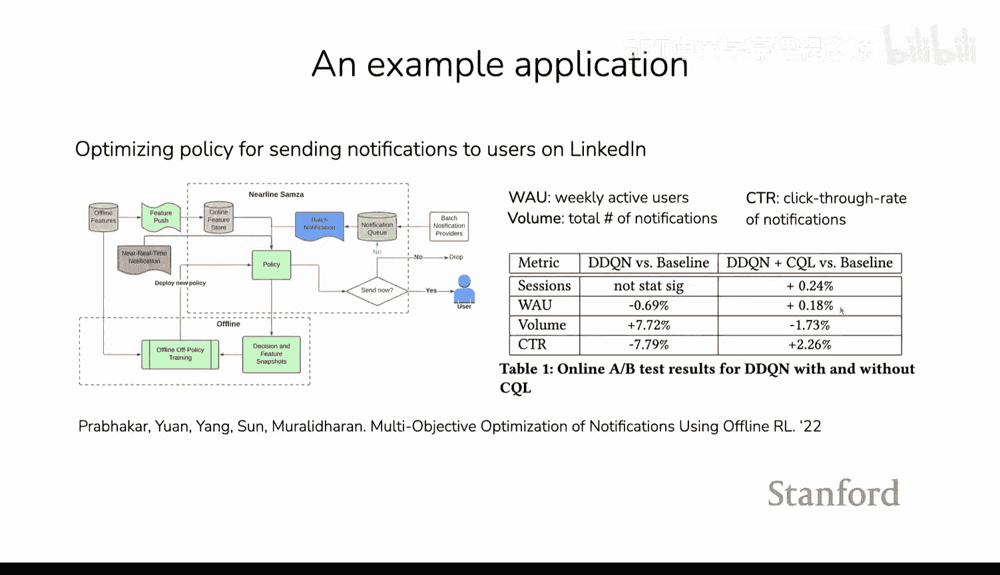

Yeah， so the question is why do we want to be conservative in the first place so the this kind of really comes down to like the very initial motivation for offline R。

 which is that outside of the support of the data when you cannot collect online data you。

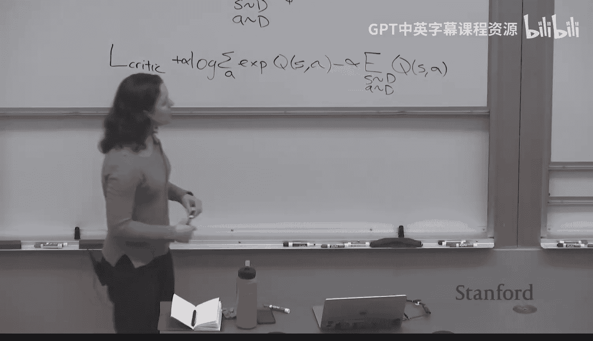

You can't really like learn a policy that's like far beyond the data and。

One reason to be conservative is specifically trying to be conservative outside the support of the data because those are the regimes where you don't have the ability to collect more data and if you try to learn if you kind of assume that you can go far beyond the data。

 then you might learn an inaccurate Q function and as a result might learn a poor policy。😡，Okay。

 so to summarize， online data is expensive， using offline data is useful。

 a key challenge that comes up in offline R is overestimation because of the shift between the policy and the data and the policy that you're learninging。

😊，And we talked about a few different approaches for doing this。

 and the one we talked about today was to try to explicitly penalize Q values。😊。

And offline neural methods are able to improve over imitation learning。

 including filtered imitation learning by stitching together good behaviors and leveraging reward information。

Cool， so let's shift gears and talk about reward learning。

So in everything that we've talked about so far， well， except for imitation learning。

 we've been trying to maximize this sum of rewards。And there's this question of like。

 where do the rewards come from in the first place and where do we get them？

And some of the very initial use cases of reinforcement learning were with computer games where you can just use the score of the game as your award function and then get a player that plays the game very well。

 but in real world scenarios you often don't get。Rewards as directly。

 especially when we're developing computers to do things so if you wanted to develop a robot that could pour water from a pitcher into a cup is fairly complex for a robot to do although young children are able to do it fairly well humans maybe get some kind of reward when they drink the water and some sort of satisfaction from that but robots do not get that kind of satisfaction and so if you were to try to get a reward function for this kind of pouring task then you would need to think about how to represent where the water is。

 did you spill any water did the water get into the cup and so forth so it's pretty challenging to get a reward function for that。

If you have notion some kind of dialogue situation if you're trying to develop a chatbot。

 people don't directly tell you that was a reward of one， that was a reward of 10。

 and so you need to think about how to get a reward function that's informative for reinforcement learning likewise in autonomous driving。

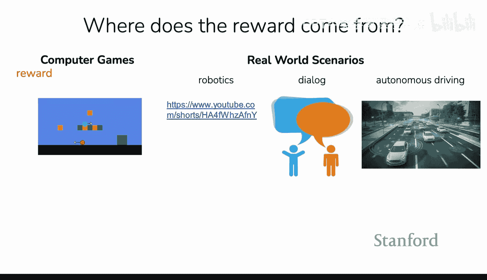

The real world doesn't just give you reward functions。

 and you need to think about how a number of different factors like the rules of the road。

 how comfortable is it for the user and so forth。

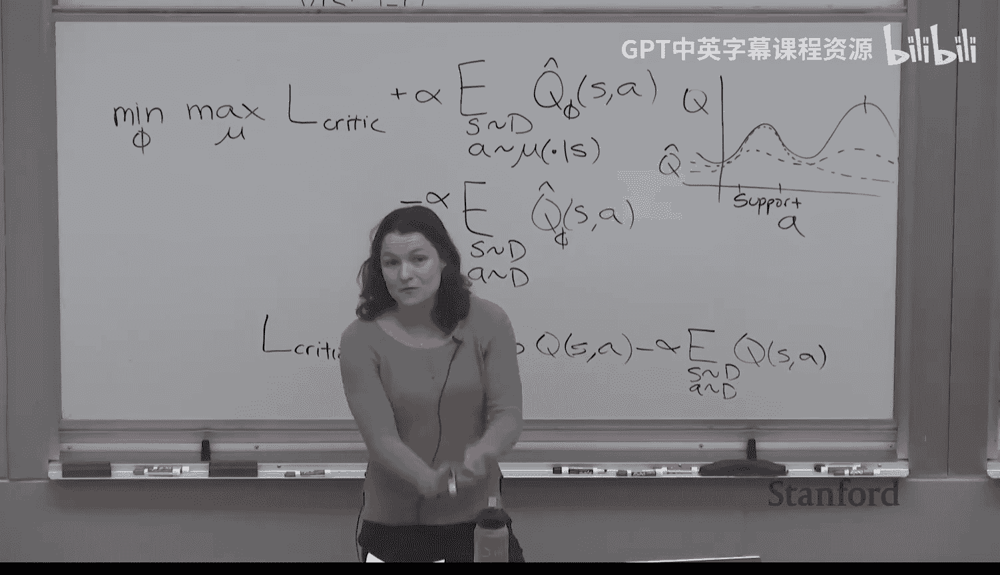

So。In some cases we can use a proxy for the true reward and you could have a human giving the rewards。

 like maybe giving like one if that was successful， zero otherwise。

 you might have some proxy in terms of like things like clickthrough rate， that's a proxy。

 we don't necessarily care about humans clicking on things inherently。

 but it's a proxy for what we might care about。

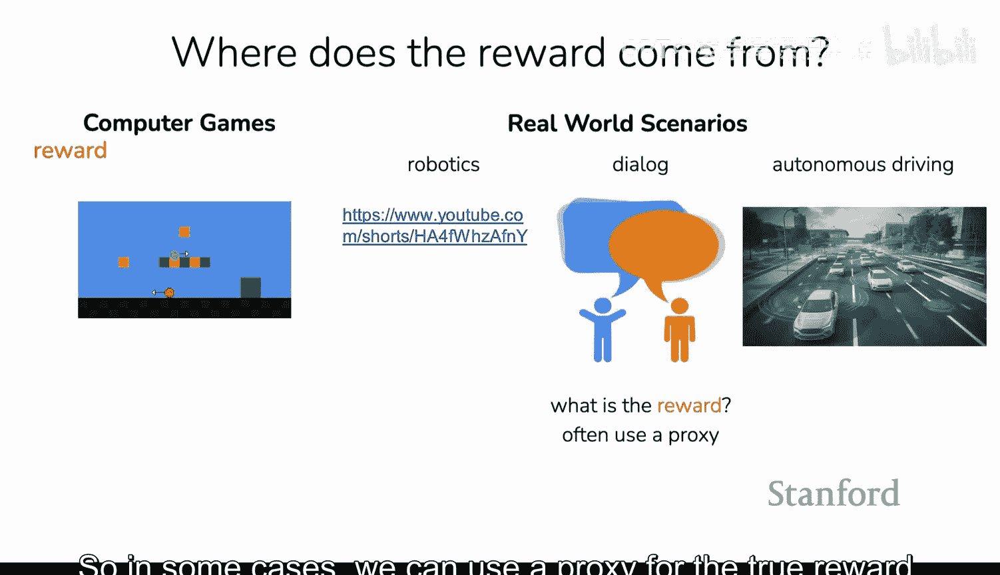

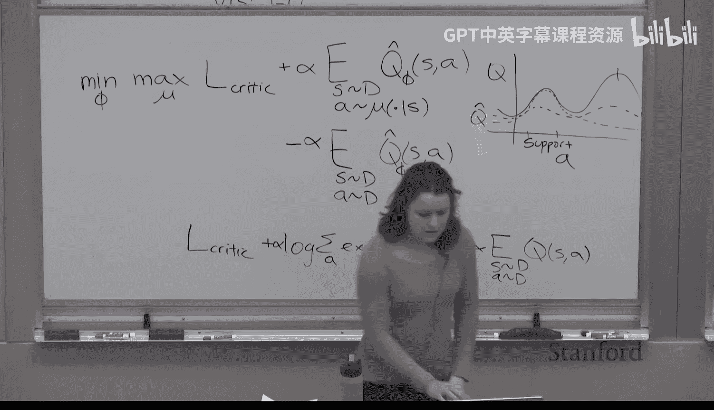

呃。But even with proxies， there's a lot of downsides and it's worth thinking about if there's other ways to provide supervision to reinforcement learning algorithms。

We've seen one alternative approach so far which is just to use imitation learning and you don't need any reward function if you use imitation learning。

 but when you use imitation learning， you're not really thinking about outcomes and optimizing for a particular outcome。

 you're just optimizing for mimicking the actions。you might also have scenarios where it's hard to provide demonstrations or where the expert has different degrees of freedom that might make it hard to get good demonstration data for imitation。

And so a lot of reward learning is to think about what is the underlying outcome that we want to see。

 like what is the expert trying to achieve， what do humans want？

So people are able to infer rewards ass a few other examples， lots of fun videos。

Where even very small kids are able to figure out what is the reward function， what is the objective。

 and be able to even optimize that to help the person。Okay， so how do we learn rewards？

We'll talk about two approaches for doing this， one is from examples of goals。

 and another one is from human preferences。So。

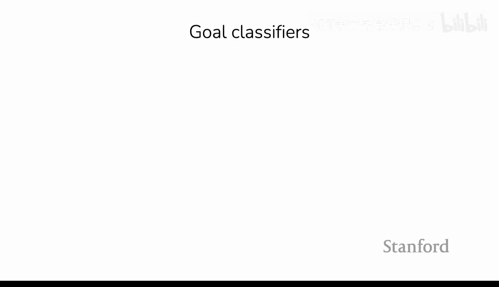

One of the simplest things we could consider doing is try to give examples of what success looks like and then train a classifier to predict success versus failure。

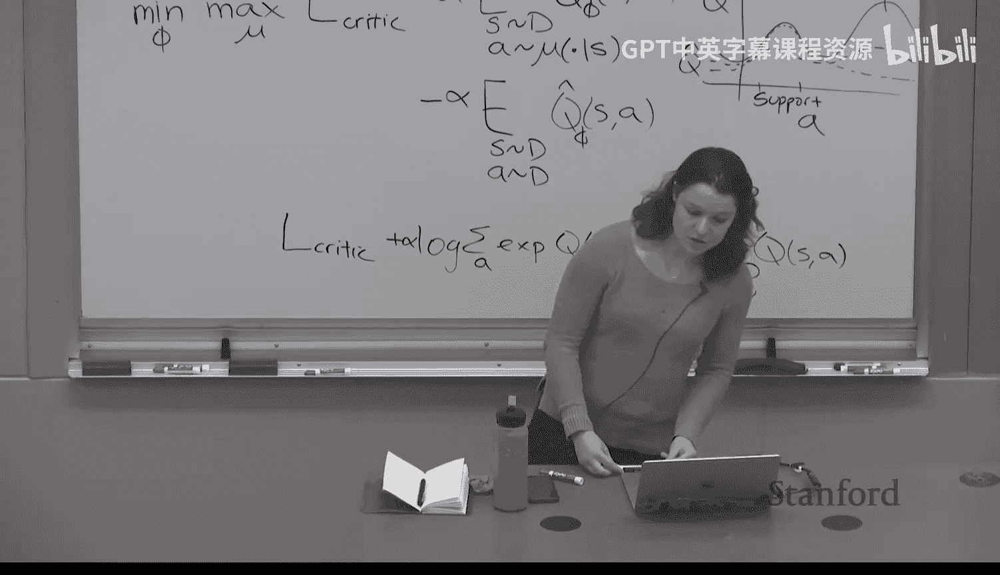

So for example， if we wanted a robot to put a pencil case behind a notebook。

 we give it a few examples of what that looks like。

 give it a few negative examples of scenarios where it's not behind the notebook。

 and then train a binary classifier to be able to predict that the positive examples should be labeled with one。

 the negative examples should be labeled with zero。😊。

And then you could use the output of this binary classifier as your reward signal。

So specifically what this would look like is you first collect examples of successful states。

 unsuccessful states， you can think of it this as states within some sort of goal set and states outside of that goal set and then trying to binary classifier。

😊，And then run reinforcement learning with this classifier。

Does anyone have thoughts on what could go wrong？If you took this approach。Yeah。

 so one downside with this approach is that it's going to give you a very sparse reward its just going to tell you。

 are you kind of。Within this kind of set of goal states or are you outside of it and you would need to figure out how to make progress towards that。

 is there any other challenges or any other things that might go wrong？Yeah。

 so a second thing that might happen is it might learn to fool the classifier。

 but not actually do the tasks that you're interested in。In particular， when you train a classifier。

 it's trained on some distribution of examples that you provided。

 but the policy that you're learning has the ability to visit lots of different states。

 including states that are different from the individual data set。And in some ways。

 kind of analogous to some of the challenges we saw in offNRL。

 when you're optimizing against this classifier， you can kind of hack it or fool it and find states where that classifier is inaccurate and when it's inaccurate。

 some of the times it might be optimistic about how to do the task。

So the first answer was absolutely correct， it does provide a spars signal。

 but one especially thing that can go extra wrong here is that the Ral algorithm will seek out states that the classifier thinks are good and it might simply find states that the classifier wasn't trained on。

😊，And essentially exploiting the classifier's weaknesses。

So can we prevent the algorithm from exploring the weaknesses？

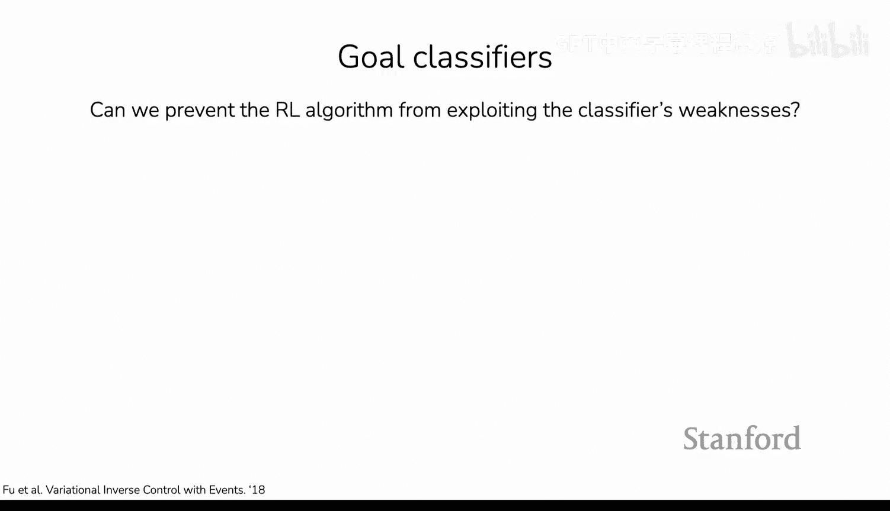

In some ways， it's actually kind of nice that we had。

 we're talking about this at the same time in which we talked about CQL because you can actually use an approach that's very similar to CQL for preventing the RL algorithm from exploiting the weaknesses。

And in particular， say that you have。😊，Some。Kind of positive goal states over here where I don't know。

 in the pencil case example， maybe this is like where the pencil case should be。

You can also just generally of think of it as some abstract space。

 and then you also have negative examples over here。 Maybe this is a bad place to go to and then。

Your classifier， when you train a binary classifier。

 it will learn kind of some sort of decision boundary like this。😊，And then when you train a policy。

When it sees it like the stuff over here is positive and the stuff over here is negative。

Maybe we can also。Specify the direction of our binary classifier， then your Ral algorithm。

 it might learn to kind of go somewhere over here。And maybe some of these states are good。

 but maybe also some of these states are not so good。And if we want to avoid exploiting。

The classifier。One simple thing that we could do。Is we could take these states that we visited。

With our policy。And。We could then label them。As。Additional data points for training are classified。

Now， we don't necessarily- if we don't have a good reward function and we don't want supervision online。

 then we don't know exactly what those labels should be。

And one thing that we could do is simply to be conservative， we could label these as negatives。

And say that all of these were states that were failures， essentially。

 and then retrain our classifier and if we retrain our classifier。

 we would then get a classifier that，Maybe looks like this。

And then maybe our policy kind of visits over here。

 and then you eventually learn a classifier that is more accurate around these states。

Is there any well okay， so let's walk through what this would look like explicitly。

So we could add states that the Ral algorithm visits as negative examples for the classifier。😊。

Specifically， we could collect some initial set of success states and unsuccessful states。

And then we would update our classifier and。Train it to classify the success states and the unsuccessful states。

Then we would collect some experience using your policy。

And update our policy using the classifier based reward。

And then we' add the visited states to our negative examples。

And then re update our classifier using those negative states。

Does anyone have concerns about this algorithm？

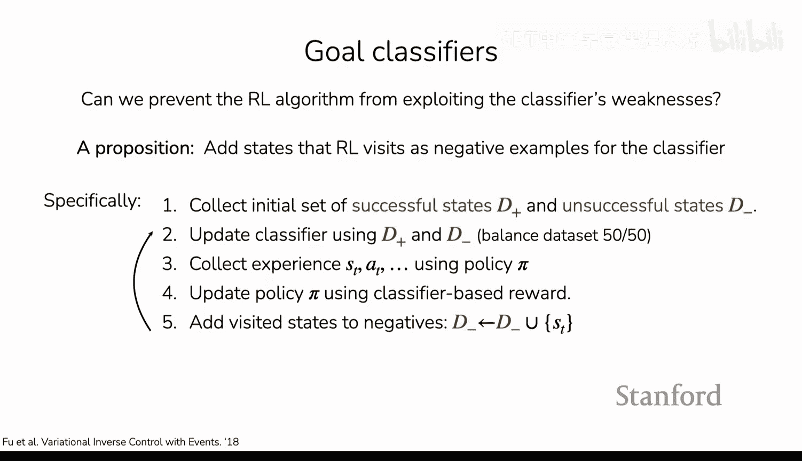

The concern there was that。You might not learn a very robust classifier and you might overfit to the positives in your data set and in particular。

If you have a small number of positives， then。You might learn the decision boundary。

That is like very like only contains like。Each of these positives and doesn't contain the things right around them and so one thing that you can do for that is to try to regularize your classifier to try to prevent that overfitting and even simple even kind of standard regularizers could be helpful for that you can encourage it to be more smooth。

Any other concerns about this algorithm？Yeah， so。One challenge that can come up with this algorithm is that you're going to be adding more and more negatives to your data and one really critical thing here is that if you keep on adding negatives to your dataset and don't rebalance your data。

 then it might just predict negative everywhere。😊，And so one critical thing here is to balance the data 5050 so that the negatives account for half of the data that you're sampling and the positives account for the other half of the data that you're sampling。

😊。

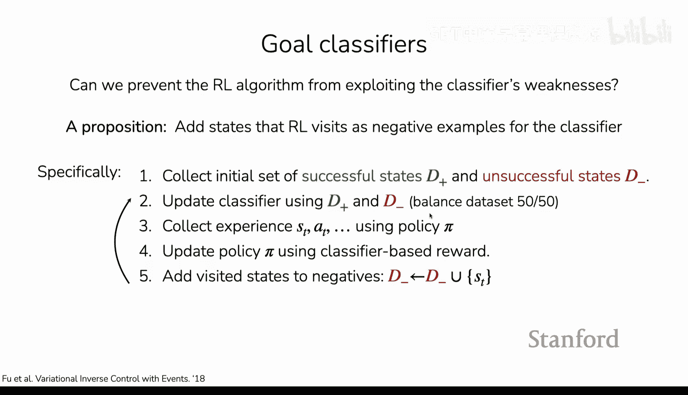

Yeah， so the question was that at some point your original negatives will be overwhelmed by the sample negatives and does it make sense to balance them certainly you could do that the it depends on how large your initial negatives are。

And so that's something to consider。One of the things that will happen is that your policy will actually start visiting the states here。

 and it might visit like even exactly the same states as the positives。

 and you're then going to be labeling these as negatives。Now， those labels are incorrect。

 like those states are actually kind of true positives。

 and this kind of also alludes to the overfitting comment at the beginning。

But it actually turns out that if you balance your data set。

 this might actually be okay and if you use like enough regularization or have a large enough positive and negative data set。

And the reason why this might be okay is that when you use balancing。When you use balancing。

 it will ensure that the half of the data set will be positives and even if。

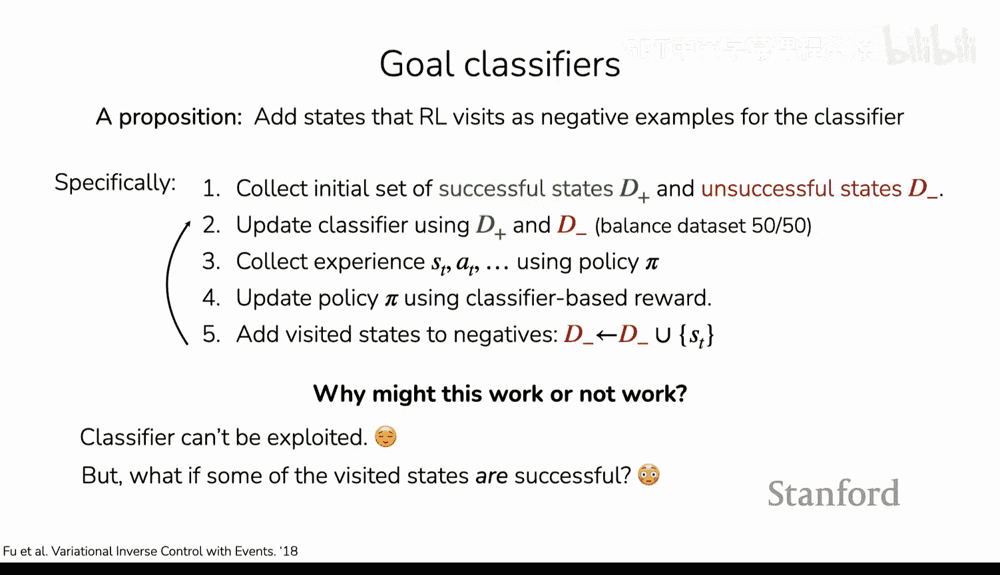

Let's say that。Okay so we know that 50% of the data set is going to be like true positives。おケ？

And then for the other part of the data， the some proportion of it will be false negatives and some proportion of it will be true negatives。

Let's say that we've gotten to the point where for the other 50%。40% is a false negative。

 meaning that it's labeled as a negative， but it's actually a positive， and 10%。

 including our original negatives， corresponds to true negatives。Then in this case。

 as long as we're balancing our data set， the。For a positive， it will still output。

 it won't output like。Probability one that something is a positive because of all these here。

 but it's still going to output a probability that something's positive。

 that's higher than 50% and probability that's higher than the probability that it is negative。

And so。Yeah， specifically with balancing， you could always expect that the probability of a true positive under our classifier。

 this will always be。If the classifier is training properly。

 this will always be greater than 50% because as long as this data set is not like if it's all the way like 50 like entirely false negatives。

 then it will be exactly 50% but as long as you have some true negatives around。

 including your original set of negatives， then it'll be strictly above 0。

5 and the probability of a true negative。😊，Will be。Wesstern。0。5。The question is。

 would this be resolved if we use confidence intervals instead of zero or1。

 so you can also use this probability as the reward and not threshold it， and that is also fine。

 in terms of confidence intervals that could also potentially be helpful although I haven't thought too much about it and you would need a probably a slightly more sophisticated RL E。

Yeah， so if you're in a scenario where you visit a state that's like very hard to distinguish between them。

 then if you have regularization， it's likely to label it as a positive because the regularization will encourage the function to be smooth。

 but it comes down a lot to like how different it is， yeah。So the question is。

 would this be solved if we use a generative adversarial network where the classifier is the reward is the discriminator and the generator is the agent。

 it turns out that，😊。

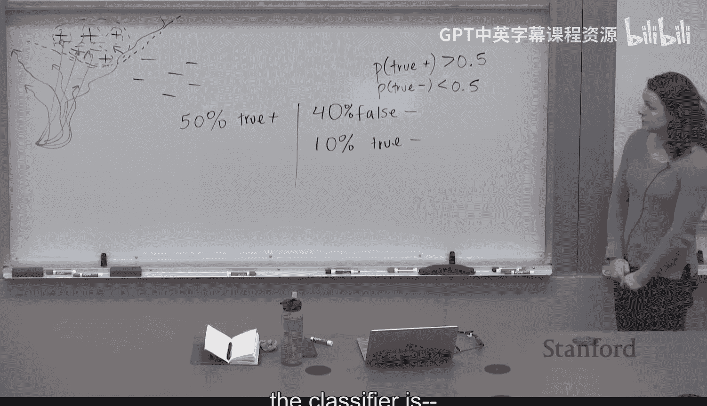

This actually， okay， I don't have this is like two slides from now。

 but it turns out that this actually is exactly a geneerative adversarial network。

 so you can think of this classifier as a discriminator that's trying to discriminate between the positive examples that we gave and everything that the policy is visiting and the kind of generator in a geneerative aversarial network is the policy not you don't necessarily need to know about exactly what generative adversarial networks or GNs are。

 but if you do know what they are， this is basically exactly a form of a againAN。😊。

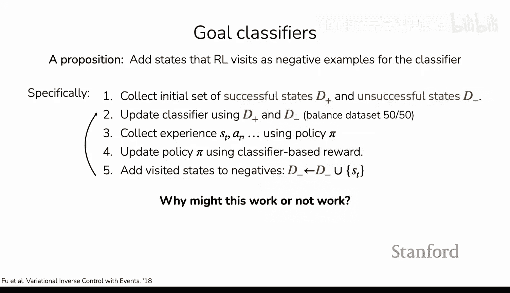

Yeah， so the question is after we run a trajectoryy are we seeing what the tree label is and the answer says no。

 so we're assuming that we don't get any more human supervision other than the initial training data set now one other thing that you can do here that makes this a little bit potentially easier is you could also label some of the data as positives or negatives as well and use that to continue to update your classifier and so that's also a very valid approach and there's ways to label only some of the data so that you don't have to label every single trajectory that the policy is doing and that could also help stabilize the training。

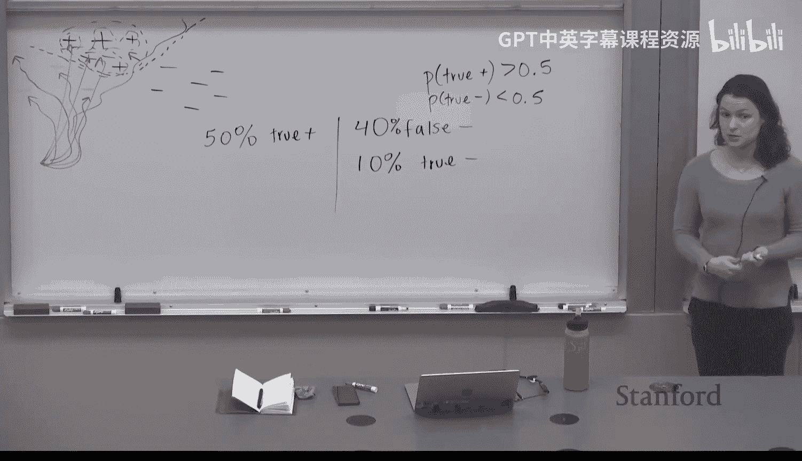

One example of using this kind of approach in robotics is。A paper that took 50 demonstrations。

 it used the final states as successes for training the classifier。

 it initializes a replay buffer with the demonstrations and if you directly imitate the demonstrations。

 the success rate is around 26% because 50 demonstrations is not that much and even if you collect more it would be hard to get to 100% success。

😊，And then if instead you use this initialization and run RL with a classifier learned in this way。

 then you get a policy that has， in this case， a 62% success rate， not awesome yet。

 but something that's substantially higher than the success rate of imitation learning。

And one thing that we talked about that was also we found in this research is that it's actually very important to regularize the classifier to help it not overfit to just the the 50 positive examples that were provided at the beginning。

Okay， and as aside， this is how GANs work， the geneative adversarial networks are a form of generative model。

 they've often been used for image generation and the key idea is to trade a classifier between the real examples like the real positives and the generated data like the states that the policy visits。

😊，And you try to train a generator that this classifier。

 try to train a generator such that it generates things that the classifier thinks is real。

Gans have been used in a variety of places here， some examples of images generated by again。

 here's a cool video of an astronaut dancing on Mars and later walking his dog on Mars that also uses a Jaative adversarial network。

Cool。Now， as a recap。We talked about trading classifiers。

 these classifiers can be exploited when you optimize against them。

And the solution is that during the Rural process， if we update the classifier using negatives visited by the policy。

Then you can avoid it being exploited。One other thing that didn't quite have I wanted to skip today because we don't have too much time and need to talk about preferences。

 but you could also actually learn not just goal classifiers but you can actually learn full reward functions if you use all of the states in the demo as positive examples and all of the states in your policy rollouts as negatives。

 then actually you can show that that's actually we'll be trying to learn a reward function over state distributions rather than just goal states。

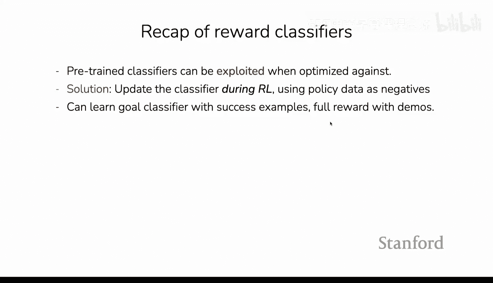

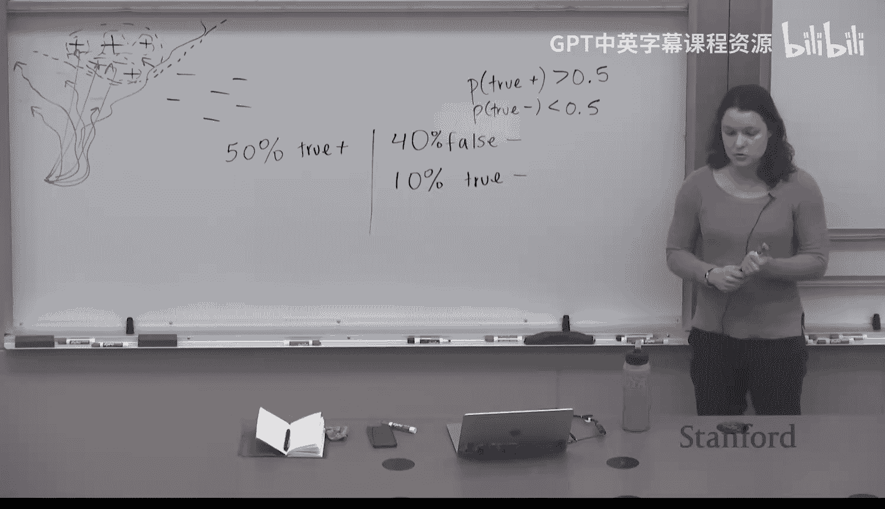

Co on the upside there a very practical framework adversarial training this kind of adding these as negatives。

 it can be unstable， there are a variety of regularization tricks you can actually take them just directly from the GAN literature and apply them and that is quite helpful and then one other big downside here is that this requires examples of what the goal is like what the desired behavior is and sometimes。

😊，Generating those examples can be challenging。Or time consuming。Okay。So。

Thus learning from example goals， now let's talk about learning from preferences。So。

And this is specifically we're going to talk less about goal classifiers and talk more about scenarios where we don't just want to reach states within some goal set。

 but we actually want to like potentially learn like good behavior versus bad behavior。

 and that might encapsulate something beyond just reaching a good state。😡，And instead of providing。

 instead of requiring example demonstrations or example goals， or in addition to that。

 we might want to provide feedback on the full rollout。

Now one option that we could do is we could just ask how good is this trajectory。

 so say that you wanted to start at this blue dot and you want to reach the star as efficiently as possible。

So it's actually kind of hard。No。Another way to frame this question is which trajectory is better。

 so who thinks the blue trajectory is better than the pink trajectory？😊，Okay。

 everyone thinks the blue it， so that's a much easier question to answer， right？😊。

These kind of relative preferences are often easier to provide than evaluating absolute performance of a trajectory。

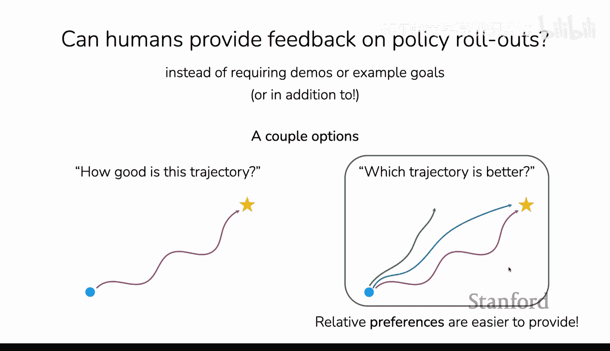

And this is true for lines in 2D， but it's also true in other use cases。

 many real world use cases as well。

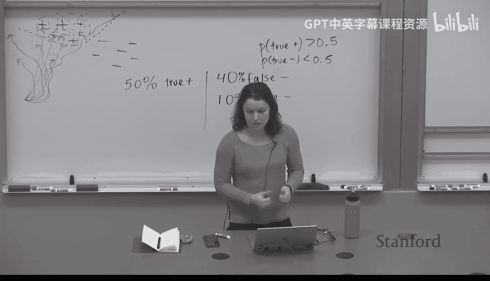

So maybe we can use these kind of preferences to get a reward function。So， say that we。

Han told us that one trajectory was better than another trajectory。

Then probably one way to think about what they're saying is that the sum of our words for the states in that trajectory。

 so for the states and actions in the better trajectory。

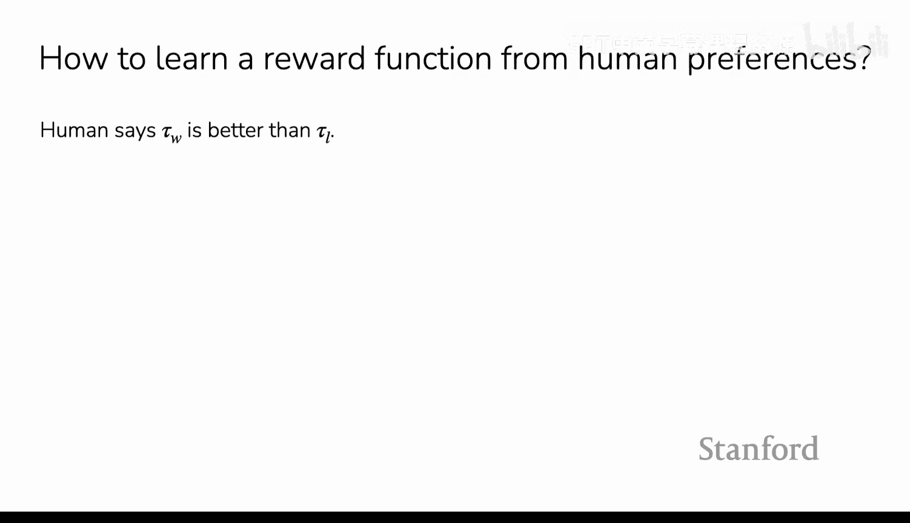

This should probably be larger than the sum of rewards。

For the states and actions in the trajectory that was said to be worse。

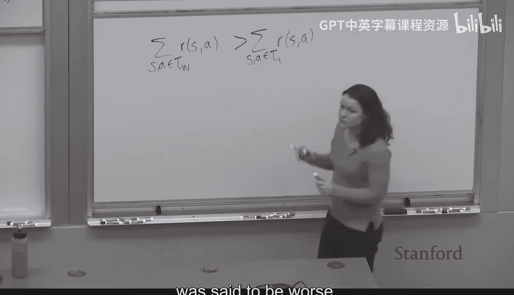

And I'm using W and L to refer to like the winning trajectory and the losing trajectory。

And maybe we'll write this as the when we say that the winning trajectory is better than the losing trajectory。

 we'll write this with this notation。

So。Any individual preference labeled that's kind of binary saying A is better than B tells us a little bit of information about the reward。

And from there， we want to figure out how to aggregate a number of these preference labels。A。

To learn a reward function。And so we'll assume that we have some data set of。These pairs。

Where we are we kind of have a pair of trajectories。

 we are told which one is the good one and which one is or which one is better than the other one。

And we want to be able to use this data set to learn a reward function。

And one perhaps simple way to do this is we want to model。

We need kind of some way to like write down an objective for a reward function。

 let's also say that our reward function， let's model it as a neural network。

 so our reward function will have some parameters and then you can think of it as taking as input a state in action and。

Outputting。A。Scalar reward value。So if you wanted to write down an objective for this。

 one thing we could do， let's say that this is。Kind of used similar shorthand of what we've used before。

 this is the reward of the trajectory。This expression right here， then maybe we could say that if we。

Took the reward of。The better trajectory and subtracted the reward of。The trajectory that's worse。

 then we want this quantity to be positive。Um。So that's one starting point。 And from there we could。

We like to do maximum likelihood。 We like to think about probabilities and do maximum likelihood training in machine learning in general。

 so we could。Try to represent the probability that a trajectory is better than one trajectory is better than another trajectory。

 and so what we could do is we could take this， we could pass this into a sigmoid function which will kind of squash it between zero and1。

And then represent that as the probability that。Winning trajectory is。

Better than the trajectoryy that was marked as inferior。

And then if we did this。Then， we could。Try to maximize the probability under our award function so we could try to then optimize a reward function such that you're maximizing this probability。

 so this would be then summed over the trajectory pairs in our data set。And so specifically。

 we would take each of the pairs， take the sum of rewards for each of these， subtract them。

 take a sigmoid， and then try to maximize that by running gradient descent。

It's also worth mentioning these tas， you could do it on a full trajectory， but in some scenarios。

 if a full trajectory is like driving from like Palo Alto to San Francisco or cleaning a kitchen。

 then there's many different subcomponents of that and it might be hard like there might be some parts of that trajectory that are better and some parts that are worse。

 and so you could also do this on partial trajectories and saying like this part of this trajectory is better than this part。

So you don't have to do it on full trajectories？We want a reward such that the reward。

 the sum of rewards for the。Better trajectory is higher than the sum of the rewards for the worst trajectory。

Humans are classifying which trajectory is better， we want the reward to be discriminative of which trajectory is better。

And so we define this probability of that one trajectory is better than another trajectory。

 and then with this probability， you can try to maximize the reward parameters such that this is true。

Yeah， so the question was the human isn't telling us how much better a trajectory is。

 and you could have a scenario where like maybe one trajectory is like this， one trajectory is like。

This， and then a third trajectory is like， I don't know。

 going all the way over here or something and。This objective isn't taking into account the fact that the preference of this over this is a smaller preference than the preference of this over this。

When you end up optimizing this objective。Oftentimes it will actually turn out that it'll assign something。

Well， also I guess a couple things here。 So if you have a a lot of data。

 then it will also tell you that like。That like this。

 the solid green one is like better than this one。 And so you'll。

 you can actually get like lots of pairwise preferences on them。

 And so because of those pairwise preferences， you'll see like a ranking like。

 this is better than this is better than this。 This is better than this。

 And when you do that that'll force the reward function to assign a much higher reward value to this one compared to this one。

 So it will already do what you want。 you could also。😊。

There's a couple other ways to get this information。

 sometimes when you actually ask humans for preferences。

 sometimes you also just give them a batch and tell them to rank as well。

 and that would make this even more explicit。

So the complete algorithm for what this looks like is you have some data set of trajectories。

 you're going to sample batches of K trajectories and then ask a human to rank those K trajectories。

😊，Um。For language models when you do this， so this is actually a very common way to learn reward functions for language models。

 and you'll often actually use the same prompt and sample k responses and then ask them to rank those k responses。

And this is useful because these trajectories all start from like some initial point。

 you can think of this as starting from the same prompt。

 but you might have other responses that are like starting from a different prompt over here。😊。

And for a different prompt or for a different starting place。

 it's a lot harder to talk about like is this better like is this black one better than this green one。

 it got there maybe got here faster， but it also had like it was an easier starting point right and so oftentimes we'll try to sample batch destructories that have a similar starting position。

Then we will compute the rewards under our current reward bottle。

 essentially do a forward pass and some over the states and actions。

 and then we can compute the gradient， do a backward pass using our objective where this is for every pair of for each pair within the ranking。

 so there's kind of K choose two different combinations of pairs and if you have a ranking then you'll have a full set of K22 labels。

Then you could update theta using the compute gradient and then you can also repeat this process so this repeating this just corresponds to doing kind of gradient descent on your objective on a single data set。

Now one thing that you can also do is you can also do this in the loop of reinforcement learning。

So you have your samples from your policy and then you can ask for。

Humans direct rank them and then update your rewards and then after you have your updated reward model。

 then maybe your reward model is more accurate and maybe you want to be going like here。

 for example instead of going here， then you could then reupate your reward function and then update your policy again。

 and then get new rollouts for your policy， ask a human to label those rollouts。

 reupate your reward function and repeat。Okay。So that's how we can learn from preferences。

TheThere's a few examples of this， so the first time or some of the first times people have learned from preferences were in some simulated settings。

 so in this case if you want to get this simulated thing to do a back flip it's very hard to write a reward function for doing a back flip and so they use 900。

😊，Quries they asked to humans 900 times like is this better than this。

 they actually did it in the loop of reinforcement learning and they got a policy that is able to learn how to do a back flip and in the process also learn a reward function for a human preferred fact flip。

😊，Also in driving， it's very hard to get reward functions and so there is work that use this kind of approach to learn things like how much does it matter to like stay within your lane。

 keep a certain speed， collision avoidance， those sorts of things。

 and you would imagine that like collision avoidance is like much much more important then keeping a certain speed。

 for example， and you can learn a reward function that way。Co， and then there's also language models。

 so this has been a very popular way to learn rewards for language models and you could have some prompt like how do I cook an omelet？

Then you can sample from your language model two different responses for that prompt。

Then we ask a person which response is better？When we're doing training。

 we might actually pay people to label our data， you might have also。

 if you've interacted with chatTT， sometimes it might have asked you these sorts of things。

 you're providing labels to give open AI the ability to learn a reward function that is better for your preferences。

😡，Um， and then once you have the things that are better。

 then you can train a reward model that judges how good a response， why is for a given prompt。

And so then in terms of what the kind of full。Language model pipeline is like if you're wanted to train something like chat GT first。

 you'll do some large scale pre trading on。Like very， very large mixed quality data。

With kind of just predict the next token， then you typically have a second stage。

 which is to fine tune on higher quality data and in particular after step one。

Before you do any kind of supervised fine tuning or reinforcement learning。

 you'll get reward a language model that knows a lot of things。

 but it's not easy to control or to get it to do what you want it to do。

 and it might not like answer questions， it might not do what you requested。

 it might just predict reasonable next tokens that come after that。Whereas in supervised fine tuning。

 we can generate a higher quality data that has like four given prompt， this is how you should reply。

 and so we do some kind of basically imitation learning on that dataset。

And then there's a third step， which is to use the human feedback and then kind of fine tune the model that you got from supervised fine tuning on higher quality preference data。

And what this third step looks like is first you gather the preference data。

 there are also actually existing preference data sets that you can use as well。

 you don't have to necessarily you don't necessarily have to collect it on your。Using your model。

Second， you'll train of reward model。That is judging how good a response is。And then lastly。

 you'll do reinforcement learning to maximize that reward function。

We will talk more about preference learning on Wednesday next week。

 but one somewhat common approach is to use PPO to maximize the reward。😡，The question is。

 is X just the prompter。 is it the whole history， Oftentimes it's the whole history and the。

You can sort of yeah oftentimes when you generally also when you formulate are all problems for language models。

 you will have。You can model it as a sequential problem， but you can also。

There's a way to a simpler but more crude way to model it。

 which is to use all the history and just treat the next response as the thing that you're optimizing over。

So the question is how do we go from preference rankings to this probability right here so in our preferences we're saying that we might have a ranking say like a is better than B which is better than C if we have a ranking of K trajectories then we could formulate K tos2 pairs where and within each pair we'll have like an A is better than B or B is better than a we're using tau W to represent the response or the trajectory that was preferred and tau L to represent the one that was dispreferred and then。

😊。

We sample one of those pairs， one of those cases choose pairs。

 and then we plug it into this equation right here。

So you're asking what is the sigma function or yeah so the sigma function here。

 this is a sigmoid so it is basically a function that squashes the values between0 and 1 and so it's just a very simple function that I can't remember I think it。

😊，Look something like this where。This is one， so yeah， I'm just using sigma。

 this is sigma right here， so it's just this function right here。

Okay， one of thing you can do is instead of using human feedback， you could also have an AI model。

 you could ask like a strong model， like is this better than this。😊。

One thing that I'll note is when you are thinking about what is preferred and dispreferd。

There are a variety of different axes in which something might be preferred or dis preferredfer。

 and so you could， in some cases you might be able to ask for certain things that you care about from the model。

This is often referred to as reinforcement learning with AI feedback。

 as one example of a use case the people have used to try to prevent models from producing kind of harmful content and so they will feed two responses into the model and ask the model which response is less harmful。

 one insight here is that critique is often easier than generation and so this is one of the reasons why you might be able to get up a stronger model with AI feedback than otherwise。

 and there have been some works that show that if you use this kind of feedback this AI feedback you can get an improvement in model performance on different axes？

Okay， so a summary of reward learning， rewards cannot be taken for granted。

We've talked about learning from goals， we talked about learning from human preferences。

 for goals it's quite practical， adversarial trading can be a little bit tricky to optimize and it requires examples of desired behavior。

 with preferences， pairwise preferences are really easy to provide it doesn't require example goals or example demonstrations。

 it has been deployed at really really large scale with language models。

 it may require some supervision in the loop of reinforcement learning。😊。

One of thing that I encourage everyone to think about is like goals and human preferences。

 those are some form of feedback， but there's a lot of other ways that we might be able to provide supervision to agents that are trying to learn。

 you could even verbally tell it some information like that was good or that was helpful or that was helpful but kind of mean or something like that and you could think of other ways of providing supervision and I think that this is an area of research that yeah where I think that there's more things that can be done。

One other thing that I'll mention is there's also some cool work in the reinforcement learning research landscape that where。

You can potentially have reinforcement learning agents propose their own goals rather than having a human provide a goal。

often referred to as this area of unsupervised reinforcement learning。

 where a human is not telling the agent what it should do and said the agent should have its own sort of curiosity。

One example of this is you can have one agent setting a goal， another agent trying to reach the goal。

 and you can formulate this as a game between these two different agents。And the。There's， yeah。

 some cool work that shows that you can have that if you have these two different agents that are trying to play against each other where one is the goal set。

 one is trying to reach the goals， you can get some kind of cool behavior as a result。

