# 斯坦福大学《深度强化学习｜CS224R Deep Reinforcement Learning  Spring 2025》中英字幕 p10 -10- Lecture 10_ RL for LLM Reasoning.zh_en -BV1SvmxB3E5e_p10-

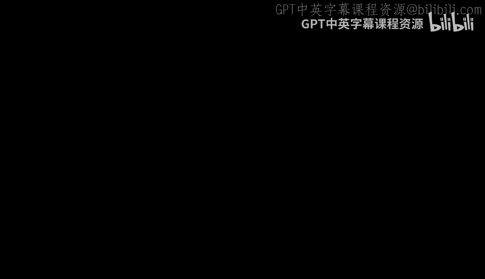

So today we will not talk about CQL。 We' will talk about reasoning and sort of particularly reinforcement learning for LLM reasoning。

😊。

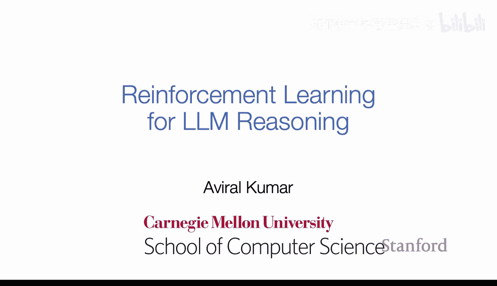

So at a high level reasoning could mean many， many things for and it clearly even today means different things for different people。

 but what I'm going do today in this lecture and also I should mention that like it's very hard to kind of do justice to reasoning topics and sort of one lecture this was also a trouble that I had for my own class this semester where I was kind of covering similar content like two weeks ago and I couldn't go over everything。

 but what I'm going to do today is to sort of give you at least one perspective on some of the trends in the field of reasoning。

😊。

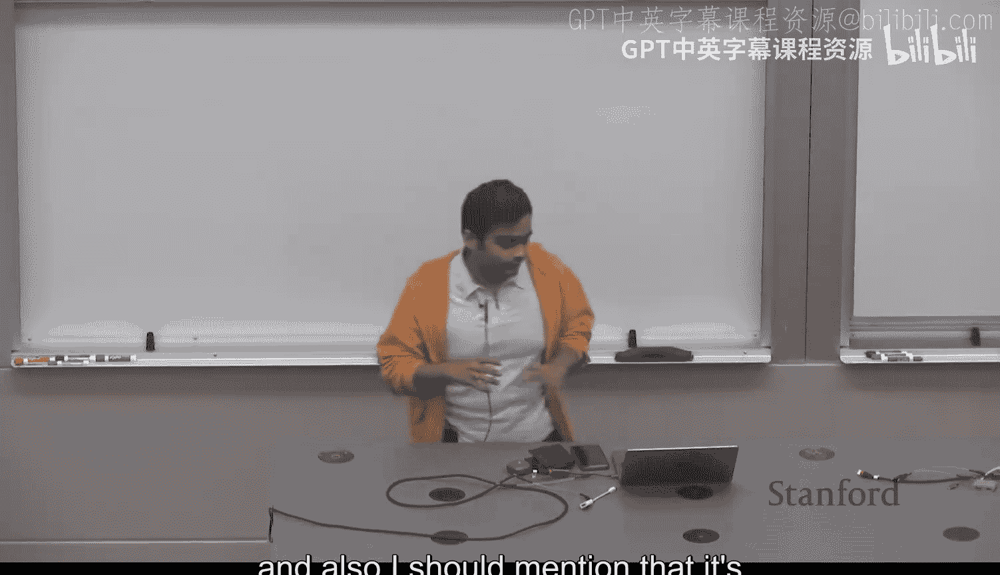

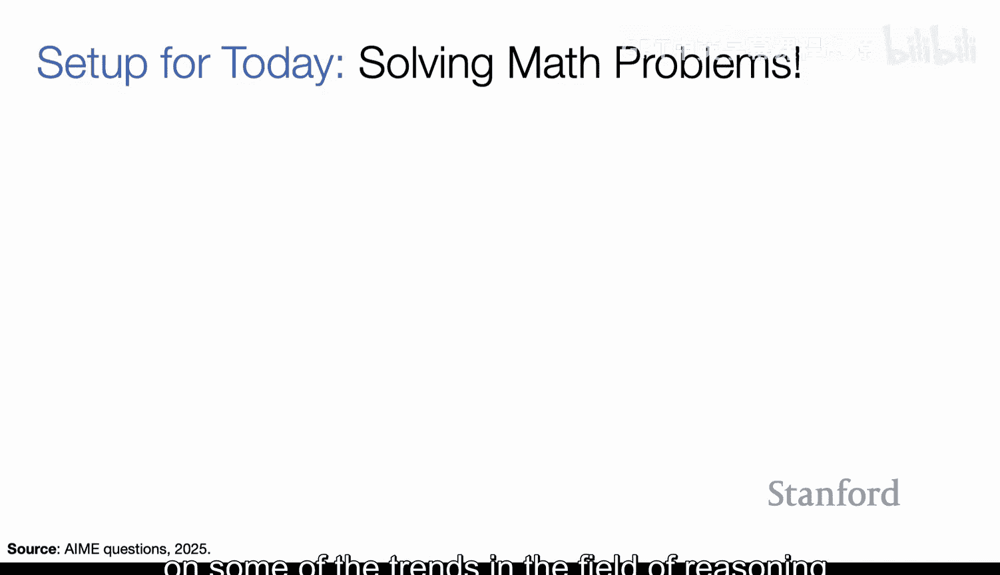

And for doing that， what we do is we restrict ourselves to sort of solving math problems。

 So you know if you're following all the news in language models these days。

 sort of people have been really excited about solving sort of technical questions like math and coding and scientific questions with these models。

 And one of of the benchmarks people look at， for example。

 is this AIME exam American invitational mathematical examination this is sort of an example question from from that particular exam where you kind of have to solve a certain sort of number theory question。

 for instance， and to solve this sort these are some ground truth solutions for it。

 you'll have to solve this in natural language where you kind of want your language model。

 for instance， to after seeing this question， produce a solution that looks like one of those solutions that you see up on the slide。

 So I took these solutions from the ground sort of the reference solutions that exist for this exam。

 but you would want your LM to sort of be capable enough to one write a solution like this and two come up。

😊。

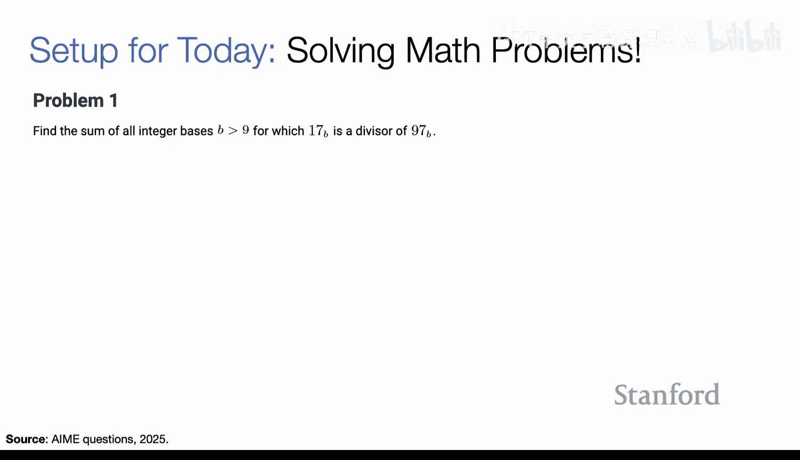

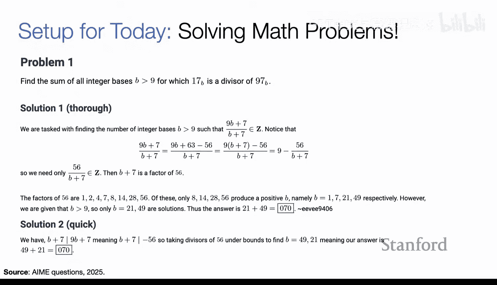

The right answer， finally。So that's of sort of the goal for today。😊。

So what I'll do today is I'll give you sort of my perspective on or sort of I'll organize the material in reasoning and especially RL for reasoning in sort of a particular way that I particularly like and to do that we' will start off from sort of the conventional way or looking back at the conventional way of training language models。

😊。

So typically， when we train language models or just generally foundation models overall。

 the the commercial paradigm has to do has been to do next token prediction。

 meaning you take your data， you tokenize that into a string of sort of tokens in token inputs and you train the model with sort of a negative log likelihood loss to predict the next token that appears in the sequence。

😊。

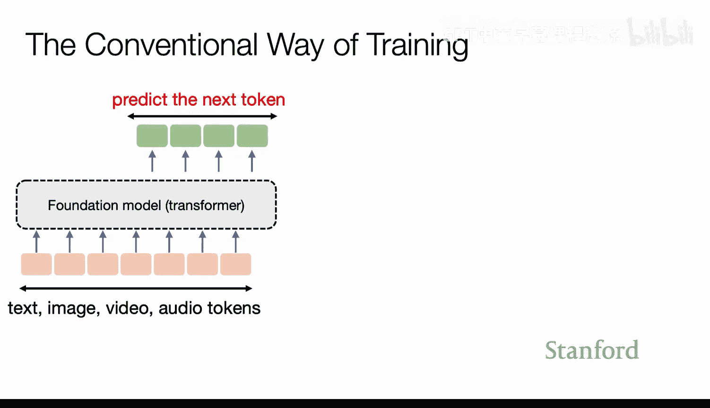

So in thercs of reasoning this would mean you would take the question。

 you would tokenize it into a string of tokens， you would take the answer。

 which is from one of these reference solutions， tokenize that into a string of tokens and then train the model to predict this answer string conditioned on the input question string。

😊。

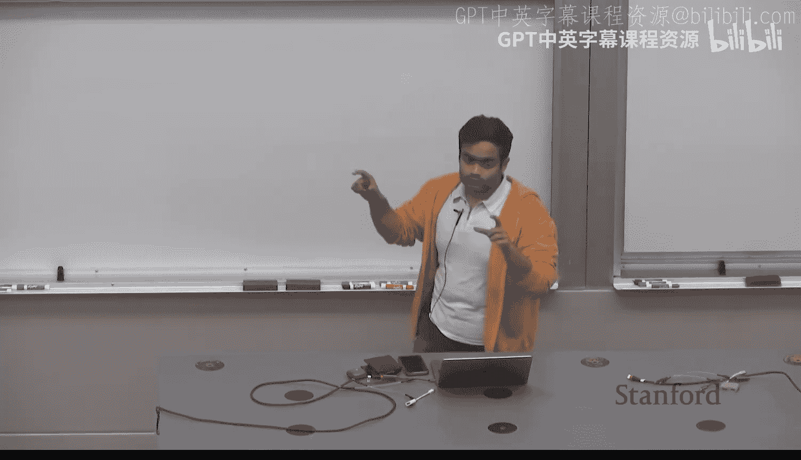

Now to start to look at or start to understand why RL matters here。

 we start by asking this question of why does next token prediction of this form actually work？😊。

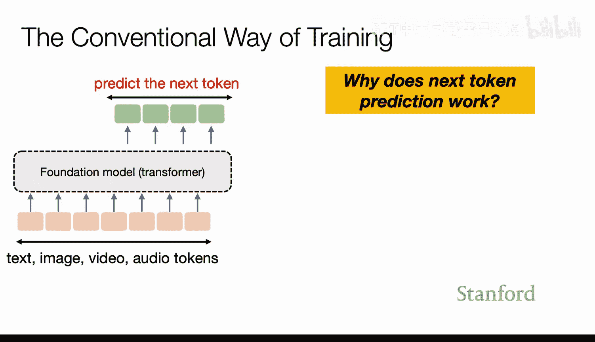

And you know again， this answering this question will take sort of more than it's an open research question to be honest。

 but one perspective of looking at this that I particularly like is to sort of look at this particular equation。

 which tells you how well next to prediction works in general。

 So what is this equation telling me it's telling me that if I train a model if I train a particular model P Theta。

 which is mapping some input X like the question to some output y like the answer this learned model is only going to approximate sort of the ground truth underlying model or the ground truth solution with an error meaning with an error that is shown on the slide。

 which is P theta minus p star， depending on the size of the data that you used for training。😊。

So if you have a lot of data which shows you many， many questions and many， many answers。

 then ideally this error would be and you would kind of approximate sort of a very high highly capable expert at solving these questions。

😊，But in reality， it so happens that the amount of data that you have for a lot of these reasoning problems and many other domains as well。

 you really don't have enough data to make this bound small enough so you kind of end up learning models that are not approximating human level capabilities you just to next to prediction。

😊。

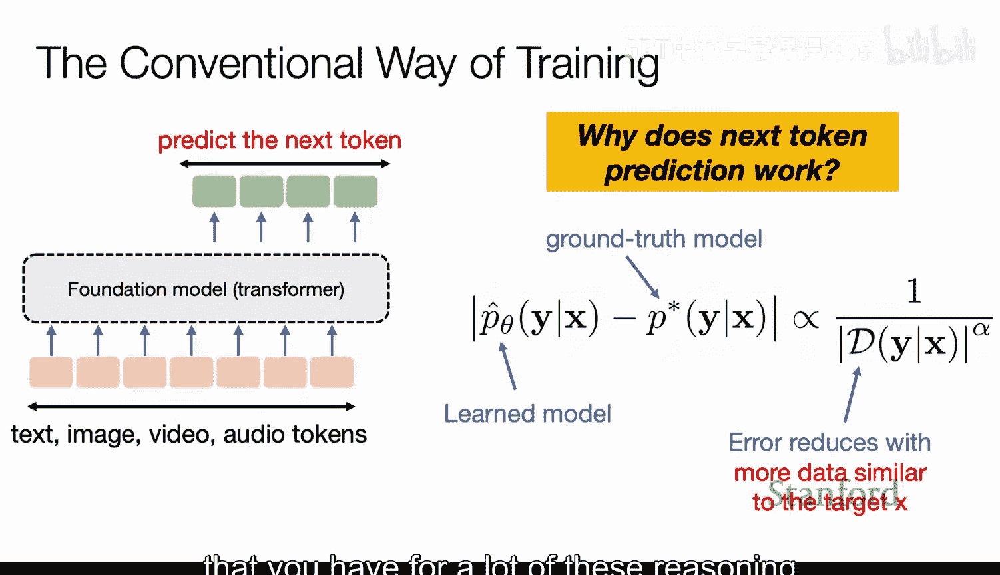

So there's actually sort of a lot of work that exists out there which studies the amount of data and one of the interesting things that they tell you is if you simply keep doing if you simply keep taking high quality solutions of hard questions from the internet and you train your model with some sort of supervised training some sort of next token prediction。

 you will kind of not do really well because its estimated that you are going to run out of high quality data of this sort by 2028 and clearly you have not gotten to a level where you can do great research with or these models can just replace human researchers for instance。

😊。

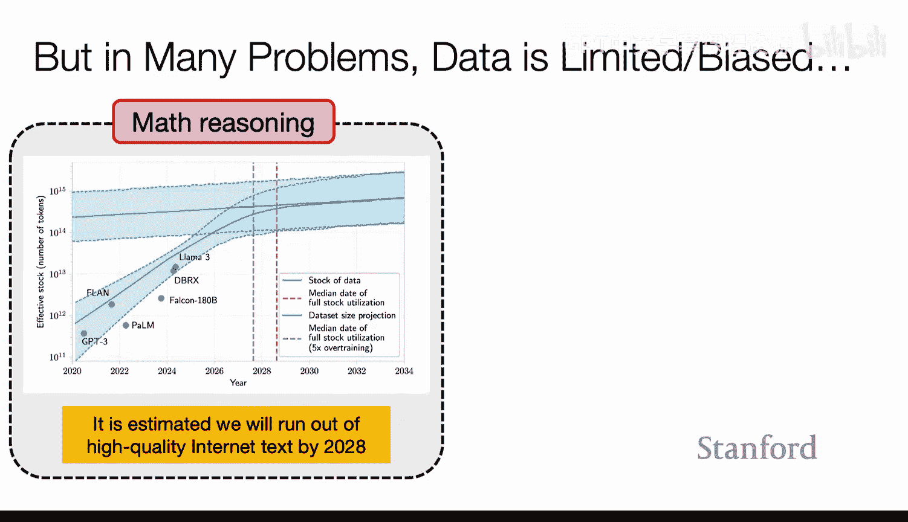

This also happens in our domains like for instance。

 in robotics and embodied air where again data is very limited。

 which means that if you just simply rely on next token prediction alone。

 you will not be able to get the ground truth sort of expert level capability in your model of。😊。

So just to kind of give you a concrete example you know if you just train models and current data and you ask them to solve this very interesting question from IMO21。

 presumably this question exists in the training sets of one of these models but if you ask sort of GPS or Open A family have models to solve this they're going give you a solution that kind of looks very sensible in these settings so they're going to produce solutions that look quite quite like a solution that a human expert would have written except that they end up missing the logic behind the answer。

 So in this particular question if you need to prove that inequality that you see up on the slide。

 you cannot really go out there and start to look at individual terms or that expression to kind of think about the whole summation as a whole and these models。

 this is I think from an O series model I think01 that I kind of got the solution it starts to look at sort of individual terms。

 for instance， and ends up kind of asserting solution at the end but really kind of does not realize that it's actually making a mistake and does not correct。

😊，So really， what ends up happening with these current sort of supervised training paradigms when you think about reasoning is that they are going to produce a solution that looks very much like a legitimate solution that you could have written on an exam Its just that that solution ends up being wrong and the logical content of that solution is not quite correct。

😊。

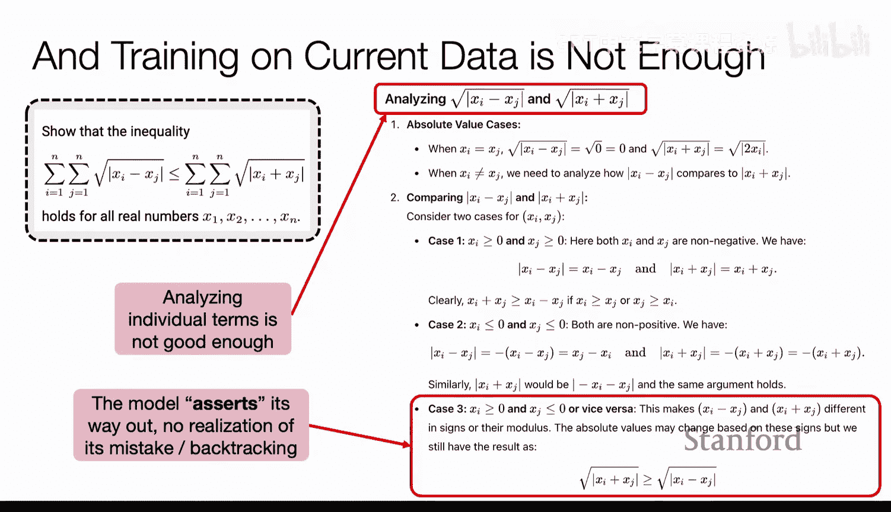

And that's precisely something that ArL tries to fix。

 and I'll know hopefully try to show you some some examples today of what what kind of r techniques come to rescue in that setting。

So in today's lecture， I guess we'll talk about Ar for reasoning。

 I roughly sort of characterized this in in sort of two parts。 So I broke this on into two parts。😊。

And these two parts are based on sort of timeline。 So it's based on like stuff that came before sort of the deepse R1 family of models came out。

 How many of you know what the deepse R1 model is， actually， I'm just curious。

 or I have have seen it have played around with it。It's it's a model that was released。

 which is from a company in China named Deepepse， which is really。

 really good at solving a lot of these sort of competition math problems or competition coding problems。

😊。

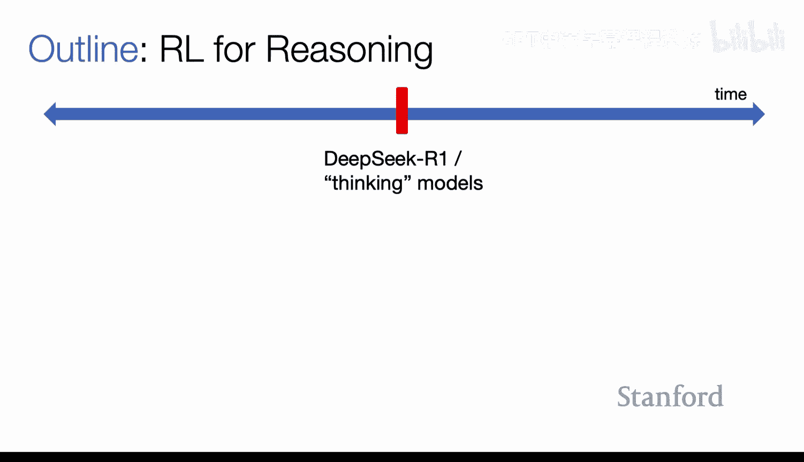

It's sort of in a similar vein similar style of model as the openai O series of models or some of these thinking models that exist out there like the Gemini thinking model or sort of cloud sonnet thinking version etc。

 So these are sort of models of the same family And what we are going to do is we're going talk about techniques that came before。

 these models came out， which is early 2025 So January 2025 and some techniques that that kind of have become much more prominent in the community after these models came out。

😊。

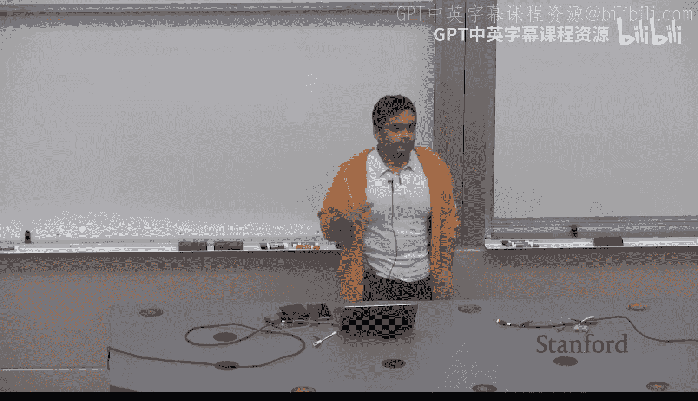

So the first part of my lecture will be based on these classical techniques that I'm going to talk about and I talk about techniques that rely on some form of imitation learning。

 which I'm guessing has been covered in the class。 we talk about some techniques that look like offline reinforcement learning and I talk about some techniques that look like online reinforcement learning This is sort of my characterization of this whole space in general there's a lot of literature that has been coming out so I probably miss out on some of them。

 but this is roughly a characterization that I think makes sense to think about。😊，And after that。

 I'm going to talk about some modern extensions of these techniques into sort of this you know。

 into this thinking model kind of territory where we'll talk about how can you take some of these techniques that people have built before early 2025 and think about using them to train thinking models that have been doing really amazing right now。

😊，And there's some very sort of interesting things that need to change when you go from the first the left hand side and the right hand side in this particular setting。

😊。

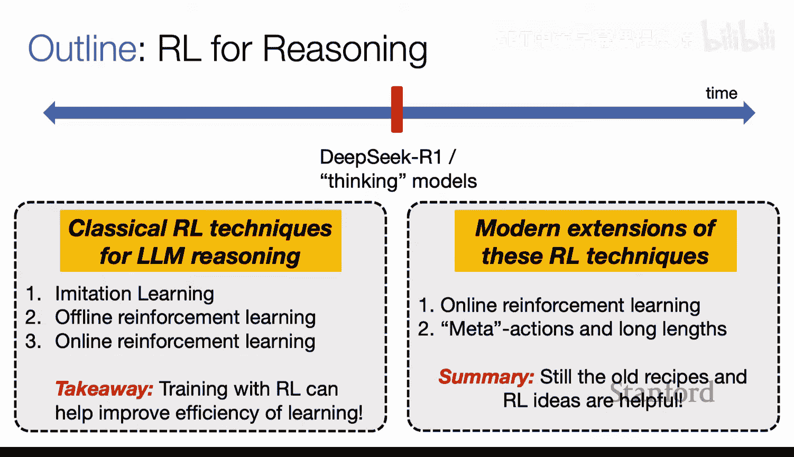

Okay， so I guess I already talked about the the the problem set up。

 but let me kind of just quickly go into a little bit of detail and connect back to oural terminology。

😊。

So we are going to consider reasoning。 And you know， in this what you were saying。

 as I described earlier， you will be given a problem in natural language and you provide a solution in natural language。

😊，So what we can do when you think about this in the context of R from an RL person's lens is you can think of this whole problem solving as an MDP as a Markov decision process。

😊。

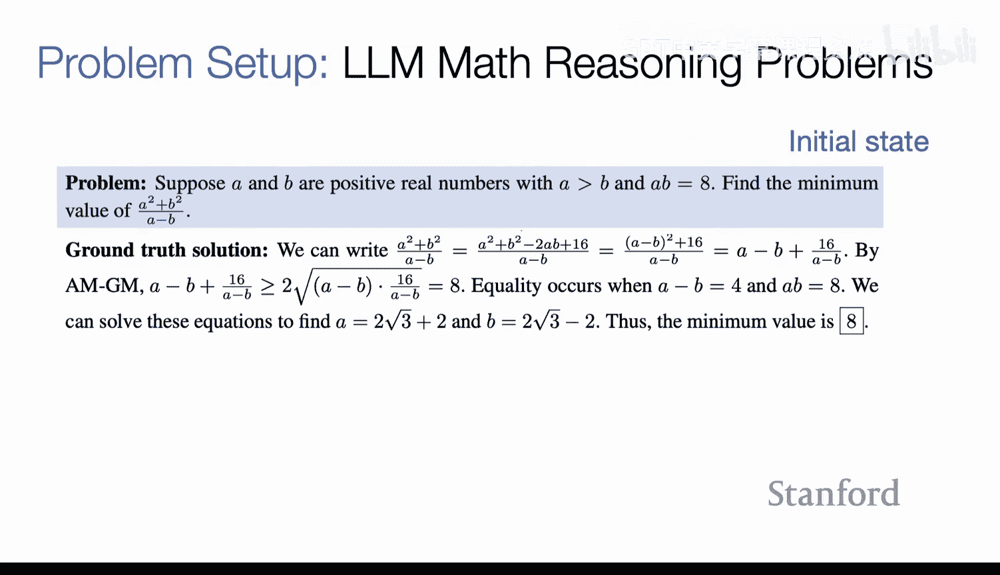

And to do that， what you can do is you can think of the string of tokens that exist in the or string of words that exist in the question as sort of an initial state of your MDP so it's sort of the initial state that your agent or your policy is going to start from when it starts to sort of act in the word。

😊。

You can think of sort of the solution that the model produces you know as being broken down into a sequence of steps and these steps could correspond to actions。

 for example， so you can think of it as you know there's a model which which takes us and put this initial state which is the problem it one by one takes in a bunch of actions which are these steps and at the end ends up with a particular answer so in this particular setting the answer is represented in this sort of you know in this box that you see up there and the answer is8 and what youre going to do is you are going to reward the model with a sparse reward of plus one you this answer ends up being correct。

😊，And a reward of 0， if this answer does not end up being correct。

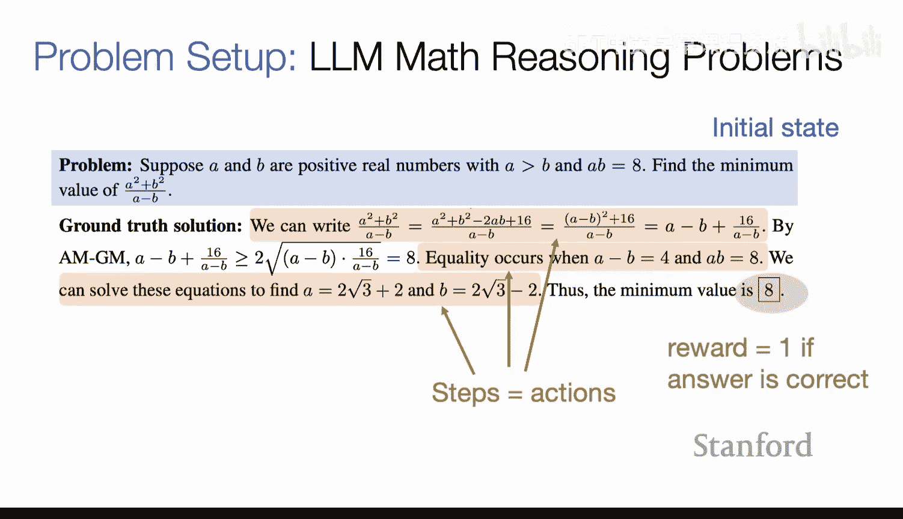

So the real Markov decision process here is sort of state going to a sequence of actions and going to sort of you know a termination bit where the model produces an answer and you get a reward at the end of it when if the particular answer is correct or not。

😊。

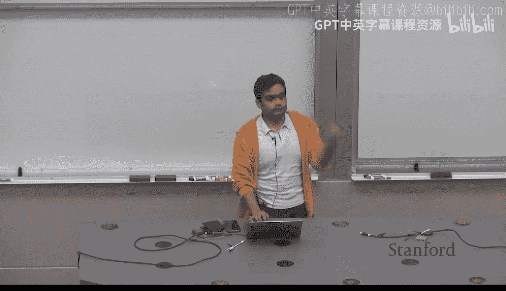

So in aal terminology this is a lot like a sparse reward mP with a deterministic dynamics What do I mean by this Basically there's no external environment in this whole process of producing these steps there's no external environment that gives you a next state all you are seeing is the initial state and these actions one by1 which tell you the next state of the problem so Ill just draw on the board because I think so this is your initial state your model takes as action you know the particular step the first step of the problem it gets to state s1 which is nothing but the string of tokens in S0 and a0 concatetnated with each other so that's all S1 is it produces the next state a it takes the next step a1 or next action a1 goes to S2 and your next state S2 is just S0 a0 a1 concatennate with each other until you hit the final answer so you do this multiple times you hit the final answer your model produces some answer let's say8 you get a reward which is。

😊。

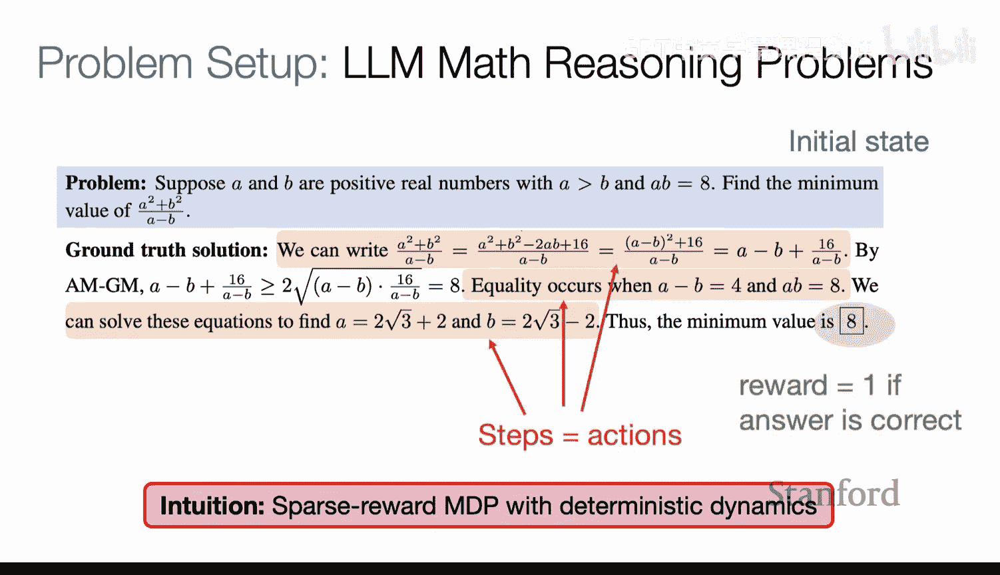

Based on know whether 8 is equal to the ground truth answer or not。

 So you get a reward of R of8 comm ground truth。 This is either plus one or。

 That's your MP that you are operating at。So that's a very good question。

 So the actions here could be infinity there are infinitely many actions。

 but unlike sort of having unless continuous control where you kind of have a you know fixed dimension vector of many of continuous values。

 which are also infinite， you have a variable length string of tokens。

 which are which are all discrete， but then there could be many of them。😊。

So the question is what about questions where the answer is a answer is a proof or not a not a final numerical value That's a very good question。

 I think we as a community haven't figured out the right set of techniques for such problems。

 So that's why we started off with sort of competition problems where there is a sort of a deterministic final answer in some ways。

 So well assume for now that we have a deterministic final answer we learn with。😊。

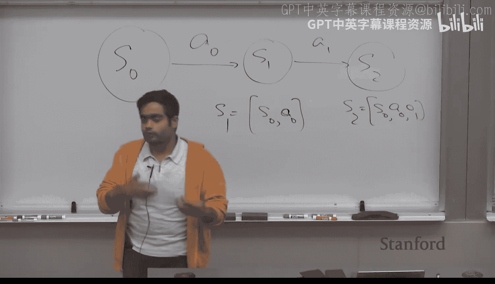

Yeah so the question is is there a risk that we get to the right answer but we take suboptimal steps there is。

 and I'm going to be talking about that in this lecture actually。😊，So that's sort of a basic sort of。

 you know， reasoning MP or a language MP you can pose for for studying reasoning problems in this particular setting。

 and at least something that I'm going to be sticking to in this particular lecture。😊。

Okay so we'll start with studying some classical RL methods for reasoning and what I'm going to do here is I'm going to cover one of my papers from Europe 294 that you see on the slide this is the first bullet point and why am I covering that paper it's not because this paper invented a lot of the techniques but because this paper actually did a lot of sort of lot of interesting empirical analysis of a lot of the methods that exist out there to kind of understand why something works and why something fails so it's just sort of a nice way to kind of get a conceptual model at least in my opinion about all the sort of techniques in the classical reasoning space with RL。

😊，Okay， so what we are going to do is we are going to sort of try to understand how different methods or how you know R methods for training for reasoning behave when we when we train them on different amounts of data。

 So we are going to do what we call it data scaling analysis in this particular segment of the talk。

So the basic setup here would be I'm going build algorithms that that can be used to train reasoning models on a data set right this data set will consist of some problems or these initial states that I described to you earlier and we assume access to some oracle solutions because we need a way to like check the ground growth answer because that defines the reward function so we have a data set of problems and solutions that were going be training with and what we are going do is we're going to try to understand different classes of methods by evaluating how well they do when we train them on different amounts of problems and solution pairs that this data set gives us。

😊。

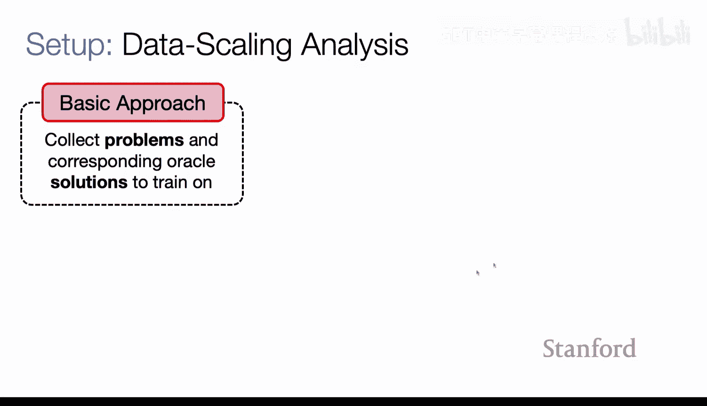

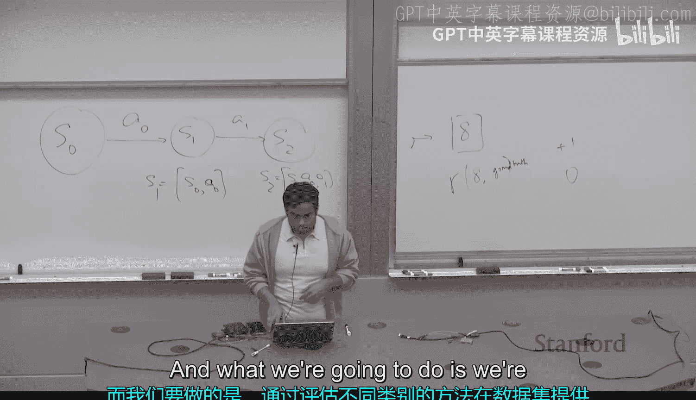

So there's three axis we are going to look at when we think about you know。

 training these methods on， on this data。We can train them with potentially you know ground truth answers on multiple questions so we can take this data set of problems and solutions and train the model to produce the solution given the question like what supervise fine tuning or know imitation learning does so we can just do imitation learning on top of this data。

😊，Well introduce a new method that we call sort of you know rejection find tuning。

 which trains on many correct solutions for a given answer。

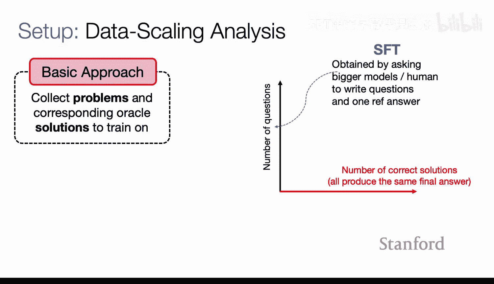

So I'm going write this method out here ands， and that will be clear here you。

 So what you're going to do is you're going to take a model pi of y given x。😊。

We'll take a question X from my data， So this is my question。Or problem。 So this is my initial state。

😊，This is my solution， which consists of a sequence of actions。

 What I'm going to do now is I'm going to take these questions and sample multiple solutions from my particular model from my current model that I want to train in this particular setting。

 So I have a model pi theta Im going to sample multiple solutions conditioned on the question given。

😊，This particular。Model， so this is my model I'm training the initial model。This is the data set。

 I am going to sample multiple solution traces。 What I'm going to do now is I am going to take these traces。

😊，Evaluate the rewards on each of them。 So I'm going to evaluate R of R of y 1。R of Y2。Out of white。

Why can I do this， Because I have this question in my dataset。

 which means I have a ground truth answer。 Y star。For this question in my data as well。

 ground truth answer。For X question。And what I can do is I can simply match whether multiple traces or multiple trajectories sampled from my policy P Theta。

😊，End up in the right answer or not by checking the you know。

 checking whether the final number was correct or not。

So what I'm doing here is I'm taking my initial model。

 sampling a bunch of traces or you know rolling it out in my environment。

 which is simply producing solutions from this model for each question and evaluating the rewards against the ground truth answer。

😊，Now， what I do is I take this particular set of y1 to y I produced。

 and I retain only those ones which ended up in the right answer。So I take the set S of y1 to Y n。

And I filter it。To get。Some filtered set， let's call it S stillde， which consists of wise。

So y j such that the reward is1。Meaning， these solutions ended up at the right answer。

Does this procedure make sense to people？O。And what I'm going do now is you know。

 now I have a bunch of traces or a bunch of trajectories that ended up at the right answer。

 which means they' are successful。 So what I can do is I can simply try to train my model pi Theta to imitate these trajectories。

 So I can train pi Theta to imitate as as still。 So I'm just gonna write it down here again。

 So my algorithm looks like this。😊，For iteration。One， two， some P that I can choose， however I want。

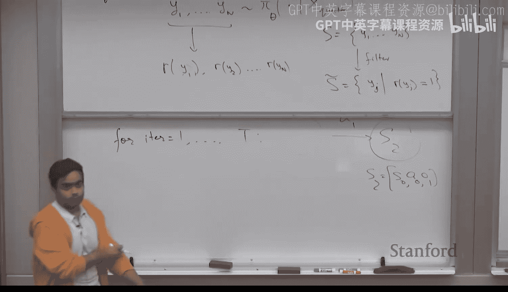

Sample， so step  one is sample。Y1 to ns， y1 to n from pi Theta。Of dot given X question。

The second step is filter。And generate S stillde， which consists of correct。😊。

Why once correct wise only。And the third step is do imitation or do BC。😊，or SFP。

 depending upon whatever terminology you like you can call that on S still so you are training the model now pi theta to produce only the ys that were correct。

😊，So that's sort of this particular approach。Okay， so this approach is what is called rejection find tuning or RFT。

 And that's why you see it on the the the the horizontal axis up there where what you are doing now is youre going to produce many solutions and try to filter for correct correct once and train on them again。

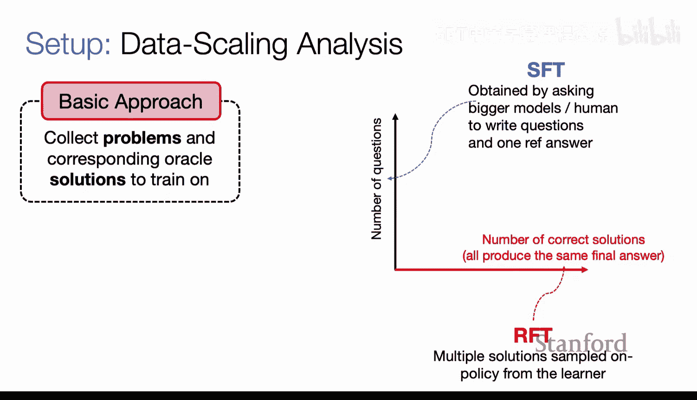

What happens now is you are rejecting the ones that were wrong。

 hence the word rejection and fine tuning just stands for fine tuning。

 so RFT or rejection fine tuning。The nice property about this approach is it's not actually asking you for oracle solutions that a human wrote。

 all it asks for is solutions that that your model can produce， which ended up being correct。😡。

So these are on policy rollouts that are sampled from your policy。

 and you're simply filtering for correctness， which you can。

 because you know what the reward function looks like。

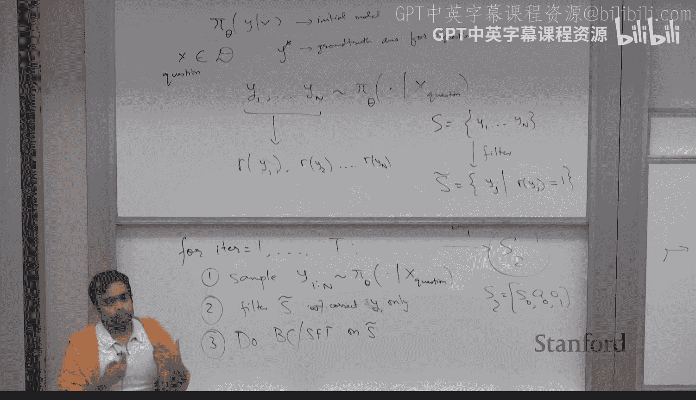

And the third axis here is actually full blown reinforcement learning， where， you know， in R。

 when we train on data， we don't really need the data to be high quality or high rewarding。 You know。

 you've talked about offline R。 that's on your homework。

 you can learn from suboptimal data data that does not succeed。

 And so you can kind of also think about know the third axis in all of these methods as methods which train on incorrect solutions or learn from traces or rollouts that did not succeed that attain the reward of0。

 So Im just gonna call them R。😊。

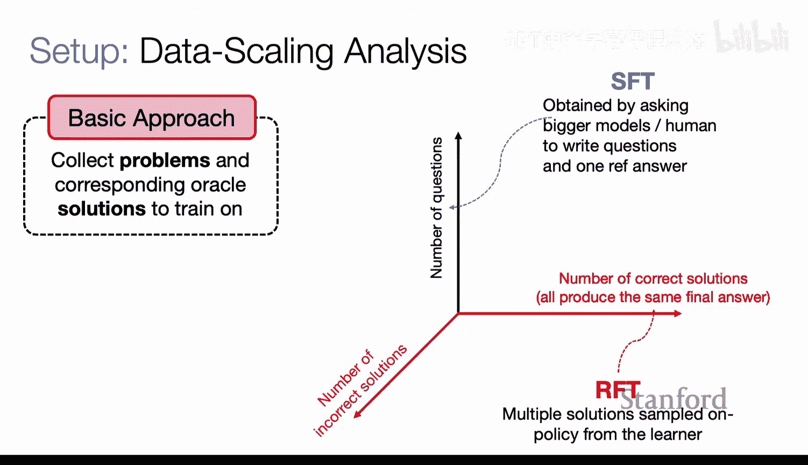

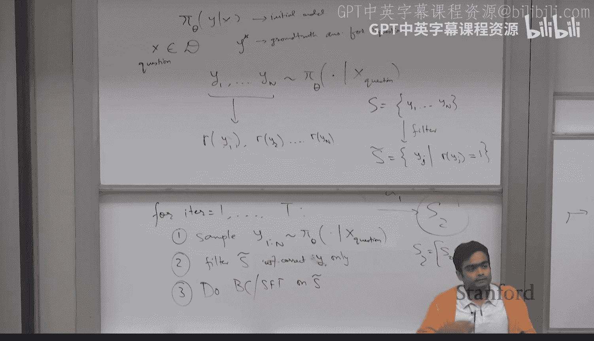

So there are these three different access along which you can sort of you know train methods。

 you can scale your data， you can scale your model model bandwidth number of questions and ho solutions。

 SFT， number of questions and correct solutions by filtering or rejection which is called rejection fine tuning or RFFT and just training on any kind of data which is reinforcement learning。

😊。

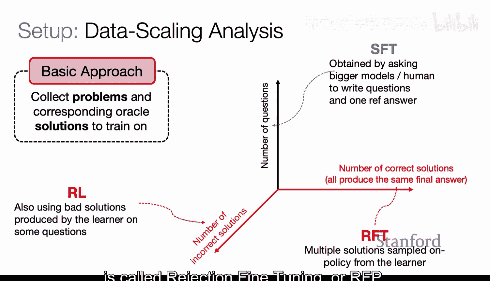

So what I'm going to do in this lecture is we'll talk about how these different methods actually behave in practice。

 and that'll give us a sense of like what to use in what case。

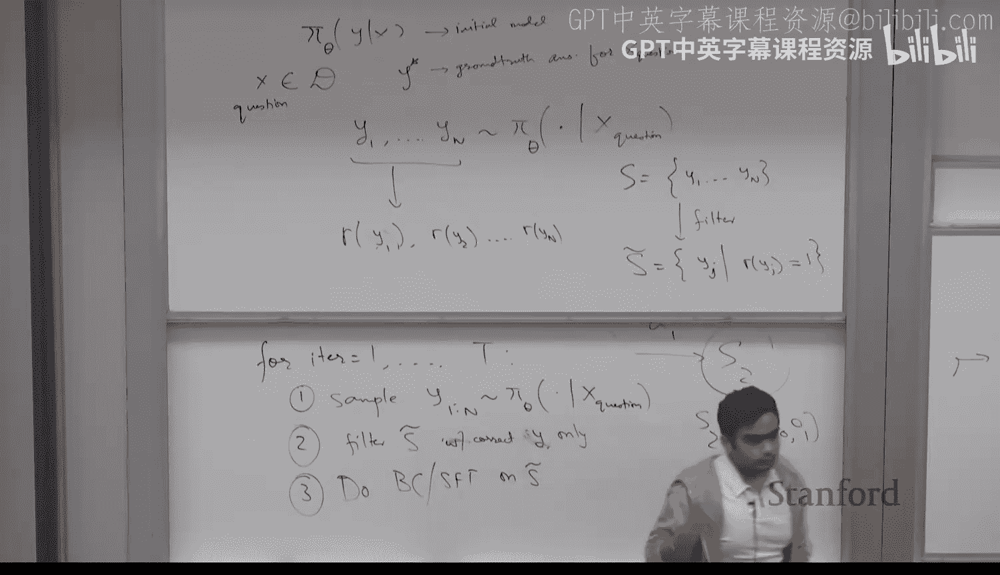

So the question is， are we forcing the model to come up with overly verbo answers So here we are not really so the short answer is no because here we are not really encouraging verbosity at all。

 All we're doing is we're simply sampling multiple traces from a model and train the model to find answers train the model to closely mimic traces which end up being successful in some way So if the traces that end up being successful are those that actually need more space to be verbo then it's going to incentivize you to be verbo but if the questions that end up succeeding are not the traces that end up succeeding and not the ones that end up needing to be verbo then it's going not incentivize So imagine that let's say the question is two plus two is equal to question mark maybe one of the traces gets you an answer of four and there are some traces which are going do this which are going count two plus10 different ways but most are the traces right on four right away then what you're going to do in this process is you're going find traces which end up the four right away and you're going train the model to produce four right away does the next open so it's not。

3ty going to happen that。Okay， so the question is， if。

 if the the method got the correct answer with the wrong sort of approach。

 then you're incentivizing the model to learn that。 And the answer is yes。

 And that's why we'll see how these things behave in empirical results。

 That's kind of the next part of the talk。Yeah， so the question is would the data set be biased towards easy problems the short answer is it does yes in some way but the practical answer for this question is well in these cases what you're going to do is you're going to potentially start with training the model on top of oracle data or oracle question answer pairs first with SFP the first axis that goes up and then do rejection fine on top of it so the model has some capability now to produce some answers for those questions and then you start doing it。

😊，Great， so this was actually one of the slides which takes which took me a long time。

 even in my lecture back then。 But a lot of the slides from here on are actually talking about properties of these methods。

 actually。😊，So the first thing we are going to look at is how does SFT behave。

 So training your model with like imitation learning on correct answers given questions that some human wrote。

So when we are doing this work we looked at two benchmarks named GSM8K and Mac these benchmarks now are fully solved so it doesn't make sense to sort of going forward benchmark methods on these benchmarks but back then in 2024 this was like a year ago exactly these benchmarks were very sort of representative of like useful methods so what we tried to do in this particular slide is we are trying to see how well SFT behaves and comparing it to and we are trying to compare it to RFT or rejection fineing that I described to you。

😊，We do that on top of multiple models and here Im showing you one result on top of the deepse V2 model that that is one of the best math models back at the time。

And what I'm plotting here is I'm plotting the average test error of these model after fine tuning with these SFT and RFT methods as a function of how much data we run fine tuning on。

😡，So the more the data， the ideal the picture is you will get lower error and you should be able to actually get better accuracy。

 right because you have more data， more coverage of questions like that。😊，So that indeed does happen。

 so you do find that error goes down as you scale up the amount of questions in both of these settings。

 but clearly sort of the error does not go down at a very fast rate。

 meaning it so turns out that you know the test error if you try to approximate the closest sort of function to this particular curve it will be it will be the function that looks like d to the minus0。

15 or d to the  minus0。05 so this particular curve that you are seeing these are empirical measurements。

 but if I try to fit a smooth curve to it as a function of the data set size that the exponent is going to be a very small number。

😊，Ideally， you would want this expon to be really large like you know D to the minus half。

 for instance， because this curve will go down very quickly and with a reasonable amount of data。

 you're going to be succeeding at the particular problem at this particular data set。

 but that doesn't happen in this case。😊，So one of the goals that we then could have for a lot of these reasoning methods and RL methods for reasoning is to sort of push this curve as much as possible towards the left and towards sort of the x axis so push them down and towards the left。

And the first result we saw to that extent was the fact that rejection fine hearing or training on your own data on your own correct solutions actually gets you a much better test error so you find that sort of you can get the same test error on both of these benchmarks with RFT as you could do with 2 x the number of questions and 2 x the number of human written solutions for SFT。

😊，So what this tells you at a high level is that sort of on policy imitation learning。

 sampling from your policy and imitating the correct answers can be 2 x more efficient in this particular setting compared to SftT alone or off policy SFT or just imitation learning alone。

😊，Okay， great。 So， so that's sort of the first result。 First takeaway to have you。😊。

But it so turns out that if you simply keep doing this over and over。

 it's not going to give you the best possible policy or the best possible model。

 So if you simply keep scaling up Sft on policy data， what do I mean by scaling it up。

 I mean you increase this value of n that you see up here。

 So you just sample tons or tos of solutions and pick the correct ones and just start to know do B on all of them。

 turns out that that recipe does not actually work。😡。

So what happens is on policy im learning ends up hurting generalization if you do too much of it and to show a result for it。

 Im going to show you a plot here。😊，Which is showing sort of the test performance or the same plot as but now the X axis is the number of correct answers you get in this filtered set that I was describing to you earlier per question so you can scale it up for how much you want S still day the size of S still day multiplied by a constant factor is shown on the X axis and we are plotting the performance of the resulting RFT train model。

😊，The interesting thing to notice here is that know initially your error goes down so as you do more and more correct solution traces as you generate more and more of these correct solution traces。

 your error goes down as you see initially but then beyond the point your error starts to go up in this particular setting so you find that like know beyond the point you hit diminishing returns and there's no way you can simply generate more solutions from your policy mimic them and get better performance and in fact the error even goes up on some of these data sets that you see up here。

😊，そこら？It's the number of you can think of it as S the size of S still。

 So number of correct solutions you retain per question。 So the question was what is the x axis。

 The X axis is number of S still So the the plot， it's basically S stillde times 8 k in the plot because you know。

 that's the number of prompts that you see up here。 but yeah， it's just a constant multiplier。

 which stays same for all the points on the particular plot。

So that's a great question So question is when you scale S still which is for RFT do you do Dduupplication the answer is yes。

 and I actually removed that detail from my slide because I thought it would be too much details but since you asked it the answer is yes you would often when you do this process you would often deuplicate S still days there's a lot of mechanisms for it people can do sort of just edit distancebased sort of rejection as well so keep the sample more than n so one of the recipes people do is sample more than n like2 n and retain the n of them which actually seem to be maximally diverse that's something people do a lot of times so yeah you do that。

😊，Great， okay， so what this tells us at a high level is that fitting on self generated data on a limited number of initial states actually hurts generalization of the model。

 So if you recall the picture that I drew earlier， which I erased where there was an S not and your model took an NO and went to S1。

 you can think of this as basically training on a set of Snots and evaluating on a new set on a new test set test problem and turns out that if you train too much on a particular set of Snots in this particular way。

 you end up hitting the generalization model in that setting。😊。

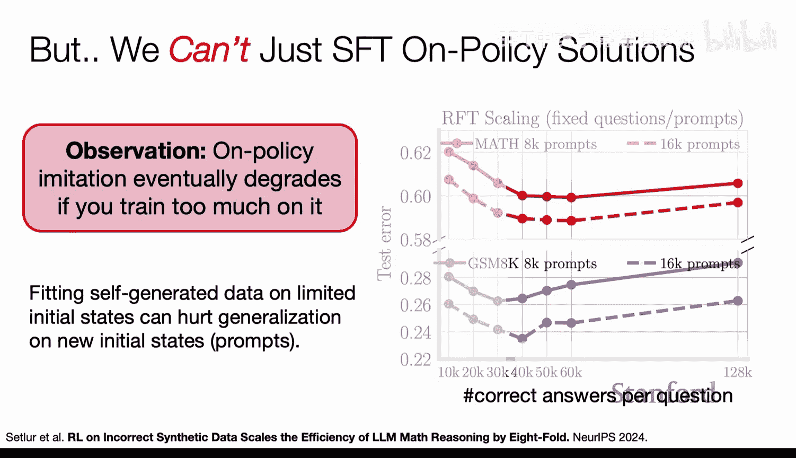

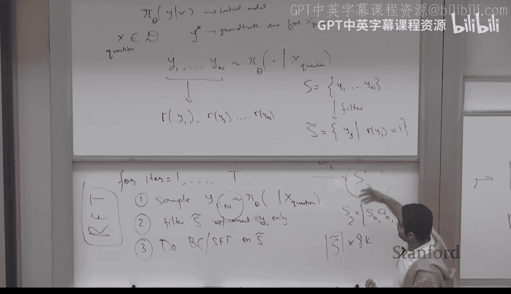

Okay， so why does this happen。 And this is sort of the picture I'm going to talk about。

 and I'll connect it to some of the interesting concepts that we know in imitation learning right now。

 which is this picture of spur steps。😊，So yeah， so what were going to do is you know we'll move away a little bit from like examples and look at pictures and what we' do is well plot these pictures as I was describing to you earlier as this little trajectory in an MDP so you have prompts as initial states and you are producing these steps one by one。

 they take you in next states and then eventually you end up at the answer。😊。

So it so happens that when you sample a lot from your own model and train on it on policy。

 like you sample your policy and train on it， you will often find that there are some of these traces which end up having steps which are spurious in nature。

 steps which actually are incorrect， but they just somehow don't affect the model's generation。

 so I'm going to show you an example but basically these are steps which would take you to a regime where youre maybe doing a wrong calculation know somehow you get there。

 maybe on this particular trace when you are sampling from your model you end up do recovering from these traces so you end up at the correct answer。

 but maybe in reality these traces are actually harmful。😊，So just to give you an example。

 let's say this is a little arithmetic problem from this GSM8k data set。

 one interesting example we found which is the most stark example of this particular issue was you know theres a solution from the model which does some calculation then it says that you know the total amount of money needed is like 100 times2 which is 200 and it reverses its calculation in the next line so the true calculation is 100 by2 but it ends up saying 200 and then sort of goes 200 by 2 right away。

😊，So what ends up happening is this particular step that exists in the middle where it's doing 200 is sort of a spurious step it's a step that is not needed it' iss an incorrect step that exists in the solution。

 you end up still at the right answer in this particular rollout。

 but this step shouldn't be there in reality in that particular setting。😡。

So that's the stiesiest step， in this particular set。

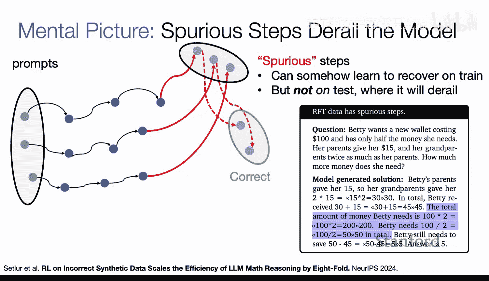

So the question is the step is always a sentence。 For now。

 you can imagine it's always a sentence in this particular setting。

 There's no universally agreed upon definition to it。

 So this is a very sort of I guess in the second part of my talk。

 I'm going to show you some examples where the step is not at all a sentence It's a full block of things。

 So yeah that's a great question。 So So the question is is there is this the main cause of increase in error and can you not measure it in some way So turns out that the answer to both is yes。

 it's one of the main causes for increase in error can you measure it in some way。

 at least normal notions of fitting the data won't tell you this。😊，That's a great question。

 So the question is， can we associate the olding problem with this。

 So you can actually measure this in the paper we did measure this。

 We measure the amount of superior steps we see， and it grows on over time。 Obviously。

 I cannot give you a proof that this is the only cause。

 right can give you proof that this should be a problem。

 I cannot give you proof that this is the only problem。

 but this is sort of one of one of the big problems that you see。😊，So the question is。

 how do you find out this per step in an experiments， we do it in a particular way。

 and that also dictates a lot of methodologies that I'm going to show you in a second。😊。

So this particular method sample so the question is do you sample entire trajectories。

 this particular method sample entire trajectories。

 you can sample parts of trajectories if you want it to be。

 but I think it needs some advanced machinery that I think can be done based on what I'm going to talk about in the next slide。

😊，That's a great question。 the question is， do you overfit to a certain class of methods that got to the right answer in a way the answer is at a high level yes with the caveat that I don't know how to define what the method means right So you can call a method that just seeing this example。

 one can say that the calculation of 1 hundred times to is a methodological phenomena that the model wants through to be able to then succeed and then realize that was wrong。

 you can also say that know really the method here is nothing but just doing a bunch of arithmetic So really depends on what you define that。

 And I think it's a semantic question at that point。

 But yeah from a very like sort of symbolic perspective one can say that there are a set of tokens that maybe still lead you to the right answer on a training set but may not actually help you do the right thing on a test on a test problem。

😊。

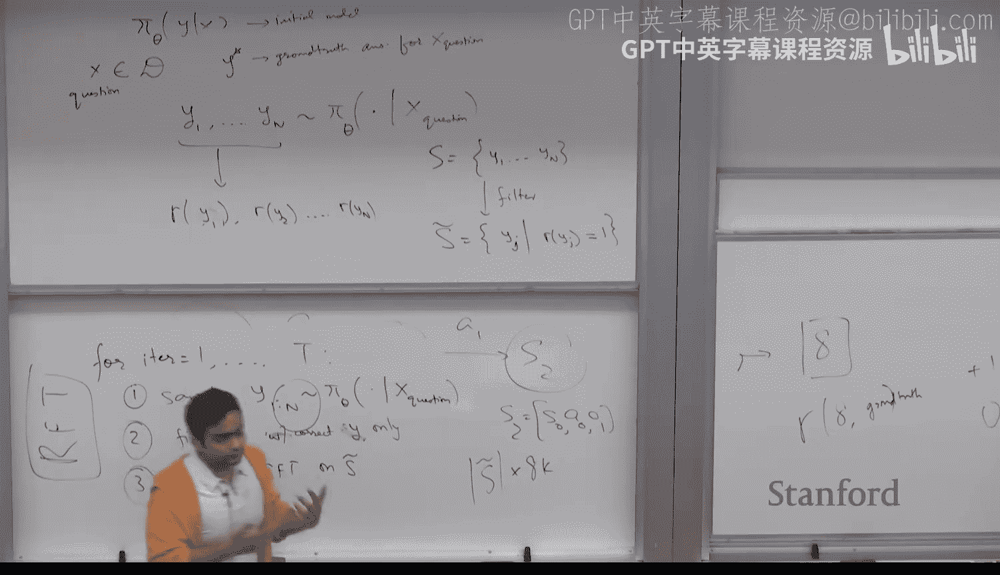

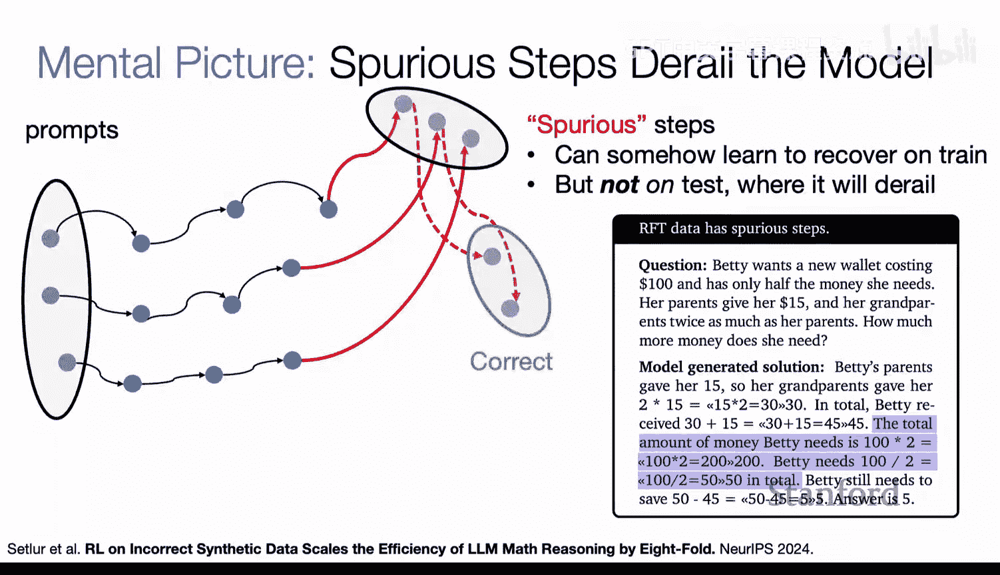

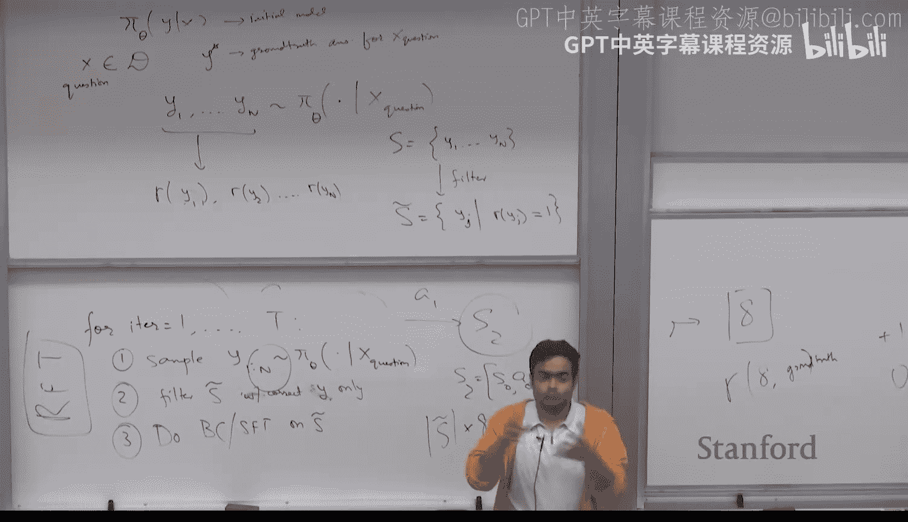

So this is very similar to the problem of causal confusion in imitation learning actually I'm not sure if causal confusion okay okay okay never mind。

 but basically there's this problem of like you know if you if you produce a bunch of bunch of stuff in your policy that you know might might be bad like these poor steps you might just not learn to imitate the expert in the right way possible。

 So you maybe you actually like end up at the right answer。

 but you're learning these incorrect associations that's basically the gist of this problem of causal confusion that people in imitation learning know a lot about actually。

😊，Okay， so how can we address this。 And that's where R L comes in。

 And that's sort of the third axis of using incorrect data or incorrect rollouts for learning。

The simple idea is you know as many of you already asked questions about you know assigning some notion of a credit to a step。

 so if I can understand you know what is the utility of every single step or every single state that my policy generates。

 then I can kind of somehow use that notion to filter off these bad kinds of solutions in some。😊。

So that's exactly kind of what we do or what R for reasoning tries to do at a high level as well。

So identifying these earlier steps and eliminating them in some way。😊。

So the way to do this is the following and you know this ties back to a lot of concepts of value functions and advantage functions that many of you are probably familiar with。

 So I'm going to start with an illustration and then I'll write down the exact math for what this means。

😊，So let's say I gave you a particular rollout or a particular trace。

 you know so again starting from a prompt adding these steps or actions and going to these going to a final answer which maybe ended up being incorrect so it shown as a red dot。

😊，What I can do now is you know I can try to identify whether a step is spurious or not doing by taking these particular prefixes or taking these particular states that were basically concatenulating all the tokens so far and doing what you can think of as rollouts in a way。

😊，So I can ask some model to try to complete the solution given a prefix of a generated solution。 So。

 you know， for example， in this particular setting that you see on the slide。

 I have kept the first three steps the same。 and I'm asking a separate model or a separate rollout policy to try to complete the solution given this particular prefix。

😊，I can do this know so if I do this and let's say the rollout ends up succeeding so you know many of these rollouts end up at the right answer。

 then likely the prefix was not too bad because clearly for this particular rollout policy it did not end up affecting any of any of its problem solving abilities。

😊，On the other hand， let's say if I ended up at a totally wrong answer condition on the prefix that you see up here。

 clearly something is not okay here and clearly there is something wrong with with the prefix that you are seeing up here because your rollout policy could not at all succeed condition on that prefix even after doing many possible rollouts。

😊，And if I ended up succeeding sometimes and sometimes not， maybe there's still some issue。

 maybe it's not the best thing you can have， but at least it's slightly better than you always failing that you see up here。

 for instance。So this basic principle of doing rollouts and estimating some notion of expected success in the future can kind of tell you something about what is wrong with the current prefix that you are particularly operating at。

😡，This is also very similar to a value function right because this is basically computing the expected future 01 reward that my rollout policy that this orange policy gets when it acts in this particular MDP。

😊。

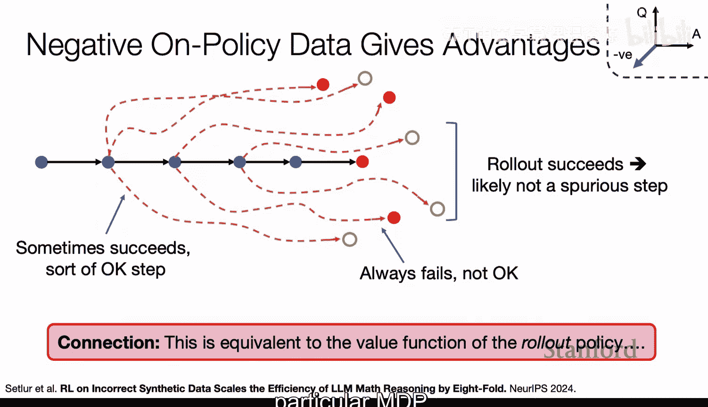

So the question is the spur step on the previous slide is that actually actually irrelevant or incorrect or irrelevant slash I mean it's incorrect clearly because or okay the step is not incorrect in its own own right。

 but it is sort of irrelevant in a way， imagine for a second that if you pass to a language model a million irrelevant tokens and ask it to sort of dig out the information that actually matters that that can be a challenging problem on a test set so that's why even if a step is irrelevant it can be a problem for the model。

😊。

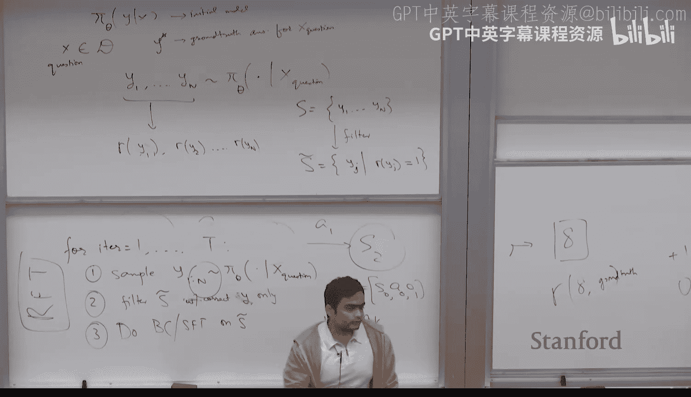

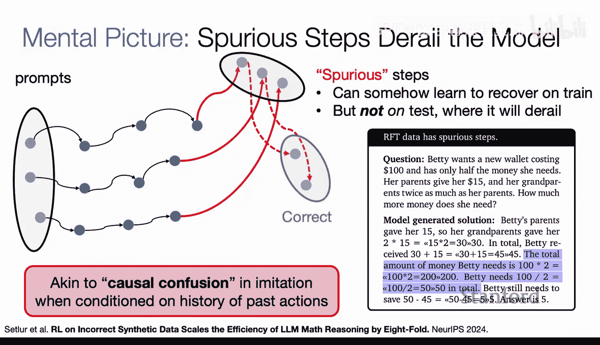

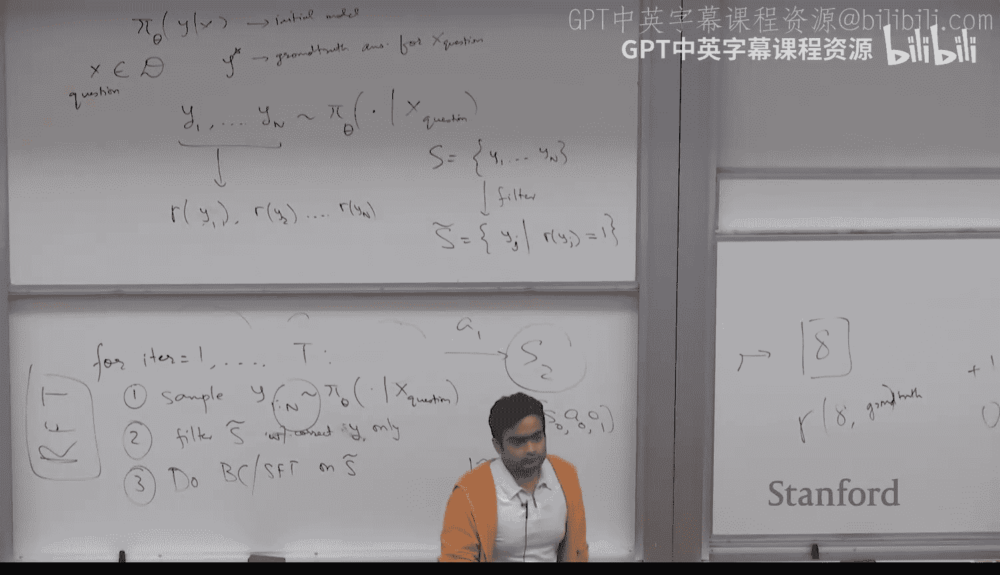

Okay， so we did these rollouts。 We computed the expected value of how many times can I succeed and that resembles something that looks like a value function of sorts you know and why is it a value function Because if you sort of write this down in a bit of math you know so let's say if I define the problem or initial status x each of these steps as y1 to yn So you know I guess there's a bit of a notation mismatch here y one to yn are independent rollouts here the y is I'm showing are basically each step or each action that you take。

😊，So if you write down if you define a quantity that looks like the following it's basically a Q function so what is this quantity it's telling you the Q value for your particular rollout policy P day so the policy which is trying to complete the solution rollout policy P day I am computing its Q value at a given stake given by the initial state and the prefix of the solution so far and given an action which is the current step that your policy adds。

😊，I can define the Q value here as the expected long term reward， meaning the expected 0。

1 reward that I get under my rollout policy if I start by executing you know。

 action if I start by getting actions I plus1 to L from this rollout policy。

 So what's the Q function， a Q function just to recall Q pi。

 I guess it's subscript pi Q pi of essay is basically nothing but。

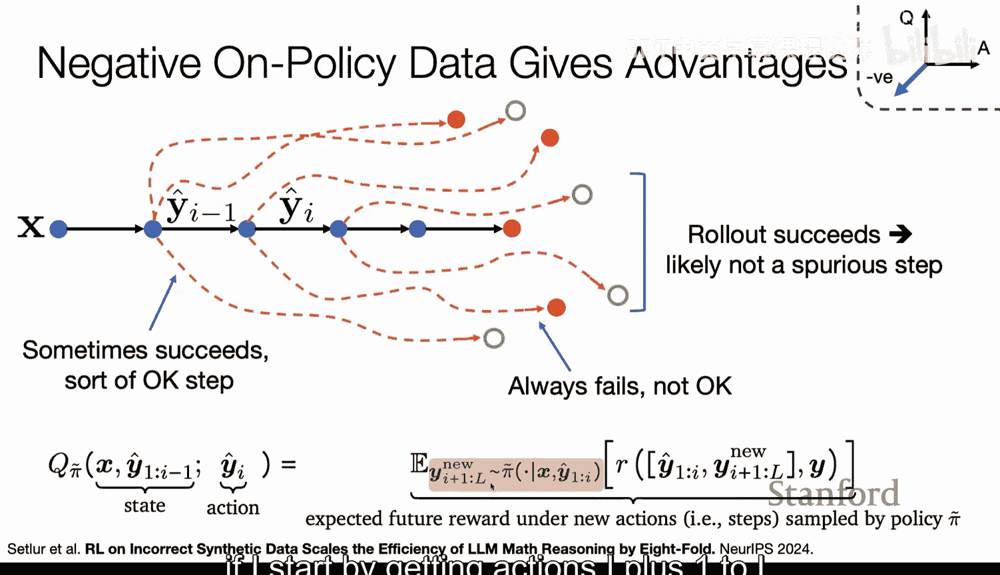

R of essay or I guess， depends upon how you write this。 But it's basically the expected。

Discounted reward that you get。

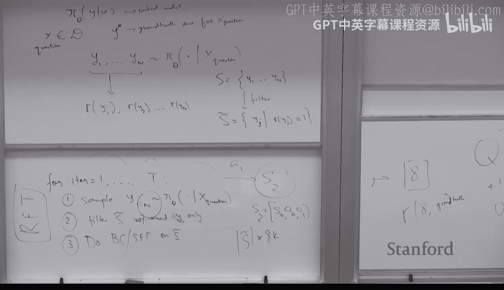

Yeah。Starting from t equal to 0 to you know， let's say infinity in general。

 conditioned on S0 being S and a0 being a。😊。

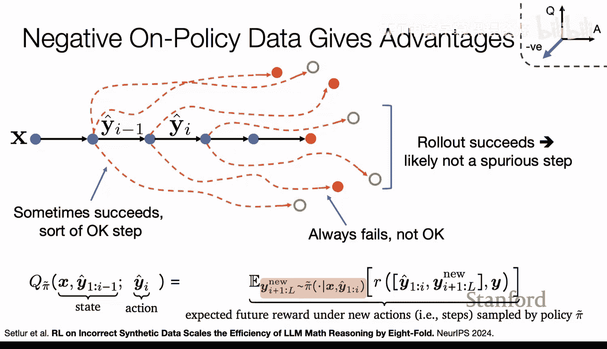

This is the definition of a Q function in this particular setting we are assuming discount factor is one so gamma is set to exactly one and the reward that you get is only at termination so you know there's 0000 until you end up hitting the final answer so that's why you see there's only one expectation up there and this expectation is computed under policy pi so you compute you roll this policy pi out from from there on there's one minor detail here you typically have r of essay plus this thing because you roll out the policy from the next step and you sum of the reward at the current state in this case it doesn't matter because r ofs is equal to 0 you only get a reward at the end gamma is set to one。

😊，So essentially the thing that you see up here is essentially an expected future reward starting from a given prefix。

 which is the state given step at a given step， which is the action and know the rollout is performed under prior till day that you see up here。

😊，Okay， so the question is do you use the same policy to roll out those other trajectories So in principle this equation that I wrote is is agnostic of which policy use to do the rollout Most of so there's been actually no。

😊。

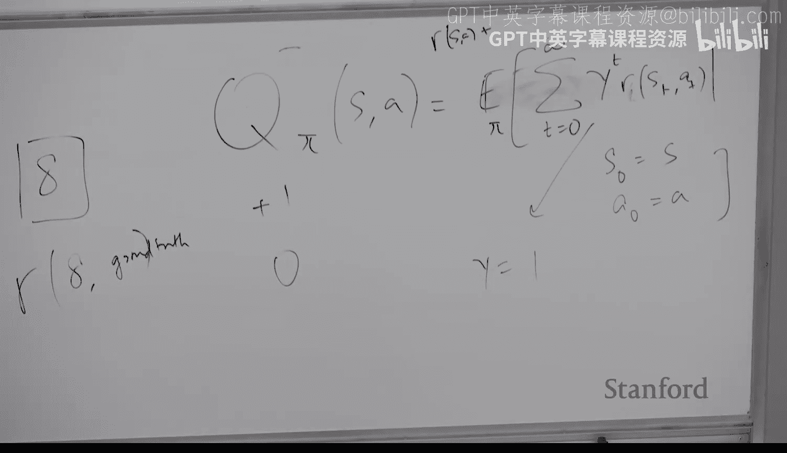

So I have a belief about this answer about this particular choice of the policy。

 So in my opinion the policy that you're doing rollouts switch should be a different policy compared to the current one。

 otherwise it can fail in the same way。 But's some work in literature which argues that even using the same policy can actually be good enough。

 I think we haven't seen an apple step as comparison given the sort of scale of experiments。

 which definitely shows one way or the other。 I think most of the evidence that exists right now points towards the benefits from having a different policy。

 because that makes sense also， but I think there's a part of the community。

 especially sort of the NLP community， which kind of does it using the same policy and finds it to work reasonably' be fine。

😊，That's that's a great question So the question is is this similar to trajectory stitching and advantage weights It so turns out that the answer is exactly yes。

 it is very related to that I don't think I have a discussion of this stitching angle in the in my slides because I think it would have been a bit too technical but yeah if you check the paper you' will find exactly it talks about sort of stitching in this particular setting and it's very related concepts So yeah think of it that way。

😊，Okay， great。 So so this is a definition of a Q function and you know once you've defined this Q function。

 you know it sort turns out that you can use this Q function to now tell you whether steps are spurious or not or good or not。

 in the same way as you defining advantages would have done So I'm pretty sure you talked about sort of advantage weighted regression as an offline R method。

 I'm going to do something very similar to that but just sort of to kind of spend one minute on the definition of the advantage here。

 So the advantage function typically means Qs minus b of S that you probably talked about So a of essay under a given policy。

😊，issq pi of s minus v pi of s in this particular setting though the dynamics are deterministic and the state is simply a concatetnation of the previous state with with a new set of tokens which define the step that is added in there hence what happens is like you can define the advantage as Q value of the prefix until step minusq value of the prefix until step I minus1。

😊。

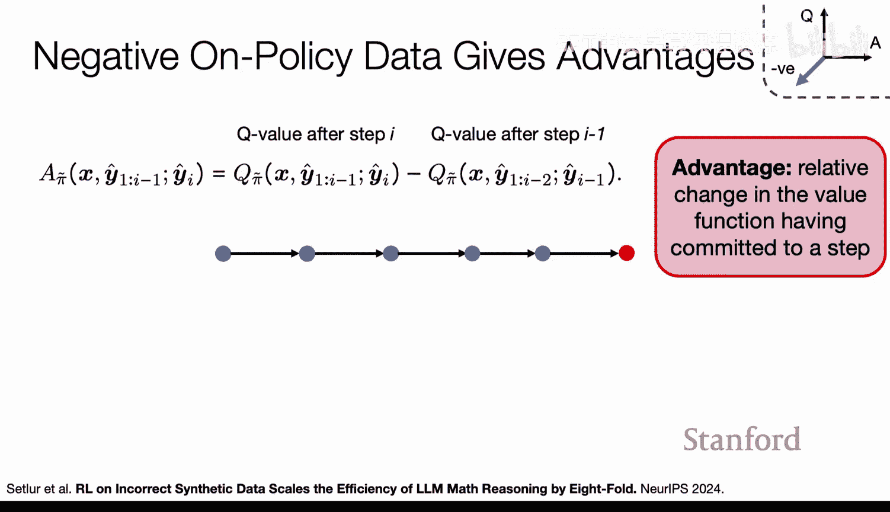

That sort of serves as the same notion of advantage in this particular MP。

 So that's why the definition you see up there is Q minus Q and not Q minus v， but it's。

 it's sort of basically the same thing。

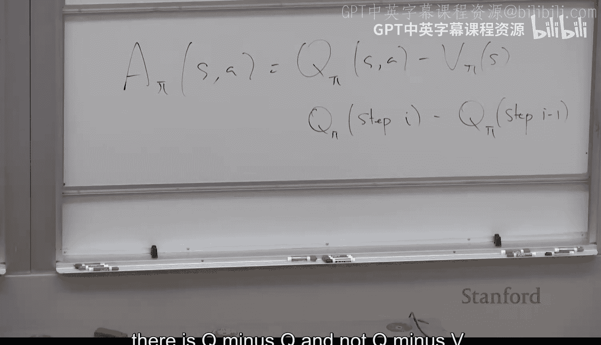

So once you define it in this way， you can actually compute these advantages for every step so you can compute advantages by subtracting the Q values for consecutive steps one from each other and you will get some positive and some negative numbers in this particular setting。

😊，Just really depends on how many times can you succeed and once you have these advantages。

 they are a measure of how well a particular step， how much a particular step contributed to your ability to be able to succeed from you know that particular prefix So if step two ended up like sort of reducing the advantage that means your Q value at step one was higher than Q value after step two has been executed。

 which means step two is probably not a use， not that good of a step to have in order to be able to succeed eventually。

😊。

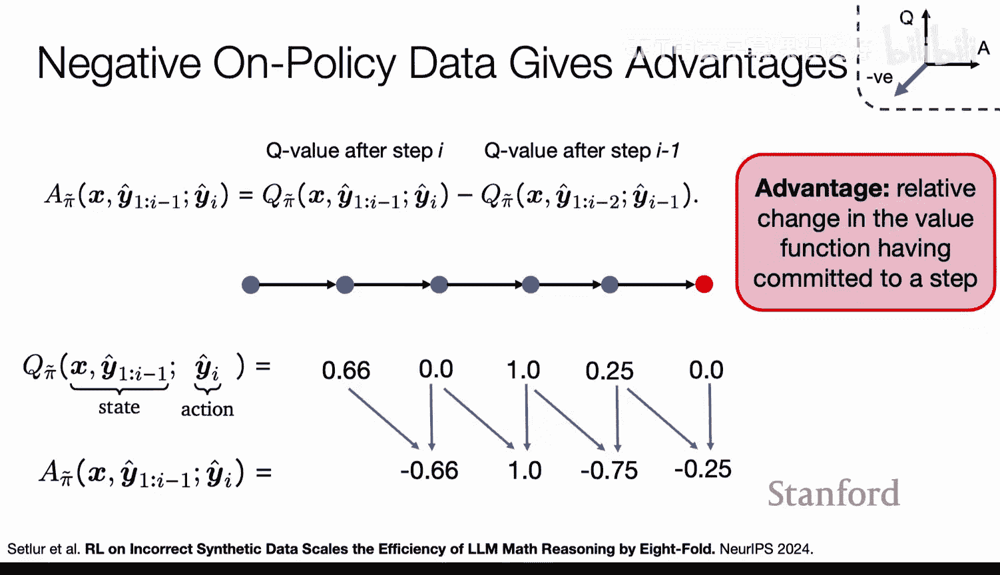

So a negative or a low advantage means it's sort of a bad step or kind of a spur step and you don't want to necessarily learn from it。

 A positive advantage means it' it's a good step and you probably want to learn from it some。😊。

So this is sort of supposed to answer the questions about like。

 how do you identify spur steps in some。So the question is are we fitting a Q function its a very good question turns out that in the literature theres been two kinds of work they explicitly fit a Q function like quantity its what is called so in the in the NLP community this is what is called a process reward model。

😊，Process reward model so in the I'm guessing since you've covered DPO and Ar if you've talked about reward models。

 which sort of give you a score for like particular question and answer this is sort of giving you the score for every step and hence sort of like scoring the process and hence the word process reward model or a PRM I don't necessarily think that PRM and Q values are exactly or should be semantically the same thing but that's kind of what a lot of the NLP people call this but yeah you can kind of train that but there's the other class of methods which would simply use rollouts the way I talk to you about to estimate advantages and we'll see what that means。

😊。

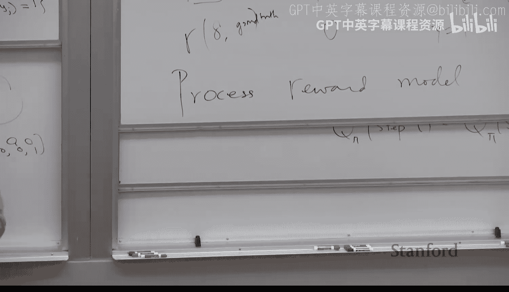

Yeah， that's a great question。 The question is how does this help learn how does this help models learn general general problem solving strategies The rough answer is ultimately what ends up happening here is you are breaking down the success of a particular long trace into sort of successes of individual steps that appear inside of it and that can be a useful thing to know because now presumably your model can realize that okay once let's say it has broken down the problem into four steps or four highlevel plans。

 if it can also localize which step is kind of going wrong。

 it can actually better learn that step as opposed to sort of know just vaguely thinking that okay step three might be the cause of the problem when it fails whereas maybe it's actually step1 So it helps you just learn sort of in a more so ultimately you need to have some data for learning but then this is sort of vastly improving your data efficiency and so yeah。

😊，Great， okay， so the next step is going to be to use these advantages for training。

 And this is where sort of a lot of the methods that I talked about also will come in into a picture。

😊，So the first thing is just going be to filter by advantages that I just described so you can take a bunch of traces from your model and you know I still have the RFT algorithm here so I'm just going I'm going write it down as one to n sample from pihi Theta you can take this you can take the RFT algorithm you can sample you can sample from your model and on policy trace potentially you can take every step do these rollouts that we talked about use them to estimate advantages and put this into your training data set for doing imitation learning or SFT if this particular step is correct。

😊，So what does that mean that basically means that you are taking a particular trace and you are you are checking for at a step level whether the advantages a positive。

😊，Even if that particular step comes from an incorrect solution trace。

 you're going to put that into your training data if that step itself gives you a high advantage。

On the other hand， let's say if that step itself you know comes from a correct solution trace。

 maybe there is a particular step here which gets a low advantage or a really negative advantage。

 I'm going to just throw it up。😊，So this is very much reminiscent of advantage weighted regression。

 except that here rather than doing expentiated advantages， which I'm guessing was covered。

 we are doing sort of like filtering on advantages that's sort of the basic idea。

 you can also do exponation of advantages so you can like you know train on everything but multiply them。

 multiply the loss by E to the a that that objective I think。

 requires a lot of tuning and if you can only run one experiment。

 you probably prefer this objective over E to the a in general。😊。

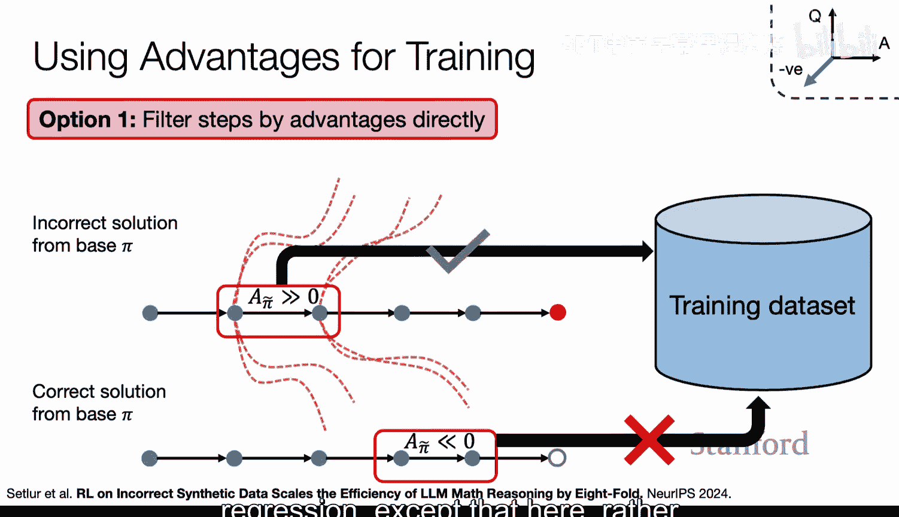

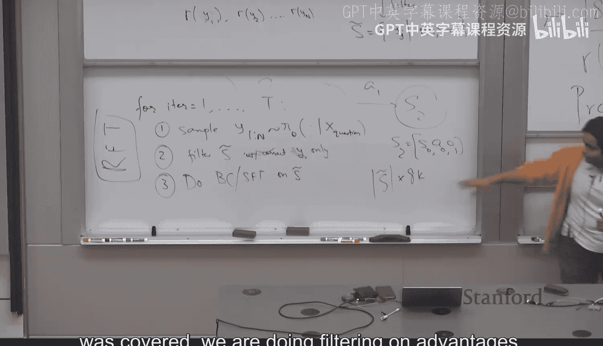

That's a great question。 So the question is， do you only train up to the good steps on an incorrect solution The answer is not really。

 So we initially thought that that's kind of the only way to train here and we did a concrete ablation studying this as well The answer is well you never really train the model to so in this particular setting you're not let's say a particular step gives you a higher advantage you're not training the model to produce this step and then this step All your training is to produce this step conditioned on the prefix so far。

 So your loss looks like。😊，Train the model to produce AI given S and not the previous actions or the previous steps that you see up here。

 So I'm just gonna probably just draw it here， because I think it's easiest to draw it。

 So think of it as this way。 you had you had x or S 0。 You went to you took a 0。 You went to S 1。

 You are taking a 1。 went S2。 These are steps。 And this is the the states。

 Youre not let's say this state get got an advantage， which is really positive。 So A of S 1 A 1。😊。

Is really positive And a of S 0， A 0 is really negative。

 What you are going to do now is you're going to not necessarily。😊。

So what Im not saying is train on train your policy to produce a0 given s0。

 you are not going to do that， you are going to just train the policy to produce a 1 given S 0 comma a 0。

😊，So that's all youre trying。 Or， you know， I wrote S 0 comm 0。

 This basically just as equal to S1 because you're concatenating steps。

 But that's kind of the thing you're gonna incentivize。 So you're only training on the steps。

So the question is， is there a separate prompter that keeps prompting the model when it acts here。

 the answer is not really right So in general when you do RL。

 we never really train the policy to sort of between the policy with to produce individual actions like in offline Rl or invitation learning we train to produce a1 given s1 a or given S and so on but when it acts in the world it just acts and produce a giant string ofken or giant sequence of actions in one go right so you can train the policy on different segments of steps it it's seen but when it's deployed。

 it's going to just produce one action then the state S1 is going to be simply the whole tokens in the question tokens in the tokens in the step so far and that's S1 and you're going now the same policy can now continue on and produce the next step so it's not going to be prompted in any way its just like going to be producing the whole solution in one flow except that now you're just training it in a way that you're breaking them down into steps so really there's no notion of like a separatector。

So the question is do you only train on a step because of the Markov property because you don't care how you got there in a way the answer is or actually no because in some ways your state S1 consists of all of your history right so S1 consists of so S0 is a problem。

😊，A 0 is， let's say， step 1。And S1 in this case is basically problem concatenated with step one。

 right？😊，So in some ways you have preserved all of your history in this case and it's a non Markovan policy that you're learning except that here the reason why we do this at the step level is because now we can better do better understand which part of the solution actually caused me to derail if it did so there's no notion of independence it's not like given so in this particular setting given S1 sure action A1 is all matters but S1 and s0 is0 are the same so it's depending upon the way you look at it it can be called a non Markovan policy as well because it's condition on the whole history but in this particular setting if you define S1 that Catator states it's a Markov n policy。

😊，So the question is if your value is really so if Q values are really negative。

 but your advantages are positive， but you put it in the train dataset set or not？😊，Yeah。

 that's a great question。 I think we tried this with like so we did take traces which were incorrect and we took we put the steps which were actually good from them into a data and that was fine except that let's say if there are traces where everything is just to there's no way there's no prefix of that from which you can succeed at all the advantages are also small and the queues are also small turns out that if you filter them out you might do a little bit better but again I don't have a very。

 very concrete like result I can show you here so I'm not gonna like tell you that this is the way to go but like it seems like to a large extent the sensitivityivity does not exist in some way because know the prefix is the culprit then your training only a1 conditioned on the prefix and not trying them on to produce the prefix at all。

😊，Okay， great So so that' is the first option。 So this is a lot like filter imitation learning or advantage better regression。

😊，The next thing okay before that I can show you some results here so this actually ended up addressing that error going up problem at least to the extent that we were able to train models so you know here again I'm plotting number of correct answers per question and you find that the advantage filtering did help you compared to sort of the RFT approach which was going up before。

😊，So it does actually and we did measure the number of spur steps according to some heuristic definition of you know how we can evaluate this。

 like how can we can probe this and seemed like just from a qualitative perspective also the number of spur steps actually kind of reduced in some in some way。

😊，Okay， so the next thing is how can you use this for offline reinforcement learning and this is where sort of you know DPO based methods come in so there was a question about this earlier in the class so you can also use them for you can also use the same principle for doing DPO actually。

😊，So the idea in DPO is sort of slightly different from computing this advantage exactly but uses the same protocol that I described to you earlier where what you're going to do now is you're gonna take a solution from your base model that that youre training maybe this is incorrect and so far what we did is we found out steps that were useful and retain them in some way or the other and discarded everything else but what we can do now is we can do these rollouts and rather than sort of throwing away or throwing away these rollouts or just using these rollouts to estimate the advantage what I can do is I can instead take a rollout which ended up succeeding with a shared prefix take the solution trace from my model which did not end up succeeding and construct a preference pair out of them so I now have a preference pair which looks like some prefix followed by some correction which is good and some prefix followed by sort of like some steps which are actually wrong。

😊，And I can throw this into a DPO training data set。五十。

I can also do the same thing with like sort of a correct rollout so if let's say I have a correct rollout from my base model I can still do these rollouts you know and maybe one of them will not end up succeeding potentially from my rollout policy and I can basically put this thing as a preference pair into my into my training。

😊，So a nice thing that is happening are there are two differences that are happening here right in some way Im still realizing in this process that prefixes are shared and really the difference between you know correct and an incorrect rollout comes from that little segment that you see you know beyond the prefix in these settings thats the first thing and the second thing is you know rather than the previous approach of filtering by advantages I'm actually retaining the whole steps that appear in this rollout distribution。

😊，So I'm not simply using these rollouts like the the the orange colored you know dash lines to compute advantages。

 but I'm retaining them， and I'm training on top of the tokens that appear in that rollout as well。

So the DPO loss， I guess I don't have that on my slides。

 but you know I guess probably you know I don't need to necessarily write that down。

 but it's basically just a matter of like you know the same old DPO loss on top of these two segments of solutions that we talked about。

Yeah， great question。 So the question is， do you want high quality text or do you want sort of a more diversity？

 I think the true so okay so I should mention that like this is something that we have tried to formalize So there's like an exact equation that you can you can write down and you can be like okay I want a policy to do these rollouts which maximizes this expression sort of thing in one of the papers。

 I think that kind of balances in some way diversity and high quality。

 So imagine for a second that your model is really bad。

 So let's say your model mostly produces incorrect traces。

 then you want a rollout policy that can actually somewhat succeed because otherwise there's no notion of a success that you can learn from ever right you only see failures。

 how can you actually even learn to solve that problem if you only see failures On the other hand。

 let's say if your model is kind of decent like 50% accurate。

 but it's like not as good overall like it's not the best at solving problems In that case。

 maybe all you want is just diverse ways of solving the problem such that you can see what ways you're more pro。

😊，To failing So you care about about sort of coverage in some ways。

 So really the answer here is like every single problem in R。

 there is some balance between exploration and exploitation you kind of want to do。

 which is high quality text or high quality solutions which solve the question correctly and you know being more being more diverse in some way I think the exact expression for this is actually something you can also write down and I am not going cover today。

 but yeah straight out between them yeah， so basically you should train if。

 So so you know like so far， I guess okay， actually let me just write that algorithm down for everybody's understanding So what you do is you are basically so that is the RFT algorithm and now what we are gonna do is we are gonna simply do the same process of iteration。

😊，And one to T， I'm going， you know， sample。

Why1 to end from my current policy？Given any question， I am going to now do these rollouts。

 so I am going to you know do rollouts。😊，And you know construct the preference data set Df in this case。

 it's basically those preferences and now what I'm going to do is I'm going to do run or minimize D loss。

That's kind of the main algorithm that youre going to do and the deep breath consists of you know prefixes generated from your current base model and the trace is coming from sort of you know one part of it is from the same model that you are training pi Theta the other segment the other part of the preference pair comes from the rollout policy that that's the honest time。

😊。

So the question is given a sample trajectory， how do we segment into steps。 So in this work。

 we just use sentences。 So we just said， well sentences we couldn break them down into steps from after we sentence in general。

 I think it depends it's a thing that you can bake into your model。

 So if you have played with for example， open AI models you'll see that they often produce responses that look like step one in sort of mark down like a very big step1 and then they'll say a bunch of stuff and then step two and they'll say a bunch of stuff So you can use that sort of notation oftentimes it's so happening as these models kind of get better at basic instruction following。

 you can just prompt them to produce responses for complex questions in a particular stylistic fashion and use some heuristics about that style to partition things into steps。

 So for instance， you can just tell a model well， I want an answer that for this particular question that that never uses the word step that always uses that always produces a logical block of calculation puts a horizontal line and then pushes the next。

😊，block and so on。 And most likely do it for you， which is something you can also do during the course of training。

 So you can just prompt them to kind of produce solutions in a particular way and then define steps accordingly。

 Thiss no universal definition。So the question is is there a convention to produce special tokens for generating steps I think that I've not seen a very very clear convention that is universally used all the time one convention that we have been using that I've seen many other papers use but there are still outliers for this is they would produce like step hash one colon and then say something and that could be bunch of lines as well you know in this work we used lines in a followup thing we had this like step notion so it really depends on like up to you clearly I think yeah。

😊，Okay， cool。 Any questions on the DPO part in this case。

 So this is the the DPO version of the algorithm。😊，Great， okay。

 so you can do this and and put this into your your data。

 So if you go back to our our plot from before， if you measure how how well does such kind of an offline rL method do。

 what ends up happening is okay， I guess these were supposed to be Jeff but anyways so。😊。

I'm now plotting the test error as a function of number of questions that existed in my dataset so so far we are looking at number of correct answers per question for a lot of the plots in the middle but now I'm back to the plot where we are plotting the x axis is a function of number of questions in the original data and you find that compared to and now there are two models here one of them is like a Lama2 models so this is probably tells you how old this work is at this point it's a year old but Lama2 is feels like long time ago and then deeps2 models as well as yeah deepsv2 models and what we are finding in general is that compared to the base Sft method where you were just training on human written solutions you can get up to an8x boost in the amount of data that you need for training so the dash line here is this first step sort of DPO algorithm that I talked about and you see that it can get you the same test error with like8x fewer samples than than like training with SFT on like human written data RFT。

😊，was 2 x for reconction we I removed that line here because it would have been too cluttered。

 but in general like this ax also holds true for Lama too roughly overall in this setting。😊，Yeah。

 so the question is what is pass at 5。 That's a great that's a great question。

 So you can think of pass set 5 I guess for understanding this slide， it doesn't matter。

 first of all， but in general you can think of pass set 5。

 basically as saying if I gave the model5 chances， can it succeed even once out of those five chances So it obey people evaluate models because it's kind of telling you that maybe the model could not succeed in one tribe but if I gave it like n tries。

 maybe it can succeed and that's what pass at n in setting it doesn't I mean I don't think for this particular result。

 it matters so much， the main thing to look at is this ax boost and data efficiency here。😊，Okay。

 so the high level takeaway here is that if you do offline R with sort this first step notion of like credit assignment that we talked about。

 you can actually do sort of you can actually get a lot more data efficiency。

 boost compared imation learning。 So for the same amount of data for the same base model or sorry for the same base model and for8 x fewer questions。

 you can do similar we can get the same performance with R in this setting。😊。

Yeah so generally I've seen people use 0。6 as a temperature for a lot of so the question is what's the temperature recommended temperature to use I' generally found it to be 0。

6 is what most people use I don't think that there is like a theres like something thats like sat in stone you can always change it。

😊，So the solid line So question is what's the solid line。

 that's just SFP on like human written solutions in the study。

 There's no per step advantage that line。And the first step advantage one was actually the one I showed to you before I removed it here because sort of this is the kind of maybe the the ultimate kind of result in some ways from human data to the kind of self generated data of sorts。

 but yeah it's like two weeks with the first step。😊。

Okay so the final thing that final main method and then I'm gonna just talk about what people are currently doing very briefly and I end the lecture at that point。

 but the final thing we can also do here is online reinforcement learning there's two ways of doing this sort of the most basic recipe for doing this is actually to not use any of this advantage but sort of generalize this kind of basic RFT algorithm without advantages to online So how do you do that you can basically just take your model know similar to like how we sampled a bunch of traces from my current model or current policy and filter the right ones rather than filtering you can just train it with like on policy so you can just generate rollouts from your current policy which might be correct or wrong one of you can reward them using like the reward function by just checking the answer against the answer that the model produces you can penalize it if it does not produce an answer you can penalize it if it violates format there's a bunch of reward shaping things you can do and then you just like train your policy to maximize。

😊，This reward using policy gradients。 So RFT we were explicitly filtering and and training with SFT。

 But rather than doing this filtering or training with SFT。

 you can simply run on policy reinforcement learning because all in this formulation is just state action。

 there's an MP。 there's a reward and just to R on top of it。😊，So。

 you know you can simply write the policy gradient gradient equation so that basically just looks like grad log pi times the reward that you see up here and you can just run that on your problem。

😊，There's also a lot of work which now tries to kind of go beyond the basic reinforced style policy gradient and goes to sort of methods like what's called GRPO It's nothing but just an extension of like the basic PPO algorithm in the setting So the PPO algorithm I guess I'm gonna say a few things like PPO algorithm uses learned value function the GRPO algorithm replaces that learned value function or learned Q value function which simply this rollout based estimation of advantages So the same old basic added recipe applied on an MDP that looks like the thing that you see up there So a trajectory that looks like the thing that you see up there with a zero1 reward。

😊，Okay and what you can also do and this is something that finally you can do is you can also do per step advantages in online R that's kind of the final method that you can apply so in this setting you can take a solution from your pace model you know or take a solution from your current policy that you are training over the course of training you can do these rollouts if you want to you can use these rollouts to compute advantages and rather than doing these rollouts you can also potentially do something slightly different and which is basically to train a reward model like thing to fit to these advantage predictions or to fit to these Q value predictions and then compute advantages。

😊，So this is very similar to some of the RLHF work that you probably saw。

 except that now this is a reward model that is rewarding every step or sorts or that a reward model that is producing the Q value for every step or the advantage for every step as opposed to producing a reward for the whole sequence that you are seeing。

😊，And once you have these advantage predictions that you can fit to a network。

 you can query this particular so for any rollout at your policy producers。

 you can query the advantage predictor that you have trained to reward every single step in this particular policy generation。

😊，And once you do that， what you can do now is you can simply， you know， take your network。

 produce these advantage labels and optimize for reward that you' are getting at the end。

 plus these advantages that you see up here in this said。😊，Yeah。

 that's so the question is how generalizable is reasoning when you train on math does it improve on GSMk So it turns out if you train on math。

 it does not improve on GsMk and many people have shown it。

 but if you train on a bunch of mixture of prompts which are a varied levels of difficulty you can actually get there。

 So this is precisely the recipe which has been used and or not this one but the basic online order recipe which I talked to you about earlier used to train all of these many of these thinking models who have which have like open open recipe descriptions So this online R recipes kind of used to train the deep sea carbon model。

 for instance and that kind of does generalize to a fairly good model extent it doesn't also generalized to to every single problem out there but to a fairly good extent it does。

😊，So you can compute these advantage predictions。 you can fit them to a network。

 use them to produce these rewards for every single step and that's sort of the more advanced way of doing online R with this particular thing。

 So we had a work that we call process advantage verifiers here process because it's rewarding every step advantage because it's fitting an advantage function and a verifier because somehow in the domain of reasoning reward models referred to often as verifiers So if you see that word come up just just synonymous to a reward model of sorts or in this particular case even you can think of it as a Q function or a value function of sorts but that's kind of the name of the method and we find that in general So I'm gonna to skip some of these details。

 but in general if you do dense reward R like process reward or advantage-based reward R you find that you can kind of get to a much better accuracy compared to sort of what's called orM R or just01 reward R like the sparsse 01 reward provided at the end So this is sort of the basic recipe。

😊，A lot of the current work is using this is sort of the advantagebased verifiers recipe and you can kind of see that you can get a bigger boost in sample efficiency as well as in terms of just absolute performance that you see up here Also these numbers kind of look small but like with 2 B and 9b models that we were basing this off of apparently like this is sort of the best result that you can get on certain data sets that we tried this on so it's about5 to six x sample efficiency boost in about 6 to 7% absolute performance improvement in this particular setting with the tense advantages some way。

😊，Okay， okay， I'm going skip some of these things， but at a high level you know。

 we are also seeing now these like newer thinking models that have come up where basically these models can just think for longer and produce a better answer。

 This is sort of the deep CR1 family of models Open A O1 family of models or O series O series of models from open AI。

😊，In my opinion， like really these are trained using very similar recipes that I just talked to you about for this whole lecture。

 except that there are some small changes that happen in this process from pre these models era versus these models。

So the adult training objective has remained the same。

 So you know there's some minor details like there's this new method called GRPO。

 which I just just describing it's basically PPO with some tweaks。

 There's also some other methods like advantage induced policy alignment。

 You don't you don't need to know what those methods are Just think of them roughly as policy gradient methods done with slight tweaks overall。

😊，But what has changed is that the action space in a way has changed for these models in my opinion now this is a very kind of crude statement to make and to be really rigorous about it。

 I think the statement sounds wrong because these models do actually produce token by token one at a time。

 but these models， the base models on which we are doing R have become better at being able to kind of implement interesting kind of meta procedures like you know these models can actually produce a solution maybe go out there and then try to verify the solution they have produced maybe then backtrack a particular point and do something else from there and you can think of this as just yet another version of like defining the step like these models can produce more interesting steps than just going out there and calculating yet another quantity like the models previously could have done。

😊，So it's just a better notion of a step or a better action that these models can sample when you run all of these algorithms on top of them。

😊，And once you do that and you give these models a longer budget to act so if you tell these models that okay there is no limit on how many tokens you can you can think you can sample during the course of RL you can maybe sample solutions which are really really long but just get me the right answer if I give these models that play ground to kind of sample more and more tokens turns out that RL training algorithms with you know with these two bullet points actually give you much better performance and that's kind of what we see with these current thinking models right now。

😊，Turns out that if these models are you know if you do a counterfactual experiment where you take models which are not capable at doing you know implementing like basic sort of answer checking or verification or generating a better answer。

 turns out that you cannot do good or with them right now。😊，So really。

 nothing has changed in terms of like the high level techniques that I talked about。

 except that the base models have become more have become more interesting in a way that they can sample interesting kinds of steps to train on。

😊，And that has LED to some of the most amazing results that we are seeing right now。

