# 斯坦福大学《深度强化学习｜CS224R Deep Reinforcement Learning  Spring 2025》中英字幕 p11 -11- Lecture 11_ Model-Based RL.zh_en -BV1SvmxB3E5e_p11-

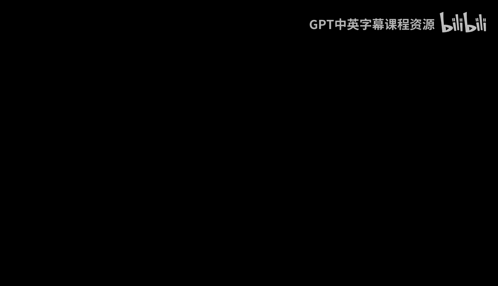

Great， so we had some feedback in office hours and at other times that it might be helpful to have like a high level recap of the algorithms that we've talked about so far to try to understand where some of the pieces fit together。

 So I put together one slide that is a little bit more high level， but actually captures。😊。

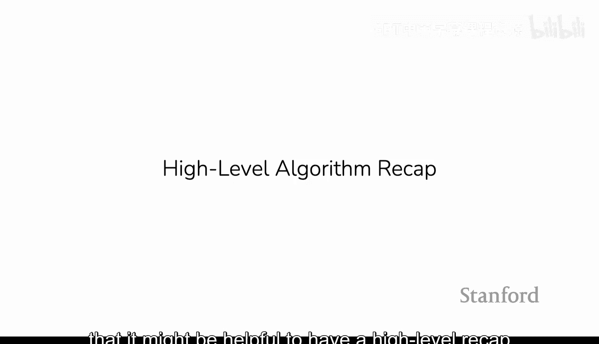

Almost all the algorithms that we've seen so far。

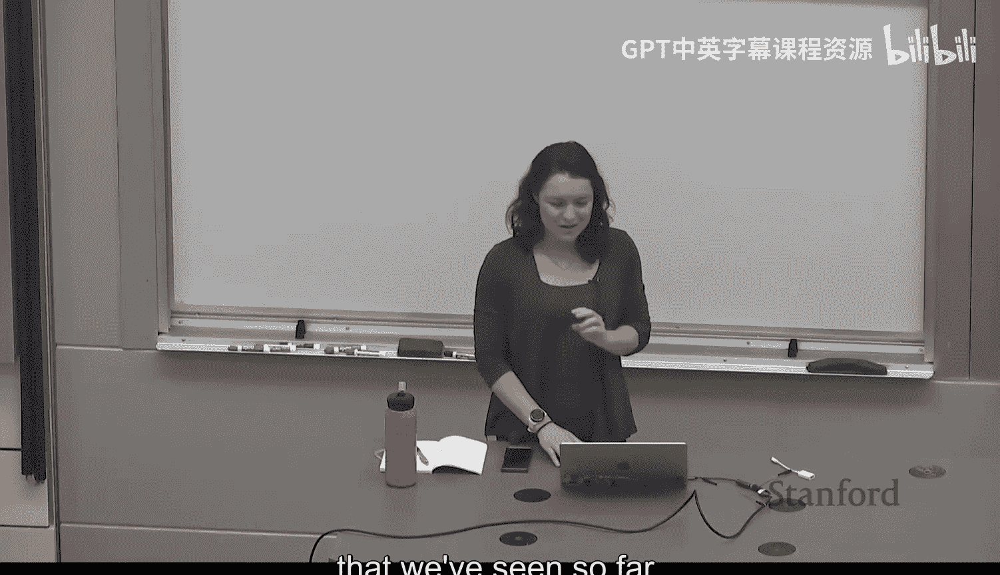

And in particular， we've talked about both online and offline algorithms。

 where online refers to scenarios where the policy will be used to collect data。

 and offline means that we're given a data and we cannot do any additional data collection in our environment。

And in the offline setting， we talked about two different classes of reinforcement learning methods that use on policy data collection in order to improve。

 and we referred to the first type is on policy URL and the second type is off policy URL where on policyR。

 you can collect data but only from the current policy you can only use data from the current policy and this means that are not going to be reusing past data。

 you can't use offline data and so forth。And this include algorithms like reinforce or the vanilla policy gradient method。

And then within the realm of off policy URL， this was where we could start to reuse data from other policies。

 including data from policies before we took a gradient step on our policy parameters。

 And this included algorithms like PPO and important sampling。

And then we talked about algorithms that are more off policy that can reuse data from policies that are even different。

 even more different and where we use a replay buffer to store the data from those past policies。

 and that included algorithms like DQN and S。And then I colored these different algorithms。

 different colors because the blue algorithms only involve training a policy and so we refer to them as policy gradient methods。

 PPO and S learned both a policy and a critic and so we refer to them as actor critic methods and。

There's also algorithms that only learn a critic and don't explicitly learn a separate policy。

 and that those are often referred to as key learning algorithms such as DQM。

I should also mention that PPO is often actually referred to as a policy gradient method。

 although you do actually learn a value function， and so we typically were're referring to it as actor critic in this class to avoid confusion。

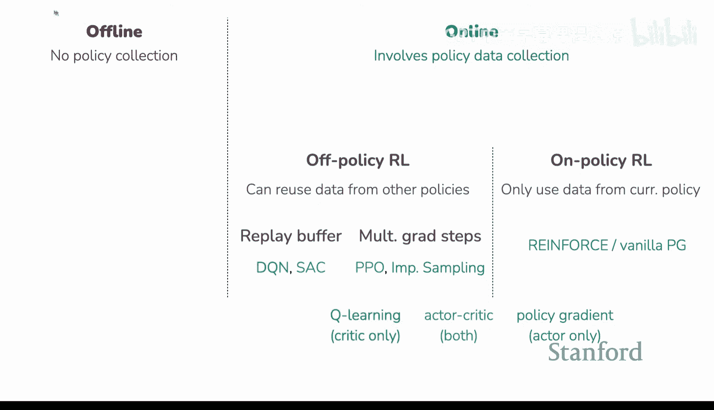

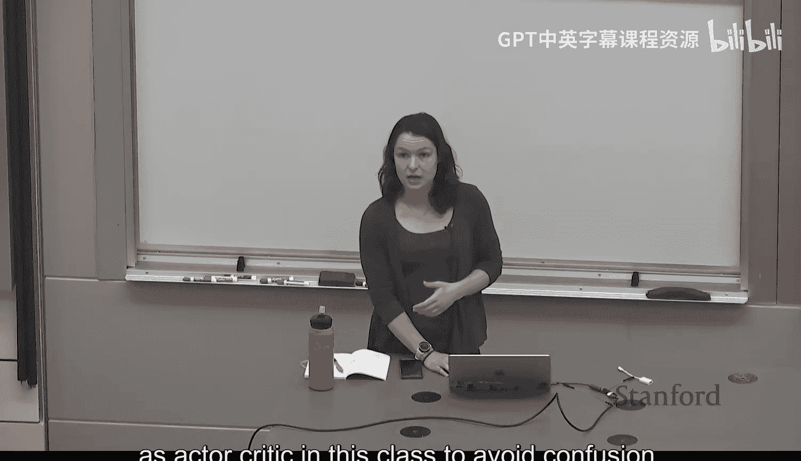

And then separate from these classes of online methods。

 we also have offline R methods that we started talking about and these built upon a lot of the ideas we saw in online URL。

 but I have to cope with the fact that you're not collecting any data at all。

 and we looked at two different approaches there。 what is to constrain to only considering actions in the data。

And this included algorithms like AR， AWAC and IQL。

 and also an algorithm like CQL that implicitly is constraining you to actions in the data。

 but not so explicitly， and this is through conservatism。Now for these RL algorithms。

 generally as you move right， you need more online data and so that means that typically they're going to be kind of more expensive because online data is often more expensive than offline data because you can't it's harder to kind of repeatedly collect a large amount of online data。

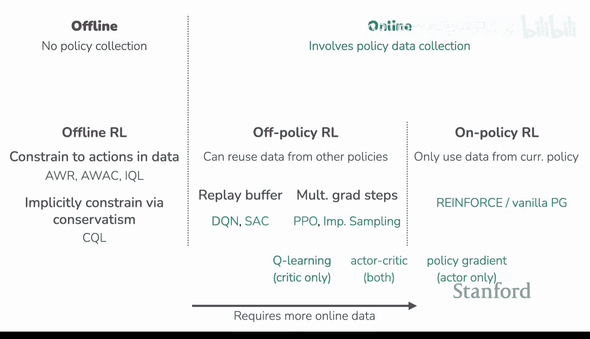

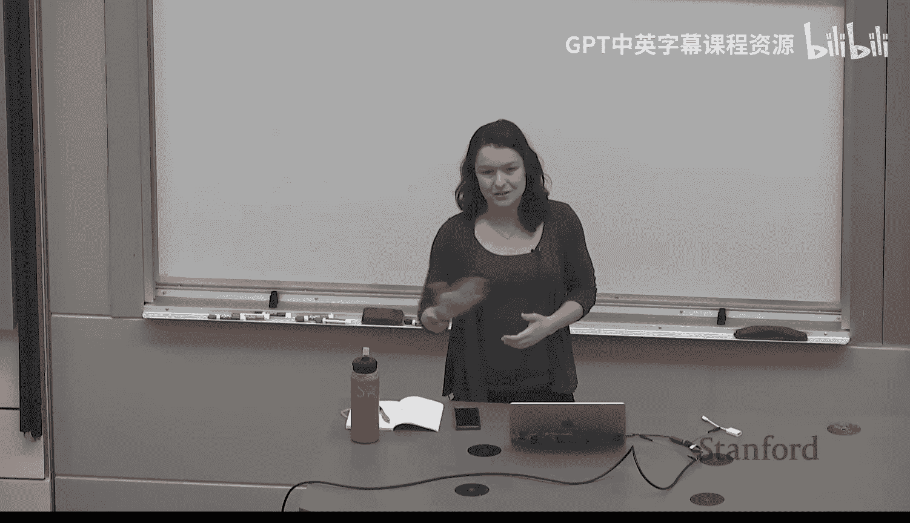

And then lastly， before we talked about URL， we also talked about imitation learning algorithms and。

This can also fall within the bucket of offline and online。

 although there's a bit different set of assumptions。

 the first imitation learning algorithm we covered was kind of vanilla behavior cloning where we're taking a data and trying to imitate the actions in that data and then we also talked about an online algorithm that is online both in terms of the policy and in terms of querying an expert like asking an expert what is the right action on this new data that I'm collecting and I put these in of they're in a little bit of a separate category because they have different assumptions。

 you don't need a reward function but you do need pretty good data and you're not gonna be able to outperform the average behavior in your data。

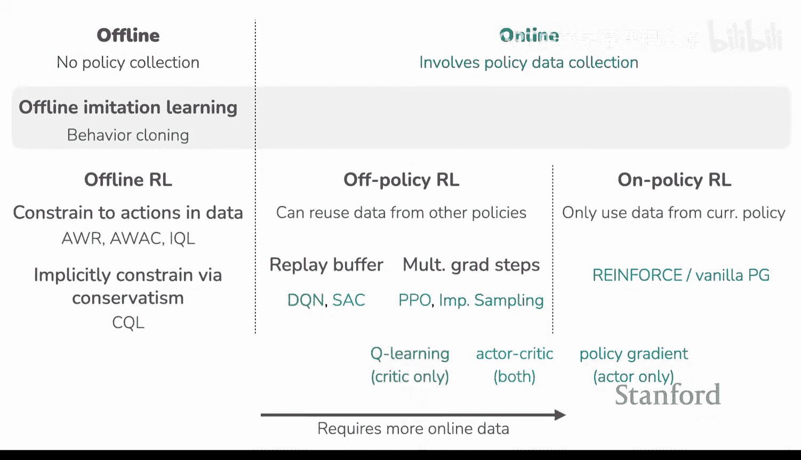

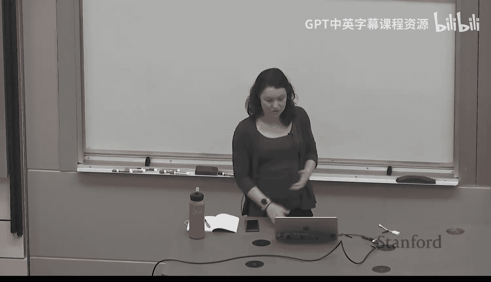

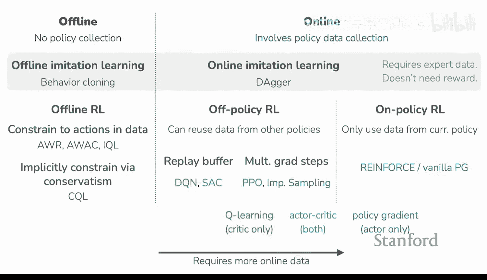

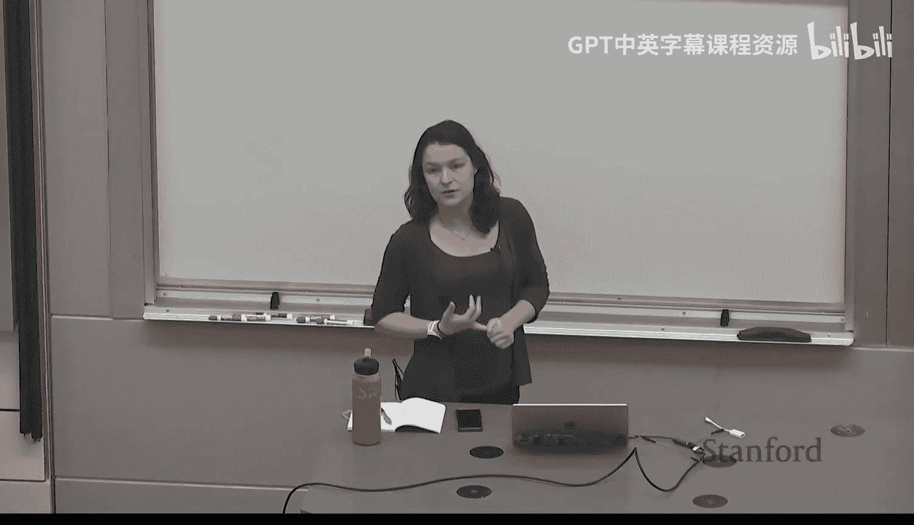

Cool， so that's kind of an overview， including a lot of these different terms that we see in reinforcement learning like offline online。

 off policy on policy， and so forth， and imitation learning versus reinforcement learning。Cool。

 so what we're going to talk about today is we're going to talk about model based reinforcement learning and model based reinforcement learning can actually be applied to all of the different classes of reinforcement learning methods on the previous slide。

 someone has a special place in my heart because I used to do actually quite a bit of work on model based R。

 And I think that there's a lot of really cool things that you can do with model based reinforcement learning。

😊。

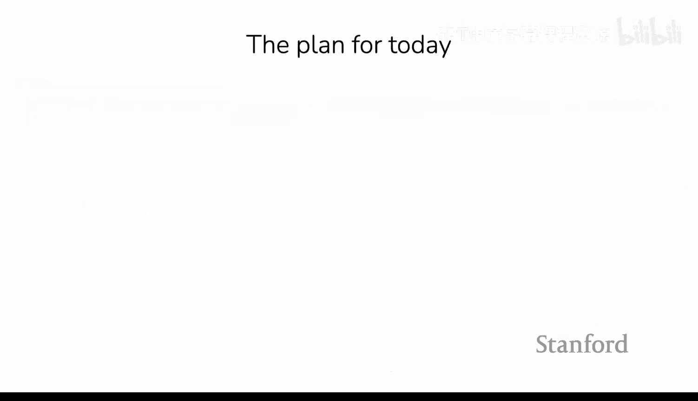

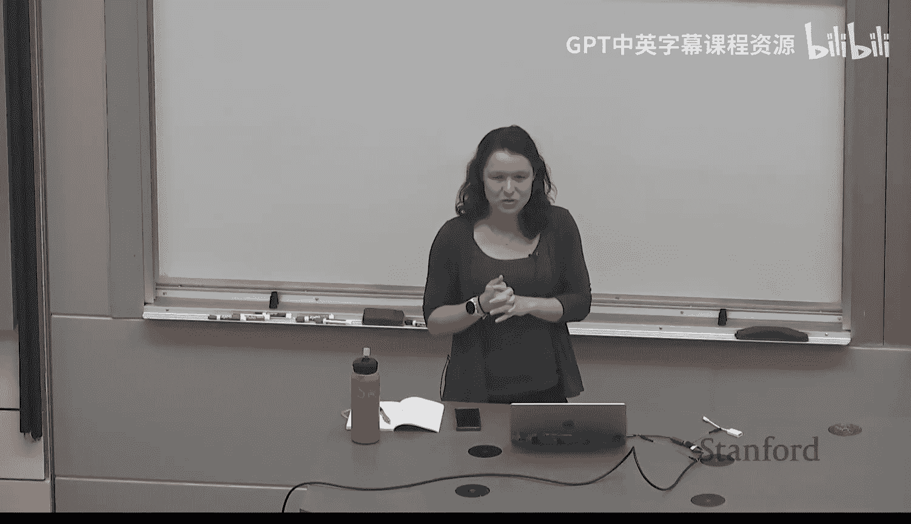

We'll talk about the key idea behind it， how to learn models， how to use those models。

 including with planning and data generation， and then we'll also look at one case study in joints robot manipulation and as a teaser for that。

 we'll talk about the method that we'll be talking about today is we'll allow a robot to do something like this。

 which is pretty cool， this hand has more than 20 degrees of freedom。

 more than 20 different joints that it's controlling。Yeah。

 and then kind of the key outcomes is trying to understand how we can learn and use dynamics models and the different challenges and trade offs with this whole class of methods。

Cool， so the key idea behind model based reinforcement learning is essentially。

 we're going try to learn a simulator。😊，A。Can we learn how to predict the future。

For actions that we might be taking。And for robotics and driving and other physical systems。

 this might be modeling the physics of some particular system if you can directly observe the underlying kind of physical entities in that system。

And alternatively， if you can't directly observe the different entities in that physical system and model them。

 then this might look something more like video prediction conditioned on actions that the agent wants to take so for example。

 I might want to predict if I say something to someone else， how will they react or if I。

 for example， move my legs in a certain way， will I fall down， will I go that way。

 will I go that way and so forth。

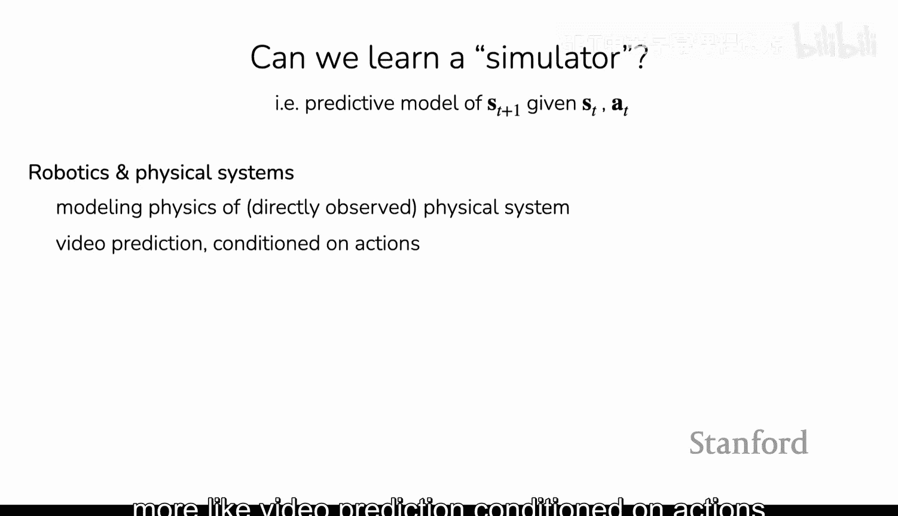

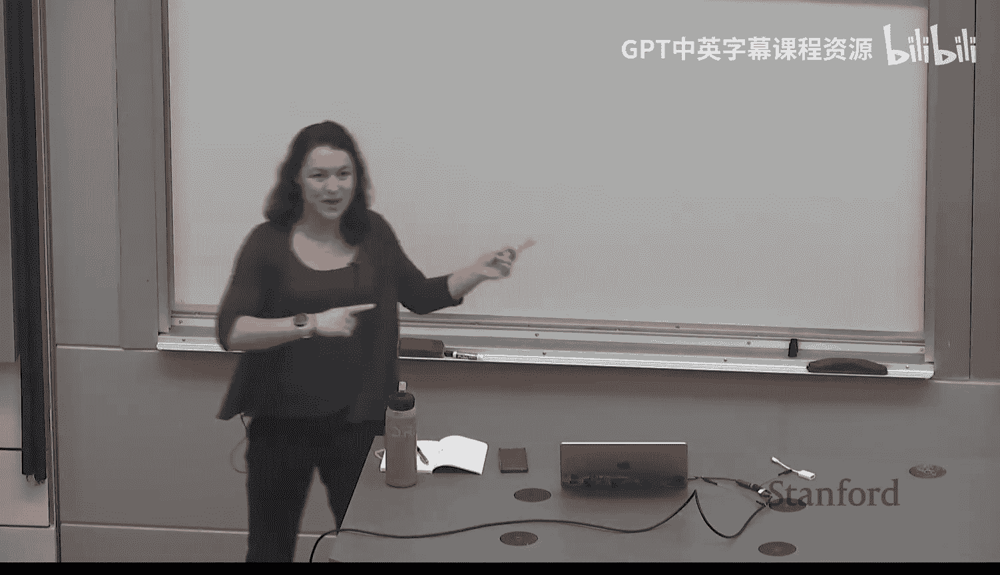

嗯。In terms of like what this video picture might actually look like， the。

 we've seen like pretty cool videos coming out of large models like V O2 and Soa。

 And these are kind of examples of。😊，generated image videos。

 videos that are generated by a neural network， and you can imagine that these kinds of models could be very useful for training systems like cars。

 robots， quadriators that are flying through different places in order to learn about how their actions affect the world。

Now models could look something like models of the physical world。

 they could also look at models of other things。 So for example。

 if you wanted to learn a policy to make money on the stock market。

 then one of these simulators would be trying to predict what will happen to the stock market over time。

And if your actions have any effect on that。And then if you're trying to train an agent to play a game。

 then this sort of model will underscore the rules of that game。And actually， in a lot of games。

 you might actually already know the rules of the game。

 and you may not even need to learn a model in the first place。 For example， in chess。

 if you take a particular action， you know the outcome。

 you know how the piece will move as a result of that action。

 And then it comes down to in two player games or three player games or multiplayer games。

 you might need to model other players。

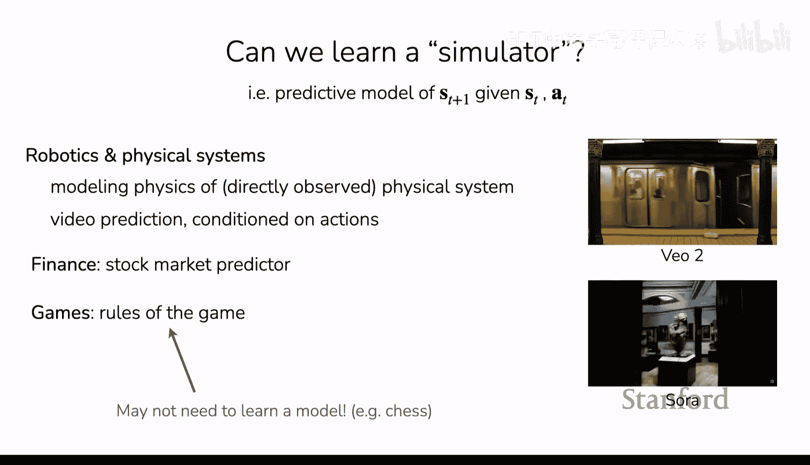

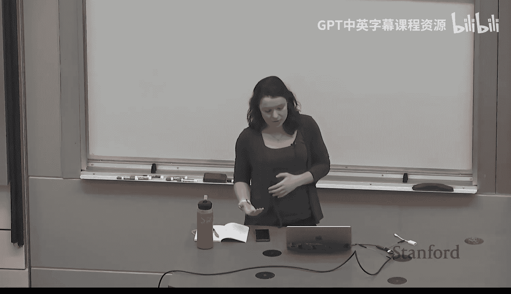

呃。Moodeling other players， you can sometimes consider that as part of the dynamics。

 but oftentimes it's actually modeled separately。 So you don't even even necessarily need to consider it as part of this simulator of the world。

 I， for example， you might be able to use your own the model of yourself as a model of another agent。

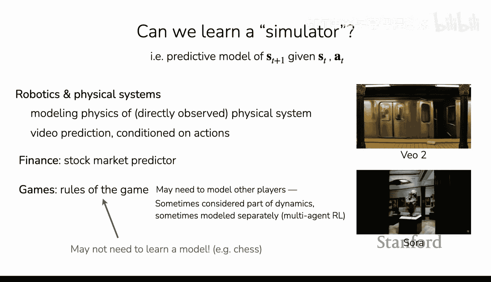

Okay， so if we could learn a simulator， how would we use it？

 So the sketch of an algorithm would be something like this where we get some data。

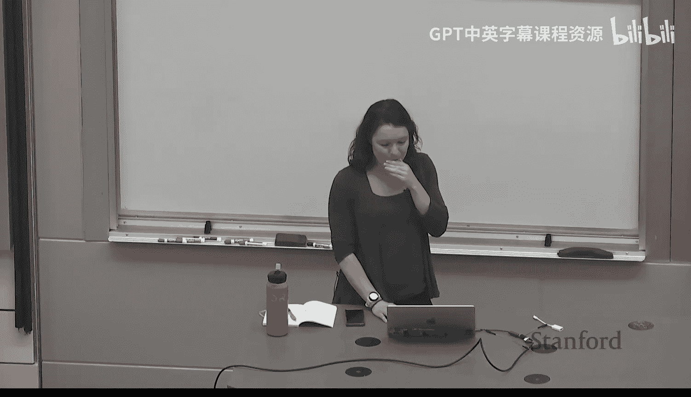

Then we learn a simulator on that data。 that's going to be。

Trying to predict the future for the present and some action that I might take。From the present。

And then try to run your favorite method inside the simulator。So for example。

 maybe you have a kind of a simple scenario where you want to get from the green point to the red point。

 you might collect some data。This is collected from some policy。

Then you would train some neural network。Conditioned on a state and in action。

 what is the next state？And one way that you could learn this is just by。

Minimizing the L2 loss between your predicted next state and the next state observed in the data。

And then in terms of running your favorite RL method。

 you could use one of the RL methods that we've covered or you could use a planning method and we'll talk about a couple planning methods today。

Cool，So now I have a question for you。 So here's a sketch of an algorithm。

 Does anyone have thoughts on what might go wrong if you follow this sketch。

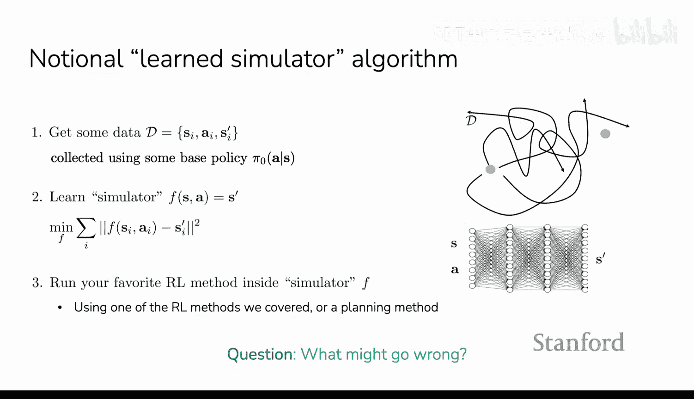

Yeah， so the idea there was that your simulator might not always be accurate and so similar to what we saw in reward modeling and also arguably what we saw when training Q functions。

 you might exploit those inaccuracies， those inaccuracies might compound and then what you've learned in your kind of learned simulator might not transfer to the real scenario that you're trying to learn a good policy in。

Yeah， so there's also this data coverage issue so similar to what we've seen when training Q functions and other things。

 if this pi zero， if this initial policy doesn't is different from the policy that you're ultimately learning。

 then you're going to have this mismatch and you might not have coverage of your M might not be accurate for the states that are visited by the policy that you're learning。

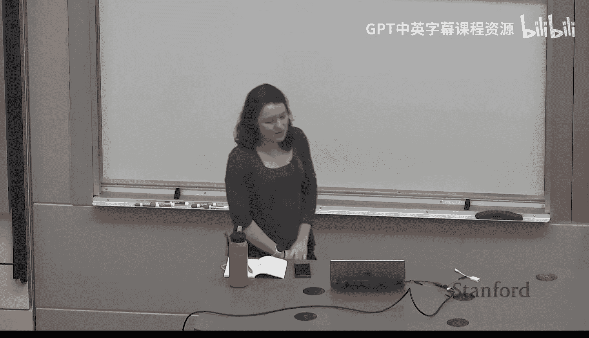

Cool， so。TheThis is mostly basically what's on the slide exactly。 so if you have some environment。

 maybe you want to navigate a maze， then you might collect some data set from some policy。

 maybe the policy does something like this yellow arrow， this is your data。

But the Za doesn't cover the whole maze。 And so that if you wanted to go to this part of the maze。

 for example， or this part of the maze， then you your model probably wouldn't be very accurate about the mazes in those parts of the environment。

 And so then you wouldn't be able to learn a policy for reaching those parts of the maze。

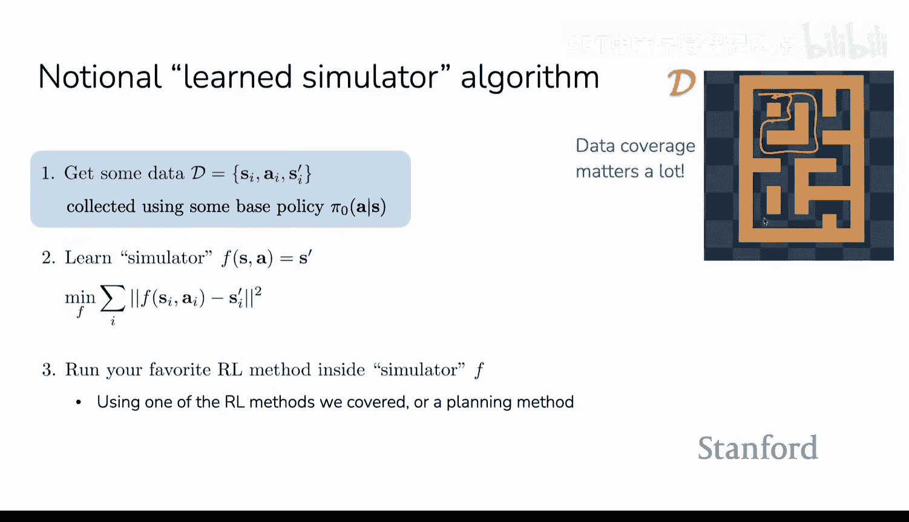

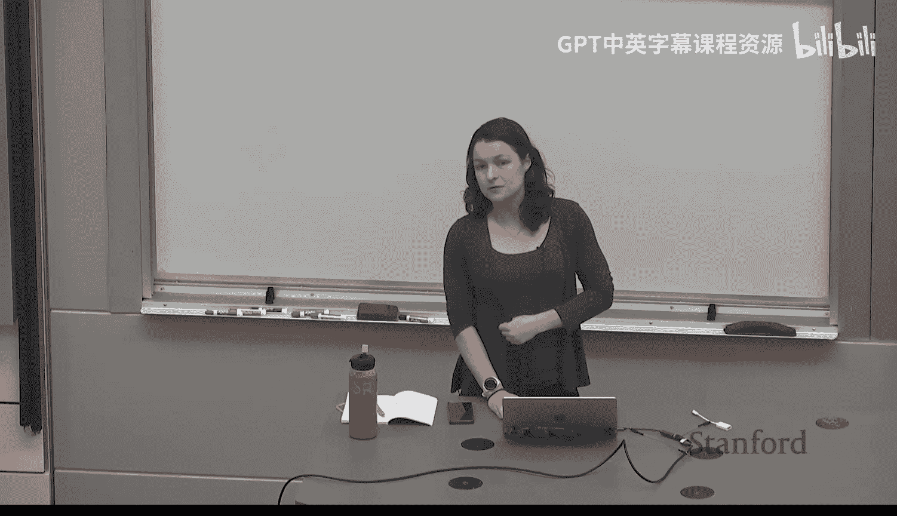

And then for the second point， you might not always have an accurate simulator。

 So here's an example of a video generated by Sa with the prompt humanoid robot standing near a table with the red。

 green and blue cubes on it， performs a cube stacking task with red on the bottom and blue on the top and you can see that the video generation does some creative things with physics where it kind of changes the colors of the block。

 and。😊，Synthesizes blocks out of thin air。 I would love for my robot to be able to do something like this。

 It seems very useful， but this is not kind of modeling what robots can actually do in reality。😊。

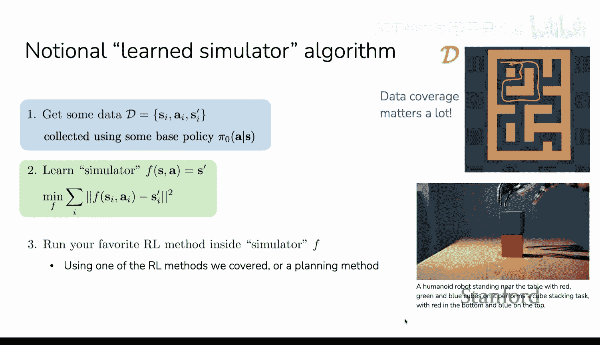

And to this point， when you're actually trying to develop this kind of model。

 oftentimes you might need to make。

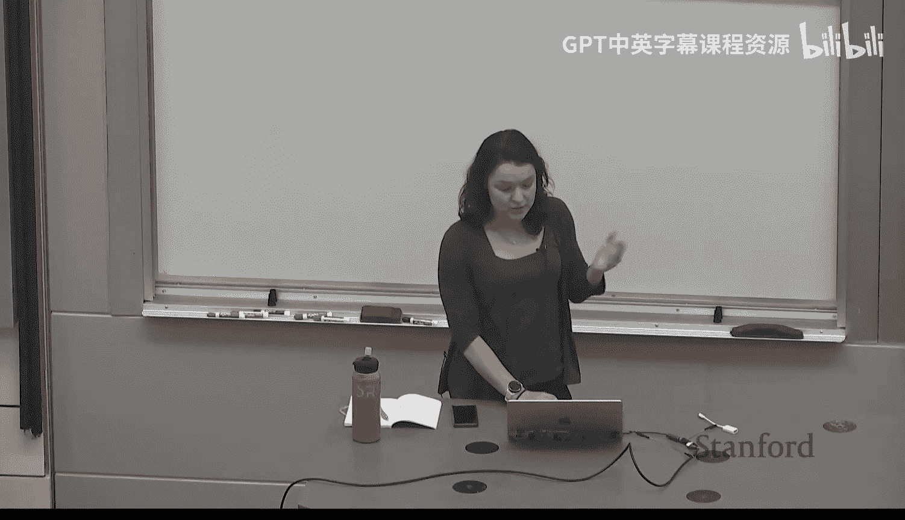

Choices that are dependent on the domain， like if you're trying to train a video prediction model versus training a model of。

 like kind of low level physics with friction or training a model of the stock market。

 you might have some choices to make in terms of what are the inputs to that model and how are you training。

 What's the architecture and so forth。And some domains are going to be much easier to simulate than others。

And then lastly， for this last part， even if you have a really good simulator。

 this doesn't mean that it'll be easy to get a good policy or to get actions that are accurate as a result。

 you still have to run， you still have to do the RL process using this simulator and you need to account for inaccuracies in the model during this process because usually your model is not perfect。

 you don't have a perfect simulator of the world。

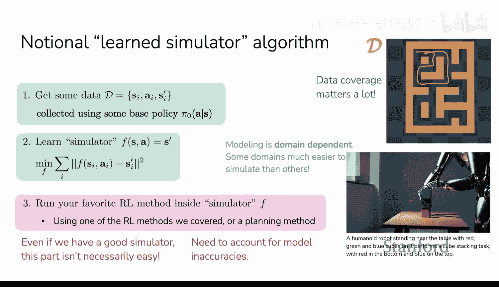

That's the key idea behind model based R O。 Now， let's talk a little briefly about how to learn a dynamics model。

 We don't have too much time to cover this。 So we'll just talk about it briefly。

 and then we'll spend most of the time on how to use a dynamics model。

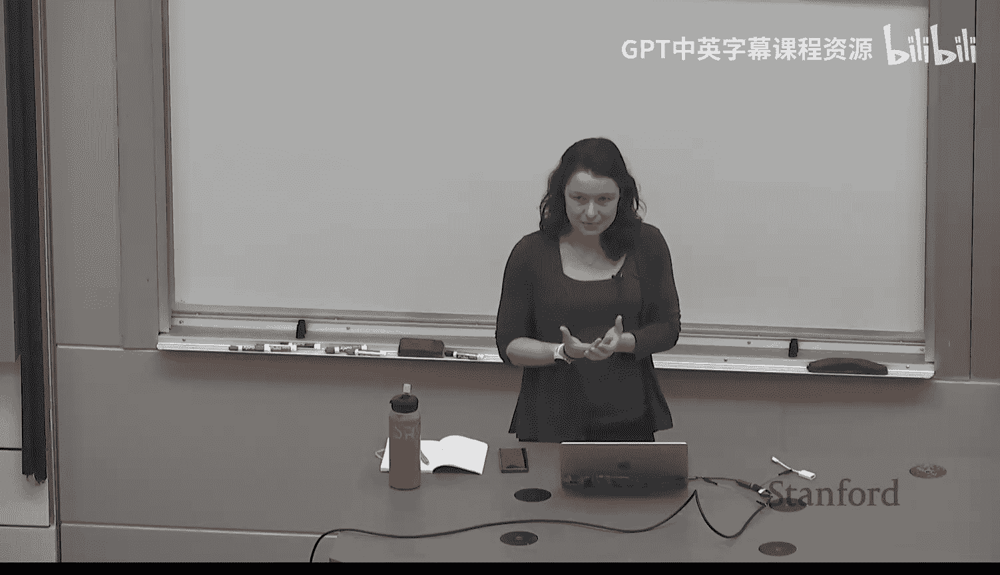

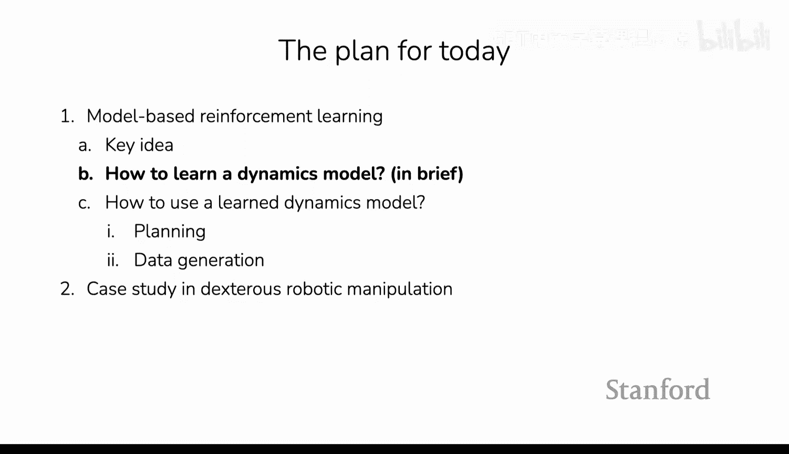

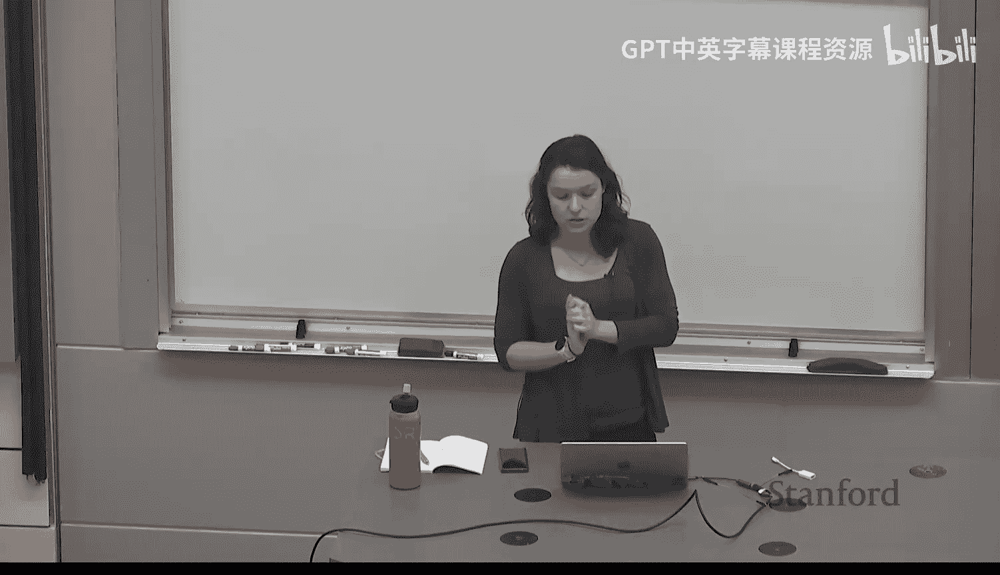

Okay， so in terms of learning a good simulator， a good dynamics model。

 there are some scenarios where you might know it already， and you could already。

 you could just use it。And then you're in great shape。

There's also scenarios where you might actually know most of the model。 like if you are in a。

A simplified robotic control setting where you're trying to like push an object on the table。

 Maybe you know most of it， but you don't know the friction of the table。

 the friction coefficient of the table or。

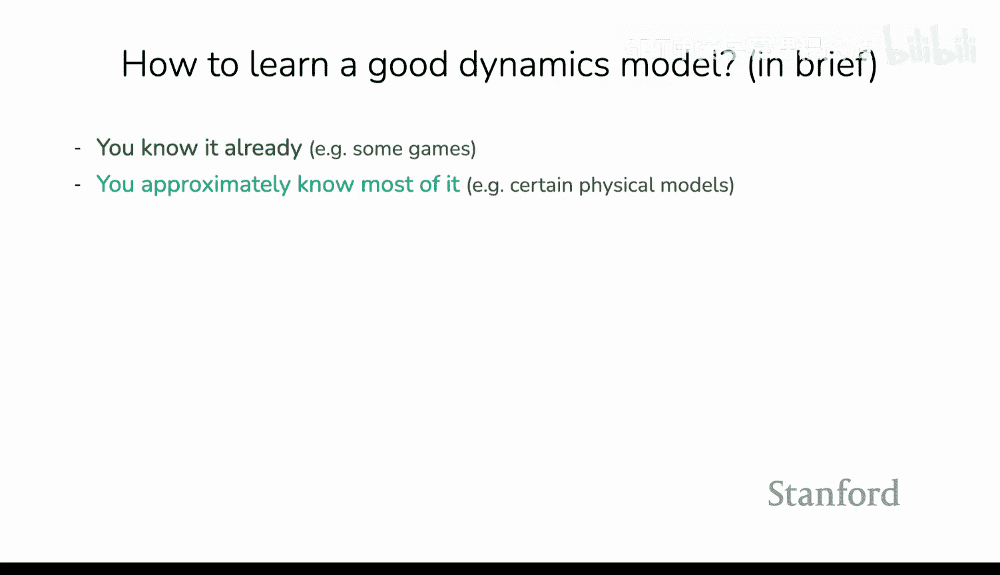

In driving， maybe you have a pretty good model of how the car is going to like accelerate like how it will move forward if。

With like a given， like steer steering command and a gearing， a given thing。

 And you just need to model some additional things。 In those cases。

 you might actually be able to leverage knowledge that you know about the world and then fit those unknown parameters using the data。

 This is actually。

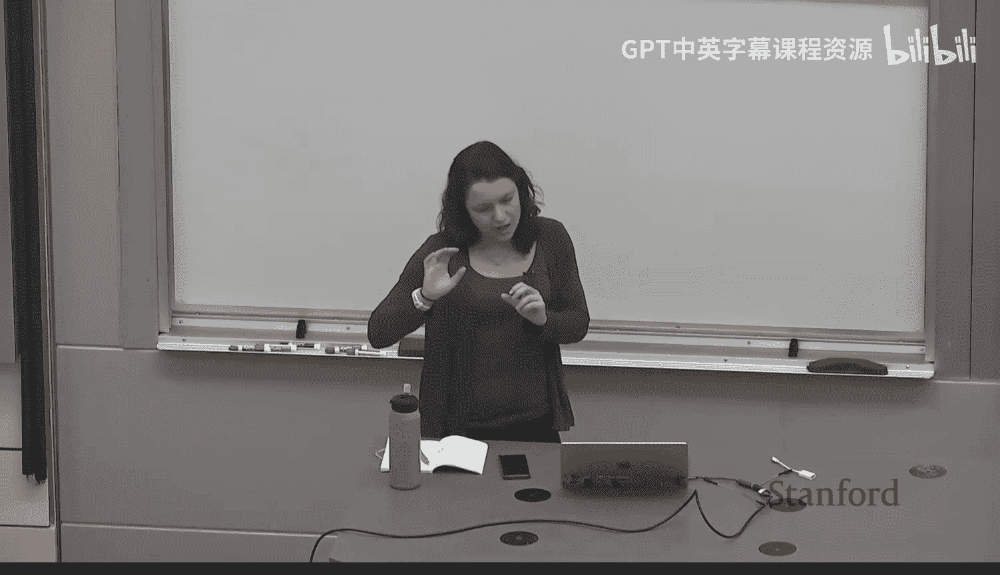

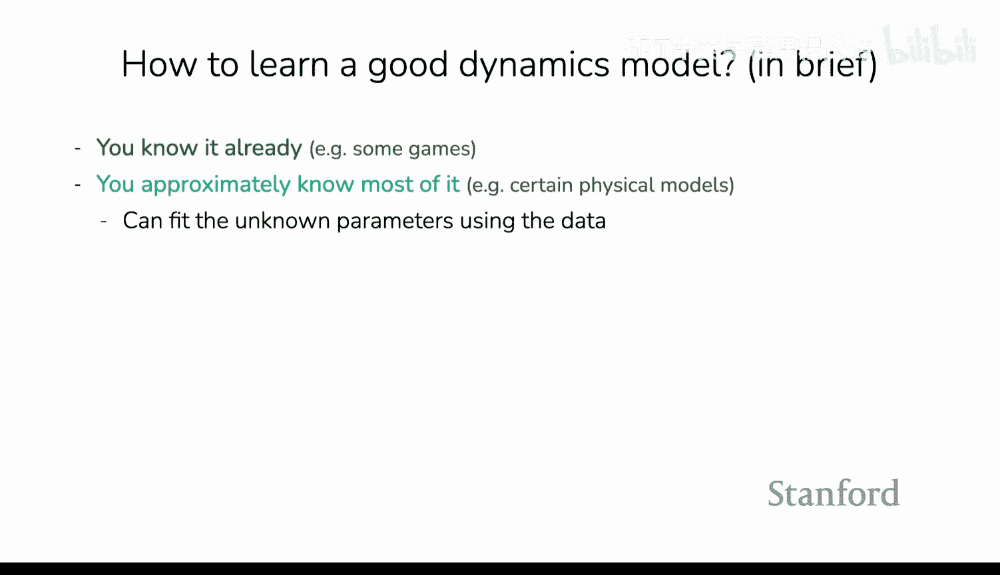

I think one of the cooler ways to try to incorporate domain specific knowledge into reinforcement learning algorithms。

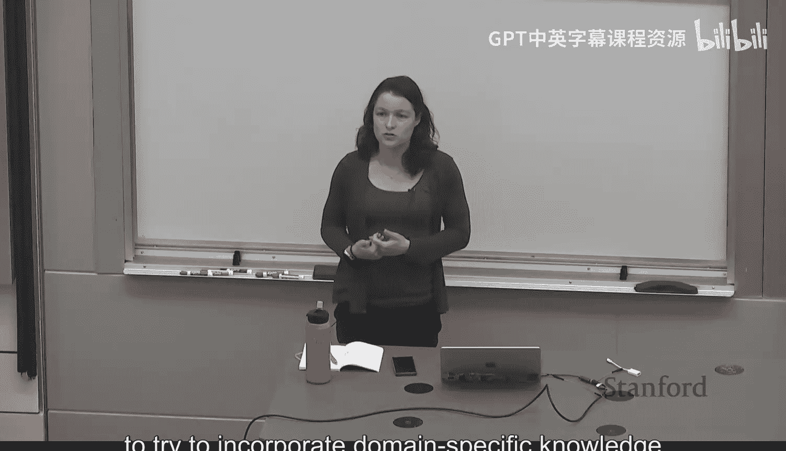

And then。In almost all scenarios of practice， you don't really know the model。

 And this might be because you can't， for example， if you're trying to like manipulate some objects。

 maybe you kind of know roughly the laws of physics。

 but you don't know like the vast majority of like how an object is going to behave because it has lots of different properties and there's many different objects or you don't know how people are going to interact in the world or other drivers are going to behave in the world and so forth。

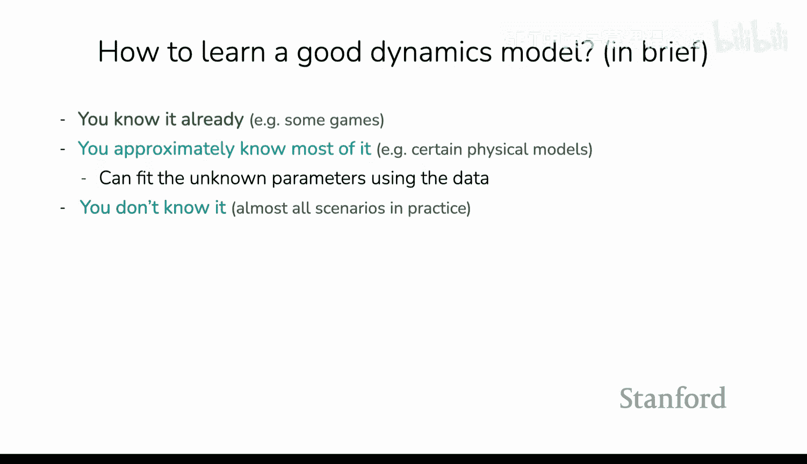

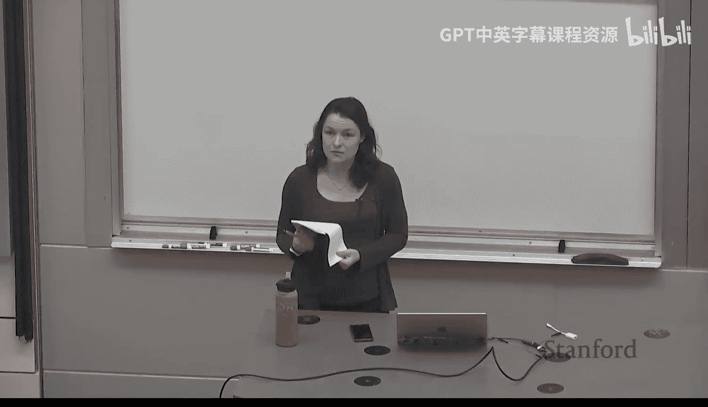

And in these scenarios， the typical practice is to learn the model。

From scratch with a neural network or some other function appxiator。U。Now。

 there are a couple options here as well。 So the。

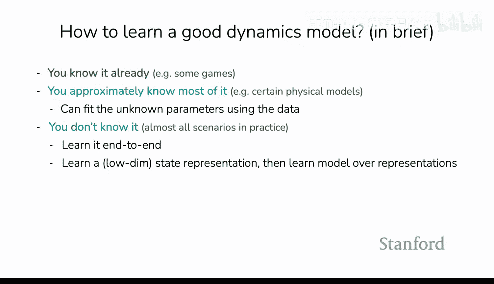

If you are using like image observations， for example， and you're trying to predict like。

Like if your state space， for example， is like an image of， I don't know， maybe this is like。

You have a car and there's like other cars here and you're trying to predict like。In video。

 like where those cars will be moving in the future。 And maybe there's like。

I don't know if some like trash on the ground or something like that。啊。One option is to。

This I'll refer to this image as ST One option is to generate like。Entire future video。

Like like the videos that we saw on the previous slide， this would be。Conditioned on。Actions。

But this might be fairly expensive to do because you have to。

 if you have to basically be predicting this entire video over time， that's a pretty large thing。

 and you have to model all the different details of how all of the pixels are going to change in the future。

And so one alternative option that is sometimes used in to learn dynamics models is instead of modeling in the image space。

You could instead learn some lower dimensional representation and then model in that representation space。

So you， for example， could learn。For a given state。

 you could learn some sort of encoder that maps this to a lower dimensional representation space。

 Maybe we'll refer to this as Z T。And then instead of learning a model in the original image space。

 we could then try to learn a model that predicts。Future ZT is like ZT plus one。U。

This can be a good alternative in scenarios where it seems like it' will be very expensive to learn a full model。

 it also has its own challenges because you need to figure out how to get this representation in the first place。

 and if you have a good way to get good representations， it can be a good place。Yeah。

 so the question was we are gonna to be losing information by going to a lower dimension and so is the main reason to do this in terms of cost Yeah and exactly so the main reason to do this is to try to reduce like some of the computational cost associated with this because you are losing you might be losing information and the key idea is that there is some parts of this observation that doesn't matter like perhaps like the exact texture of the road like whether it's like really dark black or maybe a little bit worn down in may scenarioaries that might not matter。

 and so if you can learn a representation that discards that information that's irrelevant。

 then you don't have to spend so much compute modeling all those details that don't matter。

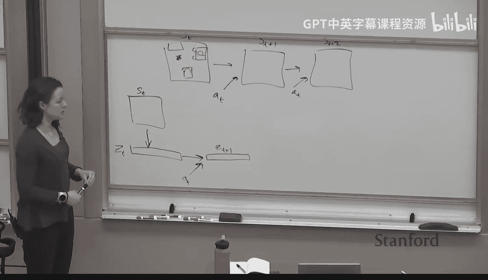

嗯。The other thing that I'll mention here is that oftentimes when you're trying to learn these models。

 typically with supervised learning or generative modeling techniques。

 you often will also need to learn a reward model as well。

 And the reason for this is that if you want to be using your model to generate data or to kind of see into the future。

 you need to see into the future， not just the states。

 but also how those predicted states will lead to rewards。

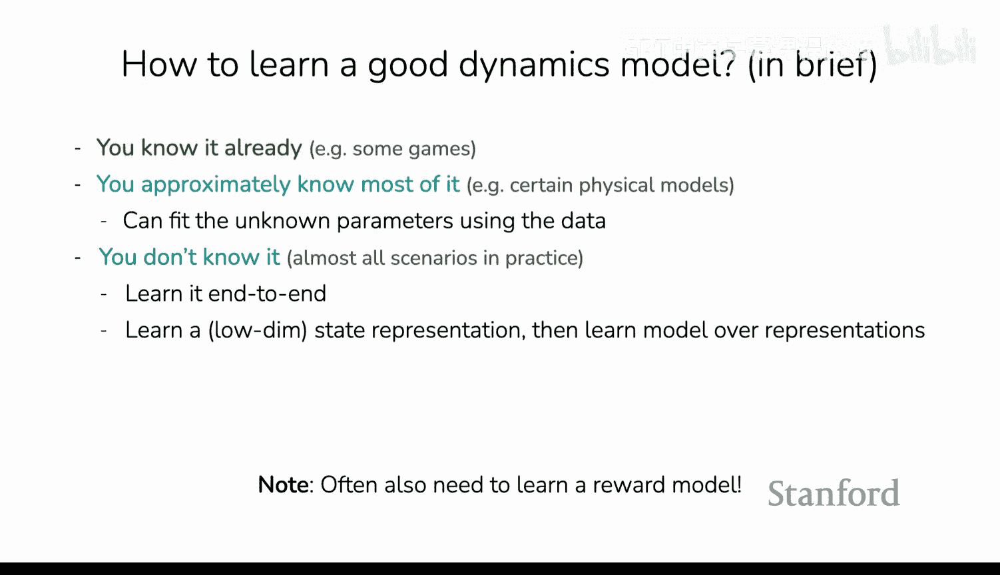

And so we'll talk about what that looks like。On the next couple slides。The question is。

 does model learning have to happen and to end， the way that it works is we are optimizing for our ability to generate future states。

And。TheThere are actually pros and cons that we'll talk about with regard to that objective。

 but you can think of it as like how well。One way to think about it is like how well can I model the distribution of PST plus1。

 given ST A。Another way to think about it， especially if you have more deterministic dynamics。

 is how well can I minimize the。The error between my predicted S T plus one and the。

Like the actual ST plus one。So how do you go about using a dynamics model。

The first approach that we'll talk about is we'll actually start by talking about planning。

 And so this actually can be a little bit different than simply running reinforcement learning inside your kind of learn simulator。

And。The way that this could work is。You can think about your MDP where you have your current state that you're in。

And then you take some action。 And then this affects your。

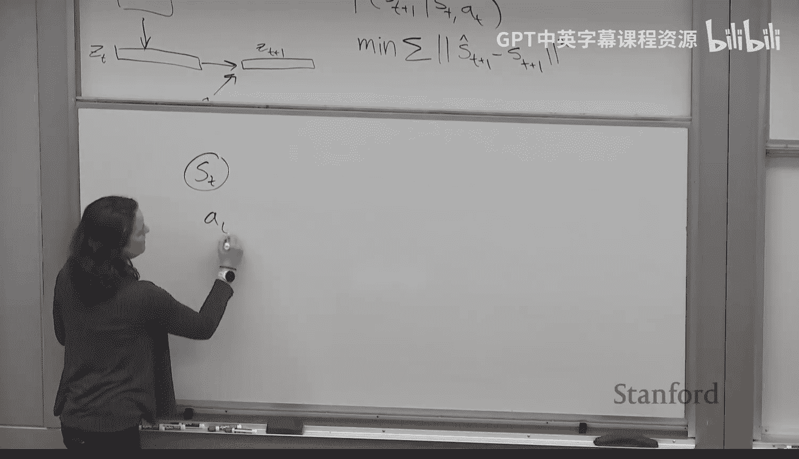

Next action。And then。As a result of that， you'll also get some。Future reward。

 And then this process will repeat。 You'll get， you'll take another action。

That influences the state after that， which will yield some additional reward。

 this reward might also depend on the action that you took as well。No， the。

Often in some of the past reinforcement learning works that we talked about。

 we kind of assumed that we didn't really know this kind of the relationship。

 We kind of don't know how。The actions affect future states。

 And so we have to figure out how to optimize rewards without using kind of direct gradients。

But if we can actually predict like what a future state is。And what a reward is based off of that。

 if we train a reward model and a dynamic model。Then we could actually just directly backproagate from rewards into actions。

And so。We could potentially kind of directly pass gradients from。

Your words into your actions and what this would look like is your objective would be to maximize the either just the current action or maybe。

The kind of next sequence of actions。For the sum of。Future rewards。 Maybe we'll do this T prime from。

For some horizon， so maybe we're optimizing for the rewards from time T to time T plus age。

So what this would look like specifically。I guess we can show it on the slides as well。

 So we're trying to maximize the sum of awards。And。

We often refer to this kind of problem as kind of looking into the future is planning a sequence of actions that will maximize rewards。

 and so if we have some model of how we predict future states and actions and rewards and if we're modeling that with the neural network。

 then we can also compute the gradients of that neural network to fact propagate rewards into actions as following。

And so then specifically， what this would look like。Is。Well， first you would。Collect some data。

Then you would train your model。Maybe that's to minimize。

F of S minus the this is your predicted next state， this is your true next state。

And then once you have this model， you could then。Find a set of actions that is actually。

 just to be explicit for this optimization， we're minimizing the parameters of our model。And then。

The third step is to try to find a set of actions。This would be AHt。T to T plus H。 This is like。

 what is the course of actions that will lead to good rewards， And this would be。Yeah。The argm of。

Of the sum of words。Yeah。哦，什么题。And this is over。Okay。

So you might this is run ingredient gradient decent on actions is a little bit like back propagation to actions is a little bit different from the typical back that we look at。

 So oftentimes when we run back， we're doing it with regard to parameters of a neural network here we're actually back propagating into these actions right here。

And so specifically what this kind of third step would look like is you would。嗯。You would need to。

Basically， like。Initialize。Just like you randomly initialize your neural network parameters。

 you'll need to initialize your actions。Then you need to compute your gradient。So this would be。

The gradient。OfThe sum of words。With respect to。The actions that you take。

And to compute this gradient， this would be， you can think of it essentially。

 if you use the chain rule， the gradient will be。The sum of rewards with respect to。The states。Yeah。

So that would just be based off of your reward model。 and then you'll have。

That if you apply the chain rule， you could then have a second term that's D states D actions to actually get the gradient of the rewards with respect to the action。

And then once you have your gradient， then。You could use it to update your actions with gradient descent。

 And so then。Maybe this is your initial A hatt。A hat T to T plus H。Is going to be your previous。

A hat。Minus alpha times this gradient right here。I'm going to put this separately。😔，Yeah。

 great question。 Actions would be continuous in the setting。 Yeah。

 we'll also look at scenario where we can do it with with discrete actions as well。

We're assuming wordss are deterministic， but we've actually always assumed wordss are deterministic。

 And you can have， you can consider any sort of nondeterminism being encapsulated by the dynamics and in the state variable。

Correct， yeah， so here we have a dynamics model。 And I， yeah， I guess I didn't explicitly write this。

 but。RightYou also need to have you would also be trading some reward function。

 maybe this is like Rci， for example， and this wed be using like some of the reward learning techniques that we've talked about there's also some scenarios where you might know the reward so it might be for example。

 like forward velocity if you're trying to learn how to walk or some distance to some goal that sort of thing and in those cases you don't need to learn the reward function。

Yeah， so the question is if your dynamic model is stochastic， how do you backpro through it？

That gets into。A lot of。The like it kind of depends on how you're modeling the stochasticity。

 So if you're using a Gaussian， for example， there are certain tricks for differentiating through samples from that Gaussian。

 whereas if you're using something like a diffusion model， it would look a bit different。

 So the it is kind of model dependent and so far。We're talking about determin models， yeah。Yeah。

 so I， so the question is， will this like start to exploit errors in the reward？ Yeah。

 so this will start to exploit both errors in the reward， but also errors in the dynamics model。

 So the， if your dynamics model is inaccurate or if your reward model is inaccurate。

 If either one of them is inaccurate then you might get actions that aren't actually going to take good actions in the world。

 and。That's a problem， and so we'll talk about that in a second。Yeah， so this is a good question。😊。

I guess instead of repeating it， I think what would be helpful is we aren actually learning a policy here。

 and that's essentially what you're pointing out and。And this is essentially this is now。

 this is like becoming our policies， quote unquote， this is like our behavior。

 And the did I have a good term for this。 I guess I mean， yeah， this is like sort of。The policy。

 in quotes and。This is what we call planning。 where at every single state。

 we're actually going to be planning forward and thinking ahead。

 like what are the actions I should consider that I think will lead to good reward and。

And to be doing this optimization process every single state。When we're doing planning。

So on the slide， are be writing some policy to collect data。

Learning a model to try to be able to accurately ball the dynamics。

 potentially also learning a reward function as well。

And then we'll be back propagating through the reward and the dynamics in order to choose actions。

And then once we choose those actions， we'll be then be executing these actions in the environment。

 and then after we execute those actions， we'll then be rerunning this planning process again。

 so in particular， I guess maybe to explicitly write that out we'll have a step four here that is to actually。

Execute。A hat T to T plus H。 And then you will kind of。

Then kind of move on back to step three after you've executed these H actions。Yeah。

 so the question is， we are only planning over a horizon of H。

 and what if we have an infinite horizon。In principle， you can like the math kind of， well。

It's a good question。So we'll talk a little bit about this for now。

 we're going to be only considering this short horizon planning。

And like in like eight inch slides or something， I'll talk a little bit more about what happens if you want to do infinite or very long horizon things。

 and we'll also talk about some of the shortcomings of。Okay。Now。

 so far we've been talking about like we talked about kind of gradient descent for optimizing actions。

And this is actually not the only way that you can do optimization。

 so it's probably the optimization technique that you're most familiar with because we use it all the time for neural networks。

 but there's other ways that we can optimize a function。

 specifically when we're trying to optimize the sum of rewards。

And if we think about gradient based optimization， typically we have something that we're trying to optimize over in this case it would be we're trying to be optimizing over actions and the thing that we're trying to optimize is the sum of rewards。

Maybe。Yeah， and so。Actually， also， it is small mistaker。

 There should be a plus sign because we're maximizing， not minimizing。

So the way that gradient descent works is you kind of randomly initialize some action like right here。

 And then you evaluate the gradient at that position。

 So maybe you find that the gradient is like pointed like this way。 and then。You then say， okay。

 I should move probably over here。And then maybe you sample this。

 you choose this action because that's kind of a step size away。 you evaluate the gradient there。

 and you find that the gradient maybe looks something like this。And then you say， okay。

 maybe I should move further to left but a little bit less because the slope is less steep and then you get maybe something that looks like this and you're like。

 okay Im the gradient is0 and so maybe I won't be sampling any further actions and then your final choice after writing ingredient gradient descent is this value right here。

Now， an alternative way to try to do a kind of optimization is instead what I'll call sampling based optimization。

 is is also called gradient free optimization。And the way that this works is if you have some set of actions and some sum of rewards。

You， instead of just starting from one place and evaluating the gradient。

A we're actually not going to use the ingredients at all。

And we'll just sample a bunch of actions and see what the values are。So maybe we'll， for example。

 sample like this a， we'll sample this action， maybe sample this one。

Maybe sample this one and so forth。And。The first version of kind of a sampling based method could just be to sample a bunch of actions。

 a bunch of things in parallel and then pick the best one。

This is is basically just called random sampling， sometimes it actually works like better than you think it might do。

 and if we were to do that， then we would say that okay。

 this action has the highest and so maybe I will kind of return the corresponding action for this value。

But you can also do something a bit better than that， even without gradient optimization。

Which is that you could look at these samples and say， okay， it looks like maybe like。

Maybe we have one more， one additional sample thing that we've Maybe we've also like sampled something like this。

And in that case， one thing that we could do is instead of just considering this one and taking the best is we could say maybe we should sample more over here because these are the ones that were the best。

And so we could fit。We could basically try to sample more from the things that were good。

 so we could take the ones that were the best fit some kind of distribution over those like a simple distribution。

 like a Gaussian。 say okay， these were the actions that were the best。

 So maybe we could fit some Gausian or sample more from the actions here。

And then do another round of sampling from that new distribution where now you're going be sampling more from this distribution。

 you find that like when you sample for a second round， maybe you get。Samples that look like this。

And that allows you to hone in on what a good action might be。So on the slides。

 I did this on the slides。 instead of with actions and maximizing rewards。

 I did it with parameters and minimizing some loss function。 but all the ideas are the same。

So for gradient descent we。Pick an initial value， evaluate the gradient。

 move in the direction of the gradient and repeat that process。

 There's some underlying function that we don't know。 and I。

And so we're trying to get to the minimum of that function using these gradient。And likewise。

 with sampling or another way to call this is a zeroth order optimization。

 we're instead going to be sampling points and trying to figure out what a good value is just from sampling and again。

 there is some underlying curve here that we don't know we can only evaluate samples or in the case of gradient descent the gradient of those samples。

One other nice thing about a sampling based optimization is that it means that you don't need gradients。

 so it can apply to discrete variables。 It can also apply to scenarios where you maybe know the reward function。

 something like you know， you have reward values， but you don't know what the gradient of the reward function is。

Like if it's a discrete， like one， if it's a discrete reward function。

 then getting the gradient might be challenging。Okay。

 and then to formalize this kind of iterative sampling process where we're trying to sample more from the good actions。

 One method for doing this is cross entropy method。 There's also a way to do this with well。

 if you have discrete actions， you could also just well。There's somewhat of a different process。

 but you could also just use random sampling if your action space is small enough。

So what cross entropy method is not to be confused with the cross entropy loss。

 is you sample from some initial distribution， This could be a uniform distribution。

Then rank the samples， according to their loss。To get the like， this would be the best one。

 This would be the second best， is third best， fourth best and so forth。And then take the best ones。

 like these three ones and then fit a distribution。

 like a Gaussian distribution to those best samples。And then resample from your distribution。

 rera and repeat this process。So it was basically like a very simple sampling based way to try to get。

 in this case， good actions， it's kind of a general optimization technique that can be used for any sort of objective。

No。Cool， and then after this process， eventually， after you run some number of iterations。

 you'll return the best sample that you found in the last iteration。

The question is can you also use sampling to approximate gradients Yes。

 so there is a way there's something called finite differences where if you don't have a way to get gradients。

 then you could try to sample basically points very close together and then use that to basically like look at the difference between like this point and this point and use that to estimate the gradient there's pros and cons to it。

 but there's definitely a valid approach。Yeah， the reason the question is why do I put the quotes around the policy here。

 The reason is that we're not like learning a parametric policy or we're not like learning a neural network to represent a policy。

 And there's actually like a like an optimization process underlying the policy here。

 And so typically we don't。It's a policy in the sense that it is mapping from a state to an action or a state to actually multiple future actions。

But it's often not referred to a policy， because。To differentiate it from policies that are like more like neural network like that are like more compact。

Well， you can also have like a linear function that's mapping states at actions is the main thing is that it's a process。

s like an iterative optimization process rather than some sort of like closed form。

 like here's an action for a state。Yeah， so the question is。

 can we talk a little bit about how this policy is stored so the only thing that we have learned at this point is a dynamics model and potentially a reward function and so the only thing that we have stored is the parameters of the model and the parameters of your reward model and then when you're actually trying to figure out what to do and and what actions to take like policy to follow we don't have a neural network that's telling us what actions to take instead every single time step you're thinking okay what's going to happen if I do this。

 this or this and then choosing actions that you think are good as a result of that kind of thinking process this ends up being like you're using a lot more compute as part of this process you're doing that like in real time as you're trying to figure out what actions to take。

Yeah， so we're not recording。We're not recording what we're doing， yes， right now yeah。Yeah。

 so the question is if when we sample actions if some of them are like can some of them be out of distribution。

 so yeah， when you select the distribution to sample from。

 your actions might be out of distribution compared to the data that the model was trained on and we'll talk a bit。

 we'll talk in like the next slide on how to deal with that yeah。Yeah， so the question is。

 because we're doing so much compute at test time。 if。

 if you finished computing and by the time you finish computing， the state has changed。

 how do you account for that the。Typically。I don't know if I have a great answer you。

 I think that typically when people run this in practice。

 they just try to make that compute process as fast as possible so that。

They don't have to account for the change。 I guess one thing that I， one thing you can do is。

You're kind of planning actually a sequence of actions here and so if you know that if you can estimate how long how long that computation took。

 if it took like two time steps， for example， then instead of starting by executing AT you could actually start by executing A plus3 or A plus2 depending on how yeah the off by one works and so that's kind of accounting for the fact that you have like time has moved forward the downside there is that AT and A plus1 might be different from what was actually executed and so you might be in a different state from where you thought you ended up in and so that introduces challenges and it's actually somewhat of an open research problem on like how best to handle that sort of like。

That sort of thing， especially if you're you're like basically kind of ACgriously like running this process and also like the world is evolving as well。

Okay， so。In terms of so going back to gradient， like doing this with gradient descent versus with samples。

 there's pros and cons to gradient based and sampling based。

 and this helps elucidinate why sampling based actually can be a good choice for planning。

So gradient descent is very scalable， even to very high dimensions， and it works well。

 especially in over parameterized regimes， like when you have a big neural network that's representing a function that may actually have fewer free parameters。

The downside is that requires a nice optimization landscape where your kind of gradients are fairly smooth rather than not smooth。

 I guess， with neural networks it ends up being especially because neural networks have high dimensional parameter spaces and are over parameterametized。

 kind of the pros end up heavily outweighing the cons here。

Some of the upsides with sampling based approaches is that it's really easy to parallelze。

 because you can actually。Like estimate multiple samples in parallel， whereas gradient descent。

 it inevitably has to be a very sequential process where you compute one gradient and then apply it and then compute the next gradient and so forth。

 And this parallelization can actually， in some cases， make it faster。

It doesn't require gradients if you don't have them。

 the downside is that it scales poorly to high dimensions because if you have a really high dimensional space。

 it's very hard to cover that high dimensional space with lots of different samples。

 so in one dimensions， something like this can actually work really， really well。

 but if you could imagine instead of this being one- dimensional or two- dimensional or10 dimensional。

 you have to you have to have your samples cover that space well in order to find a good optimum。

Cool， so what， what specifically what the planning approach would look like with a sampling based optimization is。

You will still run some policy and train some model like we did in the first two steps and will also be choosing actions that are trying to maximize rewards。

So。Essentially， things are the same except the way that we do this optimization problem is going to change。

Where instead of ready gradientding disscent， we could instead sample a bunch of different actions。

 imagine what will happen in the future， and what rewards will get。

 and then potentially refine our selection of actions iteratively to then get a good outcome。

And so in terms of what this looks like， if we use capital A as shorthand to denote this kind of A T to A T plus H。

 then。Version one is if we just do one round of sampling。

 then we'll sample a large number of possible action choices we could take。From some distribution。

Then。Jews。The set of actions that had the highest reward。

And then run those actions in the environment。This is。

The technical name for this is often called random shooting because you're kind of shooting out different possible samples of what could happen in the future。

 imagining the future， evaluating the reward， and then just picking the one shot that had the highest reward。

No。The kind of the， the downside and the thing that's kind of unsatisfying about this first algorithm is that this distribution may not be very good。

And so what we could do is we could use the cross entropy method where we're iteratively improving that distribution。

 where we start from some distribution， maybe a uniform distribution， evaluate。

 rank and pick the best samples that have the highest rewards。

And then ref a new distribution to those best samples and repeat that process where we're then going to be resampling from that better distribution and then evaluating those samples and repeating。

If this is paralyzed， this process actually can be quite fast if you have low dimensional actions。

 is' actually also pretty simple to implement。But like we talked about。

 it doesn't scale well the high dimensions and so it's best if you have a somewhat kind of low dimensional space that you're considering。

 this includes both H and a because the optimization that you're considering is over this vector right here and you need to be the size of this is the dimensionality of your action space times the horizon。

Cool。Let's run through an example for roughly how this would work。

Let's say that we are in this simple， beautiful environment and you are trying to maximize reward。

 Maybe you're trying to get to the highest point because the highest point you get the nicest view。

So your reward is just like the height of where you get to。 You run some policy。

 you collect some data like this。And maybe you learn that when you kind of train a model on this data。

 that when you move right， then you go higher。Because generally when you move right。

 kind of the elevation became higher。And then when you then kind of。

Try to choose actions according to your model。Then you're going to learn that you should go right。

 so you'll learn that when you're actually kind of finding actions that maximize reward。

 your set of actions will be to go right。And then。Then you'll actually execute those actions。

 and you'll go right， which is good for a bit。 You'll be maximizing reward for a while。

 And then at some point， you'll fall off the cliff。And that's not so good。

And this is because the thing that we talked about at the very beginning。

 there's this data distribution mismatch where。The data that you collected at the beginning doesn't cover the data that you are taking with your final policy。

So we have a simple fix to this。The simple fix is that when we then execute actions in our environment。

 we can then。Add those actions to our data and ref our model to that data set。

 learn a more accurate model and repeat this process。

So then this is starting to look a little bit more like a reinforcement learning algorithm。

Because we're actually iteratively collecting data， fitting a better model。 In this case。

 a dynamics model。Sampling options， choosing options to execute and running those actions in the environment。

And so then when we do this， we will then execute the actions that we planned。

 so we'll go off the cliff， then we'll learn that our model will become more accurate。

 we'll learn that if we go right past this point， we get a lot of negative rewards or we get a lot of like very low elevation which corresponds to negative rewards and then we'll be able to learn a model that goes to the top and stops。

Cool。No。There is a number of things that we could still improve about this algorithm。

And let's talk about a few of those。

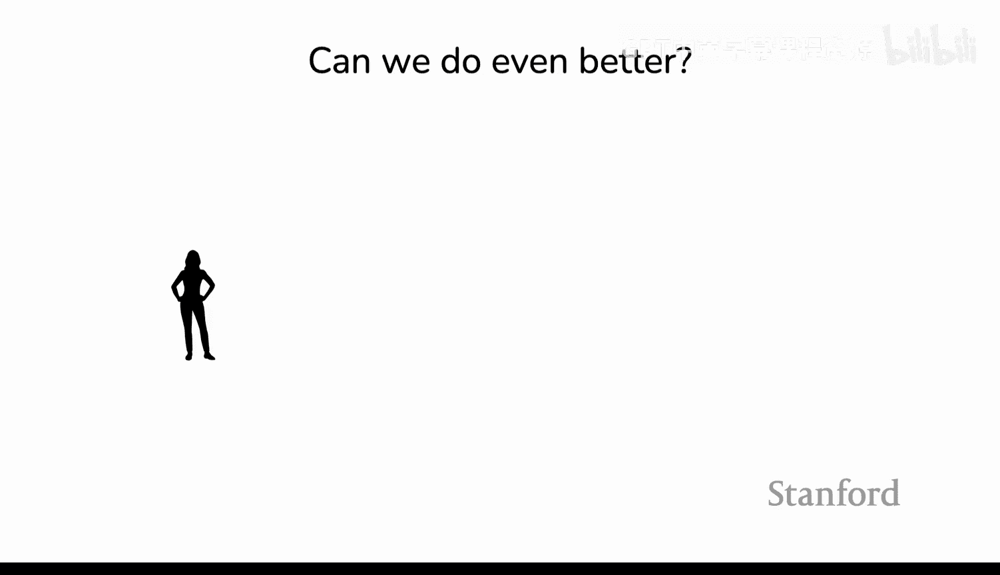

So。So far， we've been executing。This kind of set of actions right here in the environment。

 So we've been planning out a sequence of actions， executing them。

 And so what that looks like is we have。嗯。We have our agent。And our agent is like。

We're running H actions in the environment。So。Action  A T， A T plus 1， A T plus 2。

 and so forth in some environment。And we're executing those actions without actually having access to the previous kind of intermediate states。

And one one alternative that you can consider is something where at each time we're going to be planning T to8 plus H。

 but we could also have something where we plan。AT to T plus H， but we only actually execute A。

In the environment。And then we then get another， the next state back in return。

And then we replan at the next time step， a new set of actions。

And so the difference between these two things， this is often what's called open loop。Because。

You're not actually using the feedback。From the environment， the intermediate S Ts， when you are。

Executing future actions。Whereas this is often called。Close loop， because you're able to use。

 you're actually kind of replanning as you get new states。

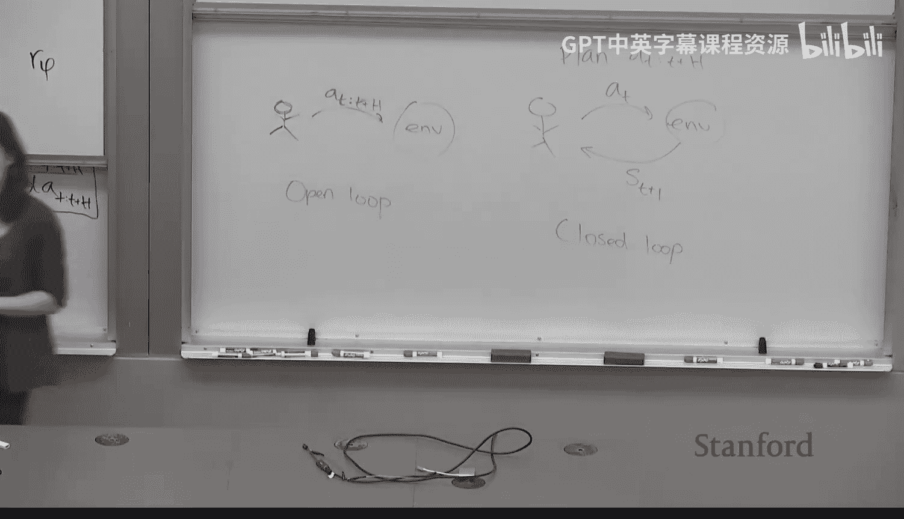

So here's what that looks like。No， I'm curious。Does anyone have thoughts on。嗯。

Like scenarios in which it might be bad to be open loop like this。

 where you're not using kind of you're not， you're only planning based off of S T and not planning based off of all of the kind of future S T。

Yeah， so when the environment is changing a lot， so if the environment changed in a way that is different from what you anticipated because you maybe weren't able to predict everything that would happen。

 then you won't react to those changes when you act in an open loop way。

 and instead if you're closed loop and you're reconsidering based off of the latest states。

 then you're able to actually react to those changes and potentially in some cases actually have a much。

 much better policy。Whereas in scenarios where the world is like a little bit more deterministic it can be okay to be a little bit open loop at times。

 but you don' you usually never want to be have A be too large。 Otherwise。

 you're executing too open loop。Now we talked about how we can make planning closed loop。Which is。

 instead of。Instead of executing the entire action sequence。

 you could just execute only the first planned action。

 So we're still going to plan on a sequence of actions because we need to consider not just the first action。

 but how all of our actions are going to affect future rewards。

 but then we'll execute only the first one。 Oberve the resulting state。

And then we will then replan an action sequence starting at that new next state。

And then we can also like before， kind of also add the data to our data and periodically ref our model based off of the latest data。

This is something- this algorithm right here is something called model predictive control。It's very。

 very common in。In certain robotic systems， like like very widely used， is's also used in。

Other kind of simple control systems as well where you can model kind of like lower dimensional systems。

It can be quite effective for legged robots as well。

 where you're trying to learn models and you're able to plan over kind of the next couple seconds to figure out what what will lead to good performance over the next couple seconds。

And this sort of replanting when you actually。Are considering a new plan at the next time step。

 If something changes or if you made a mistake， you slipped or something。

 this replaning allows you to actually consider a completely different course of action and。

Yeah and for example， correct for not just for changing environments。

 it can also actually correct from model errors。And so generally this sort of approach。

 if your model is accurate in a large part of the state space， but in some parts of the state space。

 it's inaccurate， this sort of approach ends up actually being a lot more robust to those kinds of model errors。

Yeah， that's a good question so if there are multiple correct paths the question is will in that sort kind of multimodality。

 will that lead to like oscillation between those different paths it certainly can lead to that if you're replaning all the time and you might kind of start going in one direction and then maybe say oh maybe I'll go in a different direction sometimes you also won't see that if the state kind of indicates that you've clearly committed to one direction but so sometimes you see it sometimes you don't the other way to accommodate this and also actually address computational challenges is that you can warm start your plan for any given time step to basically the plan from the previous time step and so if you planned A to A plus H and that the next time step you are planning based off of S plus1。

 you're planning A plus1 to T plus1 plus H。

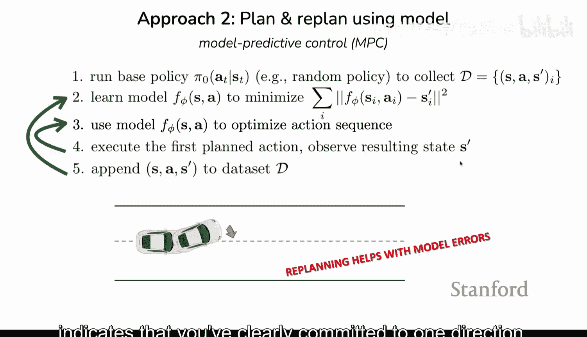

Then what you can do is you could actually warm start this using the。

Everything but the first time step of this previous plan and then you'll actually already have and then randomly initialize the lastft action。

 and you'll already have some kind of initial plan that is sensible and so you don't have to run as long of an optimization procedure。

And it also helps you commit to the previous action in the previous place。

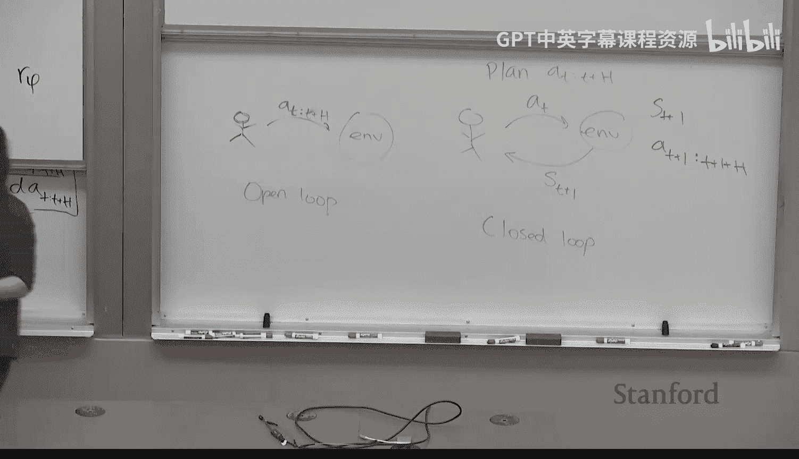

Yeah， you can instead of randomly initializing， for example， in our sampling based thing。

 you could yeah either hear or in a sampling based approach you could initialize close to the previous plan。

 you could also add some noise or add some variance to your sampling distribution so that you're not like only considering that particular plan。

Cool， so replaning helps with nondeterministic environments。 It also is really。

 really useful for model errors。😊，I。It is also compute intensive。

 So the warm starting can be helpful。If you're actually replaning at every single time step。

 it means that every single time step you're kind of reconsidering what action to take and so it also can introduce additional compute challenges as well。

 sometimes you have something in the middle where you'll have some planning horizon。

 but then maybe you'll replan not every one step but every like three steps or every 10 steps or something like that where maybe your horizon is something like 100 times steps。

Yeah， so it's interesting question so the question was like as you're learning and getting more data presumably your model is gonna to get better and you have more confidence in your model and so maybe insofar as this is really useful for correcting for model errors。

 you might be able to replan less frequently when you have a better model so that is certainly but yeah like very viable and usually at some point you will have some kind of final model that you're using after the learning process and you could kind of reoptimize you use different hyperparameters with regard to like replaning for that final policy versus during the learning process and during the learning process it can also be valuable like the model errors also help you explore to some extent because you're going be exploring exactly the regions where the model is inaccurate because you'll be incentivized to exploit in the inaccuracies。

Yeah， so the question is it seems like this is an off policy algorithm and does it make sense like how do you choose that policy so yes this is an off policy algorithm。

 we don't need to be using data from our current policy。

 you can actually use a pretty broad policy and it makes sense to use a pretty broad policy because then you'll get a model that's accurate in more places assuming that your model is expressive and can fit that broader data distribution。

O。So far we've covered planning with models， so we plan a sequence of actions we can do either with gradient descent or sampling。

We then update the model using data collected through this planning process。

 and we could replan to help account for mistakes。This is a pretty simple way to use a learned model。

It's also one of the things that's like， I think really cool about this is if you have a model that's quite good。

 you can actually plug in different rewards or different goals at test time even and get a policy that can follow like that can like for example。

 if you have a model that's good at like like universally good then and you have a robot that's trying to walk then with that same exact model。

 you can use this process at test time and say I want you to run forwards。

 I want you to walk backwards， I want you to the crouch and this kind of model is。😊。

Is quite task agnostic。The downside is compute intensive at test time and so you need to account for this and if you have an model an expensive planning process。

 this kind of planning at test time might not be suitable。

And the last thing is we've been talking about this for short horizon problems。

 this is not applicable to long horizon problems unless you have a shaped reward function。

If you have a shaped reward function that is telling you a lot about what a good state is versus what a bad state is。

 for example， maybe you have an infinite horizon problem that you want to walk forward forever。

 you want to learn a policy that can walk forward forever。

 but you have a very dense reward function that's like forward velocity。

 then you can plan for a short horizon in a way that approximates the long horizon problem。

But if you have a long horizon problem that doesn't have a very dense reward signal。

 then this is not a good approach。Cool， and part， part of the reason for this is。Is the accuracy。

 the model。 Another part of this is that it's very like it's going to be expensive to be planning out a very long horizon sequence of actions because you're not like you're not learning a policy in this。

Okay。Now， the question is， can we train a policy using this model？And。

TheThe first option here is you could actually distill a planner's actions into a policy so you could store these actions and then train a policy to match these actions。

This would this would address the compute intensive problem。

 and this would make it a lot cheaper because then you just need to run a forward pass through the neural network to get your actions。

This doesn't address the horizon problem， though， because we're still going to be using this procedure to optimize for actions。

And then in terms of handling using models for longer horizon problems， there's two main solutions。嗯。

The first solution is that。Right now we're optimizing for a sum of rewards。From T to T plus H。

And if we want to optimize for a longer horizon of rewards。

So far we the way that we would have to do that is by optimizing over a longer horizon of actions。

 which gets higher and higher dimensional。But another thing that you could do is that if you have a value function。

Or like an estimate of a value function。 Then you could actually use that value function to help this process where instead of。

Trying to maximize the sum of rewards for the next H time steps。

 you could optimize for the sum of rewards for the next time steps plus your estimate of the value of the state that you end up at after taking those H actions。

And so。This would end up with an algorithm where you're learning both a model and a value function。

 and then you would be running this planning process。

 you'd be considering a bunch of different actions over some horizon， and then past that horizon。

 you're just asking your value function， is that a good state or a bad state？And so this is。

A valid way to combine planning with value based RL in order to select select actions。Yeah。

 so the question is， why， why use the model， why not just like use a Q function， for example。

This is why I didn't want to spend too much time on this method is that in this case you are learning a value function。

 you have to learn a value function and a model like you're learning a lot of different things and there's a lot of moving pieces there is still some merit to using this and for example。

 if you know the model then you're gonna to get a better estimate of future rewards than your value function and so you can actually get a lower you can actually use this to kind plan out future actions like in games。

 it's actually really common to kind of do kind of these rollouts through your model of the game and then to the extent that it's computationally feasible and then use your value function just because it's gonna to reduce it's gonna be more accurate it's give you a better estimate of how good your action is but it's only if you have a really good model or if it's practical and not too difficult to learn a good model。

And then。The other approach。Which I'm thinking。We don't have too much time。

 and so I think I might cover this second approach。On Friday。

And then then kind of the go through the case study。So。Let's talk a bit about the。

Let's talk about this case study。 So this case study is actually going to be an example of using planning。

For dexrous manipulation。And the reason why I want to cover this case study briefly is that in my mind is actually still one of the most impressive robotics results with a five- fingered hand。

 and it also has some pretty nice comparisons that are elucidating about what is important for good performance in model based or LN planning。

So the way it works is the states are the position of the hand and the position of objects。

This assumes that you know kind of the 3D position of an object。

 which you can estimate with a computer vision system or put like motion capture markers on the objects。

Whereas the hand position you can use like sensors in the hand itself in order to measure the hand positions。

 the action space is to control a five finger hand。 It has 24 different joints that you can control。

呃。And the word is to target some kind of object trajectory where there's also some penalty for dropping the object。

The model， it's going to be actually pretty simple。 There。

 the model is going to be a neural network with two hidden layers of size 500。

 but it's also going to train an ensemble of neural networks。

And this is something that I kind of an example that I wanted to look at because this kind of enssembling approach can also help with model errors。

 And the way this works is instead of just training one neural network。

 you'll train three neural networks with different random initializations and different kind of mini batch sampling。

Just with different random seeds。And then if one model is like very optimistic about what will happen。

 that can be counterbalanced by like errors in other models。 And it essentially gives you a way to。

Together。Deal with the fact that models will have different errors in different ways。

So you're not going to exploit the errors in any one model。And then the planner。

 it's a modified version of the cross entrytropy method。

 so it can be using iterative resampling of the actions。And。

Its the modifications are that it's going to use this kind of softer reward weighted mean。

 and it does some sort of temporal weighting on the actions to encourage and search over actions that are taking smoother trajectories。

But you can basically think of it as like cross entry method or this kind of iterative sampling based optimization。

 and then they alternate between in step one collecting 30 trajectories and updating the model。Okay。

 so then in the simulate experiments， we are going to see comparison to some model free methods。

 methods that are not using a dynamics model， we'll see softte or critic in an algorithm called natural policy gradient。

 which is a policy gradient method。And then we'll also see some model based methods。

 so the proposed method is called PDDM。We'll also see an algorithm called MPPO。

 a different kind of planner called pets， and then also a method that doesn't use ensembles and doesn't use iterative resampling。

And here are some videos of what you're able to do with this method。

 so we're running planning in the loop of actually execution。And。

We see that it' able to learn how to rotate the bowing balls in the hand and also write digits on this piece of paper。

And we see that if we plot the kind of reward where hire is better over the number of data points that are collected in order to fit the model or in the policy in the case of model free methods。

 we see that first for this really complex task， only the proposed method is able to solve it because it's really challenging。

And we also see that some of the methods that， for example。

 don't do iterative resampling that for example， just do random sampling shown in yellow。

 get very poor poor performance because you're not able to get to a good part of the distribution and hone in on good actions。

And in the case of handwriting， which is a little bit easier。

 we see that some methods are able to get good performance like S and natural policy gradient get high performance。

 but they need far far more data than this model based method which is shown in green。

 and so the model based method is using like maybe on the order of 100，000 time stepss of data。

 whereas the model free methods are using like half a million time stepss。

So it's a lot more efficient than model free methods。

 it's also more performance than other model based methods。

 We also see that the model needs to be sufficiently large。

 You also need this ensemble for good performance and there's different tradeoffs with regard to the planning horizon so you don't want to plan for too long into the future because that's too high dimensional。

And then they also did it on a real hand using the method that we talked about。

Data efficiency is really important for fragile hardware this robot hand is very fragile there actually is one at Stanford in the Gates Build and I think all the students are like afraid to touch it because they don't want to break it and then they have to figure out how to fix it because it's also really complicated。

😊，呃。And the success rate for 90 degree turns is actually around 100% after just four hours of data for 180 degree turns。

 which is a bit harder， the success rate is a bit lower。

 but you're still able to make significant performance with four hours of data。

 they also had the they reset the system when it dropped a ball using another robot like this setup up。

Cool， that's it for today， next time we'll cover the last part about Model based R and arel with multiple tasks singles。

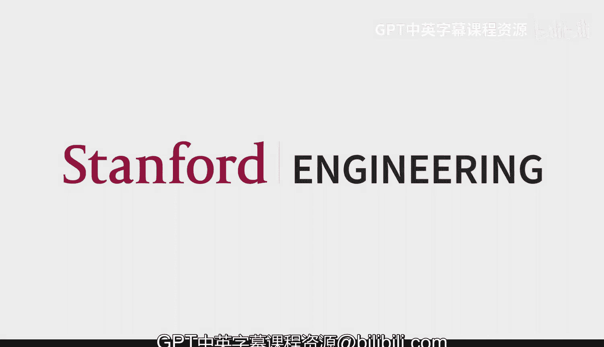