# 斯坦福大学《深度强化学习｜CS224R Deep Reinforcement Learning  Spring 2025》中英字幕 p12 -12- Lecture 12_ Multi-Task RL.zh_en -BV1SvmxB3E5e_p12-

Now， let's get started。 today， we will be finishing up model based reinforcement learning。

 specifically a way to use a learn model with synthetic data generation and when to use model based reinforcement learning。

 And then we're going to be talking about multitask imitation learning and reinforcement learning。

 including ways to on tasks，😊，Different tasks as goal reaching tasks and an approach called hindsight relabeling。

 which you'll be re implementing。So let's get back to modelbased reinforcement learning。

 so last time we talked about a scenario where we learned some model。

 that model could be a deterministic model it could also be modeling a distribution over over next states and in particular you could think about it as trying to approximate the distribution over the next state given the current state and action and you can use this model to actually kind of predict what will happen in the future and for example if you have an action that you think you might take or multiple actions you think you might take。

 you can use this estimated distribution to generate or imagine what might happen in the future if you were to take those actions。

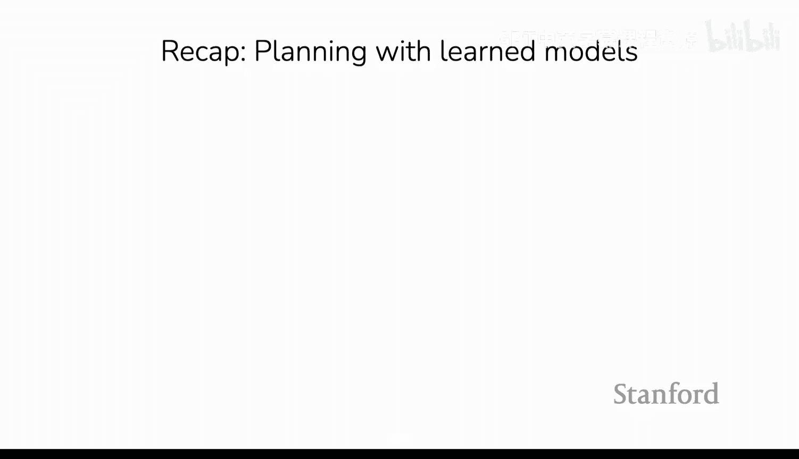

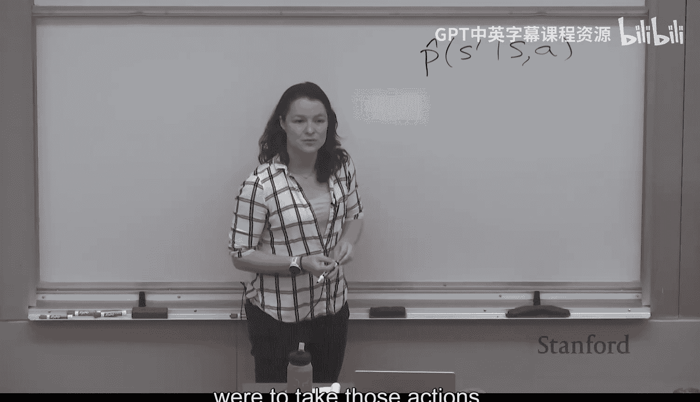

We。Talked about an approach to behavior that's quite different from learning a policy where we're not actually explicitly learning a mapping from states to actions。

 and instead on the fly， we are thinking through for a given state what actions we should take。

 we call this planning。And we talked about how this sort of planning can be done with gradient based or sampling based optimization over your next future horizon。

And we also talked about how it's important to update the model using the data collected。

 because then you'll be able to actually learn a better model in the realms that you want to use that model。

And then periodically， we also talked about how you can replan to help account for mistakes。

 account for errors in the model and and also react to changes in the environment。

Cool the pros of this sort of planning approach is that it's simple。

 It's easy to plug in different goals or rewards。 If you have a general enough model。

 possibly even a test time。 And the downside is that it's compute intensive at test time。

 It requires a lot of test time， compute at inference time。

And this particular instantiation was only practical for short horizon problems or for very shaped wars where you can plan over some shorter horizon rather than considering like an extremely long horizon。

嗯。And the reason why short horizons there's kind of two reasons why it is only applicable to short horizons。

 One is that as you increase the horizon， it becomes even more compute intensive。

 And the second reason is that the model is not very accurate when you try to apply it multiple times to generate a long trajectory。

嗯。Cool， now there's a second way that you can use these kinds of learn models。

 And that is to learn a policy。And so that's what we'll talk about right now。

And the key idea is that we could actually use this model of the future。

 this kind of learn simulator to augment any sort of data that we've collected。😊。

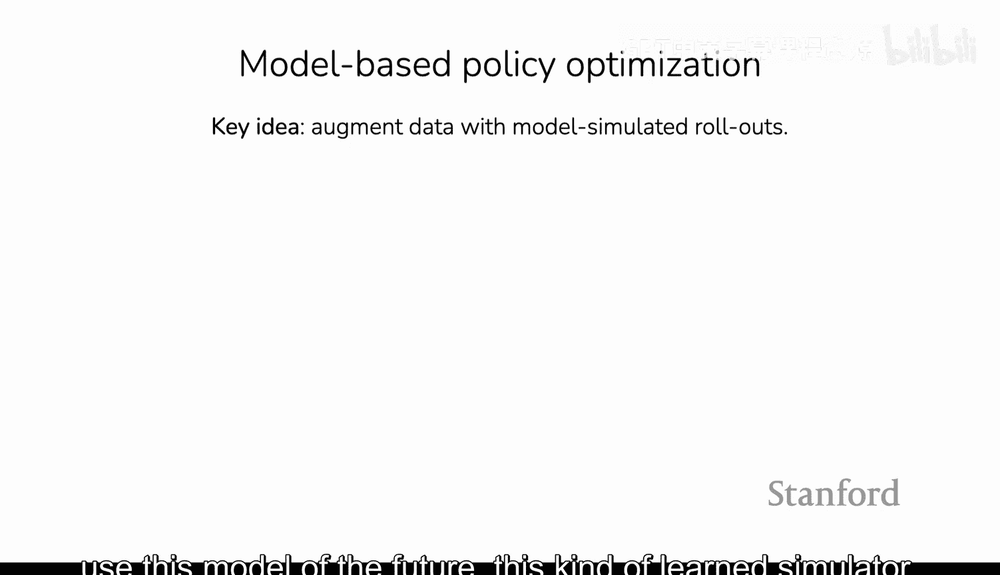

So say that in the real world or the real environment， we've collected some data。

 So we have some trajectories。 Some of this data could also have been provided to us in an offline data。

And so maybe your。The data that we have in the real environment looks something like this。

Does anyone have thoughts on how we might use。Our like ways in which we might want to use our learned model to augment this data set right here。

Like how would we go like procedurally， like what would we do to try to generate synthetic data？Yeah。

 so the thought there was that you could take， you said you could take the last state and then generate more from there so you could add on to your。

Like the last state here。That's one thing you could do。 Other thoughts on things you could do， yeah。

So something like dagger， where you take the first part that's run by the policy。

 and then the second part that's kind of from the model。 So it's kind of similar to this。 maybe。

 but maybe you do it earlier， Is that what you're saying。Yeah。

 so you don't just have to start at the end。 You could also start anywhere in the middle as well。

 So you could， for example， generate kind of trajectories from really any sort of state in your buffer in your data set。

 and then if you were to do something like that， then you would。Kind of be able to generate。

Data that looks like this where everything that is in red is kind of synthetic data or data that was imagined using your model。

 and then everything in black is the real data from the environment。Now。

 one thing that we talked about before is that our model is not。Is not very good to be like。

 you can't really trust it if you're to make a really long rollout。

 And so one thing that you can do is。Keep these trajectories very short。 And so you could actually。

 like instead of having these be almost as long as your original trajectories。

 you could actually change them to be just little short。Rollouts。That look something like this。

 and that basically add a little bit more coverage around the trajectory in your data。

 And so that would look kind of something like this。

And that's often something like this picture is often more like what people find works really well in practice because of inoccuracies in your model。

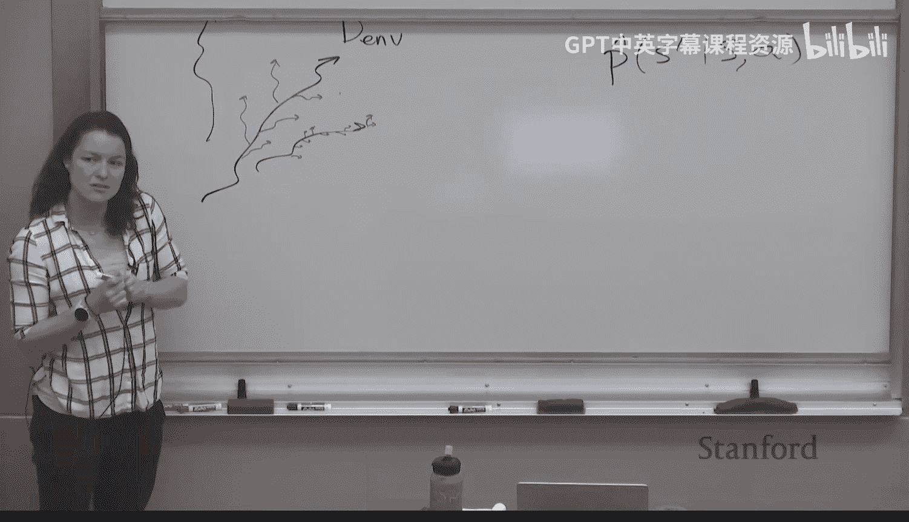

And so kind of specifically， say we have some example， real trajectory。Then。

Maybe the first way that you could think about creating data。

 maybe wasn't the first way that you guys thought about it。

 But one simple thing you could do is just start from initial states and generate full trajectories as if it were the real environment。

 But downside there is that the model may not be accurate for long horizons。

 And so you won't be able to actually get very good state coverage if you only start at the initial state distribution and don't actually end。

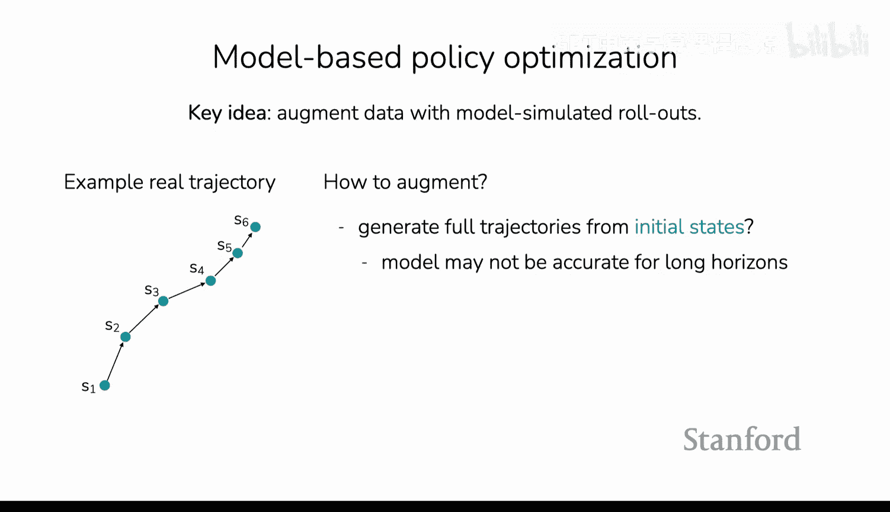

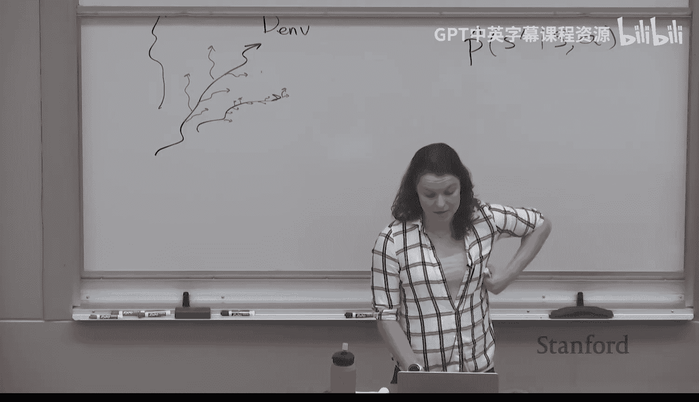

Because you only want to use fairly short rollouts。

 you can also generate partial trajectories from the initial states。

 but this won't give you good coverage of later states。

 And so what kind of one thing that kind of gets the best of both worlds against you good coverage and also allows you to use short trajectories is to generate these kind of sort of partial trajectories from all of the states in your real data set。

So then what the full algorithm looks like is you will first。Collect real data。

We can call this DN like before。And then we will want to like update our model。

Using the real data so that our model is as accurate as it can be。And then we can。Sample。

 you can generate data and the way this generation process will look like。Is first。

Sample some S from your。Your real data。 And then。Generate a short trajectory starting from S。

 where you will。Roll out your。Policy or whatever exploration policy you have。Starting from S。

But then we'll be doing this rollout inside your learned model。

And so this will be inside kind of the world that kind of is。

Instaniateated from your learned model and not in the real environment。This data will go into some。

Other data set， maybe we can。Call it Dgen for de generated data。And then， at the end。You can simply。

Update your policy using both the real data and the generated data。So。Update。排theta。Using D， N， and。

De generated。And then repeat this process。What's a misspelled real。So the question is。

 if you're only generating short trajectories， does that take longer to converge to some goal。So。嗯。

You can think of it as kind of supplementing the data that you have so far and the things that are like the things in your when you start from states that are closer to the goal from。

When you generate data there， then you'll be close to getting rewards and you'll be able to update when you're further。

 this doesn't mean that this data won't necessarily reach the goal。

 but you with reinforcement learning algorithms， you'll be able to understand like some of this data might feedback onto like feed into states that are in the data and when you use reinforcement learning。

 you can then learn that as an example， maybe you have a real trajectory that kind of takes a path that is maybe not the most direct path and then you start learning a policy that knows like maybe I should kind of shortcut this。

 then your model when you explore that in your synthetic data。

 you might actually this might actually help you learn like a better policy by using this kind of data in terms of convergent speed or kind of speed in which you'll get a good policy generally this will allow you to。

It might require generally the thing that we're often trying to minimize is the amount of real data that we need right here。

 and this will allow you to get a good policy with less real data by using these red trajectories。

Yeah， so the question is， how do we get rewards in this case， So the I didn't。

 I haven't explicitly written out here because sometimes you。

Sometimes you might know the form of the reward function， but if it。

Or you might have learned a reward function in which case in the like original R problem。

 in which case you can use that if you don't。If you didn't learn a reward function and the real world just gives you the rewards as part of this data。

 then when you train this model you'll need it for it to either this model or a separate model to also learn a reward function with supervised learning。

So the question was about compute， so this is going to be more compute intensive during training than if you were to not use this。

 especially because sometimes the models that you might be learning in some cases the models that you're learning usually rolling out through them is takes compute you're kind of trading data in the environment for compute and one of the reasons why that trade off is often favorable is because collecting online data in need real environment might be unsafe or it might just be really expensive if you have to run experiments on like physical equipment。

The unlike planning， however， this is not more compute intensive at test time because you're using this synthetic data to update a policy and then at test time you're running that policy as your final behavior。

裤。So the algorithm on the slides， we collect data， we update our model。

 This model may also model rewards by trying to mimic the data from the environment。

 Then we will collect these short rollouts by kind of。Using our model。

 starting from states in the real data。And then we'll update the policy and optionally also update any sort of value function using the aggregate aggregated data。

One other thing to note。About this is that。It is compatible with a variety of reinforcement learning algorithms。

 So step 4， you can use a variety of algorithms here。

 You can even use on policy reinforcement learning algorithms as well。 in particular。

 if you have an on policy algorithm that needs data from the exact Py theta that you're taking a gradient step on。

All that means is that Py theta has to be the policy that was collecting the synthetic data through the model。

嗯。Cool， and so yeah， so with regard to this last update here we're using both the data from the environment and the data from the model。

 There are actually also some policy updates that only use data from the model and find that that works fine as well。

😊，So you could choose to use either both or just use the data from the model。Yeah。

 so this this only makes sense when you have an estimate of the word function。 and if you don't。

 then you won't be able to update your policy on the generated data。So the question。

 is the learning stable when you use this synthetic data？Yeah， yeah。

 so you may be in a scenario where you're adding a lot of synthetic data。

 and so like how much synthetic data you generate and how you balance that data in this last update is like kind of might depend on like how good you think your model is in terms of stability。

I think that we'll talk about pros and cons on the next slide but one downside of these kinds of algorithms is they do introduce additional hyperparameters because you have to train this model and if。

 for example， your model training like for whatever reason it didn't do well then you might end up in a scenario where the algorithm performs more poorly because those hyperparameters weren't well tuned and so you can see issues there。

 but otherwise。This sort of like if you have a fairly accurate model。

 you usually don't have issues otherwise with stability。So。Let's talk a little bit about when to use。

This sort of synthetic data and when to use model based reinforcement learning。

 So generally the way to think about it is that there's potentially really big upsides with model based reinforcement learning and also potentially big downsides。

The big upside is that if you can learn a pretty good model。

 then it is immensely useful to be able to predict the future。 and you can get away with using far。

 far less real data by using the data that's generated。

 And so in domains where it's feasible to learn a model。It's really， really useful。

 You could also do the kind of test time planning as well。 And generally， I guess。

Maybe one other point that's not on the slides with regard to upsides is that it it seems like this notion of being able to anticipate kind of future states as an outcome of your actions。

 that seems like a fairly fundamental thing that our models should at least have some understanding for。

One other thing that we actually didn't talk about is there are also scenarios where the model can be trained without reward labels。

 and for example， if you have if some of your data。

 if some of your real data has rewards and some of it doesn't have rewards。

The part that doesn't have rewards， you can train your model on。

 and your model can actually leverage potentially more data than what a model free reinforcement learning method。

Can use。And so that's quite nice。 and there are scenarios where you might be able to collect very large amounts of data without rewards and a small amount of data with rewards。

And then the other thing is that the model is somewhat task agnostic and so if it was trained on a broad enough data distribution。

 sometimes you can transfer this model across different tasks or across different rewards and so for example。

 if your goal isn't just to learn one task but to learn many different tasks。

 this sort of transferability is useful。So those are the big upsides。 What about the big downsides。

One downside is that the model doesn't optimize for task performance and errors。

 because it's trying to like， for example， if you have image observations or your states or images。

 then it's trying to get the details in the pixels to line up and that for example。

 the color of the sky is like the correct color for example。

 and that in some ways oftentimes is not actually what you care about in terms of learning a good policy。

 so there's this mismatch between what you're optimizing for when you train a model and what you actually might care about in terms of downstream policy performance。

Sometimes it's really hard to learn a good model， sometimes it's hard to learn a good model than it is to learn a good policy in these cases。

 usually you don't want to learn models because you're kind of then presenting a harder problem than the actual downstream problem you might care about。

And then the last thing that I alluded to before is that it's another thing you have to train。

 And so there's more hyperparameters and it's also more compute intensive。

 And so because of these like big upsides and big downsides。

 generally whether to use whether to try to learn this kind of predictive model depends a lot on the domain and how hard it is to learn that kind of model。

Yeah， so the question is what are a few examples of the additional hyperparameters。

 the main thing is all comes down to like this step two right here。

 which is that you need to design the architecture of the model。

 of this predictive model and it might need to be a completely different architecture from the policy if you're going to be generating images or states。

 the second is that you need a learning rate， you need to know how long to train that for like how many epochs any regularization for that model。

 basically everything that might go into training a model like this。

One more thing on that previous question， beyond training this model is also hyper predators with regard to the length of these rollouts and how much synthetic data to generate。

So the question is， do we keep on collecting data after each policy update， So this is。As written。

 this is like an online algorithm。 You can actually also develop completely offline versions。

 model based Ar versions as well， where you have a fixed prior data set and you augment that data with a model。

 and then you trade a policy and you're done in this case。

 we have an online algorithm where we then continue to kind of collect real data。

 update our model and so forth。This can be done in an off policy way or an on policy way。

 so that's going to come down to when you do this update。

 is it going to only use the DN and the DG from this iteration or also from previous iterations and that's going to depend on what algorithm you use to update your policy。

So generally models are very flexible， you can use them offline on， off policy and so forth。Yeah。

 so the question is how hard is a model like how hard is it to learn a model compared to a policy。

 It's extremely domain dependent。 So the say， for example。

 you are say you're in like a maze So you're trying to learn like how to get from here to here。

 maybe there's like some walls you need to kind of figure out how to。

Kind of get through this sort of environment while and you're not able to go through the walls in this case。

 the model might be quite easy to learn you'll learn that like if your action is to go right。

 then you'll go right unless there's a wall there if you're going to go up and so forth that's really easy but the policy is really complicated because the policy is saying that okay if you're here maybe you need to like go in various different directions And so this is a case where the policy is a lot more complicated than the model and learning a model could be a good choice as another example say that you you're trying to like pour some water from one cup into like a bowl or something like that the policy might be potentially fairly simple like maybe you're already even like holding the cup in your hand then the policy might be as simple as just like rotating your wrist but the model in this sort of case might involve like。

Ld dynamics of how the water will pour and what will happen for example。

 if it hits the edge of the bowl or the center of the bowl or something like that。

 and this is a scenario where the model is a lot more complicated than the policy and it's possible that it would be in the scenario it might be a lot easier to just learn the policy without learning the model。

So it really depends on the domain。Yeah， so the question is。

 how successful has model based R all been in robotic scenarios。If you can。

If you're dealing with like highdiional image observations， it's arguably been less successful。

 if you have a more compact state space like the positions of joints and positions of objects。

 then it's been a lot more successful and like with legged robots， for example。

 you can use modelbased R pretty successful if if you if you're mostly just trying to learn like a blind walking policy。

 or if like we saw the dexterous like the hand manipulation where you knew the position of the two balls that it was also like very successful for that And I haven't trying to do modelfr Rl for that problem or even imitation learning like would be very。

 very challenging and so it's been extremely successful there in scenario where you need have image observations it gets a lot harder it doesn't mean that。

Video generative models are getting a lot better。 And so I could see a future where these。

 this sort of approach might also be。Quite successful in the future。 But right now。

 it not hasn't been super successful。The last thing that I'll mention on model based Rl is that so far。

 we've been modeling this predictive model of the future。

And there's actually a lot of other objects that you could learn。

So you could learn what's called an inverse model。 You could learn like four or two states。

 like what was the action that led to like if I were to if I'm currently in state S T。

 what is the action that would lead to state S T plus1。You could learn a multi step inverse model。

 which is that。What is the if I am going to end up at state S T plus N。

 what action would lead me there or what are the sequence of actions that would lead me there。

 This actually looks both of these in some ways look closer to a policy。

 except your passing as input some future state rather than just the current state。

These are also things that can be learned without data with rewards。

 you're kind of just learning about the environment and not about the particular task at hand。

You can predict futures without actions。 And that kind of can think about what are the affordances in my environment。

 What are the things that that could be possible to happen in the future。

 irrespective of the actions that I take。You could。Try to interpolate between two states。

 You could learn a transjoative model of transitions of S T， A T S T plus1。

 There's kind of some cool properties with that sort of model。And。

These kind of models can be pretty useful too， they have various purposes。

 there's lots of research on using different kinds of models like these。

 and so it's just something to think about in terms of like in some domains you could imagine or with some data sources。

 you could imagine some areas where these might be useful。Yeah， so the question is。

 if you use data that doesn't have rewards as part of your model training。

 is there going to be a mismatch between the accuracy of predicting next states and predicting rewards？

呃。The there certainly could be like a mismatch like that。Generally。

 rewards are a bit easier to learn how to predict than future states。 and so the。U。

Even if you have a lot more data for learning the model。

 you could actually end up in a scenario where the model is less accurate than the estimated reward。

 but yeah， you can definitely end up with scenarios where the reward is less accurate and where you need to specifically gather data for that yeah。

Cool， okay， so that's it for model based RO。 Now we're going to talk a bit about multitask learning and what that looks like and also different techniques that we can do beyond like a fairly naive and simple technique。

So what is multitask reinforcement learning？The key idea is that we want to be able to generate。

 we want to be able to learn a generalist policy that isn't just aiming to do one thing like。

Being able to pour water， for example， but they can do many different things。The examples of this。

 we might want kind of a generalist language wall assistant that can book travel for us。

 that can do online grocery shopping。We might want a legged robot that can walk， that can run。

 They can dance， They can crouch。 maybe a mobile robot that can hang up a towel， unload a dishwasher。

 wipe a spill。😊，We want a music recommender system that can personalize recommendations for one person and also be able to personalize recommendations to a different person。

Or we might want something that can play lots of different games。

 like being able to play Pokemon and Piball and floppy Bird and so forth。

And there are scenarios where if you think about each of these tasks as their own reinforcement learning problem。

 they might have different reward functions from the other tasks。

 they might in some cases have different dynamics， like the dynamics of different games。

Or the dynamics of different people， they might have different action spaces， even。

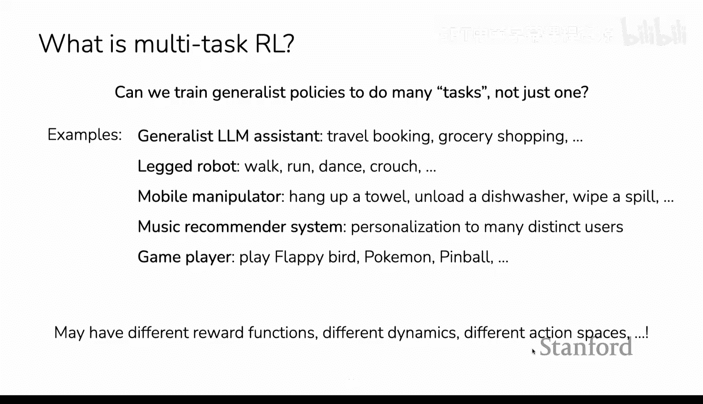

And so when you're trying to train policies across these different tasks。

 there's some considerations that come up when try to， when you try to do that。

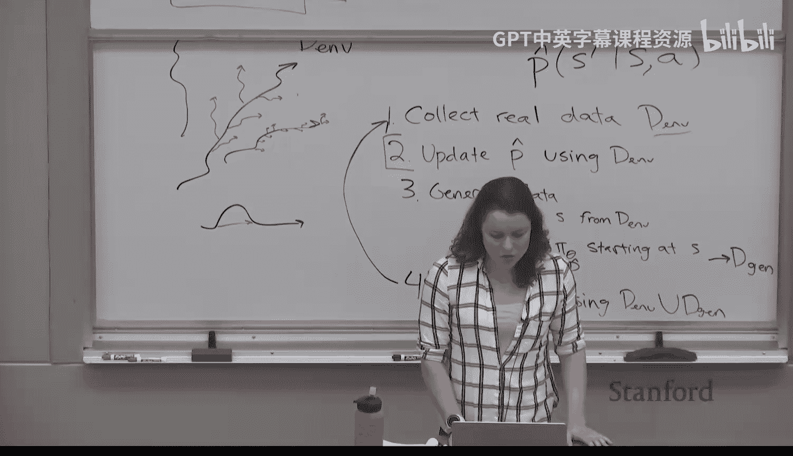

Now the key idea that we'll see is that you can， in many cases。

 just go about normal reinforcement learning， but condition on the task that you're trying to learn so you're then going to be learning。

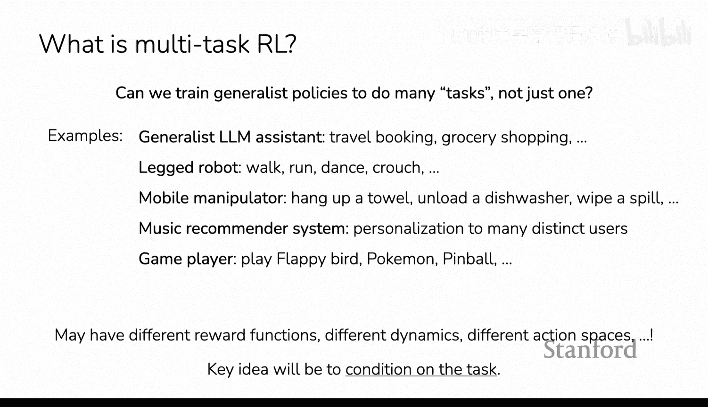

A policy that。

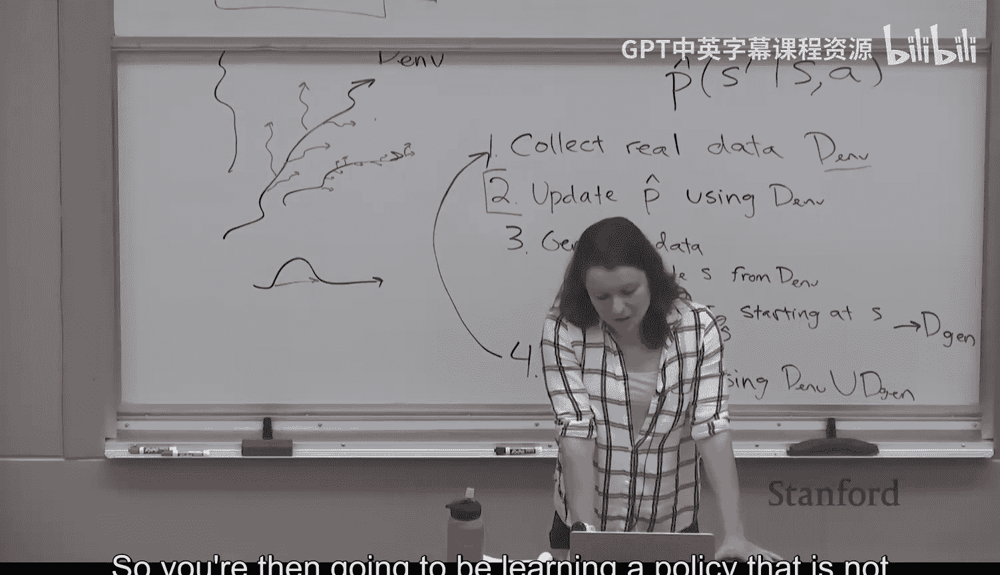

Is not just conditioned on the state， but it's's conditioned on the state and also the tasks that you want it to be performing for that state。

Now， why do we care about multitask reinforcement learning。

So if we kind of go back to a lot of the topics that we've talked about in the course so far。

 like imitation learning on policy and off policy URL， offlinearrow， model based R reward functions。

 a big topic that's recurred in many of these lectures is talking about data efficiency。

 like how much data do we need to be able to calculate a gradient that is accurate。

And if our ultimate goal is to train something they can do multiple tasks at once。

That we could actually amortize the complexity of learning any one task by actually training that policy across tasks and across scenarios。

So it could actually be a boost for data efficiency in the sense that the task。

 the data efficiency for training any one task will be lower when you're actually trying to train everything together。

 and that's because tasks are going to have some sort of typically will have some sort of shared structure。

Like if you're trying to be a language model assistant。

 there is going to be a shared structure with regard to grammar or maybe with regard to different websites。

 And if you learn how to interact with one website。

 that can teach you something about how to interact with other websites。Or like in robots。

 if your goal is to be able to like walk forward and walk backward。

 then this shared notion of staying balanced will be shared across tasks， among other things or。

If you're trying to develop a recommender system that's personalized to different users。

 then some users will share a lot of similarities， where if you try to learn to be a great recommender for one person。

 then you should also there are other people that you could also probably be a great recommender for。

And then there's also like a slightly deeper motivation as well。

 which is that when we actually try to change these generalist systems rather than systems that do one task。

 we often find that generalist systems end up being more reliable and more performant than if we were to just train on one task。

And so I think that this is like kind of a pretty cool finding that has kind of empirically been true in recent years in AI。

 and so it's extra motivation for not just training kind of something for one particular task or problem or user。

Let's maybe get into what this actually entails。 And we actually need to think about like， what。Like。

 how do we think about what a task is。It's actually not， in some ways， not very well defined。

 like what makes something a different task versus not a different task。

But one way to think about it is having different tasks just be different。Rl problems。

 different Markovd decision processes。And so each task will have a state space， an action space。

 an initial state distribution， a transition model， and a reward function。

And I'm indexing these with index I to note that this is like the state space for task I。

 this is the action space for task I， the dynamics and reward for task I and so forth。Now。

 with this definition， it's worth mentioning that when we think of the notion of a task， we。

 there's kind of some English， there's a meaning under the English word of task。

And this notion of a task being an MPP is actually potentially quite different from that semantic notion of a task。

Where you could actually have different tasks that have potentially the same reward function and only have different dynamics。

For example， the。If you're trying to walk forward on grass versus trying to walk forward on flat terrain。

 then that potentially could be considered two different paths under this framework。

 even though they're both kind of the task of walking forward。Okay。

 so a few examples of like kind of multitask problems that we might think about， one is。

This kind of personalized recommendation problem that I mentioned in this case。

 would different tasks would be different users or different people。

And different people might have different reward functions like someone might。

 if it's music recommendation， someone might really love rock music。

 another one really person really might love hip hop music。

 and also which tasks they kind of the dynamics with regard to how often they even listen to music and so forth might also change across users。

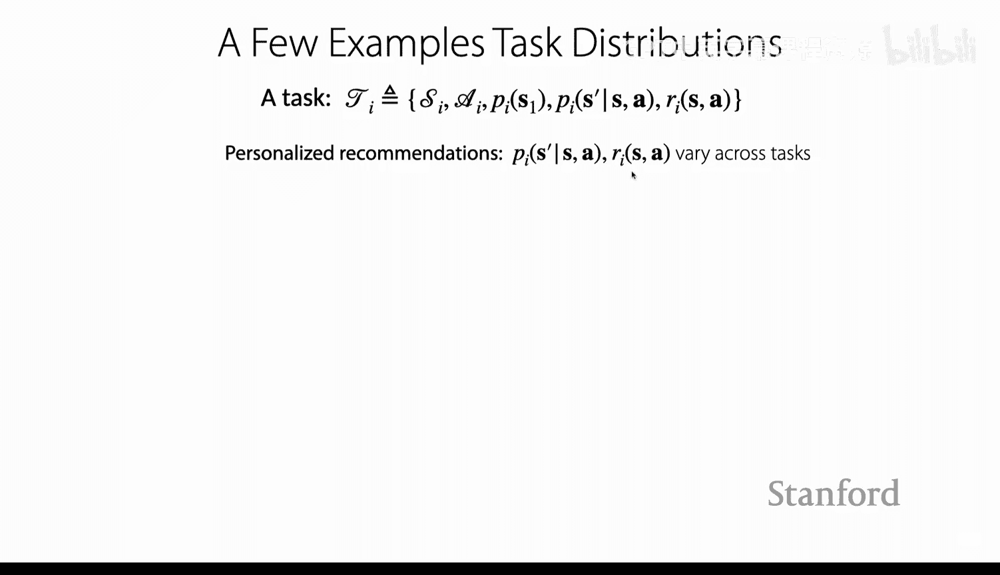

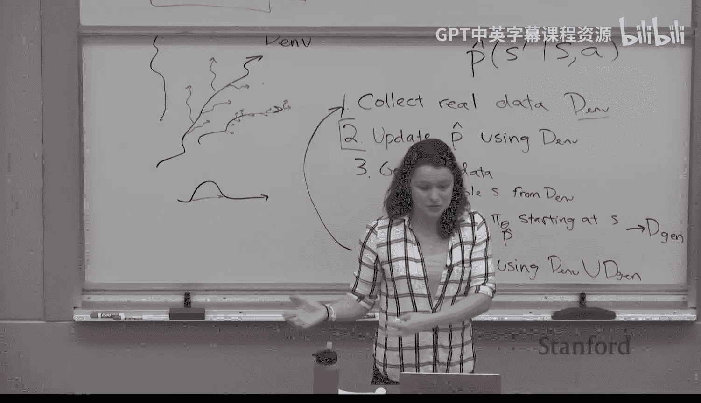

Reinforce learning has often actually， this is an application we haven't really talked about。

 but it's often used in character animation in order to actually create animations of different kinds of characters like like people or。

Or other like animated characters that appear in movies。

And you might want to learn like allow and be able to animate a character to do lots of different maneuvers。

 you might want to be able to have your character be able to do a back fliplip or to be able to run or be able to do a cartwel。

 And each of these would be different tasks。Does anyone have thoughts for these tasks。

 What is the thing that would vary across tasks versus B fixed across tasks。Yeah。

 so in this scenario， the reward will vary because in one case you want it to run。

 in another case you want it to do a cartwheel and the dynamics or the physics of the simulator will stay the same。

U。Cool， there's also been like works that's trying to do character animation involving like different like garments。

 so like a character that can put on a shirt versus like a long sleeve shirt versus a dress。

 Does anyone have thoughts on what would vary across these tasks。Yeah， so the policy might vary。

 the policy will also vary actually in all of these cases for different tasks。Yeah。

 so the the kind of the physics of how a long sleeve shirt versus a short sleeve shirt will behave。

 it will vary across tasks， I think I also put the initial state distribution might also vary。

 whereas like in the first example that maybe the initial state is always like to say like start standing up。

 for example。Whereas here you have different garments in the initial state。

And then the last example I put is maybe different tasks are controlling different robot arms and maybe one robot arm looks like this with like maybe four degrees of freedom。

 this one to six degrees of freedom， this one to seven degrees of freedom。

 does anyone have thoughts on what would vary across tasks。

 tasks if one task is like to control the first robot to grasp an object。

 the second task is to control the second robot to grasp an object and so forth？

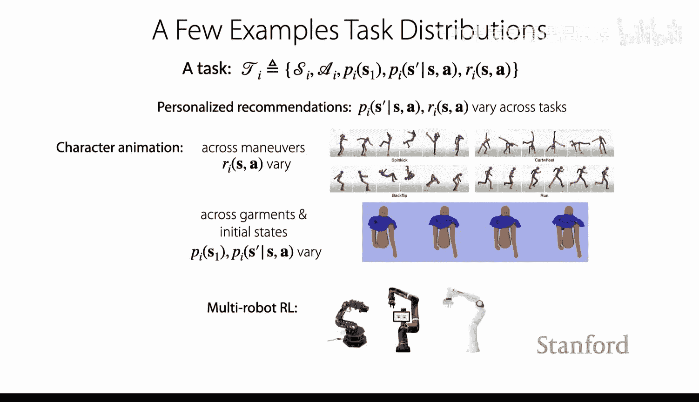

Yeah， so the actions themselves。 So you'll have like different dimensions of actions。Yeah。

 so the dynamics will also be different because when you move one joint。

 that will affect the other joints differently。Yeah。

 so the states would also vary as well so the like how you represent the arm like like that will be a different dimension。

 what the actions even are will also be different dimensional。

 and then the dynamics will also vary quite a bit as well because how how your actions affect the robot arm are going to change。

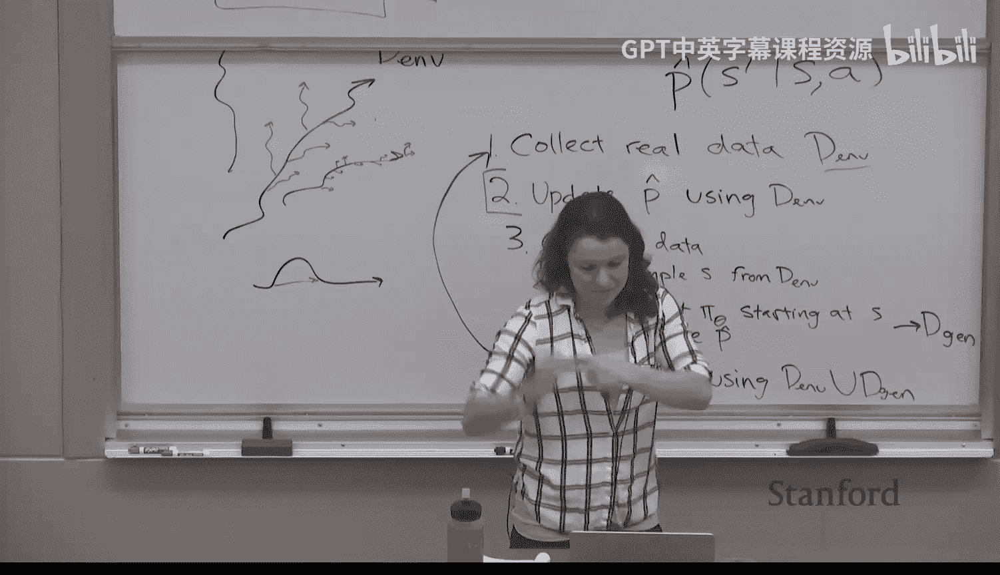

Cool， so those are the examples of like different problems where we might want to be kind of training different tasks。

The last thing is that that we're kind of missing here is we need to figure out how to identify one task from another task。

So that we can tell our policy what task it should be doing at a given point。

And one way to do this is to just assign an index。 You could say， like this robot is task 0。

 This robot is task1。 This robot is task 2， and so forth。This is like。

 if you don't have any other kind of better way to identify a task。

 this is kind of what you resort to。You could also have a language description of the task。

You could have a video illustration of what the task is。

 there's actually a number of ways to be creative with how you describe the task to the policy and we'll refer to each of these as different task identifiers so the task identifier for the task of we'll see some examples。

On the next slide。Now， once you have the task identifier。

 an alternative view on the multitask are all problem。Is。

Simply just having the task identifier be part of the state where。

 we're writing S bar as the original state。 And what this means is that before we had a kind of a collection of MDPs。

 that's kind of what's written at the top。

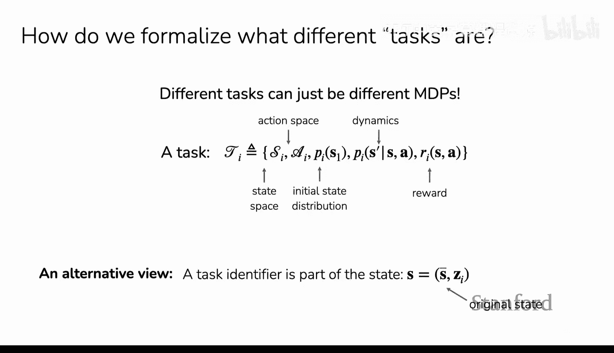

And we can actually construct。诶。We can kind of construct a single MP that actually covers all of the tasks。

 So the。We have， for example， the。Like PI of the initial state， P of S prime given S and R I of S。

 and this is like the dynamics and the reward for each task。呃。And。

We can kind of think of it as like our goal is to solve all of the MDPs for each of the tasks。

But we can also think about it as just a single MDP where the the state is now defined as like。

 maybe this is like the。Original state space of these tasks。

 and the state is now defined as like the original state space。And the task identifier for that task。

 and then the reward function， for example， in this modified MDP。

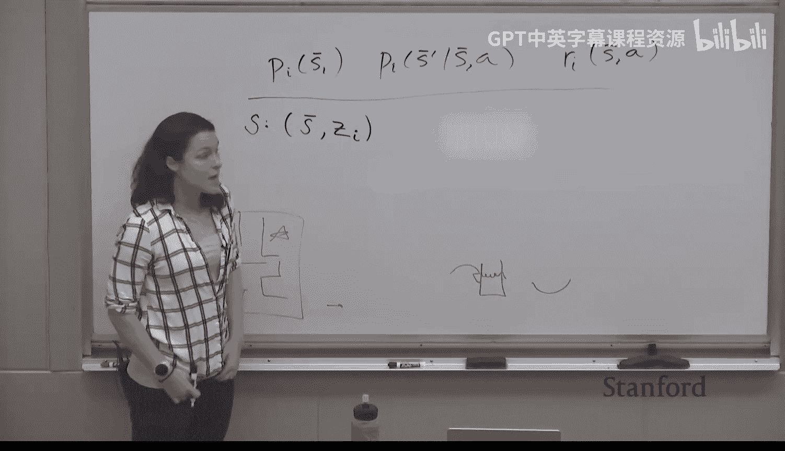

That's just a single MP for all the tasks is then going to be。A。Equal to， let's say。

 just to be explicit。The reward for。For this state。And this action would then be equal to RI of。Sbar。

A， and similarly， you can write something out for the dynamics as well where the MDP。

 the kind of aggregated MDP for。A given task。S prime given S bar。Z I。

Coma a is equal to the kind of dynamics for that task。

This gets a little bit more complicated if your tasks have different state spaces and action spaces but and so you'd have to if they have。

 for example different dimensionalities， then you need to think about how you would represent this state space in the MDP if they have the same state space and action space。

 you can basically construct this aggregated Markov decision process with this equations here。No。

If we go back to kind of。呃。Kind of what we think of as like the single task reinforcement learning setting that we've talked about so far。

 we can then kind of think about multitask R but where the task identifier is part of the state。

 where the task identifier can be the task， like an index， a language description。

 it can also be some desired goal state as well that you want to reach。

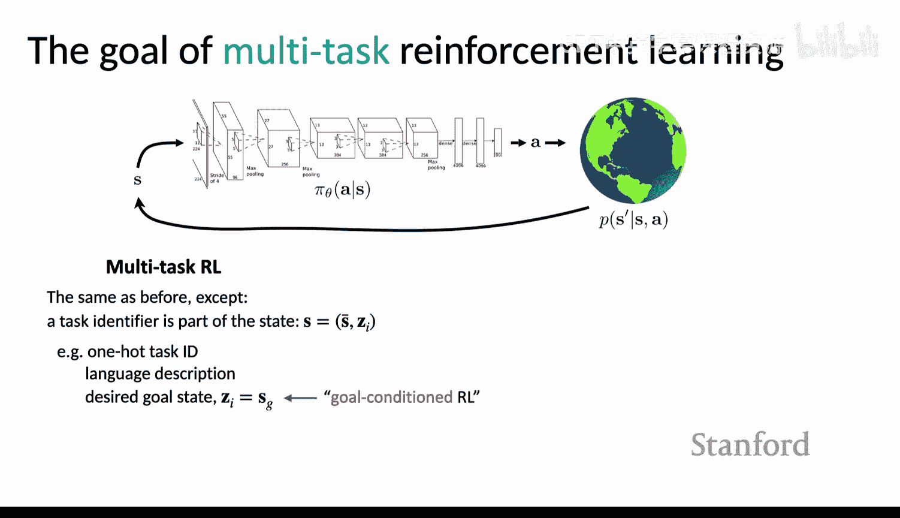

This is often referred to as goal conditioned Ral。But then once you do this。

 you're basically getting。A modified MDP that covers each of these tasks。

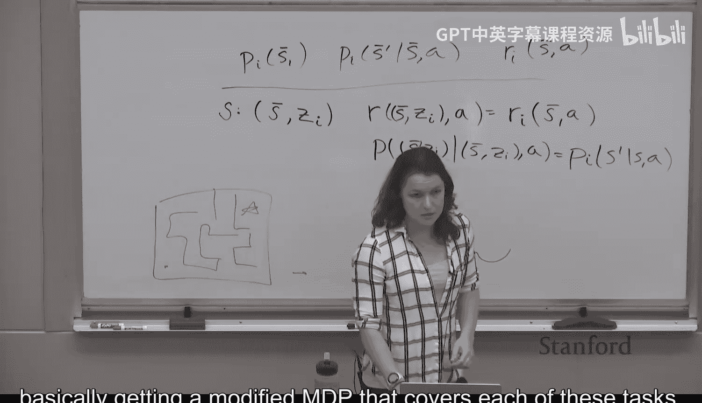

嗯。Now， in terms of the reward， like we talked about on the board。

 it's basically going to be the same as before。In this special case of goal conditionitioned reinforcement learning。

 where you're trying to reach a goal， then oftentimes you'll think about the reward as some negative distance between the state that you're currently at and the goal state。

And distance functions could be Euclidean。 It could be a sparse one and so forth。

 So we still get kind of a standard Markov decision process when we aggregate。

 when we kind of bring these tasks together。

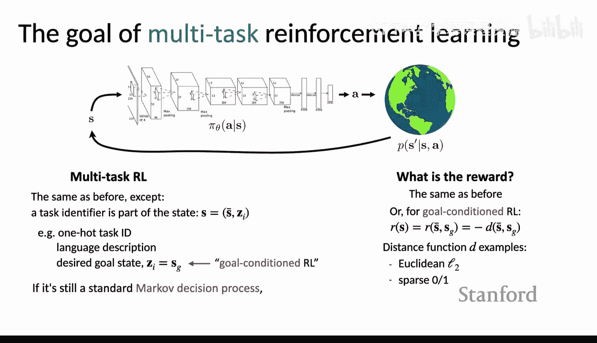

And you might ask if it's kind of， if we can get this standard Markov decision process that now has a task identifier。

 like a task string as part of the state space， then why not apply kind of standard reinforcement learning algorithms to them。

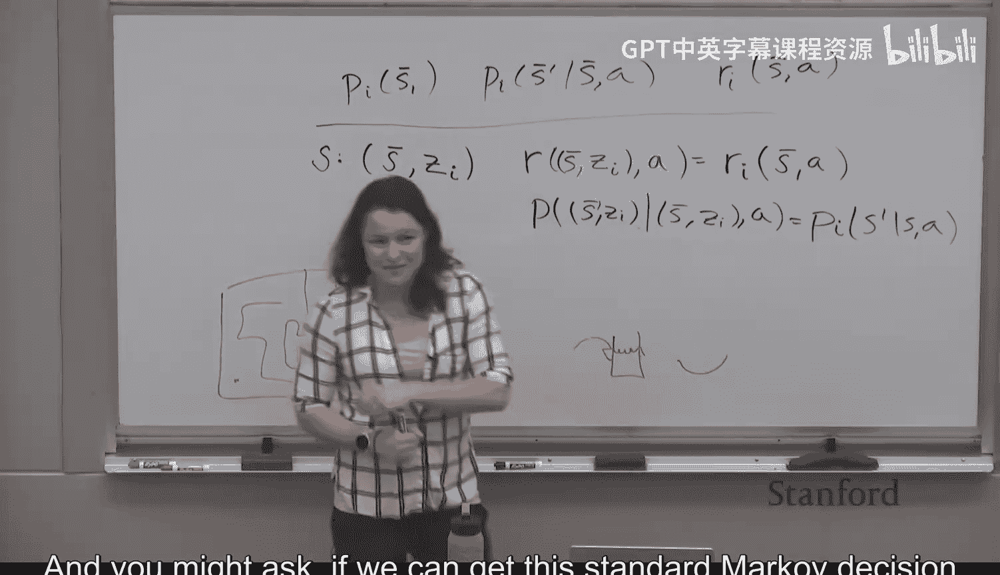

And the answer is， you can。 And in many cases， this is a great way to approach like scenarios where you want to。

Learn multiple tasks。But the reason why I'm bringing all this up is in some cases you can actually do better by leveraging the kind of known structure between different tasks and goal conditionded R is one of those cases where you're trying to reach different goals and in the kind of next few slides we'll talk about one particular way that you can do a lot better by leveraging this fact that you know that this MDP consists of these different tasks that you're trying to do。

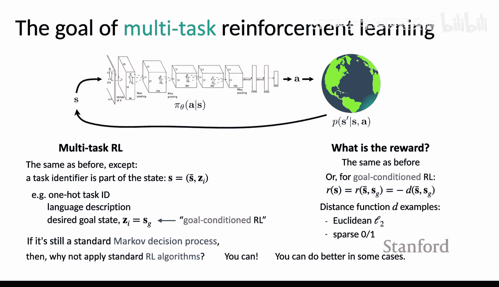

Yeah， Euclidean L2， that' just means greaterner yeah。Yeah。

 so the question is if are different people are different tasks then is there a better way to recommend or better way to represent different people than like a one hott like when I say one hot。

 by the way， I mean kind of a vector like this where like if you're going to represent the number two you use like a one hott vector so yeah there are different like definitely better ways than just this this is actually fairly common in a lot of reinforcement learning methods but for example。

 one thing you could do is you could try to get a language description of the person or their preferences you could also。

This kind of gets into stuff that we'll talk about next week。

 but you could also use some examples of things that they like and don't like as part of the task descriptor as well。

 and so you get something more like in context learning in that case where ZI actually might contain some data about the task so yeah there are some better examples like that。

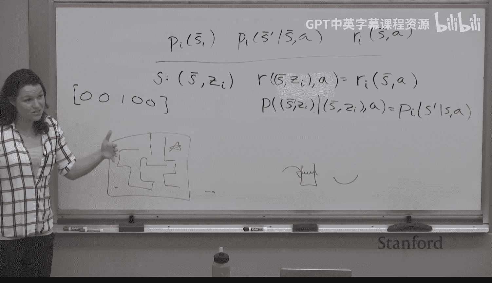

So。In terms of this problem set up， let's actually like look at an example。

 So we get to start with multitask implementation learning and。

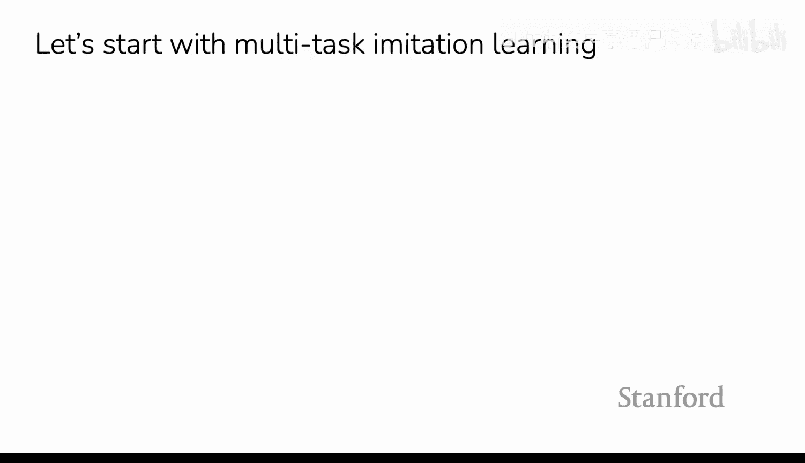

In the multitask imitation learning setting， we can think of it as if we have different tasks， I。

The if the number of tasks I is like a relatively small number。

 then you might you can basically think of it as having some set of demonstrations that are demonstration trajectories for each task where each of these contains expert demonstrations and then you'll have。

So these are。Demos for。Task I。 And this is for like。I equals like one2 n if you have。

And different tasks。

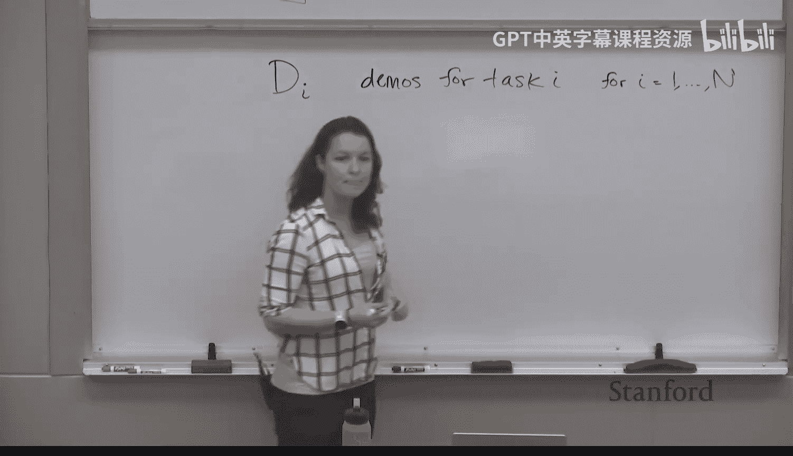

And。If we were to think about how to use this data for imitation learning。

Kind of thinking back to the very first lecture or second lecture we were doing imitation learning。

 We had this objective of minimizing the log probability of actions given states。And。

If we just write this as minimizing the kind of supervised loss function with respect to our policy parameters。

Then in when we want to move to the multitask setting。

 what we can do is we can simply try to now minimize a single policy set of policy parameters over the loss function averaged over all of the tasks。

So this is basically like multitask im learning， pretty simple， hopefully。呃。

One useful trick for this sort of approach is that。If you if tasks are very different。

 like if one task is telling you to go forwards， one task is telling you to go backwards。

 maybe one task is telling you to lie down， they're like they're telling the policy to do very different things。

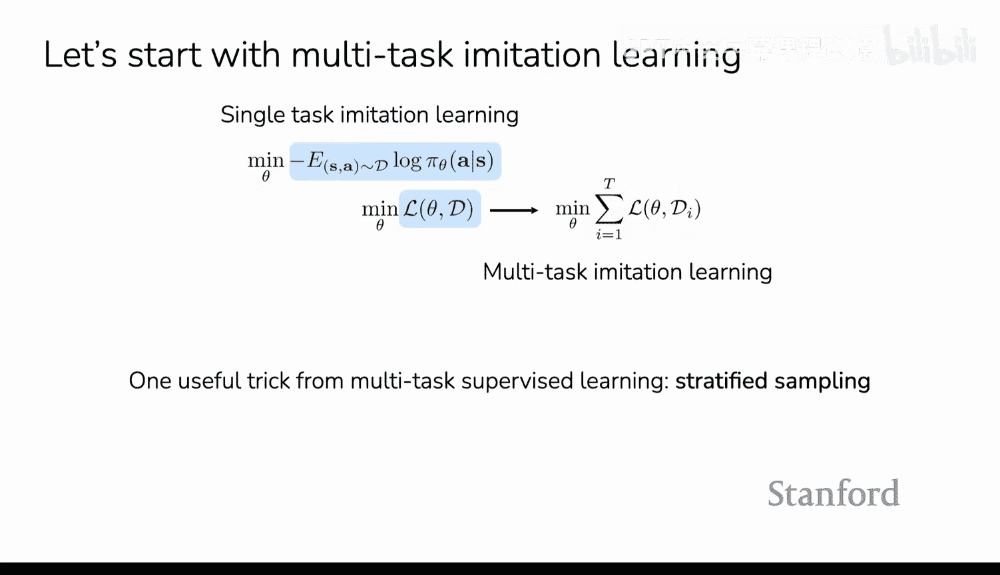

Then if you sampled one mini batch that's like mostly going forward in a different mini batch of mostly laying down。

 for example， then。From one gradient step to the next。

 you're actually gonna have a lot of variance because the first mini batch is going tell you to do something that's pretty different from the second mini batch。

And hopefully the policies should be able to use the task identifier to differentiate the two。

 but in some cases， it can be a little bit like tricky for the network to do that。

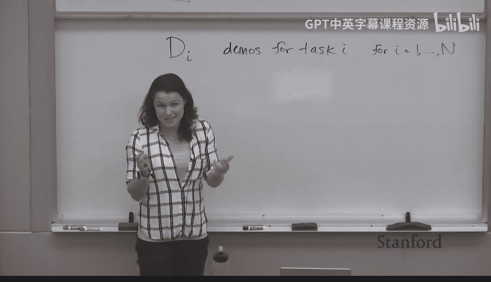

And so one thing that's quite useful is that when you sample a mini batch。

 you can stratify the mini batch and ensure that each mini batch of data has data from each task。

And if you're trying to optimize for kind of a uniform distribution over your tasks。

 then your mini batch would be like one over n of the data would be the first task。

 one over end of the mini batch would be the second task and so forth。

 and this will give you gradients that are lower variance and it can be quite useful in practice to do something like this。

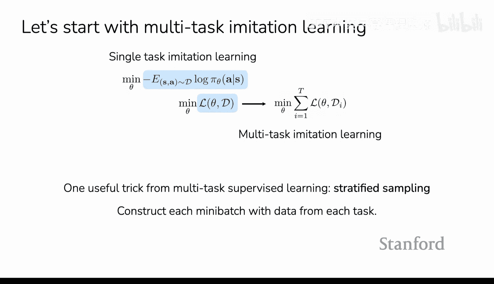

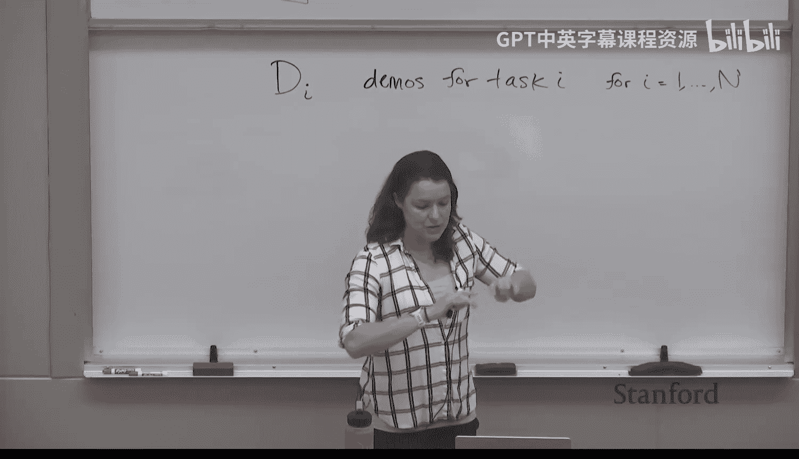

Another thing that I didn't put on the slides that can also be useful is making sure that your states and actions are on similar scales across tasks。

 so kind of per task normalization can also be quite useful for the learning process。

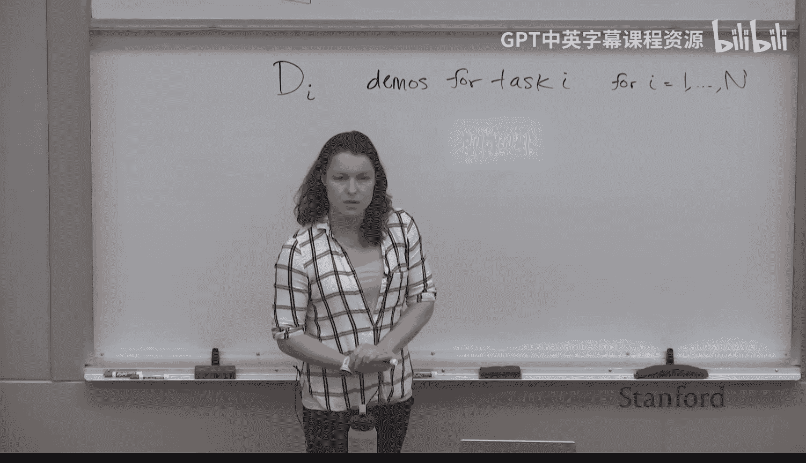

Now， we've talked about training this multitask policy。 And when we do that， we're going to have。

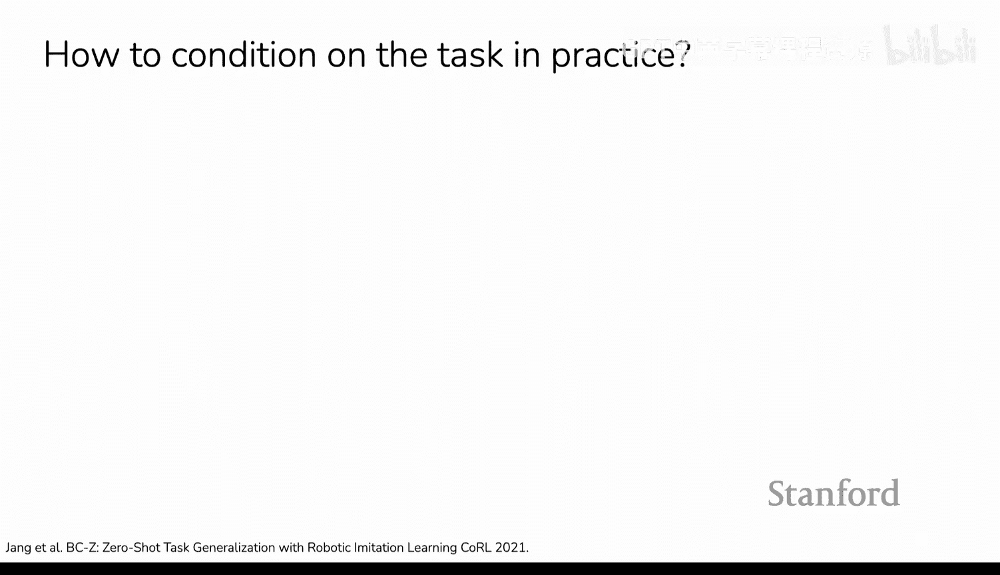

We're now going to have a policy that takes as input some state and some task descriptor and is then needs to output。

Some action。And you might have scenarios where like this is like like a language string or a one hot vector and this is an image and those are it's inherently like a very multimodal problem。

 like you have different data modalities。 these are like very different dimensions。

 And so in practice there's a question of how do you design architectures that take as input。

 this kind of multimodal data。One example that I'll give that I kind of like because it actually uses multiple different modalities of task descriptors is this paper here where the goal is like a multitask im learning system is training a robot to do some simple manipulation tasks。

😊。

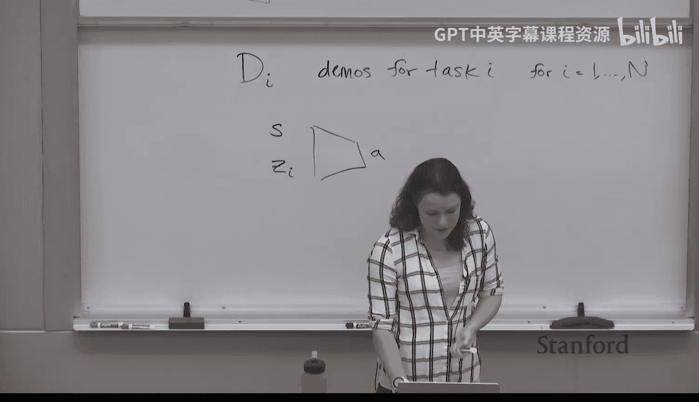

And the way the architecture works paper is a little bit old。 So it's not using a transformer。

 but here's the current state right here。 It actually downs samplesamples the image before passing it into the model。

And then it also uses actually two different task descriptors。

 So it uses a language string as one task descriptor， which is put bottle in the ceramic bowl。

And it also trains the model to be able to， instead of using the language。

 be to use a video of how to do the task。 In this case。

 the video is a video of a person placing the bottle in the bowl。😊。

And so you can and design models that in this case， then。For the language。

 use a language encoder like。Like kind of things that are typically used in language models for example。

 transformers and actually I think the language encoder here did actually use a transformer and then separately for the video。

 it would be using a different kind of encoder because video data looks very different and it uses a video encoder for the second part。

 and then it kind of。Puts it kind of multiplies these embeddings into different layers of the network。

 kind of the backbone of the network that processes the state。

And then the loss function corresponds to a behavior cloning loss。

 and it either samples the task descriptor from the video encoder or from the language encoder。

 and then the whole model is trained with including these encoders is trained using the behavior cloning loss。

So this is like kind of one practical example。 Now we can also look at some more modern architectures。

 And first off， if you have something like a language model， the past descriptor。

 it's very natural for it just to be a language string。

 And you can think of that basically just as the prompt。 And so in many ways like。

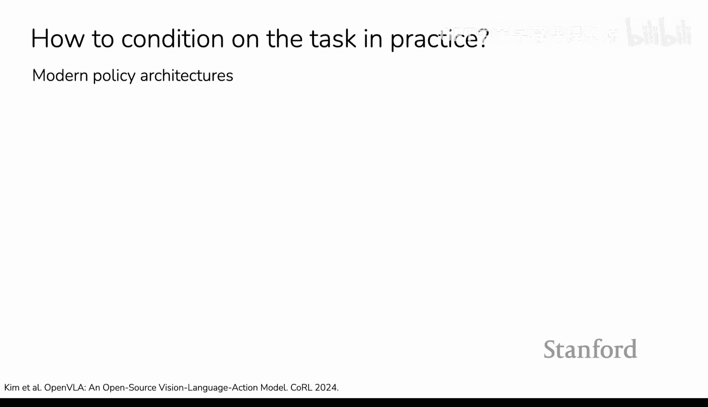

One way to think about multitask imation learning is basically all of the language model imation learning or supervised fine tuning is with different prompts。

 you can sort of think of those as different tasks。

 and it's very easy to just pass that into a transformer。

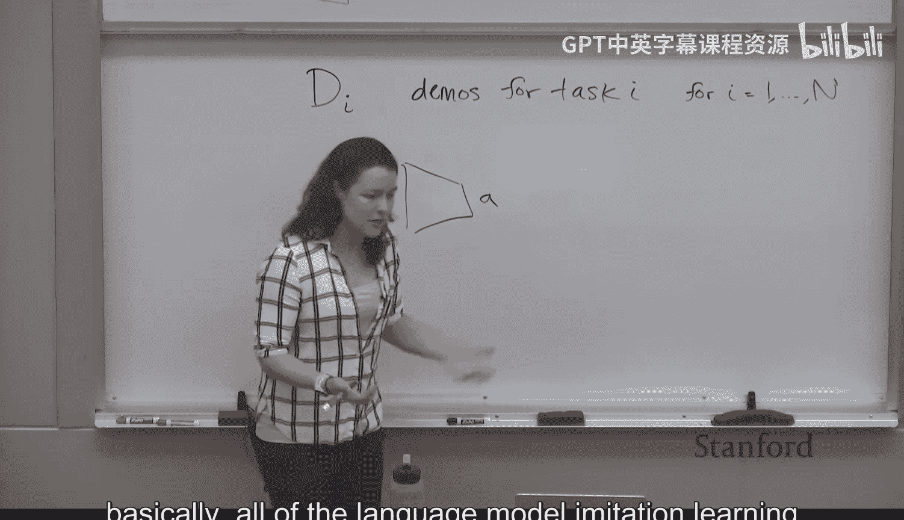

And in terms of modern policy architectures for using task strings in robotics。

 it's often common to also use a transformer and find ways to use image encoders in this case。

 kind of pre-trained image encoders， project those into the input space of a language model。

 also use the task descriptor here， which is what should the robot do to put the eggplant in the bowl。

 pass those in as tokens to a language model， and then output the actions and train the whole model。

 including the image encoder and the text encoder and then。

So here you can view the task Ho or the task identifier EI as basically the prompt for the model。

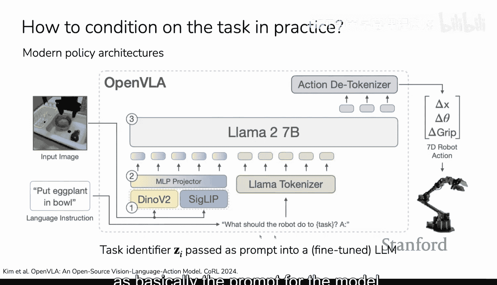

The question is， how does this compare to traditional reinforcement learning？

In terms of task performance and success rate， so the。So like。

 I guess there's a couple things that are different here。 We'll talk about multitask R in a bit。

 like right after this。 And then so the。Like you can do the sort of like prompt conditioning。

 taskca and conditioning both with imitation learning and with reinforcement learning and generally the considerations about imitation learning versus RL is very similar to what we've discussed so far。

 whereas with imitation learning， you're not able to use a reward function to improve over the expert data。

 but it's very simple and it's very easy to scale simple things to large data sets。

 whereas RL has a lot of potential and it can help a lot when you have some reward information and you want to optimize those rewards and you can actually do a lot better than pre some provided data。

And then just some examples of like what kind of multitask im learning policies might look like。

 the examples from those kind of two prior architectures like the robots are doing very simple things and so I wanted to pick something that's a bit more recent so here the task identifier is in the top left in this video there'll be two tasks one is to flatten the towel and one is to hang the towel and so for the first part the task is to flatten the towel and then here we're actually string together multiple tasks so at the point where the robot is at a point where it's like better it's like the towel is in a more flattened state。

 the human actually switches the task and then tells the robot now I want you to hang the towel and this again is passed into a transformer for the robot to do that task。

So this is a case where there's two tasks， you can also do actually a lot more tasks potentially so here's an example where there's。

 I think more than 10 tasks that 10 different language strings that the robot follows to like put the plate in the drawer。

 close the microwave， drive the base backward， rotate the base left and one of the things that's interesting to note here is that tasks can also have different levels of abstraction so you might have a level of abstraction of just like drive forward or like move your right gripper lower or you might have something that's much higher like throw the knotkin away or something like that。

The question is， if you had like one policy for each task。

 would that run similar to this or different？Yeah so in this case it one policy kind of with the prompt as input you could also have a different policy one for each task if you have if you don't do any like what I would call weight sharing。

 like if you have basically completely different set of parameters for every single task then you can't really make use of like the weights are only trained on data from that one task and you're gonna have a smaller data set and so usually in many scenarios that performs worse then training a single policy another consideration is that it ends up using a lot more memory to store all of those weights and you might actually need to reload the model into memory and so it can be take longer to switch between different tasks but sometimes there are also optimization challenges with trying to fit multiple tasks into one model and so sometimes there are some circumstances where training different policies for different tasks can be useful。

Yeah， so the question is are these systems hierarchical like some of these tasks are fairly high level so the next part of this slide is what about like even more highle tasks like what if you wanted to tell the robot clean the kitchen for this particular for the videos that I've shown here this is just like one single policy that's doing it but hierarchy is like very useful for like higher level tasks and if you just told this robot to clean the kitchen I wouldn't be able to do what it did in this video and so we'll have a lecture on hierarchy in like I think twoish weeks and we'll talk about exactly that and scenarios where we could try to do even higher level tasks but yeah even with a single policy。

 a single flat policy without hierarchy it is able to do kind of reasonable actions for tasks that are somewhat high level。

What does long horizon tasks mean by that， I mean a task that takes a long time。

 basically where you have to like takes many time steps。

 you have to take a lot of different actions in order to do that。

 And there's generally a number of challenges that can come up with long horizon tasks， such as。

Like you have to be thinking about what you should be doing in order to complete that and there's lots of things you could do to complete that。

 so there might be multimodality in reinforcement learning settings。

 you might also have sparse rewards and you might not get reward feedback for a very long time。Yeah。

 so the question is a lot of these tasks are pretty similar。

 What if you want a task that's more vision based， I think you said yeah。

 so this actually this particular model was actually also trained to do certain vision tasks like asking questions about the image and and like capturingtioning an image。

 that sort of stuff。 and they could actually actually not if you have a big enough model。

 it's not too hard to do that。 but generally you do need larger models to be able to do more things。

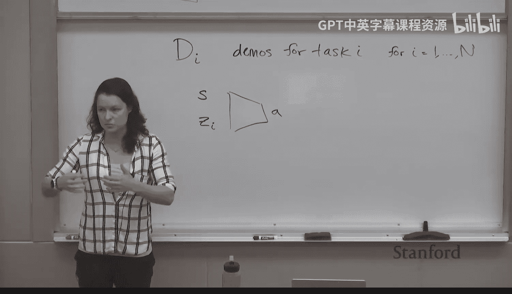

酷。So we've talked a bit about multitask imitation learning。 Now， what about multitask R， Basically。

 kind of this story is pretty similar。 We can feed as input a task descriptor into the policy。

 feed as input a task descriptor into a Q function or a value function， like whatever we're learning。

 We can pass in that sort that prompt or some other descriptor of the task into the models。嗯。If you。

 if you have a discrete number of tasks， then it can be useful to have a different replay buffer for each task。

 especially if you want to try to balance the sampling of each batch。呃。And now。

 there's this question of。Sharing data。So like then this has comes up specifically in reinforcement learning。

 not an imitation learning so in particular， if we collected some sort of exploratory data for a task when like maybe our policy was told to like pick up the sponge or something like that our policy did something。

 it might not have picked up this fund because it might have made a mistake that sort of experience might be useful for other task descriptors as well。

 and。

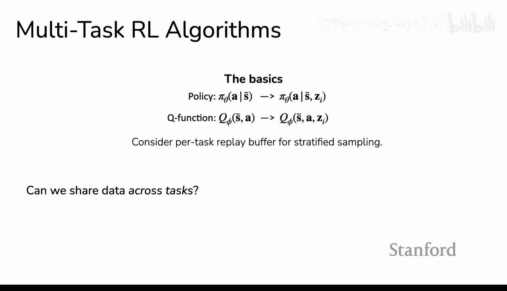

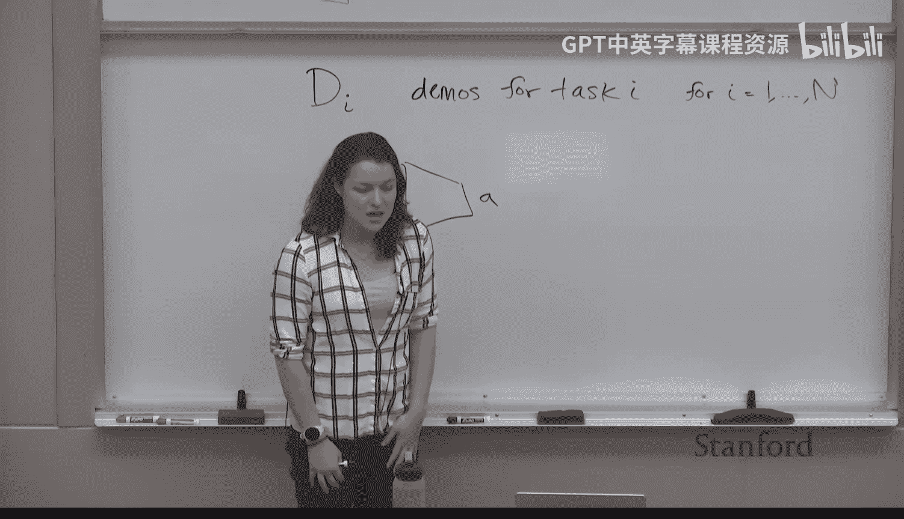

If we have like a per task replay buffer， like one for each task。

 then we're not actually going to be updating the policy for other tasks using that data。

And we could actually think about scenarios where we might actually be able to reuse data from one task to actually more explicitly help the the。

The model or the policy learn something about another task。And if we' were to do this。

 we actually have to relabel the data so that specifically like if the tasks have different reward functions。

 but maybe the same dynamics， then you'd have to actually change the reward label in the dataset to be the reward label for the other tasks。

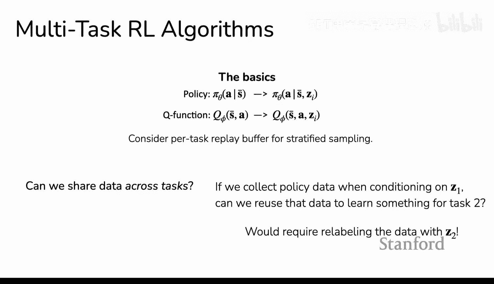

， let's walk through an example。 So say that you are trying to learn to play hockey。

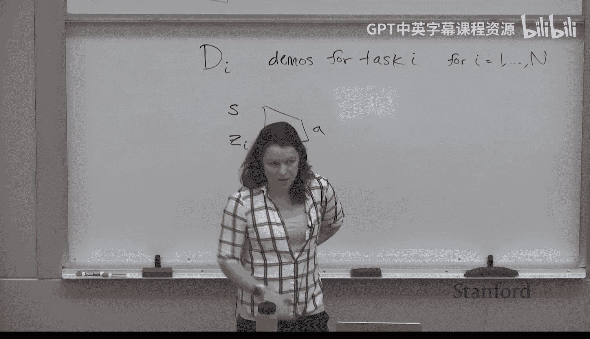

And you there's like maybe some teammates in blue， theres a goalkeeper from the other team in orange。

And maybe one task is passing， another task is shooting a goal。

And maybe you were trying to shoot a goal， but you messed up and you accidentally actually making it like a pretty good pass to your teammate。

Then。That data that you just collected， even though youre intending to shoot a goal。

 that data actually is probably pretty useful for learning how to be better at passing。

And so what you could do is you could store that experience as normal under the original task identifier。

 but you could also relabel the experience with with the task one ID， specifically the passing ID。

 there's a typo there， and then store that in a repo buffer for that task。

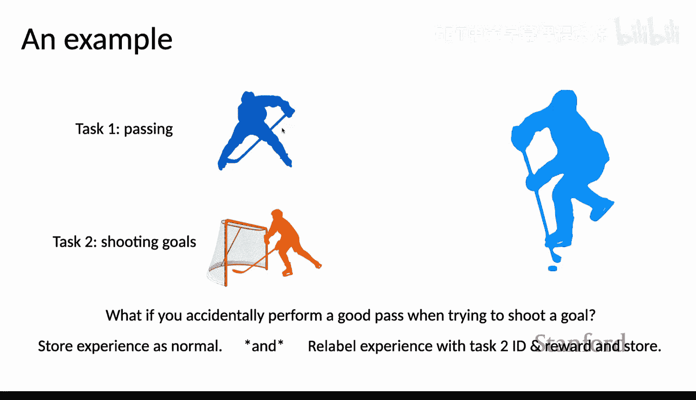

And so， specifically。What this algorithm would look like？Is。Maybe you have。

You pick one of your tasks。And then we pick a corresponding task identifier。

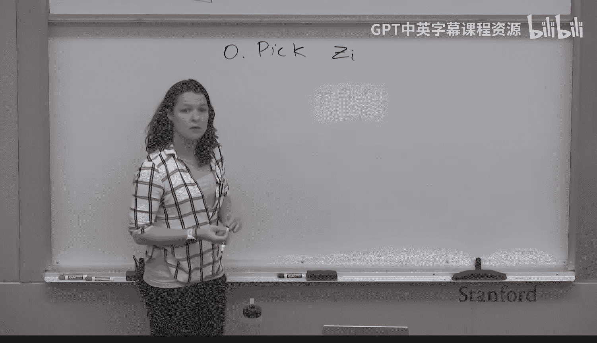

Then， we're going to。Collect data。And we'll be collecting data from。Our policy。

That's going to be then conditioned on that。Task identifier。

Then and maybe let's refer to this data as。Like it'll have ST， A。S T plus1。RRT。

 and then it will also。Have the task identifier。 Well maybe put this into a replay buffer for task I。

 so we'll store this in the replay buffer。And then we could actually then potentially use this for another task as well。

 so。That's what I'm calling relabeling。And we could consider this data， so ST A ST plus1。

 but we could actually consider it for a different task， maybe task J。

 and so the reward for task J would be R of J for STAT。And。The task identifier for T J。

And we could take this data that's been relabeled and add this to either our shared replay buffer or our replay buffer for CA J。

And so then we're actually using experience for one task to learn another task。And then。

We we might do this for multiple tasks， eventually we will update our policy Py theta and kind of collect some more data。

Yeah， so the question is， how do we decide if it's worth relabeling And in particular。

 we're doing this for task J like。Which cast J should we pick， Should we do it for all Jays。

 Should we only do it for some jas， Should we only do this some of the time。

 This is up being somewhat kind of of a heuristic process because it's a little bit hard to tell。

Generally if data will be useful for learning one task or not because learning is somewhat like of a amorphous process I guess the one heuristic is that if RJ was high。

 then it might be good for learning that task because you actually might have accidentally done something good for a different task so that's one heuristic another heuristic something sometimes is just to also sample randomly and use it for all tasks at random and uniformly。

How does this work for continuous state？There's nothing here that assumes discrete states。

How do you reach So this is actually what I've written here is like a relabeling algorithm for any sort of multitask system。

 There's also， we'll talk about what this looks like for goal condition settings in a minute。

If that's what you're wondering about。Yeah， so this is a great point。 There's only a few scenario。

 like there are only， you can't do this universally and so。This is。

 this is something that's called hindsight relabeling because you kind of look at what what you did。

 if you did something good， then in hindsight， you can kind of then relabel that to be a different task。

So in terms of this algorithm on the board on the slides， we collect some data using some policy。

 we store that data in a replay buffer。We are going to perform hindsight relabeling。

And what this looks like is this we originally collected it for task I。

We're going to relabel it with the reward for task J。

And then we'll store that relabeled data in a replay buffer。

 The slides have this for like a single combined replay buffer。

 you could also do this with different replay buffers for each task。

Then you'll update your policy with the replay buffer and repeat this process。

In terms of which tasks to choose， you can choose this randomly， tasks that get high rewards。

 note here is also you can actually do it for trajectories that get high rewards。

 not just transitions that get high rewards， because if there's a high reward somewhere in the trajectory。

 then other parts of the trajectory might have done something good as well。Yeah。

 and then there's a question of when can we apply relabeling？And in particular。

 there's actually restrictions on both like the set of MDVPs or like the MDVPs of the different tasks。

 and also on the algorithm that you're using for reinforcement learning so does anyone have thoughts on like what has to be shared or not shared for this algorithm？

To make sense。Yeah， so shared state action space。 So that's you're gonna want。

A shared state and action space。Anything else do you want？That's shared and not shared。Yeah。

 so if you only have one weekly buffer， then you want the dimensions of your state and actions to match the and generally for the state space and action space to be the same。

Yeah， so you probably want the initial state distribution to be similar。

 so you want like P of S14 to be like similar。For different。For different tasks。

 because if it' like drastically different， then they're probably like sharingrry data won't be as useful。

So if one of them has dense rewards and one of them has sparse wordss， that might be a problem。

That is true， although that might be a problem generally in multitask coral。1， and， but actually。

 in this case， like， I don't think it's gonna be especially an issue in this case because you are gonna be using the reward function for the task。

 But yeah， generally for multitaskcar role， that makes things challenging。Yes。

 it's helpful for the rewards to be the same scale。 What about the dynamics。

Should they be the same or different across taskss？Same yeah。

 so you want the dynamics to be the same and there's actually really important because you're not relabeling the dynamics here and because you're not relabeling the dynamics if they're different across tasks。

 then you're going to be yeah it's going to be a problem and so there's only applicable because because you're teaching the model and sharing data with the dynamics from the other tasks。

 it's really important for the dynamics to be the same。So the dynamics should be the same。

And then this is also most useful if the reward functions are different。

 otherwise the data like is already in the buffer with the original reward function。

My last question is， do do you need this to be an off policy oral algorithm or is it okay if this is on policy？

Any thoughts on that。We'd like to have covers， all policy is generally good， yeah。Yeah， so when we。

The action here， this was the action that was taken by the policy when conditioned on ZI and when conditioned on ZJ。

 the policy might have done something different and so this data that we're relabeling is going to be off policy data。

And so that means that we should， when we're updating Py Theta。

 we really need to be using an off policy algorithm because this data is not following the policy condition on ZJ。

Yeah， exactly。 So if you're going to be using importance weights。

 you need to store which policy collected the data in the first place， well。Actually， sorry。

 let me think about that。You're actually。This data is actually like changed from the original data。

 And so actually you you'll want to use for the like the importance which。

 you actually want to use ZJ， not Z I as the old policy because you're actually kind of creating like synthetic data that like is as if you were using ZJ。

 So yeah， sorry this book。 don you't and so you don't need to store which policy it came from。Okay。

 so you need the reward function。 Oh， the other thing is you need the reward function form here。

 You need to actually compute the rewards for the new task That's also important as well。

 Or you need to have learned the reward function。 If You need the reward function。

 The dynamics has to be consistent， and you have to be using an off policy algorithm。

And then lastly is the goal conditioned version， this is basically the same as before。

 but our reward function is now this negative distance between states and for continuous states。

 this could be like mean squared error， it could be a distance and embedding space or it could be a zero1 loss within some epsilon ball of the goal state。

