# 斯坦福大学《深度强化学习｜CS224R Deep Reinforcement Learning  Spring 2025》中英字幕 p13 -13- Lecture 13_ Meta RL.zh_en -BV1SvmxB3E5e_p13-

Okay， let's get started。

CoSo as a recap of last week， we talked about multitask reinforcement learning and how we might want to have reinforcement learning agents not learned as one task。

 but multiple different things that might correspond to multiple different reward functions and we saw that we can formulate an aggregated MDVP that encapsulates all the different tasks where you now are augmenting your state with some sort of task descriptor like a prompt or a goal or just an index corresponding to what the agent should do。

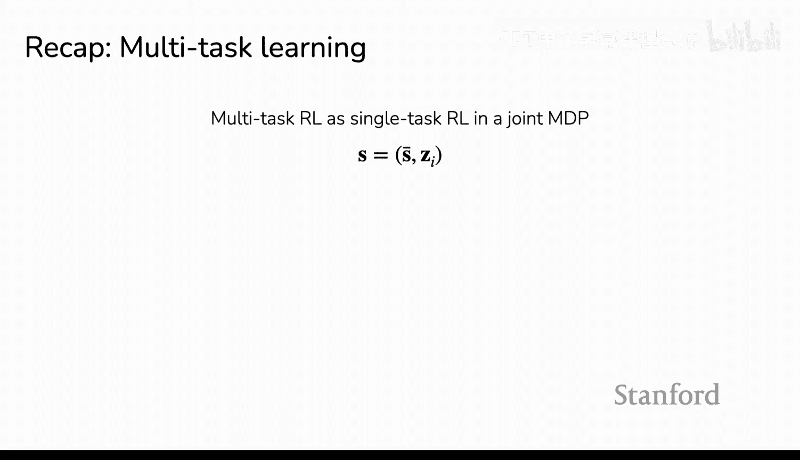

And the way that this worked is we'd sample some task。

 kind of run the policy in the MDP for that task， sample another task， and so forth。

 and we would then get yeah， get a policy that could。Be able to successfully。

Achieve high reward in a number of different MDP or。

And another way to view it a single aggregate MVP with this augmented state。

This is gonna to be a little bit different from E R。

 So we'll see that some differences here later in this lecture。

 And we also somewhat briefly talked about goal conditioned reinforcement learning and。

It could just be simply viewed as a special case of multitask reinforcement learning where each task is trying to reach a goal state and the task descriptor corresponds to that goal state and so if your states are images for example。

 then now you'll be passing as input both to the policy both the current image and the goal image and you'll be trying to reach that goal image or if your state。

 for example， is a vector you'll be passing in two vectors and the task is trying to reach some goal state and you can construct different reward functions if you have discrete states or continuous states as some sort of did you kind of reach that goal or reach close to that goal and one of the things that's kind of nice about this goal conditionditioned formulation of reinforcement learning is that you can actually do it in a。

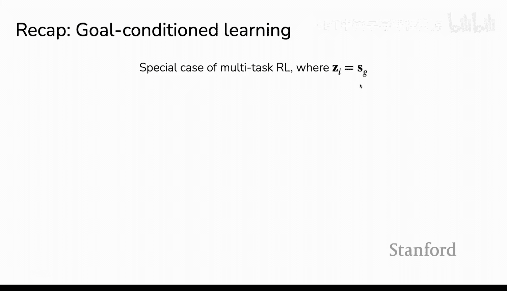

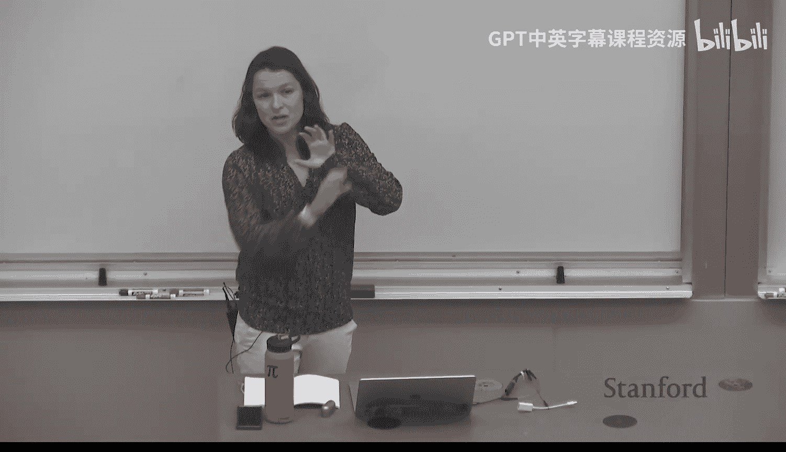

Self-upervised way， you don't need task descriptors。

 you don't need a different set of tasks that you've manually defined。

 you can just use a bunch of different states as kind of the tasks themselves and a lot of different tasks can be formulated as goal reaching tasks one thing to note here is it can be pretty hard to train but you'll be experimenting with a simple goal- conditioned reinforcement learning setting in your homework。

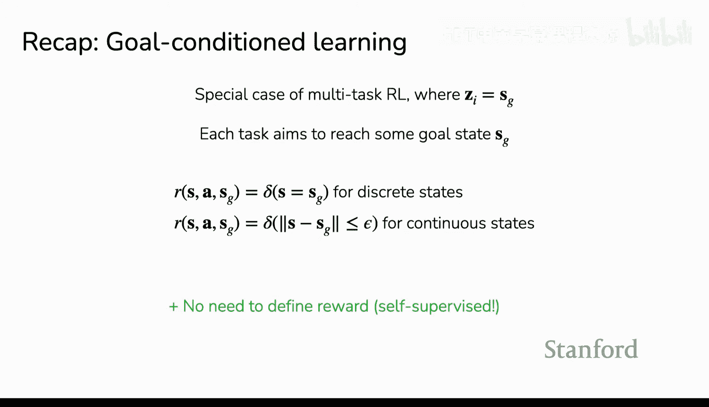

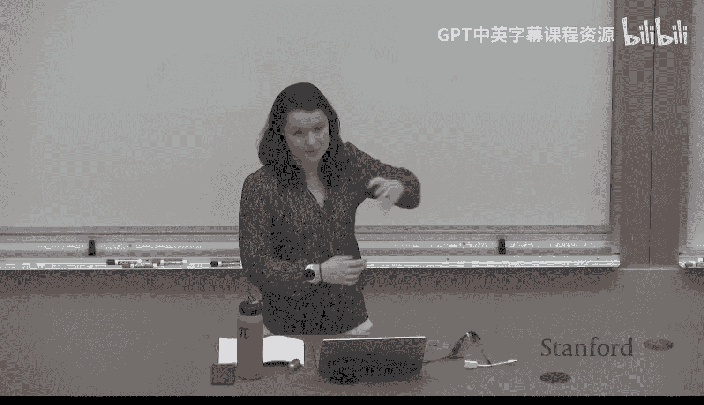

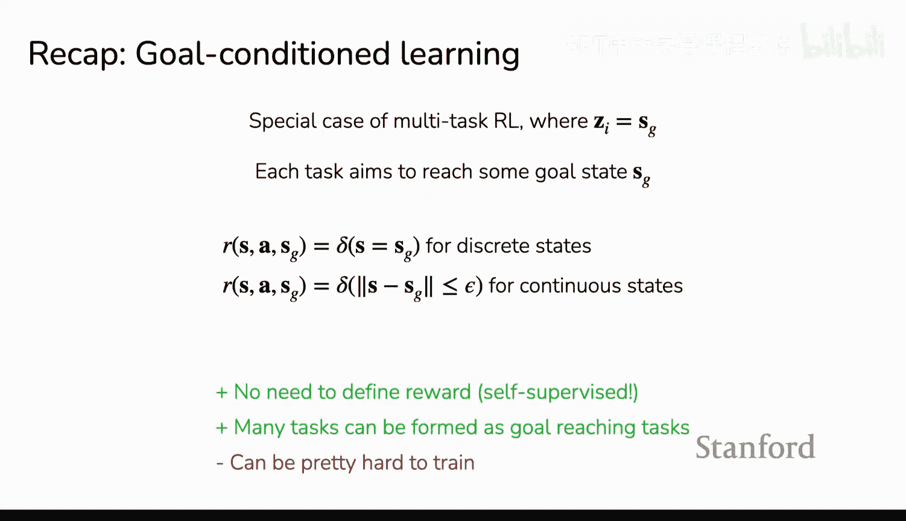

Okay， so for today， we're going to be talking about meta reinforcement learning and specifically we'll be talking about what that problem statement looks like and a class of meta Rl methods that I like to refer to as black box meta RL methods We'll start to get into what these methods look like and also some of the challenges that they face。

So what's the problem， Like， why do we care about meta Rl。Why not just do vanilla R so。

Say that you're trying to figure out how to operate a coffee。

 an espresso machine that you've never used before。嗯。If you wanted to do that， well， first。

 if you wanted kind of a robot or a reinforcement learning agent to do that。

 it would probably take a lot of data， a lot of attempts to try to figure out how to make coffee because this is a pretty complicated task。

 lots of different steps involved， you have to do those steps in sequence and also the reward signal that you get for this sort of task probably isn't going to be super detailed。

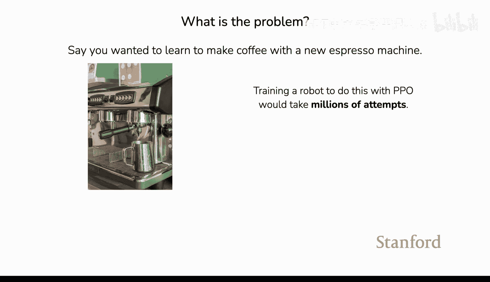

But as a human， if you were to attempt this task， probably if you had a little bit of instruction or some previous experience making espresso。

 then you could probably learn it in minutes or maybe even less than a minute。

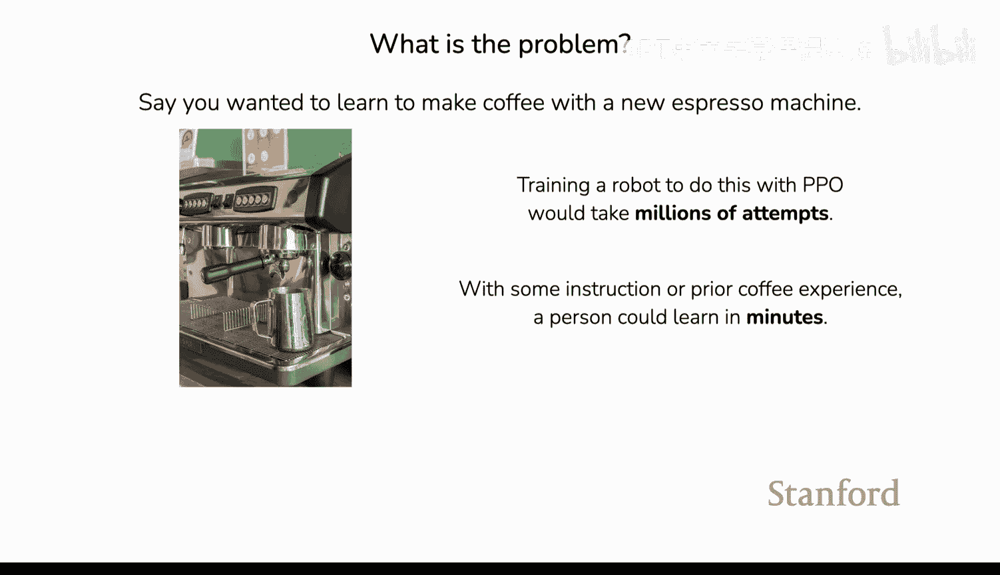

So。If you think about reinforcement learning， there's gap between how quickly a human could learn something。

And how slowly you would take a reinforcement learning system to learn it。

 This is rather unsatisfying。And if we think about， like。

 what is the difference between a person and a reinforcement learning system。

One of the big differences is that people aren't starting from scratch。

People already know how to move objects around with their hands。

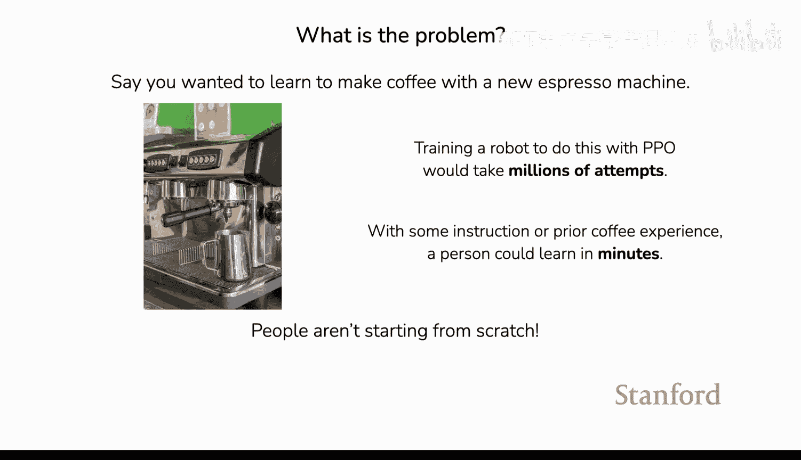

They might already know how to make coffee in other ways or with other machines。

 and they can leverage that experience and also some notion of kind semantic knowledge of what to do if someone tell you to pick up a cup and put it somewhere or to turn a knob and it could leverage that previous experience in order to solve this problem really。

 really quickly in compared to training a reinforcement learning system from scratch。

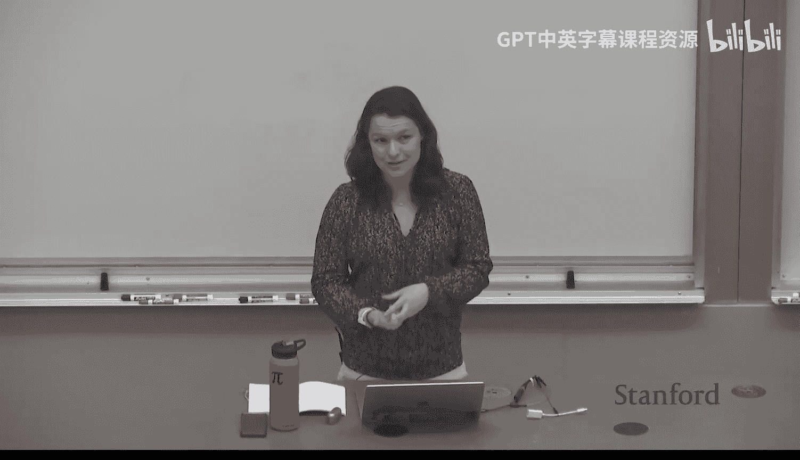

And so experience with similar tasks， other espresso making machines。

 either espresso making on other machines or as general like motor control， following instructions。

 that sort of thing can be very useful when trying to solve a new task。

And I mentioned this as a kind of example with espresso making。

 But this sort of framework of not starting from scratch is really general。

 So it applies to robotics problems or you want to you're facing a new environment or facing a new task。

 but is also really faced by。

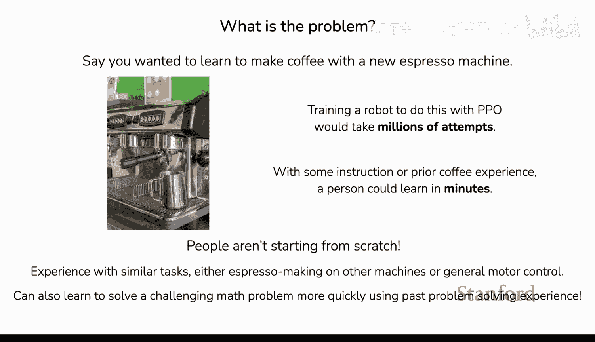

Many reinforcement learning systems as another example。

 say you want to solve a challenging math problem that you haven't solved before。

 if you have experienced solving previous math problems。

 then you can use that to more quickly solve a new problem because you've learned some sort of strategies that you might be able to apply to the new scenario。

Okay， we're freeming this question of can reinforcement learning algorithms leverage experience from previous tasks in order to learn a new task with less data and less experience？

In many ways， this problem is thought of as a transfer learning problem where we want to transfer knowledge information experience from previous tasks to new tasks。

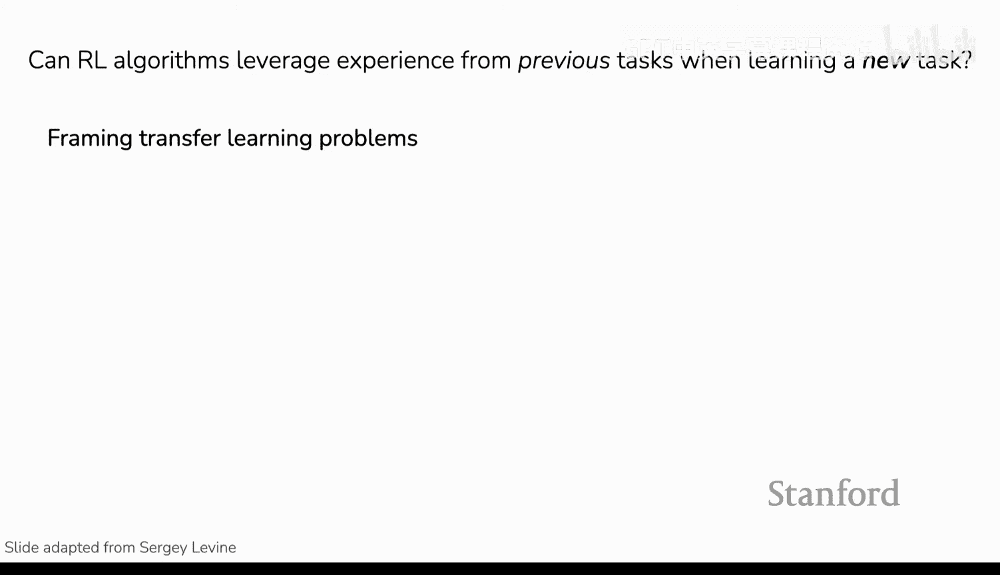

And there's a few different formulations and a few different kind of problem settings that the research community has thought about。

 One is。

Kind of a fairly， like a fairly simple setup where you learn one task and then want to learn a new task。

 And you can just， for example， train on one task and then fine tune on the new task and。

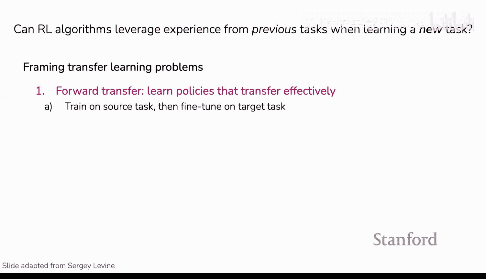

Notions of fine tuning that we use in supervised learning are also applicable to reinforcement learning settings where you could fine tune to Q function to a new task or fine tune a policy to a new task。

Although for this to work well， the tasks need to be quite similar to each other。

We also talked about multitask learning and you could also use multitask learning for transfer to new tasks and in particular if your task if your prompt shares some structure。

 if it kind of exhibits if it's just like a task one， task two task three。

 transfer is going to be harder， but if it's something that has a lot of structure。

 like pick up a water bottle， pick up a phone， pick up a pen and so forth。

 then you might actually be able to have things transfer。

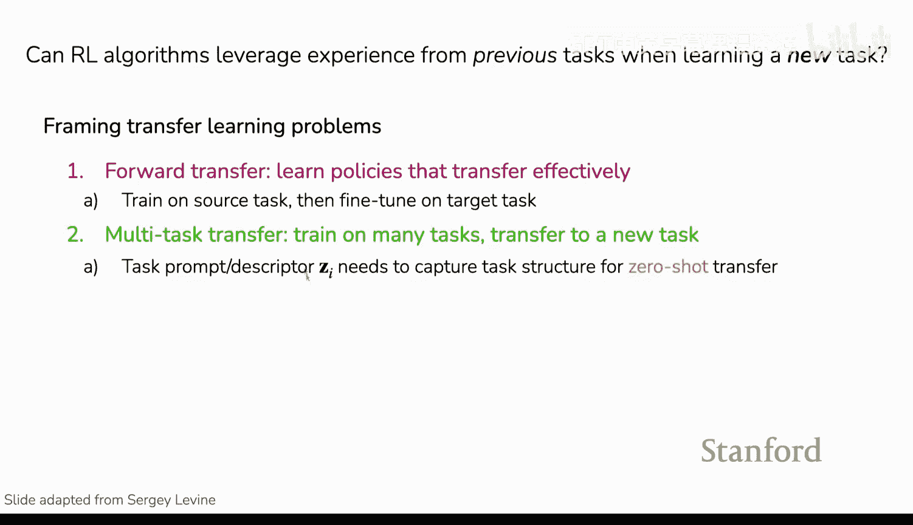

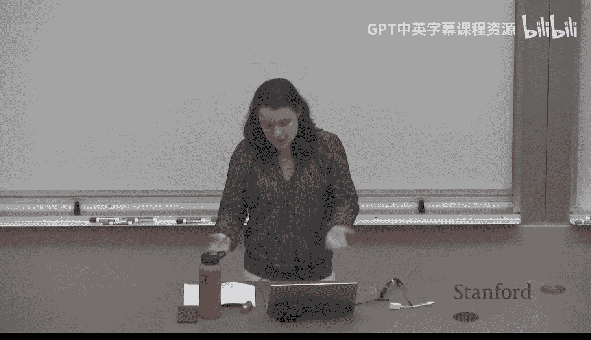

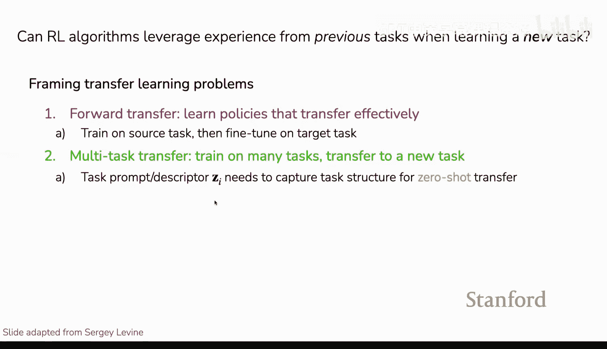

What's called zero shot without any new experience at all。

 simply by passing that prompt to the system and having it kind of act according to that prompt。

And then mental learning is often concerned with。Instead of zero transfer。

 something that's called few shot transfer， where with a little bit of experience。

 a few examples or a few trials of a task， can you adapt to that task？And。Essentially。

 the difference between multitask learning and meta learning is that it accounts for the fact that we're going to be trying to adapt with a small amount of data。

And it does that during the kind of original training process。

And another way of thinking about this is that instead of having the task descriptor be like a prompt or an index。

 the task descriptor might actually be a data set itself。

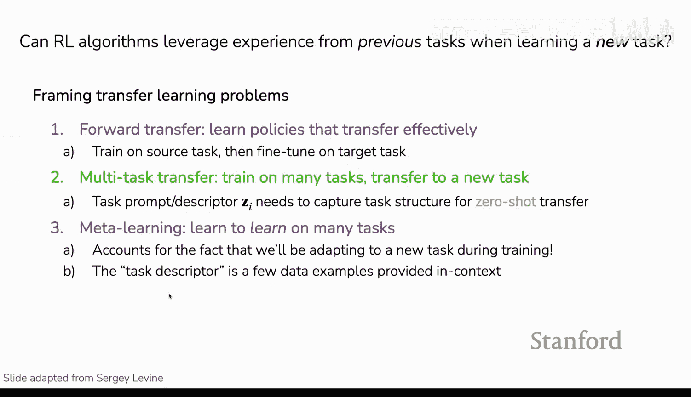

Like a set of trials that you're going to be adapting to in the context of some policy。

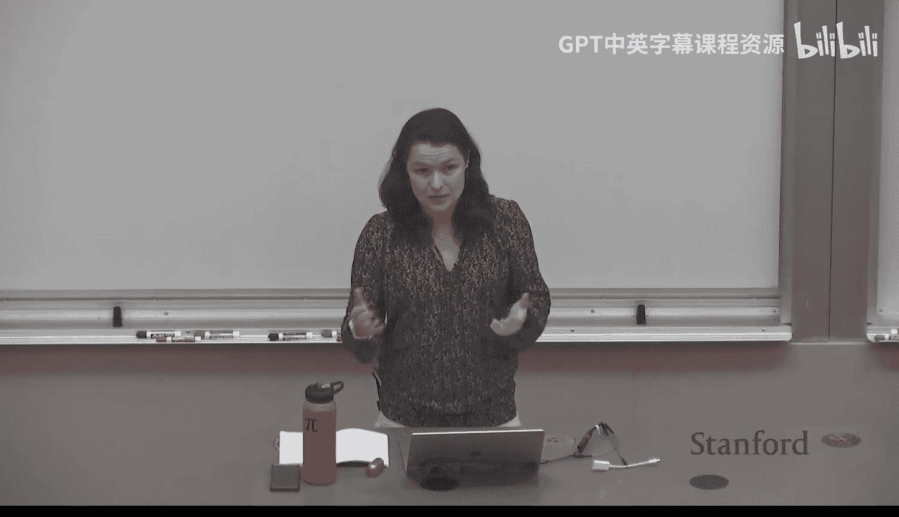

Another word for this is sometimes it in contextex learning or fu shot learning。Now for this to work。

 for the first scenario to work， you must have very similar source and target tasks。

 whereas in some ways that things getting a little bit easier and a little bit harder for number two and number three。

 they get easier in the sense that you no longer have to have an extremely similar task you said just need to have a distribution of tasks and be similar to that distribution。

 such that conceivably the new tasks that you're trying to solve should be within the distribution of things that the tasks that you've seen during training。

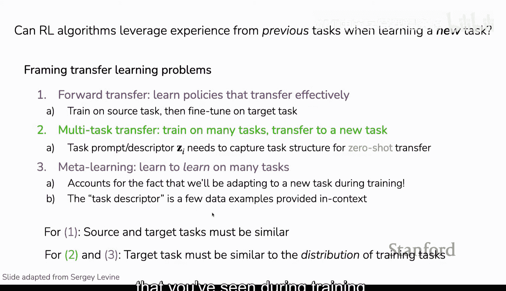

It gets a little bit harder because you do actually need a number of training tasks。

 not just a single training task in order to get effective transferred。

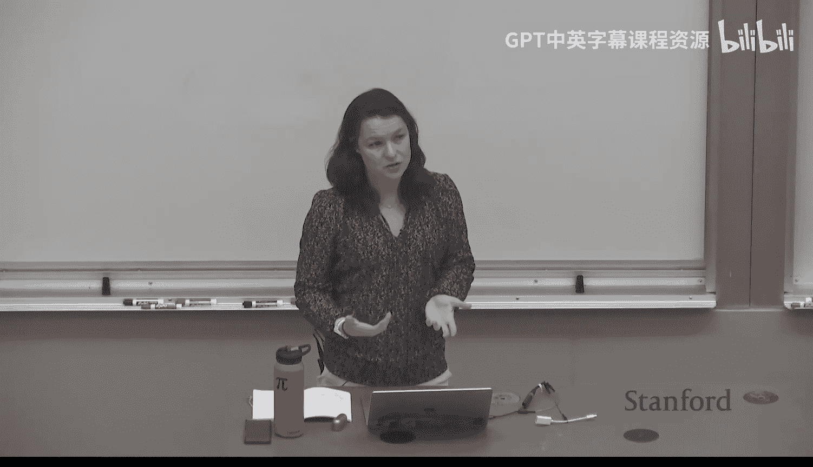

Okay。Before we jump into meta Rl， let's look just look at a couple few shot learning examples outside of Rl and then go back to the RL setting。

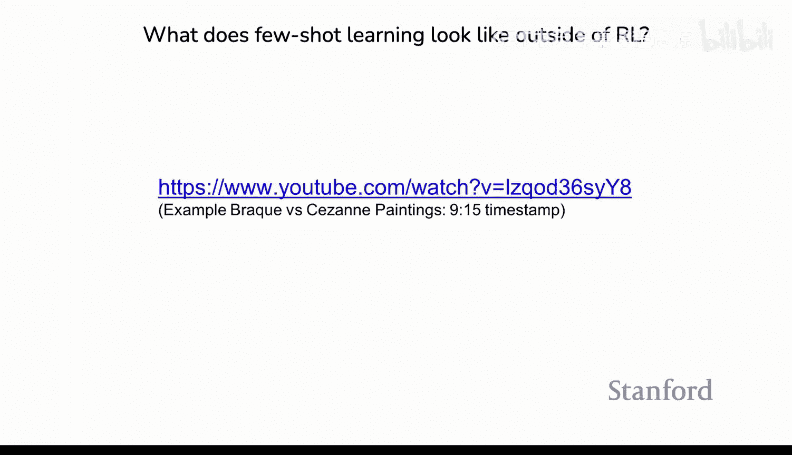

So actually， I picked this example to it so it's not like trivial。

 There's other test points that are much， much easier。

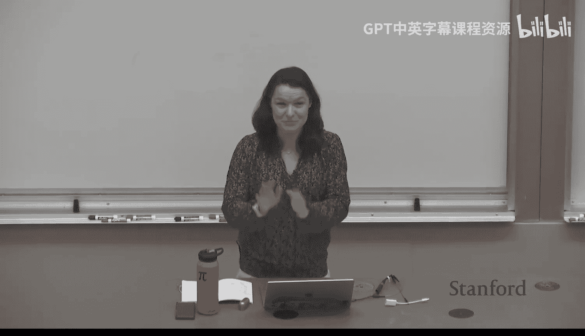

Cool， so that's kind of the essence of a few shot image classification problem where you have some a small number of data points and your goal is to classify a new data point。

And typically， if you were to train from scratch on just six images。

You'd have no hope of being able to learn a classifier， especially on high dimensionional images。

 But the way that middle learning works is you can construct other tasks for the machine learning system to solve that have a similar structure。

 like other image classification tasks， train it to be able to take as input。

 a training data set and a query image。Or a test input and then predict a label and basically constructing these each of these fu shot learning problems as a data point themselves。

Now another example of few shot learning outside of reinforcement learning is in context learning in large language models and what this looks like is here's just one example。

 there's lots of examples of different tasks you could do in this case the goal is given a sentence that's kind of poor English input like I eated the purple berries。

 output good English input like I ate the purple berries。

 it gives it in this case I think four or three different examples of input outputs。😊。

This is the training data set， and the goal is for new input。

 be able to predict a good output for that example。

So use another example of a few shot learning problem and again。

 language models get things that kind of look like this during training。

 One thing that's a little bit special about language models is that this sort of in context learning。

 you don't explicitly set up your training data set exactly to match all of this and it turns out that a lot of the statistics of data on the internet leads to this kind of this ability to react to these few shot examples effectively。

 This is actually just a base model， I think this is from G3。

 and so even without any additional supervised training， you get something like this。

 it's not perfect， doesn't work all the time， but there's another example of few shot learning。😊。

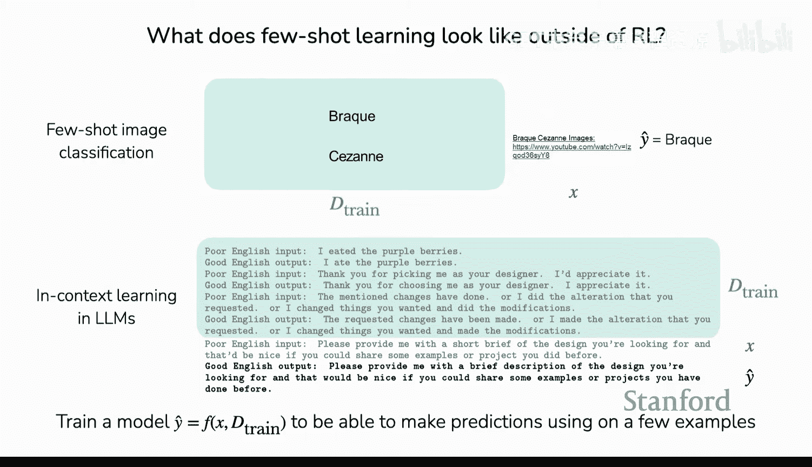

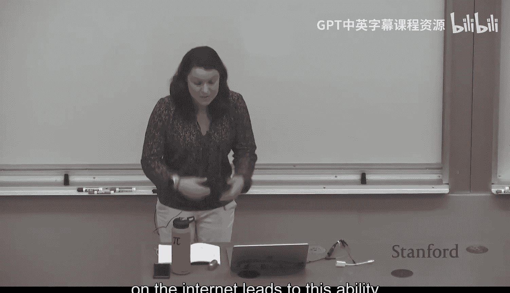

And then in each of these examples， you can think of the goal is trying to train this sort of model that takes his input。

 a training data set。And a new example X and makes a prediction for that example based on both X and on the training data。

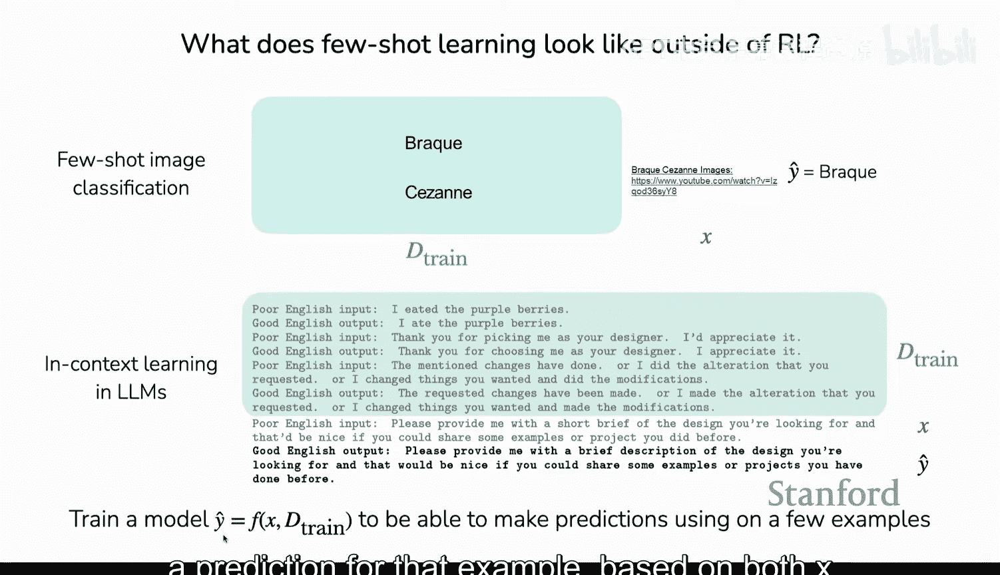

Yeah， so the question is in context learning and LLMs。

 typically you achieve this sort of model and this sort of view shot learning through prompting by putting the data set in as context or as part of the prompt into the model。

 is that also how it works in metaRL， generally yes we're going to be looking at that case in metaRL。

 there are actually other methods where you can accomplish this with actually with gradient updates as well。

 or with something that looks like nearest neighbors。

 the most successful method in MeRL looks like prompting and so that's what we'll be talking about today。

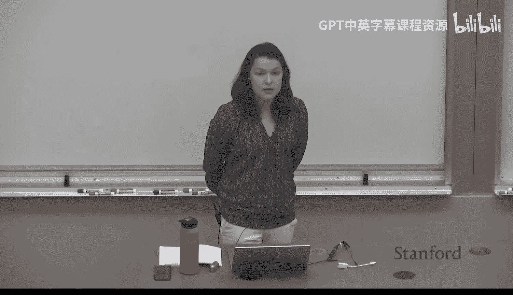

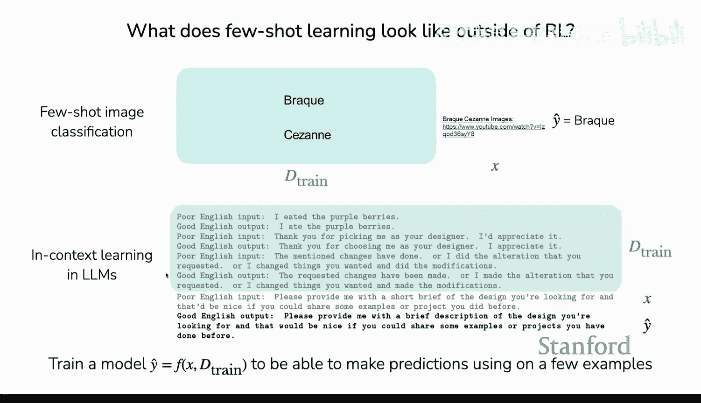

Now， let's look at a metaal example。Say that we want to navigate nass。

And so our goal is we want to solve a new maze。And we're an agent that's in this maze。

 we don't get to like see we actually don't even see this top down view。

 maybe we just have a first person perspective。And our goal is。

 because this is a reinforcement learning problem， It's not just about outputting a label。

 It's actually also about collecting experience in the environment。

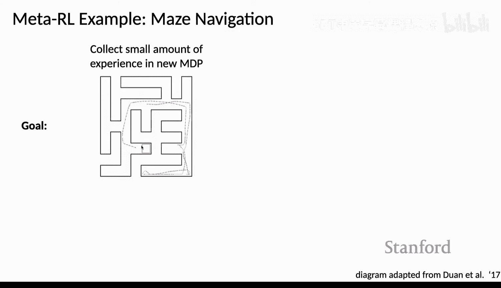

And so。Kind of the goal is we'd like to be able to very quickly solve a reinforcement learning problem and we'll frame this as collecting a very small training data set of one episode or a few episodes in this case it's kind of exploring the maze trying to find where the goal is and eventually it kind of starts in the middle right here。

 explore is over here and it eventually goes to the goal right here。And。After we explore。

 we'd like to be able to have a policy that is able to solve the maze just in this case。

 just with a single episode of experience。😊，And again。

 if you were to do this sort of thing from scratch that tries to use just a single episode of experience to get a policy that can solve the task。

 this would be very， very hard。And instead， the way that metaal frames this is by trying to construct examples and trying to construct kind of a set of trading environments that facilitates this kind of fast adaptation。

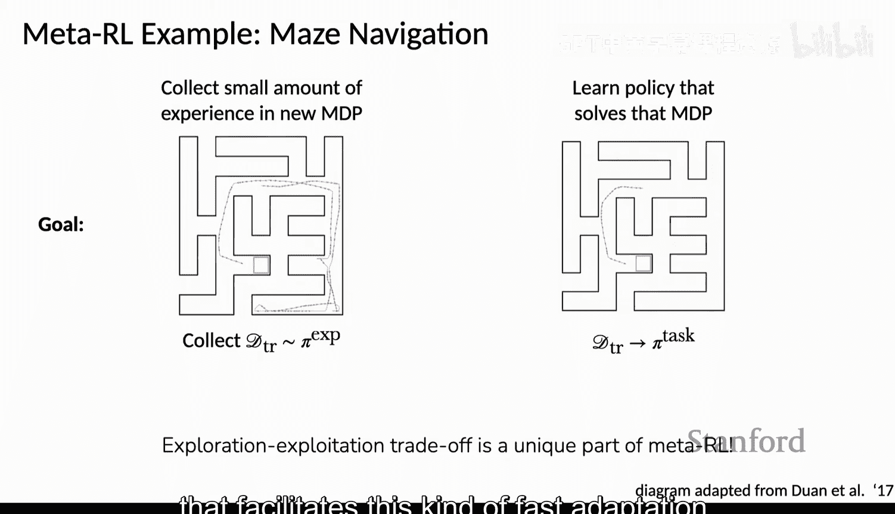

Now， in comparison to the supervised learning scenarios， like I mentioned。

We're now going to have be faced with this exploration problem。

 we're not just given a training data and then make a prediction based on that training data。

 we're actually constructing the training data set ourselves with through exploration。

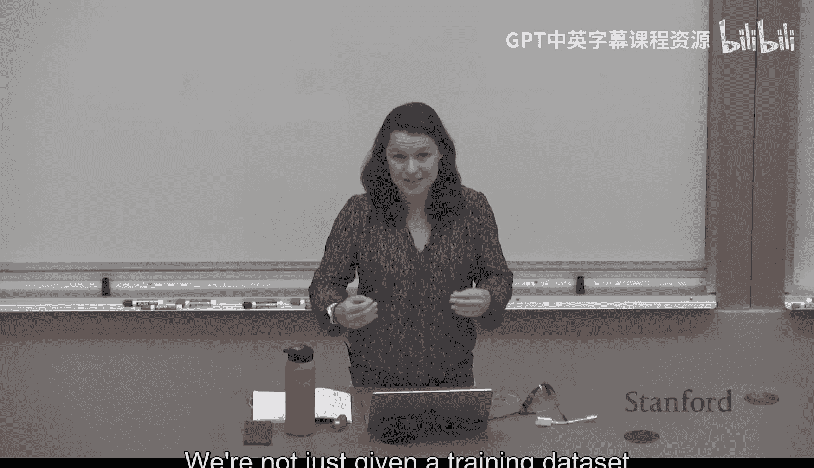

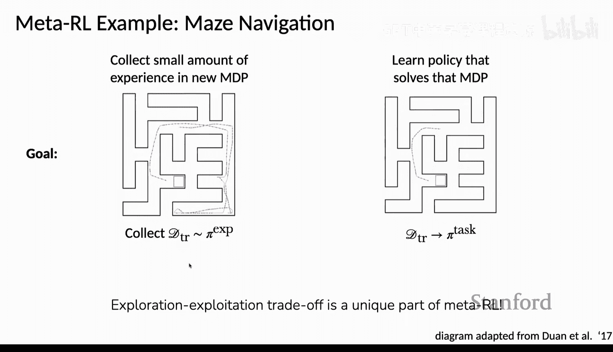

And we need to figure out how best to trade off between exploring in the environment versus being able to then solve the task and how much time we should spend exploring versus trying to exploit what we know about the environment。

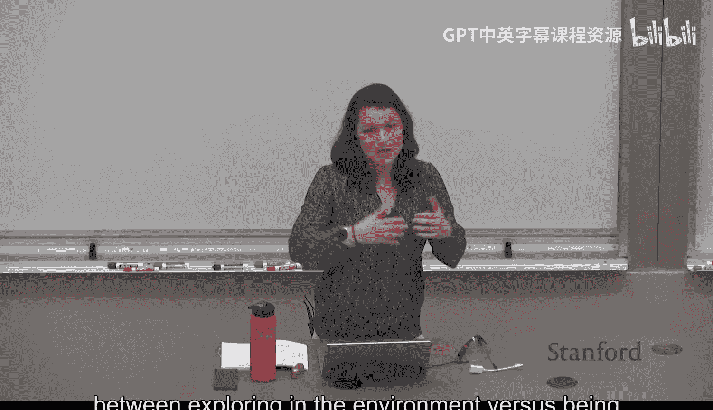

So this is our goal。 This is what we'd like to be able to do at test time。

 We'd like to be able to quickly learn a new maze。Then to set our agent up for success at meta traininging time before we try to adapt to a new maze。

 we'll try to learn how to efficiently explore and solve many other MDPs that are related in this case they can be other mazes like this and so forth and these are each of the tasks that we willll be training on in order to adapt to a new maze。

Cool， the other thing， I guess one key assumption here is that you need to have like these new MDPs can't be completely different from the MDPs that you saw before and the way that we can think about that is we should have some sort of distribution over tasks and these new MDPs that we're trying to adapt to should be within the distribution of tasks that we saw during training。

O。Amazze navigation is like one example of a meta Ral task。 there's lots of other scenarios as well。

 so one one useful scenario that we've seen in robotics is being able to adapt very quickly to different trains。

 different slopes for legged robot systems。 This is actually a really small legged robot。😊。

But it's also applicable to larger leg robots as well。

 and sometimes you might actually be training on different environments in simulation and then adapting in the real world as just another environment。

You could also have object manipulation as different tasks as well in manipulation scenarios and then there's also a number of language modeling scenarios where this is quite applicable。

 one example where metaRL has been relevant is adapting to different users with different preferences where you give examples of the kinds of things。

 the kinds of responses that they want in context and we'll also later see an example in reasoning as well。

😊。

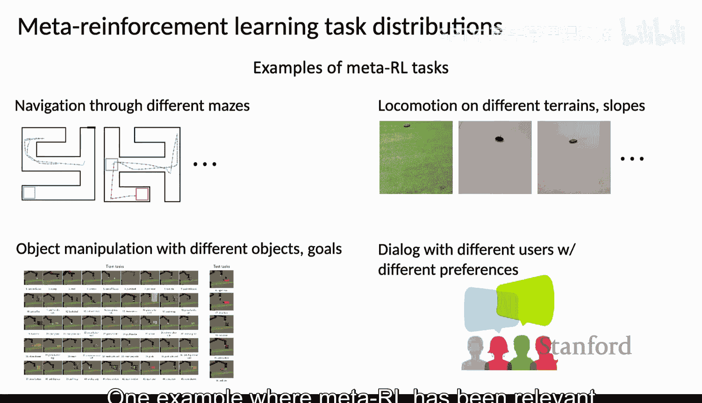

Yeah， so the question is what is the key difference between this sort of metaal approach and transfer learning where you're training and then fine tuning？

There's a couple ways to view it One is that you're during this kind of training process you're actually explicitly optimizing for transferability。

 you're optimizing for the ability to adapt with a small data set and as a result of that。

 you can get much faster transfer， you can use a much smaller data and there are examples of like if you use fine tuning versus if you use like few shot in context learning or few shot adaptation。

 you can get much more efficient transfer and yeah so you get much greater efficiency and the way that you get that is by providing the algorithm with。

A number of different training tasks rather than like just one training task that you're feeding off of。

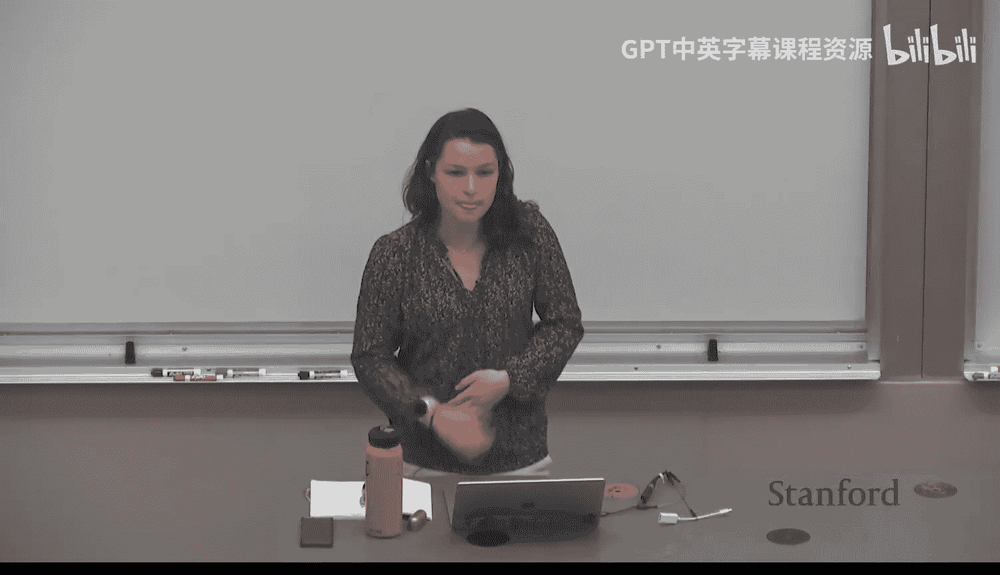

Okay， so slightly more formally， we've talked about multitask learning where you try to solve multiple tasks at once。

 you might try to transfer to a new task from that。

But you're not optimizing for transferability with transfer learning。

 you're trying to solve some target task after solving some source task， typically by fine tuning。

Whereas in the middle learning problem we。Have experience from some training tasks。

 And we want to very quickly solve a new tasks。And in the reinforcement learning scenario。

 these tasks are going to be MDPs， each with their own state space actions based dynamics reward。

 and there is this kind of nice， we see kind of meta learning and supervised learning and there's also there's kind of a nice analogy between the two where the main difference with metaRL is this exploration challenge。

Okay， and then diving into some notation here， we can view the metaRl problem as basically being able to with a small amount of experience。

Be able to learn a policy that can solve the tops。And also to be able to collect this experience itself。

 And so this training data， a couple there's two different variants of the metaal problem。

 in the first case， this can correspond to multiple rollouts from some exploration policy。

And instead you could also consider this to be just actually a few time stepss from your exploration policy there's a bit of a continuum between these two scenarios you might want to be able to adapt both online with a few time stepss and with more and more episodes with basically kind of a growing data set but writing it kind of explicitly as two different things here to kind of。

Make it clear that there are some problem settings where you want to adapt really quickly online within an episode and other scenarios where you're caring a lot more about kind of multiple trials of experience。

The last thing that will'll mention is I've been writing it as a kind of an exploration policy and a task policy。

 there are some scenarios where you might train these and these might be separate networks。

 there's other scenarios where these could share parameters and basically be the same network so。

They don't necessarily need to be separated like they are on this slide。And then the last thing is。

 insofar as we're learning this policy that's conditioning on a training data。

 you can sort of view this as a task identifier and from that standpoint we're then kind of more in a setting that looks like multitask learning。

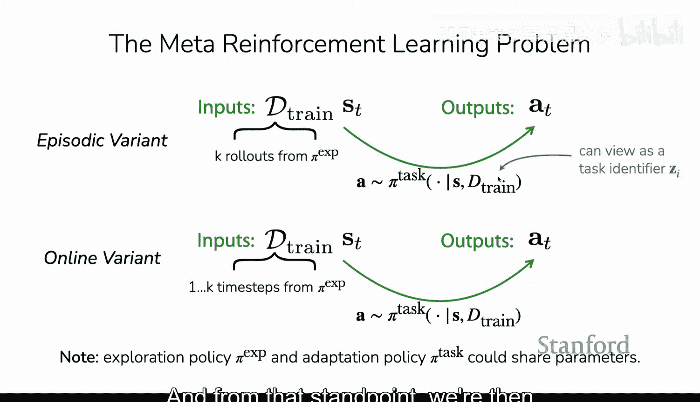

So the question is when I say that the test tasks should be in distribution compared to the training tasks。

 does it mean it has to be the same as one of the training tasks or or can it be a bit different。

 it can be a bit different and we'll see examples where it is different as well。

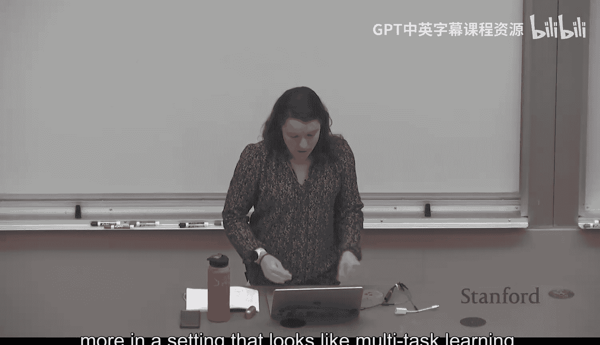

So let's talk about how to address these problems so the good news is that there's a kind of a very conceptually simple way to address this kind of general problem statement the bad news is that it can be challenging to optimize and practice and we'll talk about some of those challenges in a bit。

 but conceptually we can essentially train a sequence model it could be a transformer。

 any sort of neural network with memory or recurrent neural network， and。😊。

Use this where basically everything that's being passed into this policy corresponds to the experience that the agent has collected。

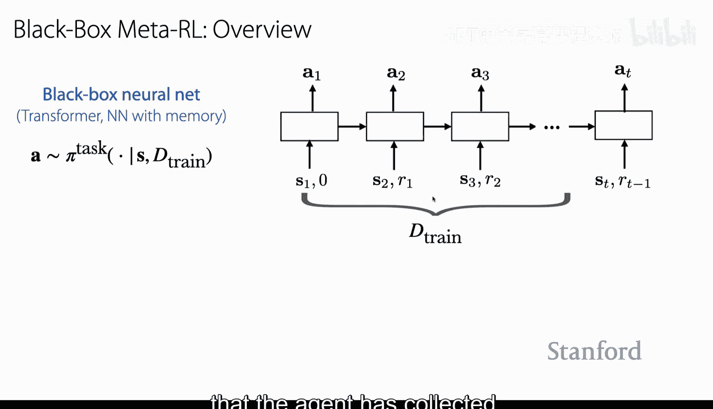

So you're sort of you're basically conditioning your policy on this training data set and then having a policy output actions based off of the data that it's seen so far in that MDP and then training this sort of the sequence model policy across。

😊。

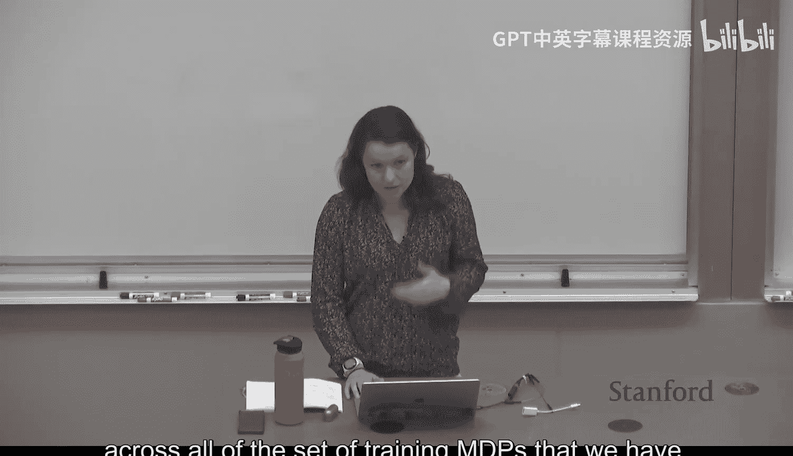

All of the set of trading MDPs that we have。So here， this is the current state。

 this sort of context or training data set is going to get larger over time as we collect more experience in a given MDP。

Now， a question for you， there are a couple differences between this and simply using a recurrent policy in a standard RL setup。

Or using a sequence model in a standard R also like using a transformer。

 Does anyone to have thoughts on like， what are some of the differences between just between kind of。

What I'm starting to talk about here。And simply using a sequence model as your policy in kind of a standard Ral setup。

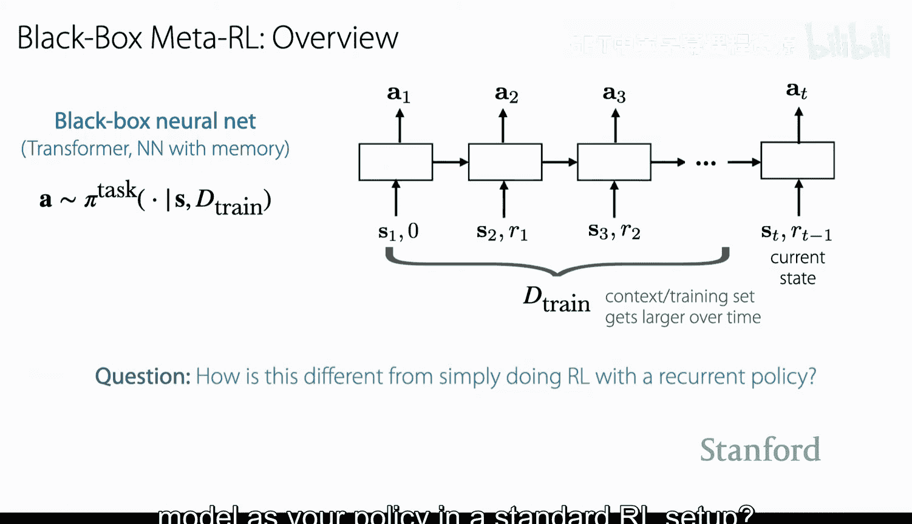

Memory， yeah， so typically in RL we often don't use memory and here we're using memory。

 so that's like that's one thing， but compared to if we had to use memory in like a standard RL setup。

 what else is different here？Yeah， so one thing that we're doing here is we're actually passing the reward as input into the memory and so and that's a little bit different in the sense that you're actually using reward information from the current MDVP in order to try to get better at the task。

 this also means that actually at test time or when we're trying to adapt to a new task。

 we're also going to be using the reward and in RL settings oftentimes we don't necessarily assume that we have the reward when we're just deploying our policy。

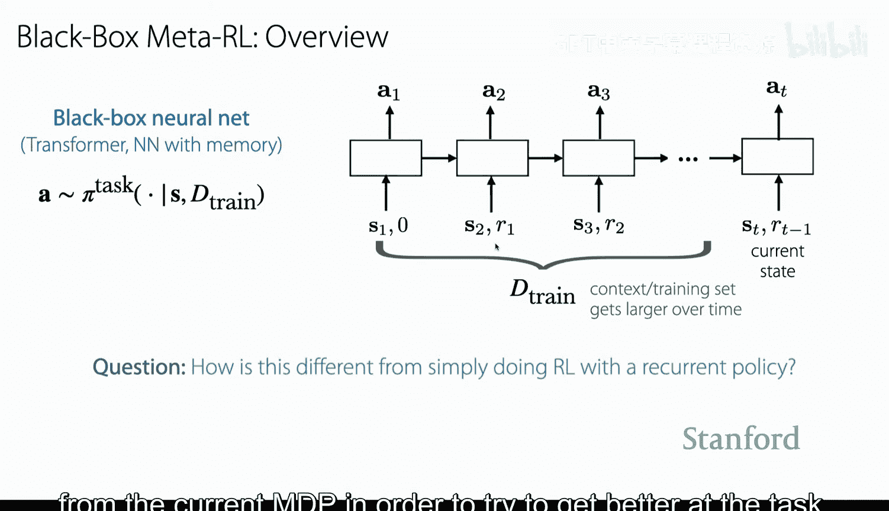

so that was kind of one main difference， any other differences。

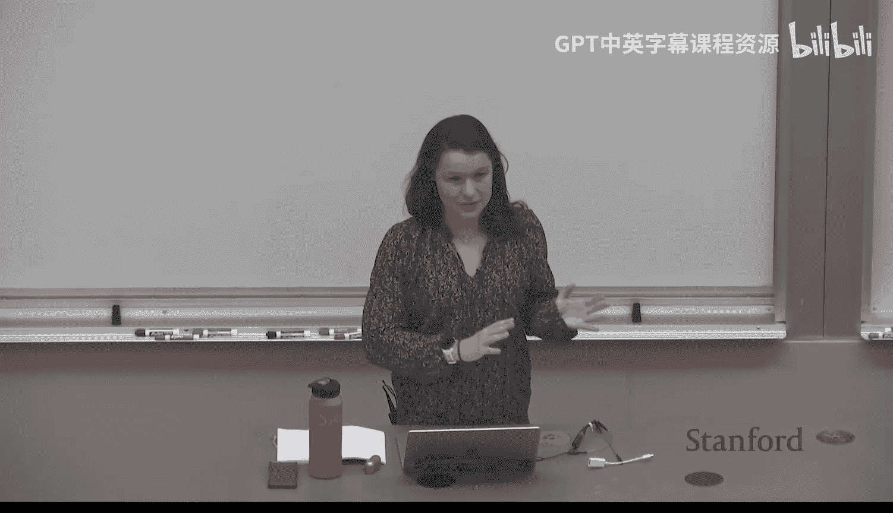

Yeah， so the question is why are we also not passive the as input the actions。

 you can pass as input the actions it depends on like if your policy is mostly deterministic。

 then information about past actions could be stored in the memory as well because you were predicting you generated those actions and so in those cases you don't need the actions if you have a more stochastic policy then that sampling process won't be necessarily in the memory in those cases it's good to pass as input the actions as well。

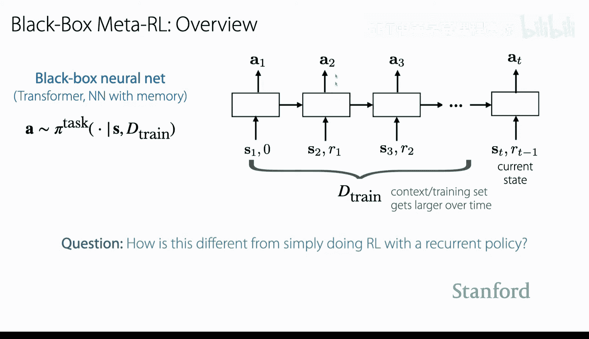

Right， so the note was that the states and actions might not be the same for different tasks and so one of the things that's different here is we're actually training this model across MDPs and so you might have a different state and action space you might have different dynamics and so because one of the big differences compared to standard R is that we're actually we're training this across MDPs and there's going to be differences in states actions dynamics and rewards across those MDPs。

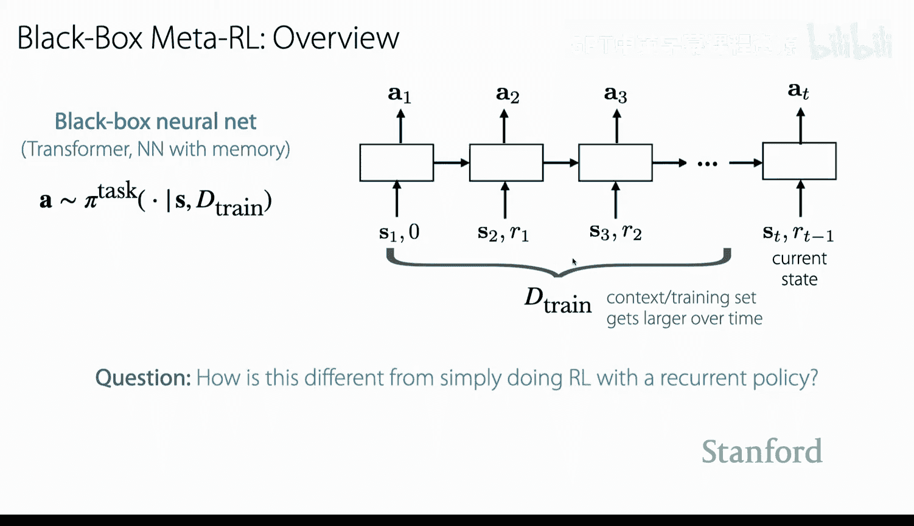

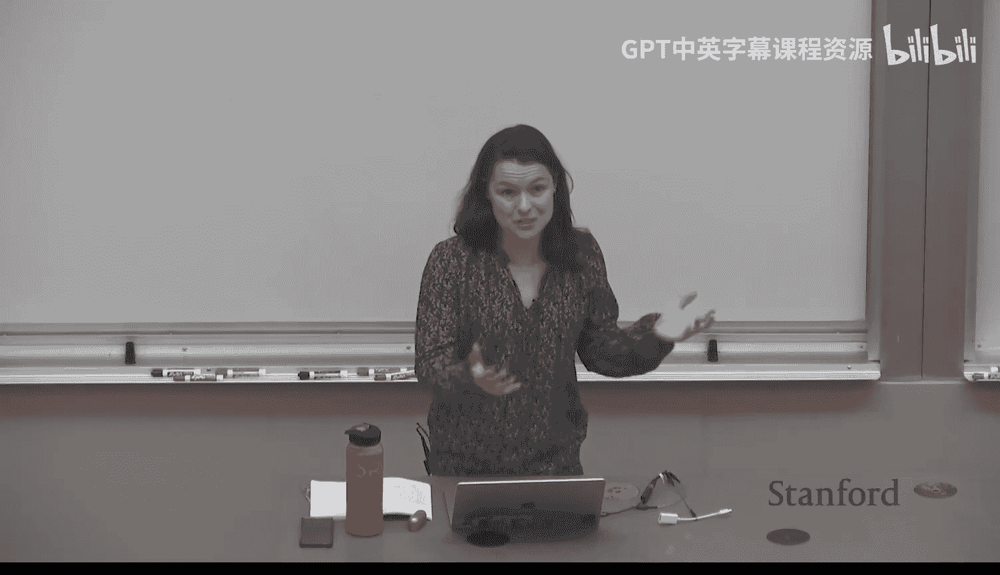

Co， there's actually also one other difference， but the first thing that we talked about is where see that the reward is passing as input。

 you might also be passing as input actions， and this is trained across multiple MDPs。

 and that's quite different from the typical reinforcement learning setup。Now。

 the second thing that's also different is that your memory。

Is also going to span across multiple episodes。 potentially， if you're trying to actually learn。

Not just within an episode， but learn across episodes then rather than having your current policy simply have memory within an episode。

 you will be maintaining any sort of hidden state or any sort of memory。

 not just within your episode， but across multiple episodes。So in terms of what this algorithm。

 maybe I'll leave this up here in case it's useful in terms of the algorithm。

 what this looks like is we will。

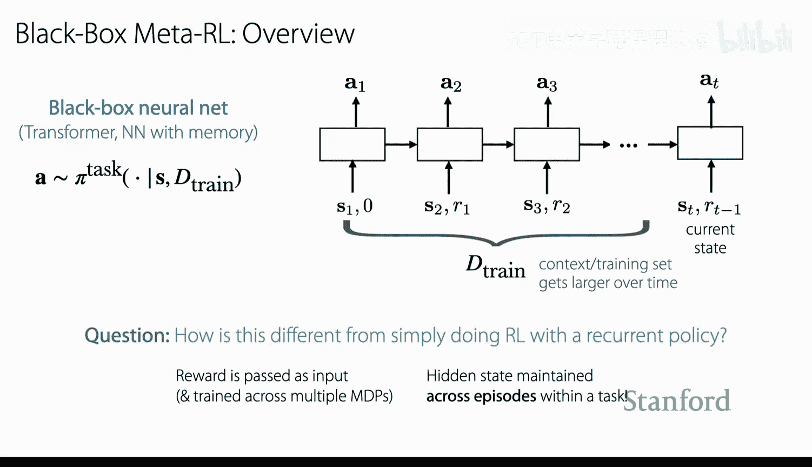

Sample。A task or an MDP。So maybe let's call this MDP。T， I。

And then we're going to run our policy in that MDP for multiple episodes。So let's say run。

Pi in our task， or MDP。For。And episodes。So this is rolling out this right here。

 And it's going to have memory across those Ed episodes。

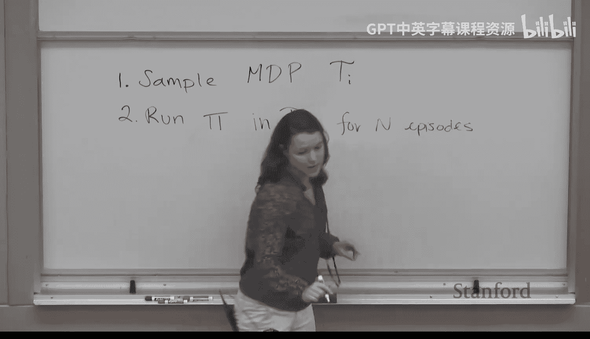

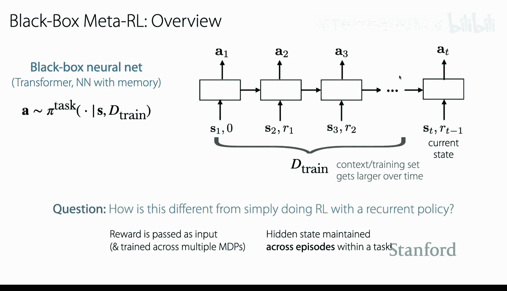

And then optionally， if we have， if we're using an off policy algorithm with a replay buffer。

 then we would store the the episodes in。A replay buffer。And then lastly， we're going to。

Optimize update our policy to optimize the rewards。 and so。We will be。

Updating pie and specifically we。Are going to be maximizing the sum of rewards like the typical Ral objective。

 But it's going to be across all of the tasks in our task distribution。 So we'll have。

Some some over tasks I in some mini batch， and then also the expected sum over words。

So this would be an expectation under our policy of the sum of rewards over different time stepss。

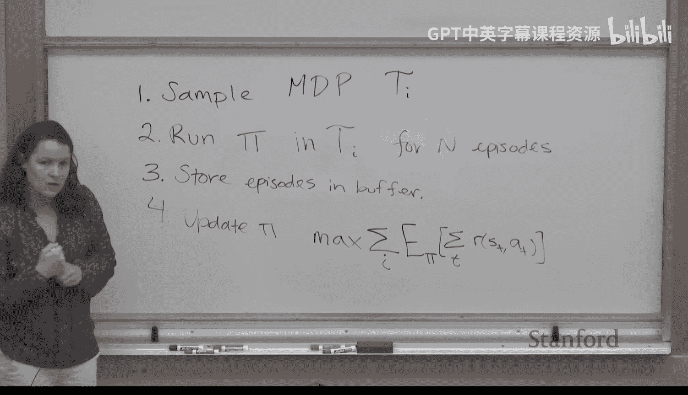

Now this is a pretty simple algorithm， it looks a lot like reinforcement learning。

 where simply the main thing that's different is that we're going to be doing this optimization across multiple MDPs and our policy will have memory across a set of episodes。

 usually this is going to be pretty small because if it was large if it was like  a thousand0 episodes。

 it's going to be hard to store that in the context of a model。

 like just because your memory will start to increase substantially。

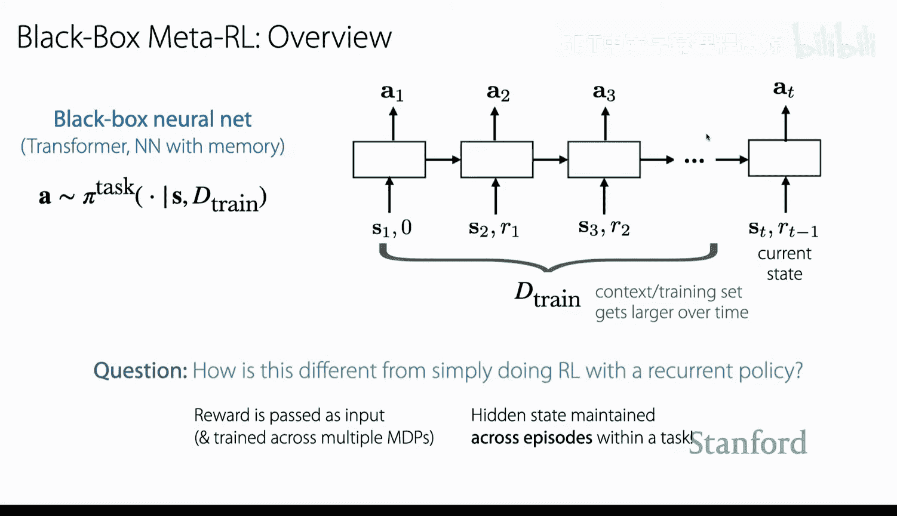

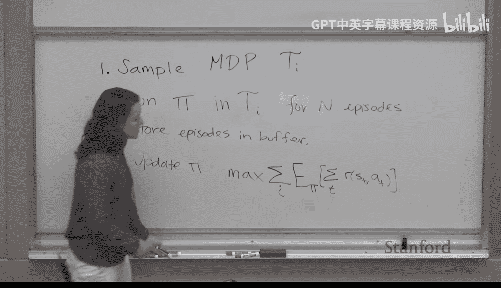

So what that looks like is you have this like neural network has multiple episodes and then you'll be kind of rolling it out for multiple episodes taking actions and then you'll start collecting for a new MDP so you'll cut your memory when you start to collect for the new MDP that you've sampled。

 so you sample a task， roll out the policy for end episodes in this case n equals two in this diagram。

 under the dynamics and reward function for that MDP。Then storing your replay buffer。

 oftentimes you'll have a different replay buffer for each task。

And then update your policy to maximize the discounted return for all tasks that you've collected for and then repeat this process in order to continuously get a policy that's better doing this sort of in context adaptation。

Yeah so that's a good question， so the question is does it know that it's starting a new episode like at this position right here。

 you could use a position encoding in practice you're also going to have a big like probably have a discontinuity in your state and so you might just be able to see that like your current state is very different from the past state and that might also tell it but yeah you could have some sort of token to also tell it that it's a new episode。

The question is， are we randomizing S1 across the different episodes when you're rolling out the policy。

 you will when you start a new episode you'll sample that will be a different sample from the initial state distribution and so S1 I guess this maybe a little confusing S1 here it might be different from S1 here S2 is very likely different from S2 here and so forth。

Cool， and then the outcome of this is you'll have a policy that should be able to adapt。

Across episodes with experience from those episodes and it should be able to on its own。

 actually decide on the best exploitation exploitation tradeoff and the best exploration exploitation tradeoff is going to depend on the number of episodes that you give it if N is to than it has two episodes to maximize rewards as quickly as possible and and if it needs to explore it'll explore as quickly as possible if n is a little bit larger than you've given it a little bit more budget to it still wants to like explore quickly and efficiently if it can because then it can get higher rewards later but it might have slightly more budget to explore and so you'll get one of the things that's like pretty cool about this when you optimize this whole thing end to end is that it will make decisions on whether or not to explore or to explore and it'll make those decisions in a way that's informed by whatever gets at the highest reward。

Then after this sort of training process， after you've trained it on multiple MDPs。Then， you can。

You could actually then roll out your policy in a new task。So。At test time。You will then。

Give it a new task， so。You're in some new。MDP。TJ。And。

You can take the policy that was trained and roll it out in。In that MDP so。Roll out。Hi。In。

MP with those date actions and rewards and so forth and so sample a new task， roll out that policy。

 you want to roll this out for up to end episodes， if you roll it out for longer。

 all bets are off in terms of what it might do。

You could also yeah， you could also have a variable number of episodes that you used during training if you wanted to be able to handle variable numbers of episodes。

 but yeah this would be like。For end episodes or for up to end episodes。

CoSo in terms of actually implementing this， there's a few different architectures and optimizeims you could use。

 So you could use like a vanilla recurrent neural network。

 Some of the first works on meta reinforcement learning did this。 and they used algorithms。 This is。

 I think before PPO existed or was introduced。 They used an algorithm that's somewhat similar in nature in terms of the assumptions as PPO。

There is also a model that a paper that before transformers are really popular。

 use self-attention and also 1D convolutions， you can think of it sort of as a transformer and optimized this and you could actually note that they do also pass the actions as input in this particular scenario。

One other thing， we'll talk about this a little bit in a bit more later， but you can also。

 instead of using a transformer or an RNN， you could also use a feed forward network and then average across average the embedding。

 this is sometimes called a deep set and it has its own benefits it's actually pretty computationally fast because you can parallellyze everything and also actually surprisingly expressive for what it can do。

So let's look at some examples， so we'll look at this example that was using something that's kind of a bit like a transformer and they were trying to learn how to visually navigate a maze。

 specifically new mazees that the agent had never been in before。They trained it on 1000 small mazes。

And they tested it on held out mazes that the agent hadn't seen before。

 they tested it actually on both on small mazees and on large mazeses。

 This is actually scenario where they were able to see some extrapolation to tasks that were outside of the distribution of what it was trained on。

So this is what it looks like。 This is at test time。 and you can see that the agent。

 it just is like exploring around this environment， looking for where the goal is。

 It only gets these images as input。And on the right， we can see the trace of the exploration。

 So it started in the middle， explored over here， and explored down here and eventually found the goal。

And then after that exploration episode， we're still。

 we still have memory from that previous episode and it's able to using that memory。

 it's able to then be able to kind of go directly to the goal。😊。

Based on this experience in that phaseze。And so kind of watching that again， whoops。

This is the first episode and so this is kind of the first episode of rolling out this policy。

 it's choosing to explore because it doesn't know where the goal is in this maze。

 it also doesn't know the layout of the maze and so we see it explore here。

And then in the second episode， it chooses to go straight to the goal because it decided that it already explored the extent of the maze。

Here's an example in a larger maze， so the agent starts over here。And。It explores in the top part。

 doesn't see the goal。And realize that kind of this is a dead end it doesn't need to explore it further and then it ends up seeing the goal here and then after that it it goes straight to the goal after that first episode and so in this training example n equals two so they trained it just to be able to explore and exploit after two episodes。

Cool， and then quantitatively they looked at the average time to find the goal in both the first episode in the second episode。

 they compared to using a random policy， which occasionally does happen upon the goal and using an LSTM architecture and this more kind of self-attention and convolution architecture and they found that with the small mazes even within the first episode they are able to do a lot better than random that means that's because it's actually exploring efficiently and then eventually often finding the goal and then it's able to like find the goal faster in second episode after learning where the goal is and about the maze in the first episode。

 and we also see that it does significantly better than a random agent in the large mazes and in both cases using kind of the self-attention architecture is better than using an LSTM architecture which is another memory architecture。

Yeah， so the question is， is the reward to find the goal。 And if so。

 why is it optimized to find it as fast as possible？ So the reward is to find the goal。

 I don't remember the exact structure of the reward the。It's optimized to find it quickly。

 There's a couple ways that lead to it to optimize to find it quickly。in this particular case。

 I believe they're using discounted rewards and so the discount factor。

 instead of being like this you have you're optimizing for discounted rewards so there's a discount factor right there and the discount factor is not one it's like probably like 0。

95 or 0。99 and so that objective will be higher if you get the reward sooner than later。Yeah。

 so the question is what is passes input to the model and yeah， exactly。

 So it's video from the previous episode， the actions from the previous episode and one basically everything up until the current time up。

 which is。Any previous episodes and everything is so far in that episode。

 so it's all of the video frames and then also all of the actions and all of the rewards as well。

Yeah， so the question is， where in the algorithm are we exploring exploration versus exploitation and the。

😊。

Here， because it basically all comes down to this objective for both of them and the insight is that。

The the agent doesn't know。It doesn't know much about the task。 It doesn't know well。

 depending on the the training tasks in this case， it doesn't know what what maize it's in。

 it doesn't know the structure of the maze and that sort of thing。

 And so it's actually not even it's not able to get high reward until it starts to explore until it finds like where the goal is。

 for example， And so by optimizing just end end for reward， you're incentivizing it to。

Like it's not going to get higher reward without exploration， essentially。Yeah。

 we will talk about that soon in like a few lectures， but yeah。

 there's lots of problems here because when your policy is bad and you're not getting good rewards。

 it ends up being very difficult to figure out a good policy。Yeah， so the question is instead of。

Doing what we're doing could we just do regular RL and then do test time training。So。In some ways。

 language models with recurrence。Like it depends on how you view it。 But in some ways。

 you are already doing something that kind of looks like metaorl。 if it has memory。

 and it basically has the ability to adapt， depending on the kind of the task that you're giving it。

 And then， yeah， and then one important component is if you're doing test time compute。

 you're allowing it to actually like think through the problem。 Now。

 test time compute is a very broad term。 So on the next slide。

 we'll talk about how you can actually use how meta URLl is relevant for test time compute。

 So let's talk about that now so。😊，Say that we're solving different math math problems。

 This is a canonical language model example， especially for a test time compute。

And one example of a math problem is trying to show this inequality this is actually the same。

 I think possibly the same math problem that overall showed in his lecture and。😊，In some ways。

 like trying to solve this math problem is you can think of it in some ways as an MDP itself in that there's different strategies that you might try to take to solve this math problem。

And。You don't know a priori which strategy is going to help you solve that problem like which kind of which like where do you start。

 like do you try to， for example， do guess and check。

 Do you try to like eliminate terms in the equation and so forth。

And ideally， you'd be able to kind of explore those different strategies and then produce an answer based off of the best strategy。

And it turns out that if you give， so deepCR1 is a language model that uses test time compute in order to solve math problems。

 and if you give our one different math problems to solve， if you give it a hard problem。

 it kind of thinks for a while， at some point， it like cuts off its test time the test time compute because it doesn't want to be thinking for too long for the user and then it outputs some explanation for the user。

And then also if you give it a really easy problem， like 2 plus two equals question mark。

 it actually also kind of thinks through what the solution might be and then gives a step by step explanation for the answer。

And so this is something that is like clearly somewhat wasteful to do， probably。

 unless this is somehow a challenging problem。

And so you can actually use this notion of meta Rl to try to optimize for test time compute。

 And if you know that you're gonna to be doing test time compute at test time。

 then basically bring that into the training process and。

Encourage the model to efficiently use that test on compute efficiently explore different strategies such that ideally on easy problems。

 it is trying to output an answer as quickly as possible and for harder problems。

 it's thinking as much as it needs， including possible exploration until it then tries to exploit and give an explanation。

And so this paper here was a paper that explored that。

 they found that when they were trying to explicitly optimize for effective use of test type and compute。

 they were able to get higher performance with the same number of tokens and also actually reduce the number of tokens needed to get the same performance so that you aren't。

 for example， using up a ton of tokens on simple problems。

So that's the use case of meta ideas for metaRL in language models。

Now a quick digression， and this will actually lead us into a different way of thinking about meta Rl。

So we've talked about multitask policies where we condition on a task descriptor。

 so maybe we want a robot to stack in different locations or a robot to walk in different directions。

And we've talked about policies that take as input experience and then kind of generate actions based off of that data。

And if you were to think about how this relates to multitask learning policies。

 one way to think about it is that。We're just doing multitask learning。

 but now this data is our task identifier。

And it's something that actually changes within a task， so the analogy is not perfect。

 it's not actually fixed for a given task because sort of think about it as conditioning on the task insofar as experience tells you what the task you're trying to do is。

Cool。And if you think about goal condition policies。

 rewards are like you can sort of also view Me Rl as kind of a generalization of goal condition policies because there's a set of。

MDPs that are goal- reaching MDPs and then there's a broader set of MDPs that are reward maximizing MDPs and so and then the other way to think about this is instead of trying to generalize two new goals。

 you can think about metaRl as trying to adapt to new tasks with a small amount of experience this would be kind of the difference between zero shot generalization in the goal condition case and K shot generalization with like K episodes or K time steps in the meta RL case。

No， so we've talked about how we can view the experience as。The task descriptor's year， the prompt。

 essentially。But there's actually another way to look at it。

 which is that if we think about this policy with memory and that has kind of the past memory and then our current policy。

If we were to think about what information is being passed right here。To the policy。

This information is presumably information about the task。And so and specifically。

 when ZI isn't part of the state， there's ambiguity about what MDP you're trying to solve。

 and you're using that experience to try to identify the MDP that you're in。

And you can sort of think about it as the policy needs to infer the task it needs to infer specifically some sort of latent task descriptor from its experience。

And so another way of looking at metaRl is something where you are using your experience to infer what the task is and then conditioning your policy that's actually the current time step on your current estimate of what the task is。

So you can think about it essentially as meta Ral is trying to explore to infer this unknown task and then perform the task。

I see。 So you're asking like， because we're going to be inferring the task identifier。

 Why don't we just give it to the， the learning system。 Yeah， so the main reason is that we。

If we don't have a compact way of describing the task that the agent is doing， then。

It may actually be like challenging like we may not have if you don't have a good way to represent it。

 then we're not sure what to pass into the policy and if we don't have a good way of representing it。

 we can always resort to just using an index saying this is task one this is task2。

 this is task3 but if you do that and then at test time you say this is task 100 it's not going to be able to generalize in that scenario and do anything about that scenario about that task whereas experience like conditioning on experience is something that could generalize where it can actually be able to use use kind of the more continuous space of states rewards and so forth in order to figure out a new task so it comes down to representations and you could sort of view this as like learning a Z representation like learning like a continuous vector that's representing our tasks。

Now， in multitask Rl， we talked about how there was this。

We talked about how if you like formulate some state space that it corresponds to the original state space and the Z vector。

 then you get this aggregate MDP。And so the result of this is。Still an MDP。

Just with a new state space and new dynamics to account for this new state space。

so there's a question of like。For Me Rl， is there an aggregate MDP？And。This would be for meta R。And。

In this case， we're not providing ZI in the state。And so there's actually like inherently。

 it's actually partially observed。 You don't actually know what the task is。

 You're trying to explore and figure that out from experience。

And so there isn't actually an aggregate aggregate MP that you could think about。 Instead。

 there if you wanted to try to aggregate it into a single decision process。

 it would have to be a partially observed MP or a Po DP。And it's actually a special kind of po Dp。

Where we talked about before where you have like some sort of partially observed mark decision process where you can't actually observe S。

And the you have actions。 and instead of observing S。

 you observe some observations that are some function of S。

ThatThat would be kind of the general Po D P case。 One thing that's a little bit special about。

About the better R thing is the only thing that you can't observe is what the task is。And so。

It basically upon VP where this hidden state space can be defined as the observation and the task identifier。

And if you can infer the task identifier from experience。

 then you can essentially view it as a way of trying to infer the underlying state space as a way to solve the poty piece。

So this is basically kind of another way of looking at them that are all problem is basically like a partially observed Markov decision process。

Now there's a meal method that we actually just talked about I had showed an architecture diagram that was actually explicitly trying to output Z's and it was actually outputting some distribution over Z's because at the very beginning you actually don't know what Z is you have some kind of prior belief over what Z is and then as you get more experience。

 you're going to have a better and better estimate of what Z is and so if you represent a distribution over this kind of latent task representation then you can do kind of cool things with that and we'll see that in a bit。

AndSo this particular algorithm is looking at continuous control problems where different tasks corresponded to walking in different directions。

 running at different velocities， and also different physical dynamics。

 so being able to adapt when the friction is different or the inertia of the robot system is different。

😊。

The other thing was that。Everything what we saw before was using like a PPO style algorithm。

 which is somewhat off policy but not very off policy。

 it's kind of more on policy than off policy in some ways because it's not using a replay buffer of past data。

And with Mediterranean algorithms， you can adapt really， really quickly。

But the training process might be really slow if your base algorithm is fairly on policy。And so。

As a kind of question， hopefully this should be a straightforward question。

 if your base algorithm for updating the policy at step four， if that's an off policy algorithm。

 do you expect that to be more or less efficient if you used an off policy or than if you use an on policy？

Face method。Yeah more efficient so if you're using a replay buffer and using that replay buffer to update your memory your policy with memory that should be a lot more data efficient during this meta training process kind of a test time when you're adapting the efficiency is going to be similar so this is just talking about the efficiency for actually training this sort of in context learning system。

And so if you if you actually look at the curves like over this training process right here， number。

 the amount of data that you need in order to kind of me learn these kinds of systems。

 you can see that in blue， if we're using kind of an policy algorithm with a replay buffer。

 it's a lot more data efficient learns a lot more quickly than RL squared and ProM。

 which are using well actually all three of these are using base algorithms。

 face RL algorithms that are more on policy and more like PPO for example。Yeah， so the question is。

 can I elaborate on what specifically is in the replay buffer so the typically you'll have well。

 so each replay buffer will have。A sequence of episodes。

 basically each thing in the replay buffer will be a sequence of episodes from a given MDP and that includes like the states。

 the actions， the rewards and when you optimize this you'll need to oftentimes you'll have a different replay buffer per task so you can sample a task here and then optimize the reward for that task。

 using the memory from from that trajectory， typically the buffer instead of just storing states and actions。

 you're storing full trajectoryjectories together because you're going to be training a model with memory and you need to be be able to provide that trajectory as memory as input to the policy。

Cool， so summary so far， we've talked about using these models to be able to adapt to new MDPs。

 they're general， they're quite expressive， and there's also a variety of choices in the architecture。

One thing is that are hard to optimize because you're actually it needs to figure out how to adapt from data and there's lots of like there's lots of different input features here that you could try to pay attention to and the model has to figure out what about like those input videos that you're passing as input for the Maize navigation is useful when you're then trying to exploit and learn a policy。

So's because you're passing in so many things as input it such a big model。

 it can be hard to optimize for that reason， and it can also be hard to optimize from an exploration standpoint。

 which we'll talk about right after this。And then。Like the sample efficiency of the metal learning process is going to be inherited from whatever optimizer you use in this last step right here。

And so if you use something like vanilla policy grading and it'll be extremely data inefficient。

 if you use something like PPO， it'll be more stable but still fairly inefficient if you use something like S。

 it will be probably a lot more efficient， although you might need to tune the hyperparameters more。

So now let's talk a bit about exploration。 by exploration， I mean like exploration in context。

 exploration。When you're trying to explore a new task。

What we've talked about so far is trying to optimize end to end for exploration and exploitation with respect to the final sum of rewards。

Then simple， in principle， it can actually yield the optimal exploit。

 exploitation trade off because you're optimizing directly for of the sum of rewards。

And that's really， really nice。 But it can be a really challenging optimization。

 And let's talk about why that's the case。😊。

So。Let's look at a running example， so say that you have。呃。Some robot。

That looks like this and the robot needs to find something and there are some hallways。

That the robot might need to go down in order to try to find。

The thing that it's trying to find and different tasks correspond to different locations of the object that it's trying to find so in one task or one scenario it might be all the way over here in another scenario it might be over here and so forth。

And to help the robot out a little bit。

We're going to introduce one other thing， which is that there's going to be like some piece of paper over here and that paper actually says where the object is in words。

 like it says that the object like maybe is trying to find like a replacement light bulb or something like that and it says the light bulb is in like the fourth hallway。

At the end。Okay， so here's our robot， here are the hallways。

 different task correspondent navigating to the ends of the different halls。

 and we have some information about where to go and if we look at that。

 information will be in the state about where the reward is for this task。No。

How do we actually learn how to explore， So say that we were trying to collect trajectories and trying to learn how to explore such that we can get a good。

 get good behavior。 So say that we。😊。

Let's start with a scenario where we sampled this task and maybe the task was to go to the end of this hallway right here。

And say that we collected a， we actually kind of just got lucky。

 we collected a trajectory that just went straight to that reward。

Now in some ways that seems good because we got reward for that。

 and so that gave us some reward and that's like optimizing the objective that we care about ultimately。

But the thing that's bad about this is that。The robot doesn't like the robot got lucky。

 and it doesn't actually。Know how to repeat that in the future because it didn't actually explore any other alternatives。

And so this is going to be。

The way that we can kind of view this is that it goes to the end of the correct hallway。

 it'll get positive reward， but the context。Leading up to getting that positive reward doesn't actually look different than any other task it kind of went through here and there's nothing that kind of differentiates what it did there。

 which was like zero rewards， zero reward， then if the task， for example。

 had been to go here or to go here。

And as a result， I didn't actually learn how to explore。

 and it didn't learn how to use exploration information in order to solve the task。

And so this trajectory might might actually be very helpful for learning。

For learning how to explore and learning how to exploit。Now let's say that we had。A different。

 a different trajectory。 So we're exploring。

And let's say that the agent。Instead of doing that。

 had it maybe sampled the same task and it went to the end of this trajectory and then continued。

 didnn't see that and then went to the end of this trajectory。

So that would be good in the sense that。It it does actually have like it did kind of rule out it has experience that ruled out one task。

 and now then it got rewarded for a different task。

 And so it's going be teaching it something about an exploration strategy that works。

The downside is that exploration strategy is quite suboptimal because it would have been a lot more efficient then to first look at the instructions and then go to the correct position。

And so it's。Some good， somewhat bad it provides signal on a suboptimal exploit and exploitation strategy。

 and so it's perhaps better than the first trajectory that it did， but still not ideal。

Now let's consider a third trajectory。Say that we are again collecting data for the metaal process。

 and let's say that the agent decided to look at the instructions and then just like stay and watch the instructions。

Does anyone have thoughts on whether that would be like a useful trajectory or not for the learning process？

Yeah， exactly。 So it did something useful， but it doesn't get any reward for that。 Like。

 it only gets rewarded until it if it did that and then went here。

 And so that's also not going to be very useful for the learning problem。And。Basically。

 you only like。In the problem like this， you're only going to actually be getting good。

 like learning something useful about how to explore and exploit if you successfully。

Did the proper exploration behavior and then did the exploitation behavior。

 And if you do them in separate episodes， then then you're not actually getting good learning signal。

And that means that you sort of have this kind of sample complexity where you need to actually get lucky and do both of the two things at the same time in order to get signal that helps you learn the problem。

So basically it's hard to learn how to explore and exploit at the same time。

Another example of this is say that you're trying to learn how to cook。

 you have data in previous kitchens， your goal is to then be able to quickly learn how to cook in a new kitchen。

Now， in order to learn how to cook， you need to find the ingredients and if you haven't yet figured out how to find the ingredients because you have bad exploration。

Then you can't learn how to cook because you don't have the ingredients with you。

 And then you're going to get low reward。And then also。

 if you don't yet know how to cook because you haven't like collected experience on that。

 then regardless of the exploration you do， you're going to get low reward。

And so you sort of have this chicken and egg problem between learning how to explore。

And learning how to solve the task using that information。

And so there's another way to view this is this kind of coupling problem where exploration and execution or exploitation depend on each other in order to be jointly successful。

So。Then the way to view end training is that it's great in that you can learn this optimal trade off。

 but it can be extremely challenging if you have a hard exploration problem because you need to figure out how to explore and exploit and get learning signal that way。

The question is is the ultimate challenge here that the reward is sparse。

 So it's true that if you had a dense reward， you you'd be in a much better place because basically because you wouldn't really have to explore you。

Yeah， you would be able to。Well you wouldn't have to explicitly take actions to explore。

And this really comes down to a problem when exploration is hard， if exploration is easy。

 this really isn't a problem because you no longer have to solve both exploration exploitation。

 you only have to solve exploitation。

So there's a couple solutions to this， and we'll start to talk about one solution today。

 and then on Friday， we'll talk about more solutions。So。The second solution。

 I'm not going to go into complete detail on how these work。

One solution here is instead of optimizing just for end to end reward。

 you can add in auxiliary exploration objectives to encourage it to try to actually figure out something more meaningful about the task。

And one approach here is to use what's called posterior sampling， also called Thompson sampling。

And the way that this works is that we talked about。

We talked about having an algorithm where you're trying to infer what the task is。And if you have。

If you've collected some experience so far and you've inferred some distribution over your task。

 in this case ZI is now kind of some blatant representation， it's not a representation that's known。

Then what you could do is you could then。Sample from this distribution and then act as if that was kind of the correct task。

So if you have if you have like this task conference procedure。

 and then you also have a policy that given an estimate of Z is able to。Generate actions。

Then what you can do is you can sample a Z from this distribution and then sample from this policy。

And if you have policies that can that are able to this starts to kind of decouple the problem a little bit because if you have policies that for given Z are kind of due the task。

 then you would basically learn an exploration strategy that is trying to kind of go down the different。

The different corridors to find。

The solution， so as an example， this is actually a problem that looks somewhat similar to the corridors where you get a sparse reward if you reach one of these circles and the different circles correspond to different tasks。

😊，And in this case， we've sampled this task right here。And first。

 we sample a Z from our kind of prior over tasks without any， any we haven't collected any data yet。

 so we sample Z， we then run our policy based on those different Z's。

 and we get exploration based on these。And then we use that to infer what the task might be。

 and so now we know that the task is probably either over here or over here。

And so now you will collect trajectories that are lighter in color that are like this one， this one。

 and going over here。And then once you've actually collected this trajectory。

 then you should actually have a much narrower distribution over the task because you get positive reward here。

 and so then you'll your policy or your Z distribution will be narrowed out here and you'll exceed your policy according to those Z's。

And so。That's kind of one approach for addressing this exploration problem。

Basically learning this latent representation over tasks and then sampling from those tasks from that distribution and acting according to your policy for that task。

Does anyone have thoughts on like so there's some scenarios where this is great and scenarios where this is not so great。

 does anyone have thoughts on when this sort of sampling might be bad。

 like what sort of MDPs this might not work well in？

If you have a large action space， that could contribute。

 although it isn't just having to do with the action space because if you have a dense reward in a large action space。

 you'd be probably okay。

So if is out of distribution， certainly things will be problematic， but even in distribution。

 there's scenarios where this exploration strategy will be like really bad。Yeah。

 so one so one scenario where this might be more poorly is if。If you start to see like some reward。

 but there might actually be even better reward in another scenario。

 you might kind of start to exploit a little bit too early。

 although it won't rule out those higher reward scenarios if it knows that there are other tasks that might have higher rewards。

So I guess the kind of the scenario that I was thinking of where I think that this can be quite bad is。

It's actually a lot like this scenario right here， so the strategy that posterior sampling will learn in this scenario is instead of looking at the instructions。

 it's instead going to go down each of the hallways and try to find the reward because it's trying to explicitly explore by executing policies corresponding to different tasks。

And this will be especially bad if the hallways are very long。So if the hallways are really。

 really long， like I would take days to traverse， then what it's going to do is it's going to spend days going down one of them and then figuring out that it's not the right one and then spend days going down another one rather than trying to seek out information that might tell it about what to do。

Cool， so for example， if the goals， if these goals are very far away and there's some sign that tells you what the correct goal is。

 then this is about strategy now if that sign doesn't exist。

 then kind of it actually would be a good strategy because you have to go down to a different quarter。

Okay， there's a couple of other approaches that we can use as well that include intrinsic adding intrinsic rewards that try to encourage it to visit new states and also trying to visit states that help you distinguish the dynamics and reward models for different tasks。

So we try to collect data so that our model of rewards and states are accurate and with this sort of approach you could actually get exploration strategy that looks a lot more efficient。

 that looks something like it is compared to posterior sampling that's trying to kind of just sample the different trajectories for the different tasks。

There's also scenarios where this might be bad if there's lots of distractors or really complex state dynamics。

 I unfortunately don't have too much time to go over that now so these sorts of approaches are easier to occupyup than end to end。

 a lot of them have some principle behind them， but they can be very suboptimal in certain environments and it kind of depends on the environment or the domain。

