# 斯坦福大学《深度强化学习｜CS224R Deep Reinforcement Learning  Spring 2025》中英字幕 p15 -15- Lecture 15_ Hierarchical RL and IL.zh_en -BV1SvmxB3E5e_p15-

Hi everyone， let's get started in the past couple lectures。

 we've been talking about training R and imitation learning systems that can do multiple different tasks and we first looked at this from the lens of multitask imitation and reinforcement learning where you condition a policy or a Q function not just on the state but also on some sort of descriptor of the task or there are also scenarios in the goal condition setting where that descriptor could actually be a state itself like a goal state that you're trying to reach and then more recently we were talking about meta reinforcement learning where you could think of that instead of kind of conditioning on a de of the task you want to do。

 you actually need to figure out from a few examples and a little bit of experience with rewards what the task is and you're trying to train this sort of like few shot policy that can adapt with a small amount of experience。

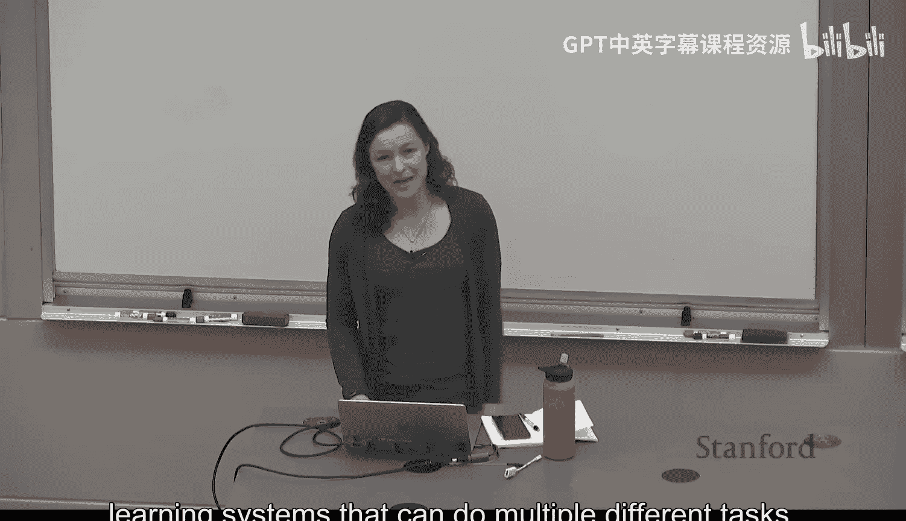

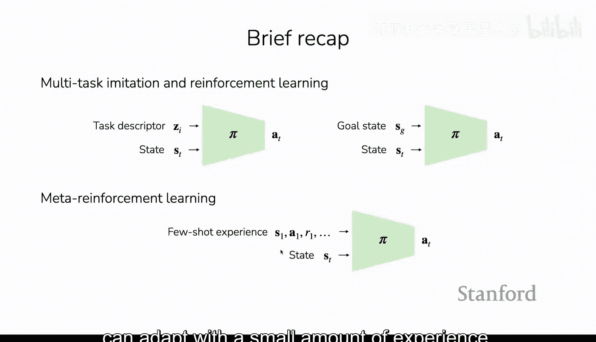

Now today， we'll be kind of building on some of these concepts and trying to not just train a policy to do multiple tasks。

 but to actually string together behaviors for multiple tasks into a longer horizon task。

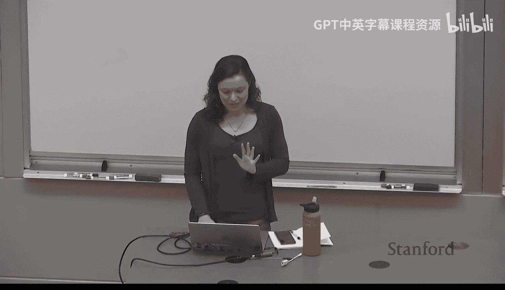

So this is where we're going to be talking about where hierarchy might be helpful for solving long horizon tasks。

 and then we'll be talking about some of the key design choices behind hierarchical imitation and reinforcement learning methods。

 including how to represent skills and goals， when to move on from one goal or task to another and the supervision for the different levels of the hierarchy。

😊，And then lastly， we'll go through a couple examples of what these systems can actually look like because there are like a variety of different ways that you could design these sort of hierarchical systems。

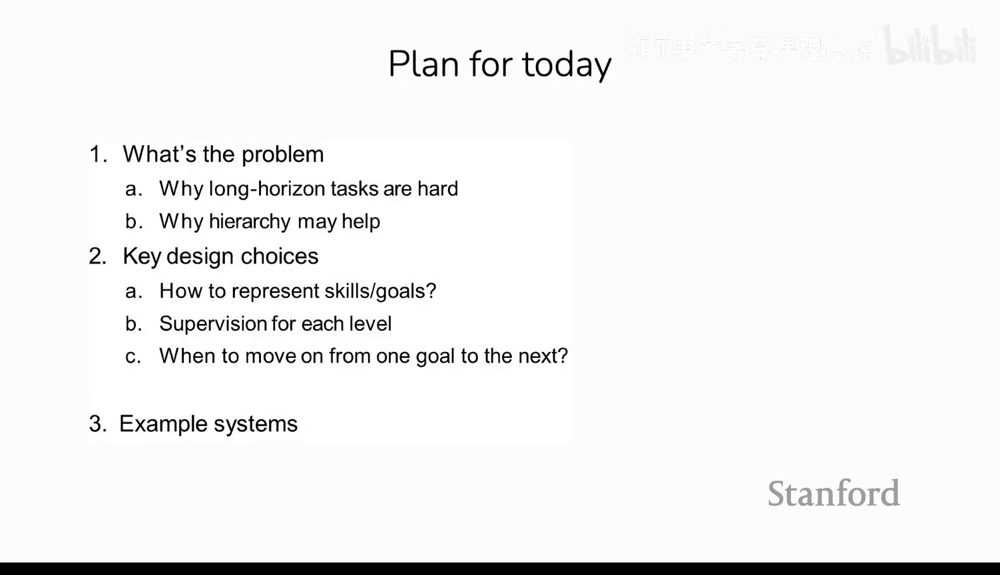

So the tasks that we'll be talking about today are long horizon tasks and by long horizon tasks。

 I mean tasks that take a while to complete and might consist of a number of different subtasks or a number of different steps that you need to take in some sort of sequence or order in order to complete it successfully so this could be something like cooking a meal it could be for like a robot system for like an LLM agent。

 it could be trying to fix a bug that's causing a neural network training loss to explode for an autonomous vehicle。

 it could be driving to Yosemite for a different sort of LLM it could be giving feedback on a long report。

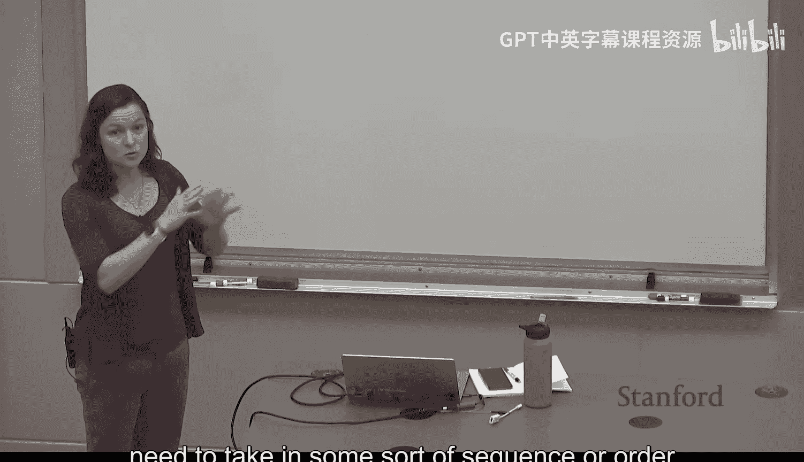

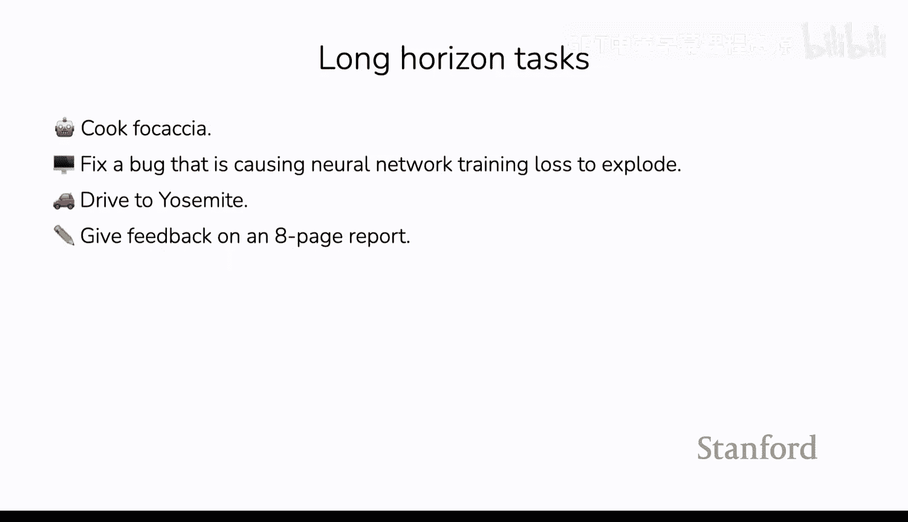

And for these tasks， you can think about how there are oftentimes different steps that you need to complete。

 Some of those steps might be。Independent on one another。

 where it makes sense to do one before the other and other tasks might be something where they're less interdependent and it's actually okay to do those in parallel。

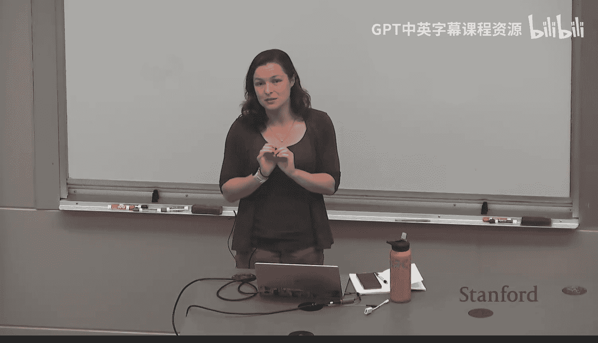

These are really hard problems for AI systems to solve in general。

 and the reason for that is there's kind of a number of reasons for that。

 so the first is that when you are doing a task that takes a long time。

 you're visiting a large number of states。

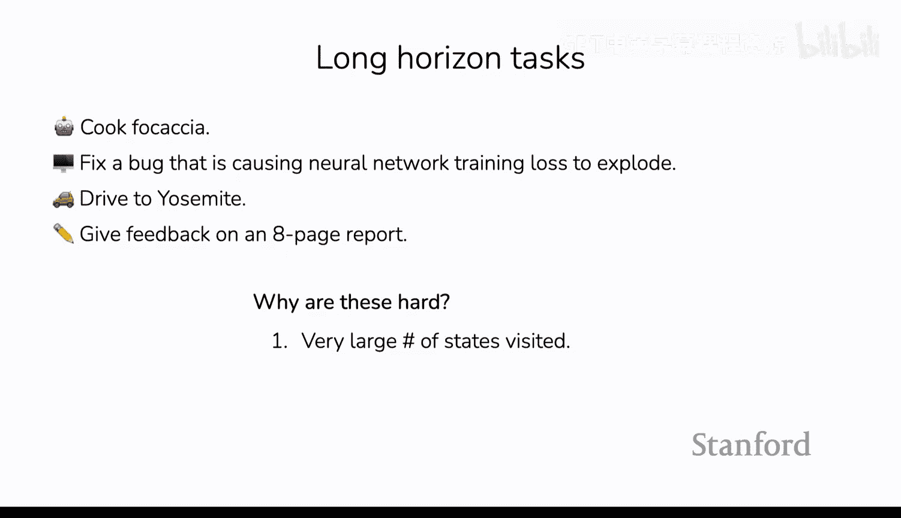

Along the way to get there。And every new state that you visit。

 you need to be able to make decisions for。 So you had basically just have a much broader distribution that your policy needs to be successful on。

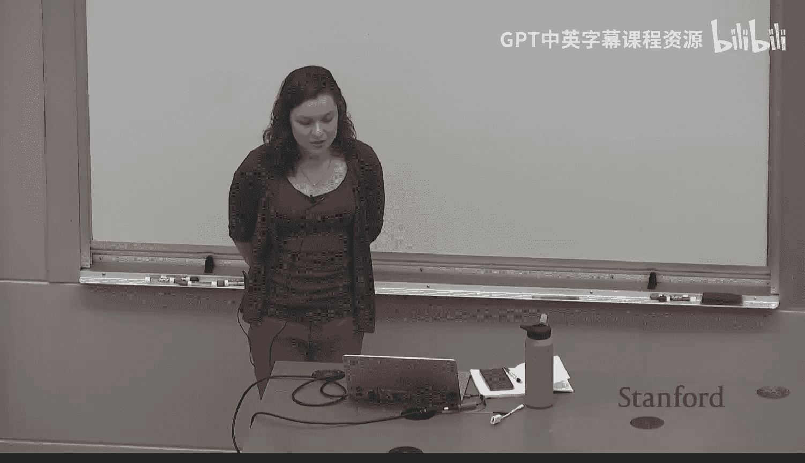

There's also a lot of different opportunities to make mistakes and if you make a mistake。

 you need to be able to recover from that mistake if it's something that you can actually recover from and separate from mistakes。

 there's also just opportunities to get stuck for example。

 if there's kind of one kind of mistake that might， for example。

 not lead you to actually make progress on the task。And。If you're not making progress。

 then you'll actually just end up in the same state again。

And you'll keep on making that same mistake over and over again and essentially just get stuck at performing the task。

 and these kinds of mistakes are kind of particularly gnarly because they when you end up in the same state again。

 your policy will keep on kind of deterministically staying in that state and never making forward progress towards the goal。

And then what's the main idea behind hierarchy？ So we've talked about multitask policies where you have some。

 actually， let me draw this further to the right。 We have some policy that。

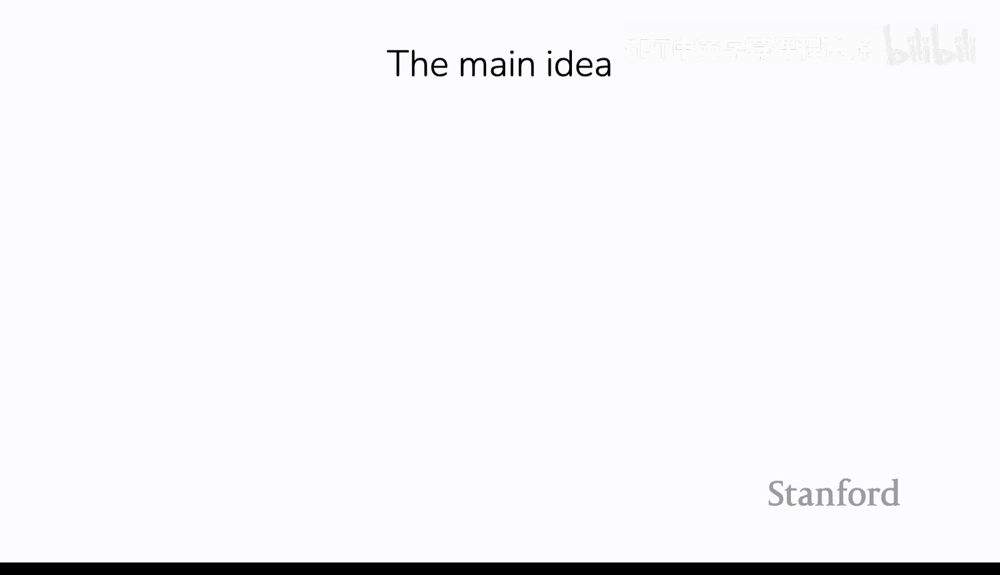

It takes this input some state， maybe the state at some time step。

 and it also takes his input some task or some goal。

 I'm going to write this as G for now because this this task or goal could take a number of different forms。

And。This is passed into your policy to produce actions that are trying to address that particular goal。

The idea for trying to solve long horizon tasks is if we have a policy that can do a number of different things。

 then we could try to break up a bigger task into into different subtasks and then use use one policy to actually tell this policy what task it should be doing at any given point in time。

So for example， you could。Have another policy here that's actually outputting the goals to be doing。

 and this policy should also have information about the state as input so that it knows where it is and what goal makes sense for the next for the agent to do。

 and then optionally this kind of this is often called like a low levelve policy or we'll use pi LL to refer to this is kind of the low levelvel policy this is doing shorter tasks and we can refer to this as a high level policy that's outputting goals for the low-leve policy to accomplish。

 and this policy， it can have a task， you may also sorry。

 I forgot this as low level that should be high level。The。

 if you want our your policy to be able to do multiple long horizon tasks。

 then this high level policy could also have some sort of task descriptor is input as well or some sort of goal is input。

 And so we， for example， could have。Goal high level as input to this policy if you want to be completing not just one long horizon task。

 but multiple long horizon tasks， like not just driving to Yosemite。

 but also being able to drive to the Grand Canyon or L A or Seattle or something like that。

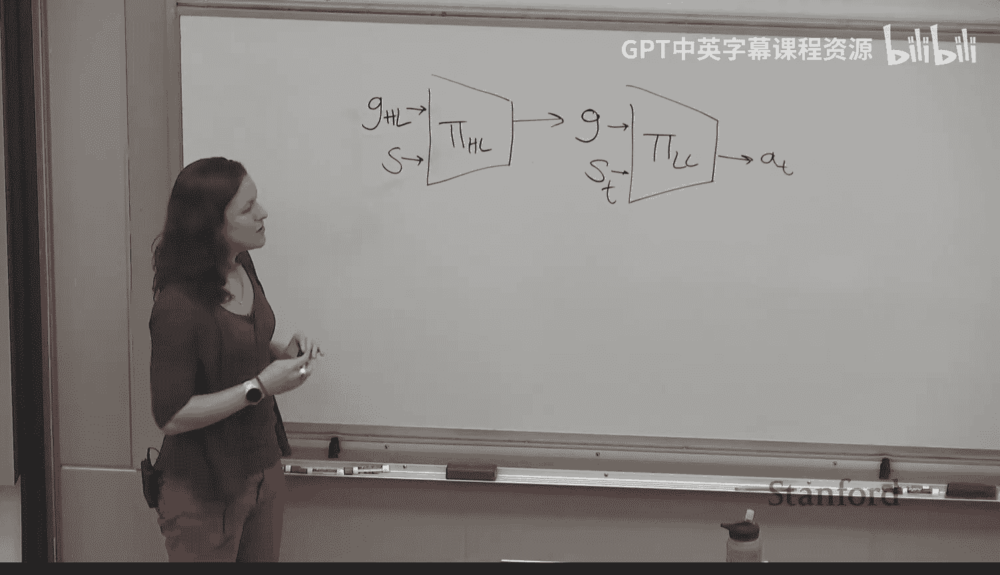

And。The kind of crux underlying this idea is that if we can break up a really long task into smaller parts。

Then we might be able to better。Address the problem。And say， for example。

 your long horizon task is to bake a cheesecake。This is a really， really hard problem。

 And if you just try to train a policy like like a robot policy to output motor commands for doing this task。

 it's really hard to figure out like what you should be doing at any given point in time。

 But if you're just starting out， you can think about， okay。

 what's the first step for accomplishing this， Maybe you need to by ingredients then what's the first step of buying ingredients。

 Well maybe you need to go to the store and how do you get to the store。

 well maybe you need to walk to the door to walk to the door you might take a step how do you take a step。

 you might contract a muscle and so you can basically break down a bigger task and do a much smaller task and these smaller tasks are a lot easier to train systems to do And if you can train systems to do the smaller tasks then you can try to compose them with like a higher level policy to be able to accomplish that more challenging task。

😊。

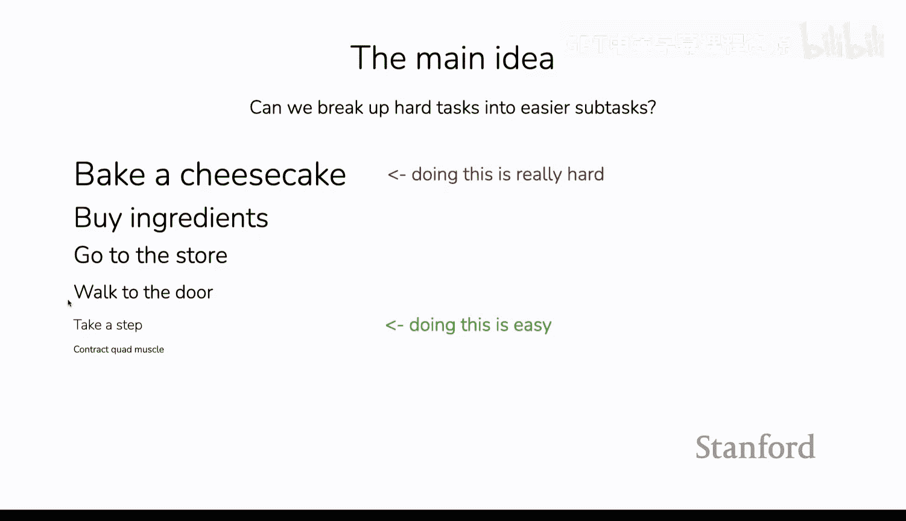

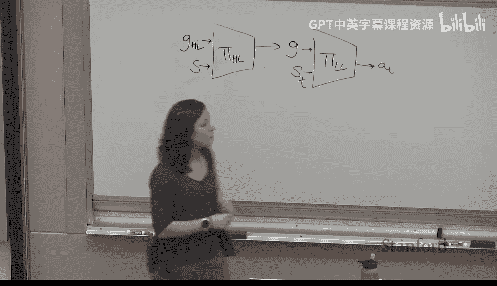

So what we can do is for the bake of cheesecake task。

 we could pass this with a state or observation into a high levell policy。

 which is going to predict an intermediate step like for example， go to the store or go to the door。

 and then that intermediate step along with the state or observation will be passed to the low level policy to predict an action。

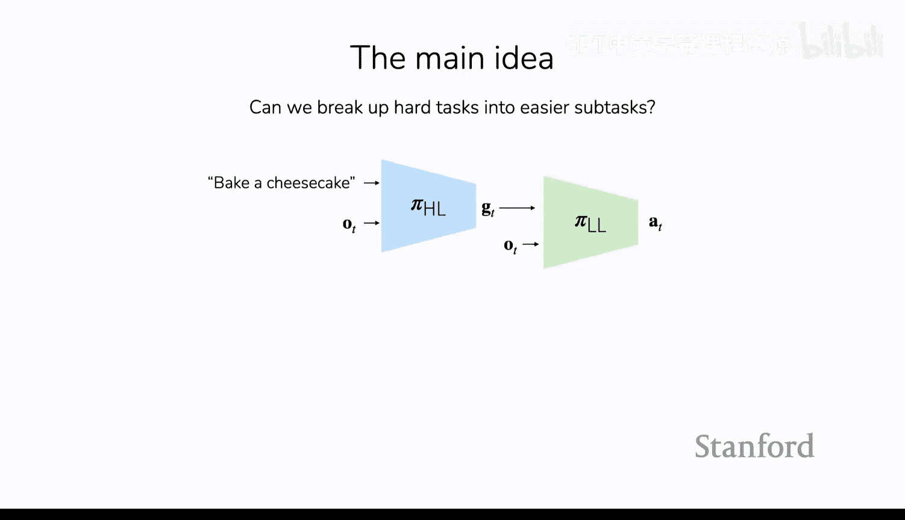

Now， a couple notes here。 So one note is that the this low level policy。

 this needs to be acting at the original kind of frequency。 So if you're。

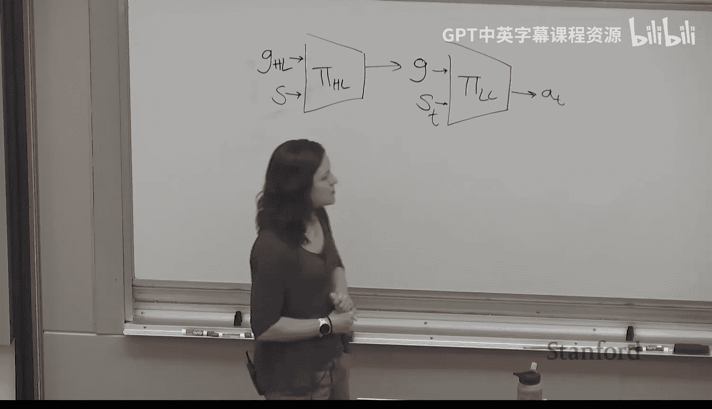

If you're controlling a robot， maybe this is operating at like 20 Hz。

 if you're controlling a language model， then this is gonna to be outputting like word by word。

 whereas the high level policy， it could actually predict goals for the low level policy at a coars or time scale。

And so， for example， it could be outputting goals after you've completed a paragraph for a language model or after you've completed that like like going to the store。

 for example， it could then give a new goal for the low level policy to perform。

And so we have a high level policy that predicts intermediate goals。

 And then the low level policy tries to accomplish those intermediate goals by predicting actions。

Typically， the low level policy is operating at a higher frequency than the high level policy。

And I should note that I'm all refer to these as kind of goals or subtasks。

 There's a number of other names for these as well， like skills or options。

 You could also think about these as high level actions。 So these are these are actions。

 but for a different policy that's operating at a higher level of abstraction than the original policy。

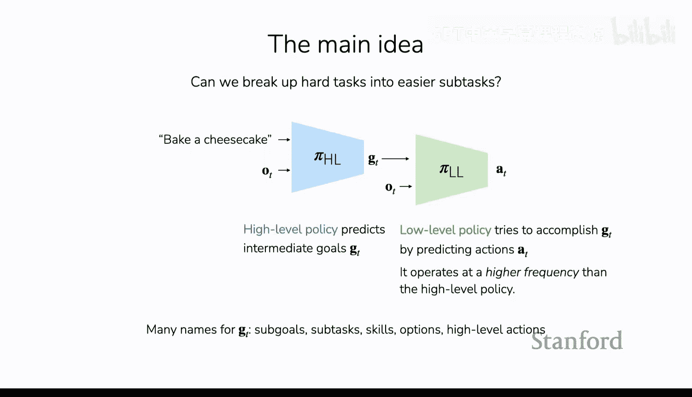

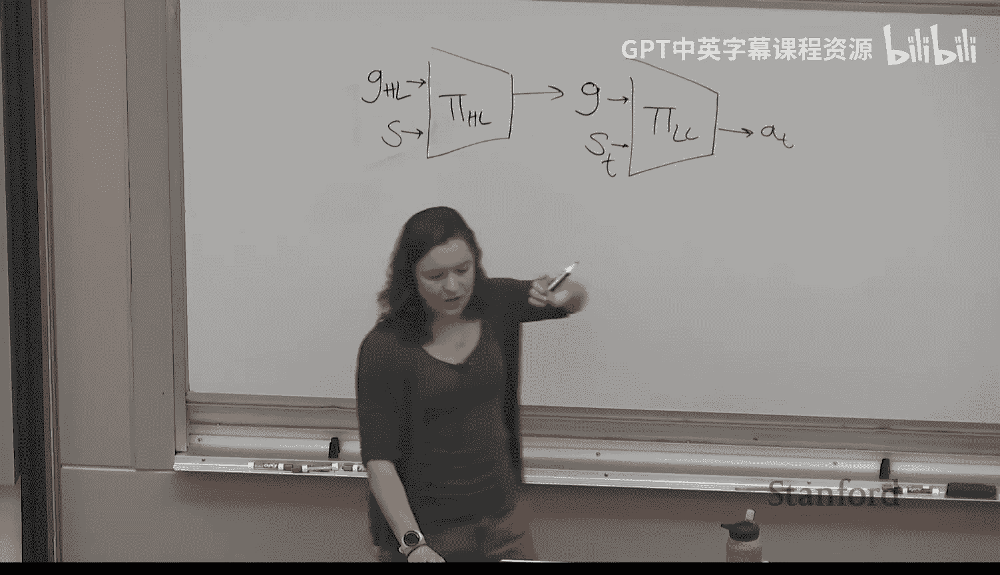

And then the other thing here is that this is kind of like a two level hierarchy。

 But you could also imagine having more than two levels of hierarchy as well。 And， for example。

 the baking of cheesecake， you could have maybe one level of hierarchy could be like things like go to the store。

 like by the things bring them back and a different level of hierarchy might actually be controlling like the motors on a robot in order to accomplish those tasks。

😊。

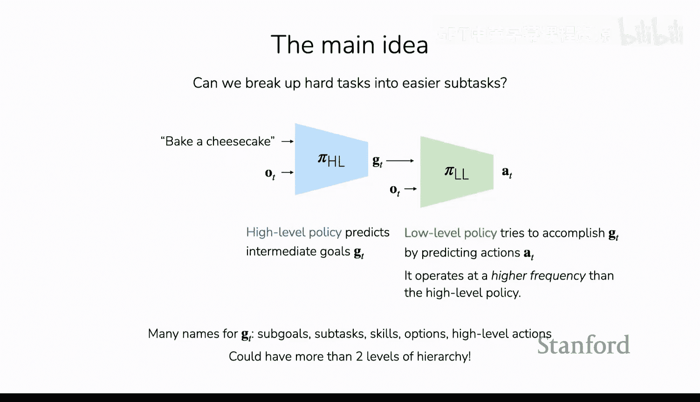

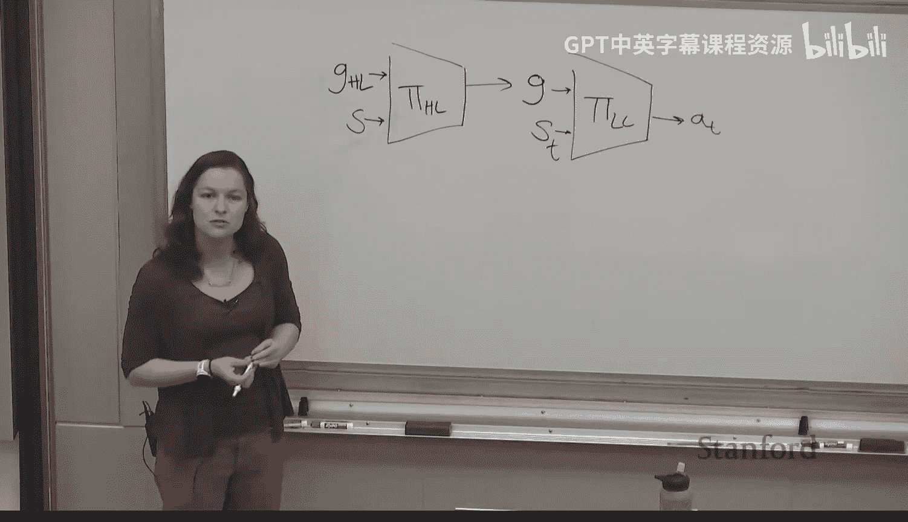

And then once we have this sort of hierarchical policy。

 how do we actually like roll it out if we can do these things？ So specifically if we're at， like。

 say， we'll start at T equals 1。Then the first step is to predict or another kind of way to think about kind of predicting a goal is planning。

 like we're trying to think forward。 What is the next step that we should do so we could try to plan a goal。

 And this will be by sampling from our high level policy。Based off of the。

 the current state and optionally， some sort of high level goal。

And then we'll be repeatedly sampling from our low level policy。 And so we could。Repeat first。

 sample。In action from the low level policy， using this goal as input。 So sample a from。Hi。

 low level。With the state and this goal。The goal from the high level as input。

And then we'll actually execute that action and get the next state。诶。So basically， at that point。

 we'll then kind of。T will now become T plus one and will observe S T then again。

 with the same goal as before。 But the new state will then be sampling a new action。

 repeating this process。And then at some point after we have。

 and we'll talk a little bit about how we decide when to get a new goal。

 But when we have decided that we're either done with the goal or enough time has passed。

 then we'll move back to step 1 to replan a new goal based off of the latest state。Yeah。

 so the question is， so let's walk through this and then I'll get to your question in a minute。

 So is there some initial state or observation， plan a new goal。 until a new goal is selected。

 we're going to execute a predicted action， according to our low level policy based off of that predicted goal。

 and then we'll observe a new observation。😊，Now， why might hierarchy help。

 which I think was kind of getting at your question。 There's a couple reasons for this。

 So the first is that typically。We're going to be training this low level policy to reach goals and this high level policy to maximize rewards or reach some high level goals。

 And this means that the objective for this policy is different than the overall objective of completing the long horizon task。

And so this is actually getting different supervision。

 And this intermediate supervision signal for how to complete intermediate goals or tasks can be useful for guiding the policy towards completing the long horizon task。

 So you can think about it。 potentially， it kind of depends on the setup。

 but you can think about it as a way to leverage intermediate supervision。😊，Now。

 you could always have intermediate supervision when training a big flat policy as well。

 where you give it shaped rewards and you give it rewards for completing individual subtasks。

 But compared to that， the other difference here is that this low level multitask policy is going to be able to more explicitly share knowledge across the different subtasks。

 So the because， for example， it has this goal as input， its。

It's kind of targeting a particular subtask。 And if two subtasks are quite similar to one another。

 then this， the kind of the this policy will be able to kind of share data across those tasks in order to more efficiently learn compared to if you were just to try to train a single policy across the long horizon task。

In reinforcement learning specifically， you can also think about benefits in terms of exploration and in particular。

 when this high level policy is proposing kind of goals to reach。

 that's structuring the exploration process to encourage it to explore not just in the original action space。

 but also in this higher level goal space。And lastly。

There can also be sometimes practical benefits as well。 So， for example。

 if you're thinking about this task of making a cheesecake， for example。

 you might need to be reasoning through the steps for how to do that。

 And if you have a single policy。Then you need to reason through those steps every single time step with that flat policy。

 So if your robot is operating at 20 Htz， for example。

 you're gonna be reasoning through like what is the next thing I should be doing and the way to get there with my action at every single time step where here we can kind of run this reasoning computation at a lower frequency than the low level policy。

So that that can be kind of a practical benefit in terms of compute costs。Yeah， so the question is。

 like， can we elaborate on the first point and how the supervision for the low level policy is different for the high level policy。

 So the high level policy is its goal is to complete the long horizon task。

 So its goal is to like bake the cheesecake and it gets rewards when the cheesecake is baked。

 The low level policy。It gets rewards for completing intermediate subtasks。 And so when it。

 for example， finds the ingredients prehes the oven。

 that sort of thing it's getting rewards for completing those tasks and that sort of intermediate supervision guides it towards completing the long horizon task。

Yeah， so the question is like what if you need to be doing multiple tasks at once so in that case unless your low level agent can like has like I don't know 1 arms or something or can output things in parallel。

 you do need to pick some order for that now the goal of the high levelve policy is to figure out whether that order matters or not。

 and so if it figures out that the order is really important that it will get for wordss。

 itll be better able to predict those goals if it predicts the correct order in other circumstances if the order doesn't matter。

 then it will it should be able to learn that and figure out that it doesn't really matter and it will just pick one arbitrarily。

Now。There's also a question， like。Whether or not we like actually need multiple policies in order to get some of these benefits。

 and we in on the last side， we talked about kind of the benefits of what you might get with a hierarchical approach versus just what's called a flat policy with no hierarchy。

 which is kind of the typical pass in the long horizon task and the state and predict the action。

There's actually also an intermediate approach that you can take as well。

 that actually retains a lot of the benefits of hierarchy and actually， in some ways。

 has a lot of the same design choices。Which is something that's a little bit like chain of thought in language models。

 if you're familiar with that， which is that if you have some long horizon task。

 you could have the policy first like reason through what goal or what subtask it should be completing。

And then predict the low level action。 So this is kind of combining these。

 these two policies into one。 But now you're just kind of predicting them in sequence。

 You're first predicting the goal and then the action。

 this sort of approach can actually retain a fair number of the benefits。

 So it can benefit from the same sort of intermediate supervision。

It also might have some practical downsides。 So this doesn't have the benefits of the kind of practical computational benefits of separating them into two。

 because then you still have to run this at the full frequency。

There isn't like entirely a conclusion yet empirically on whether this is like just as good as a hierarchical approach and you could imagine that there might be benefits in terms of like sharing some knowledge with low level policies versus with a combined approach so this is like an open area of research on whether or not you could just do this and the only like really conclusive downside would be would be the kind of the computational upside of having reasoning at a lower frequency than taking actions for the first one。

So the question is why is having intermediate supervision helpful， There is a couple reasons。

 So if you're in a reinforcement learning setting and your goal is to make a cheesecake and you only get rewards when the cheesecake is baked versus not then those rewards are going to be really sparse and not actually allow you to progress。

 the second is that even if you say you're in an imitation learning setting and you。😊。

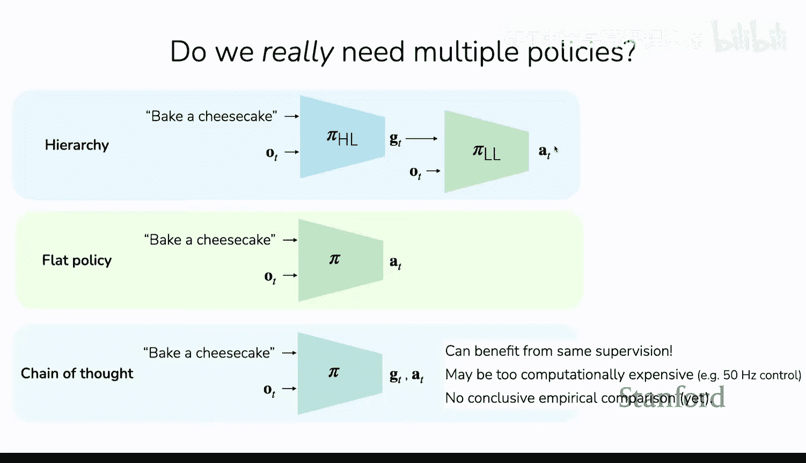

And like you're just predicting actions， like imitating actions for making a cheesecake。

 then sometimes like if the policy isn't explicitly thinking about what part of that task it might be doing。

 it might kind of oscillate between different subtasks。

 especially if it doesn't have a history of past past observations so there like there's also even benefits in imitation learning settings as well。

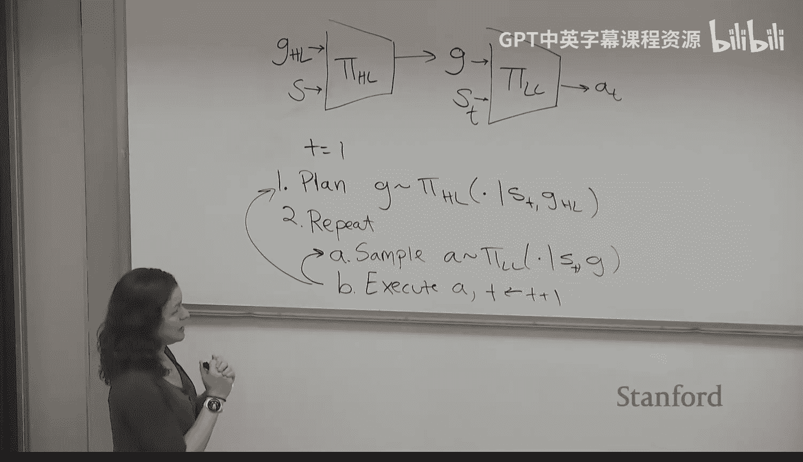

So now let's dive into some of the design choices。 and this will kind of also start to answer some of the questions that have come up as well。

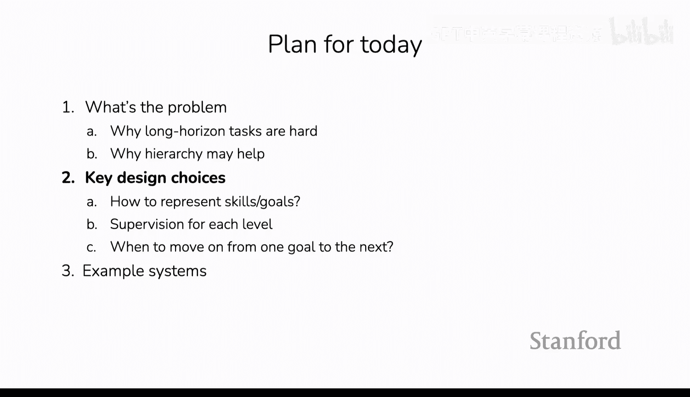

So the first is that we've kind of abstractly been talking about these different goals。

And we need think about how to actually represent those different goals。

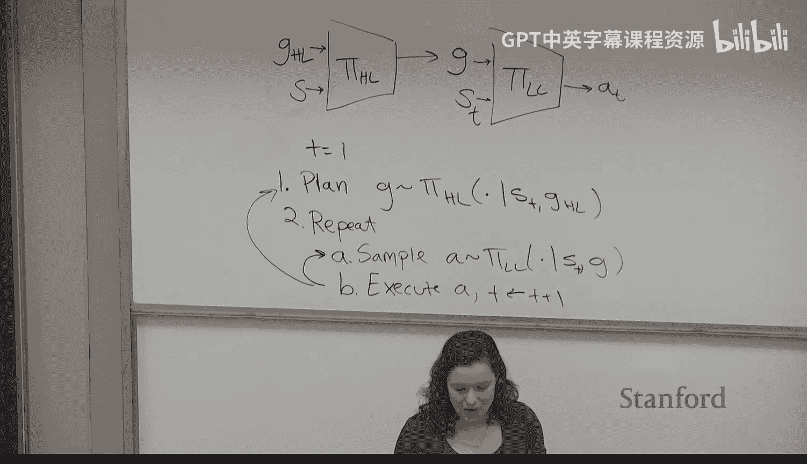

And I'm actually going I actually want to start with this as an exercise for you all to think about what different representations might make sense for different problems and so I'll give you a few different example problems and then the goal for you is just kind of think through for that particular problem What would be kind of sensible intermediate steps for the agent and how would you actually represent those different intermediate steps So the first task is a robot that wants to learn how to cook Italian dishes like vcacha what would kind of the intermediate steps for those cooking tasks look like if it needs to kind control its motors to complete that task and the representation for that the second one is maybe you're developing an autonomous driving bike and you want it to break down kind of navigation and biking to various locations on campus The third is a language model that is drafting legal briefs which is。

A rather complex and involved process。 And then the last is maybe a web agent that needs to plan and book one week vacations for users。

So I'll give you a couple minutes to pick one of these。

 discuss with your neighbor what intermediate goals would look like。

 and then we'll come back and discuss。

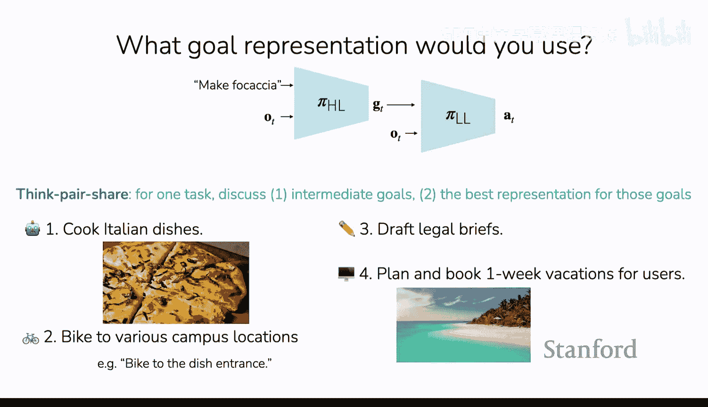

Does anyone want to share what they discussed？Cool， yeah， so for number two。

 one way that you could address it is the different intermediate goals could be kind of like waypoints towards that particular goal location that you want to reach。

 And then the representation for that could be GPS coordinates and the reward for the low level policy would be like。

 how close are you to those GPS coordinates。 So yeah， something like that makes sense。😊。

Any would else want to share。Either for that problem or a different problem。Yeah， cool。

 So for the fourth one， you could， there's a few different ways you could think about it。

 You could think about it as like intermediate goals are like booking day 1， Book day 2， Book day 3。

 or you could have a more course defined approach where you're like booking travel booking I don't know。

 hotels or whatever。 and then specific activities。 one other part of this that I would imagine you need to do is like kind of just generally figuring out what does the user want from their vacation。

 And so doing kind of high level research first。 And that could be kind of also an intermediate goal as part of completing the task。

😊。

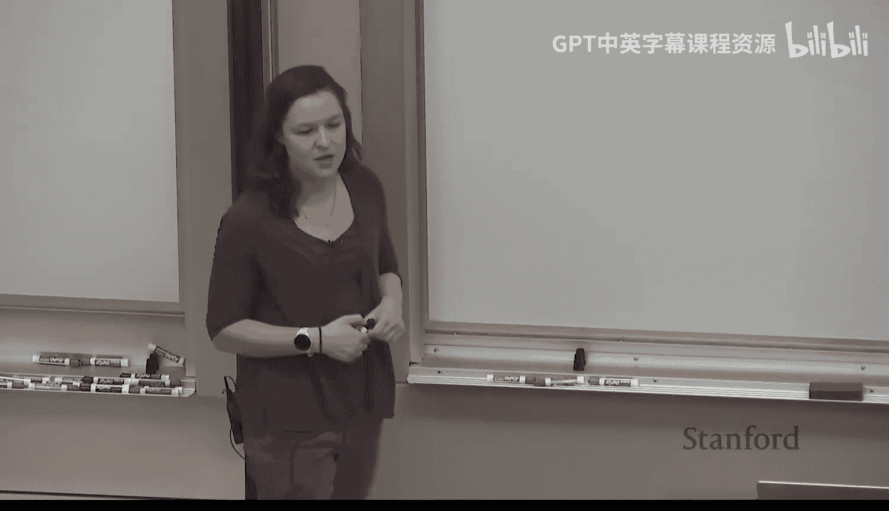

Did anyone pick one or three？Okay， so the intermediate goals are things like opening the cabinet being eggs。

 And then sorry， the representation for those goals。Alright， didn't quite get to that。 So。

 but one thing so a few things that you could do for the representation for that is it could just be a natural language。

 So it could be like literally like the string， beat the eggs or open the cabinet。 if， for example。

 if you're cooking something where you want to look in a particular way。

 You could even have an image as an intermediate goal representation as well， saying， like。

 I want the bread to look like this or yeah， that sort of thing。

 So you could imagine like multimodal goal representations as well。😊。

So one of the things that I kind of wanted to convey with this exercise is that oftentimes the goal representation that you might pick is。

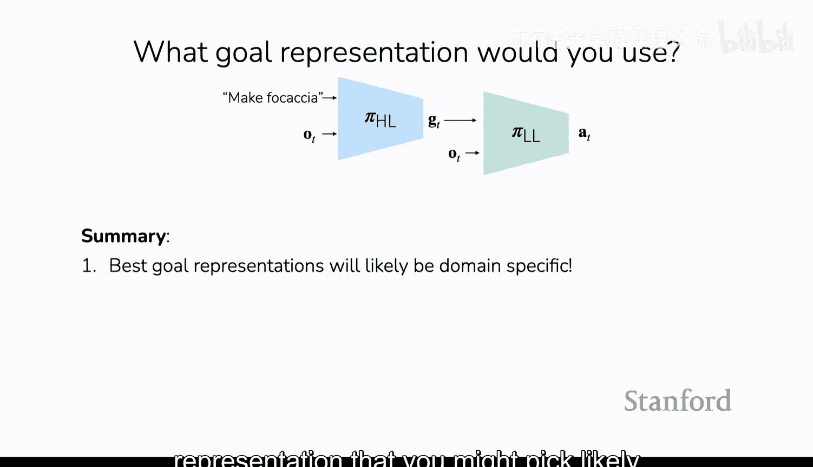

Likely it depends on the particular domain or the particular problem， for example。

 like for biking it might be something like GPS coordinates。

 whereas for cooking it might be language， for booking a vacation， it might also be in language。

 there might also be images involved and so forth。

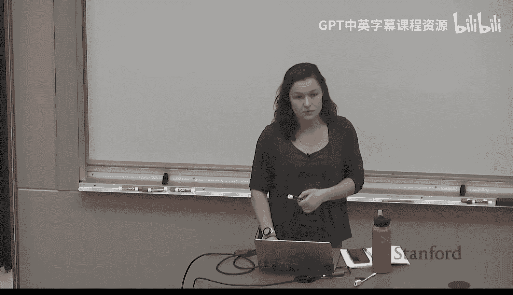

And in terms of what these goal representations might look like， oftentimes you'll want it to be。

If you're kind of developing something for many different subtask。

 you want it to be fairly expressive， like if you're trying to cook lots of different lots of different meals。

 like natural language is something that's quite expressive and can describe a number of different low level behaviors。

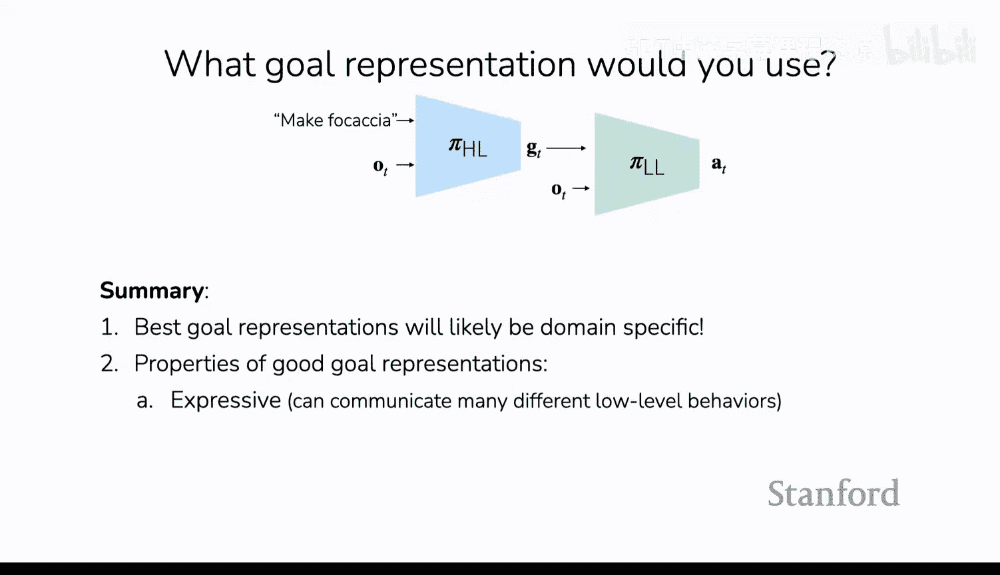

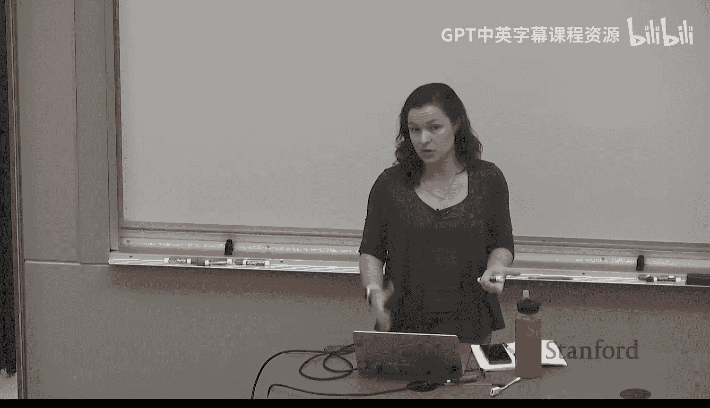

Ideally， it also has some structure。

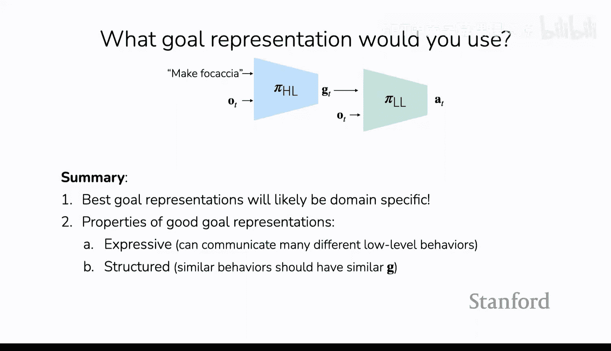

And so， for example， if your different goals are just like do task subtask 1， do subtask 2。

 it's gonna be kind of hard for your low level policy to figure out how those relate to one another。

 whereasas if you have something like GPS coordinates， then。

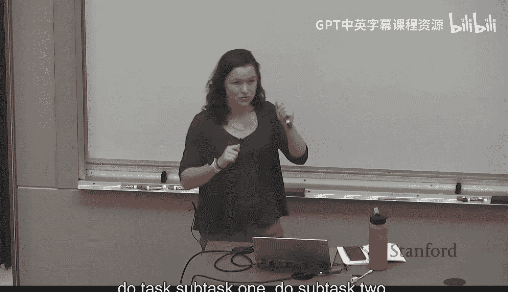

Two GPS coordinates that are very close to each other are going to have similar actions。

 and that sort of structure will make the learning problem a lot easier for the low level policy。

And then the third thing is also picking an appropriate level of abstractstruction。

For the kind of the biking task， for example， you could have like a level of abstraction that's like potentially too low level so you could have something that's like kind of pedal I don't know。

 like like current like exact velocity for the next second。

 you could also have something too high level which is like go to the quad or something which might not be particularly helpful in terms of breaking the problem down into smaller steps and choosing the right level of abstraction is often somewhat tricky and can also be domain dependent depending on the particular kind of details of the problem and the application area。

😊。

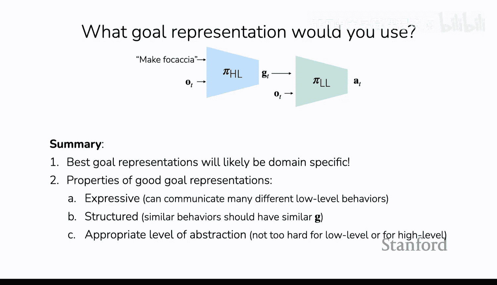

So the question is， should we also abstract the state space for each layer。

 this depends on whether or not you have access to that， like that sort of like abstraction layer。

Let's see， oftentimes even for the high level policy。

 it's helpful for it to have all of the information about the current state in order to make kind of even high level goal predictions but。

Yeah， there are kind of some things that you can do。 For example， you could， for example。

 like ask a language model to summarize kind of the high level information about the state and have a high level policy。

 use that information。 But generally in practice。You'll often use like the same low level。

 like the full state information。 You don't lose too much from doing that as well。

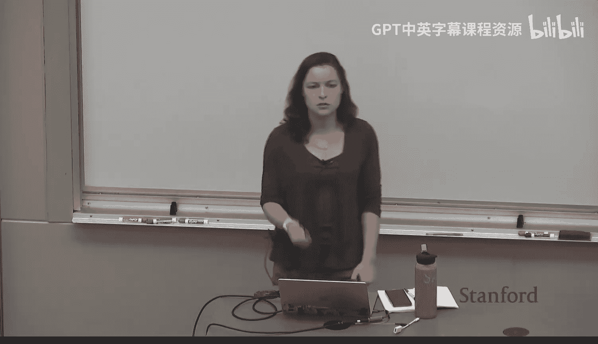

Now let's talk a little bit about the supervision for each level。 And for this。

 I think it's helpful to kind of go through to kind of consider an example so。

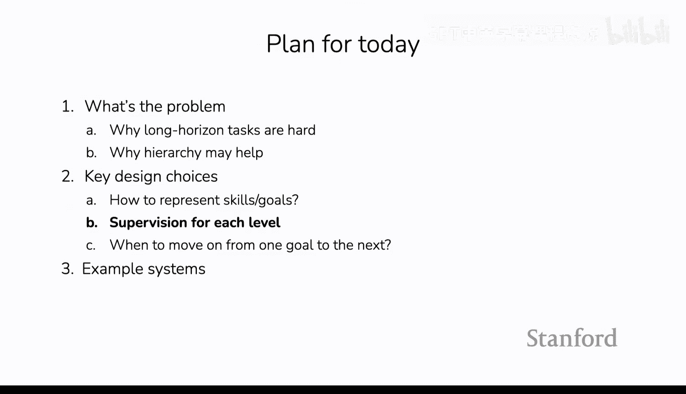

Let let's consider an example where you're making pasta and I chose this to be a slightly simpler long horizon task and you could imagine there being a few steps involved for doing this and we can kind of abstractly think about the state space for this task in reaching different intermediate steps for this so for example。

 maybe let's see， let's say that this is your kind of initial state distribution。

And the steps for making pasta is that you'll need to like get out a pot and。

 and pasta So some ingredients， you'll need to boil the water。 and you'll also need to pour the。

Pour the pasta into the boiling water。 Maybe there's also a straining step。

 but maybe we can skip that for now。And。We could think about the。

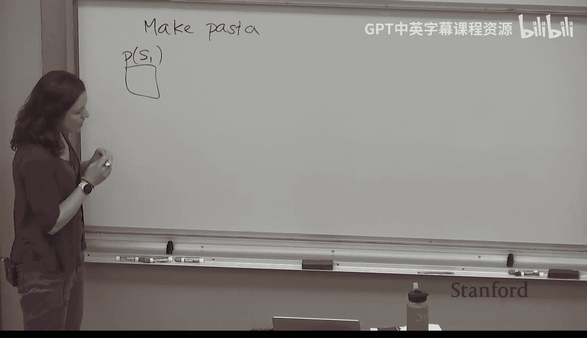

Like imagine kind of the set of states that where you have like， for example。

 you have taken out a pot， so like find a pot before actually like putting any water into it。

 you could have some states where you've now have kind of boiled the water。

Another set of states where you have like found the pasta。And then some other states where。

 like the pasta。Is cooked。And。Let's say that our if we have kind of our low level policy it's going to be trying to figure out like how do I take actions to reach these kinds of states and then the high level policy is trying to predict which like if I'm in a given state。

 what command should I use to tell the low level policy what to do？And generally。

 as we've talked about a bit before， for the low level policy。

 it's going to be getting rewards that are based off of the low level tasks。And the kind of。

 the goal of something like this would be something where you're kind of moving towards finding a pot。

 Maybe your're。Maybe then you kind of try to boil the water， Then you try to find the pasta。

 and then you try to cook the pasta。No。One thing that we talked about a little bit before is。

 so this actually deing from this example a little bit， we'll come back to it is。

We could also just train the high level policy and the low level policy end to end without any intermediate goal representation。

 And so we would just， for example， we'd have some sort of kind of latent goal representation。

 that's just the activations of the neural network。

And we could kind of train all of these just for the high level task and the rewards of completing the task。

Now one important thing that is is good to know about kind of the sort of supervision is that if you do that。

 that's basically just a flat policy with a different like a particular architecture that has some sort of like kind of activations when you feed in the observation twice。

 you can of just think about that as basically a single neural network architecture that's basically the same as a flat policy。

And the reason why it's important to recognize this is that when designing these kinds of systems。

 it's important to think about where the benefits are coming from。

 whether it's coming from additional supervision， whether it's coming from structured exploration。

 And if you don't think carefully about this， you can end up in a situation where kind of intuitively。

 if you haven't thought about it's like ideally， my high level policy will do this。

 my low- level policy will do this without actually seeing benefits compared to just kind of naively training things with a single policy。

It's actually also for those of you that are doing research。

 it's also just generally something that's good to do in any kind of research because you'd never really know if the systems that you're developing or the methods that you're developing are going to improve over some existing kind of state of the art method。

 And if you're very honest with yourself around what might go wrong and。

Why you might not actually see benefits from your new idea。

 Then you can think more critically about what sorts of things will actually improve the final results。

Cool。So supervising each level。 So we have the low level policy and the low level policy will be trained to accomplish that goal。

 not the original task。 And so when you're passing in the string of like find pot。

 it's going to be getting a reward that ism trying to kind of maximize reward for getting to the states where you have found the pot。

😊。

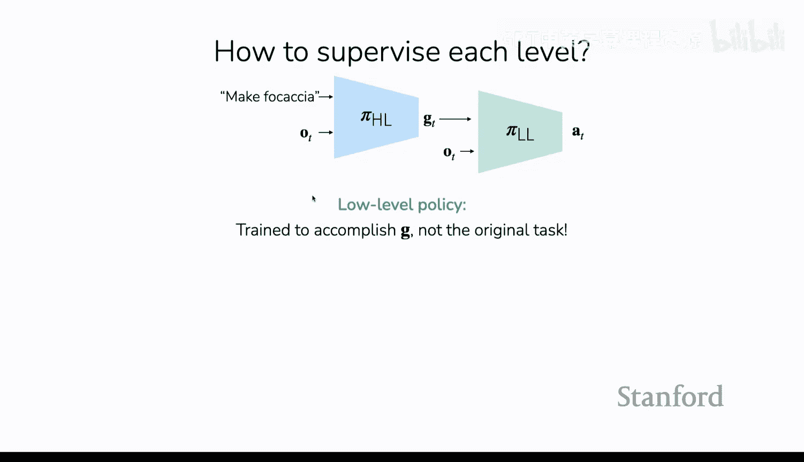

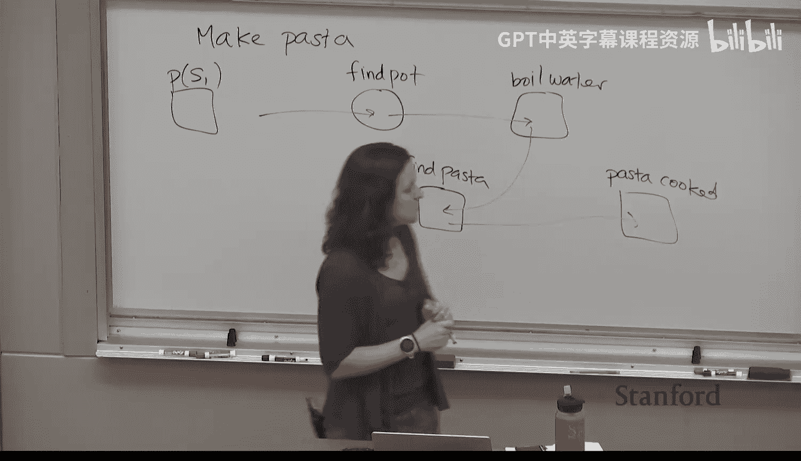

And the high level policy， its goal is to predict the subtasks so that you end up in the final state of the pasta being cooked。

So this is kind of trained to accomplish the original goal。

Now there's a couple things that can be a little bit tricky about this。

 so say that you're training these separately。And say that you've kind of trained。You could。

 for example， think about trading a policy to find the pot。

 And maybe you've like gotten to a good policy that's like really good at kind of finding the pot and getting to the state really reliably。

And then say， for example， when you have。And then maybe， for example。

 when you train the policy for finding the pasta。If you did this。

If you weren't exactly careful with how you did this， maybe you would think about， okay。

 maybe I could actually just start from this state and also try to find the pasta from this state over here。

And that's not taking into account that actually， when it's finding the pasta according to like the high level policy。

 if the high level policy actually wanted it to find the pasta after boiling the water where when you're at the stove。

Then we actually try to string together this low level policy with the low level policy for these two。

 It'll actually then struggle to transition from going to the stove over to finding where the pasta is。

And this is kind ofs basically like a mismatch when you're kind of train these modular systems。

 you and you're trained them completely independently。

 you might not actually get a system that works effectively if they're not actually at some point connected together and train such that dis skill is starting from states that where the high level policy will actually start commanding that task。

And so essentially， when you're training the low level policy。

 so you have your low levelvel policy actions， given states and goals。

 you want this policy to work for the set of states where the high level policy is going to command this particular goal。

Another way to think about this is that。And， I guess the other thing here is also。

 you wanted to be able to pick the goals that actually the high level policy would predict， so。

For the different， for different distributions of goals and different distributions of states。

 ideally， that low level policy would work for whatever states and goals the high level policy will output。

Now， if we haven't actually learned a high level policy yet。

 this leads to a bit of a kind of puts things in a bit of a tricky situation。And likewise。

 for the high level policy。If we assume that our low level policy is really great。

 then we might not realize that it actually has some deficiencies and that we need to， for example。

 continue to command something in certain states until you've actually reached a state that a different skill can operate in。

Yeah， yeah， so if the low level policy works from particular sequences of states。

 then the high level policy can learn that it should kind of walk the low level policy through those states so you don't necessarily need your low level policy to work from every state。

 It just needs to work for the state goal combinations that the high level policy is going to command now you might have a situation where say that your low level policy。

Kin of knows how to do kind of something like this。 So it knows how to go from here to here。

 It knows how to go from here to here and maybe knows how to go from here to here。

Like with some boiled water then you might have some sort of gap where to actually find the pasta you need to kind of go back to these states and if you don't have like a command or some way to get from here to here then you're going basically have a gap in the states that you're visited in the high level policy will struggle to actually get to this state here and so basically one way to think about it is you need to make sure that there's like at least some overlap in the states from one skill to the next and ideally that overlap is a bit has some buffer because if for example when you're trying to find the pasta。

 it only works like if you're like standing exactly in front of the boiled water and not if you're like a little bit to the right。

 then if your policy ends up deciding to boil the water standing a little bit to the right of it。

 then you'll get a brittle a brittle final result where it will kind of struggle in that case。

So the way to think about that is that， I guess one way to think about it is that if this low level a policy only works from like this part of the。

States where the water is being boiled and the high level policy gets you here。

 or the previous level policy gets you here， then you're going to have a little bit of a gap between here and here。

 and that sort of gap can lead to brittle performance on the full long comparison and task。Yeah。

 so the question is， does it have to be a fixed sequence And can you like learn if one sequence is more efficient than another？

 And yeah， so absolutely， the high level policy can actually decide which sequence it wants to do And that sequence might depend on what's the most efficient。

 It might also depend on where these。Where the low level policy is most successful。

 And so one of the reasons why I wanted to pick this example is actually these these two steps can be done in any order and the high level policy could decide that when you're here。

 it actually wants to command you to go here。 And as long as the low level policy knows how to find the pasta from these states then that might be more efficient overall。

 there's also world where maybe this would be more efficient because maybe while you're boiling the water。

 you're just waiting and you can find the pasta in the meantime。😊。

And so I guess there's also a pouring water and turning on the stove and so forth。

 so there's more steps involved， but yeah， the high level policy can decide which order it wants to take。

Okay。The generally， the way to address this is that you can first train them potentially completely separately。

 but it's important for at least one policy to be adapted to the other。 and ideally。

 even both could be kind of jointly adapted with each other to optimize to optimize reward or optimize some kind of complete objective。

Cool， one other side note， I guess， that I think is worth mentioning is that the even for problems that are not like traditionally LM problems。

 LM problems are Llums are actually often。Pretty good at some of the higher level reasoning that you might want to do。

 And so， for example， if you know that you want to cook pasta， if you ask language bottle。

 what are the steps involved with that， oftentimes， they could actually give you that。

 And so this is one way where you can actually kind of train the high level policy completely separately from the low level policy and then potentially fine tune them because the language model。

 for example， might not know that。😊，K of which order the policy。

 the low level policy is best suited for or other things about the capabilities of the low level policy。

And so that sort of adaptation process， even though language balls are pretty good。

 that sort of adaptation process is really important。 Also if you ask。

 it feel like a robot is in front of a coffee machine and you ask the robot to get some coffee for you。

 if the language ball doesn't actually pay attention to that image I might say that it might tell the robot like oh。

 can you like go out and buy coffee like at Starbucks or something and the robot might not have that sort of affordance。

 that sort of ability to do that。 And so kind of adapting these two together。

 it's another example where adapting these two high level and low level policies together is quite important。

😊，Okay。The last key design choice that we haven't talked about yet is when to move from one task to another。

 So we outlined this process here， and we didn't really spend that much time thinking about， like。

 how long do you repeat。Sampling from your low level policy to accomplish a goal。And essentially。

 it's like， how how often do we requery a new goal from the high level policy to pass to the low level policy。

So basically， yeah， this step right here。So there's two。Natural options for this。

The first natural option is to requery the high level policy whenever the low level policy has completed the goal。

 So when it has boiled the water， that's when you tell it to go find the pasta， for example。

And the way that this would look like is at this point。

 your low level policy not only needs to predict action。

 but it also needs to predict whether or not it's successfully completed the task。

 and this could be either with some sort of binary indicator or through some sort of progress indicator you can think about this not done sort of as a success classifier for the task。

And then the other option that's a bit simpler， but maybe less elegant in some ways。

 is just to simply requery the high level policy after some fixed number of time stepss。 so maybe。

You query the low level policy like at 50 Hz， and you query the high level policy once every second。

 So then you would be querying the high level policy after 50 times stepss。

So there's pros and cons of each of these two options。

For the first case where we're doing something after we've completed a goal， this is actually ideal。

 Like if you're to do this well， this should be the most compute efficient because you're waiting for the low level policy and you not you don't need to kind of rethink how you're doing the task while the low level policy is executing。

There's a couple things that are tricky about this， though。

 The first is that it's it can actually be hard to estimate when you're done with a task。

 This is actually like， it's definitely not trivial to do this。

And the second is that you actually need to account for mistakes that require actually redoing some past goal。

So， for example， if you are trying to， I don't know， organize some things on a table。

 you grow grab something and then you accidentally drop it on the ground。

 Your sub goal should no longer be like put that object on the table。

 and instead it should be to pick it up off the ground。this means that actually。

 you need to now estimate not just when you're done。

 but also whether or not you've actually like kind of。

Exited the states in which that subtask makes sense。嗯。

Then kind of going back to the fixed number of time steps。

This is less ideal because we're going to be probably wasting some compute。

 And there's going to be a trade off between spending more compute thinking through what the next goal should be。

嗯。Versus if this N is too long， then you're going to be delayed in transitioning to the new goal where your agent will be。

 for example， maybe it's kind of found the pot。 It's taken out the pot。

 and it's waiting for a new goal。 It might just be and is too long。

 It's just gonna be sitting there with the pot because it's like， okay。

 I found the pot And that's the goal that it's getting。

 And there'll be some delay before it then moves on to actually finding the pasta or pouring water into the pot。

😊，So theres this kind of trade off between how long N should be。 General。

 because you don't want these like really long delays。

 you'll pick N to be fairly small or fairly frequent。but when it is smaller。

 youre then you'd be placing more burden on your high level policy because it needs to be making accurate goal predictions more frequently on more states。

And you'll be spending more compute as well。So both these have pros and cons。In general。

 if we wanted to think about like。Kind of how these pros and cons relate to each other。

 We can think about how these pros and cons lead to different downstream performance。And。

With regard to like estimating when you're done and accounting for mistakes。

 if you actually make a mistake in estimating when you're done。

Then you could actually end up in a situation where the agent is like perpetually stuck if it thinks that it's not done。

 but it is actually done， then it will actually just stay in that state because the low level policy will kind of keep on predicting this won't actually be making any more further progress on the task。

So this actually is a pretty kind of rough。Outcome for these kinds of errors。

 even if they're infrequent。And then for option2， if you make a mistake in predicting the subtask because you're creating the high level policy more frequently。

 this also has bad outcome， which is that the low level policy might kind of stop making progress on the final task and might be taking the wrong actions for end steps until you get hopefully a more accurate goal prediction。

And generally between these two things， these errors are more fatal。And as a result。

 kind of typically a lot of the hierarchical systems out there opt for choosing option 2。

Because of the simplicity and because some of the mistakes that the high level policy might make when it's queried more frequently are less fatal than mistakes with regard to estimating when you're done and what whether or not you should kind of reaccount for past goals。

 it's also worth mentioning that you could potentially combine these where you try to estimate progress。

 But then if it's been a long period of time， then you requery anyway。 But yeah。

 the takeaways is that generally option to is typically what people do。

 where you just query at a fixed lower frequency。So let's look at some example systems and I guess one thing that I'll mention is that hierarchy is like pretty popular these days。

 So here are four systems that were all kind of announced in the last like five months， four months。

 and they actually all use hierarchical systems， so these are all like fairly long horizonry and tests where you're like cleaning a bedroom。

 putting like handing over objects and kind of pouring them or putting them into bins。

 putting away objects into a fridge， putting fruit into bowls。😊。

And if you look at the architectures for these things。

 they all have some sort of higher level model that's predicting intermediate goals and some lower level model that is kind of predicting low level actions。

These are in robotics domains， likewise in language model domains， things like chain of thought。

 where you're kind of reasoning through intermediate steps。

 and then actually outputting tokens for those steps is also really popular for completing more challenging language tasks。

Cool， so I want to cover a few examples of these systems。

 and I picked examples that I think illustrate a few different design choices that are helpful and actually have comparisons on those design choices that kind of elucidate some of the benefits of one design choice versus another。

😊，So let's start with talking about hierarchical imitation learning systems。

And we'll start with language sub goalss。And let's first talk about what the data would look like for training a hierarchical imitation learning system with un good sub goals。

So。The data， this will be kind of a real robot example。

 And we what the data looks like is actually it's going to use data of a long horizon demonstration of completing the complete long horizon task。

And so this case， the task is to make t mixs and put the tics into a bag。

And with this long horizon demonstration for the full task。

 it will then be segmented into with language labels for each segment。And in this case。

 the segments in the data can have at variable length。 So variable， like you might kind of。If。

 for example， the kind of。The robot trajectory looks something like this。

 then you might have like the first subtask is like something like this。

 the second subtask is maybe shorter， the third subtask is maybe longer。

 so you'll have variable frequency in the data， but the actual system will later be using a fixed frequency where it's kind of requeing more frequently than like the typical segment length in the data。

So these are different language labels。 These labels could either be。

Kind of recorded during data collection where you're actually saying I'm going to pick up the bag and then do a demonstration of picking up the bag。

 then say I'm going to pick up the metal scoop， do a demonstration of that in sequence。

Or you can do it posttc where you just collect the full demonstration and then with a labeling interface label like this segment is picking up the bag。

 this segment is picking up the middle scoop。 This segment is getting M&ms and so forth。

So we have segmented demonstrations with the As language command。

 here's another example of what this would look like where and this kind of shows that like one segment might be longer for picking up a slice of cheese。

 a different segment might be shorter for putting the cheese on the bread and so forth。Cool。

 and then once we have this data， we'll train a high level policy and a low level policy with imitation learning。

 and the high level policy will be outputting the language labels from the observations。

And the low level willll be using will be taking the language labels and the observations and predicting the actions。

So what this looks like is taking an image observations to an RGB image passes into a high level policy that's trained to predict the language label。

And then you'll have a low level policy that takes the language as in addition to the observations。

 In this case， the work chooses to use not just RGB images。

 but also joint angles as input to the low level policy。

 And generally you can have it's okay to have actually the sort of mismatch between observations for the high level and the low level policy。

And then the low level policy outputs joint commands and the low level policy operates at 50 hertz。

 and I can't remember the exact frequency of the high level policy。

 but I think it's something around like1 hertz。阔ol。So that's the general setup。

 Now we also learned about dagger and you could think about if we just do imitation learning on the offline data。

 we might have issues where we're training these like somewhat independently。

 although the data is at least of the full long horizon task。

And we could actually use dagger with these systems on both the low level policy and the high level policy。

Now， one thing that's pretty cool is that actually for the high level policy。

 we can actually update the high level policy with language supervision。😊。

And so dagger on the high level policy is actually in language space， not in joint space。And so。

InIn this particular approach， in principle， you can do dagger on both low level and high level。

 in this particular approach， if you were to do it on the high level with freezing the low level。

 you would kind of be running the policy the full system。

And then you would then kind of type or speak a language command that is going to override the high level policy。

And then。Then kind of continue collecting data， and that at some point you might give control back to the high level policy。

And then from there， you can fine tune and actually do gradient steps on data that has these kinds of language interventions to actually fine tune the high level policy。

 And when you do this together with the high level policy and the low level policy acting。

As one system， then you could actually adapt a high level policy to deficiencies in the low level policy。

 So， for example， if there's one language command that the low level policy makes a mistake on。

 then you could actually issue some corrections to help compensate for that mistake。So as so yeah。

 I guess to summarize， we can train the high level policy in the low level policy both with imitation and then freeze the low level policy and update the high level policy with Dagger by supervising on language corrections。

And so as a video of what this looks like， these yellow commands are showing the output of the high level policy。

And then the robot motions are showing the output of the low level policy。And the。

So at the beginning， the the high policy is saying pick up spoon。 The robot picks up the spoon。

 move the spoon towards me。 So it says I want some peanuts。

 So then the low level policy scoops peanuts。 Then the high level policy says move the scoop into the bag。

 The low level policy starts to do that。 at this point。

 you'll actually notice that the robot's about to make a mistake。

 And so that's when you can intervene。And I'm instead of telling the robot move the scoop in the bag because it seems like the low level policy isn't going to do that correctly。

 You could then intervene and say。You can intervene and say。

 move the scoop into the bag say move the scoop inside。 say move the left arm to the left。Go higher。

 move the scoop into the bag then。 And so these user commands are overriding the high level policy。

And then at this point， you can give control back to the high level policy。

 and then the high level policy predicts pour into the bag。And。

And get some banana chips and so forth。So that's kind of what this sort of dagger intervention looks like in the high level space。

And then after you fine tune the high level policy on those kinds of interventions。

 the the high level policy can then self correctr and know that the low level policy is making a mistake where it was about to make kind of the same sort of mistake again。

 And then the high level policy says， go higher。And then move the scoop into the bag to kind of prevent that sort of mistake。

 this is an example of like the high level and low level policy adapting together to account for deficiencies。

Cool， now we've talked about hierarchy versus flat policies。 You can ask。

 like you can actually do a comparison。 like in this particular setup。

 does hierarchy compare like outperform using a single flat policy to do the long horizon task。😊，呃。

This comparisons is actually from a different research paper。

 but it has basically the same approach and it finds that for in terms of like task progress。

 there's a 34% improvement from using hierarchy versus training a single policy to do the full long horizon imitation learning task。

And in terms of like following instructions， there's also a gap this is kind of this instruction accuracy metric。

And you can also actually compare dagger to imitation learning in the high level for the high level policy。

 and you can also see that there's like an improvement from using dagger compared to just using vanilla imitation learning。

 and this is the sort of improvement that you get from adapting the policies together。Cool。

 and then generally with hierarchy， you can， they kind of the nice thing about hierarch is you can do longer horizon tasks。

 And so with this full system， you can， for example。😊。

Get the robot to put three objects into a ziploc bag。

 which is like traditionally a pretty difficult task to do， especially in one go。

And likewise with a similar system， you can also get a robot to kind of the high level command is clean the bedroom。

 and then the low level policy will output things like pick up shirt， put shirt in basket。

 pick up shirt， put shirt in basket， and later pick up the pillow， adjust the blanket。

 put the pillow at the top of the bed， adjust the pillow， pick up tissue。

 put the tissue in the trash can， and so forth。And so these are things that are like。

 would be very hard to do if you just train like a single flat policy。So instead of using language。

 we could also use images as that intermediate representation。

And so what this would look like is instead of having the high level policy output language。

 you would output a goal image。And so be like this is kind of an image of what I want you to accomplish in the future in practice you can use a generative model like an image editing model to do this that takes input the image at the current step and then edits that to look like an image at a future time step that you want the robot to achieve。

And then the low level policy would no longer be language conditioned。

 but would rather be a goal image conditioned policy。

 and so you can think of this as a kind of like an inverse like a multistep inverse model that takes this input and the current image。

 some future image and then outputs the actions that you can take to get to that goal image。

And then both of these will be trained again with imitation learning。

And one of the things that's pretty nice is that you don't。

 you no longer need to segment videos with language annotations to do this。

 You just need the videos of the long horizon task。And to train this high level policy。

 you can train it on like robot data and predict like future images in the trajectory。

 like from one second or5 seconds into the future or 10 seconds into the future。

 but you could also actually train this high level policy using like YouTube videos or something like that to predict like what are future images that might accomplish some long term goal。

And so that sort of data， that sort of unlabeled video data can be helpful。

 especially if data from like the robot is more sparse。

So then an example of what this looks like is sitita is to move the wooden bowl to the top of the table。

 you pass that into the high level policy that then generates images which are shown with the pink border。

And then that generated sub goal image with the pink border is passes input to the low level policy。

 which then predicts actions and both of these policies again。

 are trained with imitation learning on on demonstration data and potentially also if for the high level policy can be trained on video data as well。

 so this one is putting the toothpaste in the wooden bowl。

 you can see that it generates these subg images of like for example。

 holding the toothpaste above the bowl。It then reaches that。

 then it generates a sub goal of like lowering the arm。

 And so they robot robot lowers the arm to complete the tasks。And in this last example。

 the goal is to open the drawer， the first sub goal is to like put the gripper on the handle。

 then the next sub goal is to move the gripper to the right so that it opens and so forth。

Another thing that's nice about this sort of approach is that if you don't have a like if your policy。

Sees objects that' never seen before that are hard to describe in language， Then you。

That's something that it can more easily describe in images because it can more easily generalize across the objects that it's seeing and generate pixels for those images if it doesn't know what the semantic name for that object is。

Cool， and then for this sort of thing， you could also do a comparison on like。

Is it helpful to include those unlabeled videos for training the high level policy？

And if you only use robot data， you get performance that looks like this。

 and if you add videos of humans for training the high level policy。

 you get like an increase in performance compared to just using the robot data to train the policies。

Now。We talked earlier about how chain of thought can replace hierarchy and there's also approaches that have developed chain of thoughts versions of this where you can have some high level task and the current observation and then actually like output either subgal images or subtasks。

 you can also have other representations like bounding boxes or waypoints。

And then I'll put the action and there are some like recent approaches from the last like one year。

 basically like quite recent that do something like that。Of。

The other thing to note is that this is with imitation learning and we'll talk about reinforcement learning in a minute。

 but generally for these large scale systems to date， for the most part。

 they use imitation learning more so than reinforcement learning and fine tuning them with your reinforcement learning is in some ways an open kind of research question for like what is the best recipe for accomplishing that at large skills and it's also a pretty important research direction because if we think about this slide right here the kind of performance of these systems is still not like super。

 super reliable and these are I should mention these are in pretty challenging situations with like held out objects that the robot hasn't seen before so it's kind of out of distribution compared to what it saw during training。

But if we had a way， to train these with reinforcement learning。

 then we should be able to get these performances to be much higher compared to using imitation learning。

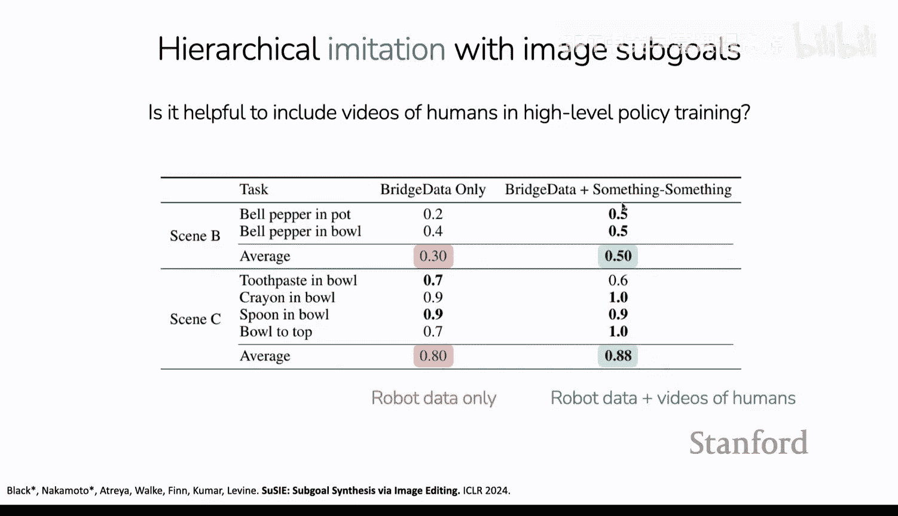

So the question is， like we talked about personalized recommendation systems and could hierarchy be useful for that generally。

嗯。I can't like， it's not something that I've seen before。 And generally when I've seen hierarchy。

 it's usually been for like pretty like longer horizon problems and tasks that are more complicated in like language modeling。

 it's been used for。For like math problems， essentially and like kind of things where you need to kind of have multiple steps for completing something。

 Yeah， I could， I could think about it。Yeah， so in this case。

 the high level policy is an image generative model and what it does is it's going to take a input。

 it's trained to take as input like an image observation and some sort of high level goal。

 so like goal high level and then。You have a neural network and that neural network is going to be trained to output。

O T plus okay。And so it's can be trained to generate an image of a future image。

Try to generate a future image。 And you can get this is if you have videos。

 then you don't need language annotations to get this image in terms of the architecture。

 it's using a diffusion model to generate these images。

 That's why you saw the noise kind of moving into the image， yeah。In the direction of the goal。 Yeah。

 so this particular goal might be on the horizon of like， I don't know， like a minute。

 And this sub goal could be in the direction。 could just be like， I don't know。

10 seconds in the future， something like that。Yeah， so in terms of using image editing models。

 that sort of general pretraining can be useful because it teaches the model how to generate images in general。

 and then the videos that are used， they're actually videos of people doing different tasks that have like a single language annotation for what the person is doing in the whole video and so those videos are especially useful to include because they're kind of pretty relevant if instead you included like random videos on YouTube it's a little bit harder but it might still teach it about if there's some like future thing what are kind of what are images that could happen in the future and that is useful pre-training for this kind of task。

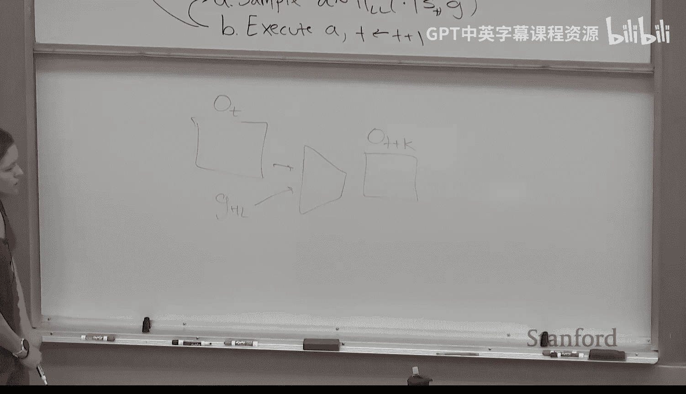

Yeah， so you're asking， like， what if the language isn't accurate and what if the。

 this is like a sketch instead of。Like a real image。Good question。 I guess first。

 if you wanted to use sketches here， you would just want to ideally like train the low level policy to be able to use that sort of thing。

 And there are actually approaches that have like taken images and you can kind of convert them into a sketch and train a low level policy to do that。

 And so you don't actually necessarily need this to be a full image。

 these are just kind of I should mention two example representations。

 and language is actually particularly popular as an intermediate representation but there's lots of other representations you could use。

 including sketches， including like I don't know， like a trace of where you want the robot to go or something like that。

 And then in cases where the language isn't accurate。

 if it is describing something that's like different， then oftentimes。

 the robot will then follow that different task until it's been told to do something different And so that if the high level policy is predicting language that is bad。

 then the system will suffer。There are some cases where the low level policy might also ignore the high level policy and and still like if you kind of give it gibberish。

 it might just kind of。Have some sort of， in some ways。

 like kind of default behavior because it was trained to output actions。

 And it often like will like four like different states， for example， if it is in， if it's like。

Holding the pasta right here， then。Even regardless of any sort of language input。

 chances are the next action is actually to pour it。

 and so if you don't give it a language instruction or if you give it a noisy language instruction。

 it might still continue to pour it just because it knows that for that state。

 typically that's what you do next。Now let's talk briefly about hierarchical reinforcement learning。

When I was bring up examples of this， I think that the hierarchical imitation learning systems are。

 are like quite recent。 and I don't have too many。I think exciting examples are examples that I was excited about with regard to hierarchical reinforcement learning。

😊，But there are a few example systems that you can look at。

 and I think that generally getting these kinds of systems to work really well。

 like potentially on top of the initialized hierarchical imitation learning systems is something that would be that's I think really exciting and important to explore。

But generally， in terms of what has been done and what exists。

 you can do hierarchical reinforcement learning with trying to reach different states。

 and this could be the relative target position of some agents or some objects。

And kind of one cool work that does this is it has this like four legged ant agent that you might have worked with in homework one。

And its goal is to get over here and to get over there。

 it actually needs to push this object to the right and then move there as a result。

 and then there's also this example where it needs to get over here。

 if it tries to go directly there， it will fall in this crevasse and instead it needs to push and make a little bridge for itself and then walk over and walk over here。

And these are pretty long horizon problems where if you just try to take actions greedily。

 you won't be able to get to the goal。And so the work trained a goal condition policy conditioned on goal states with a reward of reaching those goal states。

 and then it trained a high level policy to output goal states and those kind of goal states are the high level actions。

But actually also used hindsight relabeling for the high level policy to。

Kd of actually relabel high level actions or to relabel the goals that the high level policy should output in certain circumstances。

 and it used an off policy algorithm to train this in order to allow it to work effectively。嗯。

And then another work that does hierarchical reinforcement learning uses language goals。

 so you could do goal states， you could also do language goals， this trans language condition policy。

 it uses language relabeling so instead of goal relabeling does hindsight relabeling in language space and then the high level policy is trained to output language which is actually a pretty difficult task and again this is a work that's not too recent and so it's from like 2019 and so the tasks are relatively simple where it's trying to be able to arrange these different objects in particular order where you need to like push the green object。

 push the red object， the blue object and so forth。Cool。

 and then the one thing that I'll mention is that we've talked about these scenarios where you're supervising the low level policy to like reach some goals and the high level policy to output those goals。

 Now， there's in some ways， like a really cool。😊，Research direction of instead of actually supervising it to do certain goals。

 can you actually discover？ter discover subtasks or discover skills that might be useful without requiring supervision on those low level skills。

And。Here's one example of a work that studies that where in this kind of simple half cheetah agent that you might have also seen in one of your homeworks。

 it's able to learn skills like backing up， walking forward， doing I think a front flip and so forth。

 And then in principle， if you discover skills without supervision。

 then you could try to sequence those together to do harder tasks。

 but this is generally still an active research area and something that's pretty challenging to scale up。

 especially in very large state spaces。😊，Cool， that's it。

 And next time we'll be talking about reinforcement learning for robotics。

 specifically learning with autonomy and a guest lecture from G Kumar on the Tesla Opimist team。😊。

