# 斯坦福大学《深度强化学习｜CS224R Deep Reinforcement Learning  Spring 2025》中英字幕 p16 -16- Lecture 16_ RL for Robots.zh_en -BV1SvmxB3E5e_p16-

For today， we're going to be talking about autonomous learning。

 specifically in the context of reinforcement learning for robots。

 and this lecture and the next lecture are going to be focusing a bit more on robotics use cases where today we're going to be talking about autonomy and on Wednesday we'll be talking about we have a guest lecture talking about cinderal transfer and humanoid robots。

😊。

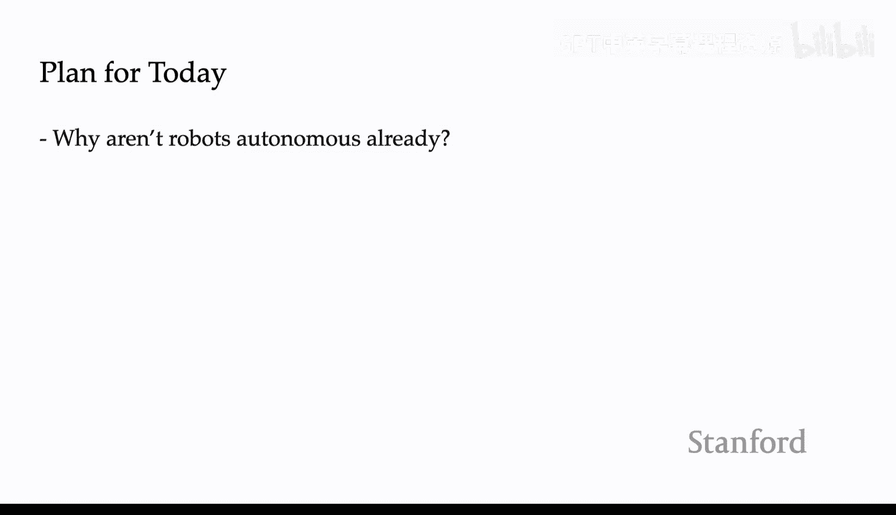

So we'll be talking about why robots aren't autonomous already。

 defining the problem of autonomous reinforcement learning， then developing the algorithms。

 specifically thinking about learning policies without human intervention and a formulation of reinforcement learning called single life reinforcement learning。

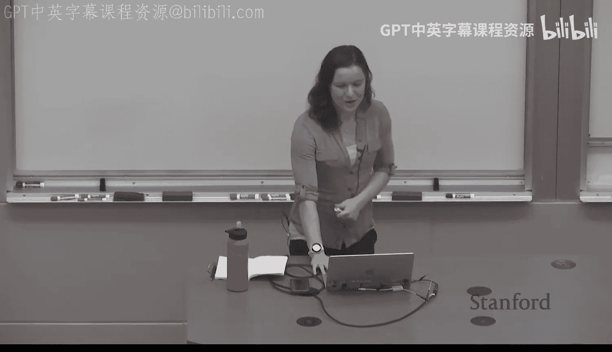

So the goal here will be to think about how we can imbue intelligent machines with autonomy。

 the ability to allow them to on their own， learn， interact， practice。

 get better human without a human in the loop。Cool。😊，Let's start with some of the motivation。

 So we've been talking a lot about reinforcement learning。

 We also talked a little bit about imitation learning。 where imitation learning， typically， we are。

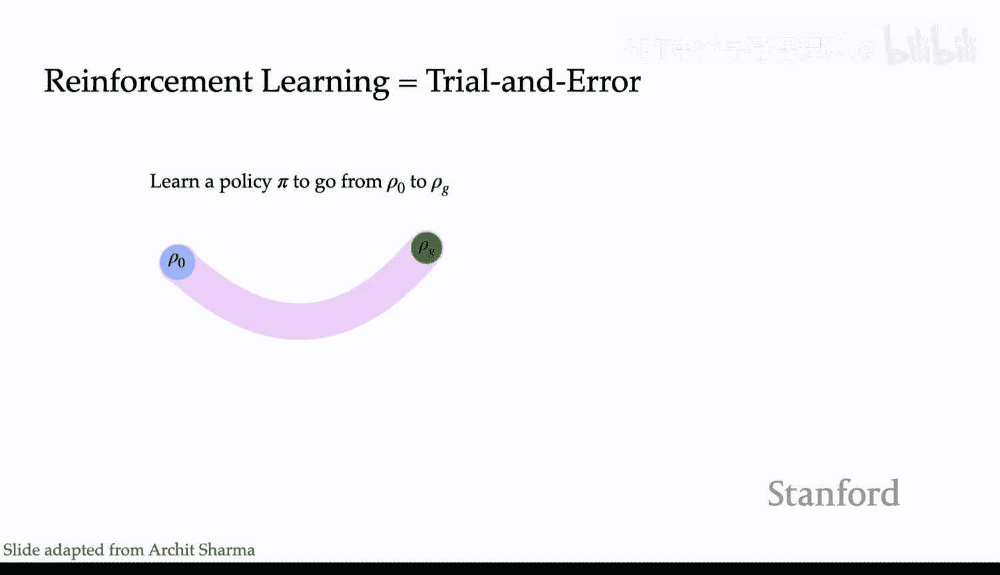

Training an agent to mimic some demonstrations that are provided from an expert。

 whereas in reinforcement learning， the agent is practicing through trial and error。

 And this sort of notion of practicing is something that is already more autonomous because the agent is learning from its own experience in the world。

But it actually isn't entirely autonomous in practice when you think about running these algorithms on physical robots。

In particular， if we think about saying that we want some robot that's going from some initial state distribution。

 some distribution over initial state， so this is a kind of the starting conditions that our agent might be faced with when it' actually deployed to some to some kind of region in the state space that has high reward。

 then typically when we think about this learning process， we will collect trials so for example。

 maybe at the beginning， the first attempt at the task will look something like this where。😊。

Because we haven't learned anything yet， maybe we haven't practiced very much。

 We don't have a trajectory that is very good。And then from there， typically we've thought about。

 okay， can we retry the task and attempt the task again where we again start from a state in our initial state distribution and kind of roll out our policy again？

Now， when we're rolling out these policies， we are kind of sampling actions from our policy distribution and acting according to the agent's own actions。

 and so each of these trajectories are under the control of the robot or the agent。

And as you're rolling out your policy， this part is fully autonomous。

 it's kind of fully control is fully with the policy pie。

But one thing kind of one little catch is that after you've attempted the task once。

 you're in a state over here and we've been thinking about when you then attempt the task again。

 magically， you'll somehow get back over here and attempt the task from this starting place。

And we haven't really talked about like how do you get from here all the way back to here？

And in practice， when you take kind of traditional reinforcement learning algorithms that we've been talking about。

 we've been assuming that a human， or somehow you'll magically get reset to this initial starting place。

 and in practice that might mean that a human is actually physically moving the robot or physically moving the objects in the scene back to some set of initial conditions。

And as a result， this process isn't actually fully autonomous。

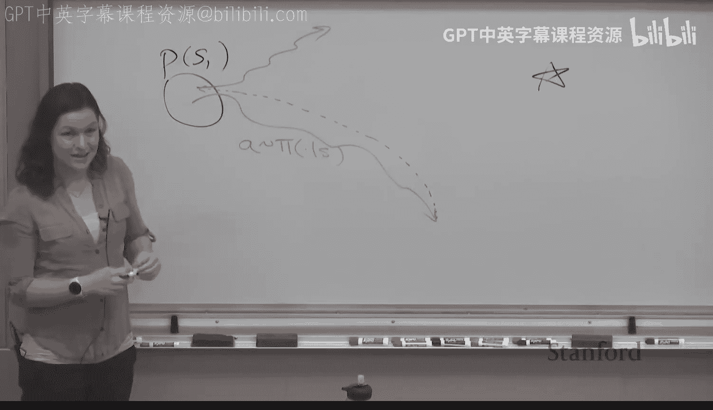

So on the slides， we'll execute actions from our policy， observe data from the environment。

 update our policy， repeat that process。And eventually we'll get a policy that is able to get high reward。

 for example， in this problem， reaching a state within some region of goal states。

And we think about that as rolling out some trajectory of length H。

 and then rolling out another trajectory of length H and so forth。But we need to think about， like。

 how do we get from。The end of one trajectory to the start of another trajectory。

Now if we're in a simulation based environment， then what we can do is we can create the environment。

 take actions for  a thousand time steps， and then once we're done， then we can call end do reset。

 which is a very nice little friendly utility， but that's something that we can only really do in simulation。

 we can't kind of reset the physical world to our own will。

And so as some specific examples say that you are trying to learn how to navigate to a basketball court。

 maybe you have a small mobile robot that is trying to deliver something to the basketball court or an autonomous vehicle that's trying to navigate to the basketball court as it tries to explore and attempt this task。

 it might make a wrong turn and rather， if it makes that sort of wrong term。

 it ends up in that physical location and would need to for example。

 figure out how to navigate either back to the starting position or find its way from that wrong turn back to where the basketball truly is。

If we have a robot manipulator， we might want to learn how to grasp the mug as we're learning how to grasp the mug。

 the robot might make a mistake and knock the mug over。

 and then if it wants to attempt and learn how to grasp things again。

 then somehow it needs to be within reach of the robot。We for kind of more of a mobile system。

 and we want to learn how to put books onto bookshelves。Again， we might make some mistakes。

I need to figure out how to kind of get back to some starting position where the book is in reach or some kind of initial state distribution。

 if our goal is to go from one set of initial states to regions with high reward。Okay。

And one of the reasons why this is actually especially important is that reinforcement learning often takes many attempts。

 it's not a matter of taking like trying three times and then solving the task。

 oftentimes there's many different trials that you'll be attempting and practicing over and over again and every time the agent tries again。

 that means that you have some human intervention or some other intervention that is bringing you back to the initial state distribution。

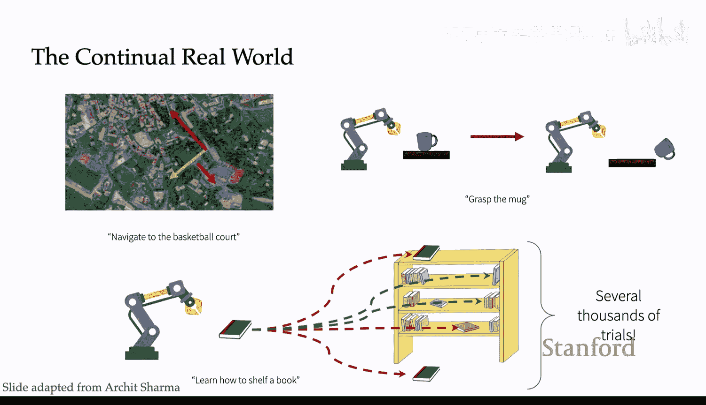

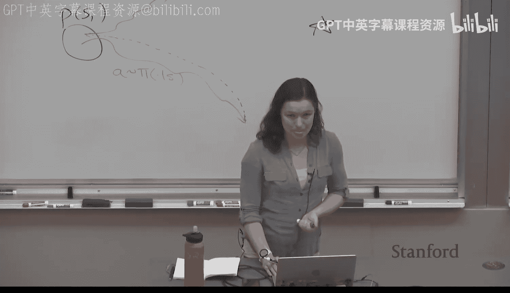

Okay， as more kind of real examples， this video on the left is a video of a robot learning how to hit a hockey p into a goal。

 and you can see that the human here， this is a friend of mine Yevgan and he's probably doing more work than the robot is right now as it attempts to do this。

Here's another example where Ali is closing the doors so that the robot can learn how to open them。

 and here's an example where Archt， who you gave a guest lecture earlier this quarter is resetting the robot so that it can attempt to fold。

😊，Fold the towel。Okay， so how do we think about this problem？

The problem is is this sort of reset often in practice requires some sort of human intervention that we want to be able to ideally eliminate so that our agents can practice and get better on their own rather than requiring some expert or some human。

嗯。Now， one way that we could look at this is， I mean， what if we could just increase H。

 What if we just increase the length of the episodes in which our agents are attempting the task。

And if we increase the length of the episodes， then in principle。

 we won't require as much human supervision。 And we might be able to apply the same exact reinforcement learning algorithms that we've learned about in the course。

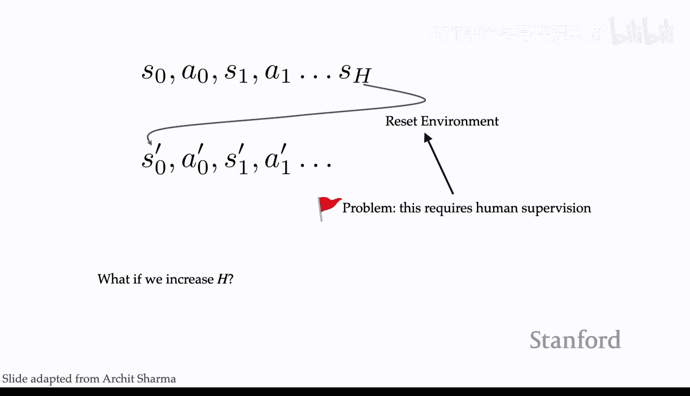

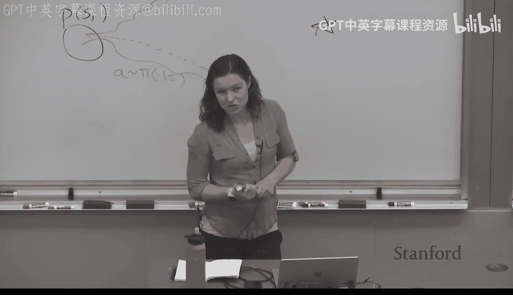

Just with less supervision during the learning process。So we can do that。

 And so the we'll see an example of what increasing age looks like in a minute。

 But generally kind of the definition of what we want to accomplish is initialize theyve seen the environment。

 Maybe it's already initialized in some way。 Then we do that once。

 we have the agent interact autonomously with the world。Without any sort of environment resets。

 we can also relax this constraint occasionally to only reset at a very low frequency。 For example。

 if8 is very large。No。As we start to think about these systems。

 we need to think about how we actually want to evaluate these systems。

 And there's actually a couple different ways。 There's actually a couple different things that we might care about。

So one thing that we might care about is after we've， for example。

 autonomously learned in some environment。

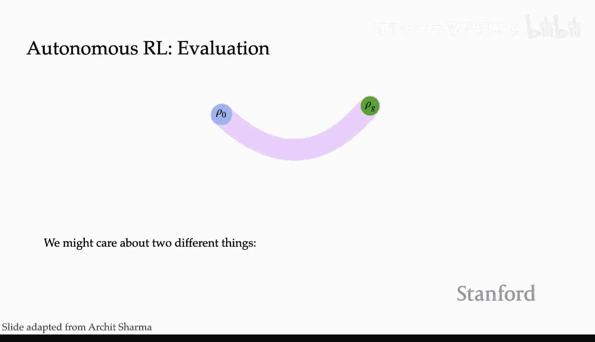

We might care about， maybe let's。看到不嗯。Let's say that we have autonomously explored。 And， for example。

 we have kind of some。Experience that we've collected maybe that looks something like this。

Where there's no resets， no kind of going back to the initial state。

One thing that we might care about is we might care about。

 did you achieve high reward as you kind of went about the agent's experience and basically did it actually complete the task at the end of the day as it was learning？

And that would be looking at like what is the sum of the rewards that it accomplished over its lifetime？

And alternatively， instead of thinking about evaluating autonomous RL from that perspective。

 we could think about after the learning process， did we learn a good policy that we could then deploy and be able to repeatedly do the task？

And so that would be looking at like if we， instead of looking at the rewards of this red trajectory。

 it would be saying after the learning process， if we've learned some policy。

 how well how good is it at， for example， going to the goal。

How good is the policy that learned as an outcome of the reinforcement learning process？

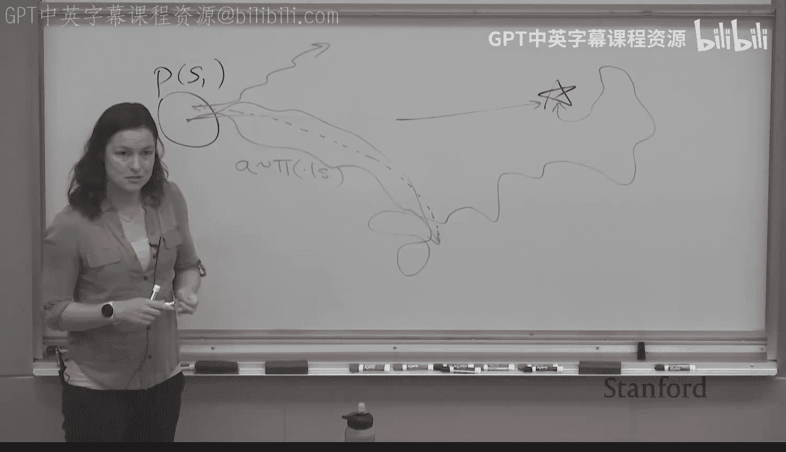

So。Two things here， one， that could be the amount of reward recovered over the course of its life。

As one example of this， imagine that you're deploying the Mars rover and you want the rover to be able to collect scientific data。

TheYou don't really care about whether it learned a good policy that you're going to deploy in in like after the learning process。

 you really care about whether or not it did a good job as it was deployed。

 as it was learning and so forth。 So that's more like like trying to measure how good is this red trajectory。

And so here's my graphical depiction of this on the slide。

Or you could learn about the quality of the learn policy。

 an example of this is that if you're learning how to cook meals。

 maybe there's some sort of training process and you don't really care that much about during the training process how well it was able to cook as it was learning。

 but then you really care about then can I deploy this system and have it be able to cook meals effectively repeatedly for a variety of customers in the future？

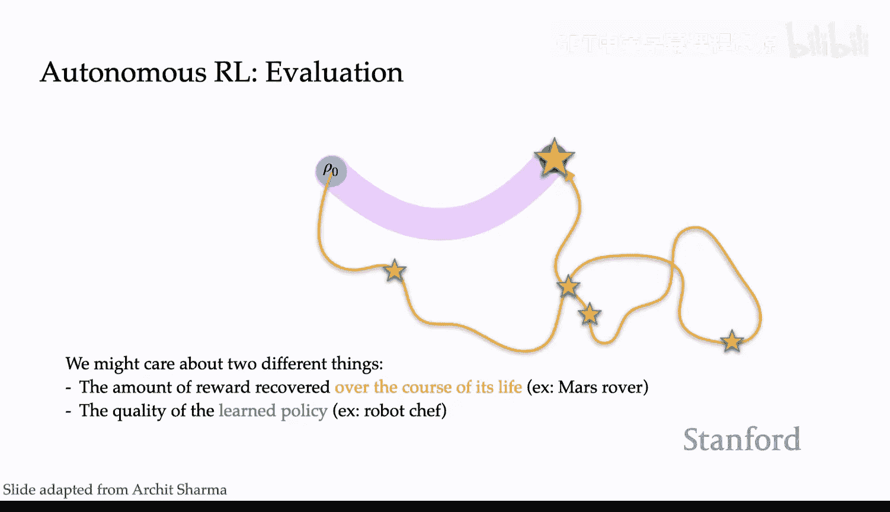

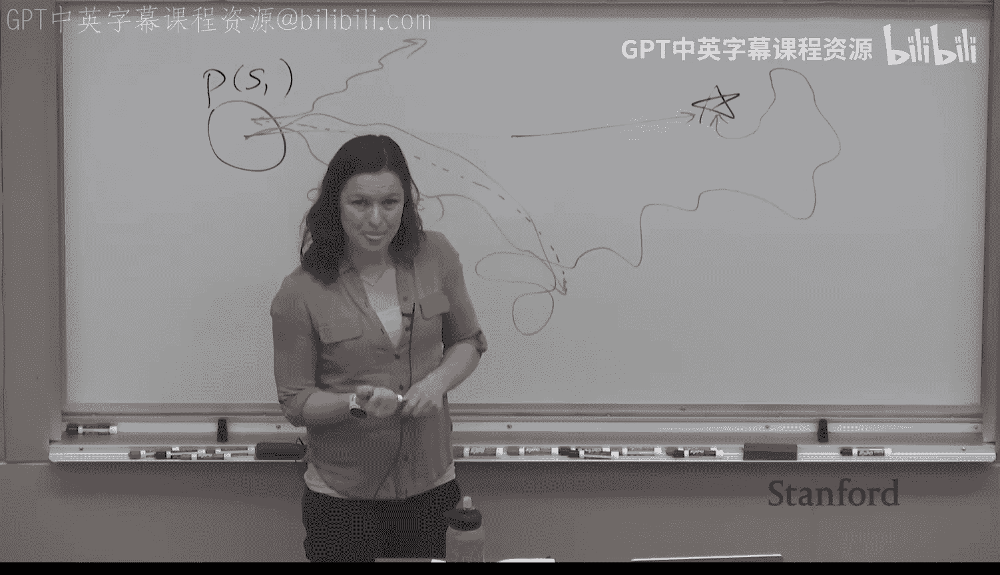

Cool， so that would be kind of a typical like if we kind of then took a policy that we learned。

 initialized it at the starting state and ran it， does it achieve good reward under those conditions。

So we'll think about these as two different things。 so we can。First。

 let's think about what we'll call like deployed policy evaluation。

 So how good is the policy that we learned if you were to then deploy it。

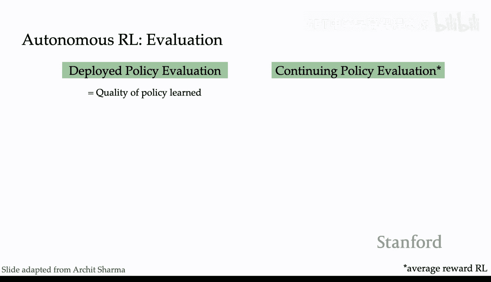

And the objective for this circumstance can be defined as an objective that looks very similar to what we've been seeing in the course previously。

 which is that you would sample a state from your initial state distribution and act according to your policy。

And measure the sum of rewards or the sum of discounted rewards。That was observed after starting。

 after running an episode， this should be yeah an expectation。

After starting from the state and acting according to the policy。

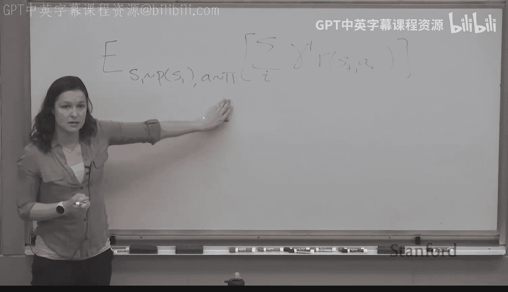

So this is deployed policy evaluation， how good is the policy if it's starting from the initial state distribution and acting according to the policy？

😊，Alternatively， if we were to think about more like the kind of continuing policy evaluation。

 how good are we if we kind of just deployed the system and it's trying to learn as it goes and how good is it during that learning process？

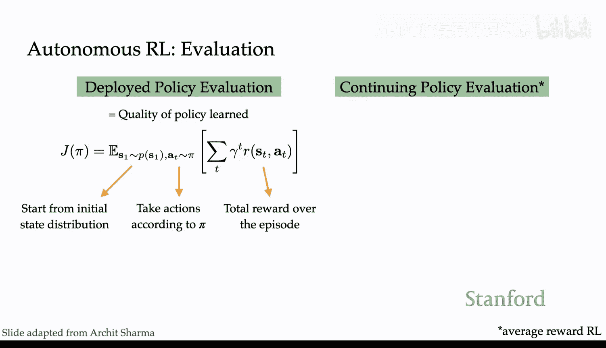

Then we'd actually be considering something a little bit different。

The we would want to be considering。What is the average reward that it saw during that learning process？

And so we would be looking at something like。u。Some kind of average 20。

 so we'll call we'll write this as1 over h of t equals 1 to h of the reward。And。We。If H is small。

 this is not going to be averaged over a small things。 And so we want to be evaluating this。

 usually as our lifetime might be getting longer and longer。 So this would be。

A limit kind of evaluating average reward in the limit in which H goes to infinity。

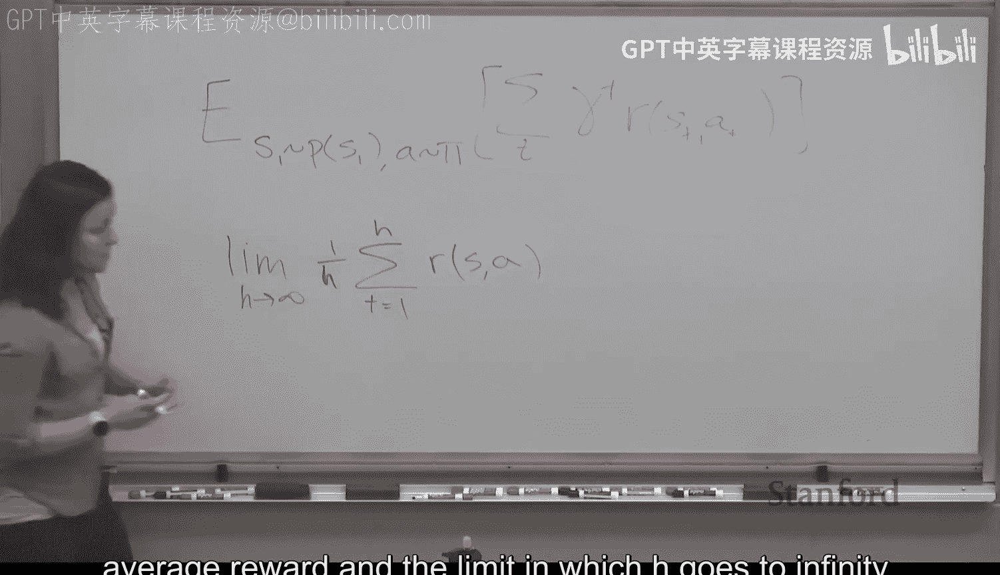

So something like this。

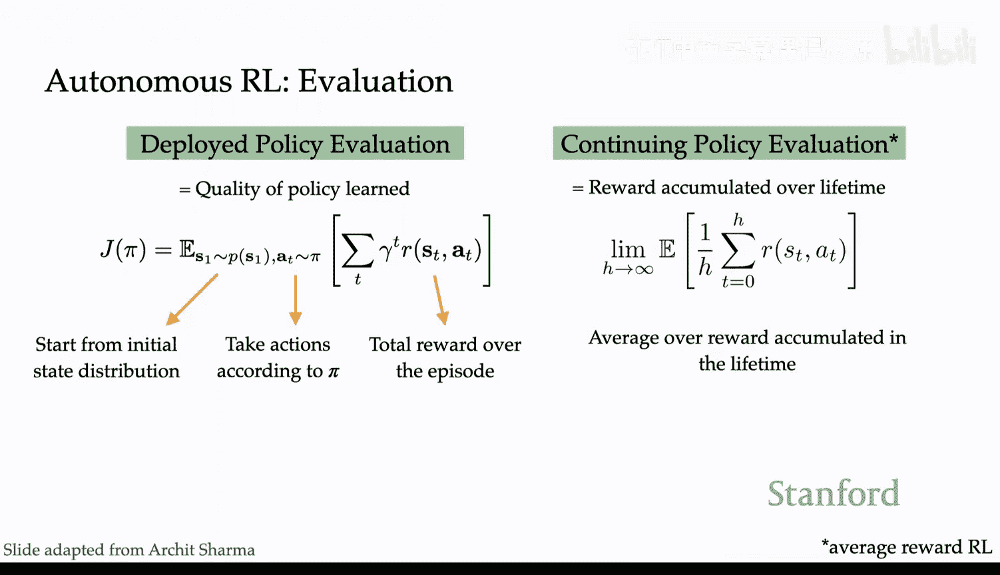

And there should be an expectation over， over this quantity。 Now， this expectation isn't。

N isn't under a single policy。 It's over the learning process itself。

So that's another difference from measuring how good a learn policy is。

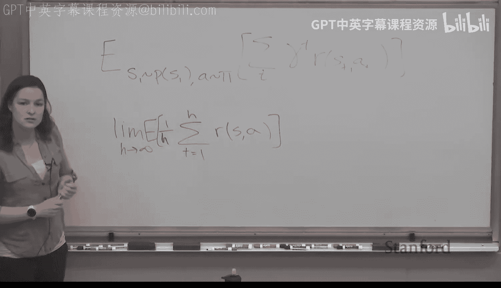

And so we'll look at algorithms for both these circumstances。

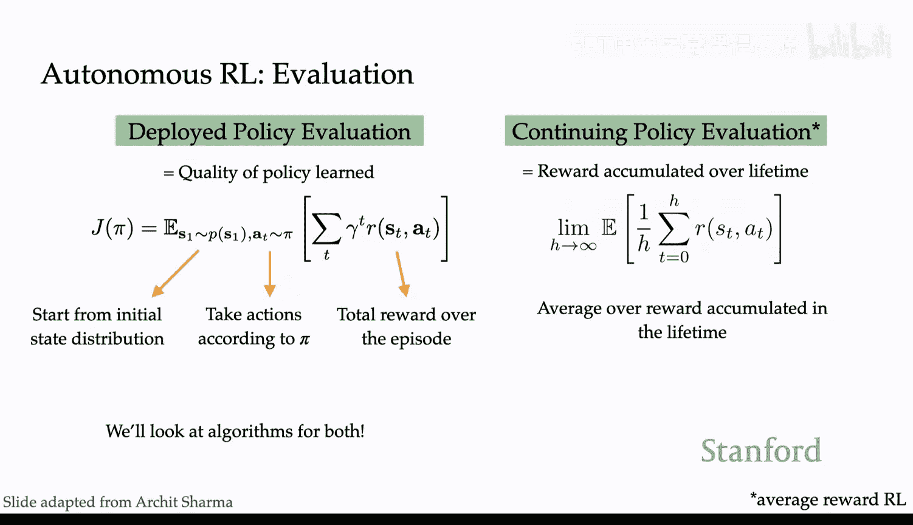

Yeah， so the question is， why do we need an expectation if we're just like running one trajectory。

If you want to evaluate just like a single like lifetime or a single rollout of your learning process。

 then you could just like measure precisely that， like run it and see how well it does now in practice there's variability that's caused by variability in the environment。

 variability in your learning process， like like how you sample batches and so forth and you may want to measure like at the algorithm level。

 how good is your algorithm at this sort of problem and if you want to measure how good the algorithm is you want an expectation over multiple runs of the algorithm。

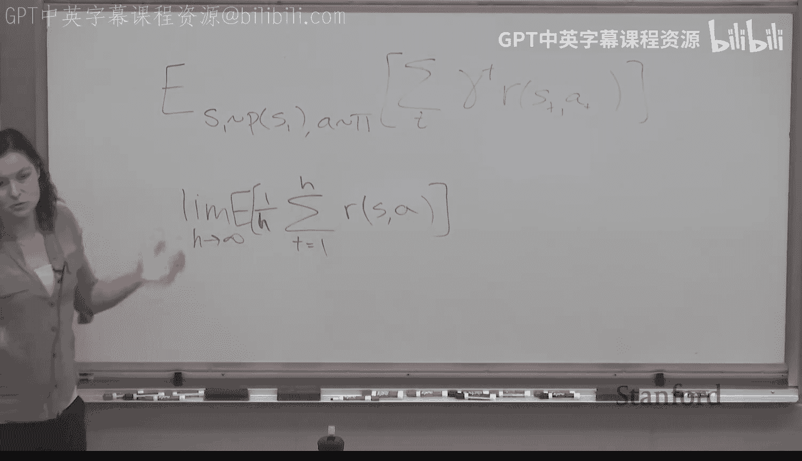

Why is this important， we've already talked a bit about the motivation。

 but to kind of elaborate on a little bit more， we want robots to operate with minimal human supervision。

 but we also want them to train with minimal supervision as well and。

Generally reinforcement learning on real robots is a kind of a promising path towards achieving really high success rates。

 really high reliability compared to imitation learning。

 and if you're able to train with minimal human supervision。

 then you're able to collect more data and more data may also unlock both greater reliability and also greater generalization as if these systems are able to be deployed at scale in a variety of real world environments。

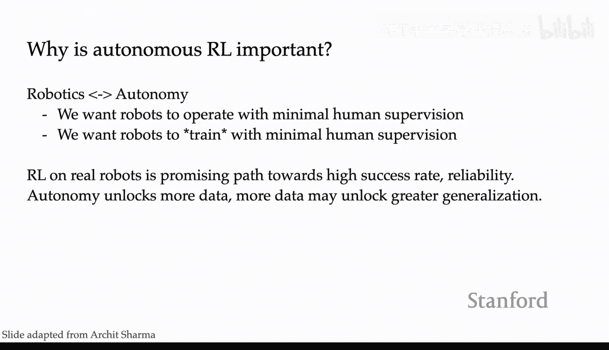

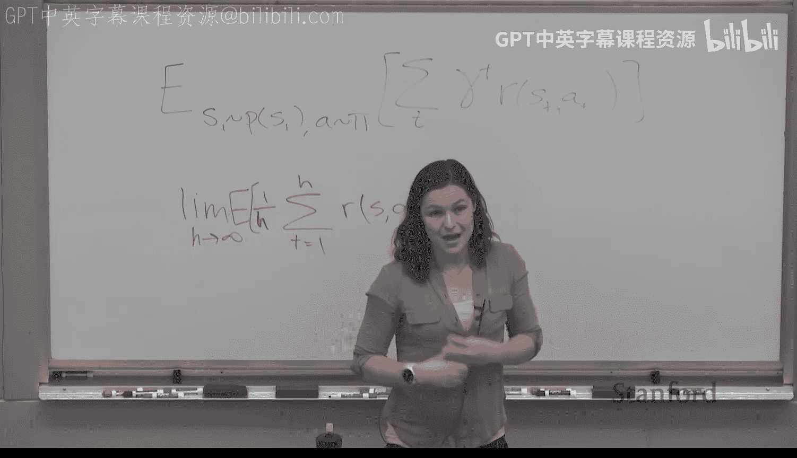

So that's the problem setup。 Now let's dive a bit into algorithms。So。

We like to learn policies without human supervision。 And we talked about this question before like。

 what if we just increase the length of the episode。嗯。

And can we just take a traditional kind of standard reinforcement learning algorithm， in this case。

 I think we'll be looking at soft factor critic。And just run it with longer and longer episodes。

 which in principle should require less and less supervision。If we do this。

We see performance changes a bit。 so this is a plot that's evaluating how good is the learned policy after training for some number of steps shown on the X axis。

 So the Y axis is reward of accomplished by kind of the deployed policy。

 So it's this blue measuring this blue equation right here。

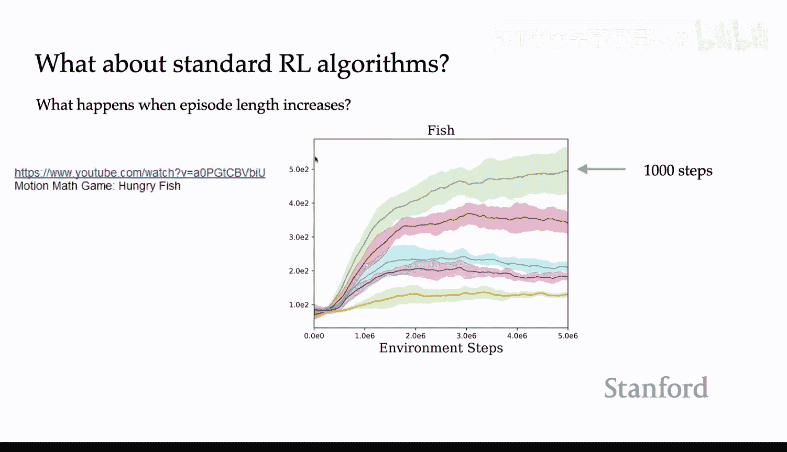

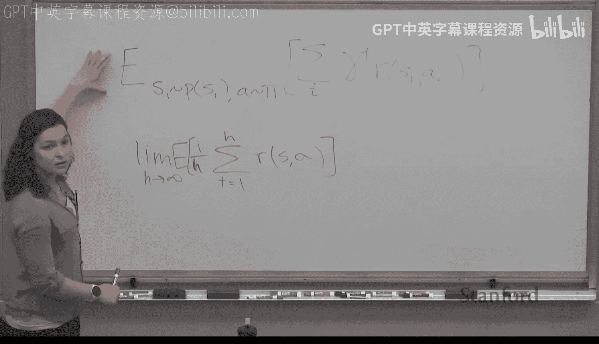

And this green line is if you run with an episode length of 1000 steps， if you run S。

 you get a learning curve where it's able to learn a policy and it's able to effectively complete the task。

Now， if you increase the length of the episodes during trading， by a factor of two。

We see that the algorithm does worse， and then we increase it by a factor of 10。

 we see that it does even worse， and basically as we increase and make the episode length。

Longer and as a result， reduce the supervision required for training。

The algorithm at the very end is hardly able to learn how to do the task at all。

 how to learn a policy that can do the task at all。

And I should mention this is kind of a very simple kind of fish control task where your goal is to navigate with what the fish can do to a different a particular position so pretty simple task。

 even for the simple task， if you increase your episode length and don't give it resets very frequently。

 you aren't able to learn a good policy。

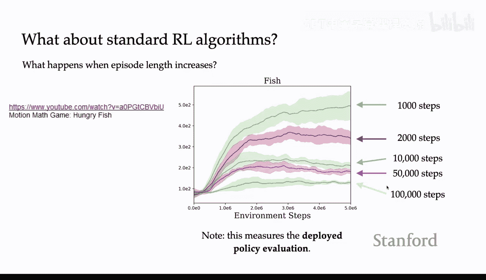

Now， why is this the case， I guess does anyone have hypotheses for why。

 like why we're not getting a good policy if we only reset every like 50000 steps or 100000 steps。

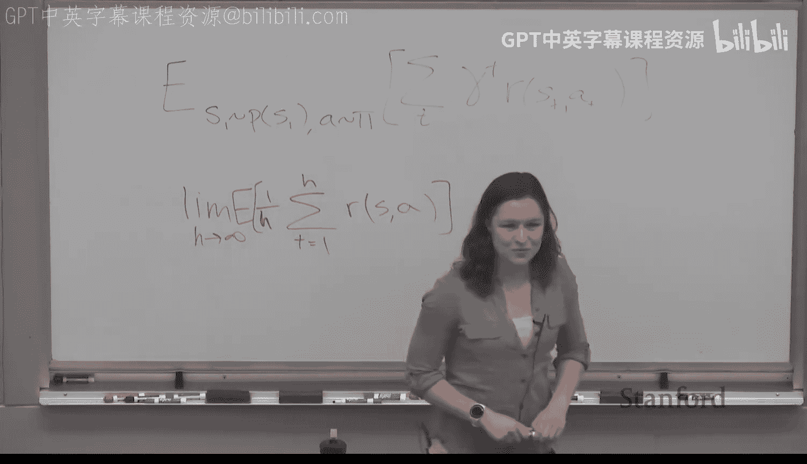

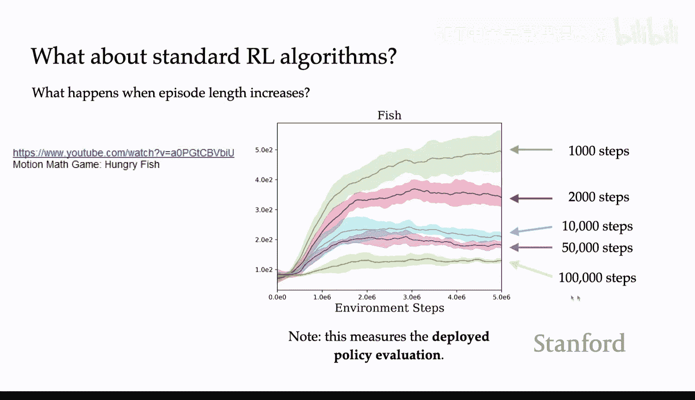

Yeah， so the first issue that can happen is it can make a mistake and kind of do something that's bad。

 maybe leads it to a part of the state space that is very hard to recover from in this particular environment。

 I don't think it's possible for it to break its tail or something。

 but you can get it basically drift away from this state distribution that's good。

And so if we were to think about this。Maybe that diagram is getting a little bit messy。

 Our goal is to learn a policy。That goes from some initial state distribution to some goal as a simple reinforcement learning problem。

 as we're learning， we might simply kind of deviate from the kind of where the set of good states is and because of this drift。

 it might be very hard to recover and get closer to the parts that have high reward。

So that's one challenge。 Does anyone else have ideas on another challenge？

The other challenge is actually a little bit more nuanced。And in particular， say that we drift away。

 but maybe either in another episode after one reset or even for this episode。

 if you are able to eventually get to the goal， which is good， you got reward。From there。

You might simply kind of stay in this region of the state space。

And if you start collecting a lot of data in this part of the state space。

 you're getting lots of reward so kind of the learning process is great。

 but then if your goal is to learn a policy that starts from here and goes to here。

 you're not actually visiting the states that will yield a good policy。And so the。

You might as not be visiting the states that allow you to actually kind of go effectively from one initial state to the goal。

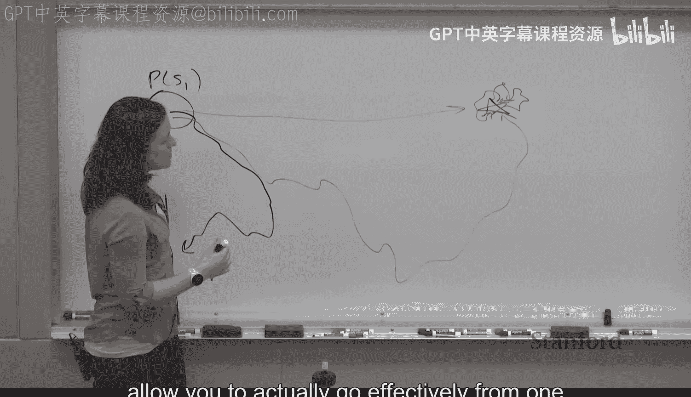

So two challenges， if we think about this row star as the optimal state distribution for getting from start to goal。

 then an episodic alert， you can always retry the task from the initial state distribution。

Whereas in autonomous learning or non episodic learning， you'll continue from where you left off。

 And that sort of exploration might lead you to drift away from the set of good states for getting to the goal。

And then even if you do eventually get to the goal。

 your state distribution in your replay buffer might collapse and and might be kind of。

Concentrated around the goal， rather than capturing the state distribution that's around the optimal policy。

 And if you don't have states from the optimal policy。

 you won't know what to do or what actions to take when you're in this part of the state space。

so as an outcome of this， you'll never actually learn a good policy。

So how can we learn an effective policy？So if the agent is allowed to reset from the initial state distribution。

 we do learn successfully。And so one very simple idea is to try to learn a policy that brings us from wherever we ended up after attempting the task back to the initial state distribution。

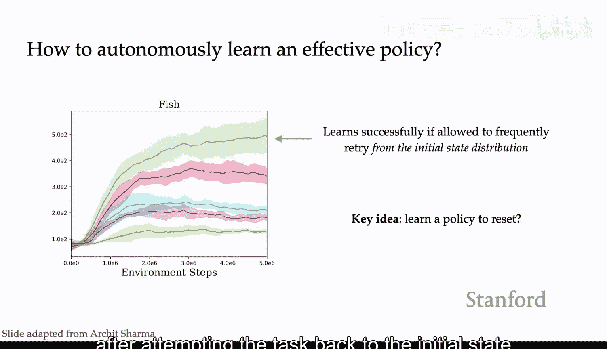

And we can call this idea，- we can think of this as like a reset policy or a backwards policy that's trying to undo the task rather than do the task forward。

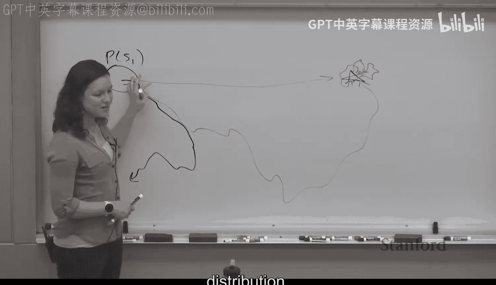

And so we can think of this as。Kind of forward backwardarrow。

 because we will be learning a forward policy that does the task and a backward policy that undoes the task。

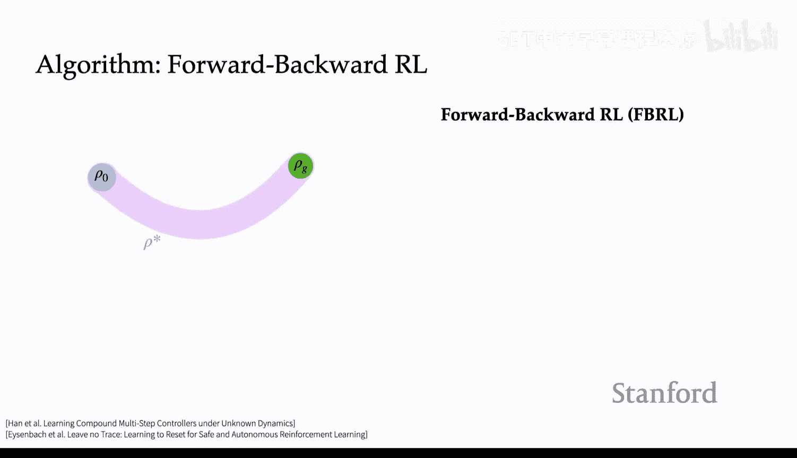

And where to put this。Maybe let's do it over here。You'll first。

Maybe step 0 is to initialize and sample。An initial state。From。Your original state distribution。

 basically initializing the agent。 And then you're going to repeatedly。Run。Your forward policy。

 which I'll call pi F。Then。Update your forward policy。By trying to maximize the sum of rewards。

 and this will be using the reward function for completing the task， I'll call that RF。

 the forward reward function。And then we'll reach some state。 We won't reset。

And we'll run our backward policy， pie beef。And then we can likewise update our backward policy。

In this case， we would need to update it。For the reverse of the forward task。

 and so we'll actually rely on a reward function that will tell us if we are reaching the initial state distribution。

 and so this is going to require a second reward function RB that is going to serve as reward for the backward policy。

Now， in terms of these update steps， you can use your favorite reinforcement learning algorithm for this。

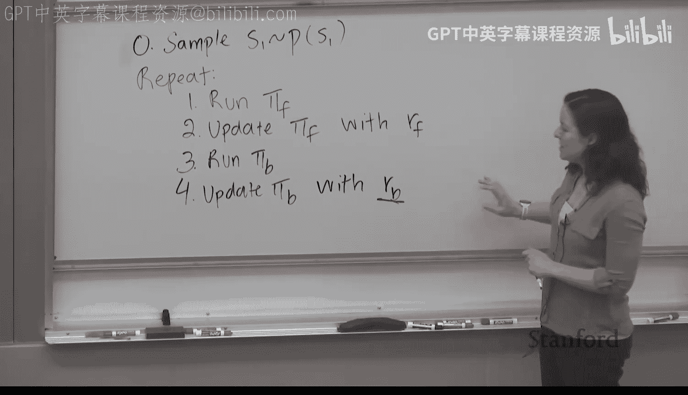

And critically， after we run the backward policy， we're not going to reset。

 we'll then kind of go back to running the forward policy again。

And so what this would look like is we will define this backward reward function。

 which is for like rewards us for reaching states in the initial state distribution。

Then we'll initialize them and repeatedly roll out the forward policy。

 then update the forward policy with respect to reaching the goal， roll out the backward policy。

 which is going to try to go back to the initial state distribution， then update the backward policy。

And then without resetting， again， try to roll out the forward policy。

 rollll out the backward policy and repeat this process。You can also have a reset very infrequently。

 so occasionally reset it just in case it does kind of get stuck in a really challenging state。

And then at test time， once you're done with this process。

 you can discard the backward policy and just deploy your forward policy。

 which should have learned ideally how to get efficiently from the initial state distribution to the goal or generally to maximize the forward reward function。

One other small note here is that where're going be typically。

 you need to decide how long to roll out the For policy for。

The simplest thing to do is simply to roll it out for H timets so choose a constant number of time steps to roll it out for you could imagine doing something more sophisticated。

 for example， before the forward policy has learned anything。

 the backward policy like if it's not moving anywhere。

 the backward policy won't really have any job to do at the beginning。 And so you for example。

 could run this for a little bit longer at the beginning。

 but then at some point you also need to run the backward policy for a little bit longer。

 and it's a bit simpler to just use a fixed number of steps。

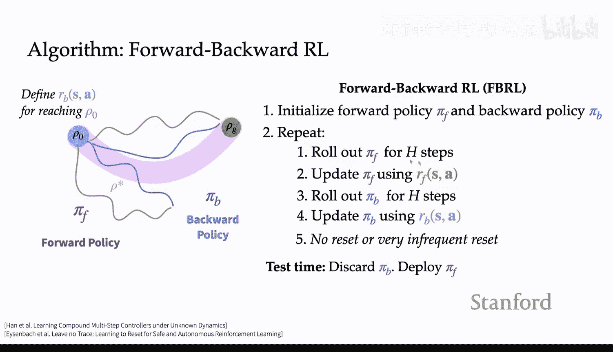

And ideally， if this process is autonomous， then the number of time steps actually matters a little bit less because you can go to sleep while your robot is trying to learn。

Yeah so the question is is there any information sharing between the forward policy and the backward policy if you're using like replay buffers you could consider sharing data between the two and relabeling the rewards for the forward policy for the backward policy and vice versa in practice it's fairly common to actually not share much information you could also share like an image encoder for example。

 like share some of the weights that can be helpful but they are actually trying to learn in some ways very different things and so that makes it a little bit tricky。

 we'll also see some algorithms later on that do more sharing。😊。

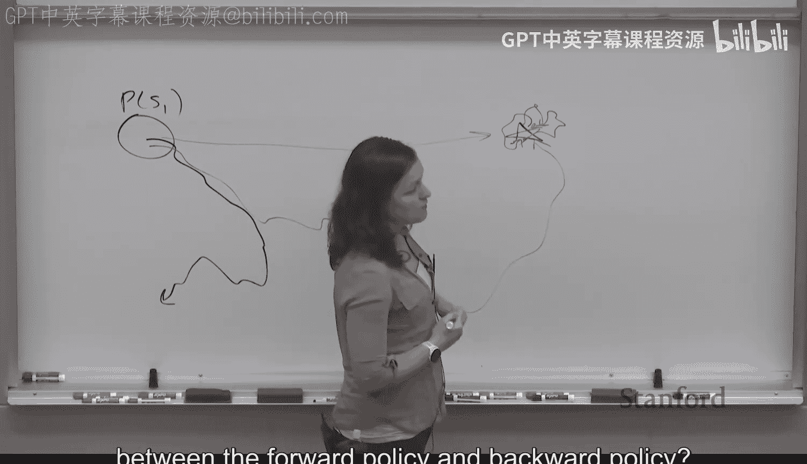

Okay， so the update of this algorithm is quite simple。

 The one of the downsides is that this backward policy that's trying to undo the task。Ultimately。

 this is not。

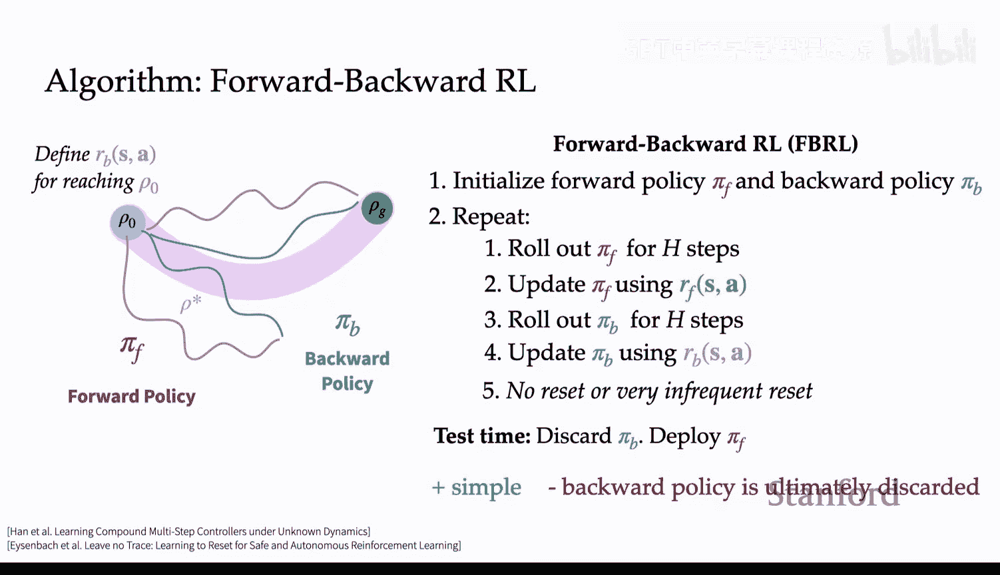

Not particularly useful， so in some ways， it seems a little bit wasteful to learn this policy。

 but it does enable kind the sort of autonomous learning， which is quite nice。😊。

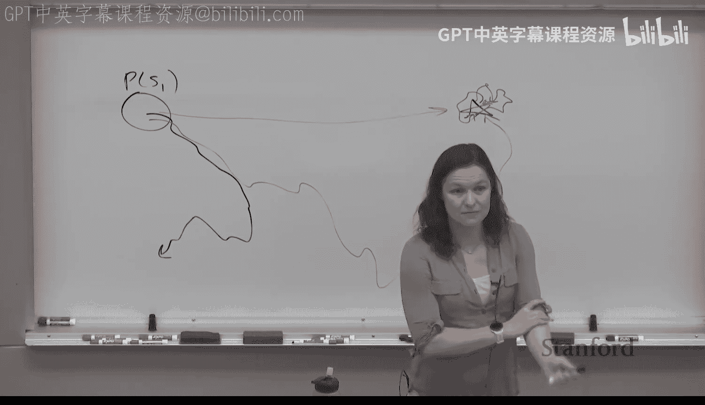

So。This is kind of like the most simple algorithm you could use for trying to learn autonomously。

But there are also some alternatives that in some ways have a number of appealing properties。

So first，'re for your backward policy， you can actually change the reward function that it uses to actually not reset all the way back to the beginning。

 but potentially to reset from a larger variety of states。Second。

 we could instead of learning forward and backward just for one task。

 we could think about practicing a cycle of different tasks and not just learning kind of a forward task on a backward task。

 we'll talk about that a bit and then the other option is you could also set up a task that can be done repeatedly where you can just kind of keep on attempting the task over and over again in kind of certain special circumstances I we'll talk about that briefly as well。

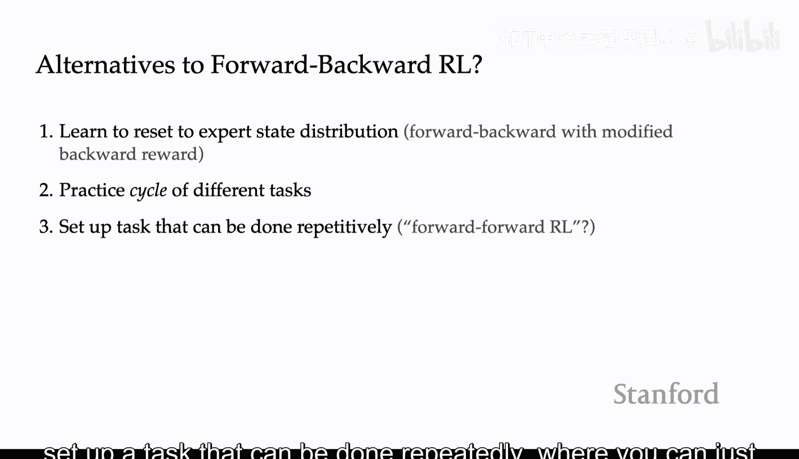

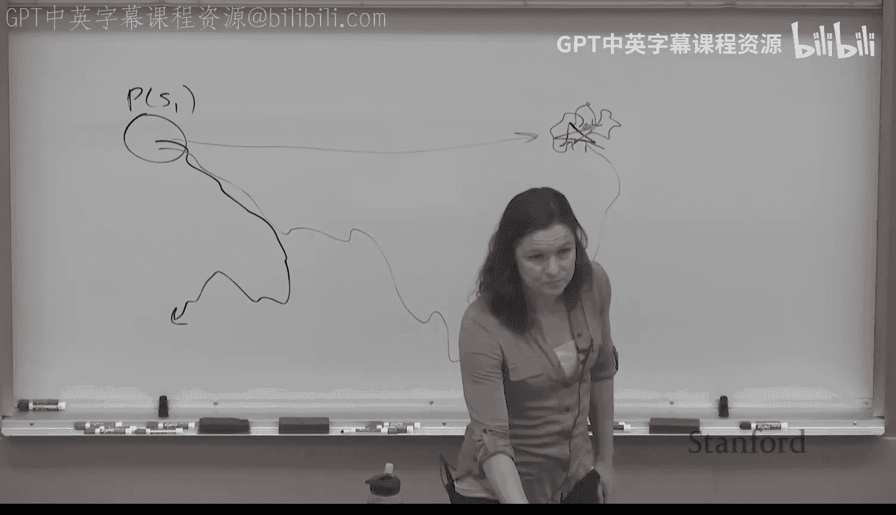

， let's first talk about learning to reset to a different initial state distribution from the initial state。

 And so the motivation here is that in forward backward R， we're kind of trying the task， going back。

 trying the task， going back and the。Ultimately， we want to be able to do complete the tasks from the initial state distribution。

 but we also like need to know how to take good actions all along the expert state distribution as well。

And so one of the things that we could do is instead of going back all the way to the beginning every single time。

 we could actually reset to different states along the expert state distribution。

And there's actually work that shows that if you were to do this and had a way to do this。

 then you'd actually learn a bit more efficiently than always starting from the initial state distribution。

 even in episodic learning settings。And so the way that this worked is basically going to be the same exact thing as before。

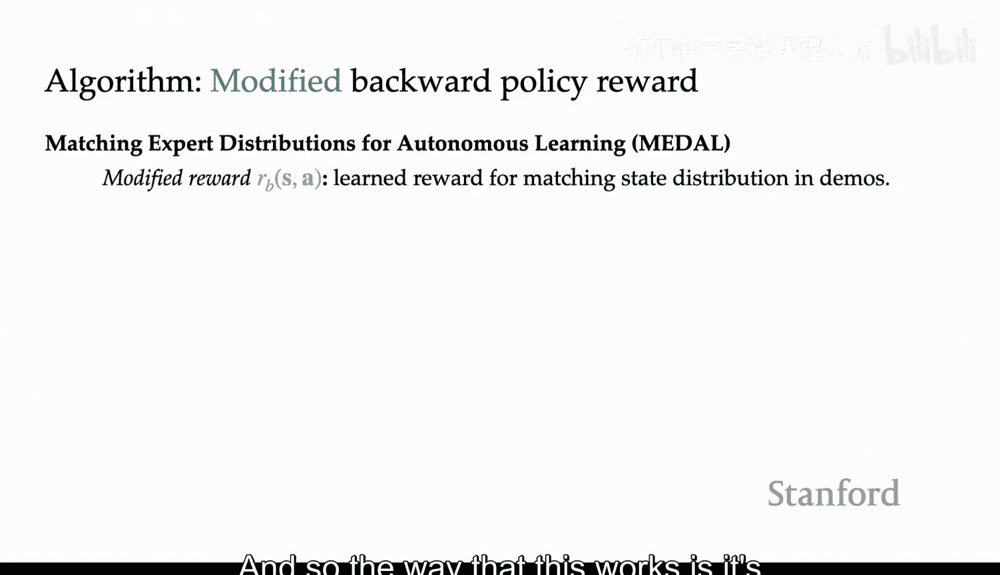

But with like basically like two small modifications。

And the first is that if we want to be able to reset and learn a policy that brings us to the expert state distribution。

 then we need a way to approximate what that expert state distribution is。

And so we'll assume that we have a few demonstrations。And so maybe step negative one here is。

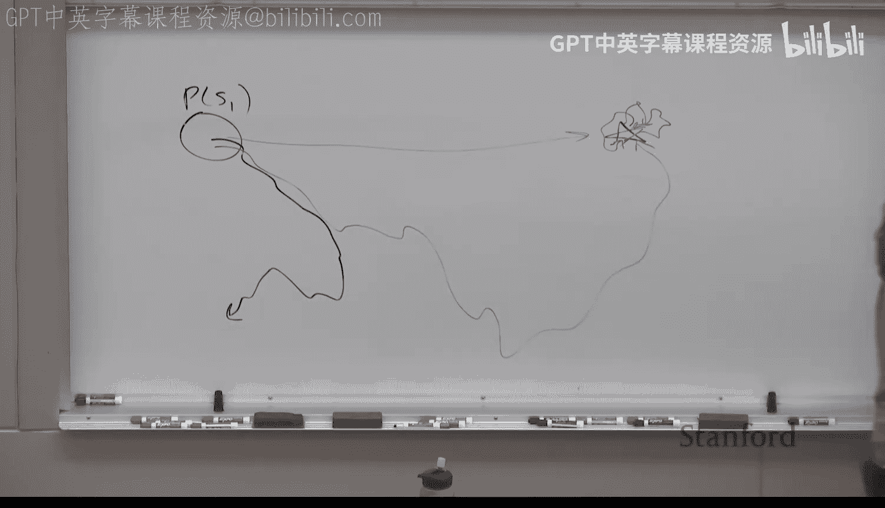

You're basically given some set。Of expert。Tradjectories are expert demonstrations。

And these will be examples of ways to accomplish the task。

And then you need to change the reward function for the backward policy where the reward function shouldn't be to reach the initial state distribution。

 but instead it should be to reach， to reach states that the expert visits。And so in particular。

 we'll be given a small set of demonstrations。 And ideally。

 what we want this to look like is we run our forward policy。 And then we。

 we run our backward policy after it's kind of。Learn something reasonable。 Ideally。

 it kind of just bring us back to the set of， the set of states in the expert distribution。

Then we run our forward policy again， and then it would bring us back again somewhere in this pink region that is showing the distribution of states that are visited by the expert。

Um。And so the forward backward process is the same。

 but we have this modified backward reward function。

 and we're actually going to learn this reward function。And in particular。

 we talked about in the lecture on learning reward functions how you can train discriminators to discriminate between good states and bad states and use states from the policy as examples of bad states。

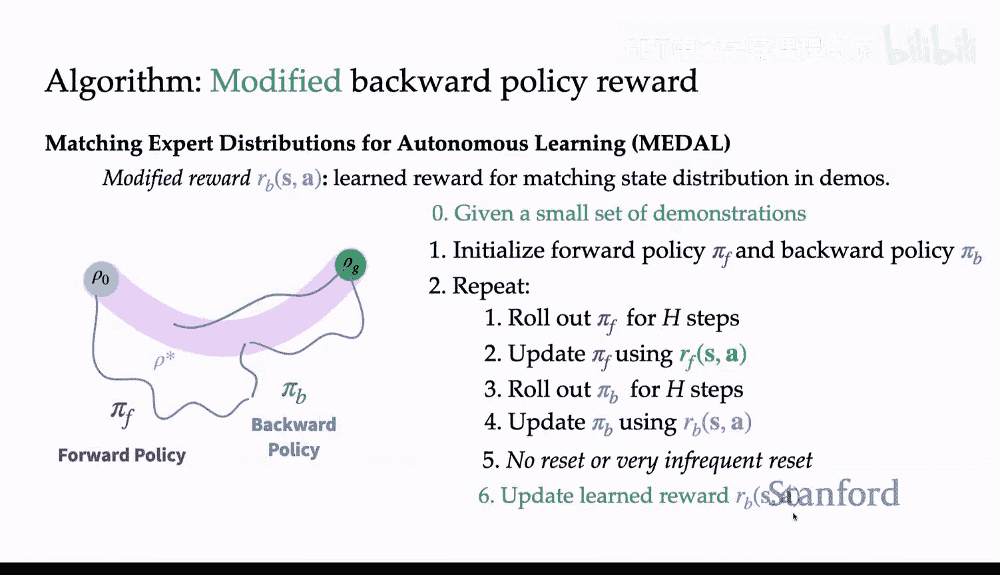

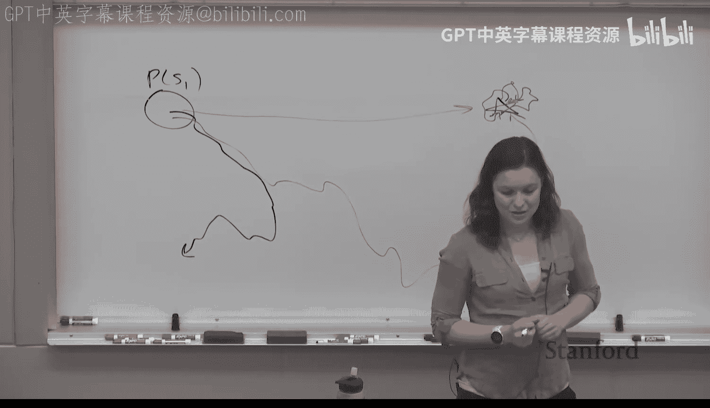

And we can do the same exact thing here where this reward function will be trained to distinguish states visited by the policy and states visited in the demonstrations。

And then you'll be trying to， when you're training the backward policy。

 you'll be trying to trick this reward function into thinking that it's the estate that's visiting our estates from the expert and not from the policy。

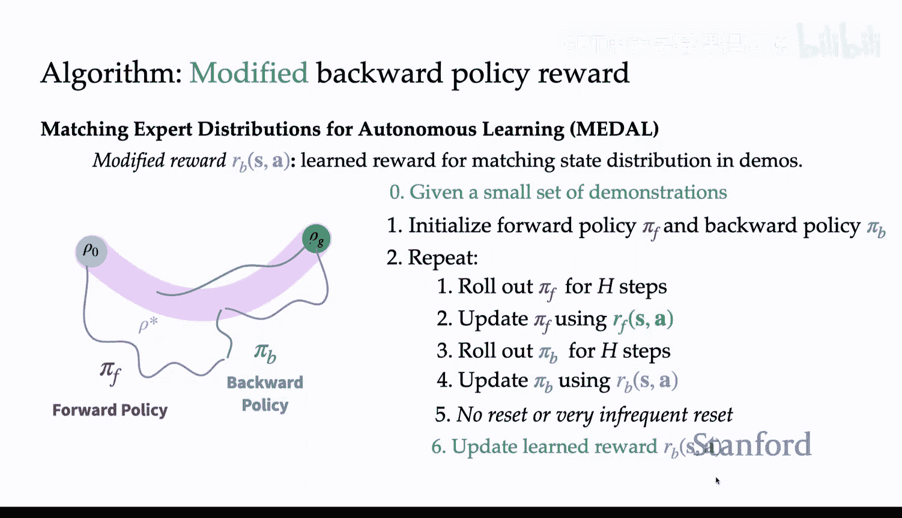

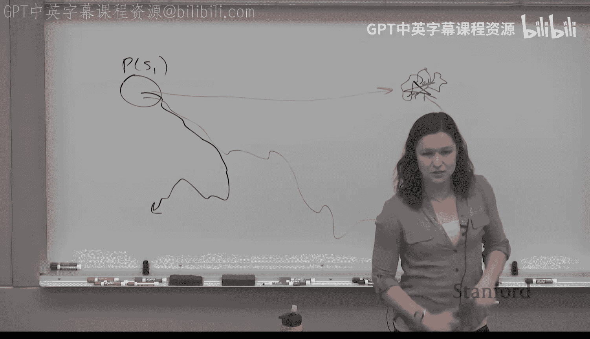

And then again， we'll discard our backward policy when we're done and deploy our forward policy。Cool。

 so assuming some demonstrations， run our forward policy， backward policy and so forth。

 this and forward backward RO addresses the challenge of preventing the agent from drifting away。

 and it also avoids collapsing the distribution that we talked about before as well。😊，Cool。

 and then the upside that we that I mentioned very briefly is that if you try the task from a wide set of initial states。

 both easier states like states that are closer to the goal and further states。

 then you could actually improve the efficiency of the entire reinforcement learning algorithm。

The last thing that I'll mention is that you could actually use these demonstrations in the like replay buffers as data to help train the foreign policy and the reverse policy as well。

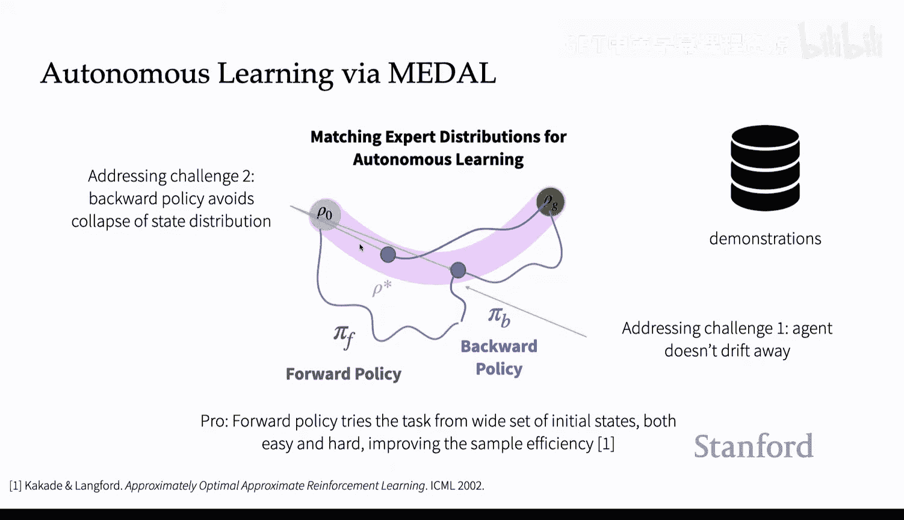

So the question is if the agent finishes the task， does the backward policy just stay there。

 and here's the example， the answer is no。

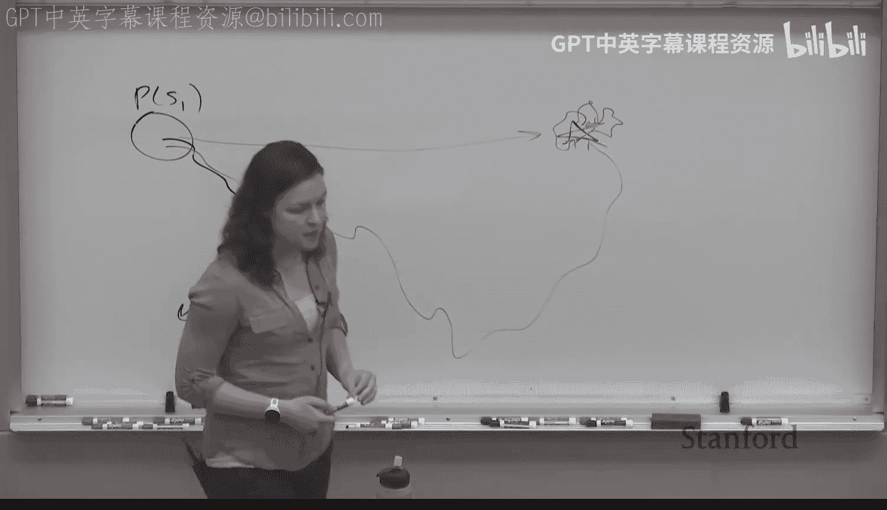

In the case of For backward R， it would go back to the initial state。

 whereas in the case of this kind of metal algorithm。

 it'll kind of try to push the policy to a state in the expert state distribution。And specifically。

 when we're training the classifier to classify between policy states and expert states。

 we're using all of the states in the trajectories， all of the states in the demos。

 and so it's going to， for example， like in this graphic， go back to somewhere over here。

 so that the policy then learns and practices how to do the task from here rather than only practicing it from the goal state。

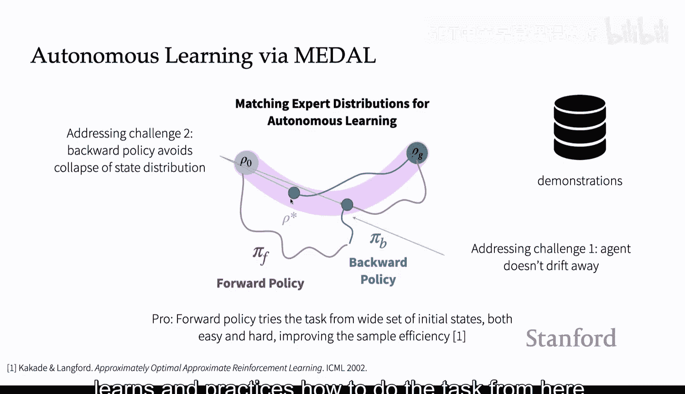

Right， the question is what prevents it from actually staying in the goal state。

 because the goal state is part of the demonstrations， the the specifics of。

I was thinking about not going into this， but basically the specifics of this reward function is actually kind of a state distribution matching objective where its goal is to match the states that it visits with the states in the demos and if it only resets to the goal state。

 then the classifier or the discriminator， this reward function will learn that if you're only in the goal state。

 then that's probably coming from the policy and not from the expert demos and it will be able to distinguish that and the way that you can kind of formalize that is you can actually think about it as a divergence between the states。

 the distribution of states visited by the backward policy and the distribution of states visited by the experts。

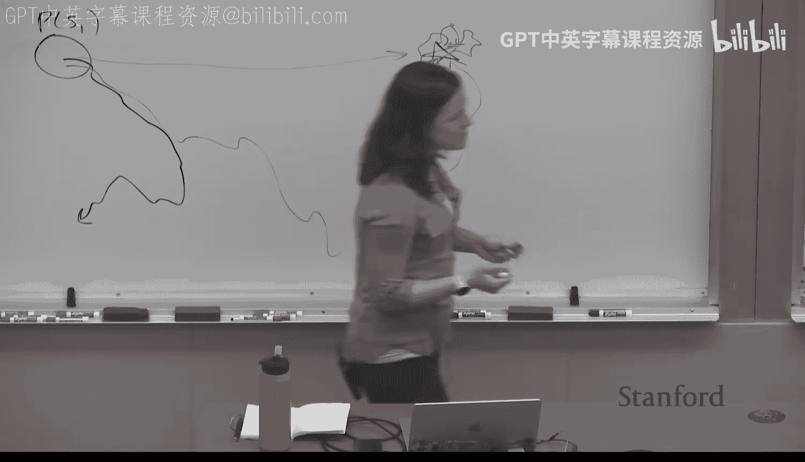

Cool， so let's actually briefly look at how these algorithms perform。

 So there's actually a benchmark for kind of this sort of autonomous reinforcement learning setting called Earl。

 And during training， you only get a reset every 200000 environment steps。

 So very infrequently and the evaluation is how good is the policy when you start it from some initial state distribution。

😊，The benchmark has a few different tasks， this is probably the simplest task in the benchmark where you can basically try to like grab a cup and move it and there's this very simple grabbing mechanism that makes a task simpler and then we'll also look at a more complex task on the next slide。

😊，And if we look at what different algorithms do in this environment where they only get resets every 200。

000 steps， first， if we just run S without a backward policy where it only gets very infrequent resets like we saw with the fish。

 the performance isn't very good and it doesn't learn a good forward policy。

If we use an oracle that is able to get resets much more frequently。

 then it is actually able to learn a good policy。And then there's a few algorithms。

 kind of reset pre algorithms， One is something that tries to perturbbit and encourage it to visit novel states。

 Another shown in orange is kind of the vanilla For backward reinforcement learning algorithm。

We could also give it some sort of goal curriculum。

 I didn't talk specifically about this algorithm and then the blue algorithm is the algorithm that's trying to reset back to states in the demonstrations。

And so we see that first， I guess the kind of main takeaway here is that these algorithms that are specifically designed for this kind of autonomous or reset free learning setting are able to do much better than if you don't design it for that case and in this simple environment they all perform kind of fairly similarly and then as we move towards more complex environments we see that for backward R and metal are able to kind of do the best where simply if you instead try to kind of。

😊，encouragencage it to visit various states or goals， those algorithms aren't doing quite as well。

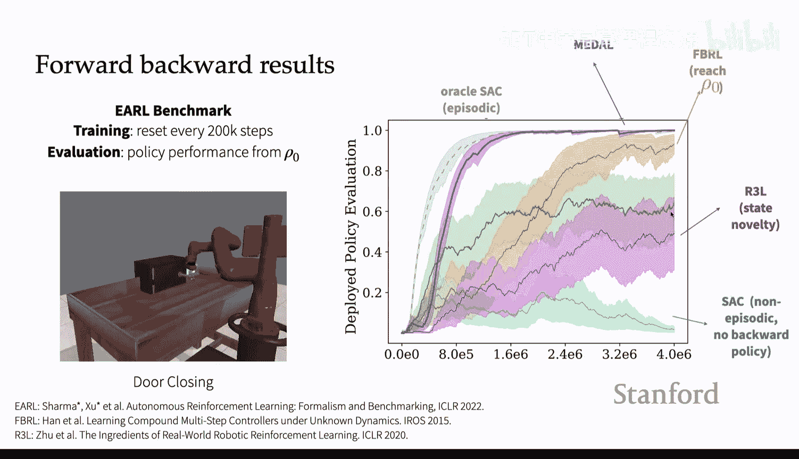

Yeah， the question is， were you assuming some expert trajectories， how are those generated。

 so there's a variety of ways that you can generate them on a real robot you would typically use some sort of teleoperationation device and that could be using like like a puppeteering like setup or a VR controller or a 3D mouse or a keyboard in simulation it can either be something that's like a scripted policy that is like designed by a person or it could be a policy that's like trained with RL ahead of time just to test the algorithms。

Can I describe what the episodic part is， So episodic is a term that often refers to like the traditional reinforcement learning setting where we can attempt the task and reset and attempt the task again where each thing is like each attempt is like an episode。

 And so it's like very episodic。 You get one episode。 You try again， you get another episode。

 And then it's not not the best term。 but that's one term。

 And then non-epsodic refers to the setting where you don't get those resets。 You just let it go。

 And so is no longer like a bunch of episodes is just like one long learning process。

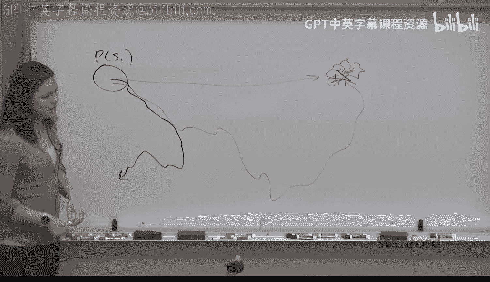

Sometimes that learning process is also called reset free because there are no resets in the process。

Oh，The other thing I should mention actually that's kind of cool about this particular task is the forward task is to close the door and the backward task is to open the door and the backward task is actually。

 depending on where the arm starts， can actually be quite a bit harder than the forward task and so you can sometimes have these sort of mismatches between how hard it is to do the forward task and how hard it is to do the backward task and that can make these algorithm that can generally sometimes make the learning process a bit more challenging because the forward policy and the backward policy will learn at different rates。

😊。

Similarly， if you could imagine like if your forward task is like to do a back fliplip， for example。

 maybe doing a back fliplip is really challenging， but like getting up and standing up to start doing the back flip is comparably easier。

 and so it's kind of fairly common to have a mismatch in that sort of difficulty。😊。

These sorts of algorithms have also like you can actually run them on real robots and it's kind of cool。

 you can like watch time lapses of them。 The left video is running forward backwardarrow where it's learning a forward policy。

 learning a backward policy and you can see that both policies kind of make mistakes and it's able to I don't know if you can see in the context of this single video but it is able to improve just by kind of through kind of a fully autonomous process and then the right is the metal algorithm and you can see that like for example。

 if the forward policy misses then the backward policy doesn't really have much to do and so you do see yeah that another property of the algorithm in the video。

😊，Cool， one of the thing that I'll mention is that rewards are also something that the real world doesn't provide。

 and so using reward learning algorithms in conjunction with autonomous or reset free algorithms is also quite common。

 And in both of these circumstances， the rewards were using models rather than using humans so that this entire process can be kind of autonomous and like you can actually like run it overnight。

 for example。😊，Yeah， so the question is it seems like for some of these tasks。

 like if you don't have a good backward policy， then it's really hard to learn the forward policy and also vice versa。

 like if you don't have a good forward policy， then you're never actually going to be picking up the towel and then you need to figure out like how to you're not really getting actually any good states in general。

 one of the things you can do is you can provide demonstrations both for the forward tasks and for the backward task and use that to help bootst the learning process for both of them other than that。

 it is just generally a challenge and yeah to try to balance these two things and。😊。

Yeah， in general， the algorithms are able to work in some settings， I should also mentioned it。

 like these works works that are doing these like。There can have still， I mean。

 certainly still in like the research stages。 I think this is not something that like。

 that like robot companies are using today， yeah。

Cool， so we've talked about kind of algorithms that learn a reset policy to help learning a forward policy。

Now， we could also think about a slightly different setting。

 which is that if we're trying to learn not just one task， but multiple tasks。

 then we could actually think about not just kind of going forward and backward。

 but practicing like kind of going in cycles and practicing different tasks depending on what state you're in。

So for example， if you have a robot that's trying to make coffee。

 maybe the first task is to put or the first subtask is to put the cup in the coffee machine。

And maybe if it attempts that it actually like drops the cup on accident。

And then kind of traditionally， what you would do is you would have a human kind of reset the cup back to where it started。

But we don't want to do that。And so instead， maybe the second task is instead of because it made a mistake。

 the second task shouldn't be to like turn on the coffee machine。

 instead it should be to pick up the cup。And so we can imagine having these different cycles where we practice task one。

Then if we fail， we'd practice task two， and then task2 maybe is kind of resetting task one。

 we maybe then go back to task one， which is to put the cup in the coffee machine。

If we didn't succeed at task2， we might keep trying it。

 If we do succeed at task  one at putting at the coffee machine， we might move to task 3。

And and so on and so forth， and so we can have this sort of graph or cycle of different tasks that we're trying and at different points in time。

 depending on the state we're in， we'll practice a different task that is possible to practice from that state and exclude tasks that are not feasible from that state。

酷ol。So what this would look like is we will be learning a task condition policy。

 so like a multitask policy。And。We will be in some state。

 and so we'll observe the state that we're in。And then based on the state there that we're in we'll propose a task that we want to practice from that state。

 So we'll have a step that is。Proposing a task， we can use ZI to denote the task that we're proposing。

And this could be like the descriptor for that task。And then we will。Run the policy for that task。

And so this could be a multitask policy。Wops。That's conditioned on Z， I。

And then we can also have an update step where we update our policy if we have a more on policy algorithm。

 then this would be updated for this particular task， if we have an off policy algorithm。

 we could update it for any of the tasks and then repeat this process where after we've run it for that task for number of steps。

 we'll then propose a different task and practice that task。So initialize our policy， propose a task。

 roll out the policy for eight steps， and then update。

 and specifically we'll be updating it with the reward function that takes into account the tasks that we're practicing。

 and so we'll need a reward function for all of the tasks that we might be doing。Yeah。

 and then again， we won't have resets or we'll have a very infrequent reset。And then at test time。

 we can then deploy this multitask policy， which can do not just one task。

 but multiple different tasks。And as an example， this is a robot system that is the goal is to pick up this different stages and different tasks or different stages。

 you want to pick up this object， slip it over and rotate it。

And there are different subtasks here and so at the beginning。

 it doesn't know how to flip it and it certainly doesn't know how to rotate it or maybe it does actually know how to flip it。

 but it isn't really good at rotating it is something where at the beginning。

 you don't know how to flip it or rotate it and you'll basically just be like practicing picking it up from the hand and putting it back。

 picking it up， putting it bad， putting it down and then once you're get better at picking it up。

 then you'll start to actually。

Kin of rotate it or flip it over and rotate it。 And so depending on which state you're actually in。

 you'll actually practice something that makes sense for that given state。

And this can actually address some of the challenges that we talked about with regard to imbalance and tasks。

 where if you haven't actually yet。Like successfully run the For policy to actually change the state。

 and you may not even be in a state where it makes sense to run the backward policy that you can keep on running the policy for a task that makes sense。

As a couple examples， more examples of this。This example on the left。

 you're trying to learn both for running walking forward and walking backwards and。

Also you also at the same time are actually learning how to get back up and so you can see it kind of transitioning between going forward。

 going backward， if it's too far to the back， then it doesn't want to keep on going backwards。

 and so then you'll practice the task of going forwards。And likewise， this example on the right。

 there's actually it's like a seven stage task where you need to pick it up position it and like screw repeatedly。

 and so it's running these different policies or these different controllers based on the state that it's in and eventually it will also run kind of the backward policy of putting the wrench back on the table。

😊，Yeah， so the question is， like， how do we select these tasks， Basically， Yeah， so there is。

Basically， kind of two。Two approaches that have been done here and this is also kind of like sort of at the bleeding edge of research in some ways。

 the verses that you could predeefine a set of tasks and also predeefine that graph saying like if you failed task one。

 then you should practice task two and basically at the upfront predeeffinine that graph what you should do in different circumstances。

And then act according to that graph， alternatively you could also kind of train a model that proposes tasks for you to do and so for example。

 in general I think it's kind of an open question with regard to which task you pick to collect for at a given point in time。

 but you could， for example， ask a language model to say like what are the different things that I could do in this environment to get better and actually then practice the tasks that it describes as output。

And so as an example of that， we are at if this is the kind of the frame that we're in。

Then there's certain things that we can do in this task。 We could like open this toy microwave。

 We could pick up the banana。 We could like push the eggplant， move the pot。

 But if we instead told it to like pick up the carrot。

 that's not something that you can do in the scene。

And if we're trying to actually try it to do lots of different things。

 these tasks are going to be seen dependent。So then you could ask。A BLM to understand。

 like think about what are the things that you can do in this environment and then have it predict。

 for example， take the banana out of the silver pot。And then from there。

 actually have it practiced doing this task versus practicing doing some other task。The question is。

 how is this different from hierarchical learninging。It's a good question so this task proposalr。

 you can sort of think of it like it shares some similarities with a high levelvel policy that's telling you what to do in a certain circumstance。

 but its purpose is actually quite different， so the purpose here is actually having it proposed things that you could do in the environment that you could practice whereas in a hierarchical system the highlevel policy goal is to say what is the next subtask that will achieve some outcome at the end of the day and so this is actually something where you want it to give you lots of different things that allow you to learn lots of different things whereas a high levelvel policy you're much more goal directed in terms of accomplishing some sort of long-term objective。

This particular work chooses to actually use a hierarchical method。

It sort of actually it kind of builds upon the one of the works that we talked about previously。

 where it actually then feeds this into an image editing diffusion model to generate an image of a generated goal。

 And then it trains the policy to try to reach this goal image。

 and one of the things that's nice about this is that。With this sort of approach。

 you need to update this using a reward function for each task。

 and it can be quite challenging to define a reward function for all of the different tasks。

 whereas if you have an image of the task that you're trying to accomplish。

 then your reward function can be based on whether or not you're close to this image。

 and so it makes it easier to define the reward functions。Your question is。

 would this proposalr kind of give those outputs？Yeah， yeah。

 so absolutely so this sort of framework was applied to like these simple robot scenes。

 but you could also， for example， like in the hockey example。

 ask it like what are the things I could do in this situation， should I like practice passing。

 should I practice shooting for those particular examples。

 I think it's also reasonable to just like there's only like a limited things limited number of things that you need to practice and so you could just have one session on practicing goals。

 one session on passing， but yeah you could also use an idea like this to actually propose what to try to do in different situations。

Those are a couple autonomous learning algorithms， the first category being like algorithms where you try to do the task and then kind of undo the task in various ways。

 the second where you're trying to then kind of try to do one task and then another task and then another task and trying to just get better at lots of different tasks all at once。

There's also actually some scenarios where you can actually set up the task in a way that you can do it repeatedly and the there isn't。

Necessly a lot of research on this particular idea， but in this particular example。

 the goal is to fold napkins for businesses where you need to fold lots of napkins。

So those are all circumstances where we want to learn a policy and our goal is to get a good policy rather than simply kind of the Mars Rover example where we want to maximize rewards。

There's also the second category of problems。And the motivation is that you've been trying to learn policies without resets。

 you'd improve the quality of policy through practice。

 but then at some point we're actually going to be deploying the policy。And ideally。

 this policy will be pretty good。And maybe you're a scenario where obviously like everything's going to work perfectly。

 nothing will ever go wrong when you actually go into deploy your policy。But in practice。

 that's not the case and the natural world， things will go wrong despite having a lot of training。

And this latter setting is thinking about after we've learned some sort of policy。

 when it's out in the world on its own， can it recover from mistakes and learn kind of after the deployment process？

And。This is something that even humans do to some extent。

 So here's a video where a person is trying to open a door。 And if you look really carefully。

 you'll notice that actually the person makes a mistake and then adapts really really in like a split second in order to accomplish the task。

 So if we play this video again， we'll see that right here。

 the person is trying to apply force and the key actually isn't correctly in the whole。😊。

And then they kind of try again by removing the key backwards and then putting it back into the keyhole。

And there's lots of examples like this， hopefully that you've encountered in your own deployed policy。

 and we'd like to think about this setting where we could actually adapt within an episode during deployment。

So in terms of how this compares the previous algorithms。

 we've talked about like a lot of the course has been talking about this episodic setting where you attempt it from the initial state repeatedly and then deploy the policy once。

 we also talked today about this reset free setting where you learn how to kind of attempt the task undo the task repeatedly and then want to deploy your policy。

And this more recent setting is something where you have some prior training data。

 maybe you've trained a policy and you're in some sort of new auto distribution circumstance and as you're trying to actually do the task because you're in some new circumstances you need to do some problem solving and actually adapt and learn。

During deployment， during a single episode without resets。

 and so you can sort of think of this as like after kind of previous data or previous training。

 you have one life to autonomously complete the task。As a fairly simple example。

 maybe you have training experience on in a flat like running in like flat ground。

 and then at some point you encounter some obstacle that you haven't seen before。

 and you need to figure out how to get over this obstacle despite not having seen this during training and you want to use reinforcement learning or use some ideas from reinforcement learning to adapt to the new circumstances live within an episode。

So。One thing we might think about is like can we just run。

 can we continue to fine tune our policy with reinforcement learning at test time？

If， for example， we make a mistake， like maybe we can just update our policy with like TV updates or policy gradients like live as we're rolling out our policy。

嗯。And so if we， if we actually do that， so we trade a policy and then try to fine tune it。

At test time with this sort of obstacle we get something that looks like this。

 so the policy actually does figure out how to get over the first obstacle even though it has never seen that obstacle before。

 and then eventually it actually kind of gets stuck on like flipped over and even though it's running reinforcement learning and you can see it's kind it is somewhat like trying to get up essentially gets stuck and even though you're kind of still running reinforcement learning still running the policy and still running updates it isn't able to recover from these kinds of states that it hasn't seen before like on its own without interventions。

And ideally， we'd have a policy that could figure out like how to get up and how to retry like during deployment in these sort of new circumstances。

Now。This is also something that's like kind of bleeding edge of research。

 and I'll just mention a few ideas that have been proposed that seem to be quite helpful for addressing this sort of problem。

One is that the when you' getting stuck， you're kind of you end up in a state that it's hard to recover from。

 And if you're doing reinforcement learning updates。

 say that you are like running your policy and somehow you get kind of stuck right here。

If you're running reinforcement learning updates， you are running reinforcement updates with regard to the task of getting to the goal。

And if instead of trying to run Ral updates to get to the goal。

 if you instead try to run Ral updates to kind of get back to states that are familiar。

 like good states that you visited in your previous experience。

 then you might have a better time at getting unstuck where， for example。

 these states might be closer to the ones that are at the goal and help perturb the agent kind of back to something that it knows so that they could then continue doing the task。

So that's one idea。And then another idea is try to leverage pre training。So。

If you're trying to run reinforcement learning on the policy weights。

 like in the low level action space， you can only change the policy so much。

 and there's only so many ways you can adapt。And if instead， you could adapt in a higher level space。

 like if you had some set of pretrained skills。Then you might be able to actually adapt more drastically and actually try to change change a strategy that you're taking rather than just changing the weights or the actions that you're using。

So for example， if you learned a skill for a kind of a pre-trained skill for walking forward and a pre-train skill for kind of getting back on your feet。

 then instead of trying to kind of continue walk forward in that new state。

 if you tried to explore the different skills that you have and explore the state of getting back up。

 then you might be able to actually be more successful at handling these sort of circumstances。

 because you're basically able to try different strategies rather than just trying different actions or different weights。

The other thing here is that kind of pre traineded Llums might have some sort of common sense reasoning that could allow an agent to adapt in novel circumstances as well and try different strategies。

So let's look at a couple examples of these ideas in practice。

 So if we take the first idea that's trying to guide the agent with reinforcement learning to familiar states rather than to the goal。

We can actually run it on that same example。And we see that the agent does actually， I mean。

 this is still an out distributionion environment， it does get stuck on its back， but it is able to。

 for example， get back up after some after trying， so here it's stuck on its back is trying to get back to a state that's familiar。

 for example， a state where it's on its feet and is's able to eventually recover from that after a bit of attempts and then make it to the goal state。

And then in terms of adapting and we talked about adapting the low level space and in the high level space。

 this first example is a system that was trained to be able to adapt kind of in the low level space from recent history。

 and this is able to handle kind of some small auto distribution scenarios where it's like on different terrains。

But if you have things that are kind of more drastically different from what you've seen before。

 it can be very helpful to adapt in a more high level space。

And so what that could look like is say that you have this legged robot that's trying to reach a goal over here。

Then if， for example， you kind of all the agencies is this image right here， tries to go forward。

 goes backward， if you just keep on running a policy without any sort of context。

 it'll just keep on trying to go forward because it doesn't know that it kind of tried going forward before。

If instead you try different strategies like moving left。

 moving backwards with context and adaptation， then you can figure out how to ultimately like even though the agent in this particular case has never seen this environment before it's able to kind of problem solve its way through these different obstacles end navigating to a goal position。

This is something where if you adapted in like kind of the low level motor space。

 like trying out different like。Different like positions of your joints。

 then it would be very tricky to try to problem solve through this sort of circumstance。

Cool， so that was a brief foray into this single life reinforcement learning setting。

Yeah good question so how do we vac in safety constraints so yeah another circumstance that might require human oversight is if you're in like scenarios where you can make like safety critical mistakes like if you are a legged robot you can like fall in a away that damages the robot if you're a manipulator you could like drop like glass onto the floor you could also like hit objects pretty hard the there's actually work that。

😊，That builds very directly upon some of these ideas where you actually try to learn some notion of safety and learn when you're actually in a highris state and then go back to a state that is less risky。

 so you could actually learn， for example， like a recovery policy that tries to get back to states that are known to be less risky and more safe and so these ideas actually some of these ideas actually were we're actually like several years ago studied in sort of safety settings。

The other practical thing to do is to try to。To the extent possible。

 try to impose safety constraints on the controller itself so that for example。

 you're not using the motors to the point in which they'll overheat or minimize like have a box around the robot that doesn't allow it to。

 for example， like。Apply a lot of force to different parts of the state space now that's not possible everywhere and learning notions of safety might be the only way to actually kind of address the problem in general。

 although to learn safety you need examples of failing so it'ss generally a pretty tricky problem and yeah I guess those are my main thoughts on that。

Yeah， so you could also the question is maybe you could when navigating around people。

 you could try to ask a VLM like what you might try to do like at a high level in different circumstances and this work right here actually was using a VLM to indicate with past experience what are good strategies to try and so these models may have some sort of common sense suggesting like maybe you shouldn't walk or run into a person。

 for example， and or maybe you should wait that sort of thing and so leveraging that sort of common sense in those models is like fairly promising。

Cool， great， so to summarize， we talked about why reinforcement learning algorithms don't already give robots autonomous learning capabilities and kind of。

😊。

Define the problem， define a couple instances of this problem where we either want to think about like the lifetime of rewards or learning a good policy。

 and we talked about algorithms for each of those where we try to， for example。

 learn a backward policy， learn a task graph， and try different tasks and also single life URLl to prevent drift。

