# 斯坦福大学《深度强化学习｜CS224R Deep Reinforcement Learning  Spring 2025》中英字幕 p17 -17- Lecture 17_ Advancing Robot Intelligence.zh_en -BV1SvmxB3E5e_p17-

Today I'll talk about advancing robot intelligence with reinforcement learning。

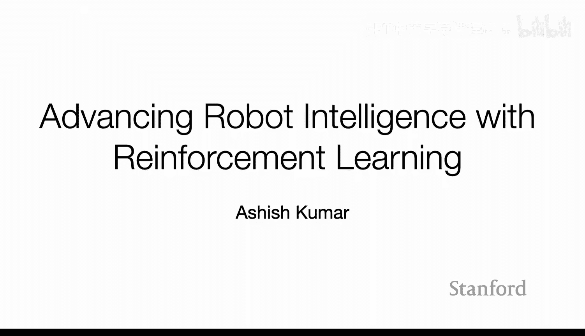

And before I。Zoom into robotics or reinforcement learning， I'll take a step back。And， at first。

Contrast reinforcement learning with imitation learning。So one thing to note here is that。

Im going to compare imitation learning that actually works with reinforcement learning that actually works。

That doesn't mean that there dont exist enforcement learning algorithms which don't follow these characteristics。

 but these are the characteristics of the ones that have been the most successful at actually solving extremely hard problems。

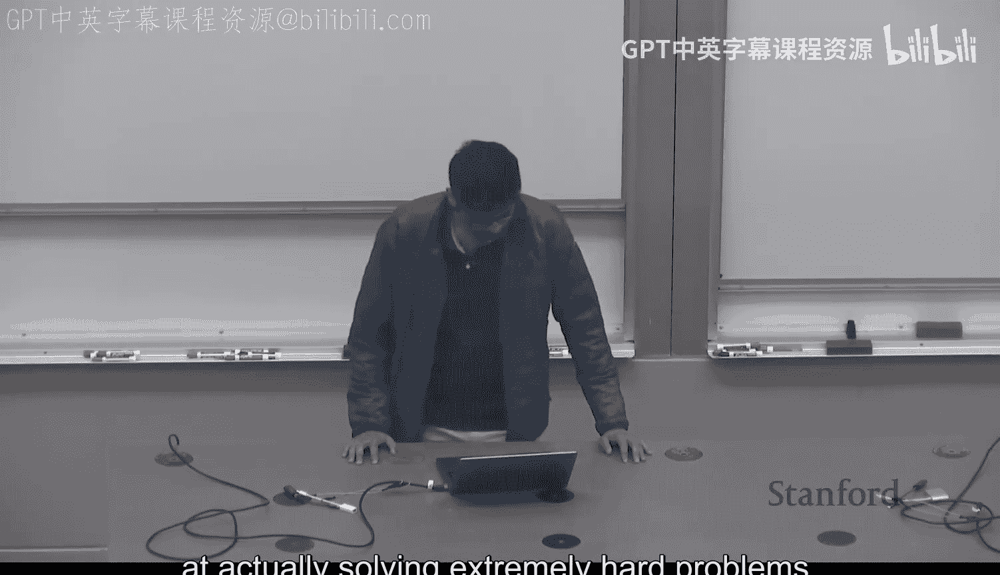

So for imitation learning， it is widely used for pre training vision language models。

 it is also used for video generation image segmentation。

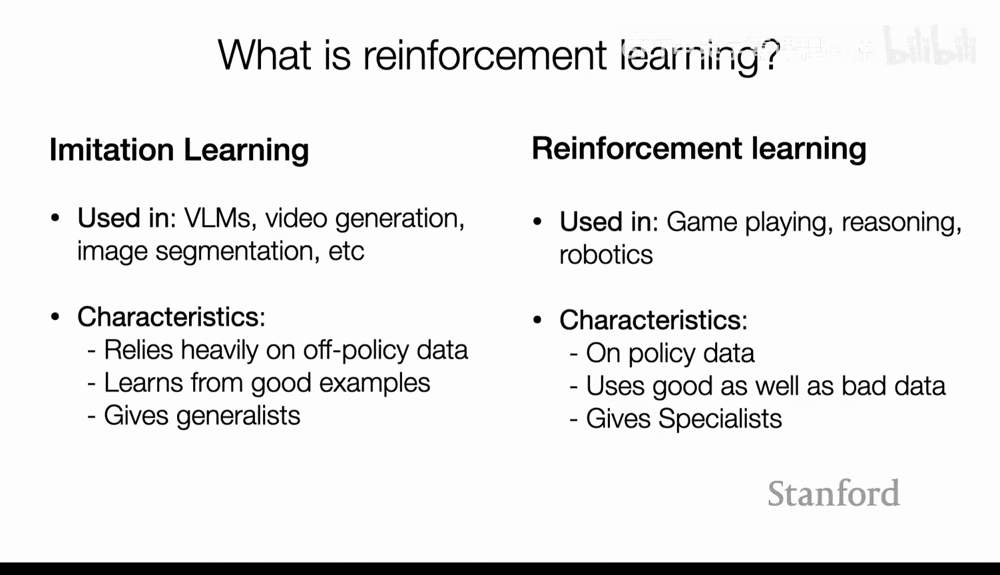

So the first two are probably more popular for image segmentation。

 you get an image and it will segment out different parts of the image。

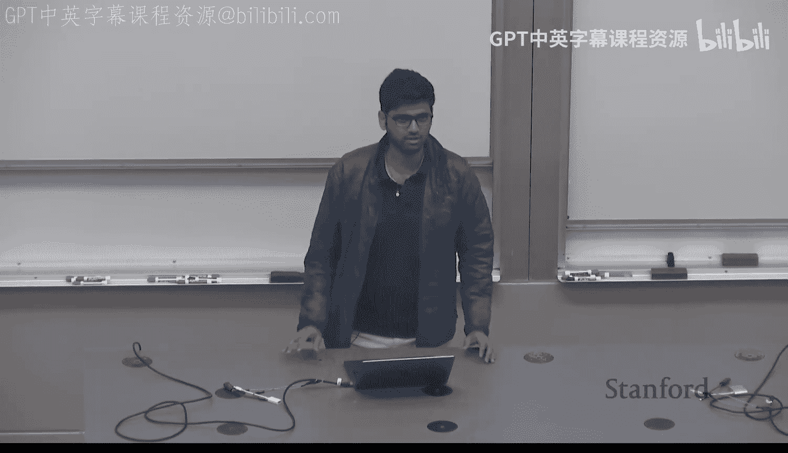

The best modelss that we have today for these are trained using some form of imitation learning。

And reinforcement learning the places where it has delivered the best results， one is gameplay。

 so for example the game of go also games in simulation。

 it has also delivered results in reasoning for large language models which is significantly beyond what the imitation learning pretraining could achieve。

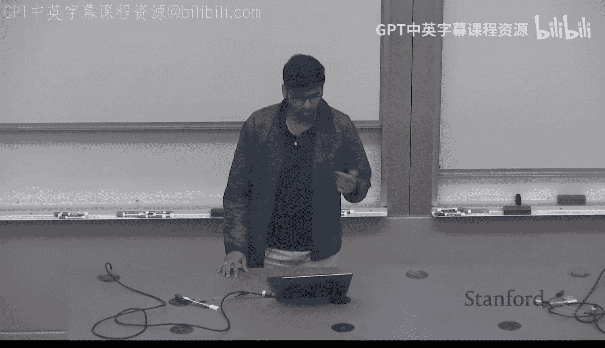

And the last one is robotics， which I will get into the rest of the talk。

So the key characteristics that successful limitation learning has used is that it relies on of policy data so this data is collected or generated by humans or collected in sources which have nothing to do with the final policy that you are improving in contrast the reinforcement learning that has succeeded is typically on policy so the policy that you want to improve is the one you roll out to generate the distribution of the data and then you somehow use to improve your policy。

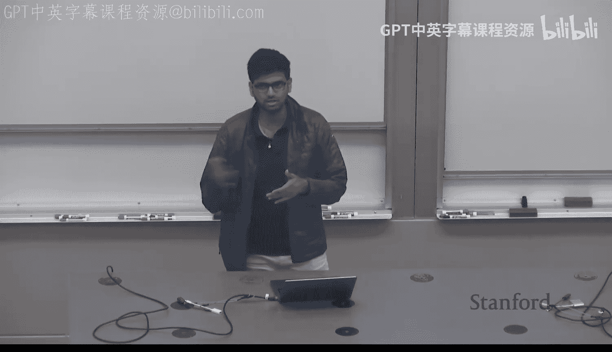

In in imitation learning， you take your data， you clean it up， you get the good data set and then。

You use that to train your model， but in reinforcement learning every data point that is generated during the policy rollout is fair game so you can use all of that to improve and update policy and that actually is one of the things that makes reinforcement learning quite powerful so you learn from not just the positive but also the negative data which kind of gives you very precise。

Behaviors that you want。And。Typically imitation learning has given us generalists。

 so you have it gives you this one single model that can do a bunch of things。😊。

Reinforcement learning either gives you specialists or it helps you specialize pre train general models。

 So this this， this， this contrast is just to give you a sense of the difference between the two。

 that is not to say that one is strictly better than the other。

 So even for the game of go we there were。

We use imitation learning for bomb starting the reinforcement learning selfpl search and same with language models you use imitation learning to warm start your whole model and then you can get reasoning or whatever it is that you want to improve the performance on top of that。

So now let's zoom into reinforcement learning。

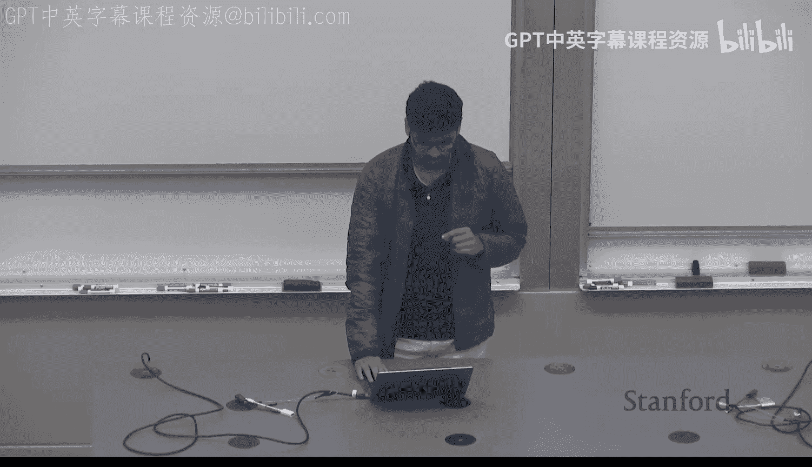

And the first question is what has it actually achieved like qualitatively what behaviors has it achieved。

 which is the only way to do those things。So for Alphago， it learned to Algo。

 a it's a game of go and we have a system called Alphago which can defeat the best go player in the world。

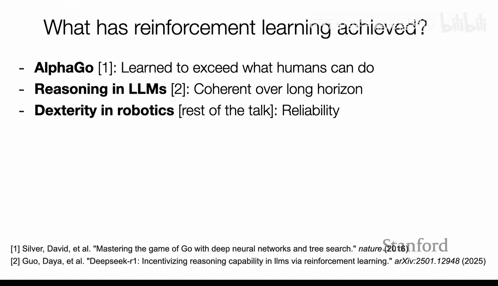

And what it has learned to do is to exceed what humans can do by figuring out innovative or new behaviors that humans have not seen before。

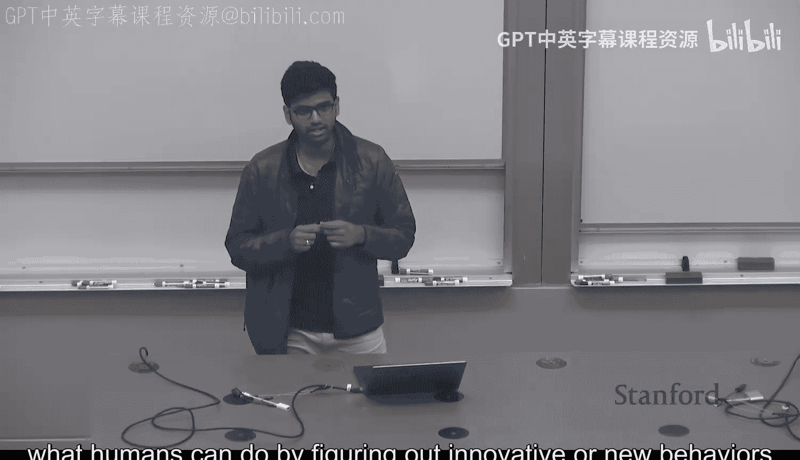

Similarly for reasoning in LLMs it can go significantly beyond what you can achieve with just imitation learning and it can give you results just significantly better than what you would get otherwise and this this the key thing that it shows here is very coherent and precise reasoning over very long horizon tasks so this is another characteristic that we know that reinforcement learning can give us and the last thing is dexterity in robotics which I'll get to soon。

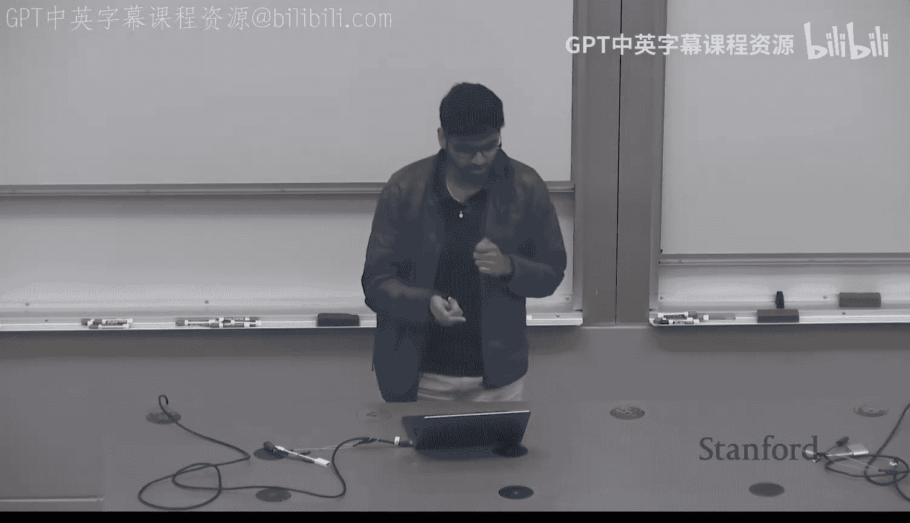

So， if you look at all three of these， there is one question that what is it what is common between all three of these which lets us achieve the scale of results we do with reinforcement learning。

So I would like to point out two things which let on policy reinforcement learning shine in all three of these domains the first is wellspec rewards so for Algo we the reward was a very spars it was very clear if you won the game of war you can look at the state of the word and you can define if you have won the game or not。

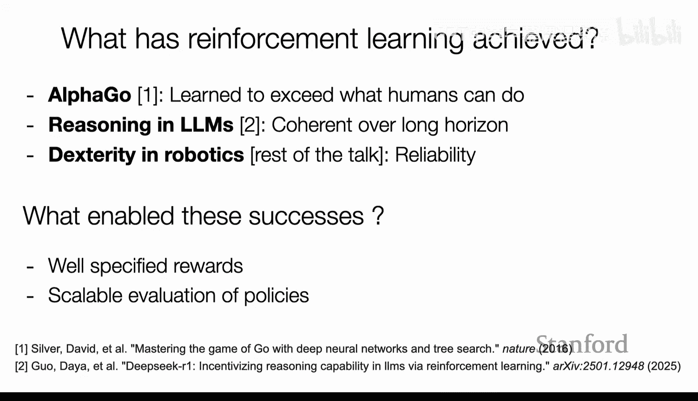

Similarly for reasoning in LLMs if we look at this deepse iron paper they say that we use a rule based reward function which is very clear to evaluate and now since it is rule based you can automate it and you can get it very cleanly and clearly at scale。

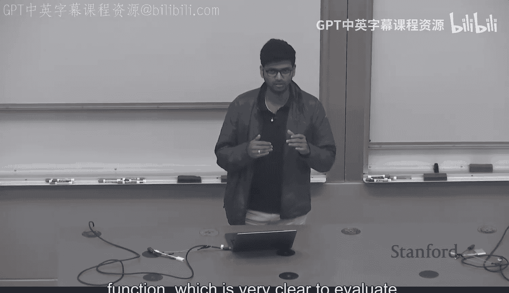

And the second critical component is can we run these policies at scale？😊。

So what with Alphago since we know the rules of the games we can put that game in simulation and now it scales beautifully with compute so we can just throw compute at it。

 you can evaluate the policies and we can convert that compute to data which we will then use reinforceal learning to improve the model。

Similarly for reasoning and LLMS， you can just roll them out in a cluster and you can evaluate them using some form of an automatic reward function。

 making this an extremely scalable way of collecting data for reinforcement learning and also evaluating it and then improving it。

😊。

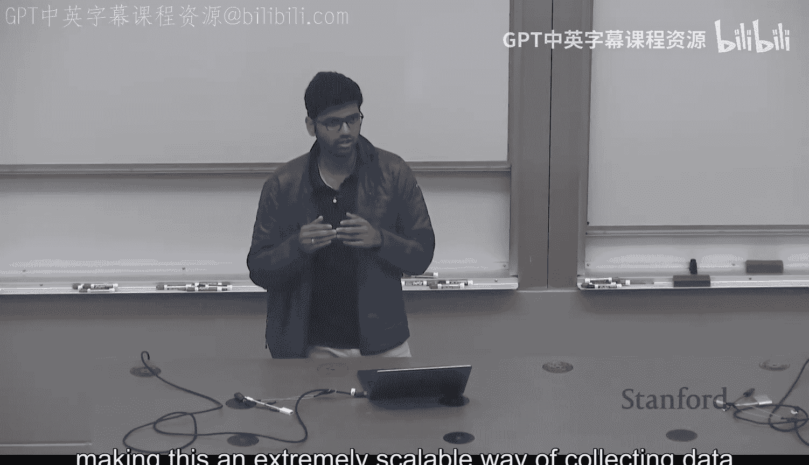

So I would argue that these two things are。All of these results happened seven to eight years spaced out by 7 to eight years。

 and all of these successes are still have these very two key ingredients which lets it succeed。

So now Ill get into zoom into robotics with a focus on what these ingredients are。

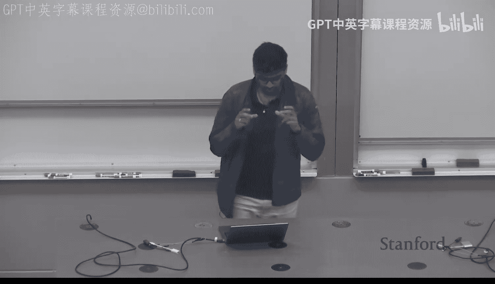

So if you zoom into robotics。The results I present are from  three，4 years ago。

 and the question is what let us succeed in robotics with the same algorithm？So。

 the closest approximation to getting these ingredients is to use simulation。

 so if we use simulation， we can programmatically calculate rewards because we have full state of the world。

And we can also evaluate policies in scale because we have converted a physical problem to a digital problem。

 which now just will scale with compute。😊。

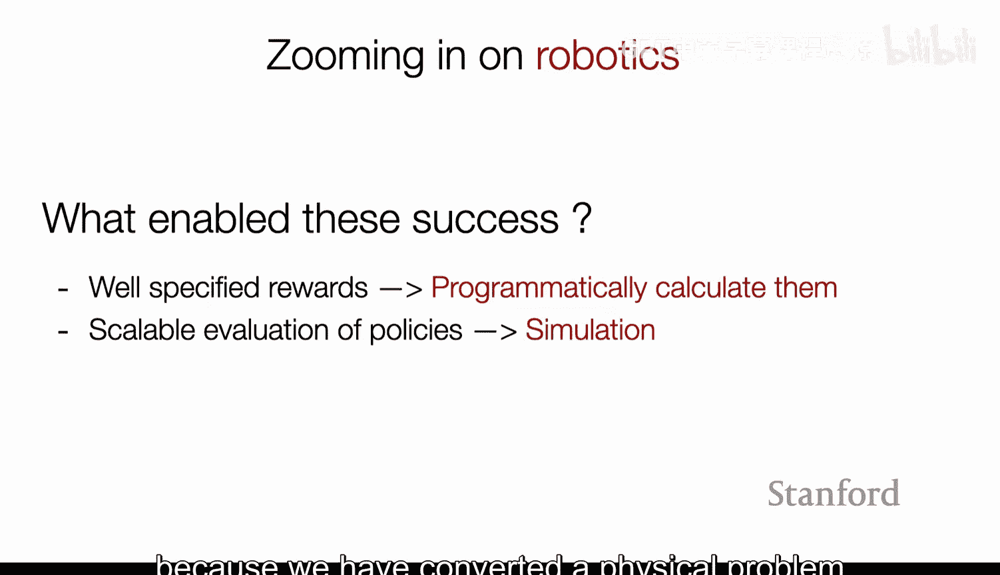

So， this gets us to solving robotics in simulation。

 but that is not the same as solving robotics in the real world。

 so how do we get robotics in the real world。

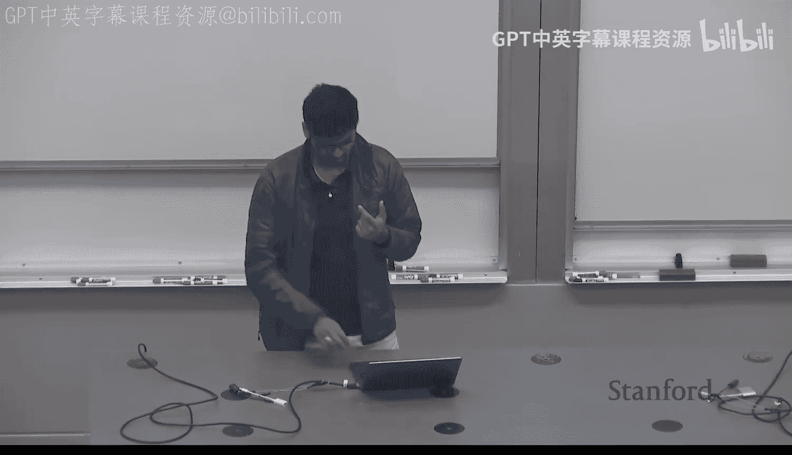

By just tackling the same to real challenge， So how do we train policies in simulation and then how do we move them to the real world。

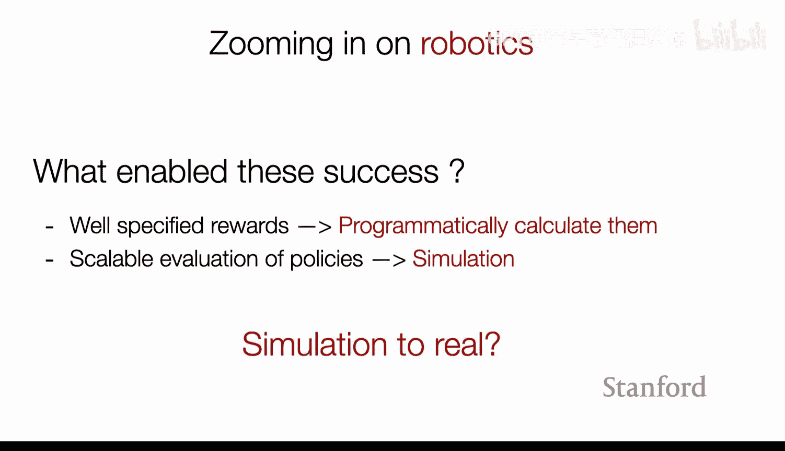

And that will be the focus of this talk。诶。Before I get into how we solve this material real problem。

 let me convince you first that this actually works so Ill start with the results real world results of robots。

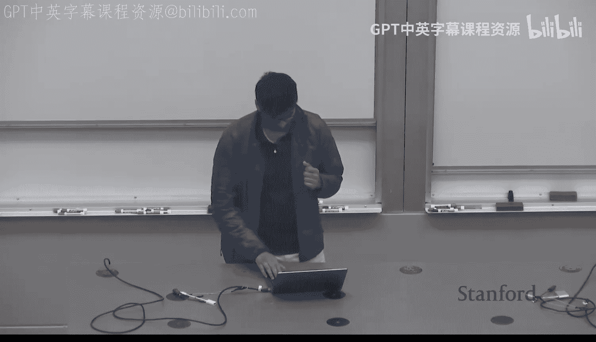

In the wild， so this is in Berkeley。And the robot is everything is real time on board。

 the robot is blind。It's trying to get over these rocks and the feet gets stuck。

 it keeps trying and then。Figures out that there's something and then continues to work。

Here it it has these staircases that it cannot see so it's a bit fuly in these staircases。

 but it can still get them and doesn't fall。He also tried this on this grass patch even if you had vision in this scenario you would not see the ground underneath so you need like a certain level of robustness just to get through some of these。

And here the ground is sloping to the left， I think there's a big ditch on the left still manages to not just drift all the way and counter that。

This is a construction site in front of my house when I was in Berkeley and we were able to repeat this and it can reliably get down this very unstable ground and here it's slightly muddy so the feet gets stuck once in a while but it knows how to like correct fire by applying more force and then just like getting out of it。

And this is just walking on sand。So， the important point here is that all of these results are from the exact exact same policy。

 so the exact same weights deployed zero shot in the real world without any tuning or specific improvement related to any of these terrains。

And the question is， how do we get it？So that is the focus of this work this was published in RSS in 2021。

So let's start by learning to walk in simulation so the idea is simple let's just pretend that the simulation is the real world and everything we can access is fair game so we want to train a neural network that's your base policy it will take an action in simulation simulation will simulate one tick of the real world and then it will give you the updated state of the simulation which the policy can consume and then it can walk。

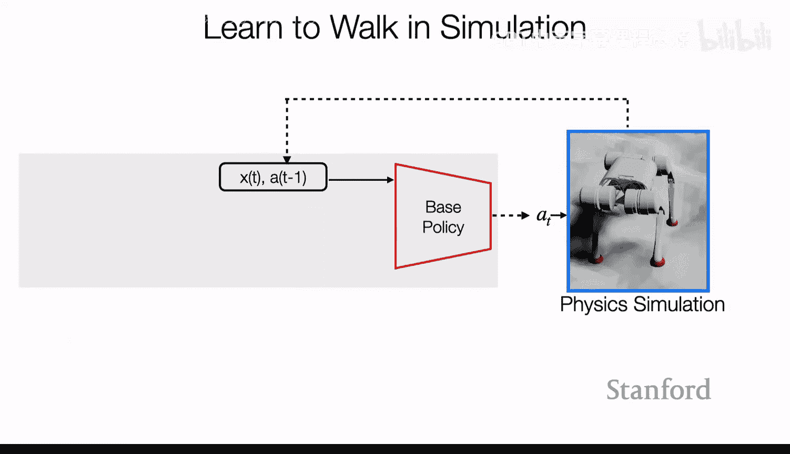

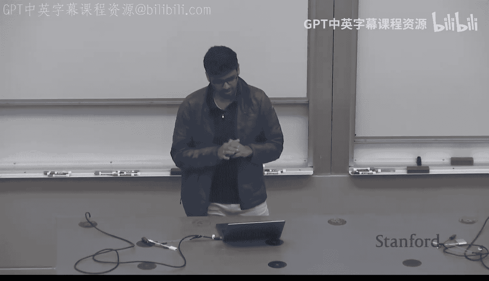

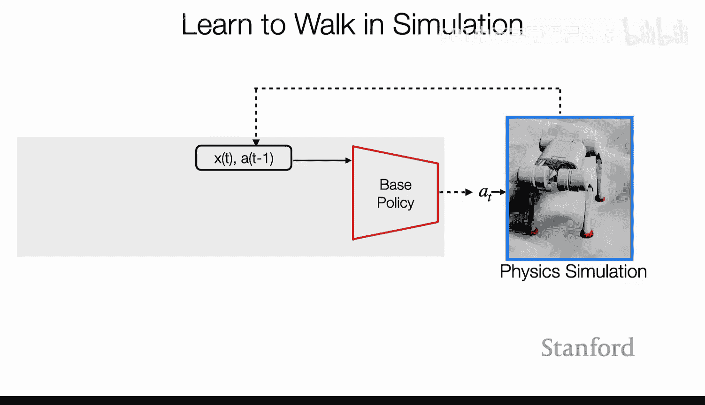

So， this would be a very narrow policy that can walk in one scenario and maybe we can deploy it in the real world by tuning some parameters of the physics。

 but this is not good enough because we actually don't want a single policy。

 we want a generalist policy that can walk in all of these scenarios。

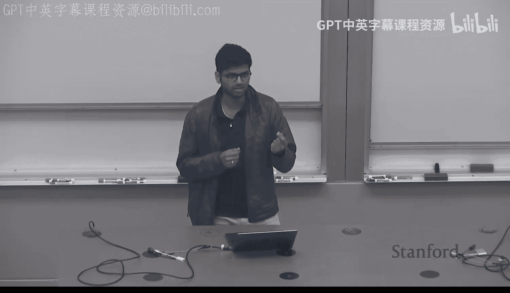

So， we will randomize all of these parameters in simulation。

And the important part is we will let the policy have access to all of these parameters。

So now when we train this policy it can work not just for any specific value of mass or friction。

 it would have seen a huge range of it and it will know how to walk accordingly so it' is not oblivious or blind to the environment it is actually aware of what it' is dealing with and for the purposes of the stock you will call this compressed vector extrinsics。

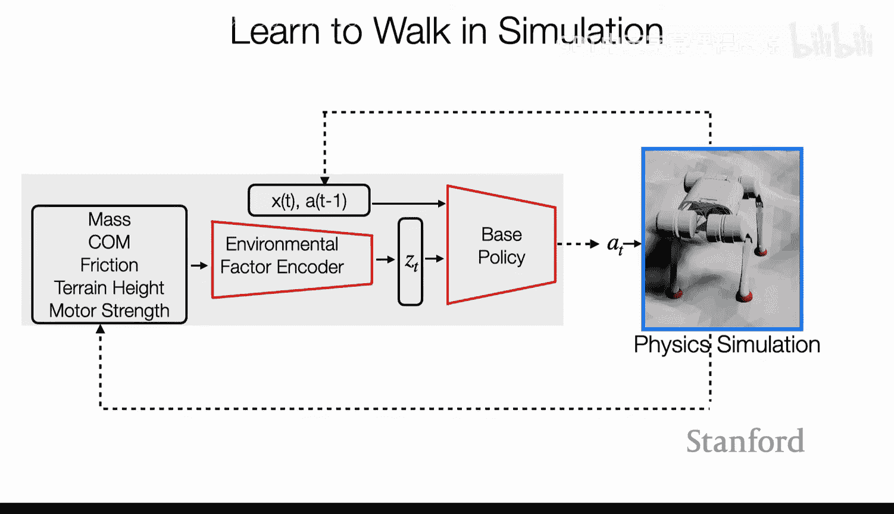

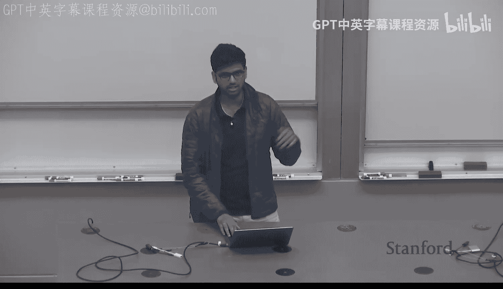

And then the reward function we use is to track a certain target velocity and then a certain other set of reward functions which minimize work and ground impact will train this whole system into end with PPO takes about a billion samples to train it in this simulation。

 this is RasM。

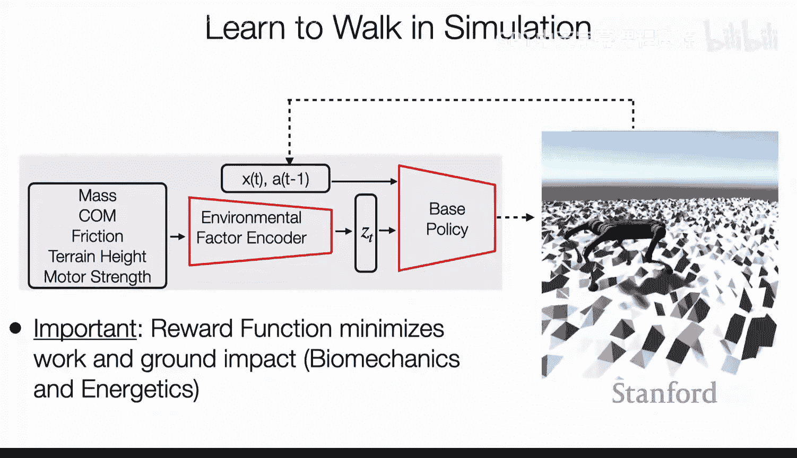

And once we have this now we can think about how to deploy it。

 but before that let's maybe zoom into the reward function that we have so we have 10 different reward functions。

 this is not very elegant but we try to be as principled as we can so the forward and the lattice so the first reward functions just specify the task so what is the task that we are trying to solve and then there are a bunch of reward functions which minimize energetics。

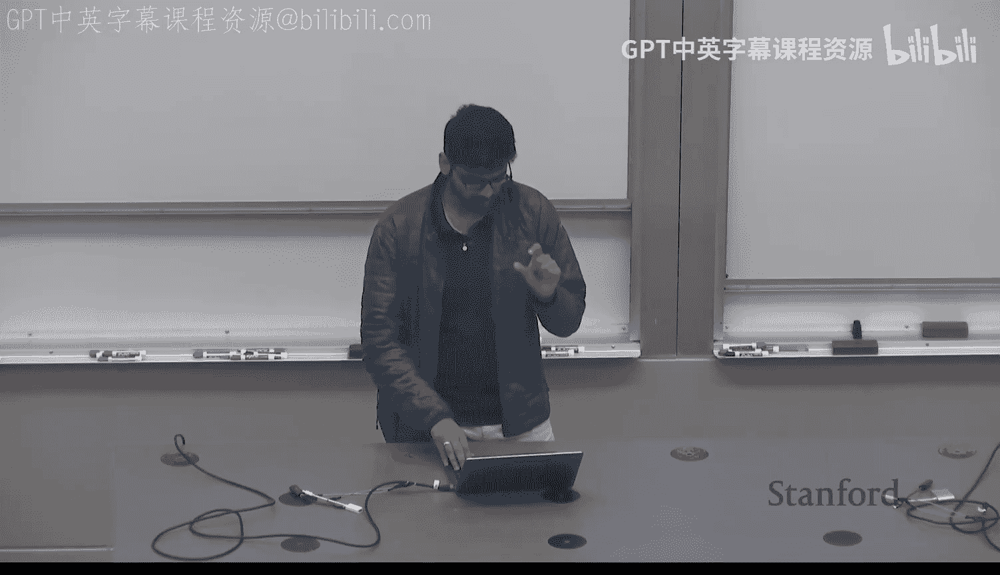

And then the last one is like stability and minimizing hardware damage because in simulation there is no concept of hardware damage。

 so we need to inject all of those biases so that it can learn something which can actually transfer to the real world。

So， coming back to how can we deploy it well this is this vector is unknown in the real world and even if I estimated that in my living room it would still not be enough because the moment I get to something which is not my living room thats say sand or mulch or any of those it would fail to work and I have to reune it again。

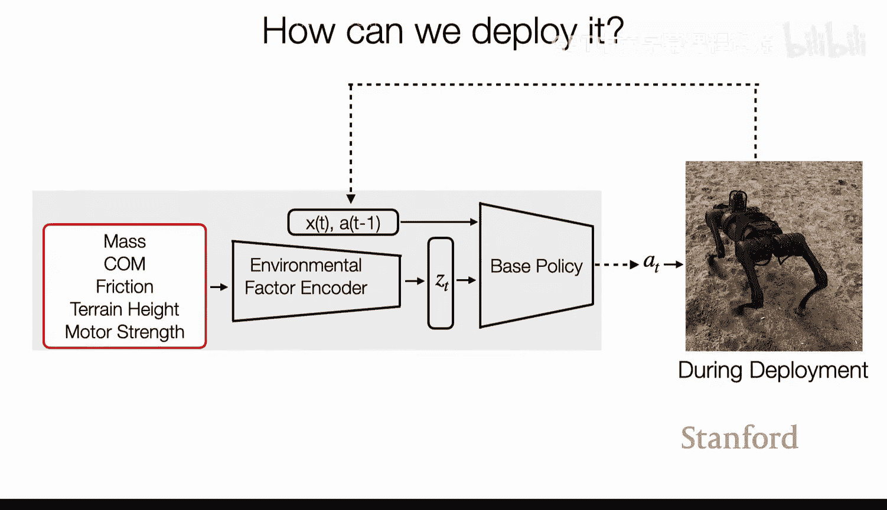

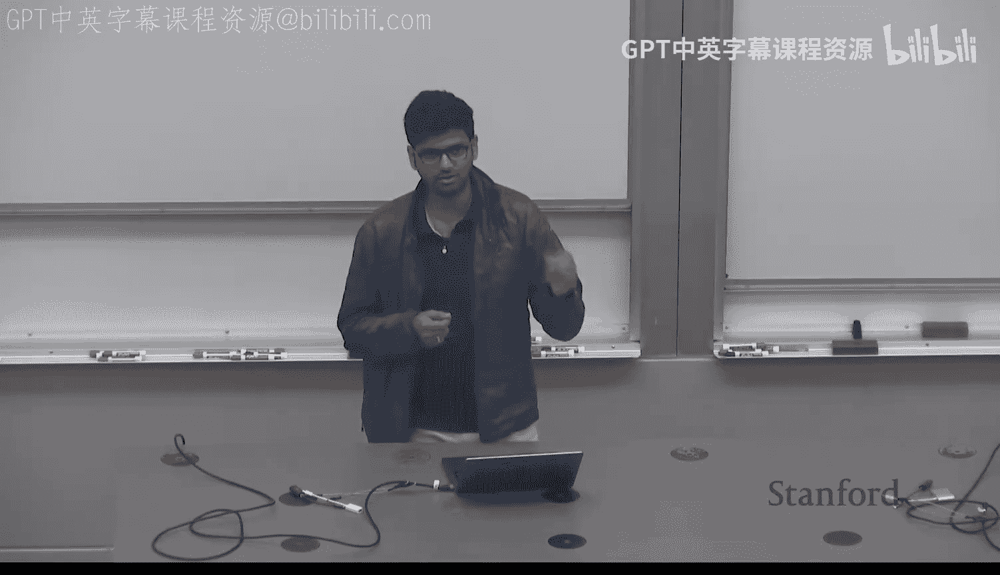

So the。Key idea that we will use here is we will estimate this online in fractionactions of a second at runtime。

And the reason why we can estimate it at all in the first place is by so the way we will estimate the signal that will be used to estimate it is the observation history so the series of commands that are executed and the commands that were actually issued we will use that as our input into the system to estimate this online。

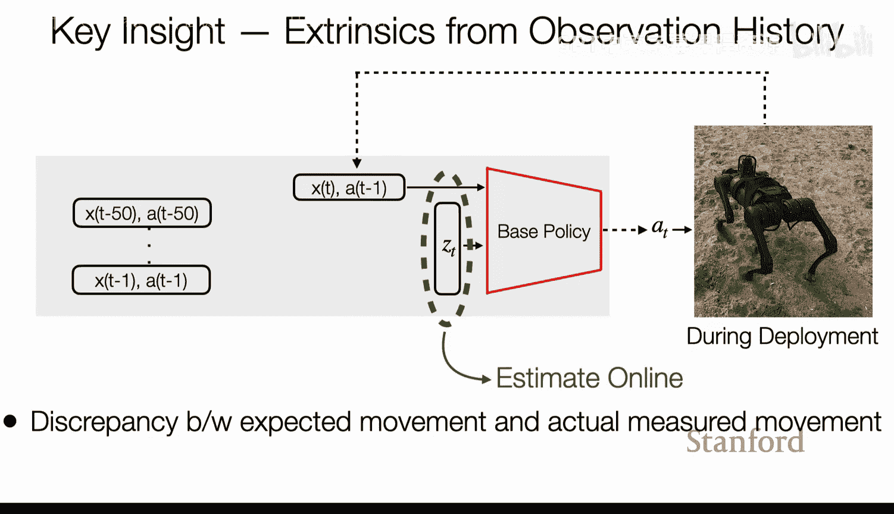

And。The reason this signal has the right thing that we care about is let's say that you gave a command to work and then one of your leg slips more than what you expected it to you the discrepancy between your signal and what you actually commanded will tell you that you actually slip this was not intentional you slip forward so the idea is to use the history of this signal to estimate was what these extrinsics are and then this discrepancy between the actual movement and the measured movement is what will let us estimate this online at runtime infractions of a second。

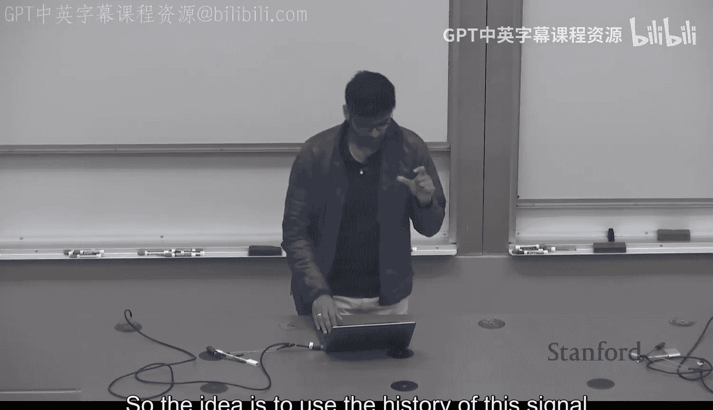

So the next question is， how do we train this model so that we can deploy it in the real world？

And its the idea simple we'll just go back to simulation and in simulation we have the ground truth and we also have the history so we will use dagger in which you roll out the student policy to generate the data distribution and then you use the teacher to supervise every single point of the student policy we will use that to train the student model so which is now using this history of observations to continuously estimate what this exnsic is which will then be fed into the base policy which is trained with reinforcement learning and be copied over the weights。

And then we can now deploy this online so one thing to note here is the base policy will runs at 100 hertz and the adaptation module which is the one that estimates is extrinsics that only runs at 10 hertz and this is not by choice it's because of whatever computer is available onboard and we see that the performance doesn't drop so this was not accounted for during training so in training we train everything at 100 hertz in lockstep and once we deploy it we see that this can only run at 10 hertz and this runs at 100 hertz and that is good enough to get the results that we want。

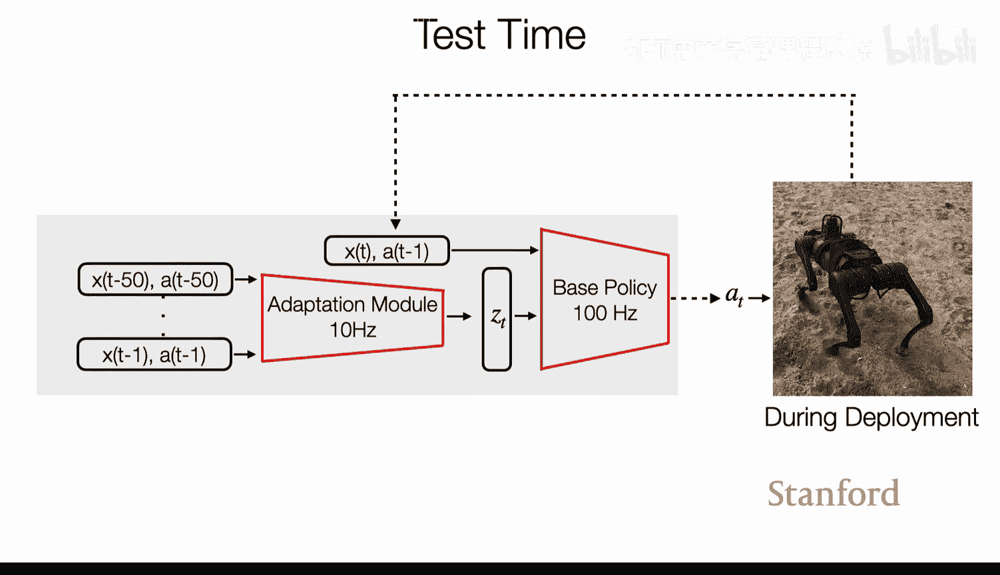

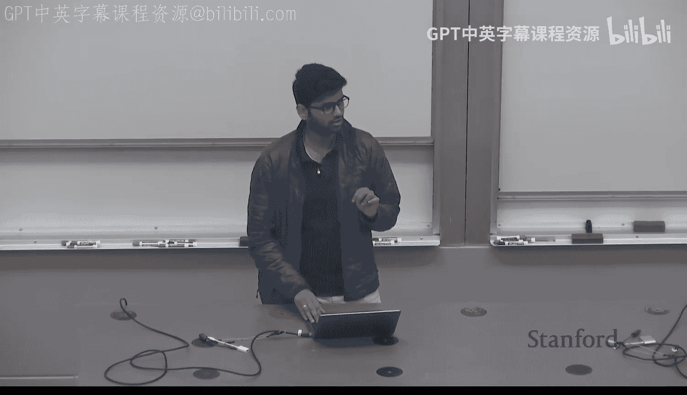

So。Let's start with evaluating a indoors。 This is my living room， and I'll pour some oil in it。

 This is this is， this is a plastic tar。嗯。I think that is。好 the oil。

This this is a vi logo so this this is the plastic tarrpon which I evaluated it and then the robot's feet also have plastic covered on top of it partially to make it challenging but also to protect the feet of the robot。

😊，And it slips a bit here。But it continues to march forward without。An issue。

Can slow it down and see it。 This is where it starts slipping。

And it seems to maintain balance and not flip over。Similarly here， I'm throwing a 5 kg payload。

On the robot and it seems to be doing fine just just to be clear this robot has 12 kgs。

5 kgs is roughly half the weight of the robot。I can。Make this bit slower。

And you see that the bo actually goes down if you focus on the green dots in a few steps it tries to go back up and recover the regular motion style that it is working with。

Similarly here it is like the foot foothold is not even stable so this plan just moves with the foot。

 so there is no clear estimate of the ground that you can get and still walking All of these results are blind by the way there is no vision all of these just use propoception history。

And I evaluatedd on a bunch of places， including my mattress on foam， taking a step down。

 step up and all of these， and it was relatively robust in all of these scenarios。So。

 lets see what happens if we switch up this adaptation module so what this means is we estimate the extrinsics at the first time step and then we freeze that update and then we don't update the extrinsics for the rest of the run。

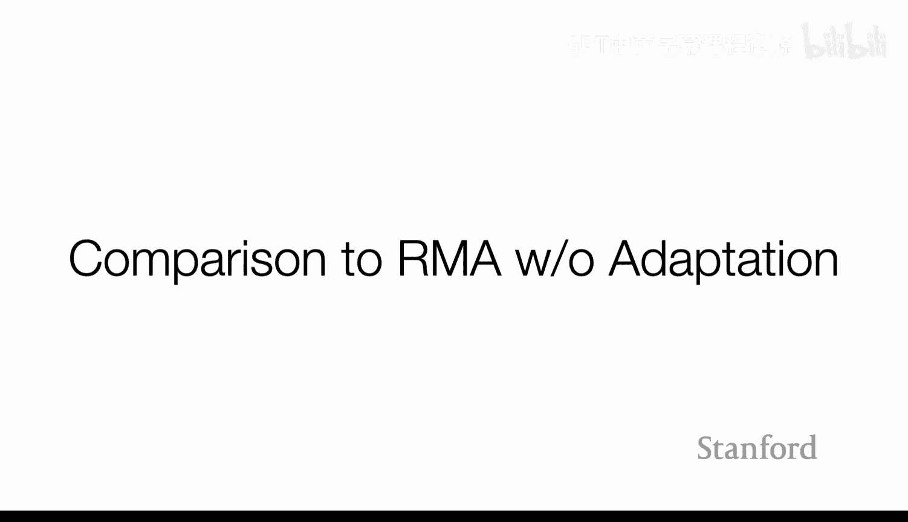

And it looks like it is 8 kg， this is like a 12 kG robot and 8 kg is very high and you can see the bot is struggling a bit。

😊，So， the rated payload for this robot when I bought it was around 3 kilograms so I am maxing this outlet heats the motors much faster。

 but it can still manage to work if you switch off this adaptation module。

So the way it actually tilts the bo forward and it doesn't know to correct for it by applying more force or talkque in the front legs or get get back to a higher clearance and just ends up tilting forward when it doesn't have enough talk to clear clear for the next step。

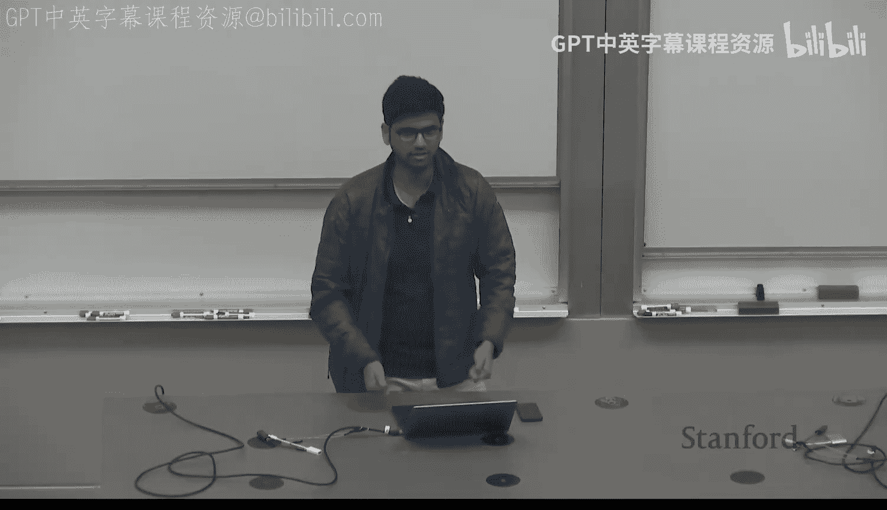

Same thing with the form。Even if even if it is getting stuck， it seems to manage that fine。

 but here it doesn't know to again apply more force to get high clearance to continue walking because it hasn't detected that event or that change。

So lets zoom into what is this adaptation module doing exactly。

 So this is the plastic surface that I showed you before it is flipped。

And there are three plots that I have here， so the top plot is called is what is called a gate plot so these are the four feet of the robot and any time a line is solid it means that the feet is in contact their feet sensors in the hardware which let us plot this。

The second plot is the amount of torque being requested in the front right knee of the robot。

And Z1 and Z2 z5 are two values that we have taken from the adaptation module and youve just plotted them I chose these two because they show the most variation in the course of this run。

So if we see that the moment it slips there is some shuffling in the gate。

 we also see a variation in the talk profile and we see that the adaptation module changes its value to capture that something has happened since these are learned extrinsics we cannot interpret them very easily but we see that some changes happened and after that it seems to have recovered to the same gate pattern and a similar talk profile as before。

Once the event is detected in the bottom graph。Similarly for this example， theres a pill。😊。

The 5 Kg payload， which has dropped， which means that at the time of impact。

 the force has probably even more。And we can do the same test and we see that theres again the shuffling of this gate and the torque is very high at the moment when this drops but it comes back to a regular gate。

 but the torque that it saturates to after it tries to after it is done with adapting to this event。

 the torque it saturates to is higher than before because it needs more torque to balance the way that it is carry。

Okay， so let's get into some quantitative comparison。

The first baseline is a very simple change over this it is just train a policy without the knowledge of changing environments you just train a policy which is blind and robust to every single thing it can potentially encounter this is a very common technique which is used it is just domain randomization without necessarily caring about if you are giving the input to the policy or not。

This is one of the baselines last before in the row above expert is the RMA baseline that is the method that I just presented stands for rapid motor adaptation and if you compare that with robust we see that it is a bit conservative but it also has a weaker success rate。

And the amount of talkrque it is exerting is also higher。

 the amount of jerk that it experiences is higher because it has no idea of the environment around it。

 it is just trying to be as aggressive as possible to make sure that it does not fall。

The second baseline we have is for system identification the goal for system identification is to estimate things like friction and mass and all of these other parameters explicitly and then use them downstream so in this instantiation of system identification what we try to do is instead of trying to predict the extrinics which is a compressed version of these environment parameters we directly go for these cis ID parameters so we directly try to predict friction。

😊。

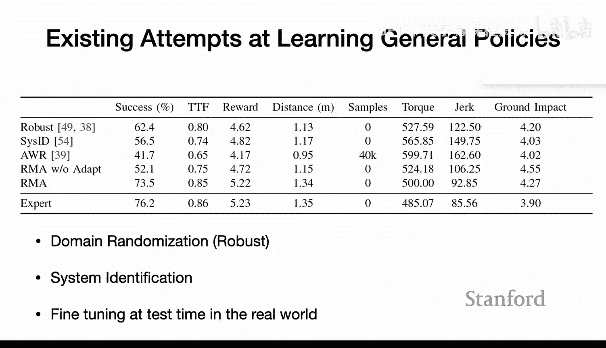

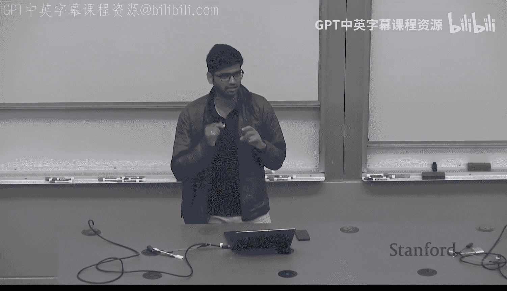

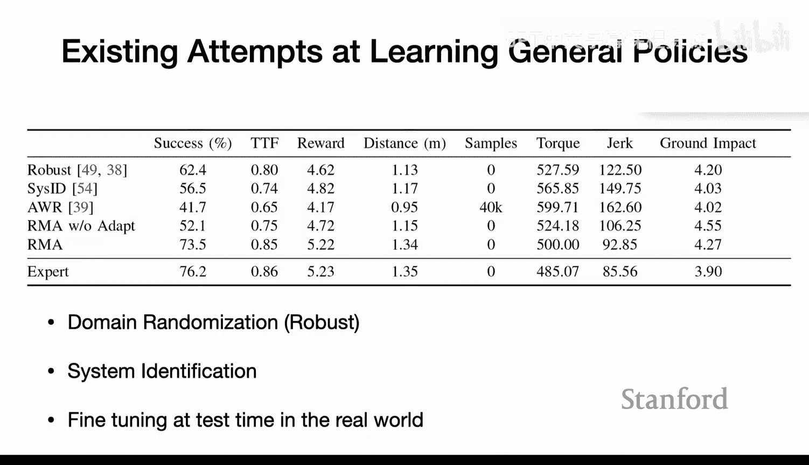

and all of these other parameters and the so this is a hard problem to predict exactly what the friction is because you might not even detect the full scope of the slip or you might not even know exactly how much the mass is。

 but it is also not necessary。😊。

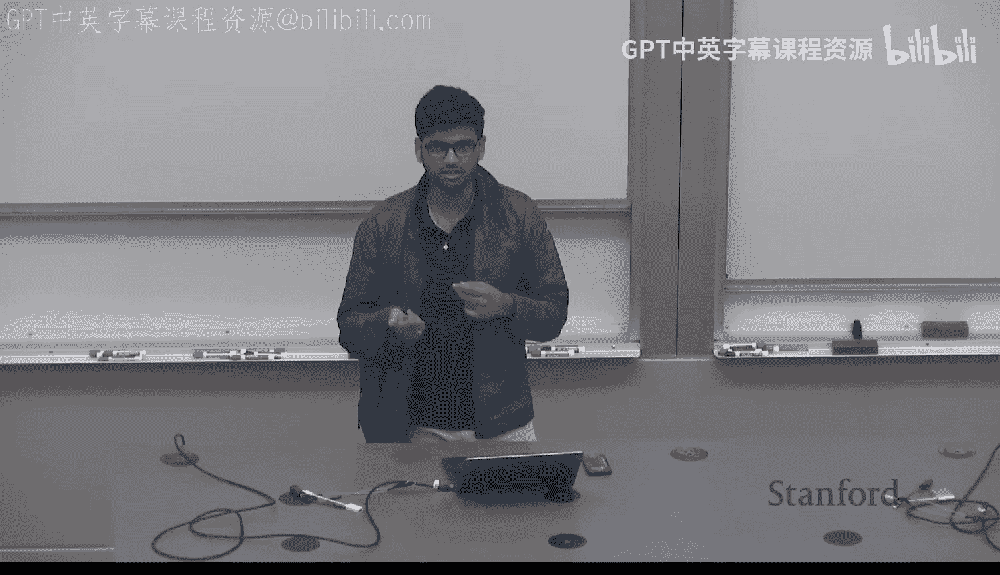

To solve for the final downstream task of working robustly。

And we see the gap in performance if we try to do explicitly estimate these parameters and interestingly it is lower than having a robust policy which is just agnostic to it and just learns a gate which is robust to all of these changes to begin with。

😊，The third baseline is one that tries to fine tune at inference time so you take a policy from simulation and to bridge the same gap。

 you roll it out in the real world and then you improve the policy。

This is one way of achieving that the R style is closer to in context learning where you take the history of everything and then the learning happens in the feet forward past itself so youll see all of these parameters and then you estimate how the network should behave which lets it do it in fractions of a second instead of trying to estimate that at inference time by rolling on policies。

And then the last baseline is the is one with adaptation so if we switch off adaptation the performance falls we did this quantitatively qualitatively and we have numbers in the real world as well We see that the performance is lower than just using I theres a small amount of gap between what we get from the expert and from。

Distilling it into an RA method which can actually be deployed。

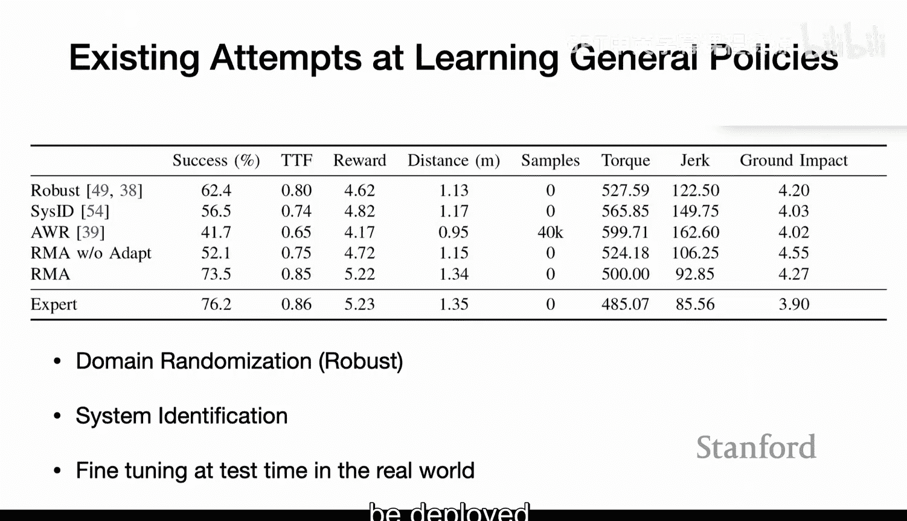

Okay， so everything that I've shown up until now is blind。

And the next thing that I' will do so if you want to strive towards having some form of a general robot model。

 it needs to have perception or vision and I will try to add vision to what I just showed for walking。

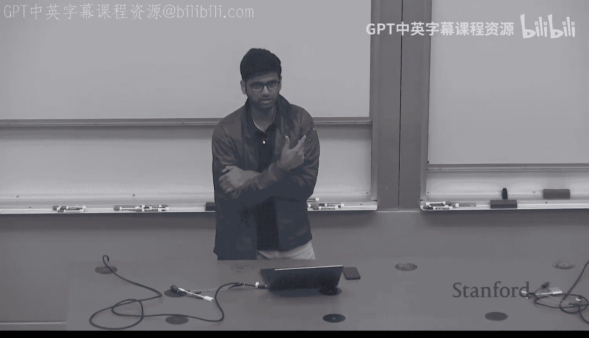

But we already saw all of these results without vision。

 So the first question is do we even need vision for walking？

Can we is it a good test we do we even need vision for walking。

 can we not just do without any vision altogether given the results we have already seen？

And the answer is that the two scenarios in one case vision is critical like if you are to cross these gaps or stepping stones or make a jump you need vision to estimate how to make that jump and the second argument is more of an efficiency and elegance and longevity argument so if you have to collide with a staircase every single time that you climb it its not it's a very。

Inele policy that will and the hardware will probably not survive for long so for both of these reasons if you have a vision in the loop you can potentially get to results which are much better than what we can achieve without vision and that will be the focus of this work This was published in Coral 2022。

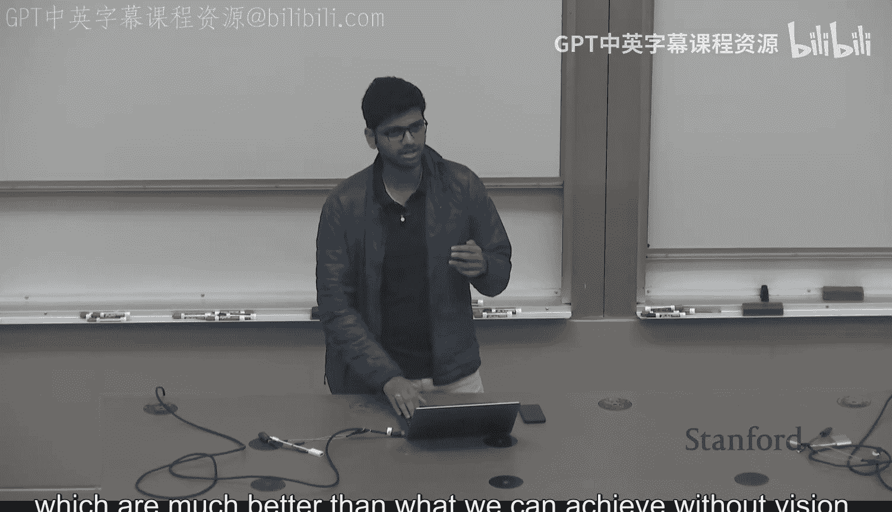

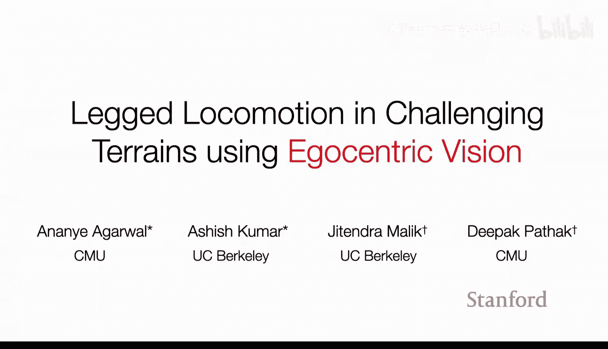

SoTo repeat the question， your question is， has there been follow up work done to use the rollouts in the real world to improve the policy？

So there are two parts to this question。 the one part is the sheer。

powerower of using a general learning algorithm， which is like if you use reinforcement learning in the limit you can learn whatever behavior it is that you want to learn and then there is this argument of if the policy makes a mistake and figures out in a few tries how to fix it will it remember it in the future。

😊，So。The first part I think is an open problem and we still don't have a method which can continuously improve perpetually online。

The second part of your question is a simpler problem which is correlatedrelate。

 which is where the simpler answer might be to just increase the context that you give to the policy。

So， if if you figure out a way to compress the context of one day into the policy or two days into the policy。

 you can imagine the in context learning to be sufficient to let it remember how it fixed it the last time and get it right in one shot in the future。

So there are two ways to get to what you said， one of them is more powerful but also very slow to learn and the other thing lets you learn much faster in a much simpler way。

呃， I。It's not obvious if which one is more complete。

I can see a system which has infinite context like what humans have and is capable of maintaining a memory which lets us continuously improve in the feet forward pass itself without needing to take without having to take reinforcement learning gradients there is no reason that cannot happen。

But the key， but then the burden of that shifts to how do you train this model。

 so you need to do something in simulation to get that behavior out of it。Yes。

 you can train directly with phase two with more compute I was using a CPU based simulation if with GPU based simulation with more GPs that is possible most successful cential policies are actually the ones which don't have a history。

They usually just use the current state to deploy and。

My guess for why that is the case is because the moment you have only the current state that you are using to deploy。

It becomes。A state index policy as opposed to a state and time index policy。So。

If you were to have a history， you need to make sure that the distribution you see in your history。

And you randomize it sufficiently enough that。If when you go into the real world。

 there is no exploitation that happened during training。

 which is preventing it from transferring as well to the real world。

So to repeat the question the question was can we just directly train phase2 and the answer is yes you can with more compute but you need to be careful with S because the more information you give it in SimM which is possible if you have a very very long in dense history。

 it might learn to exploit things of either your environment or physics and simulation or your reward structure and we do see this if you give a periodic in if you give a periodic push to the robot。

It is very common for the robot to just learn to be very robust when it expects the push when it has a long enough context or it has a notion of time but when you randomize that as well then you can get around it so it is possible you just need to be more careful with how you train your policy。

So the physical parameters in this is。Maybe there is a 2 x compression here like half of what the relatives the sics are around 8 I think the full physical parameters are maybe 17 or 18 in this version of vision we will there will be a much more aggressive compression where it goes from like the full image to a much smaller encoder。

The question is how in the series of rewards that we have。

 how do we balance between all of these different rewards？呃。There' is no good way to do it。

That is the real answer I think it is a very hard problem the practical way to do it is to add one reward at a time。

And then。Try to see what is lacking in the current set of rewards。

 add a new reward and then tune only that reward relative to every other reward so instead of this exponential complexity you can kind of reduce it somewhat to just adding one at a time。

 but this is probably not the coefficients we get are probably not the most optimal you can get。

So the question is in the in input of the policy we use the current state and the previous action what if you don't use the previous action so previous action has a very important signal to give which is what is the command that I gave in the last time step this lets you be smooth consistent and it also lets you show some amount of correction behavior so if this action didn't work and your condition on that action you know that the next action that you have to predict needs to be higher so the state is lossy。

If you if you remove the previous action， my guess is that the performance will drop compared to having the action as input。

The question is what happens if you use two or three or more time steps of the state history that' is related to the other question where what if we train the full system end to end directly faced to using reinforceforment learning you can do that you just need to be a bit careful with same to real transfer。

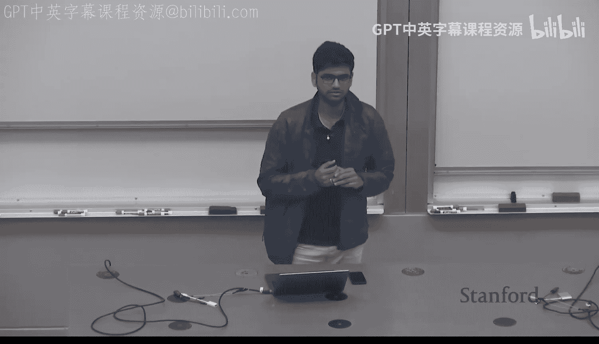

Because now it has more context and information to potentially exploit the simulation or your environment or your reward structure。

In ways which might not be desirable。The question is what to just quickly explain dagger it's a very standard algorithm where what we do here we apply that the way we apply here is apply it here is to run the phase two policy so we initialize the adaptation module which is random weights we run the phase two policy collect the data initially it's just going to be bad data because its not it hasn't learned to do anything meaningful and then we'll use the teacher encoder to supervise it every time step what should the prediction have been and then we will just use supervised learning to update the adaptation module we will take it back in simulation we will roll it again it will hopefully be better than what it did before but still not optimal and then we will again supervise it with the teacher module。

Get the data set， run supervised learning， and then repeat。So， switching to。Adding vision。So。

 the most common approach to add vision is to decouple it entirely from control and then。

Build an explicit map that you can then feed into your controller to use that to work。

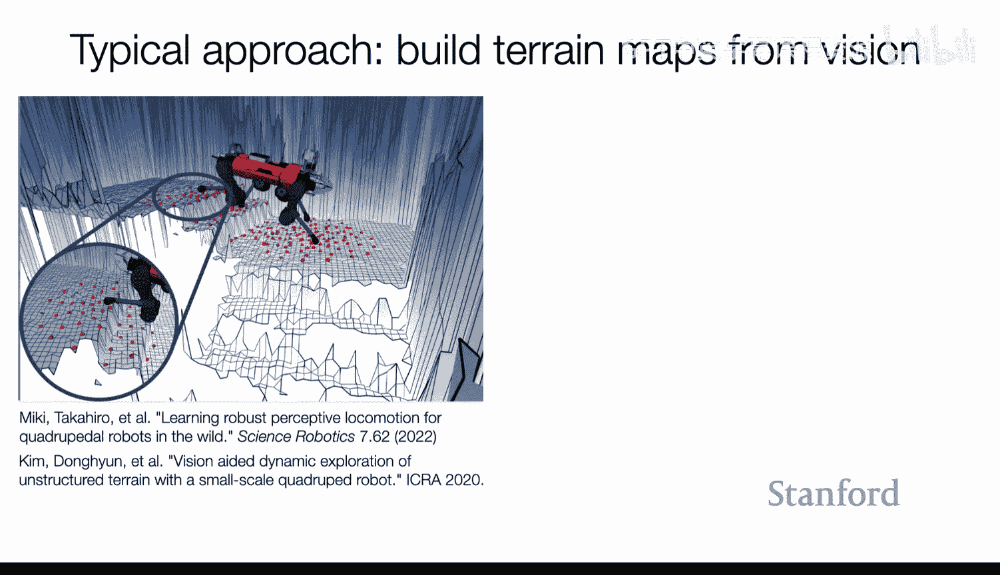

And the reason this there is a fundamental flaw in this approach， which is you first of all。

 you're solving a very hard problem， which is building an explicit map。

 So your map will always be noisies if you have non rigid objects or if you have。

estimate drift in your estimate of your pose or any of these it will end up converging to very noisy maps so that is a phase where you have already lost information and there is no way you can recover that information。

And then you feed that into the controller。So since we are solving a harder problem。

 we are losing information that we in other scenarios would not have lost if we were to directly use the perception input in the policy。

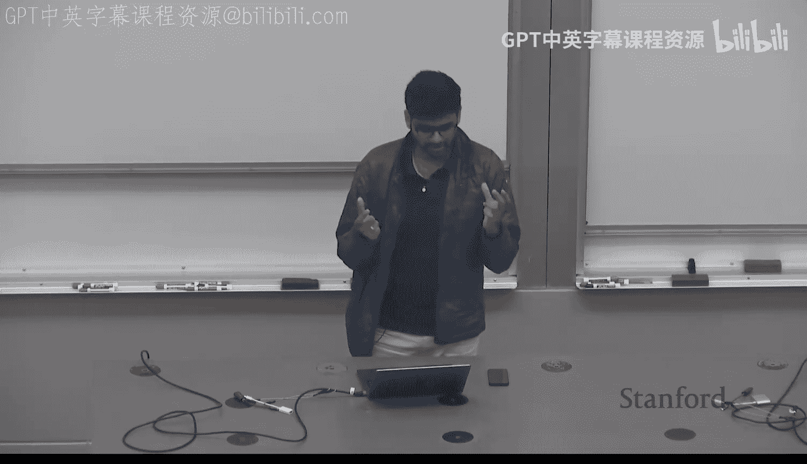

So， here is an example of how people add noise to the real terrain。

 maybe the edges were enough to tell you how how to take that step but the moment you converted to a metric map and then try to give that into the policy now you need to train your policy to be robust to all of these different kinds of noise noises which is okay for simple scenarios but becomes very challenging the moment you have you need to precisely estimate where the gap is and avoid stepping on that。

So， what we do in this work is we ask this question do we need terrain maps do we need to explicitly build them the answer that we we hypothesize that we don't and instead we directly couple vision and control in the final system。

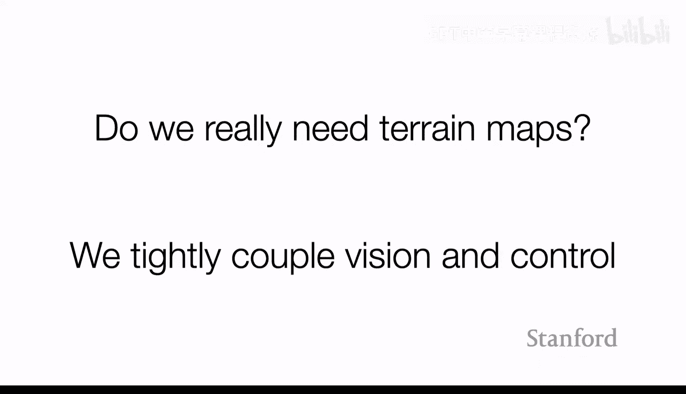

So here is what that system looks like in deployment and I'll get to how do we train it so in the top right is the depth egocentric that the bot can see I've taped the cameras and compute and everything on the bots everything is running on board in real time and it's trying to。

So it's trying to cross over these stepping so this is my living room and these just got 20 stool and then just got it to walk on it。

And it's like repeated runs with different levels of gaps and variations so that you can test that actually using perception to handle all of these。

And here it is some hiking path where the stairs are uneven and the robot is actually quite small。

 So if you give it a second here， if you see the height of the step is almost as high as the robot。

And it struggles a bit， but it manages to climb it at the end。

Similarly first as we tested it on even uneven stairs up down all of that across and was relatively robust and if you see how much it has to get down once it is up。

It is actually quite short for a robot of this size。And here the ground is extremely slippery。

 its just like there's barely a stable foot for the bot， but it keeps trying。And eventually。

 makes it。Again， here its the step is very high， it tries a few times。And then it gets it。

One thing so this is like a debris I think around CMU and one thing to note here is that it doesn't always get everything in one shot it sometimes needs to try and retry and the retry is make more sense than the previous try that is an example of learning within the context of what is spread into the model in this one change we make and I'll get to that is。

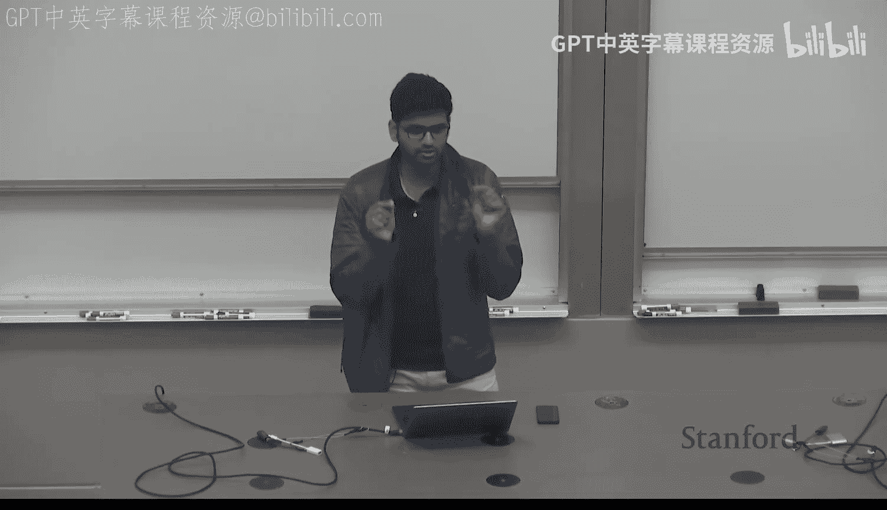

So in the first phase of training， it's the same as before with this additional。

Terrian height information， we don't add any noise to it this is perfect terrainrian height that we feed into the model and then we encode all of that。

 give it to an MLP and then train this whole system with reinforcement learning。

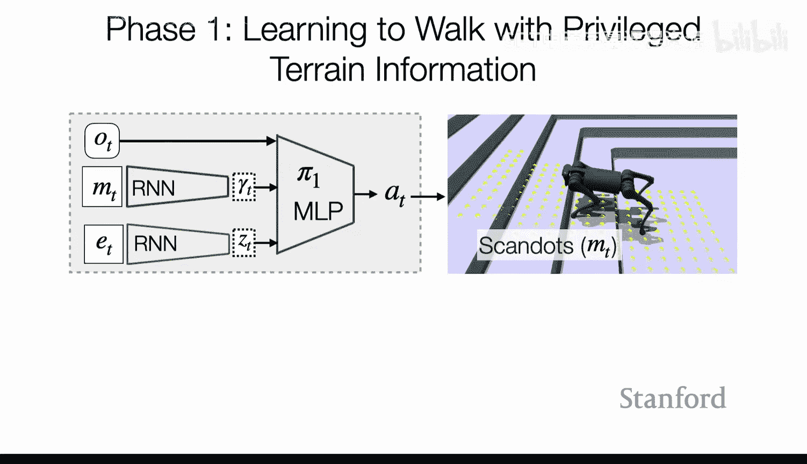

It is much faster to train because you don't need to render any perception inputs。

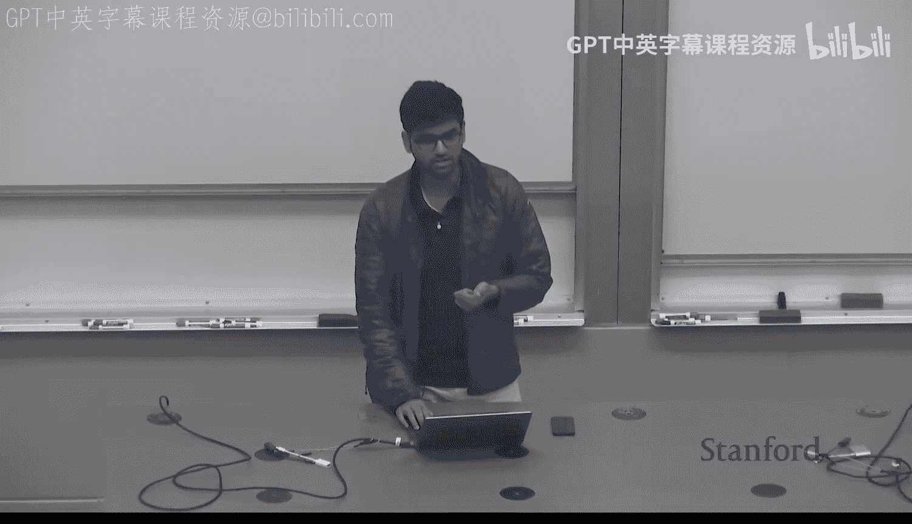

The recipe is the same as before we use PPO in simulation this time we use Iac Ge and we the rewards are to track a target velocity and then minimize energy。

These are the different training terrains we use and we then get a single policy that can walk on all of these different terrains and simulation。

The problem is same as before， how do we get these dots in the real world and most approaches try to construct a map and feed that doesnt input。

 but instead what we try to do，Is。directectly integrate depth so we render depth and simulation and then we directly tried to supervise that with the depth encoder that was trained in the first phase using the same approach as dagger where we roll out the student policy and then we supervise it with the teacher。

And same for the extrinsic vector So here。If you try training the second phase directly。

 it would be an order of magnitude lower because rendering death depth takes a lot of time so you need to this this gives you a significant speed up over how to train it and lets you deploy it in the real world as well very robustly from what I just showed you。

So this is a final deployment policy it takes the egocentric depth from the camera that's on the robot and the full propoceptive history and the one change that weve made here is the use of RNNs so we use RNN so they can give you a slightly longer context so RNNs are recurring neural networks which can which integrate information over time but they are not known to preserve very long horizon information which is why most of the community move to transformers when they wanted to do very long sequence modeling we used RNN which gives a good enough context to the model but it we did not ob using a transformer instead for the stars to see if that improves performance or not。

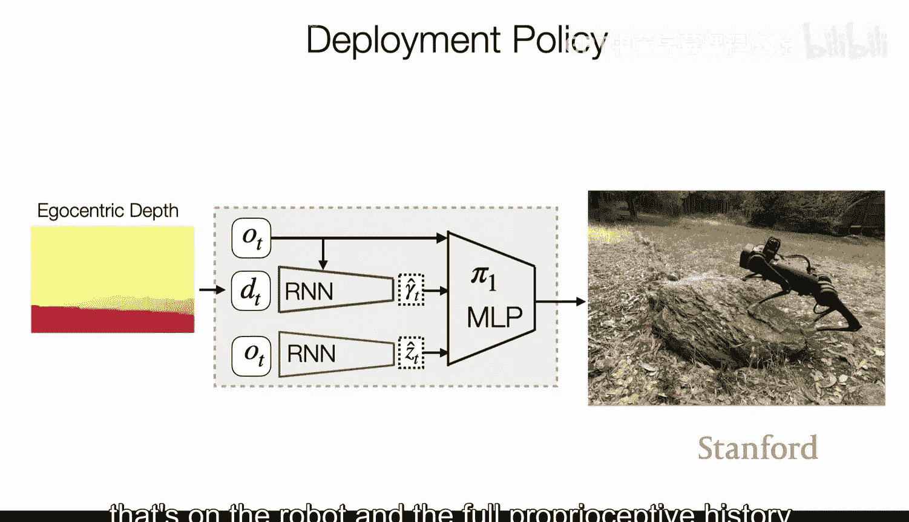

So now when we deploy this policy and to point this out again。

 I think stairs are designed for humans and this robot is extremely short。

So relative to the height of the robot， these ties at all。

 so there isn't enough clearance under the robot。To just raise its leg and then take this step。

Also when it is going down if it just does it in a way which is which everyone else would the amount of tilt you would see in a spot robot would be much smaller because it's a much taller robot while going down whereas for a small robot it needs to use majority of its leg and the discrepancy will be much higher just because the legs are smaller so what it learns is it learns to move the leg out sideways to climb all of these stairs and this is possible because we don't use any predefined gate or foot motions or any of that and we let it be learned using reinforcement learning。

To search。And this footstep planning is also emergent so it only takes a step when it needs to。

 it doesn't constantly move its feet to if we had a predefined gate of any sort and we see that it's actually quite smooth and seems to work with intention and precision and it can handle these kinds of scenarios very easily。

And then again， a same policy can control for all of these different variations of environments。

 we don't use any explicit set maps no explicit gates。

 and that is critical to get the results we do in this scenario。

We also gave a live demo at multiple places to and it was quite robust in a lot of these scenarios in some of these demos think at the bottom one。

 the right foot padding just caught out and started limping but it continued to do the full demo。

So let's quickly compare this with baseline I have three key baselines the first is just having a blind policy so the same as what we had before the second one uses a map and then feeds a slightly noisy version of the map to see how it works it's also trained with that noise。

And then the last is what I just demonstrated directly going from depth。

So we see that the gap is not that much for simple terrains like a slope。

But the moment we get to more challenging terrains。

A map based method is almost as bad as blind because if you sample from the same distribution that other works have done。

 we see that the same performance goes down significantly so you need the the final action head to know whatever it needs to from perception directly without adding any noise or any bottlenecks for it to work well in the scenario。

Similarly， first stairs and discrete obstacles， we see that the performance is better than the other two methods but。

The other methods still fall behind the performance of this method。

 one interesting thing is for stairs it is better to be blind and just learn to put your steps blindly than to use a map which is noisy and which gives you an inaccurate estimate of where you might have to place your foot。

Up until I've developed it for locomotion and then the same thing is applicable also to one one scenario and dexterous manipulation。

So， this is。The task of just rotating objects in hand its the same policy and it is capable of handling all of these different variations of objects theres a paper towel and then there is a badminton shuttle and all of these things in this。

And it is capable of generalizing to objects with very different physical properties。

 so the weight variation can be huge like from 5 grams to almost 200 grams。

This the coefficient friction， so this is an ice ball and on the right is a kiwi which has a slightly rough surface。

The center of mustard on the right is below the finger because of the weight that hangs from it and on the left it's slightly above the finger and it seems to do fine。

And here the shape is also very different。 It could be a cube or a cup and performs fine still。

 and this was also trained in simulation deployed in the real world zero shot。

And the key idea is the same here， we use propoceptive history。😊。

To give the model as input and then it uses that to figure out how to learn a general model。

One hypothesis since we don't know exactly what the model is doing is it uses propceptive history for contact detection。

So， if you look at this and if you look at the bottom join that is what we have plotted so we have the actions and then we have the joint position which is actually achieved。

And if you look at the time when it makes the contact or not。

It turns out that the time when it is not in contact correlates with the bottom part of the graph where they do overlap with each other and the time when it does make contact is at the top of the graph where it' is in contact and then it is not able to achieve the desired joint position that it is commanding and this is enough signal for the network to estimate it and if we can estimate contacts you can figure out。

The shape and size of the object。That that helps you in adapting to all of these different variations。

did the same gave live demos for these as well so in the center when this is an orange peel so if you apply a slightly larger force than necessary it will completely deform and on the right as an adapter this has not been seen any training data and simulation we don't simulate objects to this level of granularity。

and again， the same thing can be applied to drone flight as well。So。

 we have the same policy controlling the drone at the top and the bottom so the same weights which tries to estimate the mass and arm length and all of these of the drones。

 the top drone is four times heavier than the one at the bottom and the arm length is also three times。

And the same weight is able to estimate what morphology it is operating in and it is able to adapt and fly the drones it is directly controlling the motor velocity of each of the propellers。

So it' is not abstracting away to a level where this becomes an easy problem。

And it's also very robust， so this is another drone with higher mass。Okay。

It initially it wobbles a bit， I think it's still trying to estimate what drone it is flying。

And then we'll take a tennis ball and shoot it at the fins。So。

 these are the propellers of the drone and then well shoot it at one of the propellers and it still。

Quite robust to it。嘅。So， I have shown all of these results and then the next natural question is what is there left to solve？

Well， I think almost everything we still don't have a general purpose robot model that can control a general purpose hardware to achieve the task that humans can。

So Ill focus on humanoids and as the general form factor which we know can achieve every single thing that humans can and show you the progress that we have made at Tesla on this。

 so you might have seen some of these videos on the left is a biped walking on hill I've showed similar results with a quadruped but a bipedD is much less forgiving because it's a much more unstable system and you need to be more reactive。

All of these results are also trained in simulation deployed zero shot on hardware。

 and then a more recent video of the bo dancing。All real time onboard autonomous getting the first thing to work and the1th thing to work does not take very long because the pipeline is very simple once you get one thing to work you can actually pump out a lot more results very easily。

And then this is the progress you have made on manipulation。

 so this is the same neural network that takes language as input and then can execute whatever the language command is。

Here， the key ingredient is the use of videos。

We learned this from videos and a little bit of robot data。And we are able to get this。

 this is the progress that we have up until now in manipulation。Again。

 this is the same policy doing all of these things conditioned on language and we can get decent performance on these tasks。

 but they are not very reliable。

This was learned using egocentric videos of humans doing things and then we translated that somehow to the robot results that I've shown you。

 so these results are not very reliable。And where we eventually want to get to。

Is reliability and dexterity to the level of what humans have this is this is the eventual goal where we want to get to so we want consistency。

 dexterity， agility and reliability in the final system that we have。So。

 if we take a step back in all the results that I presented for locomotion。😊。

The results that we got were very agile textures and very reliable in the real world。😊。

And those results， like I mentioned， were three to four years ago。

 so why do we not already have some or most of these results for manipulation in the real world to the same level of dexterity and reliability。

And if you go back to the two things which got locomotion to work well。

 one was the simulation technology was ready rigid body contact was good enough to get very robust locomotion but when it comes to manipulation and if we have to chop vegetables we need to simulate that。

We need to simulate that and then we need to simulate de formable objects dough and everything in simulation to get the same material transfer to work for this。

And then the second comparison are rewards which are much easier to specify for locomotion so if you programmatically write out a reward which asks you to track a certain velocity its it is complete this is the full task specification and now you can just randomize the terrain and then you can get a general policy out of it but that is not true for manipulation so for manipulation if you see。

Depending on if you want a chop a vegetable and even if you had this simulated and full state of simulation。

You would still need to come up with a reward which measures the size of each of the slices that are cut and so on end that itself will depend on what exactly is it that you're trying to cook eventually so that's one reward and let's say you put in the work to do write that reward that only gets you one task it doesn't get you the full generality of manipulation So for example。

 if you want to stretch the dough or put flour on the dough you need to come up with another rewards it's a very manual process and even if you get one of this right it will not scale to anything else。

So everything I present from now on is speculative。

So let's start talking about simulation。For some scenarios like de formable objects。

 it is true that we can simulate it except that we cannot simulate it very fast and then there are some other more complex interactions that we cannot simulate at all。

But there is no obvious fundamental reason why we cannot simulate more complex scenarios as we get more compute。

So if if we bet on compute， then the hope has as compute progresses。

 simulation can progress and can give you progressively better results in the real world as we expand the scope of what simulation can do and if we are to learn from the better lesson then compute would be the right bet to take here which as you just hope that simulation can improve over time for those of you not familiar with the better lesson it's a very short piece by it certain I highly recommend everyone to read it I just have the first line from it which says that general methods that leverage compute。

Are ultimately the most effective and by a large margin。

Sarching to the other topic of having a very general reward model。

The most obvious thing that comes to mind is can we train a general large big model for general understanding of the world and somehow use that to define the rewards that we want to improve our policies？

This could work， but。RL as we know has exploited weaknesses in the model if they exist so when we do RL HF if we continue tuning with RLHF you see that the model goes completely out of distribution from what you would like it to do same with the deepse paper they find that if you dont use verifiable rewards or rule based rewards like they do at some point RL can start exploiting the rewards that you have defined for them。

So， I was optimistic about simulation， why am I optimistic about this general reward model。

 which is also also seems to be a very hard problem to solve。

The reason I'm optimistic is because the absolute worst case。

Is we get humans to label all the rewards for us and humans are very scalable because we have billions of them。

And then before I end this talk， I would like to just。

Revisit how we approach。The idea of robotics so most of the definition that I have used during the course of the talk and most work in robot learning tries to approach robotics as achieving parity with human the day we achieve that it will be a civilization changing event。

However， that will just be the first step in everything that we can achieve from robotics because the actuator that we make driven by electrical torque and the computers which are based on silicon as opposed to carbon than what we have it is possible that they can exploit all of that to achieve capabilities which humans。

Have not thought of or cannot figure out how to do。

 so they could do things much faster more efficiently or better or can be much more agile and extra than what humans are。

And then one system that we know which has already done it is Alphago where the key was to use a sparse reward and then lots and lots of search or reinforcement learning to get it to discover new behaviors which are beyond what humans could think。

So。This is， I think， a more general or a follow up question。

 can we get robots not just match human capability but exceed what humans can do？

