# 斯坦福大学《深度强化学习｜CS224R Deep Reinforcement Learning  Spring 2025》中英字幕 p19 -19- Tutorial Session_ Review of Q-Learning.zh_en -BV1SvmxB3E5e_p19-

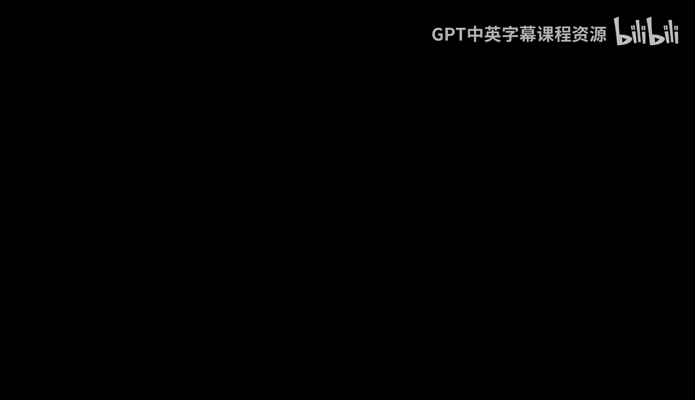

My name is Eniquet， I'm a TA here for CS224 R and I hope you guys in the right place for the Q learning lecture。

 so just as a general overview of what we're going to cover。

 we're going to start off by just doing a very very brief overview of MDPs。

 hopefully at this point you guys will be somewhat familiar with the notation and then we're going to switch over to talking a little bit about a more like controlled or tabular problem where we're going to be looking at fitted Q iteration as an algorithm and how we can build up from the tabular setting to like La and effective Q function。

And then we're going to move on to parametric Q learning， looking at the bias in various tradeoff。

 learning from TD regression versus Monte Carlo rollouts。

And then finally talk a little bit about some of the practical details that go into learning effective Q functions。

 so this includes things like the replay buffer that we just briefly chatterted about overestimation and how to deal with the gradient effects of TD learning。

So an MDP or Markov decision process， so as you guys have been probably looking at in the last couple of lectures。

 we've kind of defined a kind of framework for us to look at RL as。

 where we have an agent on the right hand side that is interacting with an environment and we define this framework of an MDP that's defined by a sort of states and actions and also a transition dynamics function which allows you to go from a certain state。

 take a particular action and go to the next state。

You're also rewarded for a particular state in action that you take as well as have different kind of metrics like the starting state。

 which tells you kind of where in the trajectory you're from and things like the discount factor and horizon。

 which allow you to kind of encourage longer or shorter horizon trajectories where your horizon is the length of the trajectory。

In this lecture we'll be talking a little bit about the grid world assignment， sorry。

 this grid world problem on the top right where we have this little robot that's trying to navigate to kind of this gem on the top right and similar to kind of class as we've seen before。

 our goal is to maximize the expected return conditioned on a policy that we're trying to learn where a policy is simply defined as a set of actions for each state in this tabular environment that should be taken to reach a particular goal。

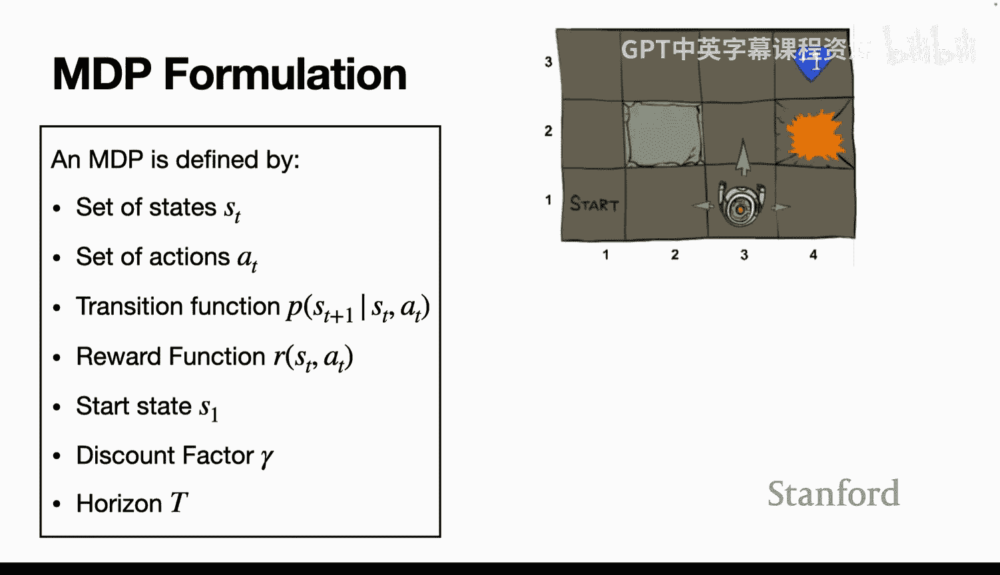

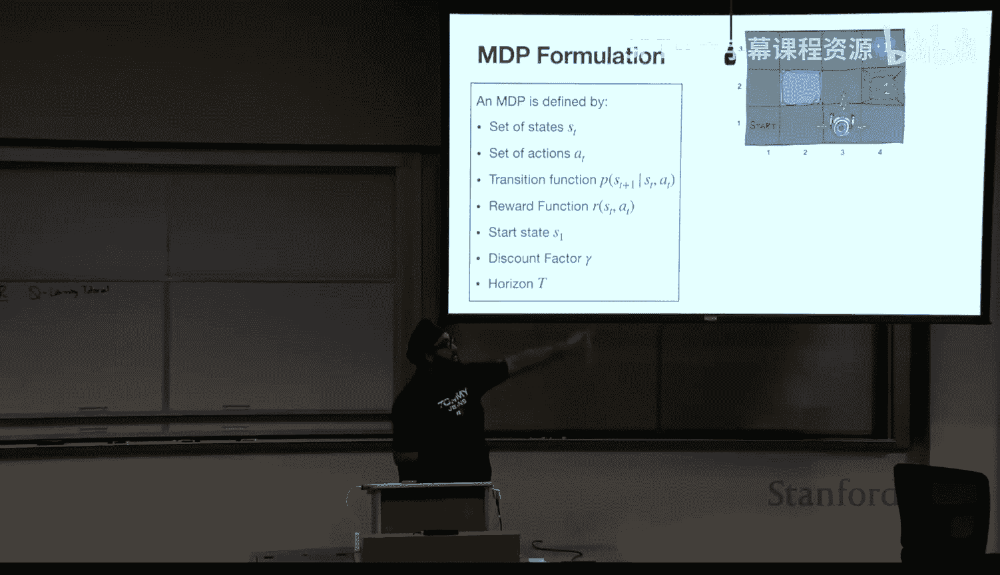

So in the puzzle couple of lectures， we've been revisiting looking at a certain set of objects。

 which we denote as value functions。So we'll start off by defining v pi of s or a value function that estimates the expected future reward when you start out a state S and follow your policy pi。

We also have this other useful object called a Q function。

 where the distinction between a value function and a Q function is that now you additionally condition on an action and look at what the expected teacher award looks like when you follow your policy。

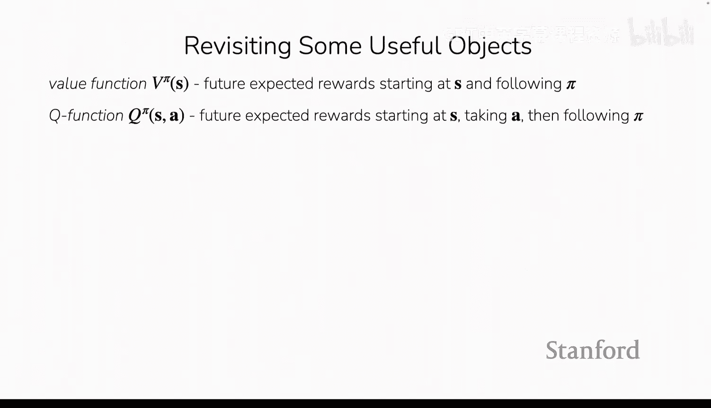

So both of these quantities are kind of an estimate of how good either a current state is or a state and a particular action is to give you kind of guidance for your policy in terms of what actions I should potentially take。

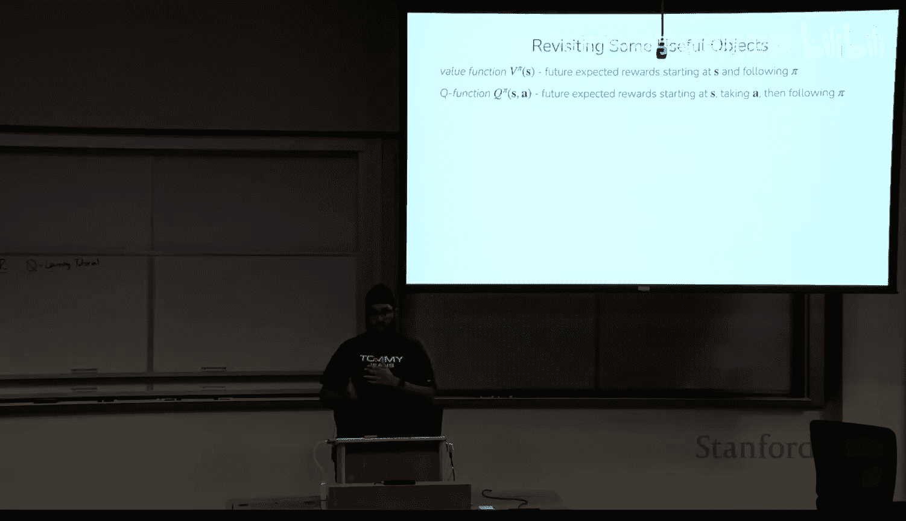

So if we look at， for example， a sort of trajectories as seen here， your value function。

 which is only condition on a state， kind of estimates from a given state。

 how well if I follow my policy will I do going forward？

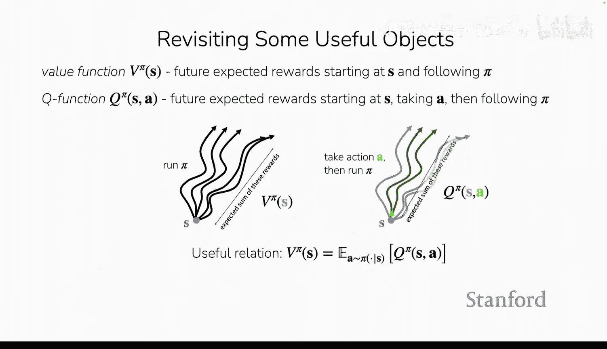

And a queue function gives you a little bit more information where you can kind of probe a particular action for an immediate action that you can take。

And consider if I take this action versus another one， kind of what my value can sort of be。

And a useful relation to sort of know in this case is that your value function that you've learned on the left is like in expectation。

 the Q function that you'll learn on the right。

Another useful quantity that you might have already seen is this notion of an advantage。

 which kind of estimates how useful it is to take a particular action A。

 then follow the policy at the current time step。

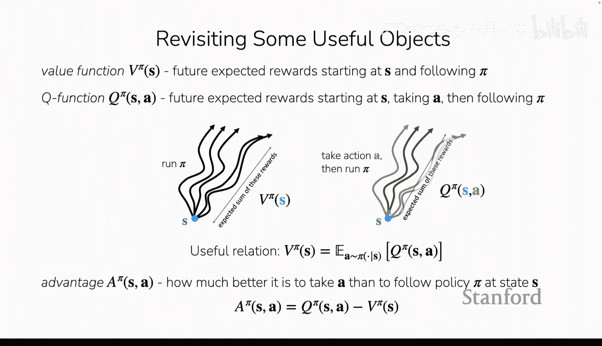

So to kind of understand this， we kind of denote this。

 we define the advantage as the difference between the key value and the value as seen on the bottom。

So to kind of explore how you can learn a Q function。

 we're going to go back to this tabular good world environment that we've been looking at and kind of see how we can learn a Q function through dynamic programming so in class you might have seen this Belman equation as seen on this slide here which is defined as the expected reward to go where we look at the transition dynamics from a current state ST multiplied by the reward at the current time step when we take a particular action as well as the map added to the max of the Q value at the next state。

We can then convert this bellman equation which gives you the optimal Q function into an iterative learning process where we are going to define our Q function at each time step as iteratively starting from the Q time step at the previous time step and doing this same maximization procedure so you'll start off with maybe an empty grid world。

 which is where your value function or Q function here is starting off at zeros at all steps and then you'll iteratively starting from your terminal states propagate reward from your terminal states back to all states within your grid world。

 so we'll see pictorially how that will happen but this is like an iterative process that allows you to propagate value from any state to any terminal state to all states within your grid world。

This is kind of the foundation of T learning or Q learning in general and is how we'll sort of visualize this in the next couple of slides。

So。In this grid world environment that we're going to look at， we're going to have， again。

 this robot that's in this toy environment where it can have five different actions that it can take at every step。

 it can either stay in this current spot， move left， move right， move up or move down。

And we're going to be rewarding it if it lands in the top right square and penalizing it with a negative value if it lands in the square in the middle up here。

Additionally， we have this notion of a discount factor to allow us to kind of。

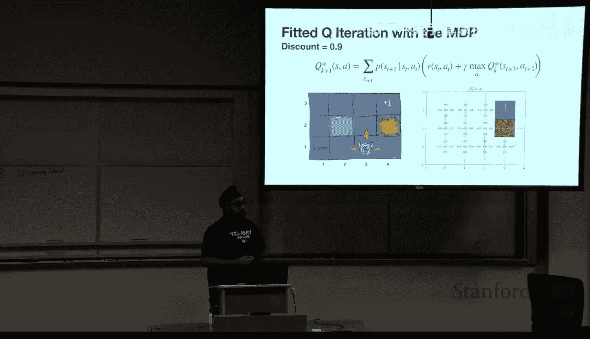

Encourage the robot to reach the goal state as quickly as it can and not do like spurious exploration。

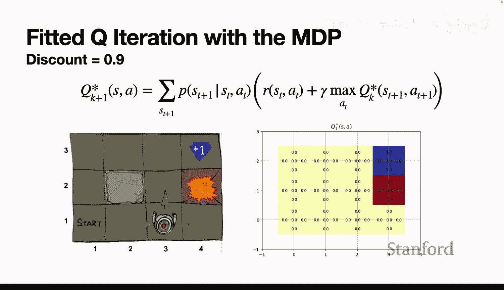

So we'll start off with the Q value function defined as the right here。

 where for every state it's essentially going to be zero。

 except for the terminal states on the right top right hand side。

 where for the top right corner it is the plus one because it gets a plus one reward when you terminate there and negative one for this lava square。

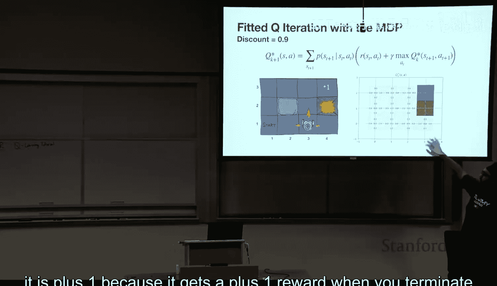

And we can then run this propagation for the Q value over multiple iterations。

 and what we'll see is that in time step two， the sort of states very close to the top right seem to now get Q values due to the propagation and eventually over multiple iterations we' able to fill up the grid leading us to like stable convergence over a Q function。

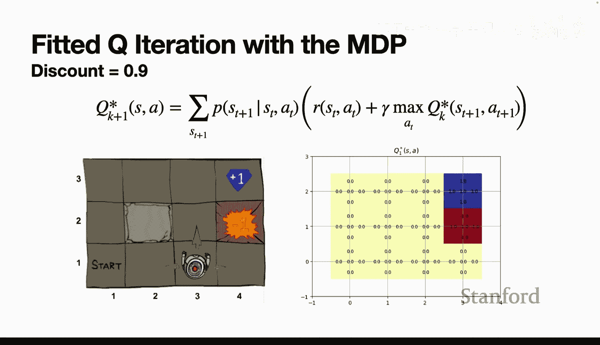

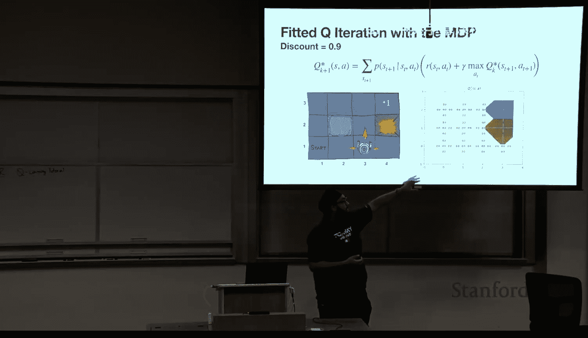

So what？The difference betweenYeah that's a really good point。

 so let me go back to where I defined that sorry。So the Bman equation here。

 as you can see on the top has no subscript denoting like what iteration you're kind of updating the policy and all it's saying is that for the optimal policy。

 this relation will hold。

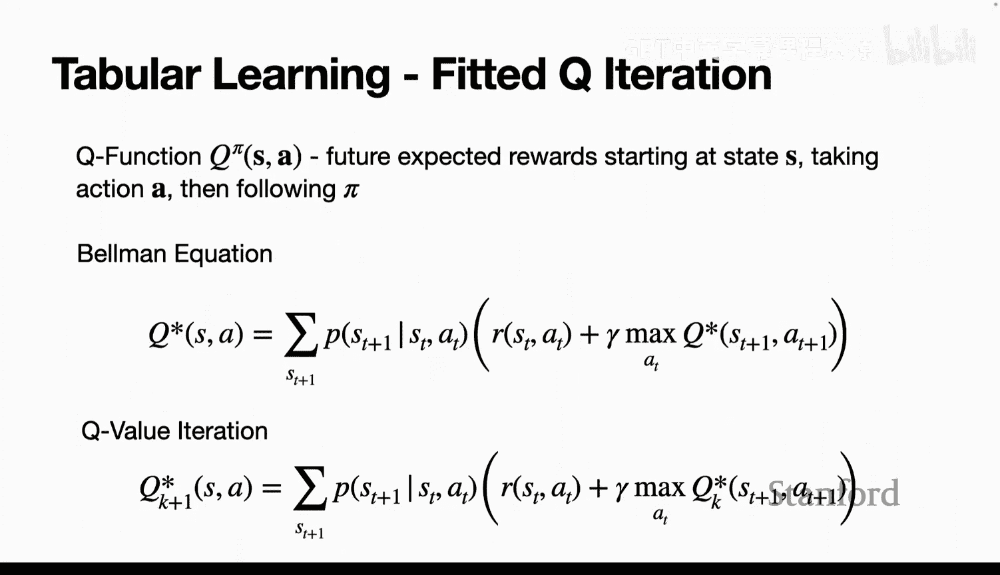

And then kind of a natural like derivation from there is that you can kind of do this iteratively where you start from your terminal states。

 which already have like a given reward and you know what that would sort of be and propagate information from that point to then learn the true Q function at every times every single state in action in your state space。

So this is now going to have a subscript K plus1 or k that represents what iteration you're going to be looking at for each step。

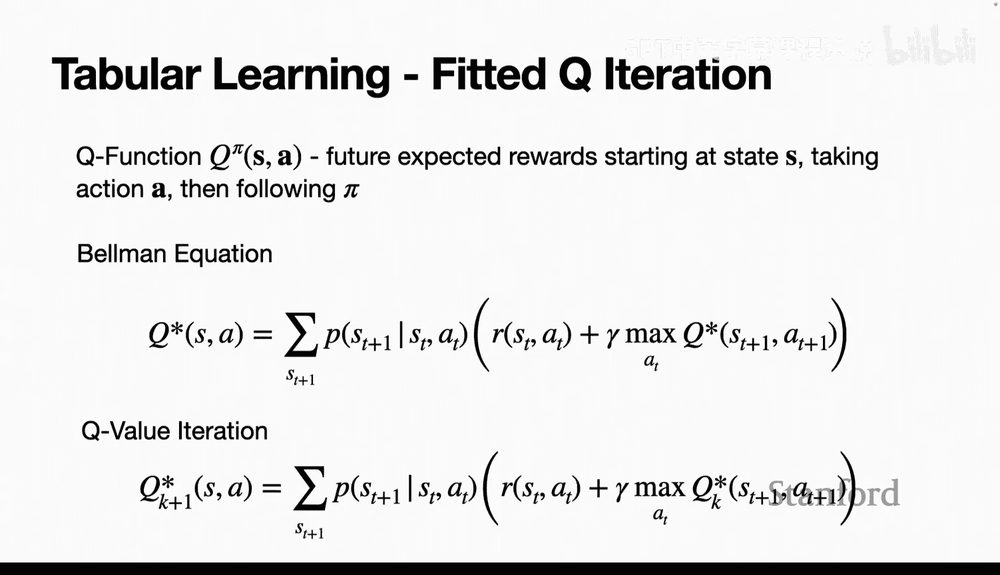

I guess the question or clarification was which one of these is like Monte Carlo or？

Dynamic programming so right now we're going to be looking at a dynamic programming algorithm and a quick way to Sanity check that or get a hesistic sense of that is that if you see the Q function on both sides of your update。

 that will generally be a dynamic programming style of algorithm， whereas for a Monte Carlo。

 you will sort of see strictly only rewards， at least for the Q learning updates and value function updates。

but right now we're looking at a dynamic programming algorithm and that is why we kind of start from these like terminal states as we see here on the right。

 and we then propagate value to all states within our grid。

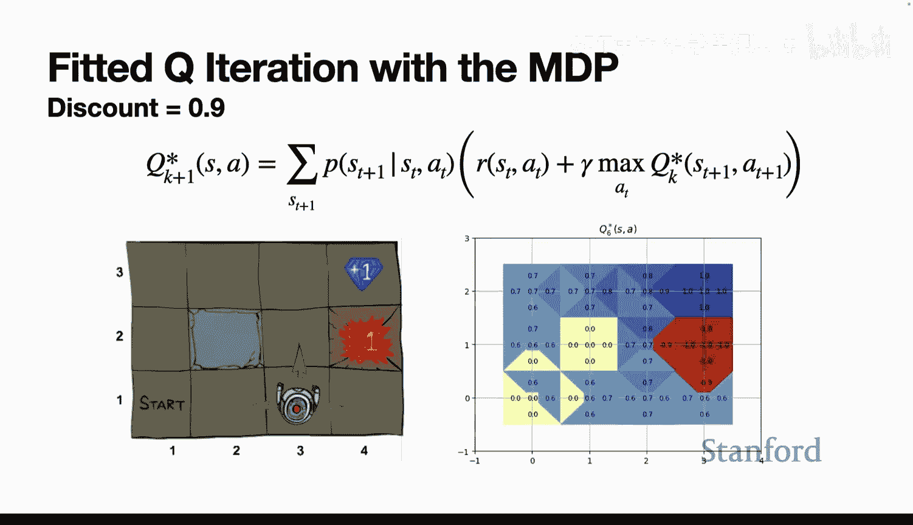

I'll start off by saying that is the state space here kind of clear， okay。

 and the actions are going up down left， right and stay。

So these are just denoting each of the five like directions。

 so the Q value for being at this state and going up is the top value and going left is the value on the left there。

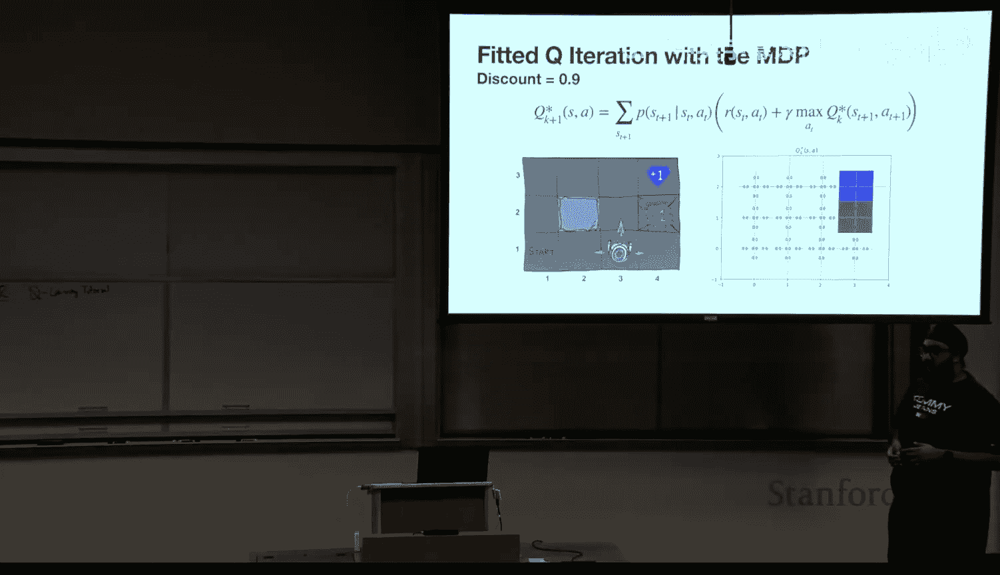

It show stay barbecu function， just like stopping your made up。

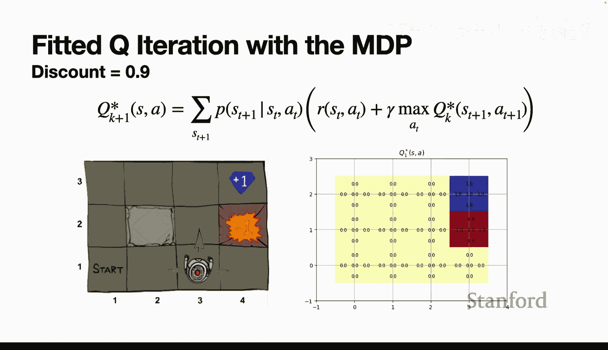

The initial state of the Q function No， it's not something that I've made up， so generally oh sorry。

 I haven't defined this here， but Q0 is defined as all zeros for all states in your tabular setting。

So you generally typically initialize your Q function as zeros and then Q1 is just a single update using the equation above and the reason that for these states。

 the reward is plus one and minus one is because these are terminal states and then from any action that you take out these states where a result in the reward。

And then so this is iteration one。

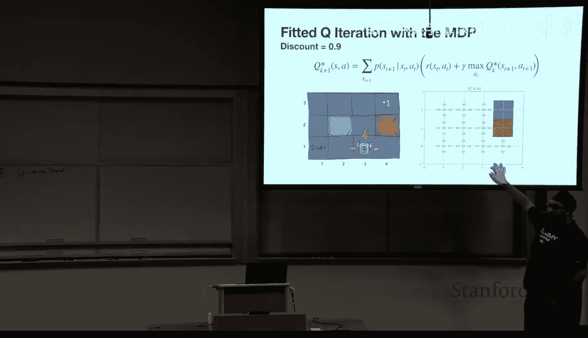

And from there we just do the dynamic programming update a seen on the top。

 and we see that the value essentially propagates from the top state to any other state in our grid world。

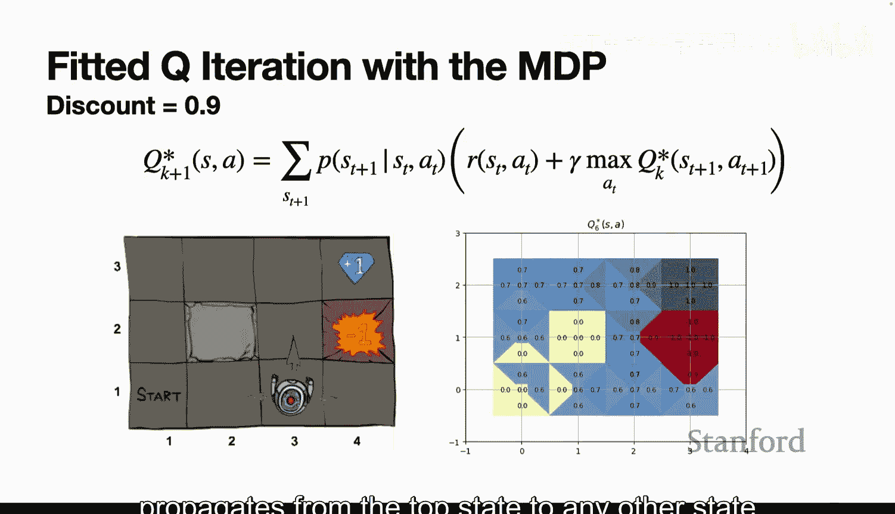

Alrighty so。

In the class we've been discussing。Like notation is something that you probably are maybe getting overwhelmed with。

 so I want to maybe clarify a few different quantities that you might have seen and talk about how that relates to the current grid roles that we've been sort of exploring。

So the top left here， which is v of S， is going to be the value function that is unconditional on the actions。

And you can see that for every state we kind of assign it a value and we see that from the top right corner。

 which is the place where you get a reward， you essentially get a reward of plus1 and the discounting of 0。

9 then applies for every state that is far away from it so you can see that like if you're one step away you have a value of like 0。

9， if you're two steps it would be like 0。81 so on and so forth until you complete the full grid。

 except for the lavo state where you get a minus1 reward for terminating。

Additionally， there's the Q star， which is the center thing that we were just looking at。

 and this is you can either get this through convergence of the algorithm that we were just describing。

 or you can also calculate it analytically。

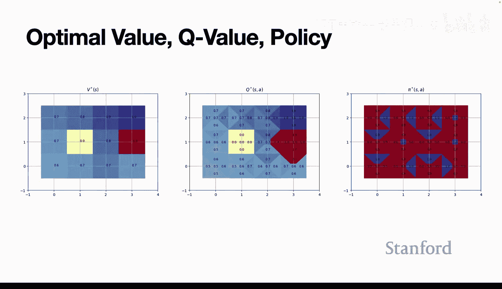

Finally there is the policy and the policy is just going to be a deterministic function。

 that's primarily because for any MDDP without any partially observability。

 the policy is going to be a deterministic function that is defined as strictly the arc max of the Q function and as you can see here it typically has a path towards the goal and is' generally the shortest path for any state in your grid world。

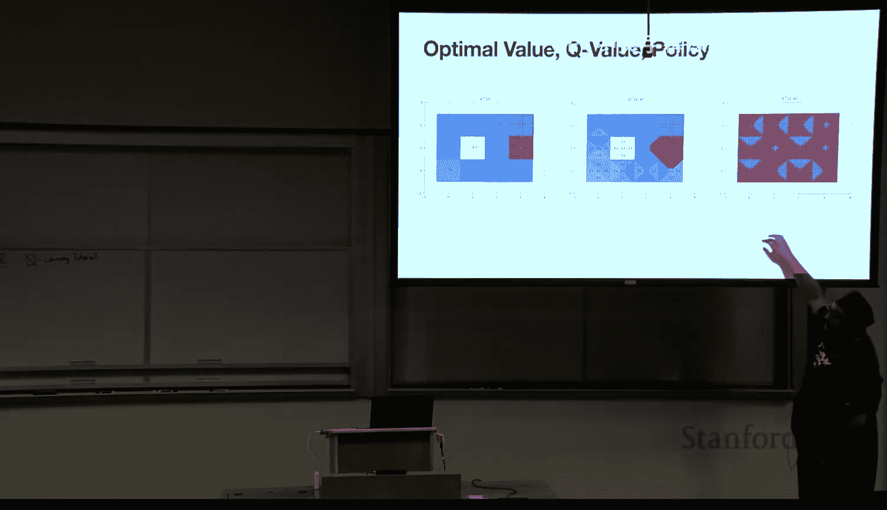

So these are all the optimal value， Q value， and policies。

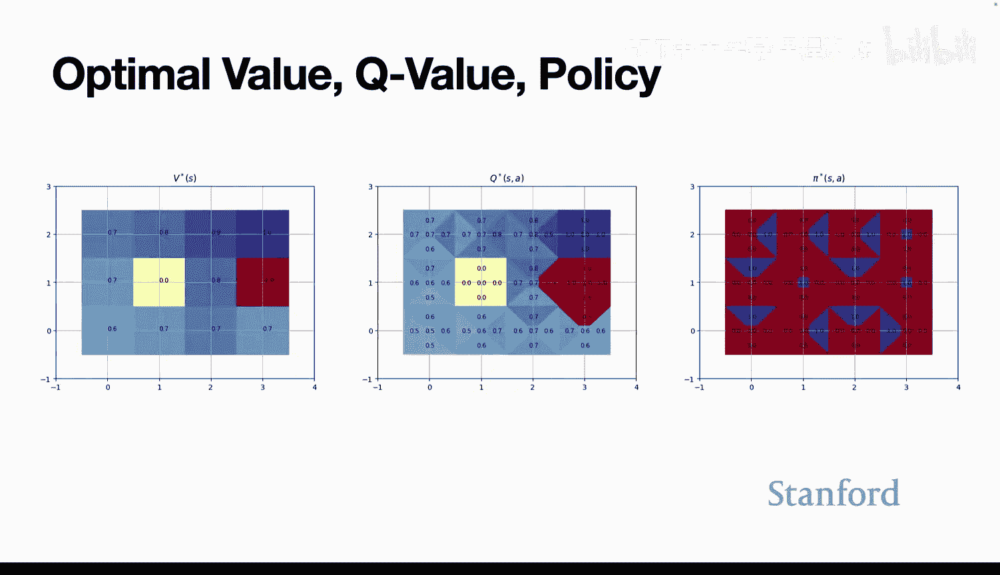

So I think I pray for me of looking at this， I think make the policy is pretty much all I need so why？

what are the different advantages？

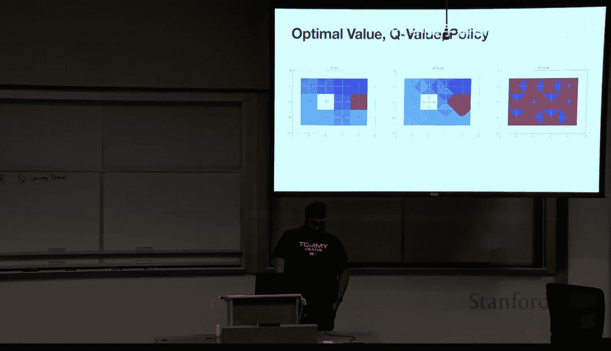

Yeah that's a good question so you're saying that okay like maybe these things seem really like extra like I don't need to actually learn them if I learned the policy i'm going to be a little good that's a great question then probably。

😊，worth thinking a little bit about so what you can think about is that in like this tabular domain the way that we've like extracted the policy is just by doing it artrc maxax over our Q function so we needed the Q function to sort of help us determine like what are the values throughout the entire state space and we were able to extract the policy from it。

There are also approaches that only utilized policy such as policy gradient objectives which you might have explored in the first couple of classes。

 but they do experience some amount of variance issues in your environment we'll talk a little bit about this when we go to discuss the differences between Monte Carlo and TD but essentially once your environment ends up being having a lot of variance either in terms of the reward or the transition dynamics that results in like policy gradient methods or Monte Carlobased methods to suffer a little bit because there's very high variance in your environment so a Q value function can allow you to trade off the variance for bias and is like maybe another way to kind of deal with kind of those specific environment configurations so there are tradeoffs to learning each of them and certain environment configurations allow you to learn a Q function better than others。

So those were the optimal value， Q value and policies。Additionally， as I discussed before。

 there's also a notion of an advantage which gives us an estimate of how good a particular action is relative to the average action in。

TheThe action that your policy would essentially take so for the optimal policy。

 the advantage should always be negative and the reason for that is that your optimal policy。

 your policy is the optimal policy so there's no action that's sort of better than it and you can see this in the grid world on the right where there are actions that are in red that go towards the lawless state for example。

 that are negative in nature and all of the actions that are from the policy are all going to have zero advantage because they're equivalent。

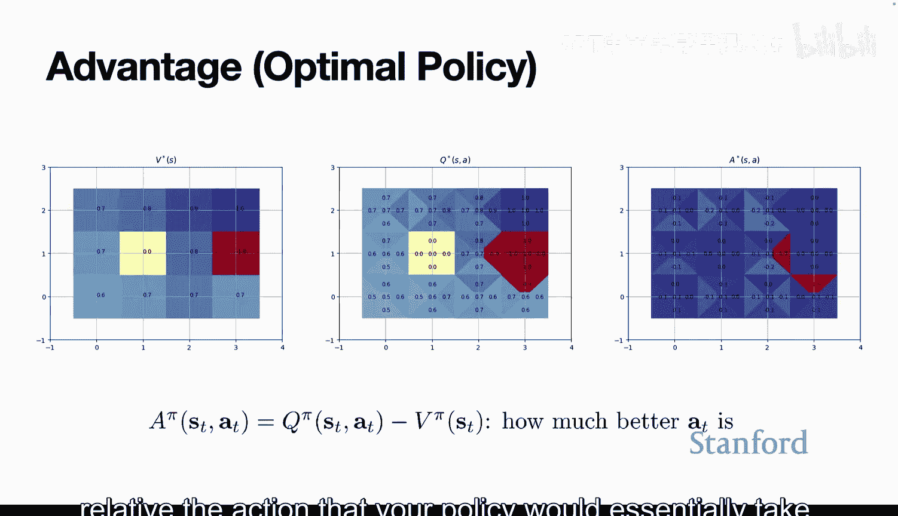

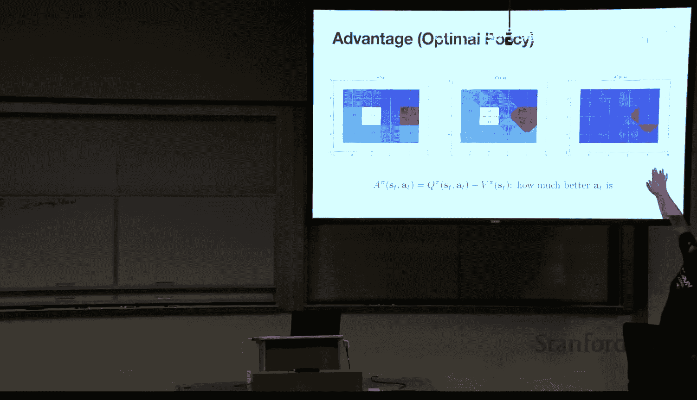

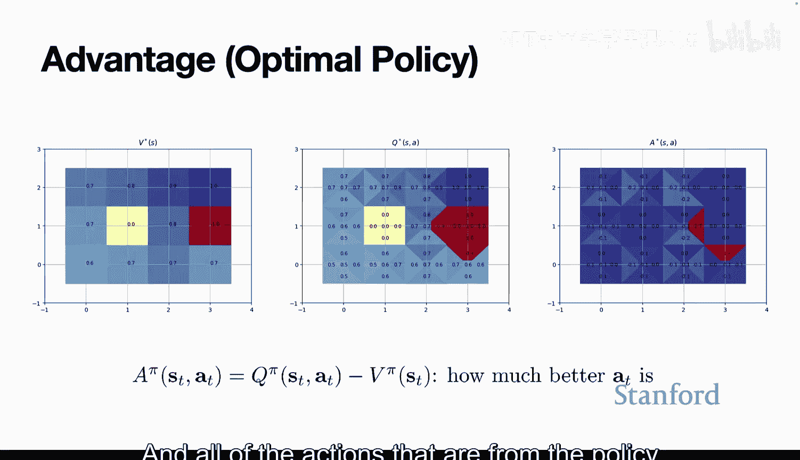

So yeah， so the advantage is zero for actions from our current policy。

 but for actions that are not our current from the optimal policy， they're going to be negative。

So that is why for every action that the optimal policy takes in the grid world on the top right。

 the advantage is going to be zero， but for all other actions。

 the advantage will be negative because they can be worse performing than the optimal policy。

 because there could be， for example， two actions that lead to like similar values。

 which I think was like an advantage， like an example， I think in。

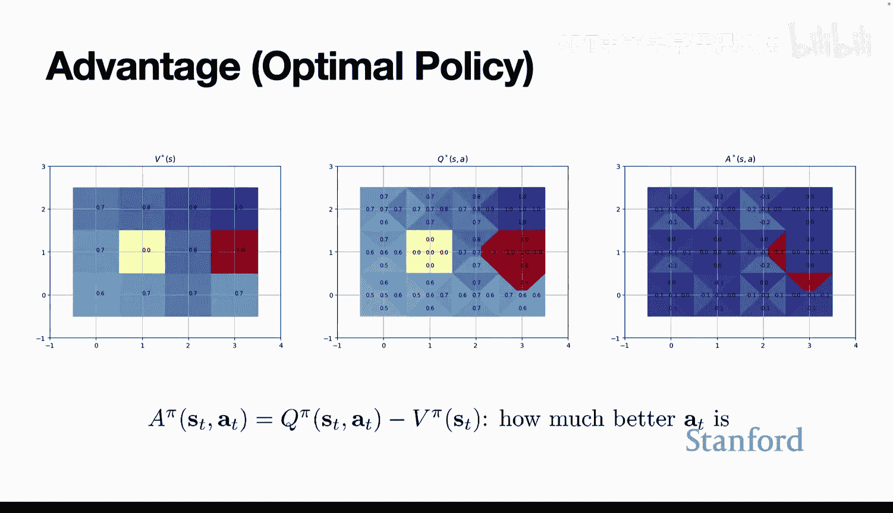

The state on0 zero， so you can either go up or to the right from the state and the advantage for both of them will be zero because they match to the optimal policy。

But the optimum policy is deterministic， so you'll end up picking one of them as your policy。

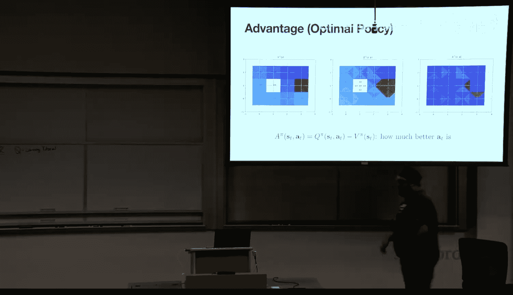

So so far have you been looking at the optimal policy。

 but what would it look like for your current policy or sub Opti one？

So here I'm going to show again Q star of essay and pi of a given S and Q pi of essay and pi of a given S So as you can see this is not a deterministic policy on the bottom and in many cases actually does not lead you to the right to the right set of actions to take sometimes even leading to like the lawless state for example。

 and we can see that here the Q function that's associated with it is also different from the optimal Q function so you can learn a critic or Q function that is condition on a policy that tells you kind of how closely am I to the optimal policy and how can I improve using that so if I wanted to learn an a critictics style algorithm for example I could use this critic that's conditioned on a particular policy to tell me what are actions that might be better than the ones that I'm taking and use that to update the policy。

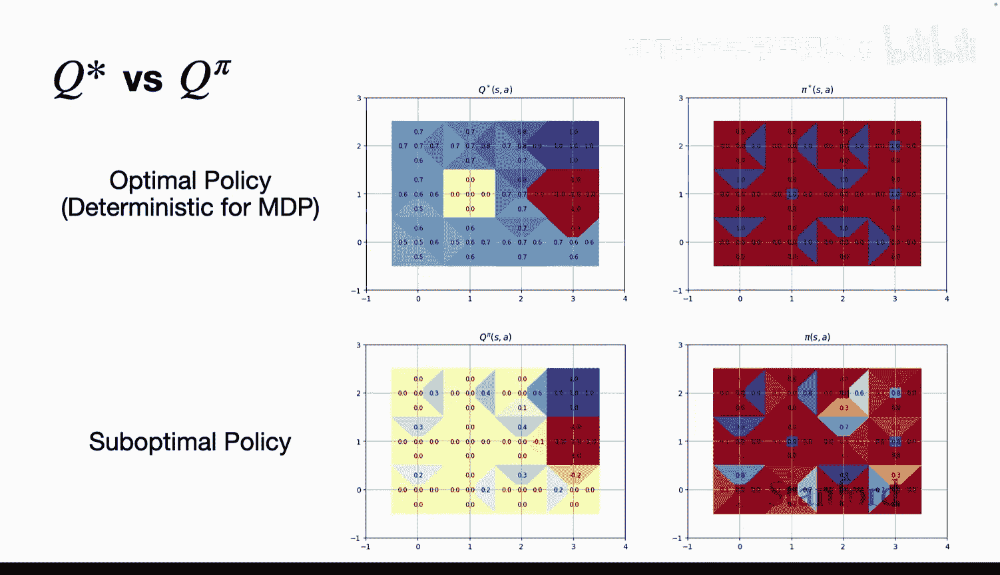

hen be like once to do one step of improvement Q start， on the other hand。

 has been converged so the optimal policy can no longer be updated because of that。

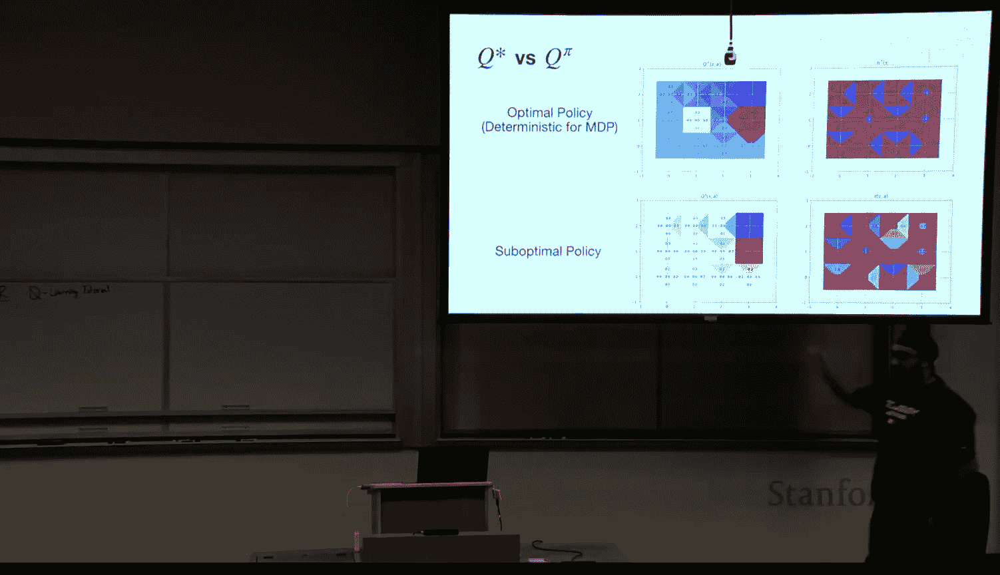

This is just to kind of give you a sense of like what the different notation sort of means。

 so Q pi just relates to the current policy， whereas Q star is the optimal one。

If you guys would like to play around with some of these Tddler environments。

 feel free to do so through the coab and the PDF that I had shared。

We've been talking a little bit about these like tabular environments and it's great to kind of like play around with these grid roles and see kind of how values and stuff propagate。

 but would something like this actually scale。

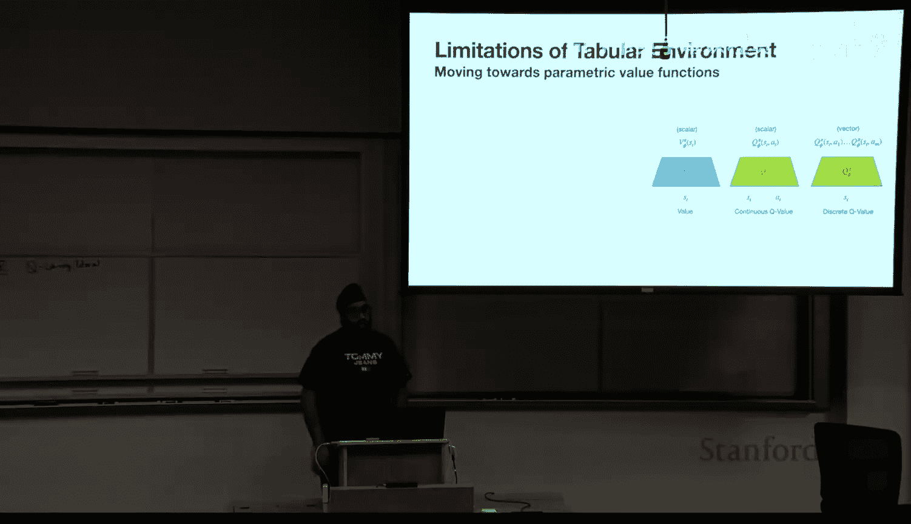

And unfortunately， it doesn't seem to be the case because a tabular value function as your state or action space grows。

 will have like thousands or millions of rows and it will be really hard to learn that。Additionally。

 if you instead learn a parametric value function through like a neural network or something。

 you can allow for kind of generalization to occur in a better way， so for example。

 if you have two states that are close to each other either in a semantic sense or in a lit sense。

 you would hope that their key values are also very similar to each other。

 and this is like a property of smoothness that you get from the underlying representation that you've learned。

And what we'll look at next is how to use regression techniques to learn a value function root neural network in both continuous and discrete environments。

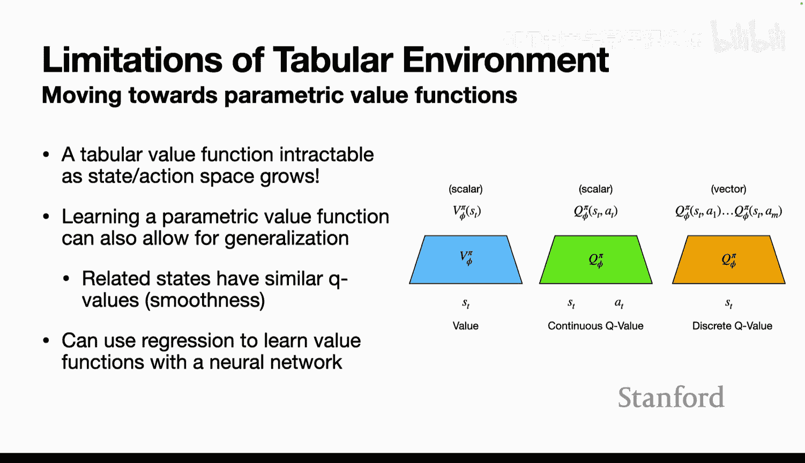

So we'll go back to look at sort of these sort of figures on the right hand side。

 where the first figure here is the value function that is not conditional on state and just takes in as input the state and outputs the scalar。

 which is v pi of s。

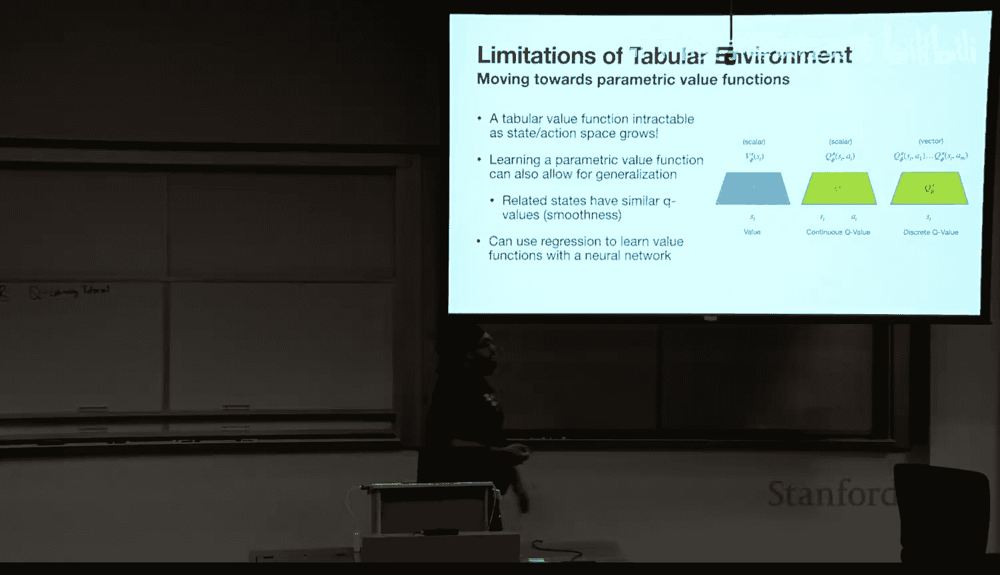

Additionally， there's now two types of Q functions that you'll like look at。

 one is a continuous Q function， which takes in both a state and then action and outputs a scalar。

 as well as a discrete value function， which outputs for a given state a vector for all possible like actions that you essentially have to be fair。

 you could also use the left representation to learn the discrete key value。

 but generally it's like advisable to do this as long as you're like discrete spaces like tractable because you have the ability to enumerate all actions in your space。

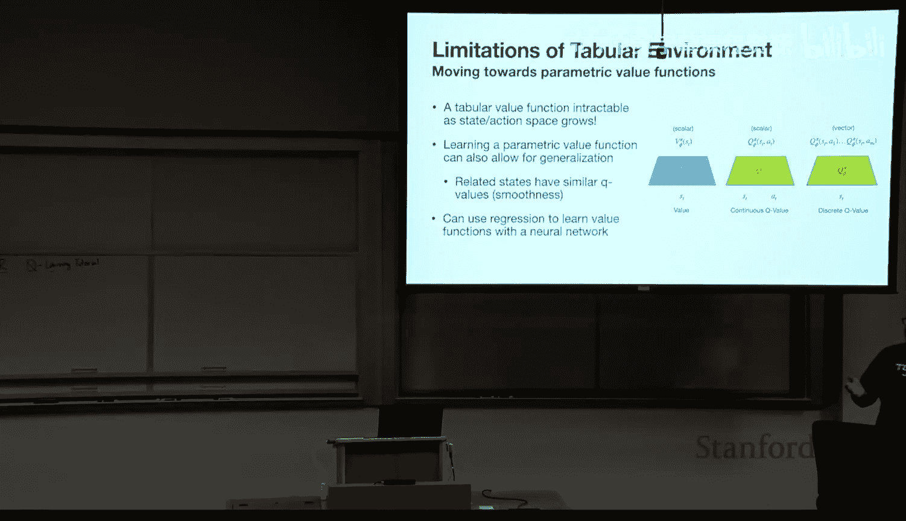

Yeah， so there's a discrete Q function and a continuous Q function， but for the value function。

 it's kind of irrelevant to the action like space， so there's only one general parameterization people use there。

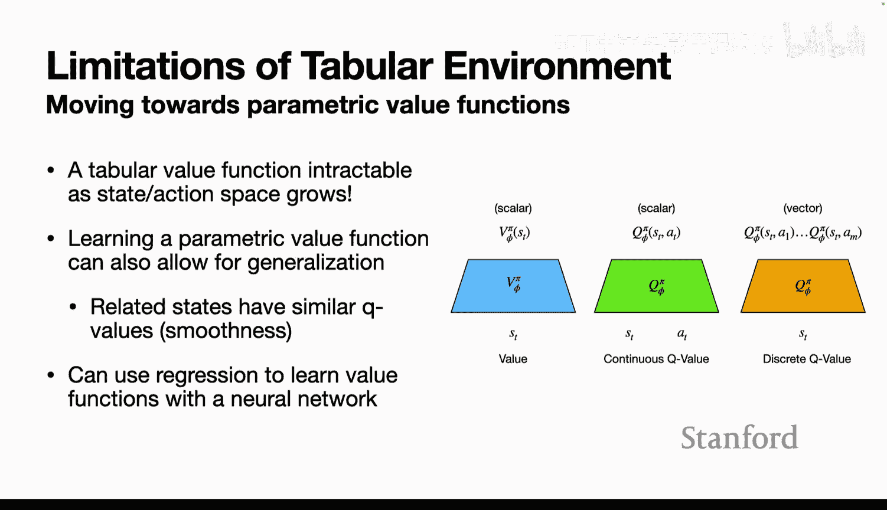

So for the discrete Q function， what you can actually do is that you can predict the action sorry predict the Q value for all actions in your space and then you can choose the particular one that you'd want to use for example。

 let's say that there are four actions like in the grid world that we had like via five actions。

 you can predict the Q value for like up down left right and stay whereas for a continuous space it would be like really hard to enumerate all possible actions so you generally take that as input instead。

So in a continuous space you typically condition on a action and output a scalar and when you do like an expectation calculation here。

 you typically sample actions from your policy in order to do so。

 we have like this robotic policy and you can see that we are predicting values for it at every single state。

Whereas for a discrete case， so you can output a value for each bin and then enumerate over all of them when you take an expectation。

 so an advantage of doing the bottom case is that if you're doing an expectation。

 you can kind of enumerate all actions and you'll get like an exact estimate of your expectation whereas on top it's just a sample based estimate。

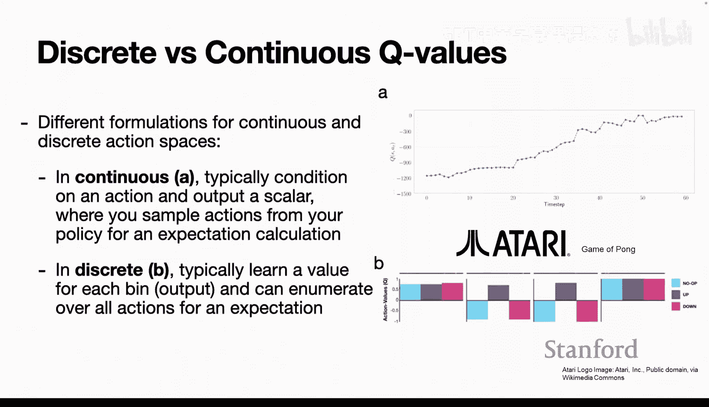

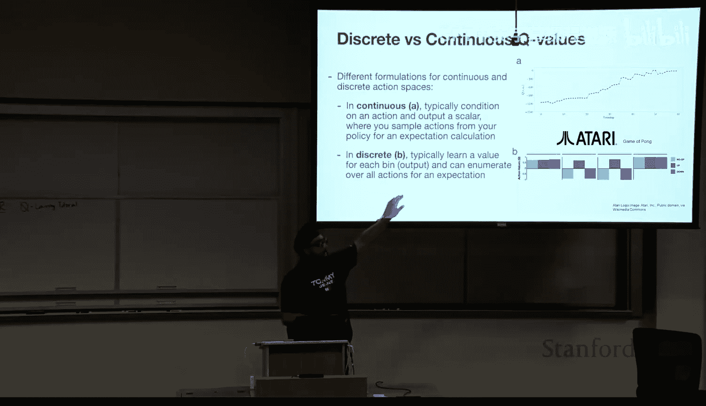

Alrighty， so let's dive a little bit into kind of how you actually do Q learning as a regression problem and I'll kind of use the whiteboard on the right here。

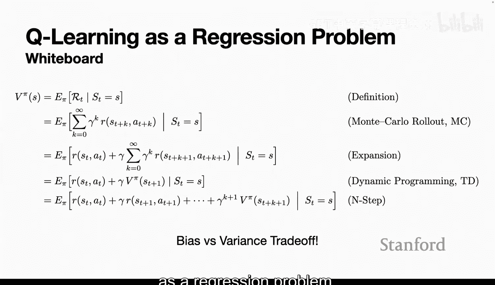

So we're going to be working with basically V pi of S。

 and you can do a similar derivation for Q of S as well。

 This is adaptive from the Se Mbarto textbook。So our value as we've discussed。

 is going to be conditioned on a particular state and it can be modeled or it represents the expected return to go from that particular state。

 so we're going to then write it now as an expectation under our policy pi of the return our T conditioned on our state S。

So the return can be now like kind of expanded a little bit to be equivalent to the sum of discounted rewards。

 so we're going to quickly do that。Yeah。Yes。And this here is going to be。Sorry。

 I need to take into account K here。Come up to the K。S T plus K and A T plus K。Given ST equals S。嗯。

So what this is essentially is saying is that from our current point in time。

 we're going to look at all of the rewards going forward， discount them by our discount factor。

 which is exponentiated according to how many times thus you are away from our current state and look at what the summation of that would essentially be this as you asked about is the Monte Carlo estimate。

Of our value function， and it's denoted as a sum。So we can do now some algebra to convert this into a one step TD estimate。

And the way that we're going to do that is we're going to take this reward out of the summation here and kind of use it to go back to the value function definition that we'd had above。

So the first thing that I'll do is that I'll remove R of STAT when k equals 0。

And then also apply the discounting here。We're going to keep the summ again from k equals0 to infinity。

 and now we're going to have one step。Of。We're going to have the summation again。そ。Yes。Okay。

So this part on the right hand side is just going to be an expansion sorry。

 this line here is just an expansion of the line above。

 we've just done some algebra so we can get it into a form similar to the MC definition that we have written above。

And what you kind of notice here is that this looks a lot like a value function。

 but now instead of at the current state， it is going to be at the next state so we can now write this as sort of the following。

Yes。P of ST plus one。Given S equals S。And by doing so， we have now arrived at our TD function。So。

You might be asking， what is the difference between？

Doing a Monte Carlo value estimate versus doing a TD estimate。

 And the main distinction here is that we're going to be representing the Monte Carlo estimate as like the discounted sum returns over our entire trajectory。

 So this is going to have like no bias。

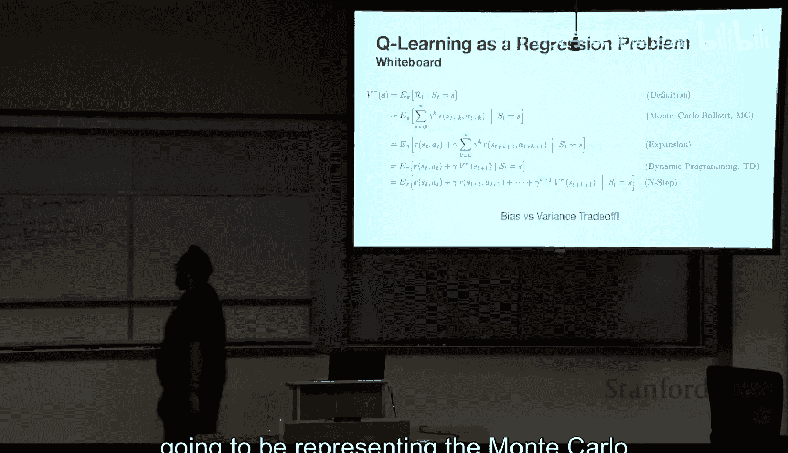

But instead here， when we look at the TD estimate， we're going to actually substitute our value function back in and this might is going to introduce some amount of bias because our value function here can be inaccurate。

 but it will reduce our variance because we're going to reduce the horizon of our trajectory so we're going from like a horizon of H which can be very。

 very large for a lot of problems to just the horizon of one and this will reduce our variance significantly over the horizon。

So that is the TD learning S that we have described here。So notice here that k equals0。

So if I like break up the summation into。Let me just add this ci step below。不。Yes。

So if I look at the case where k equals0 is going to be r of ST plus 80。

Plus the summation from k equals 1 to infinity of gamma to the K。R of S plus K。呃。Os。AT plus k。

All given ST equals S。Yeah， so that is how we remove that term。

 and you can just do some minor algebra to convert it from the step to the one on top。

So I'm going to quickly erase this because I also want to talk about what an end step return looks like。

So right now， like what we did is that we only expanded this once。

 but we can also do this expansion like n times and what this will allow us to do is to kind of trade off between the bias and the variance。

 so the bias comes again from the value function parameterization and the variance comes from the horizon of your trajectory essentially because as your like reward function might be noisy or your transition dynamics might be noisy。

 you introduce a little bit of variance amongst all of the trajectories that you roll out。So。

Let's look at what that would sort of be。I'm just going to quickly grab my iPad so I don't make a notation mistake。

That。T。😔，Yes。Yes。一し。So basically what we've done here is that we've done case steps of rolling out using the same expansion that we did for one step and now our value function is discounted by case steps instead of one step。

 and we are now turning off between the Monte Carlo rollout。

 which is going to be the full discounted sum of rewards。

 as well as this value function estimate that we do。

 allowing us to effectively trade off between TD and Monte Carlo。

So let's take a look at how this would look in a visualization。

So I'll put both of these up on the slide so we can compare one by one。

 but if you look at the left-hand side， like what we're essentially doing is that from a particular state。

 we're going to let our policy rollout until it reaches a terminal state and we're going to collect multiple of these rollouts to do essentially an update by collecting these rollouts。

 averaging the reward amongst them to the reward to go amongst them to calculate this value function estimate and that can have a lot of variance because at every action you introduce this amount of noise from your transition dynamics function or the reward。

In contrast with this TD backup， we're only going to do one step of unrolling。

 but we're going to then use the value function estimate at the next state to then reduce the variance of our estimate。

 but again， because our value function can be inaccurate， that leads to potential issues with bias。

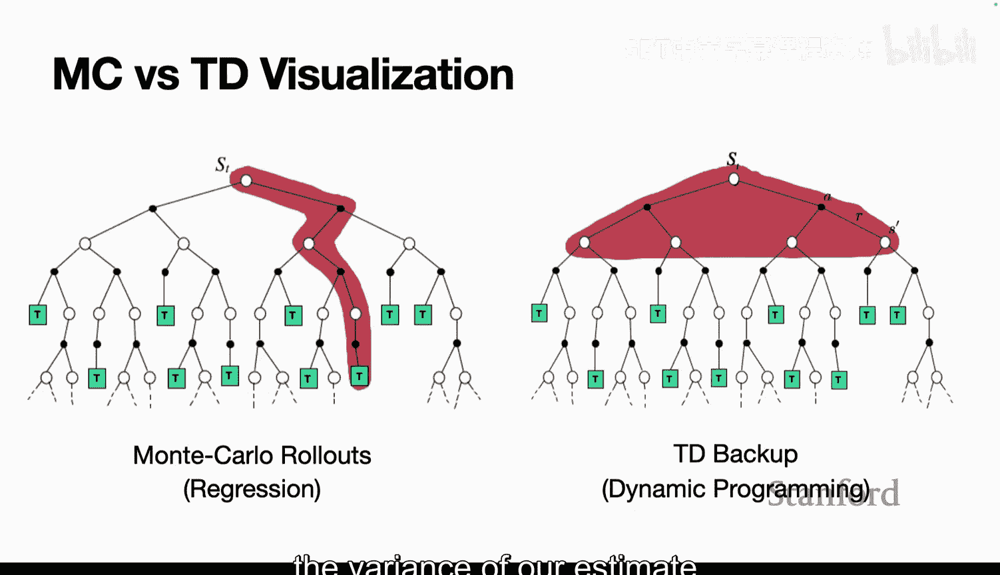

And both of these have some a amount of trade off。Yeah， so for tabular settings。

 both of these approaches should converge to the same like resulting like equation。

 but when you go beyond that， they don't seem to converge to the same thing。

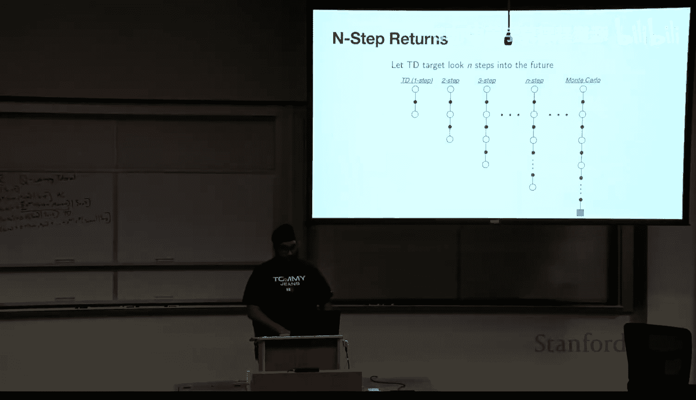

And again， we're looking at sort of the N stepP returns here as well。

 where we're going to allow the TD target to look NTPs in the future before being applied so we could then trade off between the bias and variants here。

And yeah you can look at this table here to kind of look at what the trade off of each of these would be。

 where the bootstrap depth of TD is going to be one step for N steps is going to be n and for Monte Carlo。

 it's going to be the full episode。The bias for something like TD is going to be high whereas for NTs is going to be somewhere in the middle depending on how large your K is and for Monte Carlo you're not gonna to have any bias at all and then the variances would be sort of the reverse of this where TD has lower variance with NSEs return being somewhere again in the middle and Monte Carlo having high variance again this also depends heavily on the environment that you're in so for example in language Monte Carlo rollouts are actually the way that a lot of people do things because in many cases your environment dynamics are almost perfect and your word signal。

 especially in domains like math or code reason are going to be perfect as well so you don't have to worry about things like variances of your dynamics but if you go to things like maybe agentic domains or robotic domains a lot of these factors come back into play one other thing that dynamic programming gives you is this notion of stitching and if we look at this like maize environment on the left-hand side。

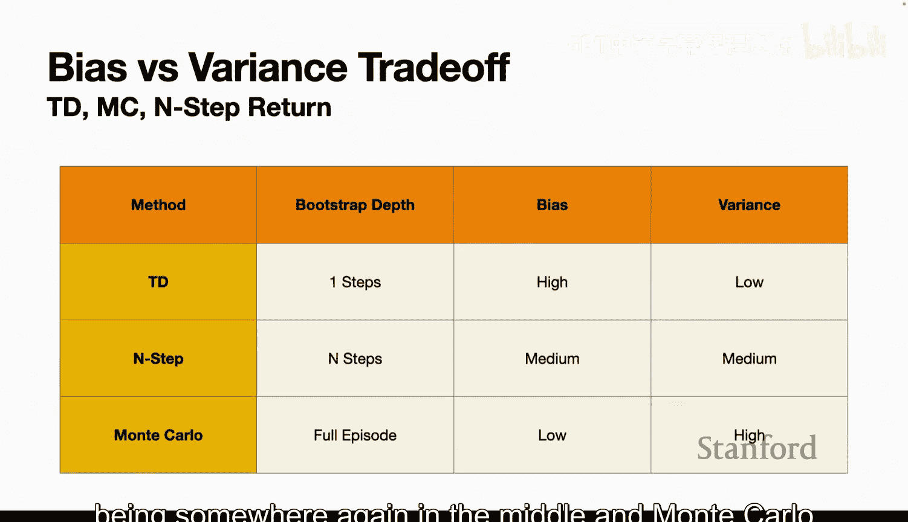

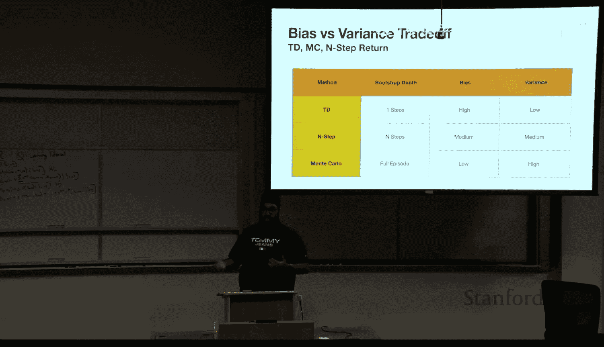

You can kind of see an example of like why this might be powerful。

 so let's say that we've collected through our policy two different trajectories。

 one that goes from A to B and another that goes from C to D。

Through this one step of dynamic programming， what you will see is that you can actually find the optimal path from A to D because of the fact that at every step you're looking like one step before it and you can kind of stitch these trajectories together to form what the optimalim path would be to the goal。

 so this kind of allows you to get better coverage of your space and allows these algorithms to potentially be somewhat more efficient。

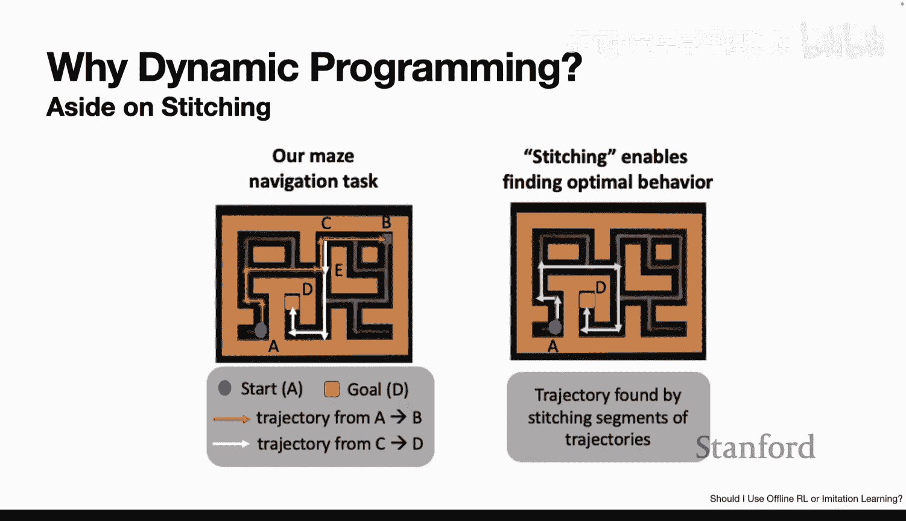

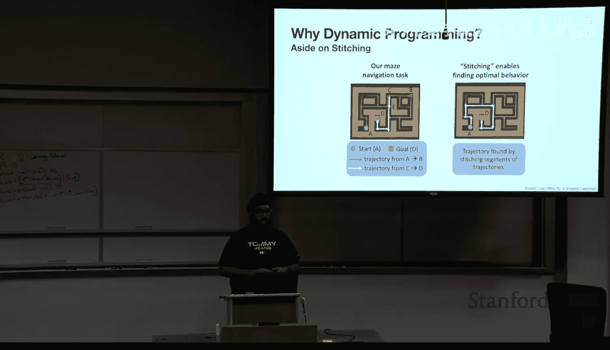

Any questions about this？Okay。If not， then let's talk a little bit more about some of the practical design details that are needed to sort of get key learning to sort of stabilize。

The first thing that we'll quickly talk about is this notion of a semi gradient or target network。

And we're now going to look back at our Q value estimate that we've been looking at so far。

 where we define it as the reward at the current time step plus the discounted Q value at the next time step where you look at the max over all actions。

So one thing that what you'll see here is that the Q function on the left is going to be the same as the Q function on the right。

 but this will make optimization kind of very difficult。

 especially if you like propagate gradients through it。

 so one kind of trick that people do use is this notion of a semi gradient which allows you to sort of freeze your target network or not pass any gradient to it to make optimization a little bit more stable。

And that's defined as this equation， the second equation that are defined here。Additionally。

 to further make things a little bit more stable， people add in this notion of a target network。

 which delays the updates of the right hand side to allow your Q function to regress to a more stable target。

And there are two types of updates that people kind of use in this space。

 One is this notion of a hard target update where at a fixed frequency。

 you allow the model to essentially update to the most recent model that you've used。Additionally。

 you can also use this notion of a soft target update or kind of an EMA or  Polac style averaging technique。

 which allows you to smoothly interpolate between sort of the Q functions that you've seen so far with a decay parameter in practice people I think try to use the one on the right that both of them kind of empirically have been seen to work somewhat well。

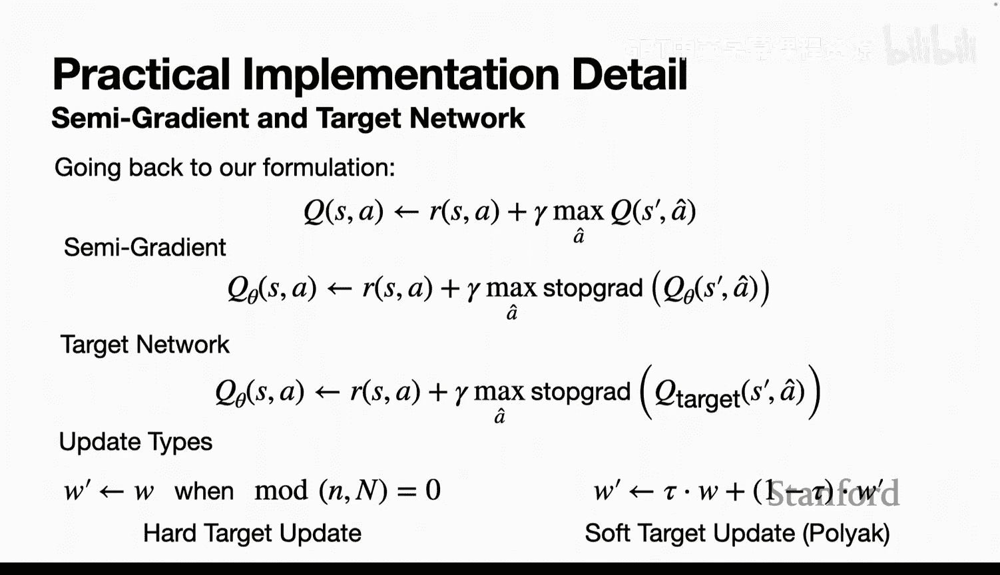

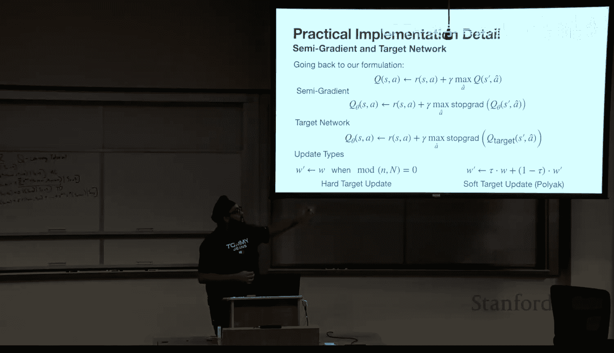

And the reason that you kind of want to do this is that you want to make sure that when you're doing some amount of regression。

 your value function is a really stable target to kind of like approach and some of these things like removing the gradient on the right hand side。

 as well as introducing a target network makes the learning problem a lot easier。

There are things that you'd have to consider in terms of like how frequently update your target network and things like that。

 but for most cases people have like stabilized this as a hyperparmeter to around 0。99， for example。

 for the polyeca averaging。Typically like when you're learning a Q function。

 you would learn this through like a regression style of technique。

 which would look something like this， so I'm just going to again do the value function update。

For you to match what we have there。嗯。Yeah。Yeah。Yeah。So， on this side here。

This is going to basically be our loss quantity。嗯。This is essentially just like for a single sample estimate what our loss would be and basically we have a learn network on both sides of our MSE。

 which will be very unstable to basically learn from what a stop gradient essentially does is that it prevents you from passing gradients to the right hand side so your target is going to be fixed when you can't pass any gradients to it but you can pass gradients through your network on the left hand side。

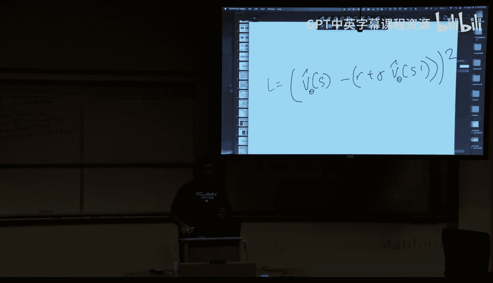

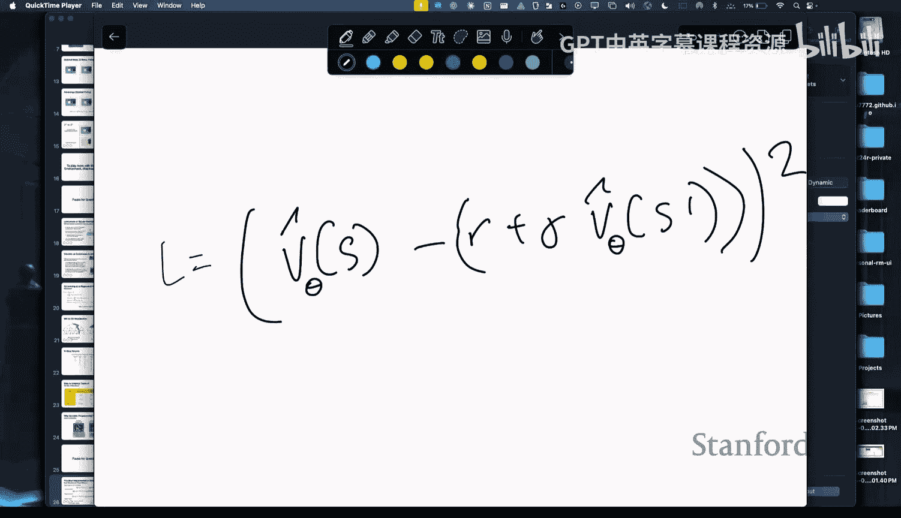

So in this case， when you do the stomach my gradient trick。

 it's going to keep the same set of parameters but not pass gradients through it。

 but the target network is in a completely different set of parameters that is like independent of the parameters that you've learned and you then update them through this like polyac aing。

 which I was showing here。So you have these sets of weights。

 W prime and W is like maybe the weights of your current network and every so often for a hard target update you would update them or for your  Polac averaging。

 you would update them like at every step but with this like soft ratio averaging。

This one here。 Yes， so this would be exactly the term that we were looking at here as our target。

 So this is our。Okay， let me be a little bit more precise soon。

So let's say we have like a target value， which looks as our reward at our current time step。Plus。

 at the discounted value。Our next time step。So this is kind of the one step TD approach that we were taking there and then our loss would look something like this。

It's our value at our current time step minus y。As like an MSC style loss。

 so this is what the right hand side sort of represents， just is like the TD loss here。

Alrighty so we're not done yet in terms of how to fix the gradients or making this a little bit more stable unfortunately。

 there are a few other types of techniques people have used to kind of make this converge a little bit better the first is gradient clipping which you might have seen in things when you've trained in networks in the past where if you have a gradient that's too large which unfortunately comes a lot of the time when you do updates like TD you want to clip them a little bit to allow you to approach the to do optimization a little bit more stably and here you can see kind of in this lost landscape for example on the left if you don't do gradient clipping you kind of go around the optimal like parameter space whereas if you do some amount gradient clipping you can kind of smoothly approach it。

😊。

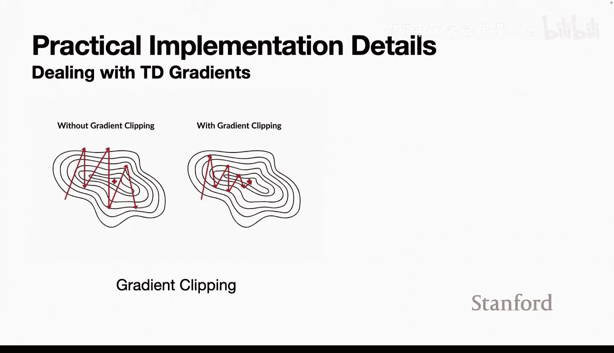

Additionally， you have you can use objectives other than MSC to kind of make this a little bit better and one standard thing people have used is this notion of a hubber loss。

 which is like an interpolation between an L1 and O2 loss。

 where it allows you to not be affected by outliers through like the L1 loss。

 which is this one in green， but then when you get close to the right。

Answer or the right like value you allow for an L2 like loss to kind of kick in and kind of get you closer and closer to the target value。

 So this is like the interpolation that you're essentially doing by this。

 There are other things that people have done。 But these are like some standard things that people have found to help with learning value functions。

Okay now let's get to replay buffers， so one thing that you might have seen in lecture either today or last week was this notion of a replay buffer。

 which is a memory structure that you can use to store past experiences that have been seen by an agent。

And the way that we parameterize this is kind of in this buffer like format right here where we have these two poles of state action rewards and next states。

 and we serve them individually as transitions instead of trajectories as a whole。

And the reason that we want to do it that way is that it allows us to like break down the temporal correlations of our data set and also allows us to prevent recency bias。

 so there are two things that kind of come into play so the temporal correlations come from the fact that at every time step we sample transitions rather than trajectories and this can be across trajectories as well。

 so I can sample any set of indices across my entire data set and they can be from like trajectories one through like and which are like the maximum of trajectories I have in the data。

Additionally， by having this like buffer of past trajectories that I've visited。

 I can avoid recency bias by making sure that I don't like overfit to my current policy。

 because one thing that Q functions like benefit from is having a lot of coverage in the space and this allows you to not like narrow down the distribution by your current policy。

And all of these kind of lead to better sample efficiency when you want to learn cube functions。

 and it allows the agent to kind of reuse this experience in an effective way。

Yeah， so this is just going to denote that your replay buffer can sometimes have a max size depending on kind of how much capacity you have。

 typically this is not a concern， but if you do you might want to either reway or throw out like parts of your buffer as needed。

I think people have explored both RN and even like Transer-based architectures like there are works like decision transformformer。

 for example， that do conditioning on long horizons to predict both actions and values and things like that and they all have different amounts of tradeoffs for learning critics or cu functions it's definitely very feasible to do so for policies in language for example。

 we do this by default， but in other places like robotics where you might have temporal correlations in your data learning with history might be actually a more nuanced topic and can actually lead to more design decisions needing to be made to do this more carefully but yeah it's definitely an interesting area to consider of like how can I keep in history like all of the states and actions I've seen so far or maybe even from previous trials and things like that。

Yeah。I now want to quickly chat about Q learning overestimation。

 so this is going to follow a derivation from using function approximation from RL and again we're going to look at again the Q learning like Bellman or TD backup as seen on the top and one thing that you might notice here is that we have this like max operation on the right hand side。

And what happens essentially if we have some noise in our Q function when we try to learn it in this way and this is what we're basically going to look at。

 so essentially when we are like parameterizing this Q function as a neural network。

 there can be noise in the estimation that we kind of incur and we're going to denote our Q function currently as approximate which is like the learn parameterization and Q target here is like the optimal Q function or the true underlying Q function。

And we're now also going to introduce this Y parameter here that denotes some amount of noise that might be like present in due to things like modeling errors。

And what we'll kind of see is that if there is noise on the right hand side when we're trying to predict a target。

 this actually transfers pretty badly to the left hand side。

 so what we're actually looking at here on the left hand side is kind of what would the Q values look like after one step of iteration and how does that differ from the true target value so Q prox of s prime a hat is going to be basically what we see on the right hand side there andq target is what the true value would be。

And like what we're going to see here is that if we kind of define even a noise that is of zero mean。

Like eventually the noise on the left hand side， which is going to be after one step of update。

 will have like a positive mean leading to our Q values to be sort of overestimated。

So this results in us having to kind of deal with this overestimation issue when we're trying to learn our critics。

I think one thing that I mentioned here is that we're going to do a maximization over actions。

There could be issues， for example， with。Sampling as well， actually。

 I don't think that's necessarily the case because your true target value over all the actions might be actually higher in that case。

 then if you only look at a subset or your total actions。

So in that case then like this property would not necessarily be an issue。

 I think the main concern actually just comes from modeling errors because in some cases you might actually overestimate your Q value on the right and once you do multiple rounds of like dynamic programming。

 this error will sort of propagate through your entire like state space and will kind of compound essentially。

Let me clarify a little bit what I mean here by like an error or an overestimation is actually in the Q function and not in actions that were taken let's assume that we can enumerate all the actions we're in like the discrete space that we're like working in and we look at the value for each of them what the failure case I'm describing here is like what the difference is between the Q function that we're learning versus the true or optimal Q function or Q star and what can happen is that your Q function can be like incorrectly modeled like maybe due to some noise is like higher than what the true target actually is and what I'm saying is that even if that noise has zero mean when you do these like dynamic programming updates it like propagates to the lefthand side and allows you to essentially get non-zero mean noise that's being due to this like max operation and this like essentially propagates through your entire like state space and makes your Q value sort of blow up resulting into sort of overestimation。

Actually I was going to go through this a little bit later but we can talk about it now So imagine that this is our state space so I do a lot of columns in this figure and we can look at each step what the value estimate sort of looks like what I am showing in the second column here is the difference in the estimate and the max value。

 the Q function can essentially have so you can look at the left- hand side and essentially telling you what the max that the next time step could essentially be and the third here kind of shows like what the difference is between the true value and the value that we want to learn and if you look at this like red figure or which is like typical Q learning style algorithms we can see that there's like a huge like error bar just because of the fact that we're like overestimating what the true value can be and we're like propagating that through all of the states。

I'll talk about like how we essentially fix this and one approach that people have taken is this notion of like critic enssembling where we want to estimate the epistemic uncertainty of our Q function using like an ensemble of networks and we can then use all of these ensemble of networks and minimize over the ensemble to kind of get an underestimate of what the Q value should essentially be The reason that this sort of works is that you can imagine that when you initialize your network they are initialized in different ways and kind of the errors that they will get across states is also going to be very different so you can kind of reduce the uncertainty or remove these like modeling errors by ensemmbling and then doing something like a min reduction over all of them。

And this has been shown to be effective in works like doublele Q learning。

 which I'll show in the next slide， as well as things like offline R， which we'll talk about later。

 where essentially you can kind of increase your ensemble size quite a lot and the distribution shift is actually mitigated because of like enssembling pretty heavily and learning an underestimation of what the Q value should essentially be。

 removing you from like getting an overestimation due to things like noise。

So the figure that I described essentially goes through exactly this。

 and this is from the double Q learning paper and like what we see is that in the figure on the right。

 despite the red one red curve here， which is like standard Q learning having very large errors。

 just having an ensemble size of two or doing double Q learning。

 allows you to kind of mitigate all over estimation errors for Q learning。

 it makes things a lot stable。So for online key learning algorithms you can get away with just doing too and for most intents and purposes like that works really well and beyond that kind of saturates。

 but you can definitely try to increase that for things like offline reinforcement learning where kind of the problem setting that you're looking at there is that you have like a static data set that you're sort of working with and any errors that happen because you like leave the support of your current state or action distribution like allows your model to propagate these errors even more so there I think being very careful about the distribution that you're in kind of matters a lot and you can increase the ensemble size for like approaches like EDAC or SN for example that do this。

There are ways that have been looking at this in the context of language for reward modeling because in reward modeling you're kind of going to face similar effects with like maybe overestimation potentially in that like reduce the performance so there have been papers that have come out that just do things like Laurara or like make sure that you share the network for like a large portion of your network you share a lot of layers of your network and have like linear adapters or something beyond that and those are like parameter efficient ways to kind of learn something like this。

