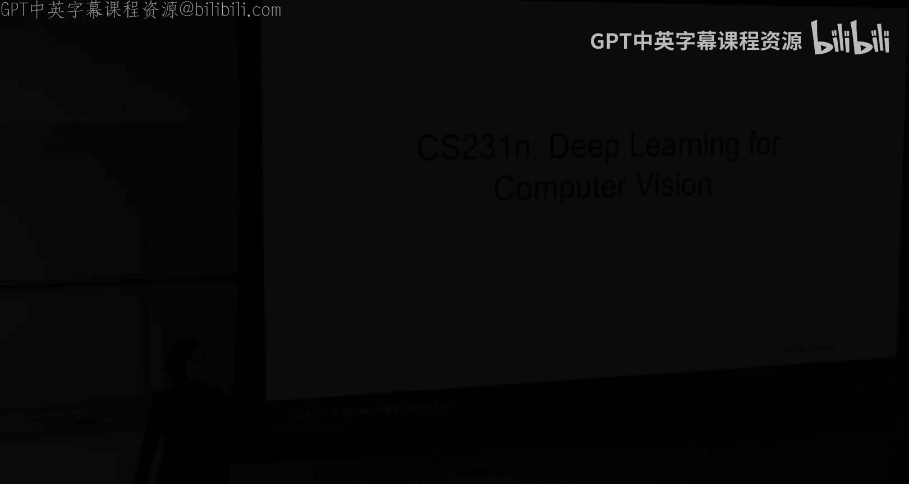
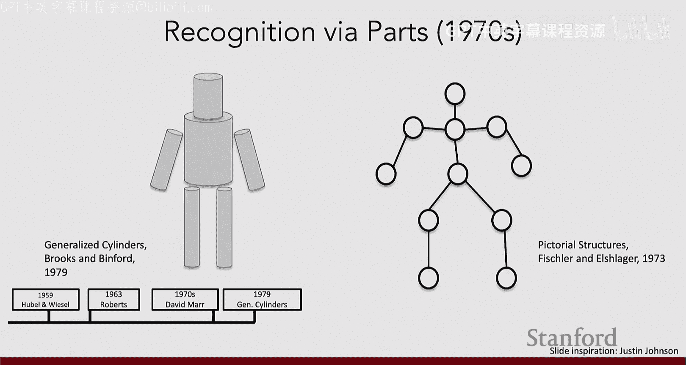
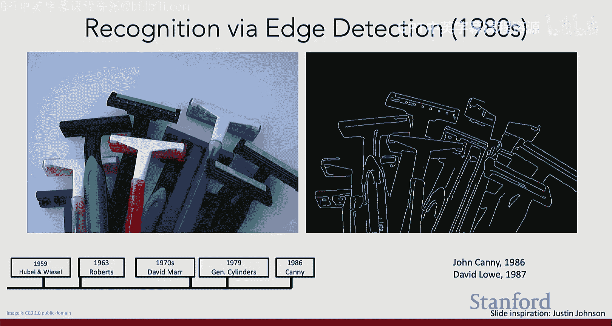
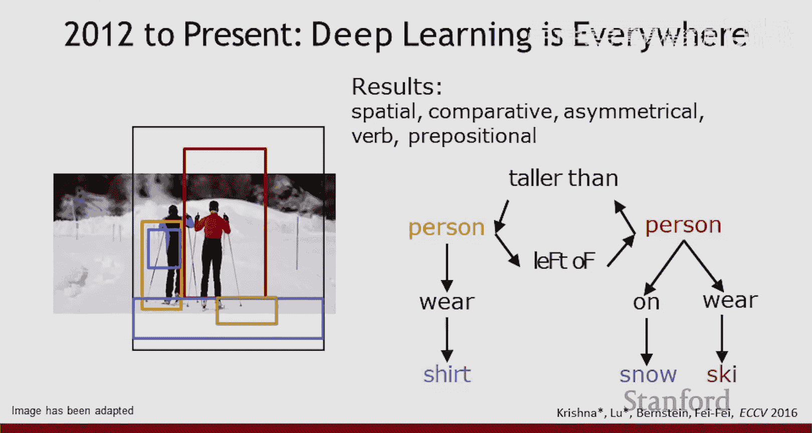
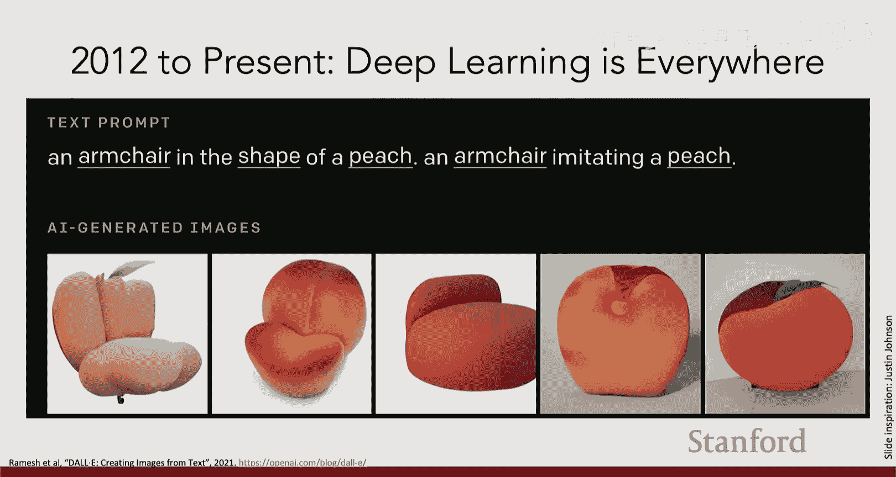

# 斯坦福大学《计算机视觉的深度学习｜CS231n： Deep Learning for Computer Vision 2025》中英字幕 p01 -01-Spring 2025 _ Lecture 1_ Introduction.zh_en -BV1FqazzVE6w_p1-

This is CS S 2，31 n， and I'm Professor Fei Fe Lee from Computer science department。

 I will be coteach this quarter with Professor Iam Delli and my graduate students saying So you meet them as well as our wonderful T team that you will meet later。

 So I just want to get started Yeah， so this is what excites me。

 that AI has become such an interdisciplinary field that what you're gonna to learn in this class。

 Of course， it's very technical。 It's about computer vision and deep learning。

 but I really do hope that you take it to whichever discipline you work in and are passionate about and apply it。

 So we hear a lot about the field of AI。 So how do we position computer vision and the scope of this class。

 If you consider AI as this big bubble。😊，Computer visions is very much an integral part of AI。

 some of you have heard me saying that not only vision is part of intelligence。

 it's a cornerstone to intelligence， unlocking the mystery of visual intelligence is unlocking the mystery of intelligence but one of the most important tools mathematical tools to solving AI is machine learning or some people call statistical machine learning and this is exactly you know what we will be talking about within the field of machine learning in the past 10 plus years we have seen a major revolution called deep learning and I'll explain a little bit of what deep learning is。

 deep learning is a set of algorithmic techniques that is built around a family of algorithms called neural networks and so if you ask me to pinpoint the scope of this class。

😊，Not be able to cover the entirety of computer vision will not be able to cover the entirety of machine learning or deep learning。

 but we're going to cover the core intersection of these two fields and of course just like the entirety of AI Com vision is becoming more and more a interdisciplinary field a lot of the techniques we use as well as the problems we work with intersect with many different other fields like natural language processing。

 speech recognition， robotics and AI as a whole is a field that intersects with mathematics。

 neuroscience， computerscience， psychology， physics。

 biology and many application areas from medicine to law to education and business and so on So what you will get for this lecture our first lecture is I'll give a very brief history of computer vision and deep learning and then Professor Delhi will。

Go over the overview of this course and lay the groundwork of how this course is set up and what our expectations are。

So， you know， the history of vision did not begin when you were born or humanity was born。

 The history of vision began 540 million years ago。

 you might you might ask what happened 140 million years ago。

 why are we pinpointing a relatively specific date or year in evolution。

 Well it's because a lot of fossil studies have shown us there is a mystery period called Cambririan explosion。

 it is the fossil studies showed about 10 million years in evolution during that time。

 which is a very short period of time for evolution。

 we see the explosion of animal species in the fossil study which means before Cambririan explosion。

 life on earth was pretty chill It was actually the water， there's no land yet。

 no animals on the land yet and。just float around around。

 So what caused this explosion in animal speciation。

 There were many theories from climate to chemical composition of the ocean water。

 but the most compelling， one of the most compelling theories was the onset of eyes。

 The first animal， a trilote。 they gained photossensitive cells。

 So the eyes we were talking about were not sophisticated lenses and retinas and nerve cells。

 it was literally a very simple pinghole。 and that pininghole collected light。😊。

Once you collected light。Life is completely different without senses， life is metabolism。

 It's very passive， it is just metabolism and you come and go with senses you become an integral part of environment that you might want to change you might want to actually survive in it。

 some animals becomes or plants become your dinner and you become someone else's dinner。

 so evolutionary forces drives intelligence to evolve because of the onset of senses because of the onset of vision along with haptics or tactile censing those are the two most the oldest senses for animals so that entire course of 540 million years of evolution of vision is the evolution of intelligence vision as one of the primary senses of animals drove。

The development of nervous system， the development of intelligence。

 almost all animals on earth today we know of have vision or use vision as one of the primary senses。

 Human are especially visual animals。 More than half of our corical cells are involved in visual processing。

 and we have a very complex and convoluted visual system。

 So this is what excites me to enter the field of vision， and I hope it excites you。 so。😊。

Now let's just fast roll from fast forward from Caman explosion to actually human civilization。

 humans does innovate and not only we see， we want to build machines that see。

 So here's a drawing by a couple of drawings by of course Leonardo Da Vinci who was just forever curious about everything he he studied camera Obcurura for how to make seeing machines。

 in fact， that even way before him in ancient Greece and in ancient China。

 we have seen documents about you know thinkers philosophers。

 thinking about how to make how to project objects through pingholeles and to create images of objects and of course。

 in our modern life cameras have。😊，Truly exploded。 but but cameras are not enough for seeing。

 just like eyes are not enough for seeing。 These are apparatus。

 We need to understand how visual intelligence happens。 And that's really the crux of this course。

 so。Let's， let's just talk about the a little bit of the history that brought us to this intersection of deep learning and computer vision so。

So let me go back to the 1950s。The 1950s， a set of very critical critically important experiments happened in neuroscience。

 and that was the study of the visual pathways of mammals。

 especially the seminal work by Huo and weas， they used electrodes。😊。

To put into live cats annaestized。 And then they study the receptive field of neurons that are in the primary visual cortex。

 What they have learned to their surprise are two very important things。 One is that。

Neurons that are responsible for seeing in the primary visual cortex have their own individual receptive fields receptive fields means that for every neuron。

 there is a part of space it actually sees， it's not all the space it's not very big it tends to be a very confined patch of the space and within that space it sees specialized patterns。

 simple patterns when when you're measuring from the early part of the visual pathway and by and large in the primary visual cortex which is around here in the back of the head not near your eyes。

 it's oriented edges or moving oriented edges， so every neuron。

 some neuron will be seeing the edge like this， some will be seeing an edge like this or this。

That's how vision the computation in the brain begins The second thing they learn is that visual pathway is hierarchical as you move beyond the visual pathway the neurons feed into other neurons and the neurons in the higher layers or deeper layers of the visual hierarchy have more complex receptive field so if you begin with oriented edges。

 you might feed into a corner receptor you might feed into an object receptor and overly simplifypl。

 but that's the concept is that neurons feed into each other and then they create this big network of of computation Of course most of you sitting here are already thinking the way I've been describing this will have a profound impact on the modeling。

 the neural network modeling。Of visual algorithms Let's keep going that's year 1959。

 it's very early studies of seeing， by the way， about 30 years later。

 maybe not quite 20 something years later， Hu Vias won the Nobel Prize in medicine for studying this uncovering the principles of visual processing。

Another milestone in the early history of computer vision was the first PhD thesis of computeruter visionsion。

 most people attribute Larry Roberts in 1963 writing the first PhD thesis just studying shape and this is a very。

 very character representation of the world and the idea is that can we take a shape like this and understand the services and the corners and features of this shape it's intuitive that humans do。

 so an entire PhD thesis is developed is devoted to this and that's the beginning of computer vision。

😊，And。And around that time in 1966。😊，As an MIT professor created a summer project in MIT and asked to hire a few undergrads。

 very smart ones。To study vision and the goal was pretty much soft computer vision or soft vision for one summer。

Of course， just like the rest of the history of AI。

 we tend to be over optimistic of what we can do in a short period of time。

 so vision did not get soft in the summer， in fact it has blossomed into an incredible computer science field if you go to our annual conferences every year now it has more than 10。

000 people attending but 1960s is where you know between Larry Robert's PhD thesis as well as as well as this kind of project we in our field consider that the beginning of the field of computer vision。

A seminal book was written in the 1970s by David Marr who unfortunately died too early。

 he wanted to study vision systematically and started to consider how visual processing happens。

 even though this is now explicitly stated， but there is a lot of inspiration from you know neuroscience and cognitive science he was thinking about you know if you look at if if you take input image。

 how do we visually process and understand the image， maybe the first layer is more like edges。

 just like we saw he calls it primmo sketch， and then there is a two and halfD sketch which you separate different depth of the objects in the image。

 so the ball is the foreground object and then the grass here。

 oh no not grass the floor ground here is the background。😊，So he does these two and half D sketch。

 And then finally， he， he believes David Mark believes the the， the。

 the grand holy Gil victory of solving vision is to know the entire43D representation。

 And that is actually a。😊，The hardest thing of vision， let me digress for 20 seconds because。

If you think about vision， right， for all animals， it's an ill pose problem since the early trilobits who collected light from underwater。

Light， the world through photons is projected on something on the surface more orless 2D。

 At that time， it was just， I don't know， some patch in the in the animal。 But right now for us。

 it's a is's a retina。 but the actual world is 3D。 So recovering 3D information， the entire 3D world。

😊，From 2D images is the fundamental problem nature had to solve and computer vision has to solve。

 and mathematically that's an ill pulse problem。So what did Lake do， anybody have a wild guess？他主啊す。

Yes， NA the trick that NA did is develop multiple eyes mostly too some animals have more than two and that's they you triular information。

 but two eyes are not enough， you actually have to understand correspondences and all that we'll touch on some of these topics but there are other community vision classes in several offers that also specifically talk about 3D vision but the point is it's a very hard problem。

And and we have to solve it。 Nature has solved it。 Human have solved it。

 but not too extreme precision。 In fact， humans are not that precise。 you know。

 I roughly know the 3D shapes， but I don't have， you know， geometric precision of all the shapes。

 So that's that's one thing to consider and appreciate how hard this problem is。

 Another thing that is very different for computer vision and the language is actually something philosophically subtle。

Language doesn't exist in nature。 You cannot point to something I say there is language。

 Language is a purely generated。Think I don't even know what word to use， right， It comes through。

Our brain， it's generated。 It's1 D。 It's sequential。

So this actually has profound implication in the latest wave of GenI algorithms is this is why these LLMs which is outside of the scope of this class is so powerful because we can model language that way。

 but vision is not generated there is actually a physical world out there respecting the laws of physics and materials and all that so vision has very different tasks so I just want you to appreciate the difference between language of vision and actually frankly appreciate nature how it solved this problem Okay。

 let's keep going 1970s。😊，The early pioneers of computer vision without data。

 without really much of powerful computers without the mathematical advances we have seen today are already beginning to solve some of the harder problem of computer vision。

 for example， recognition of objects here in in Stanford。

 one of the pioneering work is called generalized cylinders by Rodney Brook and Tom Binford and ironically Rodney Brooks today is on campus。

 actually over there giving giving a talk at the robotics conference。

 and he went on become one of the greatest robotics of time and was founder of Roomba and many other robots and then not very far from us in another part of Palo Alto researchers have worked on this also compositional。

😊。

Compositional models of human body and objects。And then in the 1980s， digital photos start to appear。

 At least photos start to appear， and people have digitized that a little bit。

 And then there are some great work in edge detection。 You look at all this and。😊。

And probably feels a sense of disappointment， right。

I mean it's kind of trivial to get some sketches and edges and it's not really going anywhere if thats how that's how computer visionion you know works at that time and in fact you're not so wrong that was around the time before many of you were born that we entered AI winter the entered AI winter because the enthusiasm and hence funding for AI research has really dwindled。

 a lot of things didn't deliver computer vision didn't deliver experts systems didn't deliver robotics didn't deliver but under the hood of this winter a lot of things a lot of research start to grow from different fields like Com vision andLP robotics so let's also look at another strand of research that had a profound implication in Com vision is that cognitive and neuroscience continued to blossom and what is really important especially for the field of computer vision。

cognitive and neuroscience is starting to point to us the North Star problems we should work on。

 For example， psychologists have told us there's something special about seeing nature。

 seeing real world this is a study by Er Biman who shows that the detection of bicycles on two images differ。

Depending on if the images are squd or not think about it from a photon point of view。

 these two bicycles land in the same location on your retina。

 but somehow the rest of the image impacts the viewers seen the objects in the target objects so there is something telling us that seeing the entire forest or entire world impacts the way we see objects it also tells us visual processing is very fast here's another direct measure of how fast we detect objects this is an early 1970s experiment showing people a video and the task for the human the subject is to detect the human in one of the frames I suppose every one of you have seen that human in one of frames。

 but think about how remarkable your eyes are。Or your brain is because you've never seen this video I didn't tell you which frame that the target object would appear。

 I did not tell you what the target object would look like where it is gestures and all that yet you have no problem detecting the humans so that is and on top of that these frames are played at 10 hertz which means you're seeing every frame for only100 milliseconds and this is how remarkable our visual system is In fact Simon Thororpe another cognitive neuroscientists have measured the speed if you hook people up in EG caps and show them complex natural things and as human subjects to categorize things from animals versus things without animals hundreds of them and then you measure the brainwa it turned out after 150。

Miseconds of seeing a photo your brain already has a signal of a differential signal that categorizes you might not be so impressed because compared to today's GPUs and modern chips 150 milliseconds is really orders of magnitude the slower。

 but you gotta admire our wet wear our brain， our neurons don't work as fast as transistors 150 milliseconds is actually really fast it's only a few hops in the brain in terms of neuroproces。

So yet again， this is telling us humans are really good at seeing objects and categorizing them。

 in fact not only we're so good at seeing objects and categorizing them。

 we even develop specialized brain areas that have expert ability in recognizing faces or places or body parts and these are discoveries by MIT neurophysiologists in the 1990s and early 21st century。

 so all these studies tell us， wellow， we should not just be studying these kind of character shapes or the sketches of images。

 we really should go after important fundamental problems that drives visual intelligence and one of those problems that everything has been telling us is object recognition。

Is object recognition in natural setting。 There is a lot of objects out there in the world and studying this is going to unlock is going to be part of the unlocking of visual intelligence。

 and that's what we did as a field we started by looking at how we can separate foreground objects from background objects。

 This is called recognition by grouping in the 1990s Keep in mind we're doing AI winter。

 but research is actually happening and progress。 And then there is you know studies of features and and this is some of you might still remember like sift features and matching and when I enter grad school。

 the most exciting thing was face detection。 I remember that first year in my grad school。

 this paper was published and five years later， the first digital camera use this papers algorithm and。

😊，Delivered automatic face focus because of face detection。

 So things start to work and be taken into industry。And then around the early 21st century。

 a very important thing。Start to happen is Internet start to happen when Internet start to happen。

Data start to proliferate and the combination of digital cameras and internet start to give the field of computer vision some data to work with。

 So in the early days， we're working with thousands of images or tens of thousands of images to study the visual recognition problem or the object recognition problem。

 So you've got data sets like Pascal visual object challenge or Caltech10 what。So， that was。

I'm going to pause here。And， and。And this is where the first thread of computer vision start to progress。

 and you might be wondering why she's pausing because I'm going to come back and talk about deep learning。

So。While， you know， this field of vision was progressing through neurophysiology to computer vision。

 to cognitive neuroscience， to computer vision again。

 a separate effort is going on in parallel and that eventually became deep learning it started from these early studies of a neural network。

 things like perception and and people like Ramahart started to you know， work and of course。

 Jeff Hin in his early days， start to work with a small number of artificial neurons and look at how that can can process information and learn。

And you've heard people like the great minds like Marvin Minsky and his colleagues working on different aspects of these perception。

 but he also did Marvevin Minsky did say that perceptions cannot cannot learn these X or logic functions and that caused a little bit of a setback in neural network。

 well， things continue to progress despite the setback and one of the most important work。

Before the inflection point， first inflection point is this neocogniron work by Fukushima in Japan。

 Fukushima hand designed in your network。 that looks like this。

 So it has about 6 or 7 or 5 or 6 layers。 And then he kind of。

He kind of design the different functions across the layers which you will learn more that more or less was inspired by the visual pathway that I was describing。

 remember the CAD experiment from simple receptive field to more complicated receptive field and he was doing that here。

 you know the early layers have simple functions and that the later layers had more complex functions and the simple ones he called it convolution or he uses the convolution function and the more complex one he was pulling the information from the convolution layers so Necogniognitro was really an engineering fee because。

Every parameter was hand designed， he has there are hundreds of parameters he has to just meticulously put them together so that this small neural network can recognize digits or letters。

So the real breakthrough came around that time in 1986 is a learning rule that learning rule is called back propagation it's going to be one of our first classes to show you that Ramahar。

 Jeff Hinton and they took neural network。Achiitecture and introduced an error correcting objective function so that if you put in some input and know what the correct output is how do you take the difference between what the neural network outputs versus the actual correct answer and then propagate the information back so that you can improve the parameters along the neural network and that propagation from the output back to the entire neural network it called back propagation it follows some of these basic ccus chain rules and that was a watershed moment for a neural network algorithm so one of the most and of course we're still smacking the middle of AI winter all these work was was happening with our public fedfa but。

Of course in the world of research these are very important milestones。

 one of the most earliest applications of this neural network with back propmagation is Yun's convolutional neural network made in the 1990s when he was working in the Bellll Labs and what he did is just created a slightly bigger network about seven layers ish and made it good enough with great engineering capability to recognize letters and it was actually shipped to some of part of the U Postal offices and banks to read digits and letters so that was a application of early neural network。

And then。Jff Hinton and Yalu continue to work on your network。

 it didn't go very far because despite these。Improvements and tweaks of this neural network things more or less just stalled。

 you know we they collected a big data set of digits and letters and digs letters kind of was quasi solved in terms of recognition but if you put these system through you know the kind of digital photos that the neuroscientists were using to recognize cats and dogs and microwaves and chairs and flowers。

 it just didn't work and a huge part of this problem is the lack of data。

And lack of data is not just an inconvenience， it's actually a mathematical problem because these algorithms are high capacity algorithms that actually needs to be driven by lots of data in order to learn to generalize and there is some deep mathematical principles behind this rules of generalization and model overfitting and data was underapp。

 was underlooked because most people are just looking at these architectures。

 they did not realize that data is part of the first class citizen for machine learning and deep learning so this is part of the work that my lab。

 my students and I did in the early 2000s that we recognize this importance of data we hypothesized that the whole field was was actually missing this under。

😊，Appreciating the importance of data so we went about and collected a huge data imagenet that has 15 million images after cleaning a billion images and this 15 million images were sorted across 22。

000 categories of objects we actually studied a lot of the cognitive and psychology literature to appreciate that 22000 images were 22000 categories were roughly in the order of the number of categories that humans learned to recognize in the early years of their life and then we open source this data and created imagenet challenge called the largerscale visual recognition challenge we curated a subset of image that of a million images。

 a million plus images and a000 object classes and then ran an international object recognition challenge for many years。

😊，is that we ask researchers to participate and their goal is to create algorithms。

 it doesn't matter which kind of algorithms and then will test you on your algorithm's ability to recognize photos and see if you can call out these1 thousand0 object classes in as correctly as possible and here are the errors right like first year we run this we run this competition the error the algorithm。

 the best performing algorithms error was nearly 30% and it's really pretty abysmal because humans can perform under like say 3% error and then 2011 it wasn't that exciting but something happened in 2012 that was the most exciting year that year。

Jeff Hinton and his students participated in this challenge using convolution on neural network and reduced the error almost by half。

 and I truly showed the power of deep learning algorithms and so the participating algorithm in 2012 imageda challenge was called AlexNe。

 and the fi is if you look at AlexNe， it's not that different from the Fukushima's neocongnron 32 years ago。

But two， two major things happened over between these two。 One is that back propagation happened。

 It's a principled mathematically rigorous learning rule so that you don't have to ever use hand to tune parameters。

 and that was a major breakthrough theoretically。 Another breakthrough was was。Was data。

 the recognition of data and the understanding of data driving these high capacity models。

 which eventually will have trillion parameters， but at that time was millions of parameters was critical for setting off the deep learning。

For this to work， and really many people consider the year of 2012 and the Alexnet algorithm that one image that challenge the historical moment of the birth or rebirth of modern AI or the birth of deep learning revolution。

And， of course。The reason many of you are here is since then we are in the area of deep learning explosion。

 If you look at computer visions。A main annual research conference called CVPR。

 the number of papers have exploded and ARCA paper has exploded and many new algorithms since then have been invented to participate in the image that challenge in the following years。

 we're going to study some of these algorithms， but the point is that some of these algorithms beyond Alex that have had a profound impact in the progress of the field of computer vision and into the applications of computer vision。

😊，So。So a lot of things have happened that we're going to cover some of these。

 not only the field of computer vision made a major progress in creating algorithms to recognize everyday objects like cats and dogs and chairs。

 we also quickly right after image that challenge the 2012 moment。

 we've got algorithms that can recognize you know much more complicated images can retrieve images or can do multiple object detections can do image segmentation these are all different tasks in visual recognition that you find yourself getting familiar with throughout this course because vision is not just calling out cats and dogs。

 there's so much in the nuanced ability of visual recognition。And of course。

 vision is not just static images， so their work in video classification， human activity recognition。

 I'm showing you this overview， you will learn some of these these are all you don't have to understand exactly what's going on here。

 but I want you to appreciate different the variety of vision tasks， medical imaging。

 those of you who come from a medical field is you know whether it's radiology or pathology or even other aspects of medicine is deeply visual and this has a profound impact。

 you know scientific discovery even the seminal picture you probably remember of the first photography of black hole is uses a lot of computer vision and computational photography techniques。

😊，Of course， you know applications in a sustainability and environment is also you know computer visionion contributed a lot of that and and we also have made a lot of progress in image captioning right after the image that 2012 moment this is actually work by Andre Cappathy where he was my student hiss his thesis work then we also worked on you know relationship understanding。

 so not not only visual intelligence is about seeing what's on the pixel you also see what's beyond pixels including relationships of objects and also style transfer a lot of this work you will actually Justin Johnson who will come to guest lecture this course will tell you all about his seminal work in style transfer。

And of course， in generative AI era， we get these really incredible results like you know face generation and this is the very early days of image generation of Dali I think this is the early Dali of course now majority journey and everything has gone beyond these avocado and peach chairs but。

😊。

But really， we are squarely in the most exciting modern era of AI explosion， the combination。

 the three converging forces of computation algorithms and data have have taken this field just to a whole different level where we're now totally out of AI winter。

 I would say we're in AI global warming period I don't see any of this slowing down。

 So for both good and bad reasons and also， you know。

 just a word because we are in the Sililica Valley。

 we're in the very building of Hu building and V lecture hall。

 so we cannot ignore also the progress of hardware and what that played。 So here is just the。

Fop per dollar graph for NVDS GPUus before 2020， you know， the progress was steady。

 but as soon as deep learning started to drive these GPUs and chips。

 you can just see the Gflps have just completely taken off and we're just by aing measure were in this accelerated curve of lots of compute as well as lots of AI and these are just different graphs showing you conference attendance。

 startups and enterprise applications in AI all across， not just computer vision。

 but also NLP and others have have just exploded。Okay， so quickly last but not the least。

It's being exciting。 There has been a lot of successes。

 but there is still a lot to be done in comm vision。 So this problem is still not totally solved and。

😊，With great tools comes with great consequences as well， right， so。

Computer vision can do a lot of good， but it also can do harm， for example， human bias。

Every single AI algorithm today， the large ones are driven by data。

AndData is an artifact of human activities on earth in history， and a lot of the data carry our bias。

 and this gets carried in AI systems， we have seen a lot of face recognition algorithms having the same kind of bias that humans have and we do have to really recognize that。

 we can also use AI to impact human lives。 Some for the good。 Think about medical imaging。

 but some are questionable。 what if AI is solely behind deciding your job or deciding your financial lungs。

 So again。Is it totally bad， is it totally good， these are very complicated issues。

 This is also why I always get so excited when students from HNS or law school or education school or business school attend my class because not all AI issues our engineering issues we have a lot of human factors and societal issues to solve I'm also particularly excited by AI's medicine and healthcare use and this is something really dear to my heart that Professorelli and they who are also coinstructors of this course we three of us work on AI for aging population as well as patients and to try to use computer vision to deliver you know care to people so this is a good use and also even in terms of technology。

 human vision is remarkable I want you to come out of not only today's class but also this entire course to appreciate。

Despite how much computer vision can do， there's just so much more nuance， subtlety， richness。

 complexity and also emotion in human vision。 You know。

 look at these kids studying whatever that their curiosity lead them or the humor in this image。

 There's so a lot more that computer vision cannot do。

 So I hope that continue to entice you to study computer vision。 At this point。

 I'm going give the podium to Professor Delli to go over the rest of the class。 Thank you。Awesome。😊。

Thank you， Fe Fei。Great start of the quarter。 And I hope my microphone is working right now。 Okay。

 good。 I'm seeing some nothingdding of heads。😊，All right， so。Very excited to be here with you all。

And I'm hoping that you will have a fun。And challenging course with an amazing list of coin instructors that we have and and great T A。

😊，So in this class， we are going to cover a wide variety of topics around computer vision。

 news of deep learning in this space。Categorize into four different。

Topics we start with deep learning basics and let's start actually with a simple question of what is computer vision really？

So at its core， it's about enabling machines。To see and understand images and。Basically。

 this is the most fundamental task in space in this space is image classification。

You give the model an image， say of a cat， and the model should output a label。Cats。And that's it。

But its the this deceptively simple task is the foundation for much of more complex applications from self driving to medical diagnosis and so on。

So how do we teach a machine to do this？One of the simplest approaches is to use linear classification。

 As you can see in this slide， so。Imagine each of the images in our data is shown with a dot in that space。

 and each axis shows some sort of feature。which was driven from the image itself here we are showing a 2D space for simplicity。

 but the task of a linear classifier is to find the hyperplane or the linear function that separates these two say cats from。

Dogs。But we all know that these linear models often go just only so far。

 They struggle when the data isn't cleanly separable with a straight line。 So the question is。

 what's next， We'll get into。The the topics of how to model more complex patterns。

 And if if we do so， we often。Face challenges of overfeeding and underfeeding。

 which are the topics we will cover in the early lectures of the class。And to a strike。

The right balance。 the right balance。We use techniques like regularization to control model complexity and optimization。

To find the best fit parameters。So these are the nuts and bolts of deep learning and creating these models。

 training models。That not only fits the data， but also generalizes to unseen and a new data as well。

 And now comes the， the fun part， neural networks。 We've been talking about them quite a lot。And。

What neural networks do， unlike the linear classifiers， they stack multiple layers of operations。

To model non nonlinear。Functions to be able to either classify to solve the same problem of。

Image classification， and so on。These are the models powering everything from Google Photos。

 and now everybody's familiar with Chat G， Cha GPs vision models， and so on。In this course。

 we will go deep into the。嗯。Details of how they work， how they are trained。

 and we will be looking into how to debugging and improving them。

 After looking at the deep learning basics， we will cover the topics of perceiving and understanding the visual world。

 which is。A complex process that involves interpreting a vast。Aa of visual information， and to do so。

 we often first define tasks。That referred to specific challenges or problems。

Aim to solve some of the examples are object detection。

 seen understanding motion detection and so on。 and to solve these tasks。We use different models。

Which are computational and theoretical frameworks we developed to mimic。

Or explain how our visual system。Accomplishes these tasks。

 one of the examples of these types of models is neural networks。

So by aligning models and with with tasks， we。Can create systems that can see an interpretive world around us。

Speaking of tasks， let's go back to the topic of image classification。

Predicting a single label for an entire image。But we know that we real world computer vision is much richer than this。

 And let's walk through some of the tasks that go beyond classification。 First。

 semantic segmentation。Where we。We are not just labeling the。

The object of the entire image is cat or tree or whatever。

Here we are looking for labels for every single pixel in damage， so every pixel is a grass。

 cat3 or sky， but we don't distinguish between individual objects。 and next we have object detection。

There we now want to not only say。What is the what is in the image but also pinpoint the location and that's why we create bounding boxes around the objects and associate them with specific labels and finally we have instant segmentation we review we'll go into instant segmentation。

 which is the most granular of them all。It combines the ideas of detection and segmentation together。

 and every object instance gets its own mask。So these tasks require。

 you know much deeper understanding， special understanding in images。

 and they push the models to do more than just recognizing。Categories。

The complexity doesn't stop with， with static images。 Let's， let's look at some temporal dimensions。

 So theres the task of video classification， as Fefei talked about。

Where we want to understand what's happening in the video is there someone running。

 jumping or dancing？There is the topic of multimodal video understanding。

 which is combining vision and sound and other modalities。 for example， in this。This example。

 the person is playing a Viphone to really understand what's happening here。

 we have to create a blend of visual features and audio features to be able to understand what's happening and finally there is the topic of visualization and understanding that well be covering in this class where we want to interpret what's being learned。

By their models and， and。See an attention framework where attention map of what the model is attending to do a correct classification and so on。

And then we have models beyond taskss， we look into models and there。

The very first topic let me introduce to you that we'll be covering is convolution on neural networks or CNNs。

 there are a number of operations， you will be going over the details in the class。

 starting from an image， a number of convolution， sampling and fully connected operations and finally creating the output。

And beyond convolutional neural networks， we will。The studyud recurrent neural networks for sequential data and even newer architectures such as。

Transformers and attention based。Frameworks。嗯。So next we will be covering some larger scale distributed training topics。

 which is kind of new this quarter。I'm sure you've all heard about large language models。

 large vision models， and so on and。We will be briefly discussing how these models are actually trained。

 We know that data and data sets are expanding models and and large models are models models are becoming larger and larger。

 and in order to train such models， there are some strategies。For example， data parallelization。

 model parallelization that we will cover in this class， but beyond that。

 there will be so many challenges such as synchronization between。These models and workers and so on。

 as well as several other aspects that we'll be covering in one of the lectures this quarter。

And we will go also over some of the trends for training these large models。

After completing this topic， what we will do next is looking into。Generative and。

Interactive visual intelligence， where。We will first start with self-supervised learning。

 self-supervised learning is a branch of machine learning in which models learn to understand and represent data by getting some training signals from the data itself。

 we will cover this topic it's one of the approaches that has enabled training of large scale models using vast amounts of data that do not require labels。

 unlabeled data。And。They have played a key role in recent breakthrough in computer vision in general。

And we will talk a little bit about generative models。 They go beyond recognition。

 They actually generate。This is an example of the content of a Stanford campus photo。

 which is reimagined in the style of Van Goh's starry Night。This is known as style transfer。

 a classic application of neuralgenrative techniques。

Generative models can now translate language into images， given prompt。A model like Do。

 Dolly too generates an entirely novel image。This showcases how generative vision models blend understanding。

 creativity and control in their generations。And you've probably heard recently about the topic of diffusion models in general。

 that's another thing that we'll be covering in this quarter。

They basically learn to reverse a gradual noing process to generate images。And interestingly。

 in assignment 3， you will actually be implementing a generative model that generates。Emojis from。

Text inputs from prompts， for example， a face with a cowboy hat。Which is Deino from。Pure noise。

Recent language models are the next topic topic of interest we will be covering。

They connect text and images in a shared representation space and given a caption or image。

 the model retrieves or generates its corresponding pair， as you can see。

 so there are a lot of advances in this area that will be covering some of the key examples。Again。

 this is a key task for。crorossmod retrieval or understanding and visual question answering and so on。

 so we'll get get to that in the class too  moving beyond 2D models can now reconstruct and generate 3D representations from images and here you can see some walkall based reconstructions。

Shape， completion， and even 3D object detection for from single view。Images。

So 3D vision enables more especially grounded understanding。

 which is crucial for robotics NA ARVR applications and finally vision powers empowers embodied agents。

That act in the physical world。So these models often must perceive。

 plan and execute whether it's cleaning up a messy room。For generalizing from human demonstrations。

With with all of these， we will be covering different topics around generative and interactive visual intelligence。

 And finally， we will cover。Some human centered applications and implications and as wefi very nicely explained。

 so there is computer vision and generally AI have been having a lot of impact in the past years。

 and it's very important to understand the human centered aspects and applications。

And some of these impacts are reflected by these awards that are going to researchers in this is space。

 it was first recognized by the Turing Award 2018， which is the most prestigious technical award given to major contributions of lasting importance。

For computing， Jeffrey Inton Asho Benggio and Yan Lacon received the award for conceptual and engineeringing breakthroughs that have made deep neural networks。

 a critical component of computing beyond that last year in 2024 Jeffrey Inton was jointly awarded the Nobel Prize in physics。

Alongside John Hopefield for their foundational contributions to neural networks。

 and finally I want to very briefly mention the learning objectives for this class。Willll be。

Formalizing computer vision applications into tasks， as you can see some of the details here。

We want to develop and train vision models， models that operate on images and visual data， images。

 videos and so on。Gain an understanding of where the field is and where it is headed。

 That's why we have some new new topics also covered specifically in this。This year。So。

The four topics that I mentioned earlier。We will be going over the basics in the first very first few weeks。

 bear with us because these are important topics and you need to understand the the details first。

 how to build the models from scratch and then we'll get to more。Interesting。

 exciting topics of the day， Comp vision。 and finally， we will have one big lecture on。

Human centered AI and computer vision。I want to just leave you with what youll be covering next session。

 but that's going to be image。Classification and linear classifiers。

Which will get us started with the world of C S 231 A。 Thank you。

