# 斯坦福大学《计算机视觉的深度学习｜CS231n： Deep Learning for Computer Vision 2025》中英字幕 p02 -02-Lecture 2_ Image Classification with Linear Classifiers -BV1FqazzVE6w_p2-

We will be talking today about image classification， basically continuing our discussion。

On the topic of image classification from last lecture， and we'll get a little bit into some。

Topics that gets us closer to neural networks and ultimately convolutional neural networks and so on。

We're going to start with。Linear classifiers。Moving to the。Next slide， this was the syllabus that。

We've talked about。Last lecture in the previous lecture。

Where we did talk about three major categories of。Topics， deep learning basics。

Pceiving and understanding the visual world， reconstructing and interacting with the visual world as the three major topics and some。

S topics that we will be covering in the class and at the end we will have some discussions around the human centered AI aspects。

And。Today， the goal is to cover the first three items， data driven approaches。

 I will I will try to tell you what this means and。D your classification。

As well as the can nearest neighbor algorithm。So。Like last， the previous lecture。

 let's start with our core task of。嗯。Image classification， again， is a coret in computer vision and。

We actually come back to this task quite often throughout the quarter because it's a very good benchmark。

 and we have some examples to。To tell you how the algorithms work。 So this is one of the。

Items that they come back to quite often。WeWe want to define the image classification task today and then。

Introduce two of the data driven approaches for image classification。

 one of them US neighbor and one of them， the other one a linear classifier。

 there are some other approaches which we have。Listed in our backup slides and you're welcome to look at them after the class。

But this is what you will be covering。So what is image classification？Given an image。And。

A number of predefined labels， predetermined labels， as set of possible labels。

 such as in this example， you see dark cat， truck， plane， and so on。

The job of the system is to assign one of those labels to this image。So。To us。

 this is actually a very， very easy task because our brains， our cost cognitive system is wired to。

Get a holistic understanding of this image and assign a label to it。

 but when it comes to coding this and looking at how a computer can make sense of this image。

 that's completely a different story。And。We want to see how machines can make sense of such data。

So images are often defined。By matrices of data。More broadly， more generally， tensors of data。

And often the numbers are each of the pixel values are between  zero and 255， which is a eight bit。

Data structure and。Since this is an image， a colored image。Assuming that it's。

With a resolution of 800 by 600。Since it's an RGB image， it has three channels of red。

 green and blue RGB， and therefore it's a。Tensor of 800 by 600 by three， as you can see。

On this slide。So。As you can probably guess， this is the。

Semantic gap between our perception of this image and how the machine perceives and sees the image right。

 and in order to be able to even understand，How this this could be very challenging。

 Let's look at some。Some challenges， some some variations in this type of imaging data。

 So let's assume， for example， as one example， let's assume that we。Move the camera。

 if the camera is moved， for example， panning the camera around。

Even if the cat sits completely and perfectly steel。All of those pixel values。

 every single pixel value of 800 by 600 by3 will be changed。

So all these pixels will have any new value。Again。For us， humans。It's the same object。

 there's no absolutely no difference， but from a computer's perspective。

It's completely a new data point。So。This is one of the challenges， but there are quiet FU。

Others as well， for example， illumination is another challenge。

So if you've seen or if you've taken courses in graphics or maybe other vision courses。

And or digital image processing courses for engineering applications。

You know that the value of each RGB pixel， the RGB values are a function of the surface material。

 color， and their light source。And that's why same cat。

 same object may look at differently in terms of numbers。When it comes to。

Being pictured in different illumination conditions。With that in mind。

 so whether the cat is in a dark room or under the sun still its the cat， it's one cat， but this is。

Creating challenges for the machine。Can you maybe name some other challenges that may change the values of the pixels and create problems for the machine to recognize objects？

Other than illumination and viewpoint changes that I mentioned。So background， background， plot。

 background objects， yes。Which is actually our next slide。Yes， Ti clutter is another challenge。

Anything else？Zooming in and out。 here so scale， basically。Of the object in the in the image。 Yes。

 what else。The resolution of the image。 that is。That could be considered as that's definitely a challenge。

 but often with machine learning models or any model that we want to recognize action objects in images since we normalize the size of the image resolution may not be that important unless there is zooming effects of the objects。

Oclusion is。One of the major problems， again， as humans， it's very easy to say this is cat。

 These are cats。 Even the last one， which is actually a very challenging one on the on the right。

 You can only see a tail and a little bit of probably par in in the。Right side。One could say， yes。

 that could be a tiger or it could be。I know a raccoon with a tiny tail。

 but this is because of the context， because we know this is inside a living room on a couch。

Most probably it' a， it's a cat， so again for us， humans， it's not that hard。Beyond that。

 there are many other problems。 deformation cats are。Very deformable。で。

Create challenges for algorithms to be。Detected， recognized。I mean， not today's algorithms。

 generally for building step by step。Algorithms that can detect objects。

 So deformation is one of the other major challenges。And beyond that。There。

Intra class variation is one more important。Challenge。We know that cats can come in different sizes。

 colors， patterns， or even they have different breeds and all of those are still cats。

But for the machines， it's not that easy to recognize the intra class variations。

One other interesting challenge is the context。Because。If you only look at that。

That part that that image unders， or if an algorithm looks at this without considering the context。

 it's very easy to classify this as a tiger。Or some other animal。

But because of the context and because we know there's。The effect of shadows and so on。

 this could probably be classified correctly。So。But the thing is that the classifiers that we have today。

Can do really great job， good jobs。Adds。Classifying the images。

 identifying the objects in images thanks to efforts like Inet and also all of the follow up works that。

Created larger scale benchmarks for。Training larger scale models and。And， and in this class。

 what we want to do is to get to， to a place that。We build models that can recognize objects and also other aspects within the image。

For the rest of this class。You're going to be working towards building step by step。

 the building blocks that are needed for building those large algorithms。 And before doing so。

 we have to。Look at。The most basic building block。Of classifying an image。And that。Is building。

 implementing a function like this。 So if youve。Taken some of the computer science or engineering courses that often build。

Frameworks through algorithms， like， for example， sorting in as a computer algorithm。

 it often comes with some if then else rules。And some for loops and so on。 So there is。

 there is a clear flowchar of casks and。steps， if anything else steps that。

Creates an algorithm for sorting。 But when it comes to images and understanding the visual world。

That is。Not happening， that is a challenge， there is no way to hard code the steps for classifying images。

 although。There has been some efforts in this space， there are papers。That。They've。

 they've tried to come up with algorithms and steps to recognize objects。

 And one of those was based on。Age detectors。是。Finding the edges in。

In the image as a first step and then。After， after creating all of these patterns， look at。

The important patterns， for example， corners extract some features that are around the corners or counts the number of specific types of corners and based on those from those try to map that into。

That output with class。 so while this is。变。An interesting effort and it had some success on very limited variability of type of images。

But this is very hard to， first， it's very hard to scale these types of algorithms， even if it works。

It's very hard to scale because you have to create these rules and everything for every single object that you want to recognize。

 And second， finding the logic for each of those requires a lot of effort by itself as well。

 So because of these challenges I think。These types of algorithms which are based on creating logics and procedures for detecting objects or classifying images have not been quite successful and machine learning comes with this data driven approach so with this new paradigm of and another paradigm of looking at this problem from a data driven。

Perspective。We define a procedure of a three step process and。The first one is。

To collect data sets of images and their labels。 So there are many different ways of if you have。

 if you want to。Recognize a specific type of object。Or or as the specific types of objects。

 we can look for data sets or single data points over the internet。To create the data。

Many samples from each of the examples。We used to be doing this 10 to20 years ago using search engines and image search engines over the。

Internet to create these types of。Data sets， now we have all of the data sets。So。

And then the second step is using machine learning algorithms to train a classifier。

 basically build a function。Train that takes the。Images in the training data and their associated labels and builds a model that can relate。

 associate images with the labels。 and then。The last step would be evaluating the classifier on new。

Images。ButWhich means implementing a function called Predict that takes the model。

And some test images。 And for those test images that were were not part of the training images。

Predicts the labels and returns those as the output。So a very simple procedure but。

Instead of building a logic， we are building a data driven approach for it。As I said。

 we want to talk about two popular methods and classifiers。

 one of them is nearest neighbor classifier。This is the easiest form of classification and。

We specifically want to go over this because we can learn some of the。Concepts。

Around building these classifiers and it's easier to explain some。Some of the details。

 and then we'll move to the topic called linear classification okay。To do that。

 what we do to build the nearest neighbor classifier。

 as I said we need to build the train and predict functions。

 the train function needs to just memorize all of the data and labels。

 so the training function basically doesn't do anything other than keeping everything in the memory。

And then the prediction function， the predict function。Looks for the most similar training image。

 basically it creates a lookup table of all of the images and all of their labels。And。

During the prediction or testing time， what it does is tries to find the closest one。

 the most similar image and outputs the label for that。Image， let's look at an example。

 so assuming that we have these five as in our training data。Then yes， you see my character sir then。

This is the query image， the input image for prediction。

 what we want to do is to see which of these training data。

And training images is the most similar to this one。And for that， we need a distance function。

 So this distance function needs to take the two images， each pair of images。

 each of these images compared to the query image。And return a value。

 which defines the similarity between these two。Inputts these two images。

There are many different ways of doing that。 One of the most popular ones is。L1 distance。

 which is defined as the sum over all absolute values of pixel differences。

Between the two images image， I1 and I2 as an example， if this is a testing image。If we。W to。

Calculate distance of this image， width。And imagine the training data。We do a pixel wise subtraction。

And the difference between the pixel values and then sum them up， which defines this value。As。

As the the distance between these two images， so。This is the most basic distance function。

 but it's actually very useful in many applications。

 you'll be coming back to these L1 and the other variations of distances in the class quite often with this very simple definition we want to see how we can get it get this implemented as I said the first step is to just memorize the training data so the train function just keeps the data in the memory and then。

What the predict function does using actually some Python libraries and nonpyI and so on。

 we can implement this in just four lines， we calculate the distances between each of the testing samples。

And the training data。Take the minimum for each of the testing samples。And then， outputwards。

The label for it for the for the for the one with mean index so。

This is going to be the implementation for the predict function。Yeah， the， the pixel values。

 as I explained。The most the the simplest form。This is a tensor of 800 by 600 by three。

And we channels。 and these are RGV values for each of the pixel locations。 So yes that。

I should actually repeat the questions for online students too。And the question was the pixel values。

 what do they represent？Yeah， so the next question is why it's between0 and 255。

 so there are many different standards for storing images。

The most popular one that we use in in almost。All images that you see online and here they are RGB RGB is a 24 beat format。

 sometimes 32 because there's another channel alpha。

 we don't want to get into into those but the 24 beat format it means that for each of the channels for each of the three channels of red。

 green and blue which create all of all color color combinations。

 we can have eight beats so that's the standard that is defined there are some other framework workss too but this is the most popular one。

So with that， let me。Go back to the code and ask you a question。So。I know some of the students。

 most of the students come with engineering backgrounds and a little bit of computer science as well。

 but we want to see。With say n samples， and examples that we have in the training data。

How fast the training and prediction happens？I'm hoping that you're familiar with the big O notation that we。

Often represent computational and sometimes space complexities with。 But here， if you look at the。

The algorithms， I'll go with the training data in the in the training function。

 And then I want you to help me with the。D answerr for prediction。For the training step。

 the the training is of all1 because we are not actually doing anything。

 We are not even moving any data。 We are just keeping the copy of the data in the memory。

 So no no operations， it means that without operations with an operations of order one， we can。

Complete the training step。 What about the prediction step for each of the。Single examples of。

The the training， the testing data， how many operations should we take？And yes。

 if we have n training data， it means that we have to calculate the distance of every single testing image with all of the images in the training data。

 so at least in the order of n operations。So。This is。This is not really good because。

What we often want to do is because training is not doing anything。But during testing。

 during prediction time， we are spending so much time just to do comparisons between the data and the each single data point and the training examples。

This would be similar to。The fact that each single time that you ask that GPT a question。

It will try to see what the answer is and compare it with all of the possible answers over the internet。

Wwhich will take years and then return your response right so it wouldn't work when it wants to scale for very simple problems。

 We used to be using these types of approaches。So what you often want is to。

Build classifiers that are fast during prediction。 they do it much faster。

 but it's okay if they take a lot of time to do during the training because that could be done offline。

 so with that。In mind， although there has been a lot of efforts making nearest neighbor more。

Much faster。Using GPUs and so on， whichr beyond beyond the scope of this class， if you're interested。

 you can take a look at those。But with that， I want to look at some of the visualizations and how this algorithm in general works。

So given this space that we have five classes of red， blue， green， purple， and red， as are yellow。嗯。

And each dot represents one training sample in that class。If you partition the space。

For every single point， you see that we can we can create these five partitions。

 let's say five or in this case， six different partitions that。Each point。

 if you have a testing sample that is in that specific region。

 the color of that region shows what the nearest neighbor for that sample will be。This。

 this is going to be the nearest neighbor algorithm， one nearest neighbor algorithm。

 Part in the space in this。Setting but。Do you see a problem here in this example？

So the yellow one is is exactly is in the middle of all of the greens。

 And this means that probably that's an outlier。 That's probably a noise。

 And this is the case for many， many problems that you have to solve。 And with that。The reason that。

There is this big yellow region in the middle is just this single point。

And because you are only using one nearest neighbor。

 this happens to make it a little bit more robust， we can increase the number of nearest neighbors that we take。

 which turns the nearest neighbor algorithm into a k nearest neighbor。And we often。

Select more than one。Point or sample。And we often take the majority voting for。

For identifying the label for any given testing sample testing image。

But the problem that you can see here is。Now we have some white regions。

 those white regions are areas that you cannot make a decision。

 a complete decision because those areas are areas that we have equal number of samples from the neighbors。

From the three different classes。And there's no way to identify what the label of that that。

Example in the in the Yqgen is。 And for for you， if you create these types of spaces for your problems。

 this means that if you look at these spaces， it means that those are good regions to go and collect more data for。

 So those are unclear spaces。 So it's a good way of finding regions that。Are important for data。

 more data collection。 Okay， so we can go larger on the value of decay K， but。

One of the choices that we have， one of the。诶。Factors that plays an important role is the value of k。

But if you remember， we had another decision to make， which was the distance function。

We talked about the L1 distance again， some of all of the absolute values。

Between pair wise differences of。The pixels。And。If I visualize the L1 distance or sometimes in some context。

 we call it Manhattan distance。The distance function is kind of visualized in this way。

If I calculate， if， if I look at this square that I have in the。And this a space。

 all of the points on that。Square R， they have the same distance from the origin from the center point。

This is a good way of visualizing and seeing how this L1 distance function works。

 Another popular framework， another popular distance function that we use is L2， which instead of。

The absolute value calculates the square of the differences。Sums it up。 But because of the square。

 we also do a square root。 and visualizing that well get this circle。诶。Visualization。

 there each of the points。And the circular they have the same distance from the center。

 from the origin。So this visualization actually helps us understand the differences between these distances too。

 and these are the most basic and easiest distance functions that we can use。

 so there are again a lot more。The reason this visualization is helpful is because sometimes if you rotate the x and y in these two visualizations are basically the features。

If we have two pixel values， two features， then we have this 2D space and this x and Y are often those features。

So if I rotate these features， meaning if I use other types of features。

 this L1 will have a different， different framework， different value。

 while it's not any different for L2， so that's why this is a big difference between L1 and L2 and sometimes if our features are very specific and meaningful and we want to preserve their information。

 often L1 is more important is better， because。It has。Kind of as you can see。

 a shape that preserves and enforces distances based on the features。

 but if there features are more arbitrary then L to distance makes more sense if I want to calculate the distance。

 so the distance of all of the points on this shape。

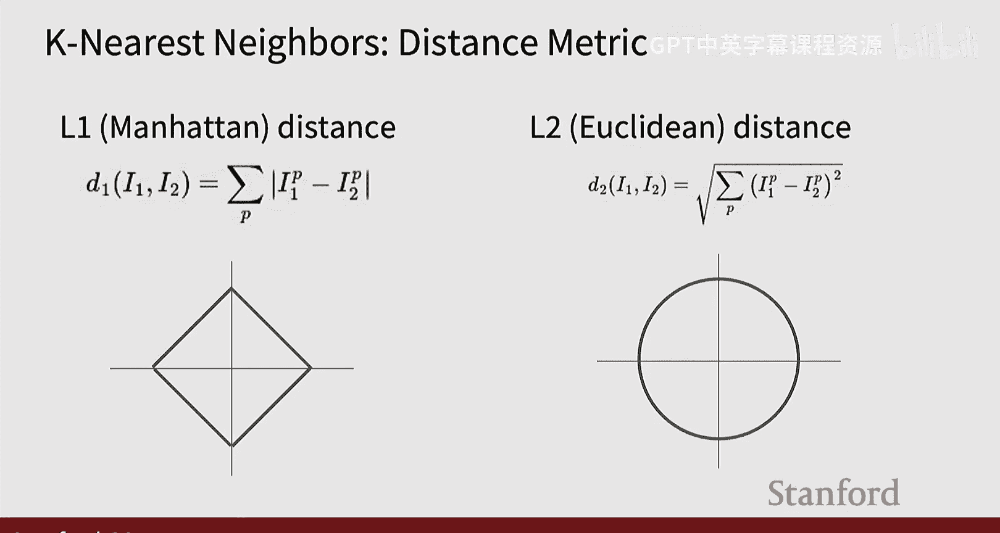

From the origin。Are exactly the same。if I use the L1 distance。But for L 2D。

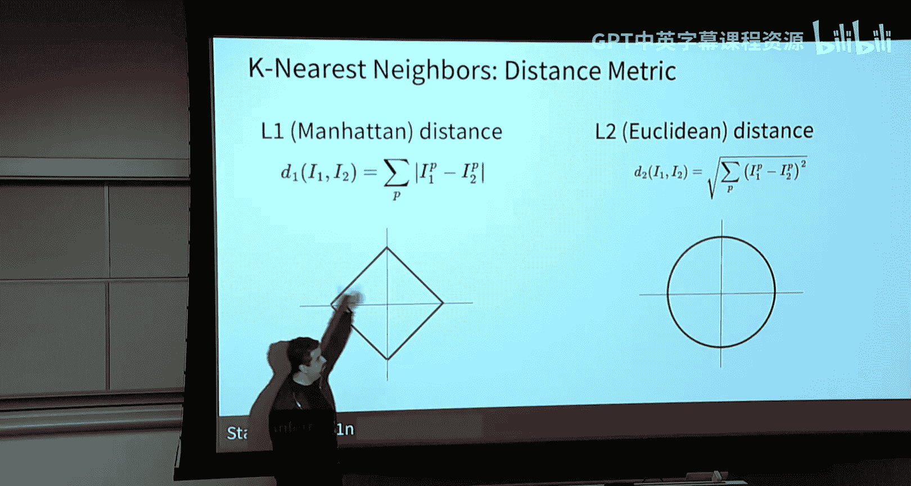

The points on this circle。Have the same distance from the center or the origin of this。

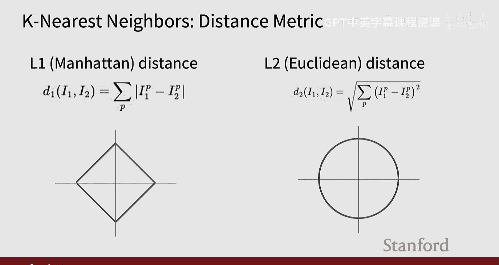

This is space。 So that's basically the domain。

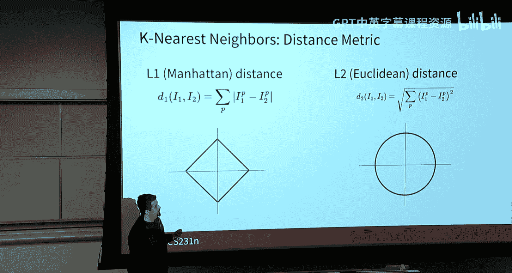

What what these two images are showing， any point and this shape。

When using an L1 distance have the same sense from the origin。 and for the suitl。

 any point on the suit。If we are using L two distance， we have the same distance from the origin。

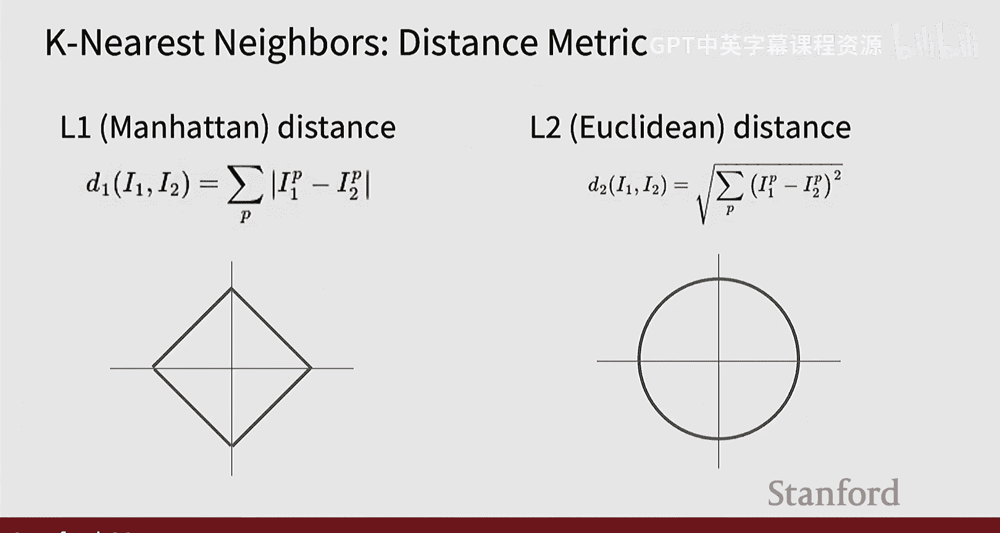

Yeah， why it's important it's better to use L1 if we want to preserve the features。So。

To answer that question， if I rotate the feature axis。

The the distances and this distance function changes completely， right。

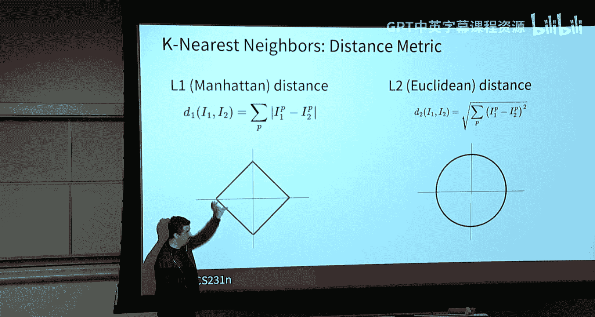

While if I do the same here。Nothing changes。'， it's the exact same value of the。

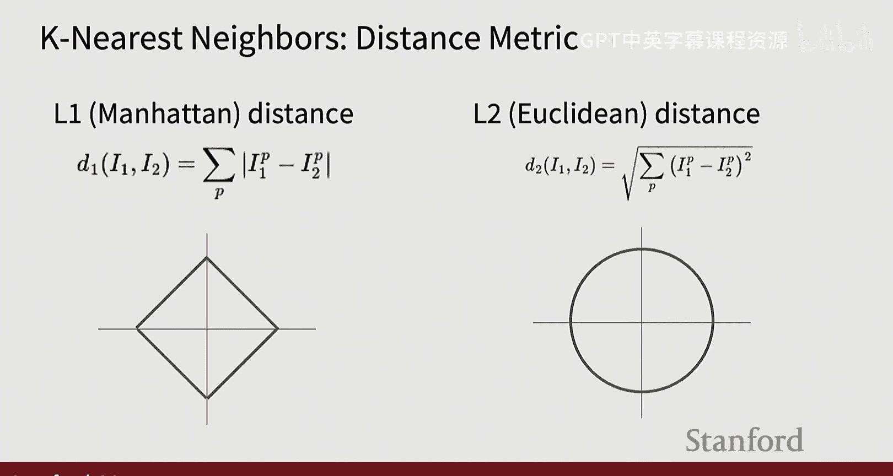

Features， right， at distance。 sorry。 So in this case， L1 is very sensitive on the feature values。

 While L2 is not。

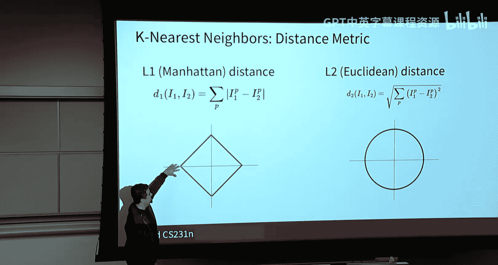

If you'd select another feature in the same space that is having a different creates a different shape。

 then your L function， the distance function changes as well。

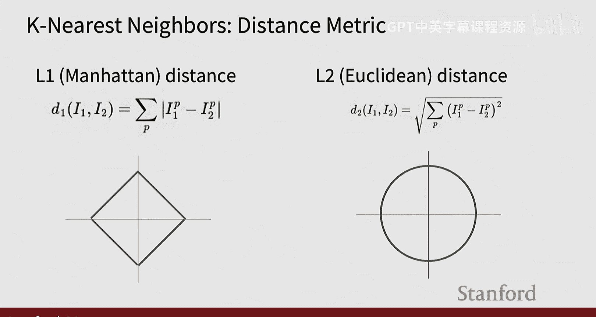

So if I draw the lines here， again， the question for online students is why it changes if we rotate。

 if I select another feature that goes from this site right， then the lines will look different。

Right， so if you rotate the。This thing。But for that shape， it's agnostic， right？

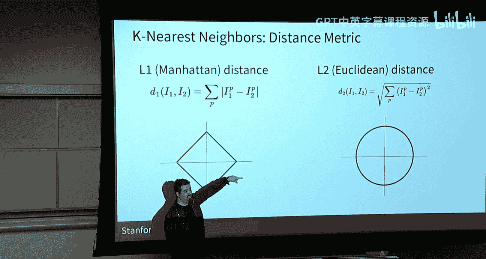

So with these two distance functions that we talked about， if I revisize the。U。Space。

You can see with K equals to one with one nearest neighbor with L 1 and L 2。

 These are the space partitionings。 One of the interesting things that you can see here is that with L 1。

Function， most of the part most of the boundaries are。Paraallllel to the two axiss， the two features。

 x1 and x2， very much sensitive to the features， while there we have a little bit of more smooth。

Boundary separation。So there is a tool online on the lab website that you can。

Play around with this with different distance functions and different number of k you can see you can create a different setup so you can play around with it。

But why did we talk about nearest neighbor to begin with？First， yes，' it's easiestzi。

Problem to solve。Easiesies solution， easiest data driven approach。 and great to start with。

 But one of the main reasons that the。We want to iterate and discuss US neighbor is。

The fact that we can。Look into the topic of hyperparmeter， Hyparmeters are often。Some of the。

Variables that you have to make a decision on to be able to run your algorithm。 In this case。

 the value K。The number of nearest neighbors is defined is is a hyperparmeter， depending on。

How many number of nearest neighbors you take， your outputs will be different。

 and then another choice that we have here is the distance function。So。第一。

Choice of high are often very much data set dependent and sometimes problem。Depenence。

And we have to have a way to identify those， to kind of optimize for them。For each single problem。

And that's what is often referred to as hyperparmeter tuning in machine learning algorithms in deep learning algorithms and so on。

And how to do that， how to set。The hyperparameters there are different approaches。

 one of them is to choose the hyperparmeters that work the best for the training data。

So you have a set of images or data in your training data。You look for。

The best set of hyperparmeters that generates the best training。Or minimum training loss。

While it works for the training data， it's not a good idea at all because。

Especially with nearest neighbor， k equal to 1 is always the best value， right。

 because you're memorizing training data， so K equal to 1 will give you always the 100% accuracy。So。

We know that this is， this is not a great idea。 The second one is。

Choosing hyperparmeter that works best for a held out testing set。

While this is a little bit better than the first one。There is also a big problem here。

 can anybody say why this is a problem？Exactly， so it it it's kind of cheating because you are trying to find the best hyperparameter that works on the testing data and you don't know how the model will work on any other data points。

 not not in the testing set。 So yes， that is that is exactly right。

It's not a good idea because we don't know how the model will generalize。And for sure。

 never do it do this as as we talked about， it's kind of cheating and。A better idea is to always。

Separate， take some part of the training data as validation set。

And train your model under the training data under the train portion of the new portion that we call train。

And then try to find or optimize your Har pipe parametermeter on the validation set。And after you've。

Found the best set of hyperparameters， then use those hyperparameters to replicate the results for the testing set and do the predictions for the testing set。

 So this is a much better。Approach， although it does have some challenges。Itself， because。

Sometimes the validation set that you've selected， it may not be a good representative of the entire landscape because your validation set is almost always much smaller and that's why one of the a better approach is to use。

Cross validation for setting hyperparmeters。Basically。

 you split your training data into a number of folds， a number of partitions here in this case，5。

And each of the folds。Plays as the validation set once。

 and itatively you run this five times for five fold class validation， you do this five times。And。

Average the accuracycuracies。 So you set a value of the hyperparmeter。

 you run this for all these five sets。Define the accuracy。

 calculate the accuracy on the validation set， average it。

 and then you do this multiple times to find the best setting for the hyperparameter after you found the hyperparameter setting。

 you apply it to the testing set。This is a little bit more reliable and generates much better results。

 although in larger scale deep learning， it is less。😊。

Praccticed because repeating these multiple times and five times with huge data sets is very hard。

 so we often use intuitions for。Setting high perform and the single validation that is some sometimes the the approach we go with。

 But this is。Pretty much advised。Again， outside computer vision， outside larger scale data sets。

Often， research papers require doing these types of cross validation and。

And these types of statistical frameworks to make sure your results are reproducible on a testing set。

 Anyways， so there are different approaches let's。Finalize the topic。 wrap up the topic of。

Nearest neighbor and look at some examples， some results。So。

Let me introduce you to the CFR10 data set。 It's one of the datasets that you're going to be using in your assignments quite often。

It has 10 classes with a number of training images and testing images， the 1 classes。

 some of the examples are shown here。With nearest neighbor for each of the testing images， if we。R。

Nearest neighbor and select the top 10 nearest neighbors。 D are all。Visualized there。

As you can imagine and guess， one of the first questions to answer is how many。嗯。

What should be the value for k， how many nearest neighbors should we take？One to study one of the。

Quick experiments with five fold。 each of those points is is one of the folds in fivefold for each of the values of k shows。

Different values here， and as you can probably see here， k equal to7。

 generates the best results in terms of accuracy， which is close to 29 to 28%。Accuracy。

Which is actually not too bad because。This is a 10 class classification problem。

 and with a 10 class classification problem， often the random guess。Gets you a 10% accuracy。

 So this is much better than random guess。 So it's working。 It's doing something， but。

Theres a lot of room to improve。So if we go back and look at the。Examples。

 we can actually see there are so many mistakes， especially with with the one that is closest。

 for example， the fourth row， if you look at that， it's a frog。

 but the first example seems to be a cat， sorry a dog。And。

You can guess why this is happening because the distance is being applied on pixels。

And pixel wise they look like each other， they have the same type of colors in most pixels。

 so they are much closer this example and many other examples show that distances that work on pixels and pixel values are not the best choices we never practice them there are much better approaches that will' discussing。

At the end of more。In the future lectures。And。Just to wrap up the topic， this is another example。

 if you look at this original image， those three images while they look very much different in terms of color or maybe occlusion or the one in the the third one from from the left side is just same pixel it's the same image with one pixel shifting to the right I think。

 although from human eyes perspective there is no absolutely no difference， but the。

This the distance between that and our original image is the same as the other two examples that you see here。

 I'll stop for a couple of questions and this is the summary of what we've discussed。

 So the question is what how we make a decision right that's in those cases。

 you often go with random randomly select one of the tops。 So if you are to collect more data。

If you're， for example， you're solving your problem now in genetics or you're solving your problem in medical imaging。

When you visualize your。Examples your。Features or whatever， and then in this nearest neighbor space。

 you do see pockets of a space that you don't have any good samples for。Or there is ambiguity。

Then you often try to go and find other samples that lie in that same area in that space。Okay。

 so summarizing what we've talked about with Kenra's neighbor， it was mostly about。诶。

Understanding the easiest algorithm that driven an approach and then talking a little bit about hyperparameter tuning and how distance metrics and the value of k play a very important role。

Moving on to the next topic， which is linear classifiers to any five minutes time to cover this。

I want to。ISpend the remaining time of this lecture to to talk about this very important topic。

 This is the。Most important building block for almost。哦。All of。De learning。And。And we need to see。

How this， this approach is different。 So first， we want to see how it's different from nearest neighbor。

 So this is a parametric app approach， meaning that now we are learning， we are。

 we are finding some parameters， W or some weights that map the input image into the output。Classes。

 the output numbers。 In this case， when we create this function F that that maps input to the output。

 often those outputs are kind of membership scores。Of the image to each of those 10。

Output classes labels。 So with this setup that we we build a linear classifier。

First maps uses W uses these parameters to map each of the inputs X into a value。

 which is the output y and how this is done is very simple。

 this image is basically an area of say 32 by 32 by 3。So。3072 numbers。 And this defines。Our X。

 which is。3072 by one vector， and we know that we have 1 output classes。

So we need 10 different scores and the scores are the output will be kind of a vector of 10 by1。

 and this means that we have to identify to find a8 matrix w that is a 10 by 3072 that maps x into the output scores。

Just to complete this linear function， we often use the sp。Term as well， it's an input independent。

Value which actually has a lot of different use cases I can talk about it when I do some geo visualizations。

 but it it sometimes creates a shift for different class classes scores and。Helps with much better。

A separation of each class。So as I said， these linear functions are actually building blocks for building neural networks。

Each of these is linear classifiers linear functions。Then put together one after the other。

 create these large neural networks。Although there are a lot other a lot of other things that that need to be added here。

 but this is one of the most important components if we look at some of the。Popular。Neural networks。

 you can see that linear functions are。Everywhere in the。In the architectures。

So to better understand what this mapping and this function is doing。

 let's go back to our example of C4 10 and our training and testing samples and so on。

 and even make it a little bit simpler instead of looking at large images of 32 by 32。

 let's look at images of 2 by 2， an input image that has four pixels。This means that。

The input image is turned into a vector。As you can see here， we have to find a W and the values of B。

So。The input image is mapped into some scores as the output。This is， this is how the。

Linear function from an algebraic viewpoint looks like the output scores here。

 we are considering three classes of cat dog and chip and。As you can see this。Fangshan。Mps the image。

 the vector representing the image into those scores。So。Algeic viewpoint of linear classification。

 Now let's look at some visual perspectives of this linear classifier。As you can see。

 we often create these like each of these images as。We talked about for this image， for each of the。

Classes， we define some sort of we have a， we have a row of this row in the matrix W， right， So this。

 this row is kind of a template for that specific class。 If I separated like this， so。

This image is multiplied by W and B， And W is。This is the template from each of the three classes of cat Talk and ship。

After training or building the model on the C4 data set， if I look at the visual。

Persspecive a visual point viewpoint of the linear classifier。

 if I look at those templates that are learned for each of the 10 classes。

 you can see these templates， so it's very interesting that in some of these cases， for example。

 for the example for car， you do see a front of a car template ish and although this is all done with just one linear classifier。

So the visual aspect， visual viewpoint of the linear classifier。

 and there is another aspect of geometric viewpoint。

What this linear classifier often does is finding those lines if it's in2D space。

 finding those lines that separates each class from the others。And as you can see here， red。

 blue and and green are defining different。Classes and in higher dimensional space。

 instead of those lines， it'， it's， it's these hyperplans。 as you can see this example on the。

On the left。So。You can also see the use of the bias term here， because if if we didn't have the bias。

 all of these lines should have passed through the origin from the center of that space。

 which doesn't really make sense， but with with the bias， we can actually create more reliable。

Functions and decision boundaries。So。A linear function is very useful。

 a linear classifier is very useful for pen。Applications， as we talked about。

 and it's a building block of。more complex neural networks。

 but it does have its own challenges because it doesn't it can't classify many instances of separate data。

 for example， in in this case if class one is the first and third quad giant and the second class is second and the fourth。

 there is no way to linearly separate these another example is，If， if we have this。

T of separation between class1 and class two that shows the distance from the origin being between one and two as class1 and then everything else is class two。

 similarly if there are three modes， three areas in the space that are one class and then the second class is everything else so in in all of these cases it's actually very hard to to do the separation。

So。What we。Should do so we talked about the classifiers and how they can actually map the input images into any form of labels in the output but。

Now what remains is how to choose the value W that for each of these images maps the image into a score for each single class as the output。

And in order to do that， we need to define a loss function。

 sometimes referred to as objective function。That。Quantifies how bad the classifier。

 how bad the model is working， so the level of unhappiness with respect to the score on the training data。

After defining those， we need to find a way to efficiently change the values of W。

To be able to minimize that unhappiness， basically minimize the loss function。

 And this is the optimization。Process， the topic of next class， next next lecture and。

In order to do that again for simplicity，'s let's look at a easier and easier example having these three classes。

 a linear function， as you can see here and。Threeree classes of cats car and。Frog。

We need a loss function that tells how good our current classifier is and in order to do that。

 we need to parameterize the problem， XI and YI defining the input image label images and the corresponding labels and then we need a loss function and distance function that。

Maps looks at the differences and how bad the scores are compared to the ones that are predicted。

' the predicted scores， Fx and W and the grand truth values， the values that are already given Y I's。

 we often normalize them based on the number of samples as well， but it's not unimant。

 so this defines the loss function， the objective function。So。

How we can do the optimization and how can we。Really find the Ws。

There are different ways of defining this L。LI， and I want to talk about Som classifier right now。As。

An example。For that cat， if you remember the scores that were given were 3。2，5。1 and a minus 1。7。

 these are the。The scores that are the output of the function we discussed FxiI and W。And。

In order to turn these scores， because these scores are unbounded and the values are often not very much controllable。

Because this is just a linear function， right， in order to turn these into some。Scoring functions。

The best the possible best possible way is to turn these into probabilities。

 which defines the probability。Of。The class being。This class K for each inputs image X I， right。

 And in order to do that， we first。This is the function that we use the soft max function。

 we first exponentiate the values of the scores。To create these numbers。

 when we use EXP on these numbers， the numbers will always be。

 the outputs will always be positive right， and we need to make sure that the probabilities are always positive。

And after creating these numbers， what we can do is just normalize them。

So exponentiateiate and then normalize based on some of all of the samples， right？

 So then we normalize them。Based on some of all samples and this creates。Very。

 very good set of values that define a probability function。 So this is a distribution function。

 They sum to one， and。If I want to interpret these。

 it's very simple to say it's this set of W's parameters。Thinks that this image is。

A cat with a probability of 13% or 013 right and obviously this is this is making making a mistake in this example because the W is not a good setting we should。

Optimize it and change it， so these probabilities are the counterparts of these unormalized log probabilities。

 which are often referred to as logits。So。If you've taken other machine learning courses or if you。

 I'm sure in other fields， you've used logistic regression， this is a similar type of framework。

 this is the exact same framework as logistic regression。And since we have multiple classes here。

 it's a multinomial logistic。Regulation。How do we define the function L。

 I told you that there are different ways of defining the function L。

We want to define a loss function that what's objective here。 We want to maximize。The probability of。

The sample belonging to the correct class， right？ So we want to maximize the value of pointer theme。

Now we have other merger values in that。Set， so。If you want to maximize this。

 this is a maximization problem， right？In order to turn it because all of the objectives that we define we try to build a minimization objective function。

 the first step is just to。To negate the values， right？We negate it。

 So the maximization problem turns into a minimization problem。

 And then we also take the log of the value just to。Make the numbers a little bit more manageable。

 so negative log of that value will define the objective function， the loss function。

For solving this problem， very simple。's that's the objective or the loss function for。Soft nice。

 and。For this logistic regression function。If you've taken， as I said， other classes like CS2229。

It's often referred to as maximum likelihood estimation as well it's the same algorithm。So。

With that in mind， I want to say that。As we discussed。

 it's the negative of the log of that probability of the correct class。

Which defines the objective function， the loss function。AndThat's basically that simple。

 but there are other types of interpreting this framework as well。One way of。

Reefining this loss function is saying that we have some estimated probabilities and we also have a probability function that defines the correct probabilities what we want to do is to match these two probability functions right and in order to do that we want to minimize the KL divergence called backlay divergence。

 this is a information and theoretic perspective of looking at this loss function and again。

Those are exactly the same。KL divergence in this setting。

Simplifies into the same negative log function that we defined。 and even going further。This is。嗯。

Exactly， they cross entropy function， because。If we define this， use this。Entropy of。P。Which is。

Entroppy of the correct values， correct probabilities。Plus that same kL divergence。 again。

 this simplifies into the same negative log function。

 and that's because when we use one hot encoding setting for the classes。The entropy 0。

 So that's one of the reasons that we call this function。

 cross entropy binary cross entropy function in in all of deep learning， you've probably。

If you've used any of the neural network frameworks， you've heard about BCE， pier across entropy。

 or you will be hearing about it a lot， so this is the same。Framework， we start very simple。

 but we got to。to the。Similarities and differences between each of those so the objective sorry the loss function was defined as negative log of this probability and the probability was was defined by softmax which we talked about and and then optimizing for this which is the topic of next session will give us the right ws but before I end I want to ask a couple of questions with this definition that you see here what is the mean and maximum。

Value that you can see for the loss function L。

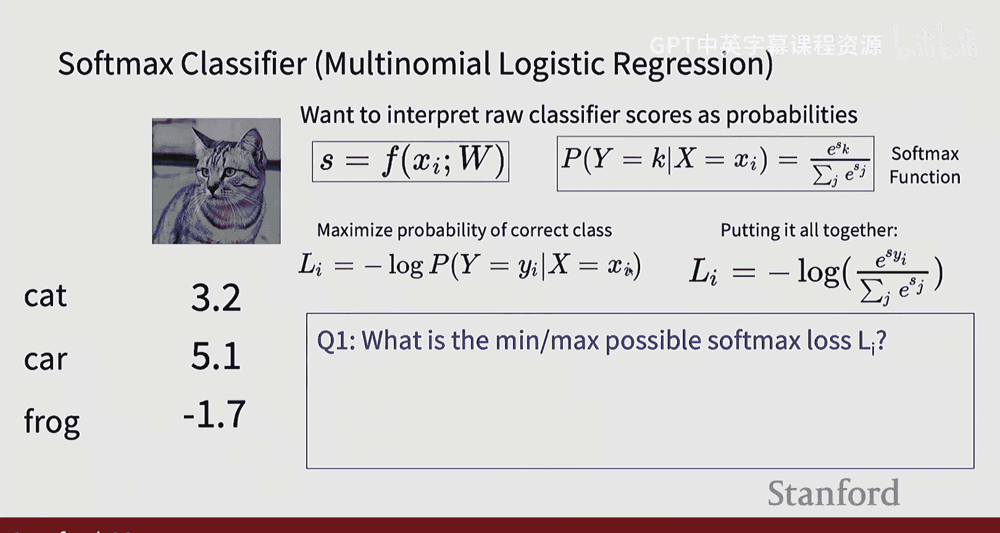

Yes， it's 0， which we， which turns into minus minus infinity。

 but we have a a negative negation there。 So it would be infinity。 That is correct。

 But then we also have to。Yes， that， that's， that's definitely。

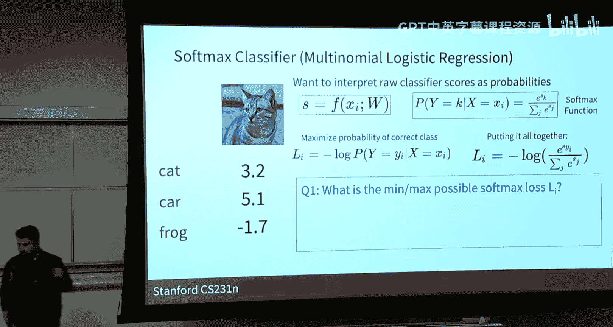

That's right， and。Let me actually look at a second question， yes， this one。

So when we initialize all of the SI， so basically the Ws in the beginning， it's almost random。

 so the probabilities of each of the classes。Becomes， mostly。嗯。Equal。

 what is the softmax LI assuming we have C classes？And especially if it's。

So because the probabilities are equal， it means that all of the probabilities are around one over。

 right？And then that will be defined as log of C。 And we have 10， if we have 10 classes。

 then the log or L N of 10 is 2。3， which is the。Ex me know what we know about it。

