# 斯坦福大学《计算机视觉的深度学习｜CS231n： Deep Learning for Computer Vision 2025》中英字幕 p03 -03-Lecture 3_ Regularization and Optimization.zh_en -BV1FqazzVE6w_p3-

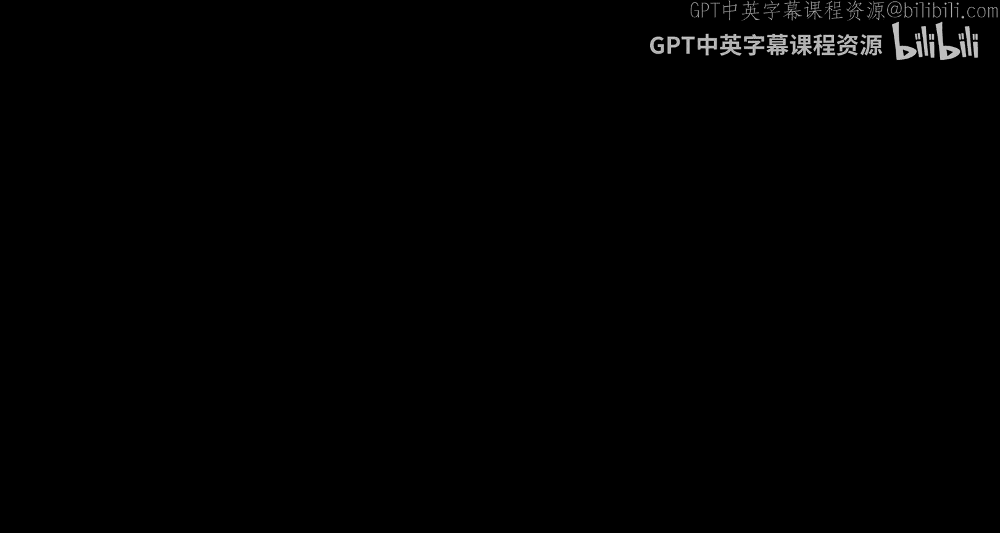

Today's lecture topic will be about regularization and optimization。

 which are two very important concepts more broadly in deep learning and machine learning。

 but especially important for computer vision and we're going to start with a recap from last week and discuss some of the topics that we discussed last time。

So we really honed in on this idea of image classification as a core task and computer vision。

 And what this task is is given an image as input， you try to map this image to a label inside of a set of labels。

 So here we have five different labels， cat dog， bird， deer and truck。

 And the goal is to assign the correct label to the input image and you're creating some model or some function that takes an image as input and outputs the specific label here。

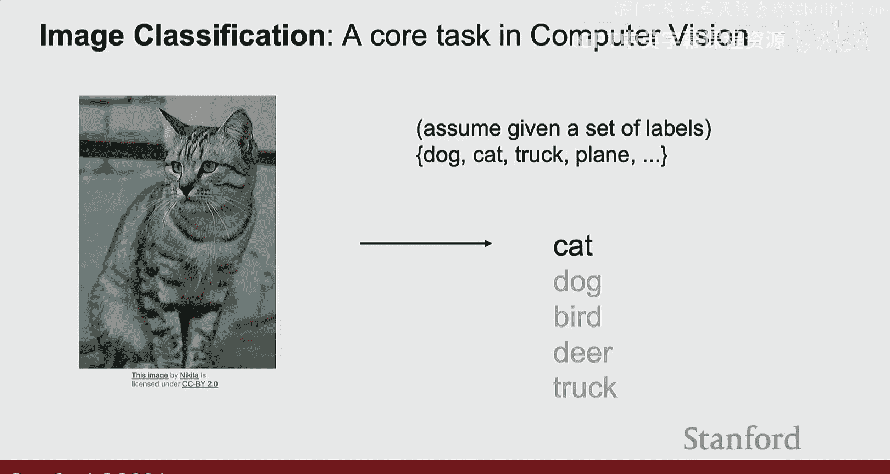

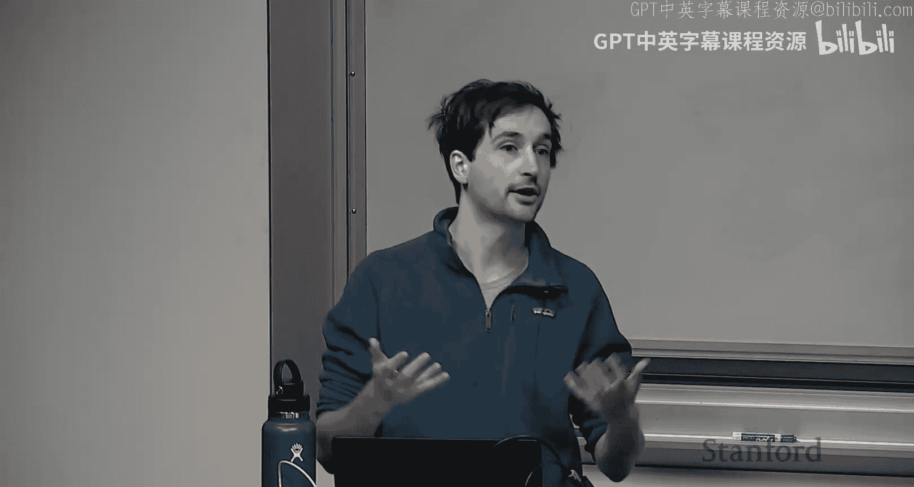

And we also talked about you know a lot of the challenges for classification。

 So one of the main challenges is shown in the top left here。

 but it's this idea of the semantic gap between what we as humans perceive in the image which is the cat and what it's actually represented as in the computer which is this grid of pixel values where you know you have this multidimensional array or tensor and you have discrete values for each of the pixels。

 this is very different from how we're perceiving the image and deciding that this is a cat。

 So being able to map from this complex numeric representation into one that we humans understand is the core challenge here but also there's challenges surrounding the images themselves。

 So if you look at something like the illumination of the scene So here you'll have different pixel intensities based on where the lighting is in the scene also you you could have certain parts of your object are in the shade and harder to see。

Cats， by nature， are very deformable。 So you talk about deformable objects。

 They can move around and twist and bend in different ways。 So they won't always have the same shape。

 And this can prove challenging if you're trying to design an algorithm to detect objects。

 There's also the challenge of occlusion。 So you could have a cat that's like hiding underneath the couch cushions here。

 But we as a human can clearly tell this that cat because of the tail how it's sort of sticking up at the end here。

 And then you know the way that cats behave。 We can infer that this is a cat。

 you'll also have things like background clutter where the object could blend into the background。

 So we need to account for this somehow as well。 And finally。

 there's this idea of intraclass variation where different objects in the same category can look very different from each other。

 But we still need to group them all into the same category。

 So here are a lot of just the challenges of recognition and why it isn't such a simple problem where you can just sort of write if else rules to account for everything and just simple logic to classify。

😊，So if logics sort of thrown out the window you can't just create these logic rules。

 how do you actually create a classifier Here's where we talked about datadriven approaches and we talked about basically the simplest machine learning model which is this K nearest neighbors model and the idea is that you look at for a given data point what are the existing data points in your training set that are very close in distance to your new data point coming in and for the one nearest neighbor case this just results in you find the closest data point you assign at that class label and you can also look at multiple nearest neighbors where you're assigning the most common class label among those nearest neighbors so we talked about these two different approaches。

 we talked about how you ideally don't want to split your data set to train and test but you can do train validation and test so that you can use this validation set here to actually help you choose your hyperparameters。

The main hyperparameter for K nearest neighbors is this K1 or five in these examples and what we showed is an example where you're plotting what is your accuracy on this validation set here over the different K values here and you would choose the one that has the highest accuracy so this is how you'd use the validation set and then you would reserve this test set for okay how does your model do on completely new data it's never seen before that would be the purpose of the test set？

This I'll just recap there was a bit of confusion about distance metrics we put a post on Ed that explains this in more detail。

 but we' talked about two different distance metrics。

 the most two commonly used ones in machine learning which are the sort of Manhattan distance or L1 distance and L2 distance or Euclidean distance L2 distance is like if you imagine just the straight line distance sort of how we think of distance in everyday usage of the word geometrically and then Manhattan distance is this idea where you can only sort of traverse left and right and up and down in this diagram you can't move diagonally so specifically looking at just one quick example here。

 the reason why all these points on the line are the same distance from the origin here is because you can't move diagonally so you have to move in this case up 0。

5 into the right 0。5 so the total distance is one whereas here you're just going straight line but it's one also the same distance here whereas in the L2 distance。

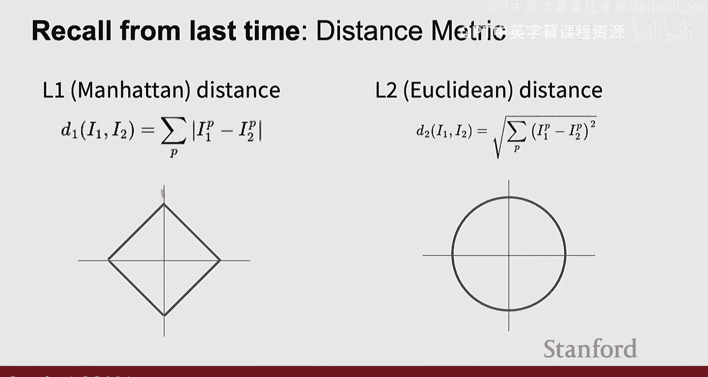

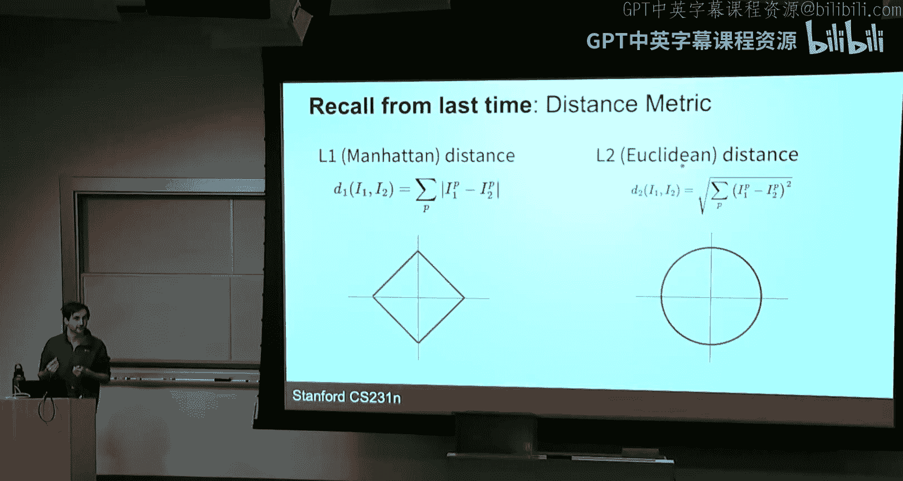

All the points equidistant from the origin here form a circle because you can you can just go in the direct line here。

 So this is maybe a brief explanation。The final thing we sort of honed in on last time was this idea of a linear classifier。

 So the basic idea in the basic setting that we did is we have an image which is， you know。

 say width 32 and height 32。 And there are three pixel values for each of the spatial locations in our image representing the red。

 green and blue intensities。Forming the color。 and the idea is we take this array of numbers for our image and we flatten it out into an array of just 3000 different numbers。

 3072。 And then we are multiplying this vector by our weight matrix W。

And the basic idea is if we have a weight matrix W that has height here of 10 and then the width is 3072。

 were multiplying each of these rows by our input sample X and this will give us 10 resulting class scores so oftentimes we'll add a bias term as well。

 which would just be one bias term for each class so this would be a size 10 vector here and we also talked about three different ways you can view or think about these linear models。

 one is the algebra break viewpoint which I describe here where each row is represented sort of independently represented the class and you multiply it by the input vector x。

 you get your score and you add the bias to get your final score and you do each row sort of independently in this sense。

 you can also view these learned class weights here as templates where。

If we then sort of rearravel the vector into the original shape of the image。

 we could plot the intensities here and understand what is sort of the template per class。

 which is what this visualization represents。And then the final way you can think about it is in a sort of geometric viewpoint where each of these rows in our weight matrix are represented by these lines here in our input space and specifically the line is where we set this equation to zero which is the decision boundary。

 so this forms the point where you know above the line you can have a positive score in below the line you would have a negative score for for the for the class so this are sort of the different viewpoints so for how you can view these linear models。

 they're all doing the same thing and one nice thing about the geometric viewpoint is that if you visualize your data like say you want to classify blue versus red here。

 it's very easy to tell that you can't draw a line that perfectly separates the data here so it's kind of a nice way you can gain intuition about what is possible for a linear model to do。

Okay， I think that's sort of the high level recap of what we discussed last time。

 I'll actually be going into a little bit more detail on sort of the new content for this lecture now。

 but I just wanted to pause briefly if anyone had any questions about what we discussed last time or at the beginning of this lecture。

 feel free to ask。Yeah， so the question for those online is for this visual viewpoint。

 is this the same as sort of running canuous neighbors。

 and this would be maybe one of the neighbors that you're comparing against。

 are they mathematically equivalent。 No， they're not the same because these templates are formed from this line。

 So it's not like one specific data point。 but you can still calculate the templates based on this sort of they would represent more like if we see in this diagram here。

 there's the line pointing in the direction of the class。

 So it would be sort of representing this point here。Yes， so the question is。

 how did we get this like 3072 number？ So the idea here is that if the height of our image is 32 pixels and the width is 32 pixels。

 and then each location in the image is represented by three values， the red。

 green and blue pixel intensities， we would then get 32 times 32 times three total values to represent the entire image。

 and that's how we get this 3072 number。So here's a。

 I guess very specific example of a linear model here and when we multiply our input x by our weight matrix W。

 we get the resulting scores for these different classes and you can see that for CA it's not doing so well because car has a higher score and we want the highest score for the correct class also here on the second example does pretty well because it's doing it correctly。

 but then in the frog example it sort of gets completely wrong where it's by far the lowest score of the three So intuitively we can tell that these scores are not very good。

 but how do we sort of mathematically formalize this intuition and how do we determine how good a given model is this is the idea of a loss function which tells you how good or specifically tells you how bad a classifier is So given a data set of examples were indexing by with this letter I and we have X I is each of the training examples why I。

each of the training labels， we can compute the loss over our entire data set where we calculate this loss for each training example by sending it through our model here。

 which is this F of XI W we get our label and then we compute it compared to the ground truth label Yi and we just take the average over our whole data set so this is how we do this we talked about in last lecture。

 the softmax loss or the cross- entropy loss， which is the most commonly used loss for classification。

 and so I won't discuss that again in so much detail here。

 but basically it's very high it's very high loss when you predict low probability of the correct class its very low loss when you're predicting the correct class at very high probability。

So these this what I just explained is all contained within what we call the data loss。

 so this is a loss that tells you how well did the model predictions match our training data and obviously we want this to be very low and if it's very low it means our models fitting our training data well but there's a second component which I'll discuss today which is this regularization term of the loss function so what this does is it's intended to it's intended to prevent the model from doing too well on the training data so actually does worse on the training data。

 but the goal is to make it do better on new test data or unseen data。

 so worse on training but better on a test set that's the point of regularization and we'll go over a lot of the intuition for how to think about it in the next slides here but the high level goal is to do worse on the training data but then better on the test data or just unseen data that's the point of regularization。

Yeah， so we're computing the loss on each of the eye traininging examples。 Yes。

 so the loss of the I example uses the X I and the Y I。I mean， you could not have an eye here。

 but this is just saying that I've lost her。Yeah， you normally don't have a different loss for each eye if that's what you're asking。

So it's just just， you could just we describe L as the loss for the I training example that we're just using。

Yeah to be。So for regularization， people usually have this intuition when thinking about it where this is sort of like a toy example。

 and the idea is we want to fit some function to these points where our input is X and our output is y。

And you say have two different types of models F1 and F2 and you're trying to decide which of these is better so F1 goes through all of our data points。

 so the training or the data loss will be very low because it's basically doing it perfectly whereas F2 doesn't go through every point perfectly but intuitively it feels like probably F2 is a better model when we're now testing on new data we've never seen before So regularization sort of captures this intuition of you don't want to overfit your data so hard and you might actually be better off with a model that fits the data less but is either simpler or has some other properties that make it a better choice。

And so if we ask， okay， is this， how are these models going to do on new data that's within our same distribution。

 you'll find that you know F2 does a much better job at modeling。

 So here's that's doing better on the unseen data。So I think there's also an intuition in this previous example that's demonstrated very well where we're preferring simpler models where it's sort of like Oham's Razor。

 which is this idea in philosophy and also scientific discovery where if you have multiple competing hypotheses。

 you should go with the simplest one first。 And then if you know for sure that's wrong。

 then you can start trying out more complicated ones as you go。

 But there is maybe also some intuition， you can have for why regularization can be useful。

Okay and then one final thing about this equation that I didn't touch on yet is this Lada parameterameter here。

 so this is the regularization strength， which is another hyperparameter。

 so we might use training and validation sets to set what is the optimal lambda here as well。

 but the basic idea is we can set this to a floating point between。

 I guess zero and infinity where zero would be basically there is no regularization infinity up to infinity。

 you have a really strong progressively stronger regularization。

 so it's very much attunable knob you have for determining how much you want to prevent the model from fitting to your training data。

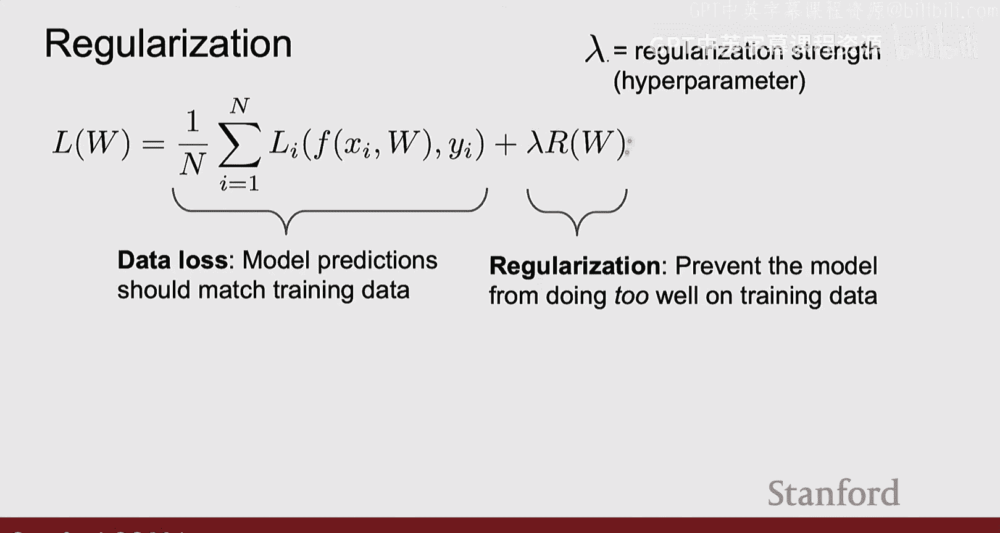

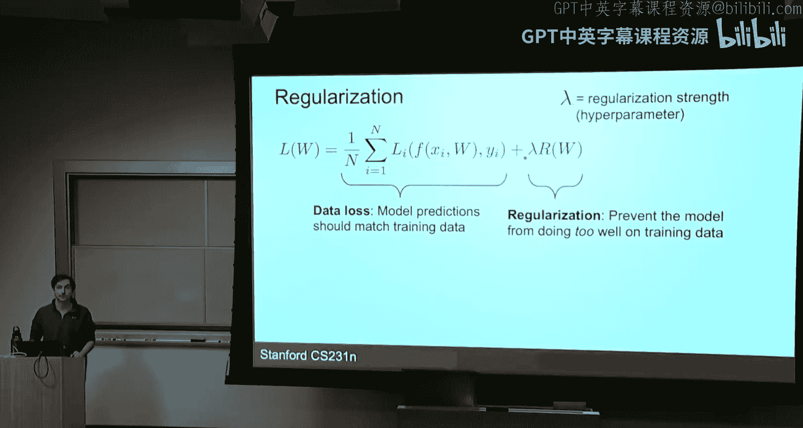

And I'll go through some simple examples now of regularization， so here we have L2 regularization。

 which basically what you do is you have your weight matrix。

 you square each of the terms in your weight matrix， and then you sum them all together。

That gives you your score here that you then multiply by lambda and you add to your total loss。

 That's L2 regularization。 L1 regularization is very similar。 but instead of squaring。

 you're taking the absolute value。 So in practice， there are some differences between how these two regularizations perform when your training models。

 So one of the things that happens with L2 regularization because you're squaring each of the values。

 when you have a really small value， it gets squared， like say 0。001。

 you square it becomes even smaller。 So L2 regularization allows for sort of these really small values close to 0 because you then square them。

 So they become even smaller。 And so your penalty here is very low。

 if you have these very small values with L2。 whereas L1 you're not squaring it。

 So it's sort of just whatever the baseline values as it's not like it's getting smaller before you're computing this regularization terms。

 So in practice what this leads to is L1 regularization， you get a lot more values that are 0。

 actually in your weight matrix。Or very close to zero， whereas L2。

 you can have generally it's more spread out where you have values that are small but non zero because the penalty becomes so small。

Seems pretty clear to you why L2 prefers sort of spread out weights that are all small。

 but why does L1 prefer sparse vectors。 So I think the way to think of it is that if a value can be0 and your performance is roughly the same。

 then this would push you towards zeroing that value。 whereas for L2。

 what you might have is the value just becomes very small but non-zero because of the squaring。

So the question is， can you we talk about what is pushing towards a zero value mean。

 So we're gonna to talk about more how we use this loss term。

 But the basic idea is we're trying to minimize it。

 So we're trying to minimize the loss or minimize the error of our model。

And if we have a term here which is giving us positive values that it's sort of not affecting the model performance and the data loss。

 we will sort of remove those through the optimization procedure。 It's sort of a tradeoff。

 you're trying to optimize the joint sum of the regularization term in the data loss term。

 So if your data loss isn't changing much， but you're able to go lower on the regularization term。

 you'll get a more optimized model so it will be preferred based on trying to minimize the overall term。

So I think we'll also touch later in the course about much more complex forms of regularization where they're all doing this basic idea of worst on the training data to do better on the test data。

 but some of them you will even like change the layers of your model so they actually get pretty complicated this is like an ongoing research area of how to regularize models there's new papers each year so lots of stuff here we' only cover a small subset in this course。

So to summarize why do we regularize models， the first is it allows us to express some sort of preference over weights。

 So if for some reason in our problem， we think the solution should be spread out or should contain a lot of sparsity where a lot of the values in the weight matrix are zero we might prefer one set of regularization L2 versus L1 over another it also can depending on how we're regularizing。

 make the model simpler so that it works better on test data so it could simplify the model if we' say heavily regularizing really high polynomial terms in our model for example what I showed earlier。

 or something we won't touch on in too much detail is especially L2 regularization can actually improve the optimization process because if you imagine like squared is like a parabola So if you're plotting y equals x squared it's a parabola and these are like a convex。

 So you get a lot of nice optimization properties where there's a global minimum we won't touch on that in this course that's like beyond the scope but know that。

certain types of optimization， the regulation actually helps train the model faster， too。Okay。

 I guess I have a question for you all。 And what we'll do is you'll do one if it's W1 and2 with your hand。

 if it's W2。 So which of these two weights， W1， W2 would the L2 regularizer prefer。

 So we have our input X's when you multiply it you do the dot product with the weights。

 you get the same score。 So you get a score of one either way。

 And here's where the data loss would be the same and we're trying to determine which of the weights would our regularizer prefer。

 So go one， if you think it's W1 and go2 if you think it's W2。Allright， lots of twos。 Yeah， it's W2。

 because as you said， it's more spread out。 you're gonna be squaring each of these terms。

 So it's one fourthth。 You square it becomes one16th。 you sum it all。

 It's one4th is the total regularization term here。 And then here it's， you know， you square it。

 So it's one。 So it's four times lower in terms of the regularization loss。😊，And as we said。

 the intuition is you like more spread out weights。And then here's another question。

 which one would L1 prefer now？So you do one， if it's weight one and two， if it's weight two。Okay。

 we got a lot of ones。 So this one's actually a bit of a trick question。

 So what L1 regular is you sum each of the terms， so they'll both be sum to one in practice。

 you probably would see this one because as we said the sparsity。 But in terms of a loss standpoint。

 these two weights would actually be equivalent in terms of L1 because one is just the sum of these is 0。

25 four times and then the other ones just one。 So they're both sum to one。

 and so the actual regularization term is the same for these。😊，Yeah， okay。

 So what's an example where L1 would be preferred if this is like 0。9， for example。Okay。

 so just to recap， we have a data set of X Y pairs。

And we have some way to calculate scores for each of the classes。

Which in our case is just a linear model， you're doing a matrix multiply。

The loss for each of the eye training examples and the softm loss。

 which we discussed last time is you expentiate each of your scores。

And then you divide by the total sum of the scores， so you exponitiate to make them all positive。

And then you sum to get a probability distribution， so they all。

 the final values in this all sum to one， and you have a score for each class and you take the minus log of the correct label。

 so this is of the probability of the correct label， which is given here。

And the full loss is you just run this over each of your training examples。

 calculate L for each of those， and then you add your regularization term here。

 depending on what is the weights of your model。Why do we use Softmax in general。

 So Softmax is great， Because what it does as a function is it converts any set of floating point numbers into a probability distribution where they will sum to one。

 And depending on the value of the score， that will translate to the relative probability of that value。

 So if you have a really high positive number and everything else is very low negative。

 you'll have nearly one for Somax and zeros almost for the other values。

 So it's nice because it converts any list of floating point numbers into a list of probabilities based on the the values of of the list。

 That's the main utility of Somax。😊，So the question is that you can view the regularization we talked about。

 which is L1 L2 as a way of regularizing based on the magnitude of the weights。

 which is true and how does that translate to simpler models So I think in L1's explanation is actually pretty simple because if we prefer say terms that have a lot of zeros in it。

 it's basically linear model with fewer coefficient。

 So that one is actually I think relatively straightforward。

 but I think in general regularization is not always going to give you a simpler model。

 It depends on how it's used So for example， in the diagram we showed at the very beginning here here you could imagine that you have L2 regularization or L1 regularization where you're penalizing more the higher degree polynomial terms of your function。

 So in that sense， it's pretty clear how you could design regularization to prefer a simpler model but it doesn't always need to be that way really what it is is this idea of doing worse on the training data to do better on the test data and that's not always going to give you a simpler model。

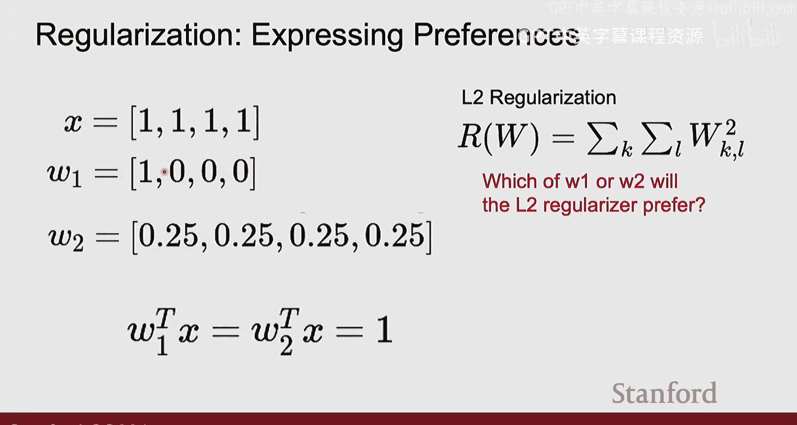

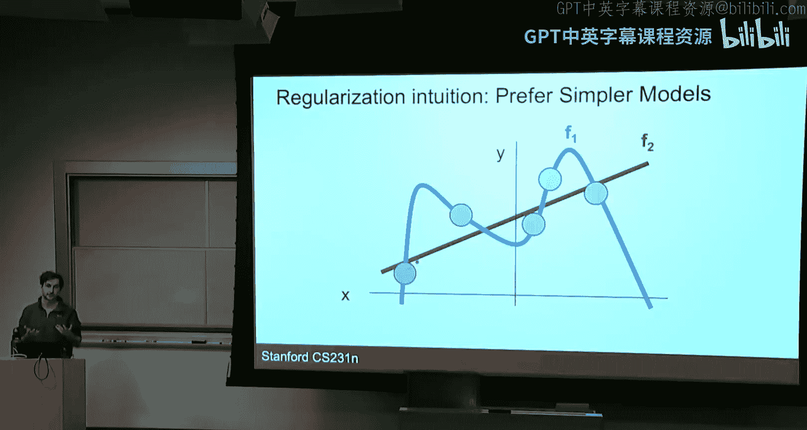

And in fact， there are many types of regularization like dropout that actually make your model more complex。

 but give you better performance on the test data。嗯。Cool。

 so now that we've talked about how we can calculate how good a given W is based on the training data and this regular term。

 the question now is like， how do we actually find the best W？And this is what optimization is。

 which is the second half of today's lecture。So I think when people describe optimization。

 they will usually use this idea of a lost landscape。

 which you can think of as like a normal landscape like on planet Earth。

 where the up and down vertical or Z axis direction is the loss So this is the value you're trying to minimize and then say in this example。

 you have two parameters in your model which is sort of the x and y direction of where you are in this landscape And the idea is you're just like basically a person you're walking around this landscape and you're trying to find what is the smallest or lowest point in the entire landscape。

 I think one of the reasons this analogy and this is a very commonly used analogy。

 a little bit falls apart is because as humans， we can just see like visually we can look into the distance and see what is the lowest point of the valley。

 But I think this analogy is actually pretty accurate if you think of the person as being blindfolded they don't have access to any visual information。

 they can only feel sort of the earth where they are right now and understand what is the slope of the ground on the current point in which they're standing。

 And I think if you view it in thatlands， this analogy actually becomes extremely accurate for。

We're trying to find the best model and we have this complex landscape of different loss values。

 depending on the parameters of our model， which translate to the location of the person in this landscape。

So how can you find the best point， We could go with like a really simple idea。

 which is maybe a really bad， you know， bad idea， but it could work。

 So here it's just basically a for loop where we're trying 10 different values of W randomly。

 And we're just choosing the best one。 So obviously not very mathematically rigorous。 But， you know。

 you will do better then a random baseline。 And if you had nothing else to go for。

 maybe this isn't so bad。You would get like 15。5% accuracy on the CyR 10 data set。

 which is the one I showed earlier with the frog and the car and things like that with the 10 different categories。

But it doesn't perform very good。 I mean， the state of the art on this data set。

 it's basically solved through modern deep learning。 You get 99。7% accuracy。 So clearly。

 it's not bad， but it's also， I wouldn't say particularly good。Strategy number two。

 which is sort of what I maybe explained a bit earlier is this idea of following the slope So for this。

 you can imagine you're like blindfolded on the lost landscape and you're feeling the ground underneath you and you're thinking。

 okay which you know which way is the slope of the earth pointing me and I should walk in that direction at all times。

 This basic idea is the fundamental way in which we train all the models in this course and in which basically all deep learning models are trained where you're feeling the location of the current places than the lost landscape and you're going down the hill So this is a very intuitive way to explain it will now go over more of the math behind it。

 but this is what you should be maybe visualizing in your head。

So how do you actually fall the slope so in one dimension。

 I'm sure you all are familiar with the idea of a derivative。

 which in calculus we can think of as this limit h definition where we add a very small number to our current location。

 we calculate the value of the function at that new location。

 we subtract the current location and then we divide by the step size and as we take the limit for h to approaching0。

 this gives us the derivative of the function at that point now this is for 1 d but in multiple dimensions you use the gradient which is where you're calculating essentially this limit definition for each of the values separately so you'll have a different derivative for each of your values。

In you get a vector instead。 And this gives you the direction along each dimension。

 So you can actually calculate the slope in the dimension by taking the dot product of the gradient with the direction And specifically the direction of the steepest descent or down the hill is the negative gradient。

 So the gradient points up the hill， the negative gradient points down the hill。

 So this is the you know， the direction we should be traveling if we're trying to get to the bottom of this lost landscape。

So you know maybe what are some ways you can calculate the derivative a really simple one is you could just actually try to use the limit H definition with a very small H so you add you know 0。

0001 you actually can compute you know the last two digs of loss change slightly so you can compute the difference divide by the step size and you can get like an approximation of your derivative here and you could actually do this for each of your values in your w。

 you just do this procedure over and over again， but it has a few problems is very slow because you just need to loop through each of the values it's also approximate so you're not even calculating the actual derivative and especially with floating point arithmetic you can get pretty significant errors here。

 so this is not really preferred， but this basic idea or intuition of what we could be doing is to calculate the derivative this way but really we have the loss as a function of W so we know how to calculate the scores to calculate to get our loss。

Which is given by our function for our model。And we can then compute the total loss with the regularization terms as well。

 And this entire loss is a function of basically Ws， the W's， the X's and the y's。

 So you have your W matrix， you have your X's and y's。 And then you have these formula with。

 maybe some logs and exponents。 But fundamentally， this is a function of W。X and Y。

 And we specifically want to calculate the gradient。

 which is given by this Greek letter Nebula of our loss with respect to the weights。

 So we can imagine our X and I X I and y I's are held constant。

 and we're trying to calculate the derivative just with respect to the weights。So to do this。

 we can just use calculus， use the chain rule， use the different methods we've learned for calculating derivatives based on sort of complex equations or not so complex。

 but know you need to have some logs and exponents and chain rules here to solve it。

So this will be an exercise in the homework。 so I won't go through step by step how to do it now。

 but it is relatively straightforward。 I think conceptually。

 it should make sense to you all how you do this。 you assume the x and the y's are constantly you solve for what is the derivative as you change W。

 So now we actually have a way where we can calculate W based on our sorry Dw。

 the gradient of W with respect to our data and the current W and whatever our loss function is。

 which is how to compute the error。So this is， I guess， summary。

 So you could do a numerical gradient， but it's approximately slow。

 And the nice thing is that it's very easy to write。

 You just add a really small H take the difference divide by H。

 The analytic gradient is nice because it's exact。 It's fast。

 but you could like potentially if you're creating a new gradient from scratch like new code to calculate it from scratch。

 you could have an error in it。 So if you are doing this， people normally will have a gradient check。

 which is where they try the H version where they have a really small H value。

 and then they make sure that it's around the same neighborhood。

 And that's a good way to make sure you don't have many bugs in your code。

 So you'll be doing they'll be gradient checks in your homework assignments to make sure your implementations are correct also。

😊，Yeah， so the question is， we often say we want a loss function that's differentiable because then we can calculate the gradients。

 but if we have a better loss function somehow and we can't analytically calculate the gradient。

 but we could use this H kind of numerical method。 Could we do that， I think in general。

 it's hard to construct a better loss function that would be。No like non nondiiable。

 you could possibly， though。 And if there is just a true loss function that is the best for your case。

 but it is nondifferiable， you could go with this approach and it may work。

 I think it would struggle if like， for example， your loss is just truly non differentfferiable across all points。

 And it's basically like a cluster of nonconnected points， then you know。

 moving in the step ofest cheapest descent wouldn't really get you necessarily at your best solution。

 if they're not well connected and forming the sort of geography。 So it could work。

 But I would think that if your loss is nondifferiable across most of the domain。

 then probably you wouldn't be able to use these approaches to find the the bottom point。

Yeah so I guess TLVR of the explanation is that if your functions convex。

 then it works very well with this sort of gradient disscenter steepest disscent type of approach。

 but if you have a non-differiable non convex function。

 probably this approach won't work as well because you're not going to be stepping in the right direction。

It's not necessarily error prone if your code is perfectly good。

 but maybe you have a mistake in your code and it's hard to tell right away。 And but the H。

 the limit H definition is very easy to code up。 right， You just set H to be a very small value。

 You run it through your function and you add a very small amount。

 So that's less error prone for implementation for implementation。Not more errorpon if it's working。

 correct。Okay， so now I'll talk about this fundamental algorithm for optimization called gradient descent and the basic intuition is what we already explained before。

 we calculate the slope at each point when we're on our lost landscape and we take a step in the direction downwards towards the bottom of the lost landscape so what we do is we calculate the gradients of our weights given the loss function。

 the data and our current weight values， this tells us how much we should change each of the weights to go down the slope and then we have to have a step size。

 so how far down the hill are we taking a step in the direction and so you go down the hill so it's the minus sign here in the step size times the gradient So this is basically what gradient descent is you're calculating the gradient at each step and you're moving a fixed direction in the direction of the negative gradient down the hill。

So given a concrete example here， so instead of this being like a 3D lost landscape。

 often people will visualize it like this where we're sort of looking down at the landscape and purple would represent the highest points and red would represent the bottom or the valley here and we could imagine we have our original W we can calculate the loss we know the direction of the slope of the negative gradient direction and this arrow might represent the fixed step size that we talked about before we're taking a fixed step size in that direction。

Yes， you can see it's fixed step size， but as the gradient becomes smaller。

 we're still multiplying it by this fixed step size。

 so the effective step size actually does become smaller because the gradient is smaller and near the end where it's flat。

Or at the end where it's more flat。What it looks like when we're always heading in the direction of the steepest asscent。

So the question is， when we step down， how do we know when we're gonna stop。 Well。

 I guess in in this formula， right， like you just keep looping forever。 So you never stop。

 So this was probably not the best。Normally， you have a predetermined number of iterations that you run it for。

Or you can look at if the loss is not significantly changing by a fixed amount also you could have like a tolerance for how much you're expecting the loss to keep decreasing by and if it's no longer decreasing。

 you know it's only decreasing by 1 e minus5 or 10 minus9。

 maybe you stop there because it's good enough so those are the two ways you can determine when to stop is fixed number of iterations or a stopping criteria of you know how much we're not really improving that much anymore。

Okay， so now I'll talk about the sort of most popular variant of gradient descent。

 which is called stochastic gradient descent。And when we talked about gradient descent before。

 we talked about calculating the loss of our weights by summing over our entire training set。

 the loss of L for each eye and our entire and training sets。

 But this is like potentially a lot of computation。 If we have a very large data set。

So what stochastic gradient descent is is it basically now instead of looking at the entire data set。

 we're looking at a subset each time， which we call a mini batch or a batch of data And so here if we look at the code it's like you we're sampling 256 data points from our data sets of the batch size is 256。

 we evaluate the gradients of this 256 subset of our data set and then we do the same thing as before。

 So the reason why it's called stochastic gradient descent is because we're sampling a random subset of our data set each time we're running the algorithm each step of the algorithm。

 So this is a stochastic gradient descent， you're basically running it on a random subset each time。

And in practice， people won't just sample it completely random。

 they'll make sure to get through all the examples in their data set and then sort of loop around again。

 and that's called one epoC of training where you loop through all your data samples once in a random order。

Okay， there are some problems with gradient descent or stochastic gradient descent。

 So this visualization is sort of the same type as the colored 1 I showed before where we were looking down the lost landscape。

 But these curves are called the level set where it's a set of points where the loss is the same on all of them。

 So this is another way of visualizing sort of。Very popular way to visualize top down looking at the loss。

 but it's without the colors。 And so you could imagine that you have this phenomenon where it's like a really narrow valley where it's really steep along the sides and you're trying to traverse the center of the valley And you know。

 gradientding descent actually does run into issues here。

 Does anyone have any ideas for what could go wrong。Yeah。

 so one of the things you could do is overshoot where you're sort of moving up and down along this direction。

 And if it's steep enough and your step size is large enough。

 you might actually oscillate out of the valley。 So you can imagine if your step size is very large and this is really steep。

 you're actually gonna be gaining like you're moving out and out each time because you you're always have this fixed step size。

 So if it's steep enough， you could just like bounce out of the valley。 that actually does happen。

 if your learning rate is too large。 So that's one thing that can happen。

 And then also even if your learning rate is not too large， your step size is not too large。

You can have this phenomenon where you're sort of jittering because the gradient is much larger in the steep direction。

 so you're sort of jittering， but you're not making very much meaningful progress towards the actual center because you're spending all this time oscillating back and forth up and down。

 So this is a pretty big issue with just default SGD。And then mathematically， just an aside。

 the loss function we consider here to have a high condition number。

 which is the ratio of the largest。The smallest singular value of the Hest matrix。

 which is the second derivative。 So you can imagine like the second derivative along this up and down direction is very high。

 but then side to side， it's very low because it's very flat。 So that's what causes this phenomenon。

All right， so one of the things we also might have an issue with SGD is what happens if the loss function has a local minimum or local minimum or' a saddle point。

 So for example， here it's for like just the very end of this curve， it's completely flat。

 So if we were to imagine there's like we're moving down the hill here。

 we would just get stuck here because it's flat and we wouldn't be able to progress any further because when we take the gradient here is zero。

So this is actually a pretty big issue where it'll get stuck either in a local minimum because we you know once we reach here。

 we don't really have any direction to go， the gradient is zero or it's very small it'll just sort of oscillate back and forth here。

 and then here it could actually get stuck on this bottom example because the gradient zero here。

 even though if it went a little bit further， it could go down significantly more。Yeah。

 so the question is， you know， maybe we can change the way we're doing the steps。

 maybe we can use the Hessian to determine the direction we go。

 We actually do have a brief slide talking about the sort of Hessian style approach at the very end。

 that's not very commonly used in deep learning but the short answer is yes。

 there are going to be actually several ways in which you can account for this that we're going to go into in like five minutes。

 so it's a good question。We'll get to that。Okay， so I think one of the other things that you might not know is that empirically saddle points are actually much more common as you move to higher dimensional models。

 So as your weight matrix gets larger and larger， you're more likely to find these saddle points and there's this paper describing the frequency of them if you don't a saddle point it's called a saddle point because it' shaped like like a saddle like on a horse and at the center of the saddle。

 the gradient is actually zero in all directions。 So it's like the bottom of this and at the top of this sort of curvature And so in both the x and the y directions。

 the gradient zero。 so you could get stuck here， despite being very close to like going significantly down the lost landscape on either side。

 So this is also a pretty common issue with SGD where the saddle points and as we move to higher dimensional spaces or theres equivalent of models with more parameters。

 this is more and more common。 This is a big issue。 And then a final issue with SGD is that。

We are sampling a subset of our data each time right so we're not looking at the whole this represents the entire loss across all the data。

 but we're looking at just a subset each time， so we'll actually have somewhat noisy update steps because we're not looking at the entire data set。

 so we'll sort of be stepping towards the center towards this sort of local minimum that we're trying to reach here but each step doesn't go directly in that direction so there's some noise in how we're progressing because we're subsampling the data set。

Okay， cool， I think to summarize these are the main issues and there's a pretty neat trick you can do where you just basically add momentum and you can really think of this as the same way as like if you have a ball that's rolling down the hill where it gains momentum。

 It's actually very similar to how it's modeled in terms of the physical properties。

 So it's a good way to gain intuition about it at the very least。

 So you can imagine that it could help with you have these local minimum because if you're rolling down with enough velocity。

 you'll be able to come out of it if you have the saddle points or like the just a flat point here。

 the model it's been rolling down the entire hill so it won't get stuck here anymore it will continue also if you have this poor conditioning value。

 you will still have maybe some oscillation but the nice thing is that it will sort of accumulate speed in this direction to the right because it will have multiple steps that keep going that way。

 so it'll gain faster and faster towards the center here。 So it also helps for this problem。Finally。

 it can also help sort of average out some of the noise with the gradients because they all sort of have a direction in common。

 which is towards this minimum here and so as you're computing the momentum it sort of builds on itself and it will converge faster because it sort of the noise is accounted for by looking at the direction they all share in common。

 which is which is included in the momentum， so let me show you how to actually do it。

 but this is sort of the general intuition for how momentum works。So we have SGD here。

 we have our mini batch X， we're computing the gradient， which is Dx。

 we have the learning rate or the step size， if we multiply and then we do the negative because we need to go down the hill。

 this gives us our new X， so this is SGD。For with momentum， we're now updating by this velocity term。

 So instead of updating by the gradient at the specific point。

 we're updating by the velocity and the velocity at a given time step is given by the previous velocity。

 plus the current slope。 So this is sort of how you calculate。 and you have this row value。

 which is the momentum， the actual like how much momentum you want to have。

 And if you have it very high than your new velocity is more dependent on the previous time steps velocity。

 And this sort of is a running average， therefore， of the。😊。

Last gradients depend and the momentum term here gives you how much to weight the past versus the present。

So now we're updating by this and we still have this alpha， which is the step size。

 So it's actually a very simple change， right， you just are now computing the velocity。

Which is a function of the current velocity， plus our gradient。

So I think I'll pause for questions here。 This is the explanation of momentum and maybe I could also recap briefly how it resolves all these issues we saw。

 So you know if now that you're adding momentum in the past over the past gradient steps。

 you could see how it would keep continue along this direction and depending on your row if your momentum is very high it would keep going and be able to account for a very large sort of hump here with the local minimum also it's very good at sort of the saddle points because it will just continue along the direction in which it was going previously for a significant amount of time and poor conditioning。

 you know if we're having cumulatively going to the right upon each step。

 the momentum will also be consistent there and build up and then if we're oscillating significantly here。

 it will move less it will move less in the direction because the sort of the values will cancel out in terms of the current direction and the velocity they'll be pointing the opposite direction so it will get minimized。

IfThe question is， what happens if you're rolling like right along the saddle， I mean。

 I think in practice is very unlikely， but in that case， yeah。

 you would be you would just get stuck in the saddle。 Yeah， I think that's like you know。

 your initial conditions like wherever you start is very unfortunate。 So yeah。

 sometimes I guess that could happen。 but it's very unlikely。 Yeah and it's also why in practice。

 people won't run like a single model training run。

 often they'll run multiple ones with different random seeds just in case something like that could happen。

 Another thing is if you're doing stochastic gradient descent。

 you're much more likely to have at least a little bit of noise to get you out of like directly in that saddle back and forth。

 So I think it's basically it never would happen because of the randomness， but hypothetically。

 I think it could that could occur。So the question is。

 why is the saddle just an issue with SGD and not optimization in general。

 it would also be an issue with the entire data set it might even be more common with the entire data set。

 so it's an issue that SD faces， but it's also an issue that other optimization algorithms that just rely on gradient descent with no sort of bells and whistles attached would also they would face the same thing。

Yes， so the question is， does adding the momentum make it more difficult to converge because we'll overshoot and then you don't have to come back。

 I think the short answer is yeah， it might not help with converging。

 but it will help you find on average will help you find a better minimum point to converge too So it will converge maybe more slowly because you won't get stuck in a local minimum like you would just converge here if there is no momentum versus overshooting So I think a lot of this stuff is empirically shown where it' like it happens to be with the specific class of neural networks。

 the momentum does help training， but this is the intuition for why we prefer it I think to be honest。

 people will use whatever works best and there are cases where people have found that stochastic gradient descent without momentum would outperform for particular model So here's the intuition about why it could perform better。

 but in practice people will just try a bunch of different ones and see what works best and I'm going over the most common ones that people。

Try now。But yeah， you're right， it could hurt convergence potentially。Okay， all right。

 I'll continue then。So。Yeah， I think we went through this and one other thing I wanted to point out is that there are different ways you can formulate this。

 so these equations are identical， but you'll sometimes depending on the implementation。

 see it written in different ways， but they you know they're doing the same thing。

 maybe in interest of time I'll skip over why they're identical。

 but you could go over in the slide and prove to yourself that these are essentially the same formulations。

Okay， I think the next thing I'll talk about is a different optimizer。 So we talked about momentum。

And now we'll talk about something called RMS Pro。 So RMS Pro is a a bit of an older method now。

 2012， but came out by Jeffrey Hinton's group and the basic idea is to instead of just having this running velocity which the momentum captures it's to actually add element y scaling of the gradient。

 So when when how do we do this is we have this gradient squared term and the decay rate here is very much like the momentum that we the momentum term we explained before。

 but now it's on the squared gradient。 So we have this sort of running average where we take the previous term here。

 the gradient squared and then we do one minus times and then here it is the literally the gradient squared and so this is a running average of our squared gradients So bigger values will get much bigger。

 smaller values will get much smaller and if there are consistently large gradients in certain values those will get very large as we continue。

You are running average here and we're actually going to divide here in the update step we divide by the square root of it。

 So the basic idea here is we're actually now stepping someone asked earlier。

 I think theres a question， what if we change the direction in which we're stepping this is exactly the type of thing you can do and this is what this is doing where we're dividing by this squared gradient term So for values in which we have very large squared gradients for the values of w in which the derivatives very large will divide by a large values so we' step not as far in that direction and the more flat regions will step farther because we're dividing by a smaller term here So this is the basic intuition behind it and it very much addresses one of the questions someone had earlier about can we change the way we're stepping in the direction and that's exactly what this is doing here So you still have the learning rate but you're dividing it by this square root of the cumulative squared gradients which gives you larger steps in the flatter areas of your lost landscape and shorter steps in。

Very steep areas。Can anyone explain， I sort of just gave a brief summary。

 but what happens in this specific line here of the code。

 Why does what happens with our gradient step direction， How does it change？

We're dividing by this value， which is dependent on the current gradient and also the past gradients。

 So the values one of these values are very large。 so these are you know know these are vector operations。

 so we have a set of derivatives here and we're dividing elementwise by another set of squared gradient value。

 So when it's very large the denominator is very large。

 then the step becomes effectively less in that direction because we're dividing by a large value and when it's a very small value。

 the step becomes much larger because the gradient squared term is small。

 So it's in the denominator and we're increasing the effective step size。Oh yeah。

 so it's specifically for this type of example here where you have maybe a very narrow valley where you want to be moving more in the flatter direction。

Yes， the question is， what does a small gradient mean in this context and how does this help us move along the steep directions less and along the flat directions more。

Yeah， yeah。 So I think actually this is maybe a great visual because it compares the three different approaches here。

 So we have with momentum， which you can see sort of it overshoots as there is a question about earlier。

 but then it kind of comes back。 you have SGd， which is slower because it's not it's just sort of always moving in the fixed direction and then you have RMS prop which we just mentioned。

 So the way that RMS prop works is because the gradient in the direction that I'm moving my mouse here is is higher。

 the gradient square term is larger。 So we move less in that we move less in that direction。

 So it you can see actually quickly starts turning here towards the center where it's a flatter landscape at this point。

 but it's traversing more in that direction。 So actually sort of changing the direction we're going based on going less in the steep direction and more in the flat direction。

 So these are the sort of three。 and then there's one more we'll discuss。

 which is by far the most popular optimizer used in modern deep learning So it's sort of just a combination of the SGd momentum in RMS Pro。

😊，So here is almost what the atom optimizer is， which is the most popular optimizer in deep learning and you also have all the prerequisite knowledge now to understand it。

 So you look at it and this first term here in the red is basically the momentum we described before where we have the current so the beta1 is like the momentum term。

 and then we have the velocity here and we're taking running average the second moment here is like the gradient and square term for RMS prop and we're doing the same thing here where we're multiplying the learning rate instead of by the se size by the velocity but now we're still doing the thing where we pick the square root and it's the second moment here and the reason they use first moment。

 second is like relation to physics and mechanics， but it's basically just a combination of the two things we explained earlier where you're accelerating movement along the flat directions dampening among the steep ones and you're also adding this。

Of momentum and velocity。 So you gradually build up speed if you're continuously moving in the same direction。

So as it's written right now， this will actually run into issues at the very first time step and it might be a little bit unclear to you why。

 but I'll actually wait for someone to have a guess So one thing to note is that these betas beta 1 beta2 are usually initialized very close to1。

 So like 0。90。999 and that these two values are also initialized to 0。

 so during your first time step if you just use this formulation of atom you would run into。

Potentially unwanted behavior。 So one of the other things is it has to do with this second moment calculation。

 So this is the main issue here。 When you calculate the second moment and then use it on the next line。

 you sort of run into an issue。

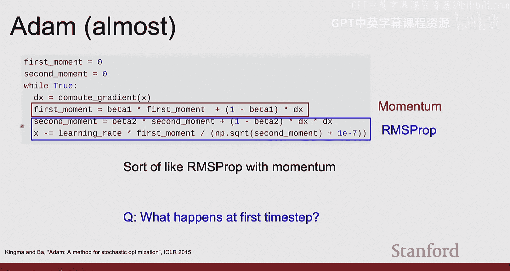

Yeah， so themin is 0。 basically Yeah， that's the exactly。 So it starts at 0。 So this term is 0。

 You have a very large beta。 So this value is very small。

 And if your gradient is not very large in your first step， you can have this whole term。

 basically be very close to 0。 Now， we're dividing by something very close to0。

 And it just creates a very large initial step。 even though our gradient was small。

 So that's probably not something we really want。 And so the final thing that atom has is it adds these bias terms here。

 which is specifically to account for this issue where it's dependent now on the time step of training。

 So you know， I think this is also something you'll go into in the homework。

 I just want to give the basically intuition behind at， why the naive implementation wouldn't work。

 which is this really large initial step。 And you'll go over the homework implementing this and you'll see how the time step is used。

 But basic ideas， this is to account for that very large initial step。

 And as your time step increases， these bias terms are not needed as much。😊。

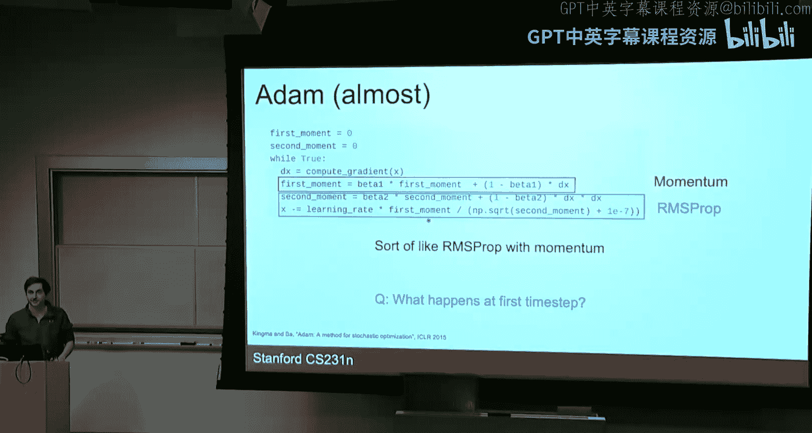

Okay， cool， these are some like good defaults that people normally use。

 If you're training a model with at， you could go with these and you know maybe it'll work。

 maybe it won't， but it's a good starting point and you can then tell from the remaining slides。

 we'll talk about how do you know if your learning rates right。

 How do you know if these other values are right， So I'll speed up a little bit just to in the interest of time。

 But the basic idea is that you can see these all these different optimizes converging they all have different properties。

 you can sort of see how atom is this combination of RMS prop and SD with momentum where it has characteristics of both。

 which is very neat to see visually aligns with our intuition。

One final topic related to Adam is that we could look at how regularization interacts with the optimizers so for example。

 if we have L2 regularization， how does this affect how the optimizer works and I think the answer is it's actually not immediately obvious and you can do it in different ways so in default atom they compute L2 when they're computing their gradients so you know we looked at the gradient and there is the last portion of our the data loss portion and then the regularization loss for atom it's using both of those when it computes the gradient but atom W basically only looks at the data loss for doing all of these moment calculations and all these steps and it just adds the regularization term at the end here so basically all I'm trying to describe to you all as there is flexibility for how you incorporate regularization and your optimizes weight decay is generally when you just add it at the end L2 regularization at the end and you don't include include it in actual optimizer for how you're calculating the velocity。

and momentums， et cetera。 So this is the main difference and sometimes under a lot of settings Adam W works slightly better like I think the Lama series from Meta。

 they all use Adam W assuming， I assume because it does slightly better for them。

So we have one function optimized。 Why are you splitting it into two。Yeah。

 so if you mix it into one function， that's what Adamom does。

 And Adamom W is specifically the separating it into two。

 So why you might want to do that is because if you don't want your velocities。

 your momentums to actually be a function of the weights， you want it to be a function of the loss。

 So if you're trying to traverse your lost landscape sort of more independent of your actual weight values。

 That's why you might want to separate it。 But you still might want a regularization term。

 but you don't want it to interfere with the moment calculation。

 So this is the specific reason why they do it ultimately， it's empirical。

 you try both and you see which one works better。 But this is why you would do it that way。Okay。

 cool， so we'll talk about learning rates， So there are different ways in which learning rates can be chosen and sometimes you'll get a very high learning rate where what will happen is basically your loss will get very large as you sort of oscillate out of the lost landscape as we described earlier。

 if you have a very low learning rate， your issue is you just converge very slowly。

 if you have a high learning rate， but you're not oscillating out。

 but you might not be able to converge because you're sort of bumping around the local minimum。

 but you're not actually able to get any lower in because your learning rates too high and ideally a good learning rate would have this property where it causes your loss to decrease quickly over time。

 but then you see continued improvements as you continue to train the model。In reality， actually。

 depending on the situation， a lot of these could be good learning rates and also depending on the step in training。

 which is the final thing we'll discuss in lecture today。

 so you can actually change your learning rate as you train your model you don't need to always have a fixed learning rate or step size and pretty much all modern deep learning like all the best models coming out have different ways they vary the learning rate during training。

So one really simple way you could do it is after a fixed number of iterations。

 you just take one10th of the learning rate and you continue training。

 so this can resolve the issue of where your learning rate is too high for you to be able to converge any further so then you reduce it and you're able to get lower into the loss landscape and this is really commonly used when training resnets So that's a very popular type of convolutional neural network。

 which we'll discuss later in the course。 another thing you could do is sort of cosine learning rate decay。

 So this one is also extremely popular。 So here you have basically this is like half of a cosine wave where you're starting at your maximum learning rate here and then you go down to zero to the end and it follows this sort of half cosine shape and here's the formula for calculating it。

 I won't go into2 any details， but the basic ideas there's a ton of different ways to do it。

 when your loss uses a cosine learning rate scheduler you'll often see。

Shape like this where it's sort of you get pretty good continued gains in the middle part of training。

 But the basic idea is that the actual shape of your loss during training will highly depend on what scheduler you use。

 So this is the basic idea we're trying to convey。 It looks very different， for example。

 than this one where you can literally see where we're taking one1th of the learning rate during training。

Another thing you do is there's a linear learning rate decay so it just follows a straight line。

 you could do inverse square root， et cetera， et cetera。

 there's basically an unlimited number of ways you could mess with your learning rate during training and depending on the type of model。

 your training and depending on what works best you'll just choose the one that works best but here are some ones you could try that could perform well in your setting。

Also a really， really popular strategy is to have a linear warmup so instead of just starting at your maximum learning rate。

 you spend a fixed number of iterations to sort of linearly warm up to whatever your maximum value is and then you go about doing whatever scheduler you had afterwards so for example。

 linear warmup and then this would be like the root or linear warmup and then like cosine is a very popular setup for training models one final thing is that there is this empirical rule of thumb or called the linear scaling linear scaling hypothesis or linear scaling law or something like that if you forget the name I think it's linear scaling law where it shows that if you increase your batch size or the number of training examples per update by N could you should also scale your learning rate by n。

 So as you increase your batch size you should increase your learning rate directly proportionally So I think the math behind this is a bit。

Involved and also， it's more of an empirical rule of thumb。

 So people have like tried to show mathematical proofs for why this could be useful。

 but based on you know the variation of gradients and your batch and the number of gradients you calculate per batch etc cetera。

 But really， this is just shown empirically to be true for a large number of problems。

 So this is a good rule of thumb。 if you have a winning recipe。

 but you want to increase the batch size， then also increase your learning rate by the same amount。

Cool， and then the final thing I I'll touch upon very briefly is this idea of second order optimization。

 which uses the hessian that someone asked a question about earlier too。

 So we won't talk about this very much in depth， but just to let you know this exists。

 It's not something we cover in the course very much But the basic idea is right now we're using the gradient to form a linear approximation of basically where' is the downward direction where we're trying to traverse this lost landscape And we just sort of look at the direction and we take a general step in that direction and we added fancy things like momentum and you know the RMS Pro we're deelerating along see directions。

 but this is the basic idea。 we're using this gradient at each time step。

The idea of the hessian is instead of using the gradient。

 you basically try to fit poly a quadratic or like a second degree polynomial to your function based on the derivatives at that point or the hessians at that point and you then try to find the minimum this way and in certain optimization problems is actually works extremely well but generally we don't use it in deep learning because it requires two things So one you have to do this like Taylor series expansion。

 whereas right now we're just sort of doing the first part where we're taking the derivative。

 but you would need to be able to calculate the second mixed derivatives which is already maybe difficult and then on top of that this mixed derivative of all of your。

Prameterters in your model by all the other parameters in your model can get very large as you have like these many million or billion parameter neural networks。

 So in practice， we don't use it because these values have the matrices become way too large and so you run out of memory on your computer if you try to run it specifically you're on a GPU memory。

 but if you're training is smaller model or if you're okay with spending much more time to get better steps towards your minimum then maybe you want to look into this depends on the problem set but for smaller models this actually works quite well。

 but for these large neural networks for training， we basically never do this due to the memory restrictions and all the time you spent computationally trying to calculate the hes。

 etc cetera， we would rather just see more data during training。

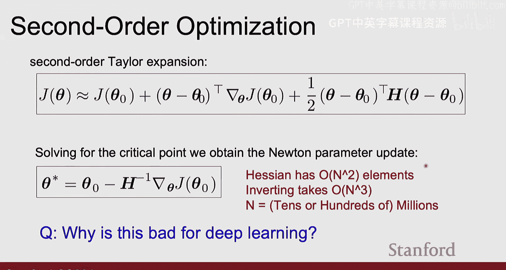

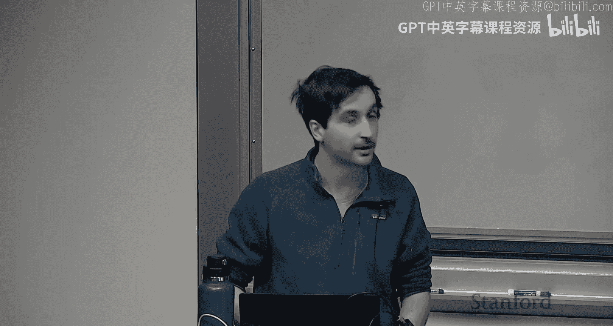

Allright， so some， I guess， concluding thoughts for you all that can be useful。

 So Adamom or Adam W is a really good default choice for training your first model if you're working on a new problem in a domain I would recommend it and it could even work okay even if you do constant learning rates so usually people will try atom atom W with constant learning rate or with like a linear warmup and then a cosine decay。

 those are like really popular combination also I think SGD and momentum can sometimes outperform atom。

 but the tricky thing is because you you generally have to like tune the values more so you have to try many more learning rates because you don't have this like RMS prop term to account for the steep directions and also you might have to try different scheduling values whereas in practice atom sort of like best by test like people have try in a bunch of different domains and it works very well it's adaptive to the lost landscape。

If you're doing like a full batch update where you're already at each step。

 you can fit basically your entire training set into your batch size。

 you might want to look beyond first order optimization into second order and beyond because it seems like your data's not very large or maybe your model is not very large and you could potentially benefit from having these non nonlinear sort of update steps and computing more sophisticated strategies for going down the trying to find the minimum here。

Yeah， so I think we're essentially done with the lecture。

 I'll give some slides about looking forward。 So how do we optimize more complex functions than linear models。

 which is what we covered in this lecture。 And next lecture specifically we'll be looking at neural networks。

 which you know is very exciting topic a two layer neural network。

 the one we'll discuss in class is basically you have two of these weight matrices now one for each layer。

 and you have something called a non nonlinearity sort of stuck between。 So in this case。

 the most sorry not the most common， but the most simple one is just this raylu function。

 which you'll learn about more。 But basic ideas is now we have two weight matrices。

 and we have this additional function that's done in between the weight matrix calculations。😊。

This is nice because as I said it's nonlinear so you know if we're trying to build a linear classifier to classify data like this。

 you'll run into an issue where the blue points and the red points are not linearly separable。

 but maybe there's some transformations we can do or through many layers of a model。

 we can eventually transform the data into a way in which it is separable by a line which would be our then sort of final layer of the model。

