# 斯坦福大学《计算机视觉的深度学习｜CS231n： Deep Learning for Computer Vision 2025》中英字幕 p04 -04-Lecture 4_ Neural Networks and Backpropagation.zh_en -BV1FqazzVE6w_p4-

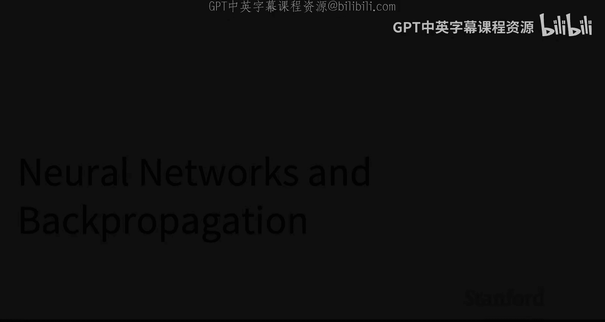

As you can see on the slide today， we are going to talk about neural networks and back。Proropagation。

 which is actually the process。Early years， I was， I was studying this。 I was often。

 often referring to it as the magical process that lets the neural networks learn from their own mistakes。

😊，Pretty much like humans， but。In a more organized fashion， and also using。A little bit more math。

 So let's， let's dive into the topic。 I'm sure this is going to be exciting。

 And this is a found is is laying a foundation for the rest of the quarter。

 Every single algorithm that we'll be discussing in the future without even mentioning。😊。

Is is using a form of back propagation。 And so that's why understanding this。

 this lecture and the topics are。I is very important。 Okay， in keeping us with the tradition。

 let's cover what we've talked about so far。So。I'm sure you now remember what we talked about last time。

We， we set how we can form the。Objective functions or loss functions。

 what we call here and then we talked about regularization。

 but to do that we formulated everything through the XY defining the pairs and scoring function。

 which in this case we are using the linear scoring function as you can see and also。

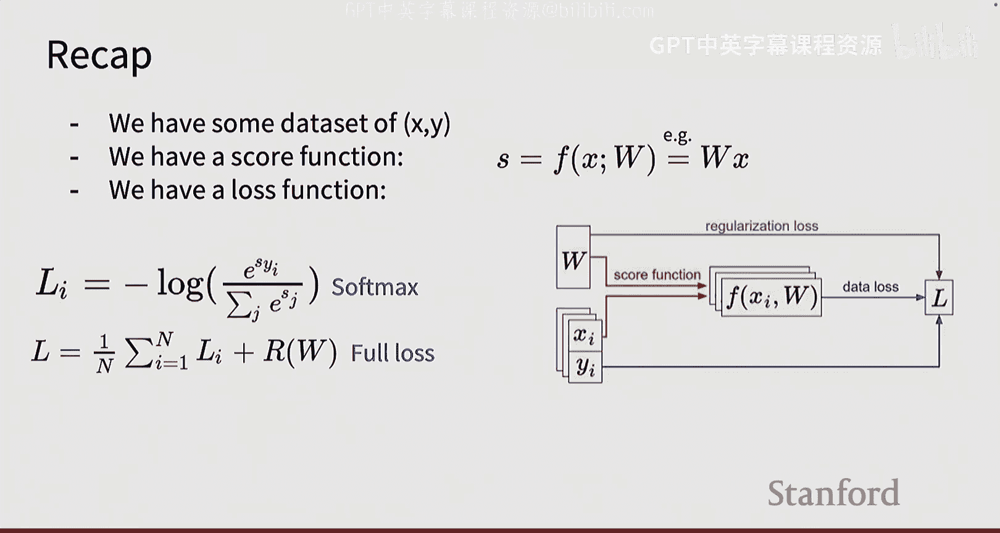

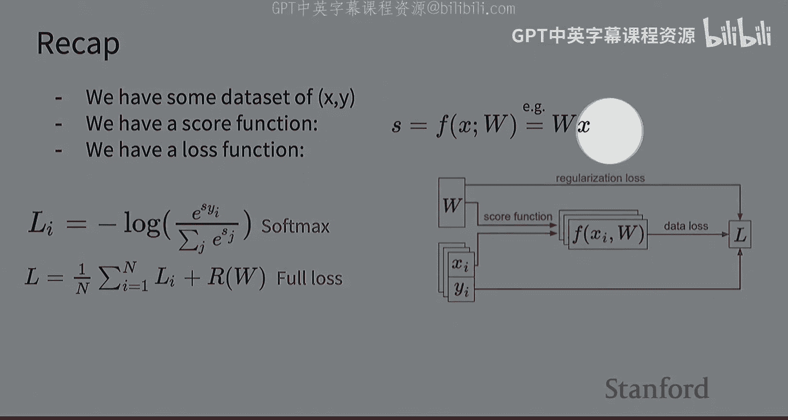

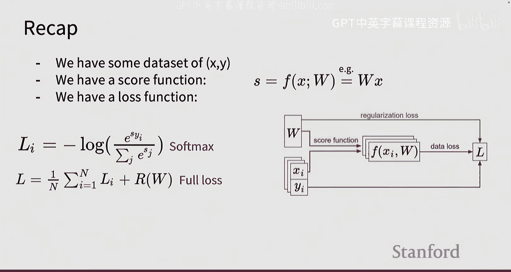

Defining ultimately this loss function。So this graph that you see on the right is what we。

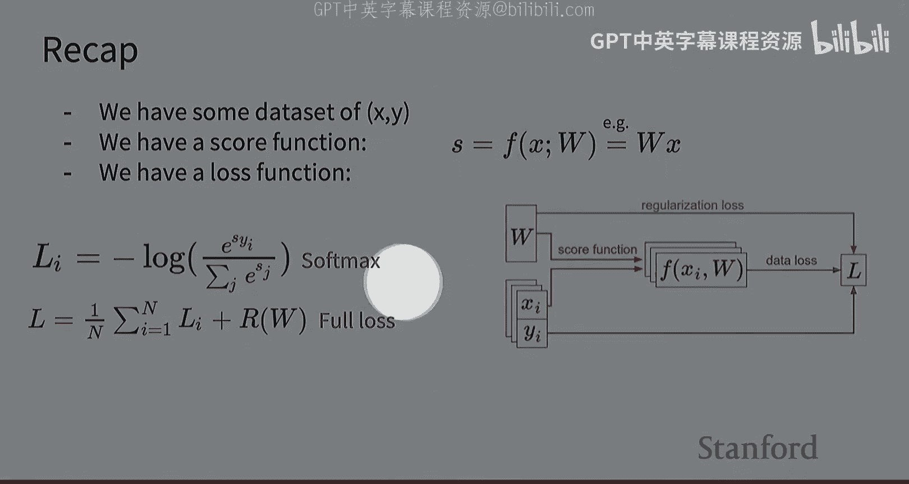

We drew showing all the process， the entire process of learning， there has been some questions。

The questions last。In the last lecture and also even before that that while only using the softftmax function。

 I wanted to reiterate that it's not the only loss function that we have and we use。

 it's one of the most widely used in deep learning and building。

 especially for the task of classification， but there are so many other options that we use for other tasks for different tasks。

 even for the task of classification。If you've looked at the slides that we've shared on the website。

 I included this hinge loss or。Used to be called SVM loss in the reading assignments on lecture in lecture2。

 So in the slides we had examples and and everything around。The topic of。Hingnge loss。

 it is also one of those widely used loss functions。

 especially in the early years of neural networks and just to give you a high level understanding of what it is this is a loss。

Function that， unlike softm， does not turn this scores into probabilitybabil。

 So turning them into probabilities is not is not the only option， right， So we can use other forms。

 This， this function encourages this score of let me highlight here， this score。

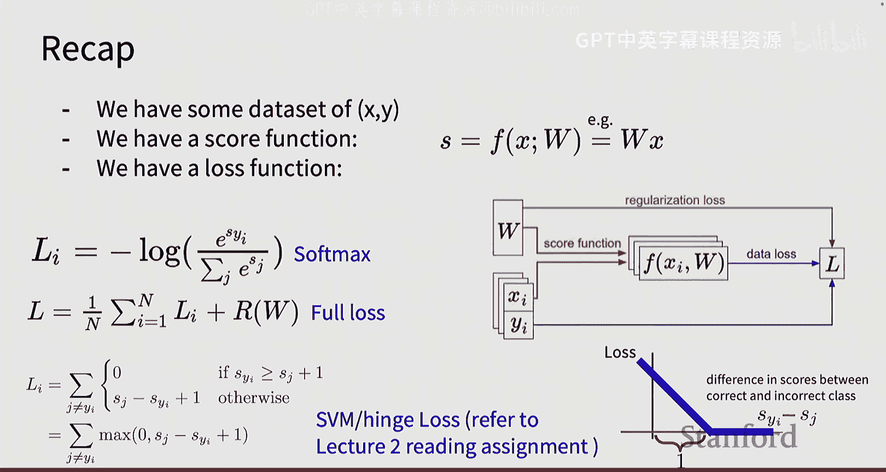

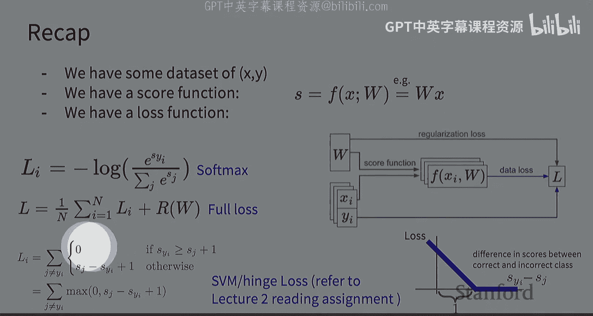

Of the correct items， which is defined by S Y， I to be higher than the scores of all other items S J。

 You can see the the condition here creating。

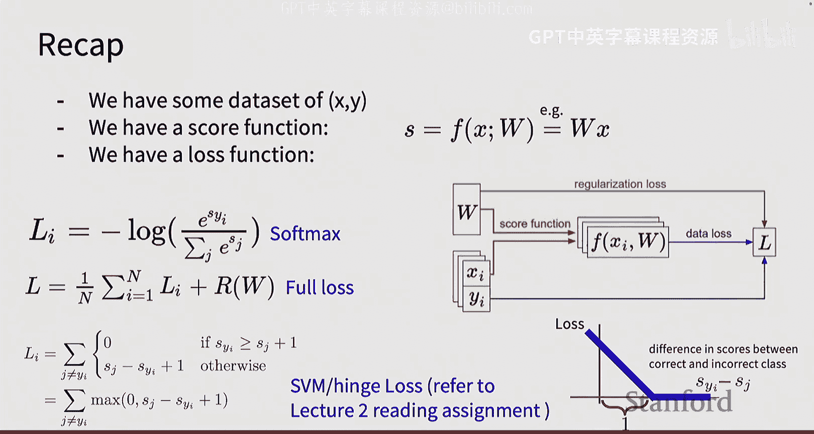

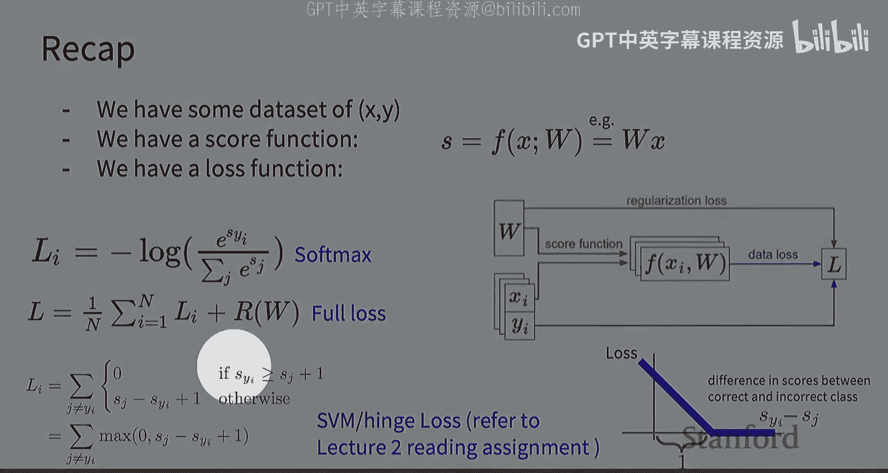

Value of zero。If the condition is true and otherwise。What it does is。So as I said。

 it encourages the score of the correct item to be higher than the scores of all other items by at least a margin。

 that number one that you see there is the margin that it creates and then if the condition is violated。

 the loss increases proportionally。

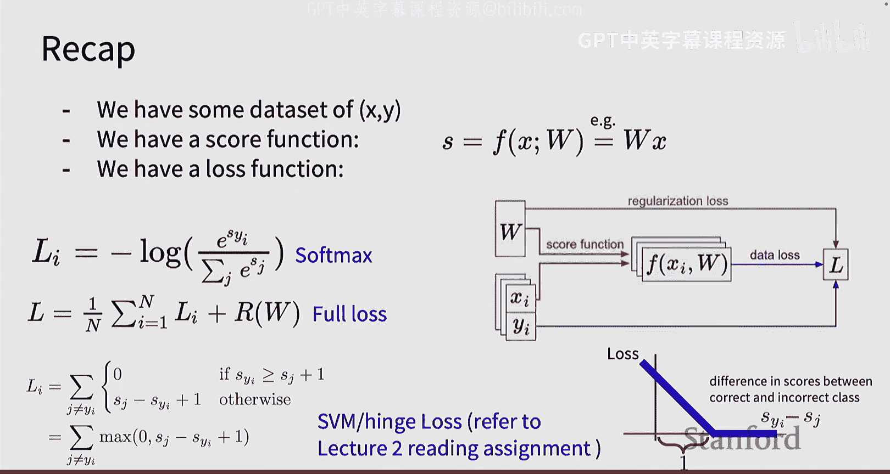

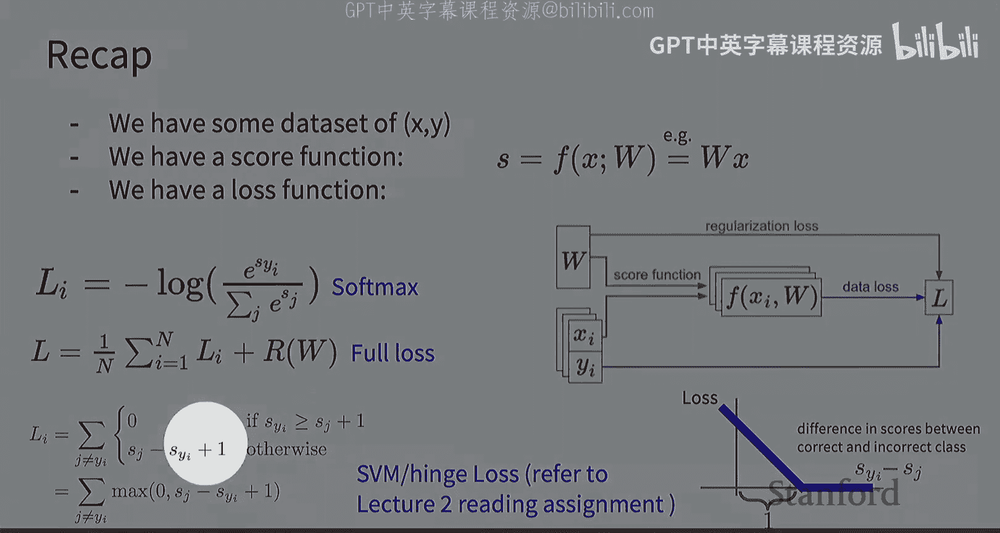

From the margin。 And this is the visualization。 So creating the。诶。This。Visualization of the function。

 So this promotes correct scores by。Pallyzizing cases where irrelevant items are scored too highly。

 So again， prefer to assignment， reading assignment in lecture2。

 for examples and and to get better understanding of that。Next。

 we have talked about general optimization， how to find the the best parameters W for。

For the neural network， and in doing so， we talked a little bit about this lost land being as a large valley as shown in this image and every point on that valley is a different set of weight parameters。

And we wanted to find the setup parameters W that minimizes that lost landscape。

We talked about the fact that the key is being able to take the gradient of the loss function L with respect to W and use the gradient for optimization in a step by step manner which gave us the gradient descent algorithm right so thes。

Are basically updated。

Although it's very hard for me to see from from this distance， what I'm pointing to， but I guess I。

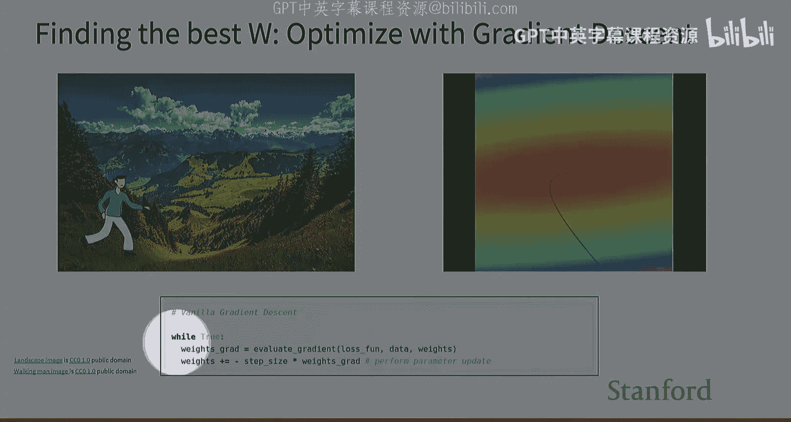

诶。I can guess。So。Anyways。In order to walk down the last landscape towards the minimum value as step size is defined。

 and we often get。

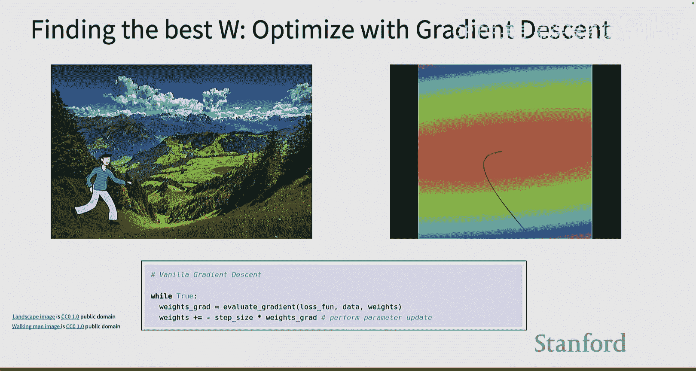

Take one step。With respect to a step size in the negative direction of the gradient。

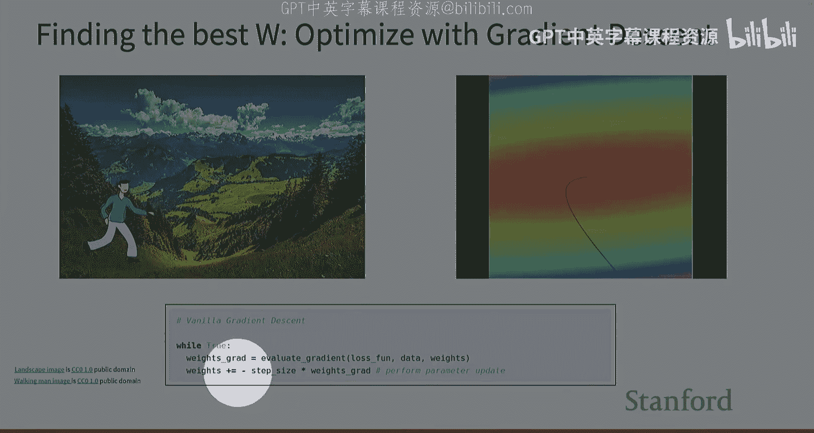

So。This was the gradient descent algorithm and in order to optimize we talked about two different approaches of numerical gradient and an gradient。

 both of which having pros and cons and we discussed in practice to drive analytical gradients。

In practice we derive an article called gradients， and often if it's hard to do the implementation and the math and everything。

 we check our implementations when youre numerical gradients。

And one of the other challenges we talked about was the use of incorporating the loss function and its gradient on the entire data set。

 so if you have a large data set，It's， it's very expensive to。

 to run the loss function and the the derivative on the entire data set。

 And that's why we talked about the idea of mini batches using。

A number of examples sampled from the data set， often 32。

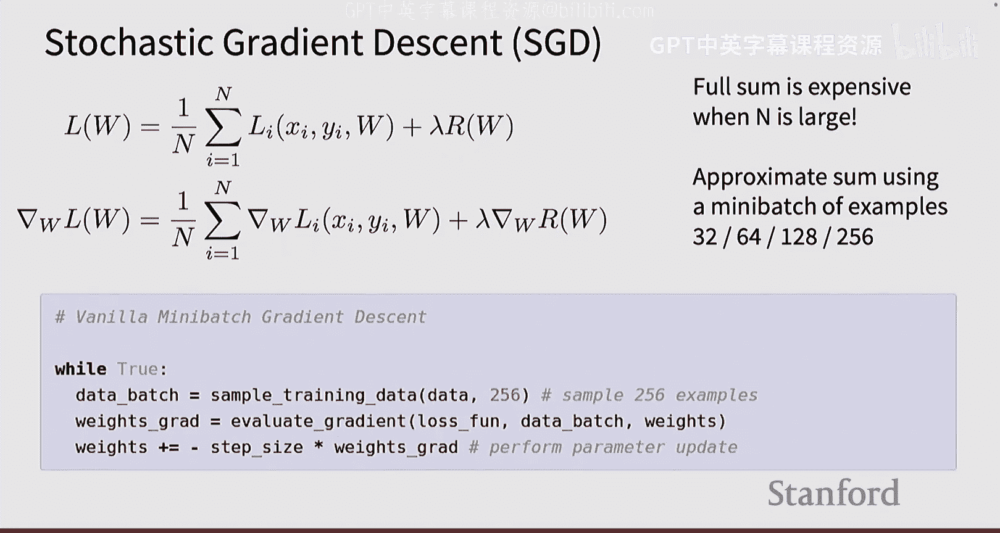

Often maybe 3264， 128 or 256， and that sub sampleled data is used for。

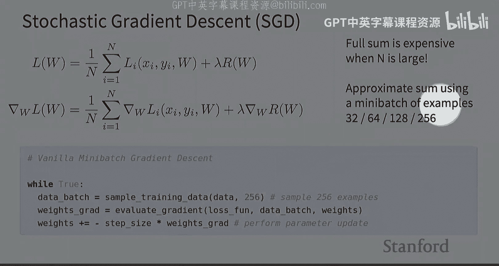

Identifying the gradients and then taking the steps towards。でミにも。

And beyond SGD and stochastic gradientding descent。

 we talked about some optimizations of SGD with momentum， IMS Pro and AdamM optimizer。

 and there were a lot of details that I would refer you to the lecture。The third lecture。

 if you have an in specific。Questions about those。And then one of the other things that we talked about was the importance of the learning rate and in scheduling the learning rate and in some of the optimizers。

 we often try to start with the larger value of the learning rate and then start using different types of。

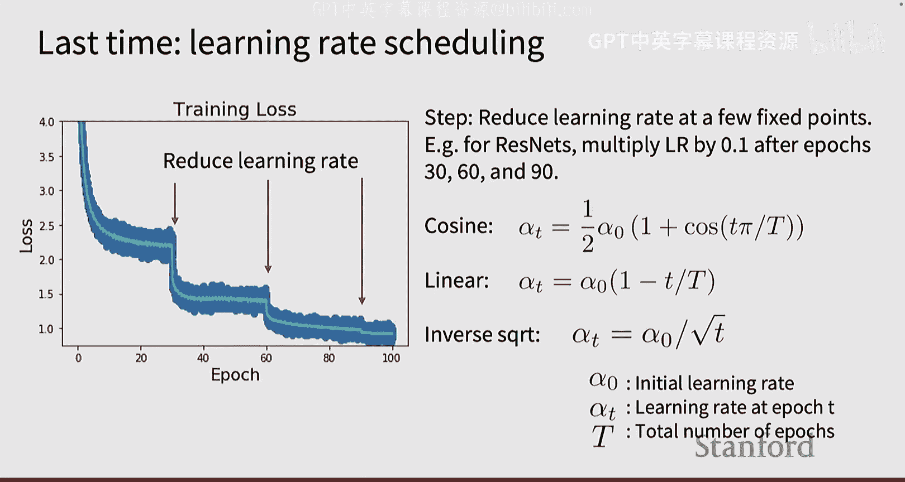

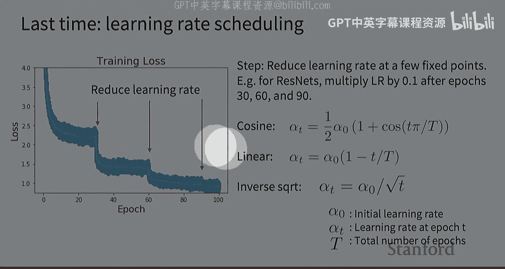

Decaying the late learning rate or reducing its value by a factor。This is normally needed in many。

Optimizers， but in some of the more recent ones， Adam and its variants。

We often do not need to manually explicitly decrease that because that is kind of encoded into the optimizer itself。

So with that， I want us to get to the topic of neural networks。And。

 and see how we can actually build neural networks and， and solve。More exciting and harder problems。

So。We've so far talked about this this function， linear function of W multiplied by x and that。Is。

Is the most basic neural network that could be defined。

 it's just one layer we'll be talking about the layers。And。

What I want you to pay attention to here are these dimensions D and C。

 which are the dimensionality of the input。

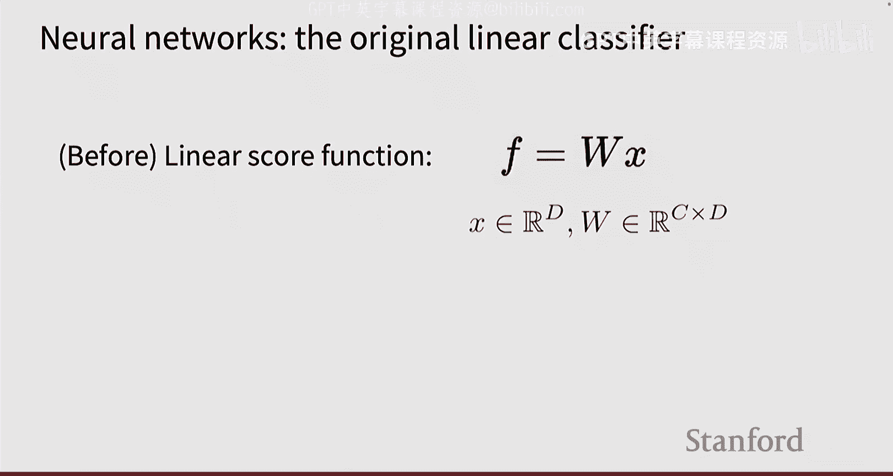

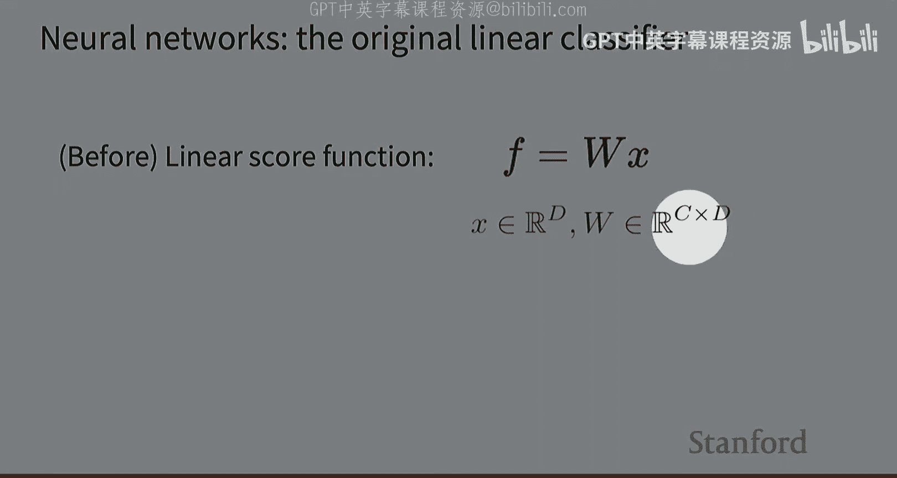

Data input X or the number of features and C is the number of classes。

 basically the number of output nodes or neurons， whatever number of outputs we need。And in order to。

Create a neural network at a second layer we can define a new set of weights referred to as W2 here。

 and we apply those to the previous layer of W1 multiplied by X。

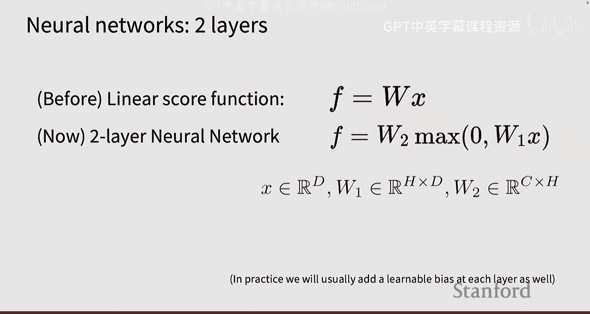

Again， pay attention to the dimensionalities here that we have the C number of outputs and D as the number of input features。

 but then we also define H and that defines。

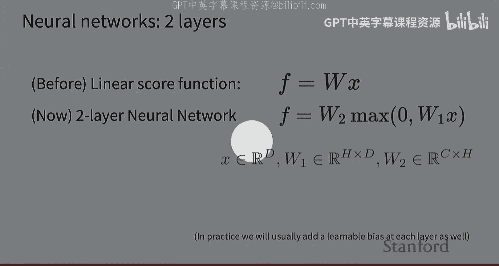

The number of new runs， the number of hidden layer nodes or。

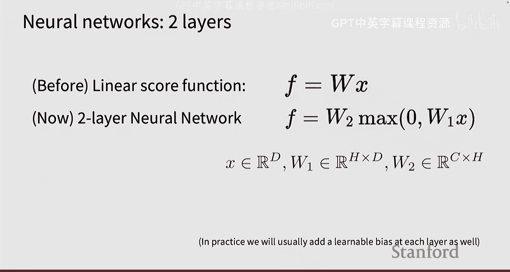

Neurons。That's one point， the second point is this max function that we'll be coming back to and we'll explain what it is and what it means。

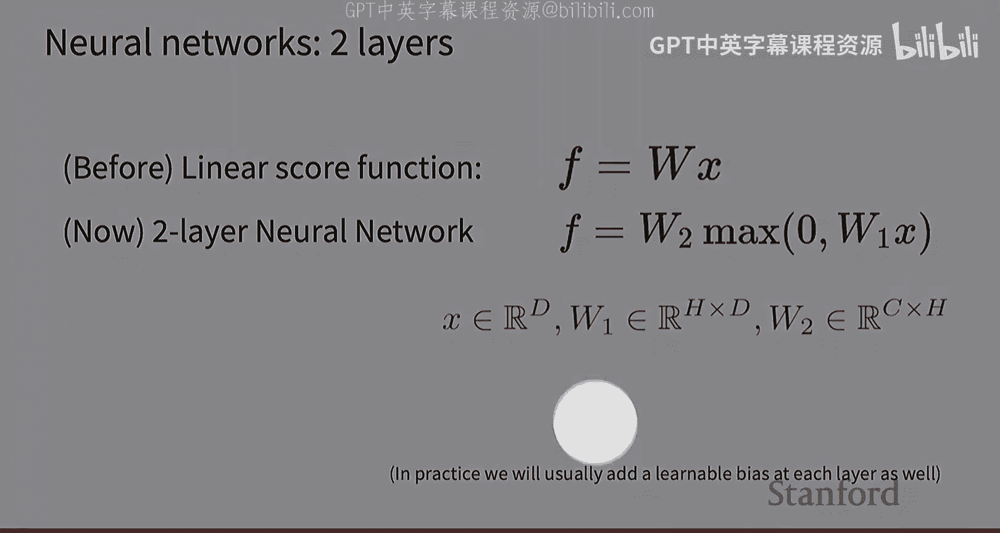

What the max operation is doing here is to create a nonlinearity between the linear transformations done by W1 and W2。

And this is actually a very， very important。Part of the process。

 I will talk a little bit about the non linearity， but also look at this last part before I forget in practice。

 that's right that we are only including W and X as we talked about this in the first and second lecture。

 we also incorporate bias just to have a complete。Frameworks， so so in practice。

 we also have bias with。We don't write it here for the sake of simplicity。Anyways。

 the max operation is creating the。No linearity。 And it's actually very important because as we talked about。

Linear classifiers last in the last few lectures， we。

 we said we mentioned that there are so many different problems that we can't。

Separate the samples with just one single line right this was one of the examples that in order to be able to solve this problem with neural networks with linear functions。

 we need some sort of non nonlinear transformation from the original space to a new space and now in the new space you see that it they are separable using a a aligned right so。

With。In this case， it's a nonlinear transformation between the input and then the second space。

 which is mapping the X and y to their polar coordinates r and theta。

 but again this is just one example， there are so many other。The I' post do。So， with。This example。

 let's to let's go back to our definition of the two layer neural network。

As you've probably seen in the literature and outside this class， these types of networks。

 which only depend on weights and inputs and layers and so on。

 There are no other operations than mark multiplication are often referred to as fully connected networks or multilayer perceptrons。

 MLP， So that's that's one。And we can actually stack more and more layers to create。

Better more larger networks。And in this case， again。

 pay attention to the dimensionalities and the hidden layers that we have in the middle and the dimensionalities that do match one after the other。

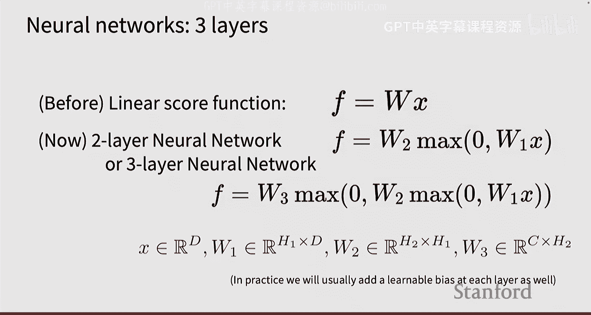

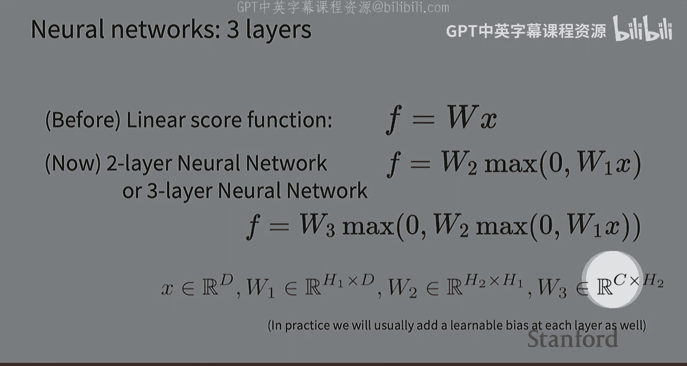

So。Back to this visual representation of what the neural network is doing。

We talked about this when we had the linear representations that。

Often what happens is the network through the weights is learning some sort of templates。

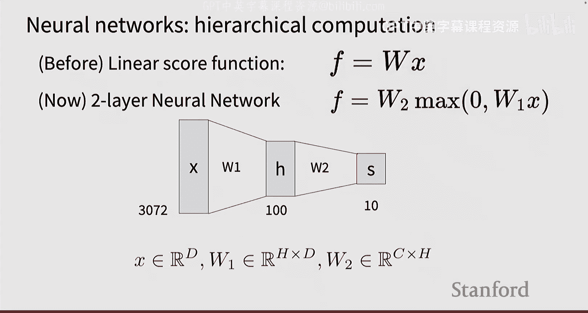

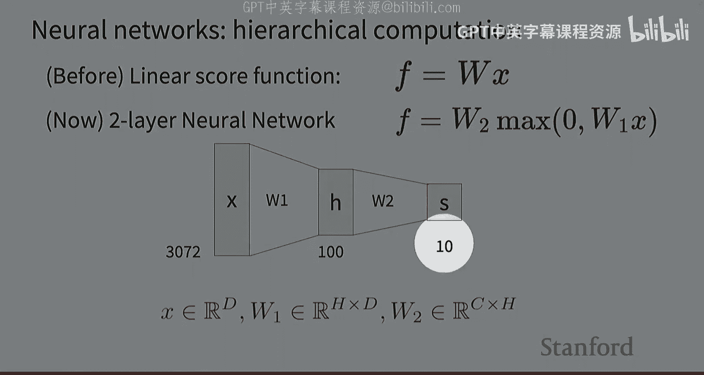

If you remember last week we were talking about these templates that are being learned。

 so again I'm saying templates， they're not， I mean。

 they are some representatives of the images but from the data。

Depending on what data it was trained on。 So these templates in what we discussed last week were kind of generated by by these 10 outputs by applying the Ws on top of the。

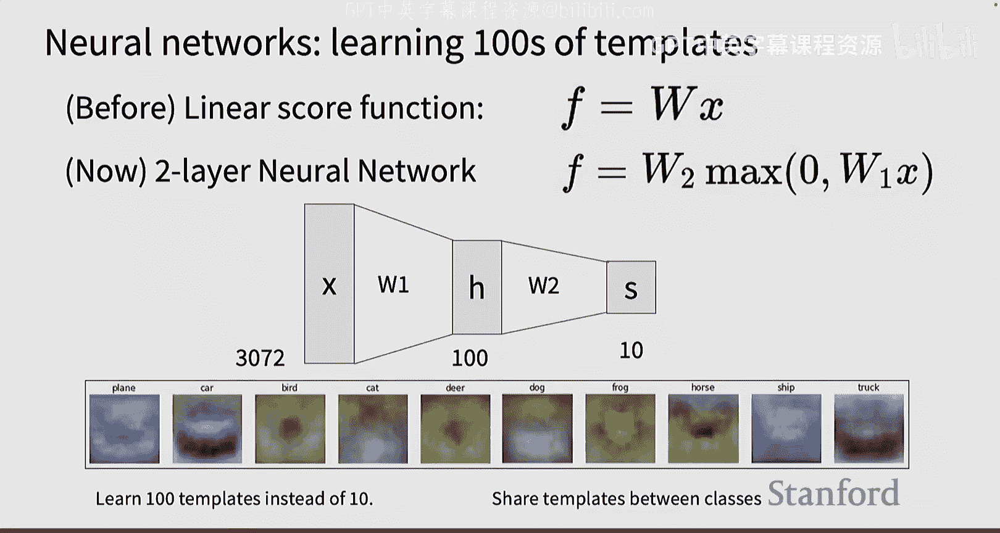

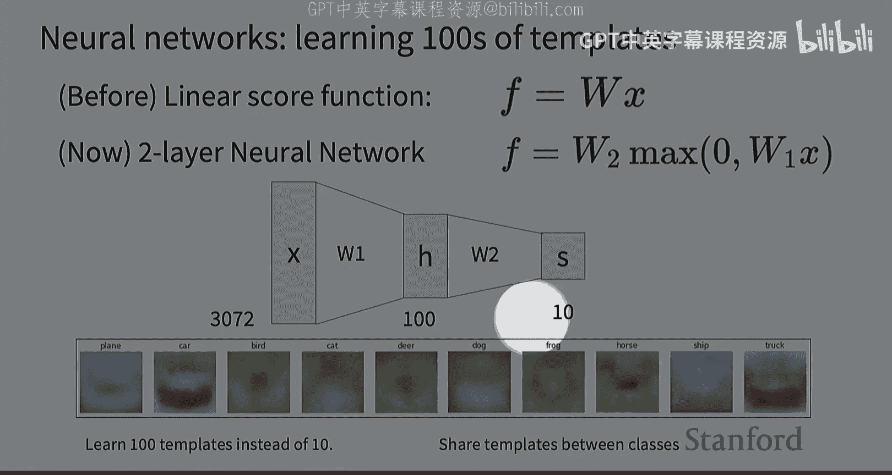

Inmput neurons， right？So with that。Now that we have multiple layers， more layers。

 now we can actually create some more templates， now we have a layer in the middle that can actually create00 templates。

As opposed to just 10 for a linear classifier， although we still have those 10 as well。

 and this again in a very high from a very high level understanding point of view。

 I'm telling you what this means when we have these0 neurons in the middle。

 we are giving the network the power to create templates for not entire objects， but maybe parts of。

The object， for example， the classes that you see here， you had birds， cat， deer， dog， frog。Horse。

They all have eyes right So one of those 10 templates。

100 templates could probably be a part of the objects that is that could be shared between all of the classes。

 So from a high level point of view and understanding this these。

Can form templates and when we come back to the topics of visualization and what we learn from the neural networks。

 this topic will uncover more details about what I'm talking about right now。So。

Back to the function max， we talked about max function and nonlinear linearity that is created here。

 and。In neural network terminology， we call that an activation function， right。

And it's actually playing a very， very important role， a pivotal role in building the model。

 building a neural network。Let's answer this question that we have on the slide。

 What happens if we try to build a neural network without one of these activation functions。

 Let's say the the max function。 This will be our function if I remove the max rate。

 So it would be W2 multiply by W1 by x。 What would happen here。Yes， exactly so as you can。Yes。

 and correctly you mentioned。Multipplication of w2 by W1 could actually be replaced easily with another matrix W 3。

 And then your function becomes just a linear function。 So everything could be lumped together。

 So we need some sort of nonlinearity in the middle to be able to give us。

The power to solve the problems。The function that we just talked about is Relu。

The rectified linear unit， it's a very popular function activation function used in neural networks。

 While there are so many other variants that have have been tested in many many other architectures and and even in the more modern architectures。

 one of the problems that relu has it it sometimes create dead neurons because it its it it's making everything equal to0 if it's not positive。

 right， So in order to avoid the that neurons， leaky relu with this type of。

Modeing or elude at the exponential linear unit。Are other options。

 Alu is a little bit better because it has a better zerocented function。

 and then there are some newer variations Jelu Go and her linear unit or I don't know I've heard post variation Jelu in Gelu。

 So could be could be used。 they are often used more often in newer architecture in transformers。

 and we also have。细佬。Or Swish， it's the sigmoid linear unit that。That one is。

 is also used in some of the modern scene architectures。

 Google was using this for efficient as some of the variations of their。

Models are also in efficient net。Other than these， there are functions like seaoidoid and Tch or or tan H that are often also used for。

As as activation functions， although they do have few problems。Because they do squash values。

In a narrow range。 and that sometimes results in vanishing vanishing gradient。

 So we often do not use sigmoid or or tangch in the middle of the。

Neon networks they are often used in the later layers there。We want to， for example。

 binize the outputs and。things like that。 So as I said， Re is often a good default choice。 It's。

 it's very much used in many。Architectures， and there are so many variations of the same function that we talked about。

I want to summarize what we've talked about。And then answer some questions。

We did talk about different adding layers and so on。

 But I want to highlight that activation functions are often。

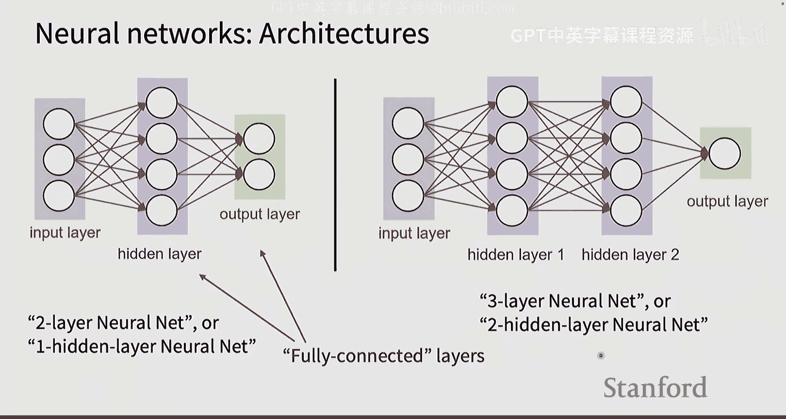

Functions that are operating in the。

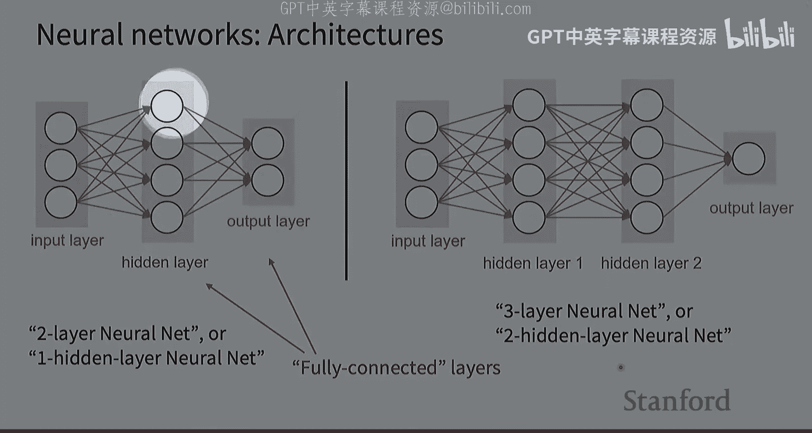

Layers， and we also have ws which define the weights mapping between the previous layer and the and the next layer。

 Again， these are fully connected neural networks with very simple。

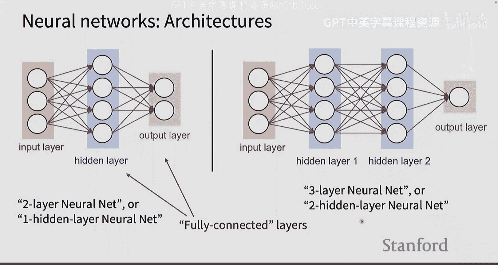

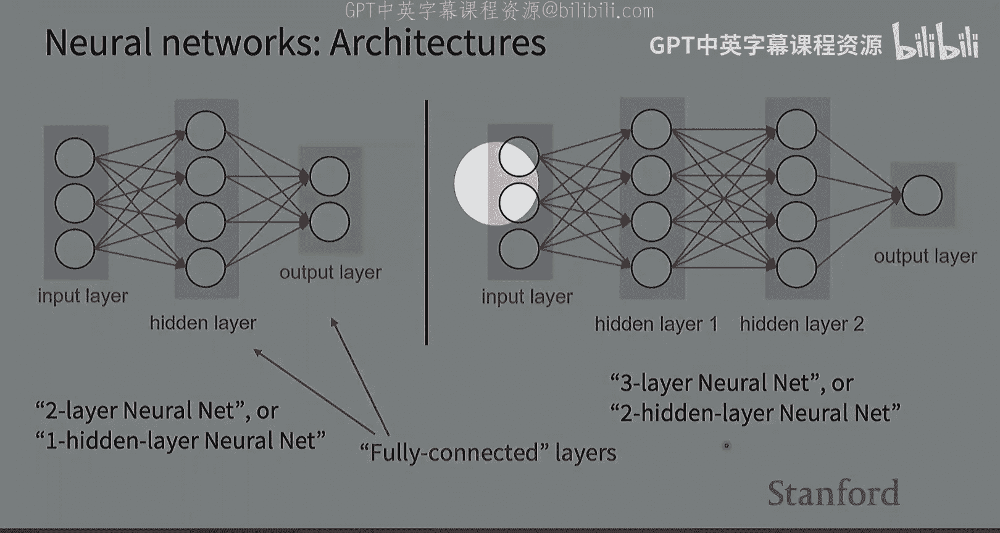

呃。Implementations， what we only need is to be able to define an activation function and in this example。

 if you look at the example， we have the sigmoid function defined as the activation function and very easily using that activation。

 the first and the second layers of。

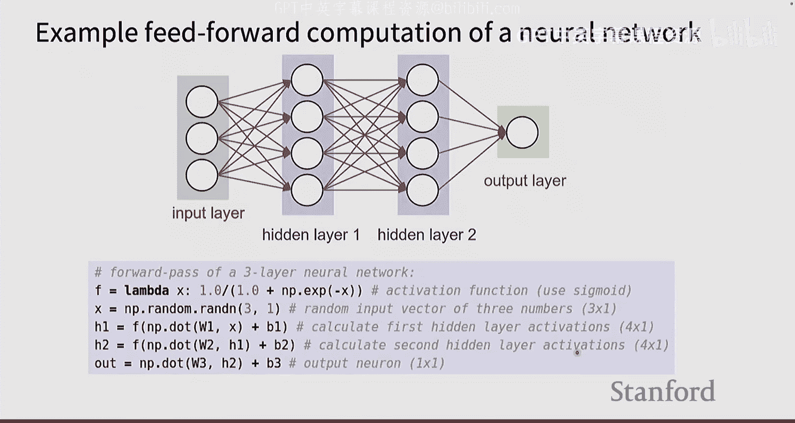

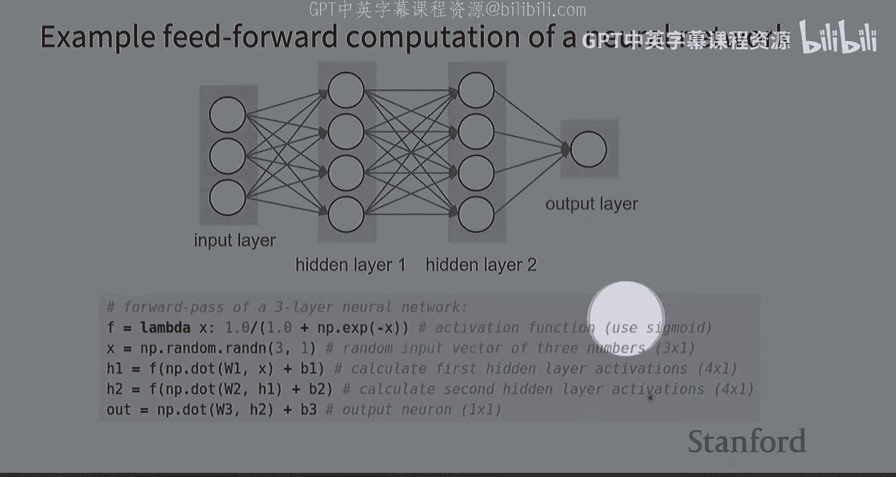

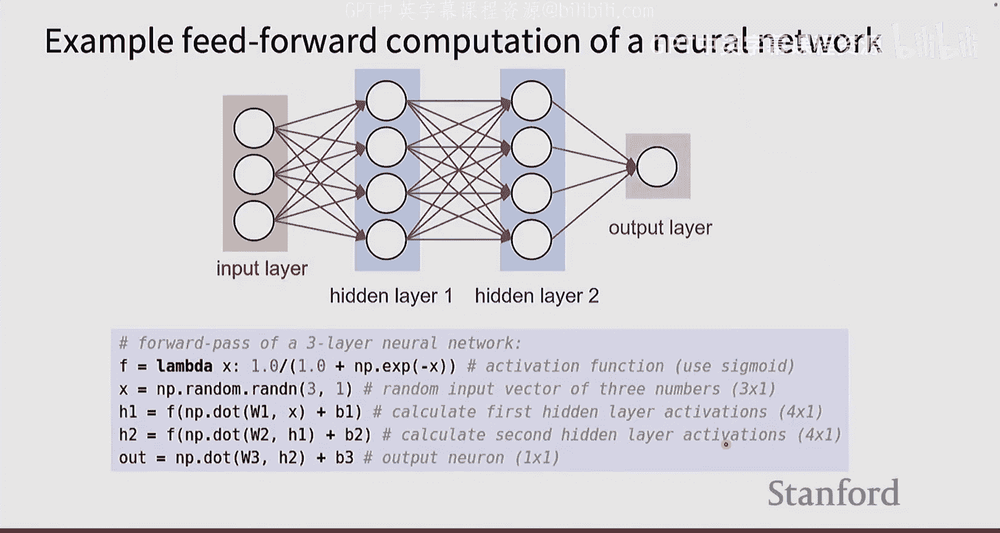

The hidden values， hidden neurons are。Calculated by applying W1 by x。

 and then also the the bias and then applying it， applying the function， the activation function。

 and then same for H2 and the output will be。

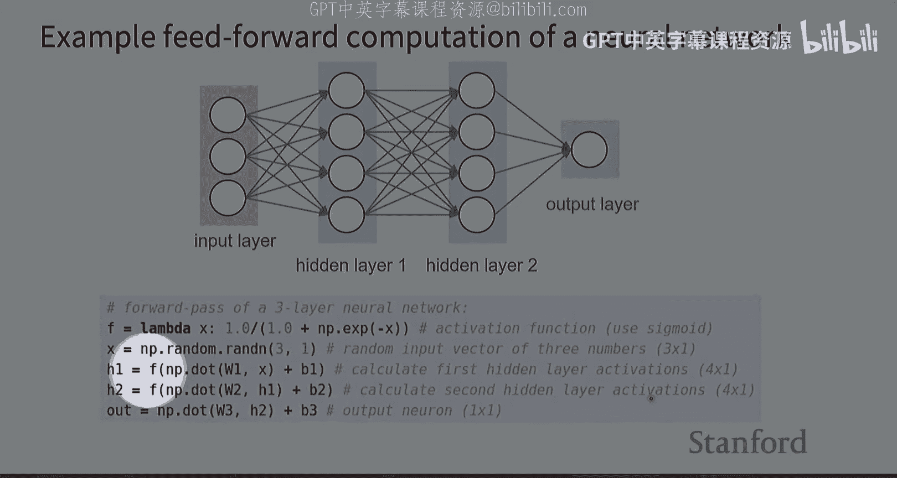

Very simply， the the dot product for the between the W 3 and the last layer of。

He then values creating the output。Layer， I'll stop here to answer some questions if there are any。

 and then we love to continue。That is a great question。 and the question is。

 how would we choose for a new problem， which of these activation functions to use。

The short answer to your question is is yes， it's empirical in most cases。

 but we often start with value or we go with standard activation functions being used for those specific architectures as I mentioned there are。

Activation functions that are often commonly used in CNNNs or in transformers and different architectures。

 so we often。Go with with the ones that are tested before。 But yes， it's it's mostly empirical。

 if you if you're designing a new network for a new problem。

 then that's one of your choices that you have to make very much similar to other hyperpometers。

So the question here is。What is the attribute that is basically common between all of these activation functions and what it really does。

 I will give you some examples and I'll go into some of the details of what these activation functions are doing basically the main。

And the most important common characteristic here is to create nonlinearity we're not using a linear function as does the activation right so creating some sort of nonlinearity is something that is makes it very important and why do we have so many variations I told you a little bit about the problems with any vanish ingredients gradient I told you a little bit about。

Differentiability of the functions， they should be differentiable because we are using them in neural network and sometimes having a。

Proper zero centered value and a smooth function makes it。Much faster to get converging networks。

 so there are so many different factors， these are the main ones that I told you and talked about which play an important role for defining or designing these functions。

I'll talk a little bit more about it than I go into details of the cap functionist。

In all of the layers， we often use same activation functions， but as I said。

 sometimes in the later layers or the output layer we use like a sigmoid activation sigmoid function and or tang function so but commonly yes and。

The question was if we use the same across the networks。The entire network。

 same function for all of the neurons。Okay。Continuing to。What we were talking about。

 which is the implementation of these。Models， these and neural network。

 So there is a very simple way， I mean， building a neural network a tool layer layer neural network in Python is just less than or 20 lines of code。

Very simple。 Def our network as I talked about the dimensionalities and is the number of samples。

 D N D in is the dimensionality of the input。 And D out is the of the out out the output and H the number of neurons in the。

hiddenidden layer and we talked about this is just creating a and Y and randomize randomly initializing Ws。

 then we have the forwardbar path which means applying ws to the inputs。Layer by layer。

 and ultimately creating the。Outward。The prediction wise。

 predicted wise and finally calculating the loss function and outputting that loss value。

After the forward pass， we need an optimization process。

 a way to calculate the to call gradients and use those gradients that are created。

To run gradient descent， to optimize W1 and W2 basically taking one step towards the optimal value of。

The network。But。This part， calculating an gradient is is the most important part in in here that we haven't very much gone into。

 So this is the the almost the rest of this lecture is about making this work and scale in。

Different settings， so。After training and building such a neural network， depending on how many。

Nots we use in the hidden layer， you see that we can identify we can get different patterns of separation between the two classes and more neurons often means more capacity to learn more complex functions。

And better separation of。The node that。Points。If you take a look at this。

 this is very much similar to this pattern I'm showing here is similar to the one that I showed in a second lecture。

Where we were talking about K and nearest neighbor。 and then we had only K equal to one the。

One year's neighbor framework。It was very much similar to using more neurons right so same type of arguments happen here that if we give a lot of capacity to the network。

Then we will have some overfeeding problems。 We won't be able to generalize to unseen data。

 but there are many different solutions for。This as well and。One thing that as a rule of thumb。

 what I want to highlight here for you is to not use the size of Nen network as a regularizer。

 we don't often use that as a hyperparameter to fine tune this network size。

 although we experiment with different values of the network size and。Related hyperparmeter。

 But what you often do is we， we go with a little bit of a。Bigger network that we need。

 and then we use the regularization and this regularizer and specifically this regular regularization。

Hyperparmeter to。To do a different， to check the different setups。

 So what we often tune is the regularization and regularization highmeter and not necessarily the network size itself。

Okay。This is the concept of neural networks in a nutshell， but。We。

I've heard about neural networks and how they could be related to the biological。

 there are some biological inspirations， so I'll talk a little bit about it， but there is a question。

Basically， your question is， why is the model？More underfe when we increase the value of lambda here。

 Yes， so。Just to quickly answer that question， the value of Lada is controlling how much contribution the regularizer should have in the overall loss right and the larger contribution that you have on the regularizer and remember that regularizer was defined on Ws so it's constraining the Ws it's giving you less freedom to the values on ws right so less freedom equals。

A little bit of， like。More generic boundaries， not。

 not necessarily giving you those like detailed values， detailed parts of the the boundaries， right。

 So if you constrain the model too much。Even with regularizer， you're also going to get。

Values like that。This is your boundaries like that。Yes。

 the light regularizer alwaysfes prevents overfeing。Again， you， you are creating a compromise。

 a balance between the loss， like。Predicting the actual the right output。

 So the first part of the loss is predicting the right output。

 The second part is only playing with the values of the vs doesn't doesn't care about the outputs anymore。

 If you overweight this， you're not going going to get very good classifiers， right。

 So creating a balance regularular as it is always good。

 but nothing is good if you use too much of it， right。

You go over again why we would want to change the regularization rather than the size。

So there are many different reasons， one of them is size of the network。

 you're building the networks， you're going to build networks that sometimes you have to run them for few days to get some results。

 right。Networks， what we often do is we start increasing quality the number of parameters in networks。

Until we see some levels of our feeding。So that's the time that we know that the network is actually understanding the patterns in the data and is now able to memorize the data。

And that's the time that we try to minimize the overfieding by regularizing the network。

 so regularization plays an important factor there。

 so if we go too high on the number of parameters number of complexity of the network。

 then that's going to be causing a problem we never often do that。

 you for a new problem to start with a smaller networks and increase that correct that with the regularizer。

For a given problem。How do we know how many new neurons we need to solve the problem。

 That's based on。Empirical。Research work and looking at other similar type of there is no one prescription for all。

 like you have to look at。Other counterparts， other types of networks that were trained on similar data。

Start from that range。 And then often you do a number of experiments yourself to balance and increase or decrease the complexity of the network。

 So it's， it's often and always pretty much bound to exploration。So your question is。

 are there any theoretical and foundational work done to see which ones to use。

 which activation functions to use and how many layers to use。

 There are so many research and and and papers out。

 analyzing these and and also some methods for optimizing all of these。

Meta or hyperpar of of the networks。 We are not going to get into them in in detail because， again。

 a big part of it is based on very much dependent on the data set， the problem you're solving。

 and so。The best answer to your question is yes， there are some works out there， but again。

 each of those make assumptions that may not be necessarily true for your application or problem。

So what happens is there are some biological inspirations， again。

 these inspirations are very much very loose if there is a neuroscientist sitting here or is watching online。

 its do not take all of the examples that I'm giving you or talking about as。The ground truth， but。

Generally， what happens in in neurons。 And you know this， this is a。Visualization of a neuron。

 It does have a cell body that often aggregates the impulses carried through dendrites to the cell。

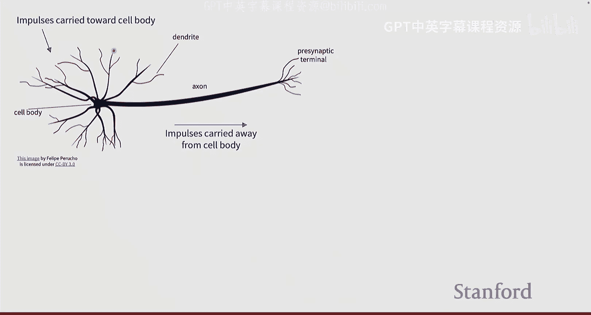

Body itself body。 And then using axons， those impulses are carried away to other neurons。

 This is very much similar to what we are doing in our neural networks。 We often have a function。

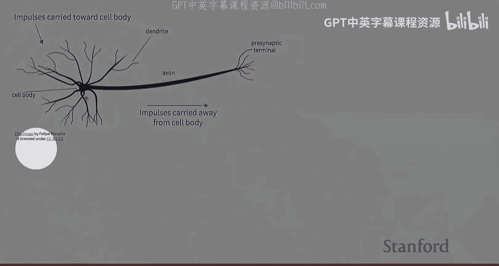

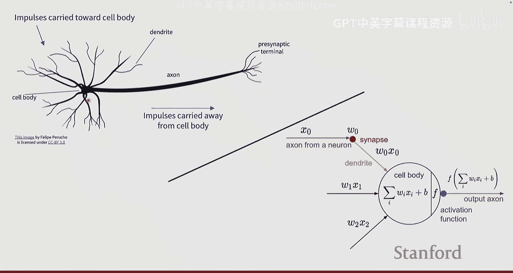

That captures the。

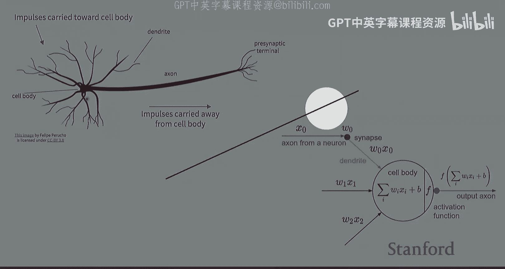

the signals， all of the。Previous impulses， activations from the previous layers and。In the cell body。

 that function。Is operated on the inputs and outputs the activations and passes them to the next layer。

 next neural neuron， and that's basically why we need some sort of activation function here to create the impulses to increase or decrease the values。

So。With that， again， there are many differences between biological neurons and how they could actually be very more complex than what。

Neural networks we build look like， but generally there are common。Concepts。

Often the neural networks that we build are organized into regular patterns and those patterns are because we want to have better computational efficiency when we implement the neural networks。

 although there has been research creating these complex neural networks and trying to optimize。

 but again in terms of results they are almost comparable with。The regular functions。

 regular neural networks that we often build， and we' will be talking about and this。Clas。啊。

I can't warn you enough on being careful with your brain analogies and。

And how this could be interpreted， so there are so many differences and I'll just stop here and we'd be happy to discuss if anybody was interested in the neuroscience aspect of things as well。

So， plugging everything in。We did have a scoring function。

This scoring function turns the inputs through some ws。

 some weight vectors or weight matrices into scores and。What we often use as。

The loss function for the network is using those scores either through Hingngelas or softmax or other variations。

And addition to that， we defined regularizers。Which ultimately give us the total loss of the data loss plus regularizer。

And we talked about this fact that in order to。Be able to optimize W 1 and W2。

 What we need is to be able to。Take the derivative of the partial derivative of L with respect to W1 and W2。

Partial A by W1 and W2， there are so many different details。That we have to。Be aware of。First。

Building these functions and then taking the derivatives and writing them down is often tedious。

 There are lots of matrix calculations and need a lot of work on the paper we could before you can actually implement any neural network。

 The other challenge， the other problem is。What if you want to change the loss？

Slightly different from what we， we've， we've done the paper all of the calculations over。

 So in that case， again， we have to。Redo the entire thing and finally。

This becomes intractable and sometimes inible if the loss function is complex。

 So with complex functions， that's going to be even。Harder。But there is a better idea。

 something that is often used。In our implementations。

 and I'm going to go into a few examples today just to make sure everybody is on the same page and understands these topics。

So and that is computational graphs and the idea of back propcagation。Computational graphs are。

Putting together all of the operations in the neural network and creating that step by step thing。

And start from the inputs and all of the parameters that are basically needed and get the loss as the final output。

 final layer。 so in this case we had a loss function， which could be a soft max function。

 or a Hnge loss function， whatever it is， it's the loss function， which is added to the regularizer。

 the function R W。And R has W as its input， so these two added together， calculate or create a loss。

And before doing the or having the loss calculated。

 we often also need to aggregate X and W and create the score， this is a multiplication function。

This is actually very useful because most of the neural networks that we build are also they have graphical representations and all of these complex functions could be shown with the same framework and then we can use this and build their computation graph starting from input image or input data。

 there are a bunch of weights throughout the network and finally there is the loss function。

And again， this is useful because there are some complex neural networks like this。

Neural touring machine。 And that is actually used for temporal and sequential data。

 So there is a lot of unrolling of this， this machine。

 And if we have to do all of the work manually by hand， this is going to be on。Intractable and not。

Physible， so， and that's why。When we build this， this computational graph。

 the solution to that is back。Proroppaation。And I want to start with a very simple example。

 So we start with a function F。Of X， Y and z， which is x plus y multiplied by z。

 and if I draw the computational graph for this function， you see we have an operation。

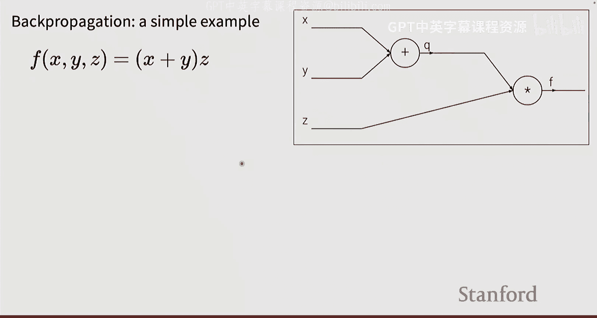

Which is the， the， the addition operation between x and y。

 And then we have a multiplication between x between the。

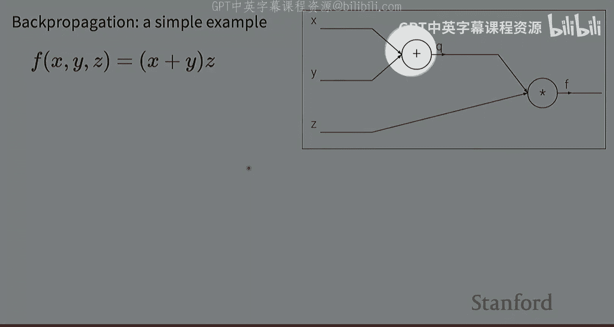

That that addition of X1 and y are multiplied by。Z。So given an input setup of x equal to minus2。

 y equal to 5 and z equal to minus4， now actually we can make all of the calculations and do this the forward。

Past the。For stepping forward in the the neural network， the first step is。Adding x and y。

 which gives us three， and in order to be able to understand the steps and step by step I'm giving it name to it。

 so Q equals x plus y and if I want to calculate the partial derivatives of  Q with respect to both x and y it's very simple because we have the formulation here between x and Q and x and y the formulation is there。

 the derivatives， the partial Q by x equals1 and partial Q by y equals1 as well this is a simple setup。

 we know it exists so just keep it in the back of our minds。Then。

The second operation is F equals Q multiplied by z again， since we have this function。

 it's very easy to calculate to write the partial derivatives， right？

Partial f by Q equals z and F by z equals Q， so it's kind of swap between z and Q。

I'm hoping that everybody knows all of these frommbling Jeraso。And if you don't。

 you should definitely check it out and remind yourself because these are actually very。

 very important。Under Ra general。 And for the rest of the。Quarter。

What we want and what we need in the setup and to complete this example of back propagation。

 we need the partial derivative of F with to x。Why， and。Z。

How we start and how back propagation implements this is to start at the front network at the end of the network。

And we start going back back， propagating all of the gradients。

And this is basically a reccursive process that will be running。So。Dative of F with respect to F。

Is what？It's the thing with respect to itself， right， so it's always the。The last part。

 the derivative of loss function with respect to itself is always。One， if I want to back prop。

The first。The most immediate one is Z。 You can see here that。We have Z and for this one。

 if I calculate the derivative of F with to Z。We already have it， right。

 F with respect to Z is equal to Q。 So whatever the value of Q is goes to。This。

As the gradient as wellt。Next we have Q Q is the next one that is directly connected to F。

 so this is also easy to compute because we have derivative of F with respect to Q we have also already calculated that。

 it's equal to z， whatever z is， that's the value of derivative here minus4。Next， we have。Y。

 which is directly before Q， and we know that y and F。

 although we need derivative of F with respect to y， but y and F are not directly connected。

And that's where we use the chain rule。There。We split the calculation of derivatives with respect to the variable in the middle。

 So partial F by y equals to partial F by Q Q by。Why， right？ so this is the。

This is how the chain rule could be could be written in this case。

 and now I want to introduce you to two important new terms。

 low gradient and upstream gradient upstream gradient is often the gradient that comes from the end of the network to this this。

Current note that we are in and then。The local gradient is the gradient of the node。

 what the input of the note is with。Graadient of its output with respect to its input。

 So it's the local gradient。 So defining these is actually not too hard because F byq。

We already have the value Q by y。 We also already have the value。 So it's one multiplied by z。

 and the value will become-4。 Sam story。 And it， it's the。For the other variable x here。

The local gradient of the stream could again be written down with this chain rule and it also results in minus。

4。And gives us because because in both cases there。Gradian with respect to x or y was already one。

 so both of them get the same value。So with this computational setup and the computational graph。

 it becomes very easy to modularize what we want to do。For every single node in the neural network。

Having。X and y as input or whatever else。 and the as the output。What we need。A first。

 the local gradients。Which we can always， we have the function F， it's a function of X and Y。

 So the output， gradient of output with respect to the each of the inputs。

 it's easy to calculate for every single node。And。What we need to be able to back propagate is the upstream gradient。

 right， and the back propagation process is giving us the power to get this upstream gradient step by step。

 So we when we are at this node， we also have the upstream gradient already calculated from。

The future notes and。That's what we need。What we can do after this is just to multiply the upstream gradient with the local gradient and create what now we call downstream gradient。

 So the downstream gradients are going to be upstream gradients for the previous layers right so that's how we calculate that for x same story when it comes to y。

So this whole process gives us the power to create and calculate all of these completely locally and a step by a step go backwards and give it to the previous notes so they can continue the process so again this is one of the most fundamental operations。

In all of neural networks and many optimization。Processes involving multiple layers of information。

If I understand the question correctly， you're saying how can we understand this intuitively what the gradients are doing right？

 So let's take one step back and and see why we why we are here to begin with what we needed was to identify to calculate the gradient of the loss function with respect to W1 and W2 and Ws in general to be able to take。

A step to in the negative。Diction in the opposite direction of the gradients to be able to find the optimal value。

 right， optimal loss。In order to do that， we need gradient of L loss with respect to everything。

 So what we are doing is we are just moving gradient of L with respect to all variables in the network。

 back to every single value of the network without sitting down and writing the function for the entire network if the network has0 layers we're not going to be sitting down and writing the function for all of the1 hundred layers separately。

 This is how we back propagate step by step to get the values that we need for that optimization process of every single weight that is going to be incorporated in the network。

Okay。Example， another example。So this is a little bit more complex function。

 function of weights and x。 And we have one over one plus e to the power of a linear combination of x and W。

So。There are a bunch of multiplications， additions， negation and the EXP function。

 and ultimately the one over whatever we calculated function。So with all of those。

 let's look at this example that we have。Specific values for w 0， x 0， W 1。

 x1 and W2 with these given values， we can do the forward pass。

 calculate every single value that we have in this process。And just to remind you。

 we do have some of the details， some of the。We know for an EXP function e to the power of x。

 what its derivative is with respect to x。Constant multiplication always the derivative is the constant value itself1 over x as a derivative of minus1 over x2。

 These are again， what we know from our algebra so。And， and if it's a constant addition。

 it's always derivative is equal to one。 So as I said。

 always in the very beginning at the at the end of the network the。

Derivative of L with respect to L is always equal to one。 So that's where。We start using this rule。

 the derivative of function1 over x。 Now we can calculate upstream， I said it's it's one。

 always at the end。 The local gradient could be1 minus minus1 over x to。

 what is the value of x that whatever the input is So this calculation results in minus。

Negative 0 53。 So negative 053 is the downstream gradient。

 which defines the upstream gradient for the next one。 And in the next， again。

 the function here is just a constant addition where we know that the local gradient equals to one。

 So one multiplied by upstream gradient。Same value goes back。Next step is the E XP function。

 So for that， again， the look， the upstream， we already have the value for the。

Local gradient is E to the power of x。 What is x the input the of this step minus-1。

 So calculating this will give us minus02 and this goes back to the next step here we again have a multiplication with a constant number which defines the local gradient equal to that number that that constant value and defining the new gradient down gradient and going back now here we have an additional function where。

We are getting some data， some information， sorry two inputs。Of the different values here。 And again。

 if you want to calculate the upstream gradient， it's 。2 already。 We have it。

 The downstream at the local gradients will be equal to。One。

 because it's just an addition between two values and an addition。

 the derivative of x plus y with to both x and y is always1， so both inputs will be the same。

Then we have multiplication operations with multiplication。

 upstream gradient again we have the values and the local gradients with respect to a multiplication is if we always have say for example。

 a multiplied by x the derivative of this with respect to x is always a the other variable right so here for the first one it's minus1 which is the value of x and for the second one it's2 which is the value of w so the other variable。

 whatever the value it has。So。With that， we can calculate everything and then also calculate the ones with respect to W1 and x1。

Again， we made all of these calculations so we can。Identify how much W should be changed。

In order to step towards the optimal。Point in the neural， in the network。So this was another example。

 There are so many different ways to。Draw a computational graph。

 This was not the only one that I I explained。 So we can actually lump all of the function together and define a sigmoid sigmoid。

 because this is basically sigmoid of。A linear function， right， So the linear function could be here。

 And then all of these operations could be defined as sigmoid。 And actually。

 sigmoid is interesting and very useful to， to use because。

The local gradient using sigmoid is dependent on sigmoid itself。

So the local gradient of sigmoid with respect to the variable x。

 if we do the calculations and simplify， it's one minus sigmoid multiplied by the sigmoid of the same x。

So it's actually a very， very useful。Framework， so anyways， useful function。

And easy and in order to calculate upstream the downstream gradient， again。

 what the upstream gradient was was value 1 and if I calculate the local gradient。

 which is this function replacing x with what the input was， which is1。

It's how this will be calculated multiplied by 1 will be 0。2。

 which is actually the exact same value that we had from before doing it separately。

I want to summarize and say that。There are few patterns in in the data， often very much。

For the nodes。That we can actually kind of memorize there is add gate for the add gate。

 it's always a gradient distributor because of the properties of addition that I explained。

 the gradients。Will remain。It's the same as whatever its input is for the multiplication gate。

 it's a swap function again I told you gradient of x Y with respect to x is y with respect to Y is x so it's going to swap。

And then。诶。There is copygate in the copygate the operation that happens is just an addition of what is coming。

To the network to the node or gate the gate。 And then ultimately， there is a max gate。

 which is actually something that we use quite often。 much similar to the value function net Max。

Gate has the gradient of because it's up it's taking a max between its inputs。

 so whichever the max value was， you just relay or route the gradient towards that direction。

So with that， it's very simple to now implement。ANe network， fourward pass， compute all of the steps。

 And then in the backboard pass， we start computing the gradients And step by step。

 I explained that the gradient of the。F the last function with respect itself is always one。

 And then we start from the end of the network and go up。 You can see here that we are going up。

 So this is the sigmoid function。Calculate in the gradients。 then going up， that was the addd gate。

 We had another ad gate， and then we had two multiply gates， which。Basically， very simply。

 gives us the implementations。 And with this type of formulation， what we can do is just。

Do some implement modularize every function in the。

In neural network and create the forward and backward APIs for every single function that we need in the neural network。

 so in this case this is a multiplication gate， that because for multiplication we need to access the inputs for use in the backward pass。

 we often save them， memorize them， but then calculate the forward pass values。

 and then the backward pass calculate the gradients。

So this means we can write our functions and put the forward and backward passes all in。

 and this is how Pytorch operators right now look like if you look at the sigmoid layer， for example。

 it's just the forward pass， although。In this very function it's not implemented。

 it's in some areas in the C++ code in the C code that it's actually implemented in Pytorch。

 but then the back path of Sigmoid is also calculating the same function that we just talked about。

So with this。So far， what we've said， and I actually covered most of the examples that I wanted to cover。

In using the scholar values， all of the examples were were just scholar values， but we know that。

All of these operations could actually be implemented in vector or matrix forms。

 just expanding on that piece。Here。We talked about this that with the scholar to the scholar setting。

 so far what we've talked about for any input X and y being scholars so。

The derivative will also be a scholar， which means if we change x by a small amount。

 how much the value of y will change if it's now vectorized and and there are vectors。

 if if x is a vector of n elements and y。Is a scholar a vector or two。Scholar derivative。

Then in this case。The derivative will also be a vector and every single element in that vector。

Means if we change x by a small value that that value。

 then how much the amount of y changes then the entire amount of y。

 because it's just one single value。 And then there are also vector to vector frameworks there。

X and y， both of them are vectors of arbitrary size and an M。 in those cases。

 the derivatives will form a matrix or what we call Jacobubians。And there。诶。

For each of the elements in x。If it changes by a small amount。

 then this derivative tells us how much each element of y will be changed again。

 look at the sub scripts here， they are not completely。

 they're not the same they could be different for every single element in the Jacobian。

There has a there is a clear meaning。 and then how we can do or or see it and visualize it in。

Here is that。If you want to back with vectors， say X， Y and Z are vectors of size， D， X， D， Y。

 and D Z， again， the loss。Derivative L is the loss itself is always a scholar because that's always one value we want to minimize。

 but then calculating the。Opstream gradient will result in also a vector disease， same size as its。

Variable Z and same as story happens when it comes to downstream gradients in in downstream gradients。

 actually before going to downstream gradients， let me tell you a little bit about the local gradients where we have。

呃。Cd of z with respect to x and y。And in this case。

 that's the part that I said there will be Jacobbians because now the matrix the gradients will turn into matrices。

 So we have two Jacobian matrices here defined by the size of their input by multiplied by the size of the output and。

And then。This results in downstream gradients that are multiplication of upstream and the local gradient。

 And there we get same size as the input X itself。 so the。

We will have a vector again here because the input was a vector same size in terms of the。Graients。

I just mentioned that gradients are variables with respect to loss。

Always have the same dimensionality as the original variable itself as also shown in this slide。So。

Backrup with vectors was that's just one one example here。 let's say we have a function。

 which is the max of0 and x。 that's the relu function。

 So this is an elementwise function that takes the input takes a max between0 and if it's non0。

 if it's non negativeative。 it passes true， otherwise replaces it with a 0。

Assume you get some upstream gradients and there now we need to build a Jacobian matrix here。

 and this Jacobian matrix in this case， because this is an elementwise operation。

 It doesn't have any dependence on any of the other inputs。

 only the dependence is on the value itself。 This is a very sparse matrix。

 only has value on the main diagonal and those values are actually。Either zero or one。

 depending on if the max was actually taken or a0 was。

 if the value was passed through or just the0 was replaced with it in its place。

Multiplying it by the upstream gradient gives us the downstream gradient， and。

This is how the calculations are done， as I said， Jacobian here is a sparse because in this case。

The operation is element wise。And that could actually be instead of in the backward pass。

 instead of calculating that huge sparse。Jacobian matrix。

 what we do is just use these rule based calculation of the gradient for this max function。

 so we don't really store that matrix and do not calculate that。

Because we know how the function operates。And then this could also be extended to matrices and even tensrs。

 if the inputs are mad vectors， there are higher dimensionalities， high dimensionality data。

 so in those cases again the gradients with respect to the variables would be of the same size as that specific variable and calculating the upstream and downstream cals。

Marices and derivatives is going to be done same as how we discussed and show。Earlier for vectors。

 And then when it comes to。The local gradients， although， however， it's gonna be a huge matrix。

 a huge Jacobcian， because we have a matrix as input as the output and the matrix as the input。

 And then the local gradients will be。Same size as the multiplication of its input size and the output size。

 So it it's gonna to be a huge matrix by itself。 Let me give you an example if this is input X and W as as input for a node for a gate with matrix multiplication。

 what happens is。And generates this this y as the output calculating。

Drative of L with respect to Y gives us these Jacobian matrices and say。We have a batch size。

 mini batch size of 64 and theality of those matrices is 4096。

 then this means that that Jacobian matrix， that U Jacobian matrix will be over 256 gigytes for just one single multiply matrix multiplication。

So， in order to。Simplify this。 We often what we do is we try to look。

At the values and how they impact each other， for example。

 what part of parts of y will be affected if element  one element of x gets。

Impacted so there X and D， this specific one often affects just one row in the output and this is this basically helps us identify for calculating each of these the nodes。

 we don't need to create the huge Jacobian we can actually write the backward pass functions specifically for matrix multiplication。

In a more efficient way。 And I'm almost done。 So you answer this question， how much does x。

And D affect the value of Y and M。 So this is Y N M that is getting impact from X and D。

How much does it get impact， It means that what should I place or or put as its gradient with respect to。

The specific value， x， x and D。Just to remind you， this is a multiplication operation。그。

In multiple gates。It should be a swap， right， So whatever。

This the answer to this question is something a value in W right。

 remember that we had this multiplication gate which was a S multiplier。

So there is a swap happening here， so。The value of。

X being affected affecting y one of the elements in y is going to be dependent on。

AW that is in row D defined by the X matrix and column M defined by the y matrix。

 So it's swapping the values。 It's the same swap。 But here now we have to look at the the giant matrices and find which。

 which specific element it should be。 And then based on that。

 we can actually replace the entire thing。With matrix multiplication and matrix operations。

 the gradient of L with to x will be defined as this simple matrix operation。

 and then the gradient of L with to W will be defined as this very simple multiplication again swap here for x。

 we include the entire W for W， we include the entire x， and do the multiplications。

These formulas makes it easy to implement larger and harder operations and get them implemented in the back。

Passes， Allright， we're done。 just to summarize。 We talked today about fully connected neural networks。

 We went through all the steps needed for back propagation， the forward passes， backboard passes and。

Next session， we will be getting into the topic of convolutional neural networks。Thank you。

