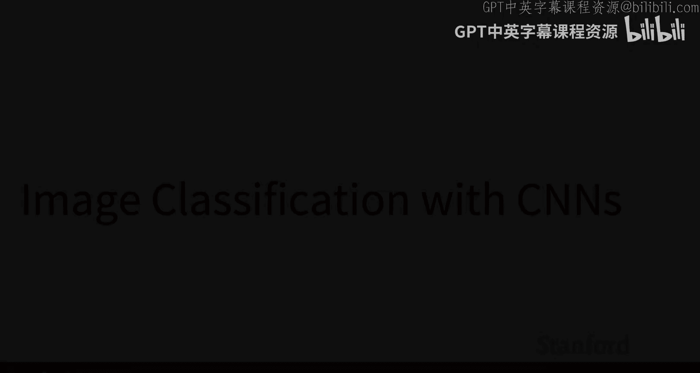

# 斯坦福大学《计算机视觉的深度学习｜CS231n： Deep Learning for Computer Vision 2025》中英字幕 p05 -05-Lecture 5_ Image Classification with CNNs.zh_en -BV1FqazzVE6w_p5-

Today， we're gonna be talking about image classification with CNNs。 So you might be wondering。

 who am I。 I'm a new face。 You haven't seen me before in this class。 I'm Justin。

 I'm the fourth mystery instructor in this class。 I think my picture has been on the website。

 but it's my first time here today。 And a little about me。

 I did my PhD here at Stanford from 2012 to 2018 working with Feifei on deep learning computer vision pretty much all tasks in computer vision around that time during my time here at Stanford。

 I was lucky enough to initiate CS 231N with Andre and Feifei and others and teach it， you know。

 quite a few times 2015，1617 and 18。😊，And 19。At Stanford after that。

 I spent time at Facebook AI research doing all kinds of deep learning。

 computer vision stuff there and I was a faculty member at University of Michigan and there I taught basically the same class a couple more times。

 So I've taught this class a couple times， but it's been a while since I've been here and most recently I've been doing a startup called World Labs with Feei and that's just a little bit about me。

Now about where we are on this class， so we're kind of at an interesting point in the class right now where the class is kind of divided up into these couple different segments and we basically finished the first segment the first segment is basically around deep learning basics and this is really cool because now all the stuff that you've seen in like four lectures is basically all the fundamentals of deep learning you basically know this whole pipeline of what is the basic pieces that go into building a deep learning system so I thought it's useful here at the beginning of this inflection point to just sort of step back and recap some of the major themes that we've seen in the first bit of the course。

So the first is this idea of image classification with linear classifiers and this was kind of meant as a toy problem to give you a sense of a kind of problem you might solve with deep learning where usually the first step in solving a deep learning problem is to define your problem in a way where you take input some grid of numbers。

 some tensors you produce as output some tensors and you want to formalize this problem as some input output of tensors and we kind of do that in the image classification setting by saying that we want to classify images into a bunch of human understandable categories。

 the inputs are going to be these grids of pixel values which are arranged in threedimensional tensors the outputs are going to be scores giving us the affinity or the degree to which where you have one score per category you define a set of categories in advance and the network is supposed to predict high scores for categories that the image is likely to be low scores for the categories that the image is likely to be not and then we can we can set up a problem to use a weight matrix multiply that against the image pixels and。

These scores， and we saw that there's a couple different viewpoints。

 a couple different ways that we can interpret these linear classifiers。

And this basically sets up a functional form saying that we can predict scores for images if only we have a weight matrix W。

 so then the question is how do we select a good weight matrix W and for that we go into gloss functions so loss functions are these things that tell us given a particular value of a weight matrix given a particular data how well does this weight matrix fit solve the problem on this data and in particular we saw some examples of loss functions that are commonly used for classification problems including the softm loss and probably the SVM loss as well and then so now we've kind of gotten a little bit farther along in our problem we've set up the problem of image classification we have a model for solving that problem using linear classifiers。

 we have a way to tele if our solutions are good using a loss function but now we actually need to search for a good solution in that space and that's for optimization comes in so now now you think of defining this optimization landscape where on the X axis or on the horizontal plane or all the different possible settings of your。

matrix and then the loss function is basically a height of this plane where a high loss function is bad because losing things is bad。

 so you want low loss。 So the purpose of optimization is to somehow traverse this space slide down this manifold and find a point at the bottom of very low loss。

 and now each point in this space corresponds to a weight matrix So by sliding down that space we're going to find a good weight matrix that solves our problem and gives us a good solution to our task and in particular we saw a couple different commonly used optimization algorithms that are used in deep learning pipelines stochastic gradient descent。

 usually with momentum， our messpro atom and one sort of interesting topical note is that right now one of the biggest deep learning research conferences is ICl international conference on learning representations and just yesterday IClear 2025 gave their test of time award to the atom paper because the paper that introduced this atom optimizer was published at ICl 10 years ago in 2015。

 So in a lot of academic。😊，they'll tend to give test of time awards to some of the most impactful papers from 10 years ago。

 And just yesterday， the atom optimizer that that you guys saw in this class got this very prestigious test of time award at IC 2025。

 So I thought that was pretty cool and a nice sort of way to connect what you've been learning to stuff that's happening right now in the machine learning community。

😊，Okay， so then now now we basically at this point， we've we've got our linear classifiers。

 we've got our loss functions。 we can optimize them。 now we're almost good to go。

 but we ran into a problem is that the linear classifiers that we started with are actually not very powerful。

 And we saw this from we saw two different ways of attacking this deficiency in linear classifiers。

 One it was from the visual viewpoint where you can interpret a linear classifier by about by thinking of that learned weight matrix as an image where you learn one image template for each of the categories that you' that you're trying to classify against And if you think about it that way。

 we realize that the weights of your linear classifier。

 each row of that weight matrix is one template the linear classifier basically needs to summarize all of its knowledge about each category into just one template。

 And that's kind of a difficult。 that's just not a very powerful classifier。

 So then you can this kind of shows up in these visualized templates of a learned linear classifier where you can see that for categories like the car。

 this car。😊，It looks like a red blob， but cars don't have to be red。

 right What if your car was blue or purple or green or something else。

 there's just no good way for a linear classifier to capture this notion of there might be different appearances for an object for each category or from the geometric viewpoint if we imagine each point of our data at some point in high dimensionmenal space then a linear classifier is basically going in and carving up that space with hyperplanes。

 So that's really good if all your categories actually do lie in linearly separable regions of your space。

 but there's no reason to expect that to be true in general。

 So these are both two big deficiencies that we ran into when looking at these linear classifiers as applied to image classification problems。

And that led us to define this notion of neural networks where we're going to generalize our linear classifiers to no longer just have one weight matrix。

 but instead stack two weight matrices on top of each other with a non nonlinearity in between them。

 and now this gives us a much more powerful mechanism for predicting scores from our inputs now basically the problem is still the same。

 we have our input pixels going through this computation spitting out scores。

 but now rather than but we just basically selected a different functional form for this score function。

And this gave us and now you the algebra is pretty simple， you just need to go from F equals WX。

 you add an extra W2， add a little nonlinearity in between， so the algebra doesn't change very much。

 but in doing so your classifiers get much much more powerful than they were before。

But now things get a little bit complicated again because how does this play into optimization we know that if we have a loss function。

 if we have a model， then we want to find values of those weight matrix that cause the loss to go down and to do that we need to compute gradients we need to be able to compute gradients of the loss with respect to all the parameters of our model and that's this notion of a computational graph So these computational graphs are basically a data structure to organize the computation of a neural network where each node in the graph is a little functional primitive like a matrix multiply or a raylu or some something else like that and then data flows forward in this graph from left to right from our inputs and our weights on the left flowing through all these intermediate nodes in the graph to spit out the loss function on the right and then once we compute the loss to traverse this graph backwards from right to left to compute gradients of that loss with respect to all the nodes of the graph inside the network。

And this is now really cool because it basically means that we can write down these arbitrarily complicated neural networks。

 these arbitrarily complicated expressions for computing our outputs from our inputs。

 but we now have a nearly automated algorithm for computing whatever gradients we want through arbitrarily complex neural networks。

😊，And the way that we do that is this magic of back propagation and back propagation is really cool。

 I think it's one of the algorithms that makes deep learning work because it it takes this global problem of how do we compute the loss through this computational graph and converts it into a local problem and now each of these nodes doesn't need to know anything about the larger context of what is the graph I'm living in。

 what is the problem I'm trying to solve we just need to be able to define these little nodes inside of our computational graph that on the forward pass。

 know how to compute outputs from their inputs and then on the backwards pass can receive gradients coming upstream。

 it doesn't have to care where those gradients come from。

 what was causing those gradients to happen and I just need to compute gradients downstream gradients with respect to my inputs given my upstream gradients and again。

 this is so powerful because now it gives us this mechanism or we can just define a bunch of different types of nodes that all just follow this local API of computing outputs computing。

😊，gradientAnd as long as we follow that API for all of the nodes。

 then we can start to stitch them together in these big。

 complicated computational graphs that can do basically arbitrary computation。

 and the gradients just come for free when we turn the crank on the back propagation algorithm。😊。

And you know this is this slide that you guys saw last time is basically back propagation on scalar values but we can generalize this to work on value vector valued or matrix or tensor valued values as well but the basic thing to remember is that your inputs are some tensors。

 your outputs are some tensors and now your upstream gradient that you get is the gradient of the loss with respect to your outputs and that always has the same shape as your outputs because the loss is a scalar。

 a gradient of a loss with respect to a tensor says for each element in a tensor if I were to wiggle that element a little bit then how much does the loss wiggle and because the loss is a scalar we just need to wiggle each of those we just need to imagine wiggling each element in our tensor independently and that is the definition of a gradient so then that's very easy to remember your upstream gradients always have the exact same shape as your outputs。

 your downstream gradients， those are the gradients with respect to my inputs。

 those also have the same shape as my inputs so then the back propagation algorithm。

is basically just the chain rule where I need to somehow compute my downstream gradients as a function of my upstream gradients and whatever function I was trying to compute and you'll get some practice on later assignments。

 computing， writing down the gradient expressions for different kinds of operators in your neural networks。

So basically， this gives us our recipe for solving pretty much any problem in deep learning like this this was intended to be quite a bit more general than just image classification or just linear classifiers or just fully connected networks right Now if you have any kind of problem that you want to solve。

 you just need to encode it as tensors write down some computational graph that computes your output tensors from your input tensors。

 collect a data set of input output tensors， write down a loss function for the kind of problem you want to solve now and then optimize that loss function using gradient descent using back prop and that's a really powerful recipe that basically powers all deep learning applications。

 whether it's image classification， image generation， large language models。

 pretty much anything involving a neural network is trained using using this formula or some slight variant on top of this formula。

 So that leads us to the second part of the class， which is perceiving and understanding the visual world。

 So here's where we want to get a little bit more specialized and start talking about not the general framework of deep learning。

😊，But how does this apply to problems that we want to solve in computer vision， processing images。

 doing interesting stuff with images and today we'll take a step towards that by talking about a bit more about convolutional networks so convolutional networks actually are a pretty small lift on top of this framework that we've already defined so we've already talked about two we have have this sort of general paradigm of computational graphs of little operators that can live inside of our computational graphs。

 but so we have this beautiful framework， but we actually haven't filled in a lot of the specifics of that framework we've actually only seen like two or three different kinds of nodes that can live inside of our computational graphs we've seen fully connected layers which is basically a matrix multiply we've seen activation functions like our relu and we've seen our loss functions themselves。

And you now to build up from what we've seen already into convolutional networks。

 basically all we need to do is add a couple new types of nodes that can fit into our computational graphs。

 and in particular there's really only two operators that we need to talk about to build much more powerful networks。

 which will be the convolution layer that we'll spend most of today's lecture talking about。

 and then the pooling layer， which is another thing that we often use when processing images。😡。

So that's kind of the roadmap for today， I want to talk a little bit about convolutional networks in general。

 then we'll talk about these two particular computational primitives that we can use to build convolutional networks in our computational graphs。

Okay， so we've already talked about so then here we want to step back a little bit and think about this problem of image classification again。

 so we've already talked about how image classification is this super core problem in computer vision where we want to take an input image and then predict you know from that input image what is in this image is a set of category predict one of K category label is basically in this image obviously as a cat so we want to predict the cat classifier and most of the you know we basically solve this problem in some sense already by building linear classifiers and by building fully connected multi perceptron neural networks but these networks are basically operating in pixel space their inputs。

 you know remember we said the first way to the first step to solving a deep learning problem is to formulate it in terms of input output tensors。

 Well in this case， our input tensors were the raw pixel values of our images So when we write f of x equals Wx that x input that's just the literal values of all of our pixels。

😊，And then we go from those raw pixel values to our class scores， but there's another way to do it。

 which was common back in the dark ages before neural networks came about and saved us from all this tDium。

 maybe back in the early 2000s sort of up until maybe 2010。

 2011ish was this idea of feature representations so here the idea is we could actually you could actually choose what is going to be your input to your neural network。

 so you could have said rather than feeding the raw pixel values of the image into our neural network instead we could define some other kind of function which is going to extract features extract some convert those pixel values of our image into some other meaningful representation that we as the intelligent human designers of this system believe represent or capture some of the important facets of our input image so then when if you're doing image classification on top of a feature representation your step one would be to define a feature representation that converts your raw image pixels into this higher level representation。

And now that feature representation will now be the X that feeds into your linear classifier。

And there was a ton of work in computer vision really in the 2000s to the late 2010s or to the early 2010s Ih that used this idea of feature representations for all kinds of tasks。

 and I don't really think it's useful to go into super great detail on any of these particular feature representations because spoiler alert。

 they got deprecated like 10 years ago， but it's useful to have a flavor for what they might have looked like。

So one example of a kind of feature representation that people sometimes used is this notion of a color histogram。

 so here what we could say is divide the space， so maybe we think that somehow the distribution of colors in our image might be a useful thing for a classifier to look at or care about because maybe you're building a fruit detector。

 apple detector and you want to know if it's ripe or not， maybe maybe a red apple from a green apple。

 knowing how much red or green is in the image might be something that we as humans think is useful for the network to know for making its classs。

So here we we could try to build a feature representation that captures that intuition so here what we might do is take the space of all possible colors。

 discretize that space into some set of buckets and now for every pixel in our image。

 we map that pixel to one of the discrete buckets in our color space and then basically our feature representation becomes something like a count of how many pixels in the image fall into this color bucket and now could and now this is kind of an interesting representation because it destroys all the spatial structure of the image and it only talks about the color distributions。

 so now you know if you had red in the corner versus red on the other side those two images would look the same to this color histogram features but they would look very different from on the raw pixel perspective。

So the color histogram is a kind of one basic kind of feature extractor or feature representation that you can build on images that basically looks only at color and does not look at spatial structure at all another category of feature representations that people used to look at is sort is sort of sort of dual to that which are these histogram of oriented gradients and I don't think it's useful to talk too much about exactly how these are computed but the intuition of these is that they basically throw away the colored information and they only look at the structure information they basically want to look for every point in the image like what direction like what is the local direction of the edges in the image around that local region so here you can see that this frog the leaves of the frog it kind of extracts diagonal type of features because it corresponds to these diagonal structures over here or around the frog's eyes you can see it sort of captured those spherical those circular structures so again it's not super useful to see how this is computed but it's useful to know that these are the kinds of features that people would designed for images maybe a decade or decade a half ago。

Oh。And people combine these in all kinds of complicated ways。

 so people would often you might wonder oh what's the best feature representation。

 the usual answer was just stack them all together。

 so a pretty common approach would be to have a bunch of different feature representations extract them all from your image and then concatenate them all into one big feature vector and that' kind of becomes your feature representation for your image and now you could imagine once we have this feature representation。

 we can basically stick whatever kind of classifier we want on top of it and and it's interesting to then take a step back and contrast that picture。

 that viewpoint of that whole system know so system A is thinking about feature feature extractor plus learned network or learned linear classifier on top of your features and then system B is endtoend neural networks and they actually don't look that different if you take a step back and think about it in the right way both of these systems are ultimately inputting the raw pixels of the image and outputting some scores or prediction。

About the image， the difference is that the difference is which part of the system is designed by humans versus which part is learned via gradient descent in the feature extraction plus linear classifier paradigm。

 the feature extraction portion of the system is designed。

 that could be a bunch of really hair C code or Harry Matlab code and you don't want to think about the details of what's going on inside of that。

 and then just the part that you're learning via gradient descent。

 the part that you're learning from your training data is just that classifier on top of the feature extractor。

Whereas their neural network approach is basically saying gradient descent is probably a better programmer than you and lots of data probably knows more about your problem than you do。

 so then the intuition of these neural network classifiers is they're still ultimately going to be a system that inputs the raw pixel values and spits out your classification scores at the end。

 but the difference is that all parts of that system from the raw pixels all the way to the final classification scores will be tuned via gradient descent and will be learned from your training data set so the intuition is that in this feature extraction paradigm。

 there might be some bottlenecks， you as a human might get something wrong。

 you might have wrong intuition about what parts of the problem are important。

 what things are not important or it might be really hard for you to write down the perfect feature extractor that solves your problem and this end toand learning approach of cons and really of deep learning more generally is just saying that data and compute can likely solve that problem better than you as a human designer can and this paradigm has basically won over over the past decade and a half。

For lots and lots of problems repeatedly。Okay， so that kind of gives an intuition then the question is like for the particular problem of images。

 how should we design these end to end systems， Like it's not going to be a fully connected network all the way that would be a little bit silly。

 We do need to still put a little bit of design into the system But the difference about designing a neural network versus designing a feature extractor is that in designing a neural network。

 you're not designing a particular function of a feature extractor。

 you're kind of defining a whole category of functions where the category of functions is defined by the structure of your computational graph by the sequence of operators that get run。

 but but theres little there's some flexibility in that system because you're leaving the weights of the system free to be learned from data。

 but the role of the human designer still matters。 You still need to decide what is that architecture of your network。

 What is that sequence of operators that get stitched into a computational graph。

 What are the sizes of all the matrices involved at every stage of processing。

 So there still is a lot of role for the human to design parts of the problem in this deep learning era。

😊，But that like what you're designing is a little bit different。

So this is basically where we start to see the deficiencies in the tools that we have so far for solving this problem because we see that we've seen linear layers。

 we've seen fully connected networks and the kind of only neural network architecture that we've seen is to flatten our pixels of our image into a big vector do matrix multiply。

 do raylu， do more matrix multiply， do more relu and that's about it That's all we know how to do at this point and one big problem with that is that it destroys the spatial structure of the images。

 there's this big problem like it's sort of like images are actually not one dimensionional objects。

 images are two- dimensionmensal， if they have two dimensionmensional structure that two dimensionmenional structure matters for the content of those images。

 and when you build a linear classifier on raw pixels by stretching it out into a big vector。

 you're basically ignoring that important factor of your input data in the design of your neural network architecture。

 So when we think about designing neural network architectures for images in particular。

 we want to think what what are other designs for our network。

 what are other computational primitives is we can。

Into our computational graphs better respect that two dimensional structure of images。

And that leads us to convolutional networks so convolutional networks are basically a category of neural network architectures that are built of linear layers。

 nonlinearities， convolution layers， pooling layers， sometimes a couple others。

 that stitch together into these neural network architectures that input raw pixel values and then output some kind of prediction or scores for our images and the general structure of these is that usually they'll have some prefix。

 some body of the network， which is some interlea sequence of convolution layers。

 pooling layers and- nonlinearities that can be thought of as an extracting some useful feature representation for the image and then on top of that they'll usually be some kind of fully connected layers。

 sometimes as few as one but sometimes more than one which you can think of as a multilayer perceptron。

 fully connected network classifier that lives on top of and ingests the features from the convolutional portion of the network。

 but crucially this whole system is tuned end to end via gradient descent by minimizing the loss on your。

Training data set。And these networks actually have quite a bit of long history， so this image。

 this particular comment architecture that we've drawn on the screen actually comes from a paper back in 1998。

 both Yama Coon， Leon Baow and others who were at the time building these convolutional neural networks all the way back in 1998 to perform the task of digit classification and it actually worked pretty well。

 but it was really expensive， they didn't have GPUs， they didn't have TUs。

 they didn't have the kind of compute resources that we did today， but the underlying algorithm。

 the underlying network architecture， basically looks pretty similar in 1998 to what things to the kinds of architectures that people were using well into the 2010s。

And then zooming forward from 1998 up until 2012， that's when the Alexnett architecture came out and this was kind of a big boom like giant explosion of deep learning。

 especially in computer vision and I think we talked about this in some earlier lectures。

 but the Alexnett architecture again doesn't look that different from this Ya Laun Lynette architecture from 1988 it's a bunch of convolutional layers fully connected layers。

 it's bigger， there's more layers， the layers have more units in them。

 but it's still trained end with back propagation to minimize some fairly simple loss functions。

But here like Alexnet was when really things started to take off and at this time they were able to train on GPUs。

 GPs were available there was more data available because of Internet because of imagenet。

 so' so AlexNe is when things really started to take off So then the era from I think about 2012 to around 2020 ish was an era where convolutional networks were basically dominating almost every problem in computer vision they like basically anything any kind of a problem that you wanted to do with an image in that era it was almost certainly going to be a commnet that had the best performance on that problem So this included tasks like detection on the left which is the task of not just classifying an image but drawing a box around all the objects in the image and putting a category label on the box segmentation is the task of assigning labels not at the box level or the image level。

 but instead assigning labels at the pixel level so now we want to assign a category label to every pixel independently in our image and we'll talk more about architectures for these problems in future lectures。

You know， these can be solved very effectively using convolutional networks。

People used commons for other kinds of problems involving language as well。

 so the task of image captioning， where we want to predict a natural language caption from an image。

 some of the first widely successful approaches to this problem also were built on convolutional networks。

And then even for some more recent tasks of generative modeling right so text image text image sorry captioning is basically the problem of an image to text where we input an image and then want to output a natural language sentence describing the image we can also think about the inverse problem of text to image generation where we want to input a natural language description of something that we're imagining in our head and have the system generate a new image from scratch that hopefully matches our input description and of the some of the first really widely successful widely successful versions of this problem also we're built on convolutional networks so this particular figure is from the stable diffusion paper that came out back in 2021 and you has this technology has gotten a lot better in the last couple of years and we'll talk more about that in some later lectures but it's useful to point out that basically the first versions of this that started to work really well were also built on convolutional networks。

So basically convolutional networks were so important for this history of computer vision that the initial version of this class that we started Bay back in 2015 was actually called convolutional neural networks for visual recognition because at the time convolutional networks was basically synonymous with computer vision and computer vision was basically the biggest field that was benefiting from deep learning at that time。

 so in setting out to teach a class about deep learning。

 it actually made a lot of sense to focus entirely on the problem of convolutional networks for image problems and that's basically the inception of this class 10 years ago。

 but the field has actually evolved a lot since then convolutional networks have actually gotten replaced visual recognition there's a lot of other interesting problems that we can solve now so you'll notice that the name of the class changed at some point along the way and to no longer focus specifically on neural convolutional networks。

And the reason for that is that you know I said this was the era from 2012 to 2020 you might be wondering what happened in 2020 other than COVID that could have displaced convolutional networks。

 it wasn't COVID it was transformers so transformers are this alternate neural network architecture that we'll talk about in a couple more lectures but basically they started off in natural language processing for processing documents for processing text strings and the transformer architecture got first published in 2017 and for a couple years after that it mainly stayed in the regime of processing text。

 but there was a really important paper in 2021 that basically applied nearly the exact same transformer architecture that had been getting used to process text to process strings and instead used it to process images in nearly the exact same way and since then people have found that for a lot of the previous problems that we just talked about that were previously solved using convolutional networks you could replace the CNN with a transformer。

 keep everything else the same and problem and you tend to get better performance on these problems they scale up to more data they scale。

To more compute and and we can get more data， we can get more compute。

 so these are much more commonly used for more and more computer vision problems these days。

And we'll talk much more about transformers in lecture 8。

 but I thought it would be weird to be pitching Comnets super hard when actually they don't get used quite as much nowadays as they did maybe five years ago。

But I still think it's really useful to talk about convolutional networks。

 one because there is a lot of historical significance， two。

 these algorithms still do get used quite a lot in practice， three。

 it helps you build intuitions about what's important for images。

 and four they're actually not completely dead right like a lot of times we're actually building hybrid systems sometimes we use convolutions。

 sometimes we use transformers， sometimes we mix them together in various ways。

 so it's actually super useful to still know about this stuff。

So then basically rest of today we're going to talk more about convolutional networks。

 we said that a convolutional network is just a computational graph for processing images that's built from a couple different primitives。

 we've already met the fully connected layer and the activation function。

 so we basically need to walk through these two more layers of the convolution layer and the pooling layer。

Quick recap of the fully connected layer This is what we've already talked about in the context of linear classifiers so with our fully connected layer like we said basically what we do is we take our pixels on our image。

 our image is this three dimensionsal tenser 32 by 32 by 3 32 by 32 are these two spatial dimensions3 are three channel dimensions for your RGB colors so we take that 32 by 32 by3 vector you stretch it out into a long vector of 3072 because that if you multiply those in your head that's the number you get and then you have basically this vector of 3072 3072 numbers we have a weight matrix that's 3072 by 10 in this case because 10 is the number of output classes that we want you do a matrix vector multiply between those two you end up with a vector of 10 numbers giving us our class score。

And in particular， it's interest like in trying to generalize this from fully connected layers to convolutional layers。

 it's useful to think a little bit more about the structure of what this fully connected layer is doing that fully connected layer the output vector contains 10 elements each one of those elements is a single number each one of those numbers is predicted by computing an inner product between one of the rows of your weight matrix and the entire input vector but each entry you should basically think of as a dot product and a dot product you should basically think about as a template match because the dot product between two vectors is high when the two vectors point the same way and it's zero when the two vectors are orthogonal So anything built on dot products is basically a kind of template matching So the way that you should think about these fully connected layers is that we have a set of templates。

 each of the templates has the same size as our input and then the output is the template matching score between each one of our templates and the entire input。

So then once we think about it that way， there's actually a nice way we can generalize this from fully connected layers into convolutional layers and that's by saying you know we're still going to have this notion of template matching。

 we're still going to have this notion of learning a bank of filters。

 but what we're going to change is that those filters those templates are no longer going to have the same shape as the input instead now our filters we'll only look at a small subset of the input。

So more concretely， rather than stretching out our image into a big vector of 3072 numbers。

 instead we're going to maintain the 3D spatial structure of our image。

 it's going to now be a three dimensionmenal tensor of three channels sometimes called depth or channels dimension。

 32 width 32 height， and now one of our filters is going to be a tiny little subim。

 a tiny low resolution image， in this case a5 by5 pixel image。

 and importantly that small filter needs to have three channels。

 the channels are always going to span the same as the number of channels in the input。

 but the spatial size will be smaller。And now what we're going to do is we're going to compute dot products。

 We think about that small filter as a little chunk of image template and we're going to slide it everywhere across the image and say for every point in the image。

 how much does that sub sub subpart of the image match this template that we're learning in our convolutional filter so we'll plop that convolutional filter down at some chunk of the image。

 that five by5 by three filter will line up with some5 by5 by three chunk of the image at that spatial location will compute an inner product between those two。

 and that will give us one single scalar number telling us how much does that chunk of the image align with our template。

And now we'll repeat that process and slide that template everywhere in our image and every place that we plop down that template it'll give us。

 well again compute this template matching score that says how much does that piece of image align with that one template and as we slide that filter everywhere on the input image。

 we're going to collect all of those scores， all of those template matching scores into a plane and that plane will now be a a two- dimensionmensional plane that says basically for point every point in the plane now corresponds to how much did that corresponding piece of the input image align with our filter。

😡，But of course this is deep learning。 We want a lot of compute and how do we get more compute。

 We have more filters so now we'll add a second filter and we'll say well'll repeat the whole process again with another filter so have we'll go on to go we had a5 by5 by3 filter that we colored in blue now let's imagine a second filter that's now colored in green our second filter will still be5 by5 by3 and we'll repeat the exact same procedure of sliding that green filter everywhere on the image compute template matching scores between the green filter and little subpieces of the image and then collect all of those scores in a second plane to help telling us you know for every points in the image how much did it respond to the green filter and now we can now we can basically iterate this and add as many filters as we want。

 so then in this case we。We're drawing six filters each of them is going to be3 by5 by5 or three by5 by5 so then we can actually collect all of those filters into a single four dimensionmensal tensor so that four dimensional tensor now has six is a leading dimension because we have six filters and then that three by5 by5 is that image template is that chunk is that template that we're learning and now the convolution layer basically takes as input our three dimensional input our three dimensionmenal image and our four dimensionmenal bank of filters slide slides all the filters everywhere on the image and gives us these response planes so then once we collect all those response planes and stack them up in a third dimension then our output has has size 6 by 28 by 28 where 28 by 28 should be interpreted as spatial dimensions and that six is a channel dimension。

And of course， we'll also you know just as we do with linear layers。

 we'll often add a learnable bias vector as well to our convolutional layers so that then in that sense is sort of in a linear layer。

 a bias is one scalar per row in the linear layer correspondingly in a convolutional layer we'll have typically one scalar bias value for every filter our convol for every one of our convolutional filters。

 so that means that we'll have a six dimensionmenal bias vector in this setting。Yeah。

 the question was clarifyifying three is the RGB channels。 Yeah， that's correct。

Question is how do you get the filters back's to the miracle of gradient descent and back propagation right So the idea is that we're defining this operator。

 this operator is going to have an input image and a set of filters。

 but we no human is going to define what those filters are going to be。 Instead。

 we're going to initialize those filters randomly and then they'll be learned via gradient descent on whatever problem we're trying to solve so that's actually a really important thing to keep in mind。

 and that gives these layers their power is that we're defining this fairly computationally expensive layer but we're expecting that it'll be filled in with the data with the data and compute from our training。

Quest is how do you to set the five， That's a hyperparameter。

 So we talked about hyperparameters and cross validation a couple lectures ago。

 So these would be architectural hyperparameters that you would typically set via cross validation in some way。

Yeah， good question does it make sense to have different sizes of filters so as we'll see in the CNN architectures lecture next lecture actually I think you're going to talk about inception sometimes you actually do have that。

 but that typically happens at the there's kind of a nice API design and problem when you're designing what is a primitive in your computational graph versus what is going to be an emergent structure built out of primitives。

 so in this case we usually define a single convolutional layer as having a fixed filter size because that makes it easier to compute and write efficient GPU kernels but you can effectively have multiply sized filters by stitching together a computational graph that combines convolution layers with different filter sizes in a larger network structure so it's sort of yes and no is the answer to your question。

😊，The question is what are we learning and this is very important to distinguish between a parameter versus a hyperparameter So a hyperparameter is something that we set before we start training the network So in this case one of the hyperparameters would be the number of filters and the size of those filters because those set the shapes of our tensor so then a parameter is a value that we're going to set and optimize over the course of gradient descent so in this case the number of filters。

 the number of output channels， the size of those filters。

 those will be hyperparameters we set those once before we start training at the beginning of training will randomly initialize the filters and then value that that will give us a fixed shape fixed size tensor and then the values inside of that tensor will float around and change over the course of optimization so then those are parameters because they get set via gradient descent。

Yes， the question is what gradient are we're computing whenever you do back propagation。

 you're always computing gradient of the loss with respect to things inside the network。

 So in this case we'll be computing gradient of the loss。

 with respect to the individualar with respect to our convolutional filter weights。

 So that's basically saying you know what is a gradient that's saying for every individual scalar inside of every one of our filters if we wiggle that scalar a little bit。

 then how much is the loss going to change So then the gradient of the loss respect we're always computing gradient of the loss with respect to our convolutional filters。

The question is basically， like， what do we do with the bias， so basically。

 the bias would be added to each of our inner products， right。

 So then we'll always compute like inner product of one of our filters against a chunk of the image and then add the corresponding scalar from the bias。

😊，The bias is a vector， but the number of entries in the vector is equal to the number of filters。

 so then each entry in the bias gets basically broadcast across the entire spatial dimension in the output。

 but each bias only one bias gets used for one filter。So conceptually， you basically one filter。

 you slide everywhere that gives us a twodiional plane of activations right And then if you have a second filter。

 you get a second plane of activations。 Those are independent operators right like step1 slide first filter everywhere。

 step two， slide the second filter everywhere。 every filter gives rise to a plane a plane a plane that we call an activation map。

 and then we stack all of those up。 and that's the operation of the convolution layer。

 question is yeah， basically after every gradient descent every time we do gradient descent。

 it's going to change the filters right So whenever whenever you imagine a training a neural network。

 it's always this loop of like wild true， get a batch of data。

 send your data through the network forward pass compute loss， backward pass。

 compute gradient with respect to loss， and now make a gradient step using your optimizer。

 So then it's always going be data forward loss， backward step and then every time you do a step。

 it's gonna to make a change to the filters。😊，All right， so I swung the other way。

 I said more questions， I got too many questions， but that's good。 we'll kind of equalize in here。

Okay， so then we talked about a convolution layer。 you know。

 it's actually pretty common in the convolution layer to work on it in a batched mode。

 So rather than working on one input image， we'll actually work on a batch of input images。

 So this this is kind of nice because it makes everything four dimensionsional。

 Now we have a four dimensional tensor of inputs， which is a set of input images we have a four dimensional tensor of filters。

 which is a set of filters， each of which is a three dimensional chunk of image and then the output is a four dimensional is a four- dimensionmensional tensor。

 which is a set of outputs， Each output one output per image。

 Each image is output is a three dimensional tensor giving a stack of feature planes you have to start to think in lots of dimensions when you start to build neural networks and that's actually kind of fun。

😊，So then here's kind of the general formulation of a convolution layer is that in general you're going to take as input of four dimensionsal tensor of n by C in by H by w。

 which is a set of n images each of those n images has C in channels for the case of an RGB image that'll be three but we might in general have more than more than three channels this could be arbitrary and then H andW is the spatial size of our input images our convolutional filters will be a four dimensional tensor of shaped C out by C by Kw by K C out is the number of filters the number of output channels C is then the rest of that are three- dimensional filters so it's a set of three- dimensional filters each three dimensional filter has shaped C by KW by KH that's the kernel width and kernel height and then we have C out such filters that could collect it into a four- dimensionmensal tensor and then as output we're going to produce a four- dimensionsal tensor again where the shape is n for the number of images one output per image C out each of those。

Output is going to consist of C out feature planes， one per filter。

 and then each of those planes is going to be h prime by W prime。

And this is kind of the general formulation of a convoir。

And then a convolutional network is just a network。

 It is just a computational graph that includes a bunch of convalers。 So in practice。

 we'll tend to stack up a bunch of convolutional operators， one after another。

 and in stacking a bunch of convolutional operators that will be a convolutional network。

So this is kind of a simple co， you know you start with an image that's 3 by 32 by 32。

 then we have a conlay that has six filters， each filter is5 by5 by3。

 then after we do the first convolution that gives us a new three dimensional set of activations for that one image where we have six channels that matches the six filters 28 by 28 because the spatial size changed a little bit through the convolution then we have another convolution that now has10 filters each of which is5 by5 by6 so the 10 is going to give us the output the output dimensions and the next layer of the convolution and this six is going to be the number of channels that needs to match up the channel dimension here of the input to the convolution so you can kind of see like you can just stack a bunch of these convolution layers and perform a lot of computation。

But there's actually a problem in exactly this network architecture design。 and can anybody spot it？

ExSizing that's a problem， not the one I had in mind。Avolutions are local。

 That's another good problem， not the one I had in mind。 Actually。

 those two will be able to fix pretty easily in a couple slides。

 but I had a different problem in mind。A lot of memory。 that is a problem， but not only can fix。

 You just gotta buy a bigger GPU。Number of filters increases。

 I don't think that's a problem necessarily。 That's okay。Everything's linear。 Yes。

 that is a problem right， So we said that a convolution was do was dot products。

 Dot product is a linear operator。 compositionposition of two linear operators is still a linear operator。

 So that means that if we have two convolution layers stacked directly on top of each other。

 they actually have the same representational power as a single convolution layer because because of the linearity of the operator。

 There's actually a very simple fix to that。😊，Add an activation function， exactly。

 So it's same actually the same bug that we saw in multi neural networks and the same fix。

 We need to add a nonlinear activation function in between our convolutional layers。 if we want。

 this introduces nonlinearity to the problem， nonlinearity to the network architecture and increases the representational power of the network that we're learning。

😊，So， you know， in general， Coms are going to be some stack of convolution layers。

 nonlinearities and other kinds of other kinds of layers in our computational graph。

There was a question earlier about what do the convolutional filters learn。

 This is basically we can view this by analogy with what we already did in linear classifiers。

 So in linear classifiers， we have this intuition where each row could be visualized each row of the learn weight matrix could be thought of as a template that as the same shape as the whole input image now with a convolutional filter you can think of it the same way。

 But now each filter rather than extending over the entire spatial size of the input image is going to be just a small subpiece。

 a subchunk of an image。 So we can actually visualize the first we can actually visualize the first layer convolution filters of a trained neural network。

 So these are some these are the first layer convolution filters that are learned by an Alexnet architecture that was trained for image classification on imagenet。

 And here each of these are basically little chunks of RGB images。

 these are the little templates that get slid around the input image in the first layer of the Alexnet architecture And the fact that this was Alexnet。

 the fact that this was trained on imagenet， the fact that this was classification。😊。

s out just about all convolutional networks end up learning filters that look something like this on almost all problems and almost all data sets and tasks as long as they're sort of reasonable tasks and the thing we see is that we often learn two kinds of filters in here。

 one that tends to be looking for colors， especially opposing colors So you'll see like this one is looking for a contrast between green and red we also see colored blobs like pink and green blobs and the other category of filter we tend to see are looking looking for somehow the spatial structure of the images so like this one is looking for a vertical edge。

 a horizontal edge， this one is looking for a vertical edge。

 some of these are looking for diagonal edges so they tend to look for colors and edges and in these little local neighborhoods of our input images。

So we can play this trick on the first layer of the convolutional filter and just visualize them directly as images。

 It gets a little bit trickier to visualize the higher layers in the network and I'm not going to explain this figure I'm just going to present it without too much too much explanation but higher layers of the network tends to learn larger spatial structures of our input image here the visualization is like each row represents a filter in a learned network and each column represents some piece of an input image that that filter was responding strongly to。

 So the visualization here is a bit different than the previous slide。

 So these are basically chunks of input images that a filter was responding to and here you can see that this six layer convolution。

 one of these filters feels like it's responding maybe to eyes。

 This one looks like maybe it's responding to pieces of text This one looks like maybe it's responding to wheels or circles or top hs of circles。

 something like that。 And again like this all sort of gets driven via gradient descent via training on your large scale datas via gradient descent nobody。

😊，Sitting down and designing these filters by hand。 And like I said。

 visualizing these higher layer filters is a bit tricky and more involved。

Question was if you look at all the responses to the filters。

 can you reconstruct the original image actually， it turns out you can do that And the trick in the way that you do that is also gradient descent。

 gradient sense is really powerful。 And that's something that we'll talk about， I think。

 in a couple more lectures on some mechanisms that do that。Oh， that's a good question。

 How how do the filters get differentiated That actually comes down to the random initialization。

 So then it's really important that the way you initialize your filters is random and crucially that you have a different initialization for each filter when you start training your network because that's gonna to break the symmetry between the filters because if all the filters are exactly the same the loss is the same。

 then that gradient is going to broadcast back and be the same on all the filters。

 So if you initialize them the same， they will stay the same。

 But if you initialize them to be different， then you'll break the symmetry and they can learn different features。

Yeah， basically， the human designer of the network needs to write down what is the sequence of operators and the sequence of channels。

 And that's the question of neural network architecture design that we'll talk a little bit more about in the next lecture。

good question is， how do we why is it the deeper layers visualize larger structures that actually has a bit to do with the receptive fields that we have a slide on a couple in a little bit。

 Maybe maybe we'll get there。 And I think a couple more some of these questions will get answered。

So one thing that already came up is how do we look at the spatial dimensions of these convolutions。

 so I wanted to take a closer look at exactly how we compute the spatial dimensions of our convolutions。

Right so in this case here we've taken this picture of a convolution。

 we're rotating at 90 degrees and dropping the channel dimension。

 So now the channel dimension is going into the board。

 and then we have our seven by seven spatial dimensions。

So here we're looking at an input that's 7 by7 in spatial size。

 and we have a three by three comm kernel， and then the question is。

 how big is our output going to be here？Well，1，2，3，4。

5 right so our output is going to be 5 by5 because we can slide that filter and plop it down in five different spaces and then we can generalize it if our input has length W。

 our con filter has length K then our output is going to be w minus K plus1 and you can sit down and convince yourself that that's the right formula but there's kind of a problem that actually a couple of people already pointed it out is that your feature maps are going to shrink in spatial size as you go through this convolution that's kind of annoying it's actually like you could actually work with that and there are some neural network architectures that deal with that。

 but sometimes we're lazy and we just want to keep the same size for everything because that's just basically simpler for human designers to think about and one trick that we do there is something called padding So here it's common to add additional data like virtual data around the input of around your true input data that you're going to basically add extra zeros around before you compute the convolution operator。

And now in this this basically lets us solve this shrinking feature map problem because now if we have add padding of P in this case we have padding p equals1。

 so we're adding one pixel of zeros are all around everywhere then we basically add two p to our output size so in particular you have if you have like a three by three con and you add padding of one then your feature map is going to stay the same size and that's convenient now if you've taken signal processing there actually are some problems here right like this can lead to weirdness from a signal processing perspective but we'll ignore that and we'll just look at the size sizes and shapes of the tensors because that's a little bit easier to comprehend but be aware why are we putting zeros is that going to cause problems yes it is going to cause problems on the borders but it seems to be okay in a lot of cases。

Okay， yeah， so then like I said， a pretty common setting is to set P is to have actually k be an odd number and then have P be K minus-1 over two。

 because that's going to mean that your spatial size after convolution is the same as the spatial size before the convolution。

Okay then the next interesting thing to think about is this notion of receptive fields someone was asking a little bit over here。

 why do the deeper layers learn larger structures that's actually sort of inherent in the way that convolutions are built right so thinking about a single convolution each output is looking at this local region of an input right so by design the output of one convolution at the first layer can only be looking at a piece of the image which is the same size as the convolutional kernel that you're learning but if we build a conin that's stacking multiple convolutions on top of each other then these receptive fields get magnified through the network so then in this case we're looking at at a network with three convolution layers and we see that in in the final layer of activations each entry here depends on a local region in the layer before it but each one of those entries depends in turn on a local region in the layer before it which depends in turn on a local region in the layer before it so when you have these convolutions。

Even though each individual convolution is looking at a local neighborhood in the layer before it。

 as you stack up convolutions in a bunch of layers。

 then the effective size of the original input that each of those convolutions is looking at grows over the course of the network。

And in particular， this we call the effective receptive field。

 so the effective receptive field of a convolution is basically how many pixels in the original image had the opportunity to influence one activation of the network later on downstream。

And you'll notice that the convolution actually this effective receptive field basically grows linearly with the number of convolution layers and there's a potential problem here is because ultimately when we make classification decisions at the end of our network。

 we would like our classification decisions to basically aggregate global information across the entire image。

 But you need a lot of con layers to do it。 So a trick there is basically to add some kind of way to increase effective receptive fields more quickly。

 one way that we can do this in convolution is by introducing something called a stride。

 So here what we're saying is that rather than placing the filter everywhere in the image。

 we're gonna to skip some。 So we're going instead of moving moving the receptive field with one。

 we're going to stride it by two instead。 So now in this case。

 we go back to our seven by7 input 3 by threecon do a stride2。 Now what's the output size。😊，1，2，3。

3 by3。 And then in general， if we have our input W filter size K padding of P stride S。

 then we get this kind of ugly formula for the size of the output， W minus k。

 the bigger kernels shrink the input plus 2 P padding adds back some of the missing size divided by the stride。

 the stride you know divides the input shape， and then plus one because that's how because of some fence post math。

Okay so then the strideed convolutions are interesting because if you go back to this picture now when we do a strideed convolution。

 it's effectively downsampling the image inside the neural network。

 so then when we have a strideed convolution， then each conf is effectively like dividing the shape of the feature map usually by two and then when we stack these。

 that means that now you can get exponential growth in the effective receptive field so if you stack a bunch of conval layersairs each of those convalairs is actually downsampling by a factor of two。

 then if you run through a similar exercise， you'll see that the effective receptive field is now growing exponentially in the depth of the network。

 so that means with relatively few layers， we can build up a very large effective receptive field that looks at the entire input image。

Okay， so here let's work through just one example to make sure that we all are on the same page about convolution。

 so here let's think about an input volume 3 by 32 by 32。

 let's think about a convolution layer with 10 filters each of those filters is5 by5 with stride1 pad2 what's the size of the output。

I color coded it because there's a lot of numbers here to keep track of right So here it's 10 by 32 by 32。

 This 32 is actually a different 32 than this 32。 so that's why they're different colors are blue right but this 10 is the number of output channels output channels has to match the number of filters and the spatial size is computed using that formula that we just saw So then the input spatial size comes down here plus plus the padding comes down here padding adds to the spatial size5 is the convolutional kernel that divides the spatial size strideide of1。

 that's trivial and then add one and this just so happens to come out to 32 So in this case this follows the same pattern that we talked about a couple of slides ago where where it's an oddshaped convolutional kernel in this case5 the padding is2 So if the kernel size is2 k plus1 then padding of k means we maintain the same spatial size。

😊，Number of learnable parameters here。Maybe I'll just go through these because we have a couple more slides to get through。

So here， in this case， number of learnable parameters is 760 because we have each filter is basically3 by5 by5。

 and we have one for the bias， so we have 76 learnable parameters per filter， we have 10 filters。

 so it's 60 multiple 760 learnable parameters here。

We can also compute the number of multi ad operations。 How much compute does this convolution kernel。

 How much compute does this convolution operator take。 So here it's a lot is it a lot， I don't know。

 I don't have a you may or may not have a lot of intuition for what is a lot of computation。

 But in this case the way that I think about computing how many flops how much how much compute does a convolution operator take。

 We think about the output volume size is 10 by 32 by 32。

 and we know that each entry and then output volume was computed via a dot product。

 a dot product in particular between one of our filters and a chunk of our input。

 So in this case we know the total flops because we know the number of outputs is 10 by 32 by 32。

 which is about 10000 and then each of those outputs is computed via a dot product of a 3 by5 by5 filter and the 3 by5 by5 chunk of the image。

 So that's 75 elements。 So multiplying those together together it means it takes about 768000 floating point multi ad operations。

Okay， so here's the kind of one slide summary of convolution。 I'm not going to walk through this。

 This is more for for you to look at later， but this just summarizes all the hyperpara and the formulas associated with convolution layers。

If you look in Pytororch， PyTtorrch is the deep learning framework that a lot of people use you'll see this convolution layer has all these hyperparameters that we talked about。

 there's a couple other interesting hyperparameters that we didn't talk about called group groups and dilation dilation isn't really used so much anymore。

 groups still get used sometimes but maybe we'll talk about those in a later lecture。

You can have other kinds of convolutions too， so we talked about 2D convolution。

 we can also do 1D convolution， where rather than having a two dimensional signal that we slide a filter over。

 we now have like a one- dimensional signal that we slide a filter over in what with one degree of freedom or a three dimensional convolution where we have a three dimensional signal。

 a three dimensional filter and now you can slide that filter everywhere in 3D space to convolve with the input signal。

 so this idea of a convolution really extends beyond just two-dial images。Okay。

 so that's basically all about convolution。 and the last one is pooling。 thankfully。

 pooling is pretty simple。 So pooling layers are basically another way to downs sampleample inside of your neural network。

 So we saw that strideed convolution is one way that we can downs sampleample inside of a neural network and downsampling is useful because it lets us build up receptive fields more quickly as we go through the depth of the network。

 but convolution actually still costs quite a lot of computation。

 So convolution you know is where the most of the flops。

 most of the compute happens in a convolution network。

 and pooling layers are basically a way to downsample that's very， very cheap。

 that doesn't cost a lot of compute。😊，And the idea in a pooling layer is given our threedial tensor where in this case 64 by 112 by 112。

 you should think about that as like a three dimensional volume of features where the spatial size is 112 by 112 and we have 64 planes。

 64 channels of activation so now what we going each one of those planes is a 112 by 112 image。

 but then what we're going to do is take each one of those individual feature planes。

 pull it out from our input tensor downsample them independently and then rest them to compute the output so then this input 64 by 224 by 224 we're going to pull out each of those 224 by 224 planes independently downsamp it and then rest them to give an same number of channels but change in the spatial size。

What is the method we use for down sampling。 Great question。

 So the ways that's actually a hyperparameter。 There's a couple different mechanisms of down sampling that we use。

 One of the one one of the most common ones to use is actually max is called max pooling。

 So in max pooling， what we're gonna do is take our single depth slice。

 divide it up into non overlapping regions。 In this case these are and we often use we use the same terminology to talk about these as we do with convolution。

 So this this we could say it's a kernel size  two by two with stride of two because then that divides our inputs into these non overlapping two by two tiles。

 within each of those non overlapping  two by two tiles。 We'll take the max entry。 In this case。

 it's a6，8，3，4。 So then you take the max entry inside each of those。

 And then and then that gives us our spatial compression。

 Ands you can imagine a whole set of hyperparameters here。 you could say what is the kernel size。

 you could change the kernel size， you can change the stride。

 you can also change the function that we use for down sampling。😊，Max pooling is pretty common。

 you'll also see average， you'll also see antiallias downpooling sometimes。

 so these are all just ways that you can downs sampleample these feature maps one at a time。

Good question。 we make a use of padding。 typicallyypically。

 you do not use padding inside of inside of pooling layers。

 There's nothing mathematically preventing you from doing so。 But in the case of max pooling。

 it would be kind of silly。 It's basically equivalent to a relu。 And so whenever using max pooling。

 if you're also using a raylu， that would be redundant。

 So typically we don't use padding in pooling layers。

 I'm actually not sure if Pytorch has a flag foring for padding or not in pooling layers。

Yeah so the stride would be another one of these architectural hyperparameters。

 but usually you don't tune these things too much， usually the intuition between a pooling layer like honestly the most common is I want to downsample I want to downs sampleample everything by a factor of two is like by far the most common operation So then the most common thing to do would be two by two stride2。

 Sometimes you'll do like4 by four is stride2 but basically the most common settings by far is I want to downsample everything by a factor of exactly two。

Oh， that's a very good question。 do images all have to be the same input size In all the language that we're talking about so far。

 yes， you're going to run into big problems if your input images are not the same size。

 so then things that you'll typically do to fix that would be like one you either resize all your images to the exact same size before you batch them to feed to the network sometimes you'll also pad your images out with zeros or some other value to make them all the same size but now padded rather than warped or you need to basically run these layers independently for images of different aspect ratios So that's another thing that you'll do sometimes in more sophisticated training setups is that sometimes you'll do what's known as like aspect ratio bucketing so then from your training data you'll bucket them into different aspect ratios and then each forward pack or pass the network will be on a batch of images of the same resolution and aspect ratio but then each iteration you might grab images with different resolutions or aspect ratios。

 if that's something that you'll see in some of the more common larger production systems。Yeah。

 so the question is where do you put these。 These are usually interspersed with the convolution layers。

 So a pretty common architecture， a pretty common pattern for commnets is to intersperse the convolution and pooling。

 So for example， you'll see like com co pool， co com pool， Com com pool， fully connected。

 fully connected is kind of a prototypical convolutional network。😊，Yeah。

 it's an extra excellent question， Does this introduce nonlinearity so it depends on the type of pooling operation that you're using。

 So if you're doing max pooling， that's a nonlinearity。 So in some networks。

 if you have a max pooling， you may not use a raylu around that convolution because a max pooling is a nonlinearity itself if it's an average pooling。

 that's also a linear operator so then if you do average pooling it's linear so then you probably still would want a raylu there。

Okay， so here's my quick one slide summary of pooling is basically the same hyperparameters as convolution。

 except you've got this extra pooling function， which is what is the mechanism you're using to do the downsling。

Then the last thing I wanted to mention is。This notion of translation equivaris。

 what the hell is that， So I said at the the beginning of the lecture that we wanted operators that are respecting the spatial structure of our images and that we have this notion that flattening our images into big vectors is somehow not respecting the spatial structure of our images。

 So there's a really interesting property that is shared by both convolution and pooling which is one way to more to formalize this notion of them respecting the 2D spatial structure of the images and that's this notion of translation equivaris so it like it sounds pretty crazy。

 but the idea is we can imagine two different operators， two different branches along one branch。

 we can imagine taking our image， doing a convolution or pooling operator to get an updated image and then translating the result by shifting that feature map to the side for example。

Then you could imagine changing the order of these two things instead what we could have done instead is first translate the image and then do our convolution or pool operator on top of the translated image and it just so happens that in this case。

 the order doesn't matter if you translate and then convolution you get the same result as if you had done convolution and then translate Sub to some boundary conditions。

 blah， bh， blah blah blah， but in sort of the limit of infinitely large images and blah， bh， bh， bh。

 blah ignoring some of these technical conditions， it's really interesting that you can actually swap the order of translation in space versus performing these downsampling or convolution operators and that bakes in an important intuition about images which is that when we're processing images the features that we extract from an image should only depend on the content of the image and should not depend on in the where the absolute location in the image that content came from so that means that if I'm looking this way。

 it looks like people。Looks like people and benches， if I'm looking this way。

 it looks like people and benches and the fact that it's over here on my right and the fact that it's over here on my left。

 I want to process that data in the exact same way。

 and that's an important intuition and important structure that we want of images and of the kind of 2D data that we're processing and this notion of translation equivaris。

 basically is a way to mathematically describe how that structure is baked into these operators so this is kind of interesting that it's a way that we can build in our intuition about how images ought to be processed through the design of our operators。

 not through the design of our feature extraction methods as we saw at the beginning。The question is。

 why do you do a translation， You don't。 Like， this is not something you're actually going to do。

 This is basically a mathematical curiosity， right。

 to be clear that you should not generally do this inside of your neural networks。

 This is basically like it's interesting to note that this happens to be true。

 but you would not do this inside of your neural networks。And if you， if you're a mathematician。

 you call this a commutative diagram， and mathematicians love those things。Okay。

 so that's basically the summary of today， we talked about convolutional networks。

 we talked about you know why they're interesting， we talked about these two new operators of convolution and pooling。

 and then next lecture we'll see how to stitch those together into CNN architectures and see you next time for that。

