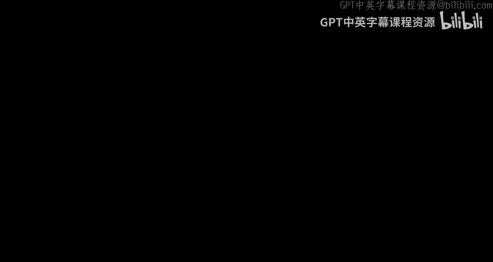

# 斯坦福大学《计算机视觉的深度学习｜CS231n： Deep Learning for Computer Vision 2025》中英字幕 p06 -06-Lecture 6_ CNN Architectures.zh_en -BV1FqazzVE6w_p6-

Hi， everyone。 My name is Zane。 I realized I actually didn't introduce myself on the first lecture I gave。

 which was lecture 3， but I'm one of the co instructorors for the course， my name Zane Durantte。

 I'm coadvised by Asan and Feifei。 I'm a fourth year PhD student at Stanford and in this lecture today。

 lecture6 will be talking about training convolutional neural networks。

 and then also CNN architectures。So， you know I would say this lecture is really broken up into two different components。

 The first one is just telling you how to piece together all of the different building blocks that we've learned like convolutional layers。

 linear layers or fully connected layers together to create CNN architecture we' go through some examples and then also we'll talk about how you actually train these and all the steps involved there So as I mentioned before。

 we'll have basically two different topics， The first one is how to build CNNs and by this， I mean。

 how do you actually define your CNN architecture to set it up to be trained and then the second set of topics today is how do you train CNNs So starting with the first set of topics here willll go through the layers in convolutional neural networks And if you recall from last lecture we learned about the key layer in these models which is the convolution layer and the way that these layers work is they have these filters you have a predefined number of filters per one of these convolution layers in this case six they match the。

Depth of your input data here。 So in this case we have a 32 by 32 RGB image。

 so we have three depth channels， each of these filters。

 slides across the image and calculates a score at each point at that location in the image you take the dot product of the values in the filter with the values in the image so you multiply all these values together you sum them together and then you add a bias term and this is how you calculate each value in your output activation map on the right so you have these sliding windows that go across the image they calculate a score at each position and that's how you get these activation maps。

And you have one per each filter。 Normally， we'll do a sort of relu or a non nonlinearity activation function at the end here。

 So this is from last lecture。 I won't spend too much time on it。The question is for images。

 the depth is equal to the number of channels， RGB。 But here， the depth is6 for that output here。

 So if we had a second convolution layer afterwards。

 they would need to be filters that go across all six of these activation maps。

 So the next layer would be a depth is 6。Okay， and then the second layer we talked about。

 which is much simpler than the convolution layer is this idea of a pooling layer。

 So here it's still this sort of filter that we're sliding across the image。

 you know two by2 filter with stride2。 So we're skipping over We're not doing every single location。

 And here is a max pooling。 So we're just taking the max of each of these areas。

 And that's the value we get here。 or you could do an average pooling。 you know。

 these are both commonly used， I would say and depending on the architecture。

 you would probably just if you're creating new architecture。

 you would try both of them and see what performs better here。

 But the basic idea is to consolidate among the height and width dimensions for your image。😊，Okay。

 so we've basically gone over at this point in the course all the top row here。

 which is convolution layers， pullinging layers and also the fully connected layers。

 these are the first layers that we talked about in the neural networks lecture where it's basically one matrix multiply followed by an activation function and for the rest of this lecture。

 I'll talk about the remaining layers that you see in CNNs， at least the commonly used one。

 which include normalization layers， which I'll go into those and then also drop out。

 which is a regular regularization technique that's used actually in the model architecture itself。

 and then finally we'll revisit activation functions and I'll tell you about here are the most commonly used ones both historically and in the modern era of deep learning。

So starting out with normalization layers， the basic idea here is we're going to be calculating statistics like the mean and standard deviation for our input data and then using those to normalize the data and then will basically learn what is the optimal distribution for the model to learn at that point so so very concretely we learn parameters that will scale and shift our input data by a learned mean and a learned standard deviation so how all of these normalization layers work is there's two steps the first is to normalize the data coming in to be a unit Gaussian so mean zero standard deviation1 and then we will scale and shift it so multiply by some value to increase or decrease the standard deviation and then shift it to change where the mean is and all normalization layers do this technique but the way that they differ is how they calculate the statistics so how are you calculating the mean and standard standard deviation and which values are you applying these。

Stistic too， but all normalization layers are doing this high level process。

So I'll talk about layer norm， which is the most commonly used normalization layer I would say today in deep learning and it's really commonly used in transformers specifically and so you can imagine you have some data coming in X which is a batch size of n so we have n samples coming into our model and each of these are vectors of dimension D so what layer norm does is we calculate a mean and standard deviation for each of our samples separately so we're calculating what is the mean along the depth or the dimension D here and what is the standard deviation then we learn parameters and so these are learnable parameters learned via gradient descent in our model to then apply to each sample so after we calculate our statistics in this way treating each sample separately to calculate the mean and standard deviation we then apply these learned scale and shift or parameter。

HereSo we subtract the mean and divide by the standard deviation within our input data to normalize it。

 and then we apply the scale here with multiplication and the shift。

 So this is the idea behind layer norm。 and at a high level layer had a high level idea。

 all of these different normalization layers are allal computing very similar things but the main difference is how are they computing the mean and standard deviation。

 So this is a really nice visualization from a paper called group normalization that introduces a new way to normalize。

 I would say not so commonly used these days， but this is actually a really great way to gain intuition about how these different normalization layers are different。

 So for layer norm， I describe the really simple case where we just have vectors that we're normalizing。

 But in the case for convolutional neural networks。

 we have channel dimension or the depth we have in the height and the width or the spatial dimensions of the image。

So what layer normorm does is for each sample we're still processing it separately and we're calculating the mean across all of the channels。

 all of the heights and all the widths， so if we look sort of back into this diagram here。

 you would basically be calculating one mean and one standard deviation over all of these over all of these values so for each of our input data points we're cculating one mean and one standard deviation across all of the channels。

 all of the height and width dimension so this is what layer normm is doing。

But you could imagine feasibly that you could calculate these statistics differently batch norm。

 you're taking each channel， so each channel is being calculated as one mean and one standard deviation and you're applying it just to that channel and so you're averaging across all the data in your batch In norm is even more granular and then group norm。

 So I just want to point out all these layers are kind of trying to do the same thing where you're basically normalizing your data and then having these learnable scaling and shifting parameters。

 but the way they do it is different because they're calculating the statistics using different variable different subsets of your input data。

Yes， so the question is for layer normm， are we calculating one mean and one standard deviation for each image or input data。

 yes？They're all calculated separately。But for batch Nor。

 there would not be the case in this example here。For batch norm。

 it's actually within the mini batch when you're doing gradient descent。

 you have a small batch of data you're looking at， you feed it into your model。

 you're calculating the per channel mean and standard deviation based on all of the data in your batch。

Yeah， I think this is like a good if you can understand this diagram。

 I think you understand what all of the different normalization layers are doing。

 so it might be worthwhile after lecture if you still don't fully understand it just to like go through and make sure you understand what you know and shaded and blue。

 these are the values we're both calculating our statistics over and then applying the mean and standard deviations to Yeah。

 one final question and then we'll go on。So channel here is is the depth here。

 so the number of spatial the different spatial values you have at each spatial。

 the number of values you have at each spatial location。Okay， cool。

 so this is we talked about normalization layers。 The key idea is you're calculating these statistics。

 applying them to your input data， and then learning a scale and shift parameter that you then apply。

 So the next type of layer we'll talk about is called dropout。

 And this is a regularization layer in CNNs。 And this is the final layer that you'll need to learn in order to basically we can start going through all these different CNN architectures that people have created over the years。

 So with dropout， the basic idea is to add randomization during the training process that we then take away at test time。

 And the goal is to make it harder for the model to learn the training data。

 but then it will generalize better。 So this is a form of regularization。😊。

The way we do it concretely is that in each forward pass of our layer。

 we'll actually randomly zero out some of the outputs or activations from that layer。

And the main parameter you have for this dropout layer， which is just a fixed hyperparameter。

 is the probability of dropping out the values。 And 0。5 is probably the most common or 0。

25 is also commonly used here。 So you're just dropping out a fixed percentage of the values here。

 And so you know， going forward to the next layer， these would be 0。

 And so you don't you don't really need to calculate the the values here。 So I mean。

 basically all all the outputs here are 0 at this point。

 So you can get there's some tricks you can do with masking so you don't even need to calculate the values because0 times any value will be will be 0。

 So I think in general， you might ask， why does this work。

 And I would say this is more of an empirical thing than a well well studied from a。

From a theoretical standpoint。 But there are actually some ways you can view what dropout is doing to gain intuition of why this might be useful。

 So it basically forces your network to you can imagine it forces it to have redundant representations。

 So if we have a list of features that we're learning at a given layer。

 say the layer right before the output of our model。

 And we have a CNN that is basically extracting each of these features So it can detect if there's ears in the image or if there's a tail。

 if it's fur it has claw。 and you want to。Your model to output the probability of a CA score。

 so one of the things that's useful about this is because some of these values might randomly be dropped out during training。

 your model can't over relyly on certain features being present and some of the classes and actually needs to learn a more broad set of correspondences between your features in your output classes so the model can't just hard focus on okay well if it has an ear and is furry it just so happens that these are always cats or something like this or if it has claw and it has an ear。

 it it'll almost always be a cat on your data so it'll actually help you generalize better to new features despite the fact that in your data there might actually be really strong correlations between the codependency of certain features and your output class by having drop out essentially making it so the model can't rely on these during the training phase because it won't always see the pairs of features together。

So this is an example for cat and the question is if we had something like tree instead。

 how would you determine which features to drop out So the dropping out part is actually completely random。

 So we're not making any choices about this。 It's just in this case。

50% of your your features at any given step will be dropped out and set to zero。 So yeah。

 you don't have to make choices about it， which is kind of nice， but it is completely random。

How would the model know if you're only seeing a subset of the features like tail and clock here。

 The point is you will actually do worse on the training data because you're only seeing a subset of the features。

 So it does make the model worse by not having all the information but then it does better at test time is the idea。

 So worse training time and better test time because at test time you're basically no longer having this dropout。

 So the final component here， which we actually should have explained first before field questions is the idea at test time。

 you're no longer dropping out any of the values。 So this is randomness that we're adding during the training phase only than at test time。

 we're never masking any of the output activations and we're removing this dropout idea altogether。

 Now one thing we need to note is that because if we were dropping out 50% of the activations during training time at test time。

 you're basically having 50% more values that are being input to each of your layers。

 And so this can cause issues if you don't scale it。 So what you need to do is multiply by。

Probability of dropout so that the sort of magnitude of the values coming into each layer is preserved during training and test time。

 otherwise if you're dropping 50% of the values and then at test time you just include all of them。

 you'll get really weird behavior because you'll be seeing much larger magnitude of inputs than before。

Yeah， so what about for backward prop， so for backpro， when you have these zeroed values。

 yeah it's sort of liket you don't need to traverse that path of your director graph anymore it's very similar to Raylu if you have a zero value at that point。

 the gradient becomes zero so anything sort of further back in your computational graph。

 there's no gradients calculated at that point。If you're dropping out certain values or activations。

 the weights associated with those specific activations will not be updated during gradient descent if you're dropping them out。

So the question is， maybe I'll reframe it。 what are we doing at test time。 So at test time。

 we are using all of the output activations。 We're not dropping them out anymore。

 but we need to scale by the probability of dropouts。

 we multiply each of our output activations by this P value because now we're using all of them。

 So otherwise you can imagine have each note sort of seeing significantly higher number of inputs than it did during training at test time。

 So you need to multiply by this P value to maintain the same magnitude of your inputs coming in。

 and the variance stays the same and all these different properties。

 It works very nicely if you do it like this。Yes， so the question is。

 can you just add noise to the image instead， The answer is yes。

 and we'll go over how to do that in future slides。 Yes。

 that's a great idea to add noise to your image。😊，Okay， some specific code here。

 I won't go over this because we already mentioned this。

 but you're dropping a P percentage of your activations here and then you can multiply here at test time。

Okay the next topic I'll talk about is activation functions。

 So you all have basically learned all of the key layers now in CNNs。

 and now we're gonna to be talking about these activation functions。

 If you remember the whole point of these activation functions is to introduce nonlinearities to our model。

 So right now with these convolution operators， the kernel citing across the image and the simple layers without sorry the fully connected layers without activations。

 they're all just linear operations because they're multiplications and additions and the whole point of the activation functions is to add nonlinearity。

 So historically sigmoid is a really commonly was a really commonly used activation function。

 but there's actually a key problem with sigmoid， that is the reason why it's no longer used today。😊。

And so sigmoid， if you graph it looks like this， you can see the equation in the top right of the slide here。

And。The main issue is that empirically what happened was after many layers of sigmoids。

 you would get smaller and smaller gradients as you're computing back prop。 So starting from the end。

 the gradients are fairly large in magnitude。 And as you undergo multiple layers of back propagation and go to the initial early layers of your model。

 You would get smaller and smaller gradients as you do this process。

 So I'll actually open this question up to the class。 you know。

 this isnt a phenomenon we see that occurs as sigmoid。 And so in what regions in our graph。

 does sigmoid have a really small gradient。Yeah， so very negative and very positive values is correct。

 And this is actually a huge issue。 I mean， you can visually see here in the graph。

 The gradient is very flat。 you know， you're taking the derivative here。 It's very small。

 And so basically， for almost all of our input space from negative infinity to positive infinity。

 you have very small gradients。 And it's only this narrow range in the middle where you have something that's non nonzero。

 So basically approaches zero very quickly on both ends of the extremes。

 And so this means that if the values coming into sigmoid are very large or very small。

 then your gradient will be very small。😊，So this is one of the main reasons why Ralu became super popular because now in the positive region。

 we don't have any of this behavior it's just a derivative of one here。

 but in practice you still have this flat portion here on the left where you know your gradient is zero so now we basically have half of our input domain here we get a gradient of one and the other half is0。

 which is better than almost all of it being zero or very close to zero except for a small region in the middle。

So in practice， these work better， also it's much cheaper to just compute a max operation between zero and your input value than the sigmoid function。

 So for those two reasons， Ras became super popular。

But you still have this issue where for any negative input you get a zero gradient and so more recently there's been popular activation functions that avoid this by basically having a nonflat section of the activation function in the nearby neighborhood to near zero so this is Galu and there's also Clu which I'll show in a slide but I won't go over the formula they look very similar the basic idea is just smooth out this non nonsth jump here in in the derivative from0 to1 at 0。

0 for raylu so there's a very sharp in non-smth function with raylu but the nice part about Galu is we actually have nonzero gradients here and in the limit as x approaches infinity or negative infinity it does converge to raylu as well。

 but you get sort of more smooth behavior in the middle here。

Tically what Galu calculates is this Gaussian error linear unit。

 so this is the cumulative distribution function of a Gaussian normal so if you imagine the area under the curve of a Gaussian that's what this5 x is at any point x。

 so if you have a really negative value here， you'll have a value close to0。

 which is why it sort of converges to raylu is zero here and that a very high positive value it gets very close to1。

 the area under the curve， so it converges to x here so this is Galu it has these nice properties and it converges to raylu at the extremes 2。

And this is the main activation function used in transformers today。

If you look at all of them and you kind of squint a lot of these kind of look the same。

 the basic ideas something relatively flat and then in the limit it approaches x equals sorry f of x equals x and sort of it becomes a linear line。

 so Clu is actually x times sigmoid of x which also has this property for very negative value you have something close to zero and for very positive value it's close to1。

 so it's actually similar to the cumulative distribution function for the unit Gaussian that is phi here so that's why the shapes are actually really similar looking to。

😊，Okay， so you might ask where are these activations used in CNNNs and the general answer is that they're placed after linear operators。

 so almost any time we have a feed forward or a linear layer or a fully connected layer。

 these are all words for the same layers a matrix multiply followed by activation function。

 or if we have a convolutional layer， pretty much after these is where we place the the so after the convolutional layer after these linear layers we'll put the activation function。

Okay， so you've learned everything now about all the components of CNNs and I'll now go through some examples of how we put them together and how people have created state of the art convolutional neural network architectures。

I think this is a really neat slide because it plots two different values。

 so on one hand we have the error rate which is these blue bars and this is over time so these are different models people have trained on INe and then you have these orange triangles which represent the number of layers that models have and you can see at the same point that we have significant drop in error where we actually surpass human performance for the first time we see a huge increase in the number of layers so we'll go over in class today how they were able to achieve this and what were the design challenges and goals for how they did this。

Historically， Alexnet was the first sort of CNNbased paper that worked really well on Inet and they used they were able to train it by using GPUs。

 we talked about this earlier in lecture so I won't spend too much details around Alexnet from a historical lens but I do want to compare it to another architecture called VGG which was a really standard and commonly used architecture in the 2010s and I think I can plot the two CNN architectures together side by side here So in general in AI。

 we like to plot our model architectures using block diagrams where each block represents a different layer or a group of layers that are stacked together and it also helps you gain intuition about know what are the general differences just at an initial glance so these orange blocks which are the common ones here are three by three convolution layers so these are convolution layers that have filters that are sliding across that are size3 by3 their stride is one。

So they're visiting every location in the image， not skipping over anything。

 and they add padding of one around the outside so that we're not shrinking as we do these convolution layers。

And so they also add these pooling max pooling layers throughout here too。

 and you'll notice that for all of these they have after a pooling layer。

 they'll start doing two sets of fully connected layers。

 dimension 4096 followed by a dimension of 1000， and the reason we have 1 thousand00 at the end is because ImNet was  a0 different image categories。

 so we need to have scores for each of these categories so the final layers always equal to the number of classes you have for image classification problem。

And so you can see it actually looks extremely similar。

 It's sort of just like a scaled up version of Alexnet with more layers here。

 and also they're now doing some sort of three groups of convolutions at a time followed by pooling rather than two layers in a pooling or even one so is actually pretty remarkable that there's only basically three different types of layers in these models。

 but they perform extremely well compared to anything people had tried before at this point So these are I would say the simplest layers。

 you might simplest models we're going to discuss today。

 but you might ask why are they doing three by three convolutions like how do they pick this value and there is actually some intuition behind how they chose three by three So and it specifically they have groups of three or even four of these So I'll ask you all a question what is the effective receptive field So we looked at receptive field last time but it's basically the。

Id of the parts of your input image that a particular value in your activation map has seen before。

 So what values have been used to compute the final activation map after many layers of your model。

 So you have three of these layers that are all three by three convolutions with this sliding filter with stride of one。

 What is the effective receptive field of each value in our activation。Map A3 here。

 So this is after the third layer。So I'm showing one of the layers here。

 you can see for each value in a3 it's computed by looking at a 3 by3 grid of values in a2 and then conceivably for each one in A2 it's a3 by3 grid and a1 and for each of those it's a three by3 grid in our input so I'll let you all think about this for a little bit maybe it will help to see the next layer here so it is actually really helpful to visualize this so at a1。

😊，Each of the corners here， you know we're calculating a new from a new3 by three grid here。

 So from our input， how large is this overall square？7 by 7。 Yeah， exactly。

 So this first one is 3 by3。 This next one is 5 by5， and then the next one is 7 by 7。

 and we can visualize it here pretty easily。 So the nice thing about the 3 by3 convolution with Stride 1 is that you're basically always adding two to your receptive field at each layer because you know。

 each point here， you're looking to the left and to the right and above and below it。

 So after you have many blocks of those， you're just adding two each time。😊，Okay。

 so we basically just showed that a stack of three of these three by three convolution and strideide 1 layers has the same effective field as  one。

7 by 7 layer。Yes， so the question is how much of this is justification after the fact versus how much of this is intuition that they then use to say design the experiments。

 I think it actually probably depends on the architecture。 So for some of them。

 it's more intuition focus and actually the one we're going to cover next。

 I think really was the whole research direction was spawned by an empirical finding that there's a thought experiment about So that's resonancesons。

 and I think there's actually pretty good intuition that led the whole investigation into what will work well but then for this one I mean I can't say I can't speak for the authors whether it's justification after fact or you know based on empirical findings or or if it was involved in the design choices because I haven't seen them speak publicly about that yet。

 but for resonancesonates I do know it was the hypothesis that led to the creation。

But this is actually a really nice property， so three of these three by threes have the same effective receptive field as 17 by7 layer and it actually has fewer parameters too。

 so we have if you imagine our channel dimension is staying the same you have these three by three grids where you have you your input number of channels so three times three times C would be the number of values in each of these filters and if we have C of these filters it's three times3 times c times C or three squared c squared and we have three layers total so sort of if we look at it through this lens it's actually it's actually fewer parameters and we're having a more complex。

😊，A more nonlinear model that we're building here。 so fewer parameters。

 and it can model more complex relationships among your input data。

So this is maybe why stacking these three by three layers together could be better than having just a larger filter that you're sliding across。

 So fewer parameters， and then also you can model more complex relationships。Okay。

 I'll now talk about res， which I guess Ill very much bring up the thought experiment that someone just asked a question about。

 So there was actually an empirical finding that spawned a lot of the conversation and thought around designing resonancenets And the idea was actually shown that if you keep stacking deeper layers on a plain CNN network。

 like something like this and you just keep adding layers to it。 you build it larger and larger。

 what happens。😊，So what we found and what they found is that the 20 layer model will actually have a lower test error than a 56 layer model and you might think that this is because of overfitting。

 but it's actually not because if we look at the training error。

 the training error of this 20 layer model is also lower so it has a lower training and a lower test error basically means that the model is doing better on all accounts so why is this 56 layer model performing worse than a 20 layer model' you it might be confusing and we know as I mentioned before it's not caused by overfitting。

So these deeper models have more representational power and theoretically they should be able to represent any model that more shallow network can model。

 so the set of possible mappings between your inputs and different values for your larger networks is a superet for your smaller networks because theoretically you could imagine that you basically are just setting some of these layers to be the identity function where the layers doing nothing and then you would have if you set half your layers to do nothing。

 you have exactly the same representation power as a model one half the size。

So the idea is not that these models are worse， but' in terms of the representational power。

 but they're actually harder to optimize。Because the set of possible models for your deeper networks is larger and it contains all of the possible models that your more shallow networks could learn。

So I sort of hinted at it before。 But how specifically could the deeper model learn to be at least as good as a shallow model。

 It's by setting。 So if we have a two layer model versus a one layer。

 So one layer here and two layer on the right， if we set one of the layers to just essentially be an identity matrix or you。

 this is just an identity function， the model should be at least as good as the shallow model。

It should be at least as good as a shallow model。So how do we actually build this intuition into our models。

 We want them to be able to be just as good as a shallower model if they want to be during optimization。

 so the way that we do this is actually by fitting what's called a residual mapping instead of directly trying to fit a desired underlying mapping。

And what this looks like is we basically take the value X and we copy it over past our convolution layers so that the value at this point is already receiving X our original input as well as the output of our two convolution stacks。

 So basically at this point， this f of x or which is called the residual map here。

 It could just learn zero values for all the con filters。 and the output would be zero here。

 and then we would just add x along here。 and we would get x。

 So it allows a very simple way for the model to bypass these layers。

 if it doesn't need to learn anything for the layers。

 And what this means is you can really easily now learn basically this identity function that we talked about earlier by just learning00 filters。

 So your filters all are filled with zero values， for example。Or in this case。

 more practically what happens is they just need to learn very small values because instead of learning this entire mapping from x to H of x。

 they just need to learn this difference， which is F of x so you're now just learning this sort of difference between your desired output here and the copied over block this is called residual block or residual residual connection when you copy over values from an earlier layer into a later layer in your model and then you just add it to the values at that point。

So I talked a bit about the intuition， which was this observed phenomenon that these larger networks were achieving worse training and worse test error because they were harder to optimize so the intuition was we need to build a model that can really easily model the shallower networks so it can be at least as good as a shallower model the way they did this was by adding a residual connection so that you can just copy over the values easily build that into the architecture itself rather than trying to learn some identity mapping among the convolutional layers and empirically this showed to work extremely well too。

Yes， so what is the residual block carry， So we have our input X。

 We pass it through two different convolution layers， and we get your output F of X。

 X is is just copied over here。 So this is exactly the same as x。

 And we add it to the output of these two blocks， which is F of x。Yeah。

 X is the output of one of the previous layers， or if it's the very first layer of the model。

 it would be the image。Yeah， so the question is， if maybe you just don't have enough data and if you added enough data。

 then maybe you could train a model without these blocks。

 I think these blocks actually do extremely help you with learning from more data。

 I think the issue it was really an optimization problem So transformers use residual blocks for exactly the same reason because I think it actually helps you model these more complex models and it actually enables you to use more data So I think it's very good residual blocks help you to use more data more efficiently because you're able to model a greater number you're able to more easily model a greater number of functions。

Yeah， so the question is that maybe if we just train for longer。

 the performance would eventually converge to the value of the smaller network and maybe it's just harder to optimize because it takes longer to train a larger model and the answer is no that these were not they were not converging to the performance of the smaller model regardless of how long you trained it and the reason is because it's being stuck in essentially local minimum and when you add these residual connections you' avoiding these。

 this is the actual explanation why this is the case is still I would say being a more active area of research it's really hard to understand exactly what causes these models to avoid a global minimum or sorry to avoid local minimum and not get an optimal solution or to what causes them to not train and find better solutions and oftentimes it's。

really an empirical finding， but there's some intuition behind it and in this case the intuition was that we want to enable our models to do at least as well as the shallower models which we know were performing better at the time。

 so it's not that you could just train it for longer and it would do better it was actually a limitation where it was no longer it was just completely unable to achieve as good as the shallower models。

Okay。So here is the overall resnet architecture。 We have these stacks of residual blocks now。

 So that's what these two blocks here together mean。 It's a residual block。

 So we have a three by three convolution with the raylu all by another three by three convolution。

 and we're copying over this X value here。 We're adding it to the outputs here。

 and then we're having a raylu afterwards。 So each of these pairs of blocks。Is one of these residual。

 and that's why you see this line skipping over here because the value is getting added forward。

The cool thing about resonance also is that they basically had a lot of these different depths that they created。

 so they created a whole family of models， some smaller and some larger。

 and they showed that as they increased the number of layers， their performance was increasing。

 albeit sort of the difference in performance as you got to the larger and larger models became smaller so it was sort of reaching a point of given the data set they weren't able to scale any significant amount by adding more layers further than that。

 but they saw significant improvements in performance among especially the earlier models and then101 to 152 is where the performance it wasn't really changed。

 it was marginally better， but performance changes maybe only like 1% at that point。Yeah。

 how did they get the number of 152。 I actually don't know how they got the number of 152。

 I think they wanted to try different values here。 And you can see that I mean。

 they're not exactly doubling， but， you know， there's it's sort of， you know。

 a significant increase in each time。 I don't know how they picked 152。 It's a good question。

 Maybe they showed it somehow worked better than other。 I actually don't know though。So generally。

 when you're trying multiple different number of layers for your model。

 like given that say these are the number of layers you want to try。

 what you'll do is you'll sort of first train the smallest model。

 see performance and then add more layers， see if your performance increases and go on so forth。

 So that's probably why they stopped at 152 is because performance wasn't increases as much anymore。

 And also there's GPU memory limitations。 So as you get larger and larger models。

 it becomes harder to train from a hardware perspective because you need to fit more parameters into your GPU memory。

 So there is like a limit for given your compute setup。

 how large of a model you can train I think you need to train these model separately though So you have one model run for 18 layers one for 34。

 etc。So the question is how to think of intuition of CNN blocks given we're using these residual connections。

 because you can still think of it as higher levels of abstraction and this is shown to be true in the layers。

You're not instead of learning within the block itself。

 instead of just learning the higher level features。

 you're learning the delta from the original image to get the higher level features。

 that's what you're learning in the block。 So you're learning the delta。

 but you're still achieving these higher level representations at each step。

 So that part is the same， but the actual functional way of doing it is we're learning this you're learning this F of x that you add your previous input to。

 so it's like you're learning the delta。The question is， if you do addition。

 does that require you to have the same tensor size， the answer is yes。

 and it's part of the reason why it's really a nice property that all of these ones have this three by three convolution with strideide one so that you maintain in one padding so that you maintain the same size at every layer going forward so after you had say a pooling layer。

 you wouldn't I mean， you could maybe come up with a way to do it where you double the you increase you sort of unpool the values but after a pooling layer for example。

 you couldn't do a naive addition anymore because the size of your tensors are different so these are done within before a pool。

At least the regular one， I mean， you could get around it by just having each value be spread out and multiple values。

 for example。Okay， so these are basically the main takeaways for renets。

 One other neat trick they do is they basically periodically after a certain number of these blocks。

 they'll double the number of filters and downs the spatial dimension。

 So basically you can imagine if you start with a really flat image as the activations get pushed through the network。

 it becomes smaller， spatially， but then the depth is larger。 So this is how to think of it。

 And then at the very end， it just becomes a vector that you then use for classification。

 So that's how you should be like visualizing what's happening to the values in the network itself。😊。

And the shape of them。 And then one other sort of thing that's somewhat unique to resonnets。

 other architectures do this too。 But before all these layers with the residual blocks。

 they have this relatively larger convolution layer。

 And the here is just empirically shown that it did better if they added this here。

 So this one is purely empirical finding。Okay， I think， yeah， basically to highlight， you know。

 it did extremely well these larger models， it was it was the first time they were able to train 100 plus layer model successfully。

 So it was a really big deal。 And basically， Resnets were used in a huge variety of computer vision tasks afterwards。

 almost every task and computer vision was using a Resnet at the time because they performed so well because of these residual connections。

😊，Okay， so we talked about some CNN architectures， main ones being the main one being Resnet and then also VGG historically。

 so we talked about why the smaller filter size is useful and having many layers of these is useful So the final thing I'll talk about in terms of how we actually construct the CNNs and prime them to be ready for training is how do you actually initialize the weight values of the individual layers。

So。You know depending on what values you choose， you could either put values that are too small or too large。

 which would cause significant issues for your model during training so here it's basically a six layer network where we have 4096 dimensional features and this is just a fully six layers of fully connected model and we initialize them here this is getting unit Gaussian random and then we multiplying it by 0。

01 to get very small values close to 0 and we have know relu at each layer too so if you plot the forward pass of this model you would actually see that at the beginning you get relatively you know because it's relu so all the means are going to be positive but you'll have a mean and standard deviation that is relatively high but as each layer progressive because we had a really small weight initialization it becomes smaller and smaller mean and standard deviation and really ideally。

You'd want basically all these to be the same for each layer because it makes our optimization problem much nicer to solve。

So if we say use 0。05 instead of 0。01， can anyone imagine what might be the issue here if we set it to too large of a value？

So when it's too small， it goes to zero， basically。What happens if it's too large？Yeah。

 basically the activations get large and larger at each layer so if you plot it here。

 you can see that you know by the end there's some massive mean and standard deviation and if you're training 152 layer resnet and you know you can imagine that this becomes quite an issue very quickly。

So how do you actually do this So in this case， you know maybe the optimal value I think is 0。

022 or something， but how would you actually know that and how would you do this more generally across any layer there are a few different ways you can initialize weights and I'll go over the most commonly used one today in class but know there are other ones and generally what there a function of is the dimension of your of of your values here so you'll have a different value for a 4096 dimension fully connected layer versus a 2048 and the specific formula will go through is called Kimming initialization is actually the same person who created resonancesonates so Kaiming Ha he was a very famous I mean he still is a very famous computer vision researcher I think he's one of the most widely cited computer scientist of the last 10 or 15 years maybe the most so he extremely well known in the computer vision community and he also came up with this idea。

Of initializing the values to the square root of two over your input dimension size。

And I won't go over all the details for how they derived this and showed that with a radiolu activation。

 this would cause the standard deviation and mean to be relatively constant throughout the layers。

 But if you do plot it， you see this does have the effect So you can almost think of this as a magic formula where if you plug it in and you get the desired properties。

 And if you want to know the derivation， you can actually we link the paper here so feel free to look into that。

 but you can just sort of take out where I won't go through the details here。

 but it does this desired effect where the mean and standard deviation is unchanging and you can also imagine that for any given setup。

 you could also just through testing， try to find what is what is the value here。

Okay so these are how we discuss how you initialize weights。

 how you combine these different layers together to form a CNN architecture。

 which activation function which activation functions people use and then all the different layers in CNNs so I think already we've covered quite a few topics so I think I'll pause very briefly to see if there's any questions about these in the second part of the lecture it's actually much less dense than the first part so we'll be mainly going over a lot of nice practical tips for when you're training these models。

So the question is， how do you do weight initialization for CNNNs。

 So you still use this same initialization， but your dimension in here is the size of your kernel。

 So if you have a three by three kernel with channels， say six。

 it would be three times three times 6 is but it's the same idea。

 It's just you calculate your dimensions differently depending on the layer， the type of layer yeah。

You can think of it as the number of values roughly in each operation。

But it does depend on the layer and some layers use different weight initializations。

 but this is specifically for CNNN's how this timing initialization applies to it。Yeah。

 so the question is why do your activations explode if you have too large of an initialization value so you imagine at each layer of your initialized network。

 you have a set of randomly initialized values and if they're very large then when you do your you have a raylu activation afterwards and that doesn't actually cap the outputs of your layer you can go to infinity with Raylu so if you have too large of a set of values that you're essentially repeating the same operation on because you're initializing all the weights to the same set of random values。

 then at each layer you'll be multiplying one set of large values by a set that's been initialized too large so that it becomes larger at each iteration afterwards I mean you can think of it as it's sort of like a recurrence relation where because they're all initialized randomly at the start where it's being multiplied by a value and。

in a civil re occurrencelation， you want it to be one， right。

 But because we have a vector of values that are being multiplied by our matrix。

 It depends on the dimension of the vector。 what your average output would be and what the after the Raylu because you have basically a standard deviation for what is your activations。

 then you you remove all the negative ones and you're left with what are your outputs at that point。

 And if you have a really large values， you have a really large standard deviation。

 So when you remove the bottom half of it。 You get your mean starts moving more positive and more positive that makes sense that sort of I didn't have slides to show it。

 But mostly sorry， yeah， you can see more details in the paper。 It's actually not too bad to read。

 I think。So the conclusion of the discussion here is that normalization would solve this activation issue where they're blowing up。

 but it still might be harder to optimize maybe we can we should probably do follow the post on end explain some detail but I think it's a really good question actually it would solve I think this particular issue but maybe it's still hard to optimize the discussion Yeah it's a good question。

Okay。Cool， so I'll talk about these steps now。 So how do you actually train your model。

 And the nice thing for data preprocessing is it's really easy for images。

 So if you have your giant image data set， the standard way to do it is you calculate the average red。

 the average green and the average blue pixel along with the standard deviations and you take your input image。

 you subtract the mean and you divide by the standard deviation。

 And this is how you this is how you do data normalization for images iss actually very straightforward。

 So it does require you to precompute the means and standard in standard deviation for each pixel channel。

 So sometimes what people will do is they'll use means that have already been calculated。

 like a very common one is to use the imagenet means and standard deviations。

 and apply those to your input images。 Even if you're training a model， not on imagenet。

 So it is very。😊，Data set dependent is the way to think of this。

 and different models will use different values here， depending on their data set。

 But the most commonly used one is just use the mean andity deviation from imagenet。Yeah。

 so any input image you've applied this operation before the model sees it。Okay， so yeah。

 that one is really quick。 And then in terms of data augmentation。

 So someone had a suggestion early in the class， why don't we just add noise to our image。

 And that's a great idea。 And we'll talk about the different ways you can add noise to your image here。

 This helps with regularization and helps prevent your model from overfitting。😊。

So we talked about it before， but this is sort of a common pattern with regularization where during training time you add some kind of randomness and then at testing time you then average out the randomness so sometimes this is approximate but you know for example。

 for dropout we saw that during training time will randomly drop say 50% of the activations and then at testing time we'll use all the activations but then we'll need to scale it down by this probability of dropout P so this is a really common pattern and it's also used for data augmentation so you can imagine this being a。

This cylinder here is like your data set。 You load an image and a label。 So we have a cat label。

 and we have our original image from our data set before we actually pass it into our model。

 it's extremely common。 And basically always and modern key learninging。

 people will always use data augmentation for training。Computer vision models。

 but basic idea is to apply some transformations to the image to make it look different。

 but still recognizable for the category class and then pass that to your model and you're computing the loss here。

 So one of the nice benefits of this is you can effectively increase the size of your dataset set because instead of seeing each image multiple times so we'll be seeing different versions of the image with different transformations that all still are the same category label so you can basically get more data and therefore it increases your generalization capabilities but your training loss will be higher because you're not just seeing the same example over and over again so it makes it harder for the model to just memorize。

So how do we know the weight initialization is just right。

 So we know it's right in this case because the means and the standard deviations are relatively constant throughout the layers of the network。

 and we're not seeing in this case， we saw sort of mode collapse to zero。 in this case。

 it was sort of blowing up to infinity as we increase the number of layers。

So the way you can ensure it always happens is by using the formula。

 this will always initialize them well， so in practice that's how people do it。

 if you were creating a new layer that maybe it does some different kind of operation that no one's done before then you probably would need to try a bunch of different weight initialization schemes and see what works best but generally for these linear layers or the convolutional layers you can use this formula here。

Which is called the climbing initialization。Okay， so back to data augmentation。

 So what are the different augmentations you can do specifically。

 So one of them is horizontal flipping。 This depends on the problem。

 So if you want to have a model that reads text， this would be a very bad augmentation to use because the text is now it's like you're looking through a mirror and you can't read it properly。

 So this sometimes useful for everyday objects， it's usually pretty good because most objects are symmetrical。

 So this property actually works pretty well。 And then you could also imagine if you're looking maybe at images from a microscope or overhead that you could also do a vertical flip。

 and that would make sense。 But for everyday objects flipping actually doesn't really make sense because a cat is almost always seen in this position。

 But maybe if you had a data where cats were in all different orientations。

 you could imagine that flipping or rotating or all these things would make sense for your data。

Another type of augmentation is this resizing and cropping idea。 So what resons and many。Different。

Image models and deep learning do is they basically take a random crop of the image。

And then resize that to be your image size。 they might even take another crop afterwards。

 So the most common strategy is you pick the length of what is basically the short side of your image。

 So if you have a。Iput image size to your model of 24 by 224 pixels you would pick a value larger than this first and find sort of finds some crop of your image that contains these this larger scale L and these are commonly used values you crop the image sorry you don't crop you resize the image to be that scale so instead of say this is an 800 by 600 image if we use 256 here。

 we resize the short side so 600 to be 256 and then 800 would be scaled correspondingly so we scale it to this L。

 we scale a short side to L and then we crop a random patch of 224 by 224 pixels from that image so you're scaling the image by first preserving you preserve the relative resolution but you make it smaller or larger to fit this L and then you take a random crop of that and this is like by far the most commonly used random resized crop is what it's called in most library。

So this is used in most problems because it works pretty well and it reserves the relative resolution of your images。

And then there's another neat trick you can do with augmentation called test time augmentation。

 so if you really just want to get the best performance possible。

 you can basically get a bunch of these different crops and resizes and run them all through your model and then average your predictions at the end and for resonances people will often try a bunch of different scales a bunch of different crop locations and maybe even flip it and usually you'll start getting diminishing returns。

 but you can get actually pretty good like one to two% performance boost by using this sort of test time augmentation so if you're in a setting where it really matters you're trying to eke out every last bit of percentage points。

 then this is actually a really great trick that you can use for any almost any computer vision problem。

Okay， so a final sort of few augmentations。 One is color jitters。

 So here we're specifically randomizing the contrast and brightness and scaling the image correspondingly。

 So maybe images look more muted or more sorry the colors look more muted or more brighter。

 but these are sort of very traditional image processing techniques。

 and usually with all these different augmentations。

 you'll try different values and see which ones make your images still look in distribution and look normal to you as a human。

 And that's like a pretty good way to judge what values you should pick for how much jitter you should have how much brightness variance etc。

 So normally when I'm starting a problem。 I'll try a bunch of these different augmentations。

 I'll see what is making the data look different from the original data。

 but then still recognizable to me and still very easy to recognize。

 And that's like generally a good set of augmentations to use。😊。

Final one is you can imagine just like cropping out parts of the image where you just are basically putting a black or a gray box over it。

 and I think this one's maybe less commonly used， but it kind of shows you how you can get creative with the augmentations depending on your problem like say you're in a setting where things will get covered like the camera will be occluded so it won't be able to see the objects fully。

 this could be a really neat trick you do to make your model more resilient to stuff blocking parts of your objects so you could almost imagine for your given setting。

 what augmentations makes sense， what ways can you transform your input data so that it's still recognizable to you as a human。

 but it makes it harder for the model to memorize the training examples。Okay。

 so the final set of topics here are basically extremely practical。

 So when you're say doing a project or training a model， as they say for your course project。

 I think you should basically do the exact things we're gonna to be describing in the coming slides。

 but this also applies outside the course to any computer vision domain you could be practicing in So in practice in many times we don't actually have so much data。

 you know INe， the original version had a million images。

 maybe you don't have a million images for your problem。

 which almost none of us do unless you've been collecting a vast amount of data with a huge team。

 So if you don't have a lot of data， can you still train CNNNs。 And the short answer is yes， you can。

 but you need to be a little bit smart with how you do it。😊。

So I think in one of the I think maybe it was last lecture。

 we showed how the different filters in your CNN are sort of extracting different types of features。

 So this goes back to someone asked about like the hierarchy of features in combution neural neural networks。

 So at the beginning， it's more of just like edges or patterns or really small shapes and then at the highest level you can imagine if we put an image into our CNN and we get this final vector right before we get our class scores。

And we compare that to other images in our data， you'll actually see that these values of the vector of our image are actually really close。

 so this is sort of like you can think of this as sort of like the nearest neighbors thing we did before。

 but instead of it being the pixels of the image we're looking at the vector at the very end of your CNN right before you you have the classification layer。

 so this would be like the 4096 or the 2048 layer。And if we look at the difference here as the L2 distance。

 you'll find that for a given image， if you put it into your model and you look at the other images that are close to the model in this vector space right here after you go through all the layers except the last one that you'll find the images are extremely close to each other when the items are in the same category。

 so intuitively what this basically means is that these features here are actually really good at at you could build a linear classifier on top of them and then be able to or a k neighbor classifier and be able to classify objects extremely well。

So， so how could you use this in practice。 So what you would do is you would first train your model on Inet or you would just grab a model someone else is trained on Inet or one of these really large web Internet scale data sets。

 and you can just。Freeze all of these layers。 so you don't train any of them。

 You keep them exactly the same as before， and you replace this final layer instead of it being in the case of I at 100 classes。

 you replace it with the number of classes you have in your data set。

And then when you're training the model， you only train this layer here。

 So if we think about we talked about how sort of in the old paradigm of computer vision。

 you had feature extractors， which was a predefined set of operations to get stuff like color histograms and other predefined features you can almost think of the frozen model as doing this。

 it's a predefined feature extractor that we're not changing in any way。

 but we're using it to calculate features that we then train a model on top of it's actually extremely similar under that paradigm because you're not training it here。

 and if you have a larger data set what tends to work best in practice is to actually train the whole model but you're initializing it from these values that were pre-train say on INe or some other really large internet scale data set So I think pretty much for all of the problems I ever work on I'm doing this step three here because I have maybe million or 10 million training examples so I'll start it with a model。

That was trained on billions that I don't have the compute for and then I'll finet the model on my relatively smaller data set and I'll get better performance than if I just try to train a model myself because the models basically see more data it's created a better feature extractor and then when I fine tune the whole thing you can still be specific enough to my problem You're basically taking say let's use a very concrete case where we're training a model on INe We're taking this model and we're replacing the final layer so that it's no longer outputting  a thousand classes。

It's outputting the number of classes in your data set。

And we're initializing this randomly using the chiming initialization we talked about before。

 but the rest of these layers are maintaining their values that they had before。

 so we're not changing these values and during gradient descent we're never changing these values。

 so these values are unchanged。 we basically take our image we pass it through our model and now it's just like we have it's almost like you're just training a linear classifier where your input are these 4096 vectors for each image that we calculate by passing it through the whole model then we have our vector of 4096 and we're just mapping that to the number of classes and we're only training this mapping at the end。

Yes， so the question is， will you have some bias in your model because it's training an Inet。

 the answer is definitely。 So the model， if you do this number two， like this way of training。

 then it will do best on datasets that look very similar to imagenet。

 So these would be like pictures of everyday things like laptops or maybe a classroom or a person。

 things like this where imagenet is everyday objects。 But if it was say photos of Mars。

 it would do a lot worse。 So there's definitely bias based on the training data of the pretrain model。

 and you want to get something that is in the same type of distribution or you're seeing the same kinds of objects or locations or things like that。

So the question is what do you do when your data is out of distribution。

 I actually have a slide here to cover some of that， so it's a great question。

 so if you have a very similar data set but very little data you can use the linear classifier strategy we just mentioned。

😊，If you have a similar data set， quite a lot of data。

 you'll get best performance by fine tuning all the layers。

 these are strategies two and three on the slide that I mentioned earlier。

But what about when you have a very different data set so if you have a lot of data。

 you might just want to start from scratch or you could you might get better performance if you still initialize here you would test but there's no guaranteed way to know that performance would be better or worse and then yeah if you have very little data or a very different data you probably want to try to find a model that's trained on something close there are specific techniques that researchers have looked into for out of domain generalization and you know this basic idea if you have one domain you train a model on one domain and you're trying to learn a new domain that's different in some ways。

 so this is an active area of research but I wouldn't say there's like a general technique that always works and it's a bit problem dependentent in that setting whereas this is for everything except the upper right quadrant here it works pretty well in practice so there are actually techniques for this and it's a pretty active area of research and certain models generalized better like I think language models are pretty good at learning a lot of different domains for example but yeah it's definitely the worst scenario。

To be in where you have a completely different problem that anyone's ever worked on before and you don't have a lot of data It's by far the hardest to train a model in that setting。

 So the question is， do you ever do anything between training one final layer and all layers。 Yeah。

 people have actually done a lot of work looking into training a subset of the layers there's also a technique called Laura。

 which we might go into in the transformers lecture I'm not sure if it'll make it this year。

 but the basic ideas to fine tune all the layers in a way where you're not changing all the values exactly but you're learning basically low rank differences between the different layers where you're sort of fine tuning differences between the original layers rather than finetning the layers themselves So yeah there's techniques you could use Laura and it would need more explanation。

 but the basic ideas instead of fine-tning the actual values you're fine- tuning these differences between the value layers sort of like how a resonnet you're learning the difference Lauras are like that。

 but you're do it with a very small number of parameters。I think the question is。

 how do they basically decide how many layers to pick why did they pick a large number of layers。

 specifically why are there two convolution layers of each size instead of one So it's actually really similar to the example we showed earlier with VGG where if you have three of these three by three convolutions。

 you're able to have the same receptive field as a 7 by7 convolution。

 but you're able to model more nonlinear relationships because you have these three activation functions rather than just one activation on the 7 by7 filter So basically three by three is more expressive。

 but you're still looking at the same set of values as long as you have enough of them。

 So a larger set of smaller filters is more expressive than a smaller set of larger filters。Okay。

Okay， so we'll go on。 yeah， basically try to find a large data that similar data get a model that was trained on that and then fine tune it on your own data。

 some good links。 Pytor image models has a bunch of models that are trained on imagenet and other data sets and then also just in the Pytor vision a Github re you'll find some too I'll talk over very briefly at the end for hyperparameter selection。

 So if you're having difficulty training your model and it's not working right away。

 I think the best thing you can do is to overfit on a small sample。

 So this is like the default debugging strategy and deep learning where you just have one data point and you want to see your training loss basically go to zero。

 your models should be able to memorize one training example。 And if it's not able to do that。

 you have a bug somewhere in your code or you're not picking the right kind of model to model your problem So this is a really good training problem And'll also tell you like what learning rates work or what ones don't work and you'll get a rough idea of the neighborhood of learning rates you should explore。

 So this is a good way to make sure your model is correct。 make sure。😊。

Your learning rate is reasonable and also to make sure you don't have any other bugs that could be impacting your code so this is like always step one。

 if you're having issues just running some code， this is how you debug the second thing you would want to do after you get this is maybe you try a very core grid of hyperparameter so I would first try with different learning rates and see how if you train model and different learning rates。

 what are the training losses look like you want one that has the most sustained decreasing in the training loss over maybe one epoch that's like a pretty good estimation but you can train for longer once you get a good set of learning rates。

 you could then look into other hyperparameters too and specifically besides the loss you'll also want to look at the accuracy curves。

So you have your training accuracy and your validation accuracy if they're still going up。

 it means you want to keep training pretty reasonable。

 but you might have a scenario where the training loss is going up。

 but your validation loss is going down this is overfitting so we need to either increase the regular or if we can get more data that could also work but you need to do one of the two in order to improve your performance further beyond the peak right here I guess would be the best model you have so far。

If you're seeing very little of a gap here， then you can probably train for model for longer because generally we you do want to just。

Get to the point where your validation loss has been maximized so if you could just keep training。

 you know you can keep training， so even if there's not a significant gap here or anything。

 if you see the validation loss is similar to the training sorry the validation accuracy similar to the training accuracy。

 you can probably keep training until your training accuracy starts diverging from your validation accuracy。

And you really basically can repeat this process over and over again。

 One final note is in terms of for hyperparameter search。

 normally people think you know you have two hyperparameters or more that you're searching over。

 should you try every combination of the hyperparameters or what is the best way to do it。

 I think in practice random search over their hyperparameter space works a lot better than like a grid search where you're trying every set of a predefined set And the reason is mainly because you can imagine you have one axis which is an unimportant hyperparameter where depending on the value。

 your performance will be roughly the same versus an important one。

 if you do random values across all of these， you'll actually search the hyperparameter space of your important parameter much more thoroughly。

 whereas you're sort of wasting time on the grid search rechecking multiple values for an unimportant hyperparameter。

 So in practice， you should define the ranges you want to try and then just randomly collects hyperparameters with values from those ranges。

 and that's probably the best way to do it。 and you just keep running till you get the best model。

Okay， that's it。 So we talked about layers in CNN's activation functions。

 CNN architectures and weight initialization。 How do you actually predeefine and build these models。

 And then we talked about how do you actually train it。

 How do you change your data to be input to the model， How do you augment it。

 Transfer learning is a really neat trick for improving performance。

 And then how do you pick the best hybrid parameters。 So yeah， we covered a lot in lecture today。

 Thank youll so much yeah。😊。

