# 斯坦福大学《计算机视觉的深度学习｜CS231n： Deep Learning for Computer Vision 2025》中英字幕 p07 -07-Lecture 7_ Recurrent Neural Networks.zh_en -BV1FqazzVE6w_p7-

So hello everyone， welcome to Le 7。 I also wanted to go over some clarifications from last time。

 So when I gave lecture last time there were two ed postss that I think were good that you all might want to check out but in case you haven't seen it I'll just go through it really quickly I think when describing drop out。

 how to scale probabilities at test time during lecture there was a bit of confusion and basically what I said in the slide had a sort of mismatch So in each forward pass for dropout。

 we have this hyperparameter P which is either the amount of neurons you're dropping out or it's the amount of neurons that you're keeping depending on which implementation of dropout you're using generally they do it's the number of ones you drop out in most libraries that so P means but the basic idea is that at test time you want the expected output to be the same as at training time So this means that if you dropped 25% of your activations during training time at test。

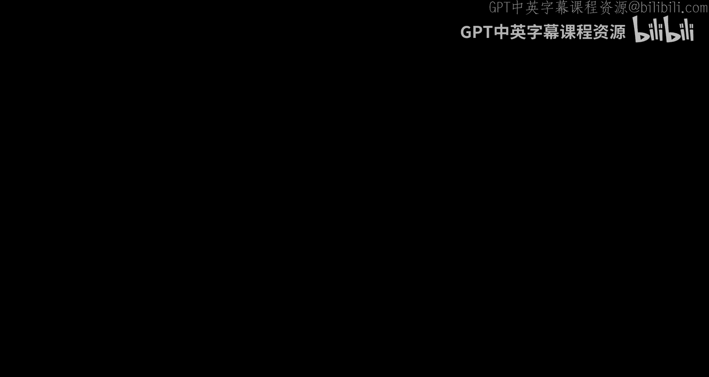

Time you would scale by 075。 so that the expected output is the same。

 And so I think there was a bit of confusion because in this slide。

 the implementation uses P S the probability of keeping a unit active。

 So there's a bit of a mismatch there， just to clarify。

There was also a question in class from last time about how normalization can be useful and maybe resolve the issues that arise when you have weights that are initialized incorrectly。

 but we have this toy setting where we have 2D inputs to our model and a two layer neural network with Raylu it's outputting and basically this quadrant function。

 So if the point lies in the top right itll output one or two or three or four depending on which quadrant the point lies in and we plot the different training losses and test losses for good initialization using the chiing initialization we discussed last time and bad initialization where the standard deviation is too high and the blue plot here represents bad and the green represents bad initialization with layer norm so you can see it actually does resolve a lot of the issues but to get the best performance you still need good weight initialization which are the two lines afterwards so you can go dive in and also whether or not layer norm help depends on the problem so in this quadrant one you can imagine that you don't need to know the exact。

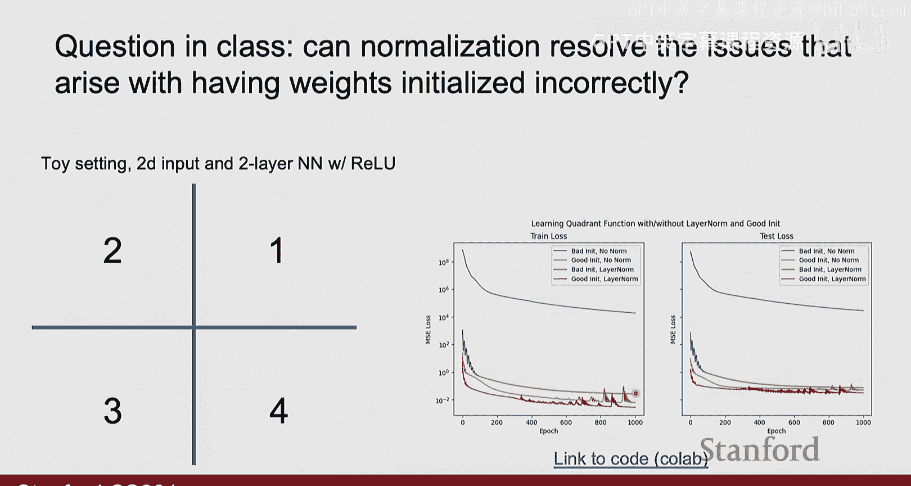

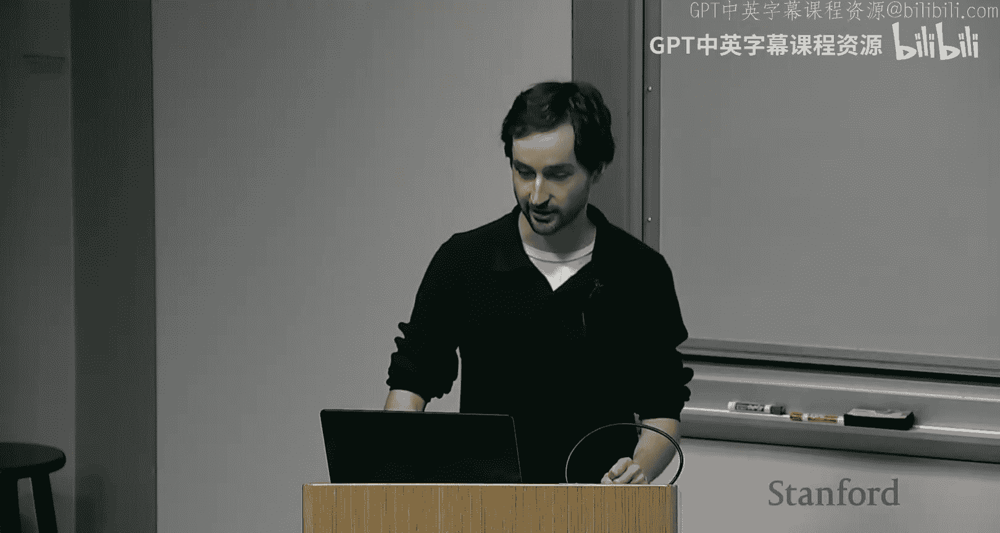

2D position of each point。 So Leorm was actually helping。

 But for some of the other functions that are in the code。

 you can check out where you need to know the exact coordinate in order to get the right output。

 Leonorm actually hurts performance because you lose some information about the exact spatial location of your input when you're doing this subtraction of the mean and dividing by the standard deviation。

 So just some notes here basically at a high level， it does help with the issue， but gap remains。

 So you can't get by this way initialization issue with just normalization。And as I mentioned。

 it may not always make sense depending on what you're trying to model。

So I think just to recap also from last time， we've been mainly talking about these sort of vanilla standard non-recurrent neural networks so far。

 so this is a fixed- sizeize input and a fixed- sizeize output you have sort of this onetime setup where you set your activation functions you do data preprocessing according to some fixed mean and standard deviation for the images the image channels。

 you have your weight initialization and normalization functions that you use as well as transfer learning so if you pretrain on one data set like Inet or some other large scale internet data。

 you can get better results if you initialize your weights to those values We also talked about training dynamics。

 how you can babysit the learning process and choosing a good learning rate。

 how you want to update your different hybrid parameters and also how to optimize those based on the validation performance as well as test time augmentation and improve performance further So a really good tool for points two and three here is something I use and basically all my projects called weight。

Bes so you might find this useful。 It's a really neat way that you can essentially look at different。

 you set different runs with different hyperpara。 In this case， they show a dropout column here。

 So these are all the different values of dropout。 then color coding is really nice so you can see that generally the lower values of dropout will achieve higher accuracy。

 And so you can visualize these different validation sorry these different hyperparameter based on validation set performance。

 and you can sort of see you know based on many runs， get an idea of which hyperpara work best。

 So I always use this， I think it's great， especially if you have the compute where you can just run something over and over again to improve performance more。

 this are a really neat way of visualizing it。 I think they do it well。

 There are other tools like Tensor board。 but this is personally the one that I like。😊，Okay。

 so for the rest of lecture today， we'll be discussing sequence modeling。

 So this is in contrast to a fixed sized input as as input to our model。

 What if we have a sequence of variable length。And also we'll be discussing what are the sort of simple neural networks that people use before the era of transformers。

 which mainly consists of RNNs and some variants of RNs。

 and then I'll also relate in one slide how RNs actually are similar to a lot of and inspire a lot of the modern type of language models that you see called state space models。

 So you might have heard of Mamba， there's some other ones too that we'll talk about in the slide。

 but the basic idea is the key concepts from RNs are still being used today。

 they're not just used in the past and they have a lot of nice advantages over transformers that we'll go into。

Cool， so to specifically formulate the sequence modeling task。

 you can imagine we have a vanilla neural network where we have one fixed size input to one fixed size output。

 which is what we've discussed in the course so far。 In contrast。

 you could have a one to many sequence modeling task。 So here we still have a fixed size input， like。

 say， an image。 But we want to output a sequence of variable length。

 So one common example is image captioning。 So input an image and we want to output a sequence of words or characters or however you're modeling the language or encoding it。

 But the goal is to have a variable length caption output for what's happening in the image。😊。

You could also have a many to one sequence modeling task。

 So here we could imagine our inputs are say a video。

 and we're trying to classify what is this a video of。 So we give it a sequence of video frames。

 And the output is one single class label similar to the image classification case。

 But now we have multiple frames as input rather than just a single image。😊。

So this is an example of many to one。And then you also have many to many。

 so the number of inputs and outputs and the sequences don't need to match so you could have your input is a variable number of frames and your output in this case could be a caption of variable length and they don't need to necessarily match but they could match so you could have so for every single input you have one output and for discussing RNNs we'll mainly be focusing on this setting on the far right。

 but there are basically a lot of small changes you can make to change and reformulate the problem to apply to the other settings。

 but this is sort of the most straightforward one every time there's an input there's an output and we'll be using it for the beginning of class to talk about how RNs work。

And a canonical example problem here would be video classification。

 wherere classifying every single frame。Okay so what is an RNN the basic idea is you have an input sequence X and an output sequence y and what makes an RNN and RNN is this recurrent nature。

 so often people will diagram it by this sort of arrow that's feeding back into the block。

 this is how you know it's sort of like a recurrent layer when you're reading different diagrams。

 but what it actually means is that RNNs have this internal state。Or a hidden state。

 as it's often called， that is updated as a sequences process。

 So every time there's a new input to the model， we process that and we calculate a new hidden state or internal state。

 So there's a hidden state。 It updates， and it depends on the new inputs。

 as well as the previous internal or hidden state。I think this diagram is sometimes a bit confusing when you're trying to think about how the gradients are actually calculated and what are the order of operations。

 So people will often do this diagram of an unrolled RN。

 And so here it's basically the same as before， but we're explicitly showing that the current hidden state calculation is dependent on our input at that time step as well as the previous RN state。

 So we're more explicitly modeling what is exactly needed to calculate each output in each RN。

 you move backwards in the computational graph。So I've been speaking with words so far。

 so let's formulate this with mathematical equations now。

 So the basic idea is we're trying to process the sequence of vectors X。

 and we're applying this recurrence formula at every single time step。

 So we have our new hidden state as a function of the old hidden state and the input vector at some time step。

 as well as we have a function with normally with an activation function along with some parameters W。

 So you can think of this as this very similar to the sort of initial neural network layers we were learning where it's a weight matrix multiply by and then you followed up by an activation function。

 This is the same thing here。 the only change is that it's now a recurrence formula。

 So we're using the same set of ws and the same activation function each time we're computing the hidden state。

So basically， yeah， as I mentioned， this is a recurrence formula and to get the actual output so how do we calculate this blue block。

 we have a separate function that depends on a separate set of parameters that convert our hidden dimension state into the dimension of our output and it also it's a set of weights to convert the hidden state to the output。

 so this does two and one it sort of changes the dimension of our vectors from the dimension size of our hidden state which can be whatever we want to the dimension size of our output and then also it provides a transformation there。

So W H Y is a weight matrix that you will multiply by your hidden state to get the。

 So it does two things。 It converts your hidden state to the dimension of your output。

 So your hidden state and output could be different dimensions。 And then also its， you know。

 it's a weight matrix that you learn。 So not only does it do this dimension change。

 but also it applies a transformation to your hidden state。

 So it's how you convert your hidden states to your outputs。What WHY is。

So the previous slide was how we calculate the new hidden state。

So it's essentially the same idea where you're doing this recursively with the same set of parameters。

 but we have one set of parameters and one function for calculating the hidden state。

 we have another set of parameters and another function for calculating the output depending on what type of task it is and how we want to model the RNN。

Yeah， so they still share the same weights for each time step。 but there's two different things here。

 One is to calculate basically how do you maybe it'll be more clear as we go through more concrete examples。

 but how do you actually calculate the new hidden state， which is this internal state of the RNN。

 and then how do you convert that hidden state to the output， which is this slide。Okay。

 so looking through this unrolled diagram here， we can see that you sort of need to initialize your hidden state to some values。

 so we usually we call this H0 and you can initialize it to whatever you want in principle。

 usually this is a learned input vector， but now we'll specifically go into each step of this unrolled recurrent RN and actually go through a concrete example for what it looks like when you're doing the forward pass。

So one thing to note that already came up with some of the questions is that we're processing the sequence of vectors X and we're applying this recurrence formula at each time step。

 so really do notice how the same function and the same set of parameters are used at every time step when computing the hidden state and a separate function in a separate set of parameters are always used at each time step when predicting the output from the hidden state。

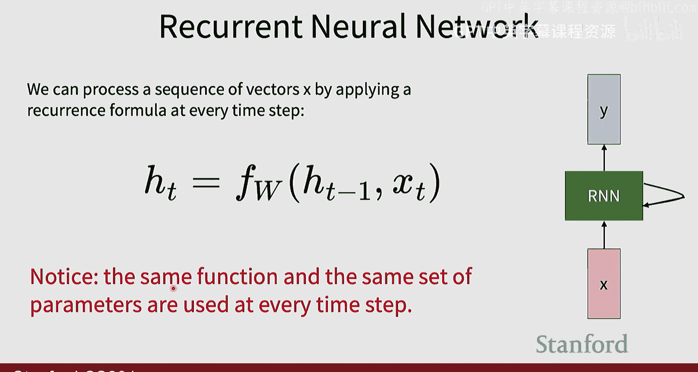

Yes， so can old values of Y affect the new hidden state under some formulations， Yes。

 and we'll actually go through one example of why that's used。

 It's most commonly used if you want to predict the next like if you're doing a language modeling or auto aggressivegressive modeling task where you're trying to predict one value given the previous values。

 People will just use the previous values as the input。

 So that's generally how people do that explicit formulation of how can y affect the next hidden state。

😊，What is the difference between H and x at the first time step。

So they use basically different weights the H0 is using all of it's using the weights that are used to update every hidden state to the next one。

 whereas it will go through exactly what the weights look like。

 but basically they're using different weights is the short answer。

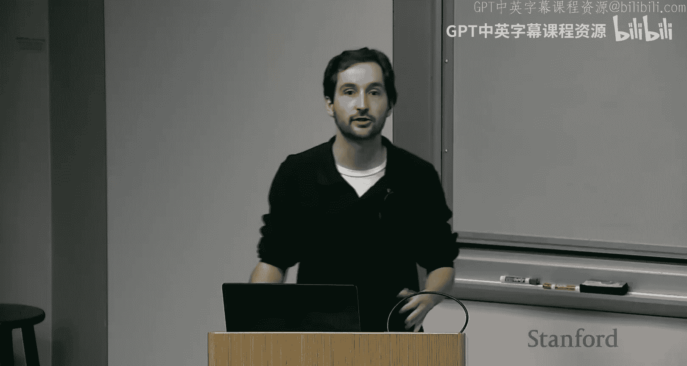

Okay， so when people say vanilla R andN， they usually are almost exactly referring to this type of model where we have our hidden state T which is uses 10 h or hyperbolic tangent as an activation function。

 this is nice because it's bounded between one and negative one so as you do the operation over and over again your values will stay within this range so this is a nice property to have it's also zero centered and you can represent both positive and negative values。

 this is why people use10 h。Also， we sometimes have an output function， FY here。

 but in the simplest case， your output Yt could just be a matrix multiply by by your hidden state。

 So this is really like the most simple formulation of an R&N and what will specifically go in our concrete example today in lecture is this idea of just mainly manually creating a recurrent neural network。

 So we're not going to learn this through gradient descent or all these different methods I'm just going to sort of show you how you could construct one by hand。

 and we'll go through it and you'll understand the forward pass what each of the different weight matrices are doing as well as how the output is calculated。

So in this really toy example because it needs to be pretty simple if we're just going to be like going through all the different weights you're given a sequences of zeros and ones and your goal is to output a one when there's two repeated ones in a row。

 So you're basically detecting repeated ones and you'll output is zero otherwise so you can see this input sequence coming in01。

01 so far there's been no repeated ones but now we have a repeated one and we have another repeated one because there's two in a row here and so on。

 So this is the type of model we're building it's trying to do this task。

 This is specifically the many to many sequence modeling task where we have one output for every input。

And so we've kind of been talking high levels so far。

 but if you're trying to create an RN to do this， what information should be captured in the hidden state？

So you have this internal state of your model， what information needs to be captured there in order to do this task。

Yes， so the input to the previous time step。 And if our output is only dependent on the hidden state。

 what else do we need to know and the current Yeah exactly So this is the information that we need to capture in our hidden state。

 So previous input and the current value for x so0 or1。

 And the way I'll do this is I'll just set the hidden state t to be a three dimensional vector。

 The reason why it's3 is this one will come in handy when we're trying to do the output stage calculation。

 but you could probably construct one without a one here。

 this is just to make the math easy and simple for for the purposes of the lecture today。

 And the other information is the current value。 So this will either be0 or one along with the previous value 0 or1。

 and we'll initialize it to be 0，0，1 so that we're basically assuming it's basically seen  two zeros in a row before at this point。

😊，Yeah， so this is how we will do this will be the type of variables we're trying to track in our hidden state。

 and this is how we'll initialize H0 so I talked about how you can initialize it to very different strategies or you could learn it。

 this is what we'll initialize it to。Okay， now let's walk by the let's walk through the code and I'll do it step by step。

 So I'm just putting it on screen here right now。 but we'll also do Raylu。 I guess， sorry。

 one other thing I missed on this slide is that we're setting our activation functions to be relu just to make the math easy。

 So it'll just be max of zero or whatever the value is we're only dealing essentially with zeros and ones in this case。

 So it makes it pretty simple to think about。😊。

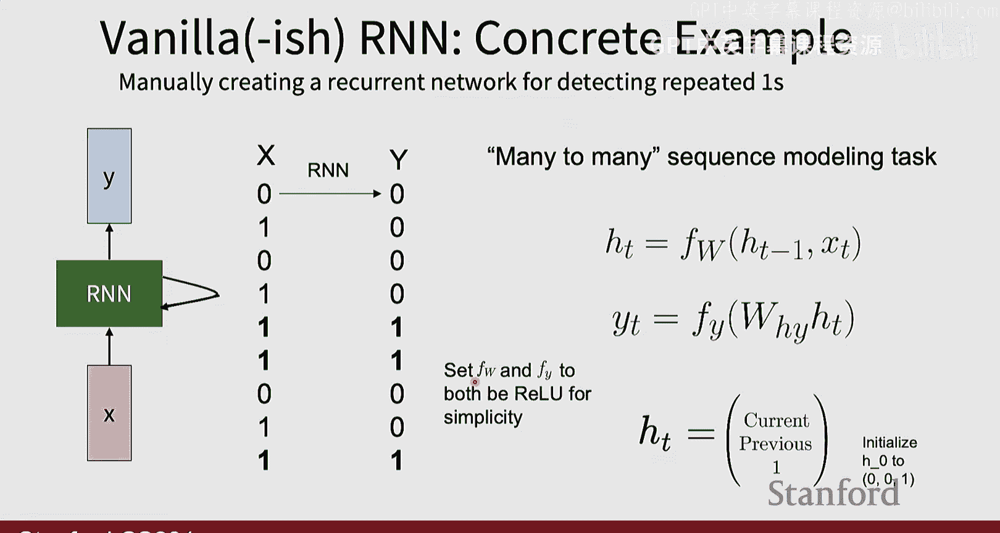

Yeah， you probably could construct it so that it works with  T0 H。

 But this is just something that I created as an example for how to run it。

 And so just to make the math really easy， we'll do relu。 But yeah。

 you could conceivably make a model that could do this with 10 H， yeah。😊。

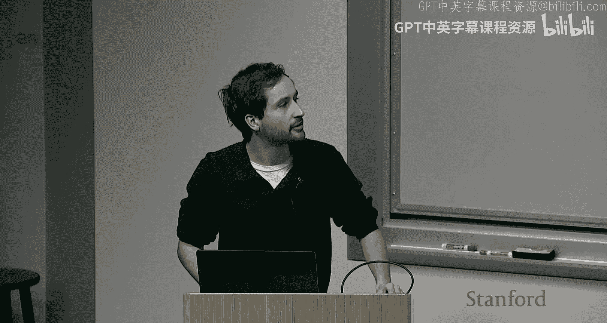

Cool， so we have Raylu we have two specific weights here。

 we have the first weight which converts our previous hidden state it applies a transformation to the previous hidden state onto the sort of to calculate the next one and then we have this weight here which converts our input x to the dimension of our hidden state as well as applies a transformation so we are setting this second one so our current hidden state is a function of the previous hidden state along with the current time step and so when we're trying to calculate this hidden state at time step T we're looking to calculate this current value first。

 so we'll use the x value here， we'll set the weight to be a3 by one column vector with values 100 such that when x is0 and we do the matrix multiply we get。

Zero vector and when x is1， we'll get 100 and we'll add this to another term。

 but basically this is going to be calculating what is the current value here。

 so it'll be either a zero on top or a one on top and it's calculated based on this first operation here。

Okay， so that's how we're calculating the current value based on the input。 Now we'll talk about。

You know how are we doing this hidden state transformation so we want to just use the current value for this top value here so in our weight matrix we'll just have zeros in the top row。

 this means that when we multiply it with the previous hidden state we'll get a zero value here for the top so it'll be0 plus whatever value the right hand side contains so that's how we're gonna maintain this not changing based on the previous hidden state and we'll set it to be100 for the next row why we do this is you can imagine we have the hidden state from the previous time step here and we want to set the now previous to be the former current time step so we have a 100 what this will do is it'll multiply by Ht minus-1 we'll set the current value over to now the previous value for this time step so basically this term will be a0 on top and it will be whatever the previous time step input value as the second term and then this final bit here just maintains the one so that we're keeping this one across all。

Calculations so just to recap， we have zeros here because we want the right hand side term to be tracking this current value。

 We have a one here to copy over the current from the former time step to be the previous sorry to copy the current of the former time step to be the previous of the current time step。

So we're just doing， you know H， maybe it's easy in the code， but you know H previous is equal to H。

 and we want to also move the corresponding value down one here。

And then this is just a copy of the one。So how do we actually get our output now so we basically talked about how we can track these values given the weight matrices I talked about。

 so WHH and W XH so if we have a weight matrix to convert our hidden state into the output dimension。

 we want it to be one by three so it's single value that's being output when we have this hidden dimension as input and this is sort of like a dot product between the values here and the values here。

 so what this will correspond to is the current plus the previous minus1 minus1 because we multiply the minus1 here。

 this is where the one became useful and the current associated here with a one and then also the previous associated here with the one as well So that's how we actually do it and if if you think about it。

This general formula will work so if we have say we're looking here。

 we have the current plus the previous is two minus1 is one for this lefthand term inside the raylu so the max of1 and0 is one and if these are both zero you'll have a minus one so we'll get zero these are a one and a0 then you'll still get zero so these are how you can construct these weight matrices。

 but I actually wanted to pause briefly and talk about if there were any questions about any step among this calculation because this is the only example we go through in class where we're literally doing all the matrix in vector multiplications and the rest will be more high levelvel explanations for how people tend to put these layers together so I just want to pause and see if there's a question about how the matrices and vectors are tracked and multiply it and updated。

Yes， so the question is， how do you go about constructing the weight matrices。

 which is a really great question。 And I thought to put it in the slide here。

 So how would you actually do this， It's the same way we're always finding the weight matrices in this class。

 We're gonna be using gradient descent。 And we'll talk about how you do gradient disscent when you have multiple time steps And maybe you have losses computed at each time step as well。

 So that'll be a lot of what we go into right next。

 So it's a great question and very relevant to the lecture。😊。

So this is just an example so you can see how all of the weight matrices are multiplied basically if you were trying to change。

 if you were trying to initialize with this and then train it to do another task that would be sort of like transfer learning where you're initializing the weights with this but in practice I don't think it would work very well at all because your hidden state is really small and people normally do much larger hidden states。

 I just wanted to do something that I could fit in the slide here。

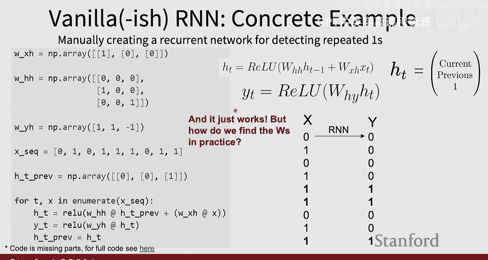

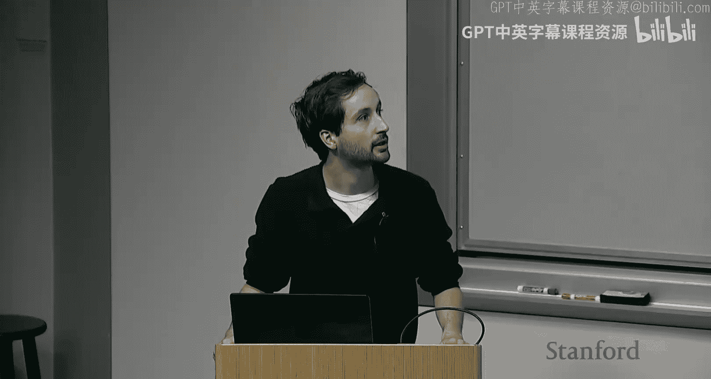

Yeah， okay， I'll go over the second row again。 So if you imagine we have H t -1 as a column vector here。

 when you do the matrix multiply to get the value of the lefthand side here。

 what this second row is doing is you're taking the value in your sort of you know rotating and doing the dot product with the values here。

 So for the second row that gets calculated it will be the entry here will be equal to the top of the vector here。

 So this is how we move the current down to the previous is in this step here。

 So the end result of this matrix multiply will be such that the second value is is the current value from t -1。

So we do the matrix multiply with t minus1 here， and so the second row of this operation and this operation are both giving us vectors of the size of our hidden state。

 and so we're adding them together。Yeah， the left is doing the previous carryover in the right is doing the current and that's also sort of how it works for R&Ns when you are doing it beyond this sort of toy example where this weight matrix is being multiplied by the current input and this other weight matrix is being multiplied by the previous hidden state so that's what these weight matrixes tracked more generally than this specific problem as well。

Okay， so how do you actually compute the gradients， let's look at the computational graph。

 So just to draw a little bit more explicitly than before， we have these X1 coming in in the X2。

 and we have a sequence of x's。 and we're calculating a hidden state at each time step。

 and we're specifically using the same ws， same weight matrices for each of these calculations as well。

😊，So we need to be thinking about this when we're thinking about how we're computing the gradients。

And let's start with the many to many scenarios， So we have an output for each input。

And in this scenario， you can often also calculate a loss for each output。

 which is how correct is the output at that stage。 So if we're doing this setting。

 you have a loss at each step and you can sum them all together to get your total loss。

 and this would be your loss across the entire input sequence。And when we do backprop。

 basically the final loss is the loss you this final loss。

 when we compute final loss we can then calculate the loss per time step as well。

 or depending on the formulation。 So if we're calculating a loss per time step。

 you can treat them independently sometimes you have an overall loss based on the loss per time step2。

 we can also get the basically the final gradients for each of these ws。

 you can calculate the gradient for each time step separately。

 and then you're going to sum them all together So this is how it works in practice。

 you could imagine if it were different ws at each time step。

 you could pretty probably easily see how the computational graph could be structured such that you're calculating different gradient for each of these different Ws and so we're essentially treating our single W for computational purposes as a set of different W's。

 but then at the end we merge all the gradients together。

Ca it's just the same weight matrix that's being multiplied。

 So conceptually you can think of it as you're just calculating it for each time step。

 almost treating it in your head like it's a different W being used。

 but because it's the same value of the weights， you just need to sum all the gradients that you calculate at each time step together。

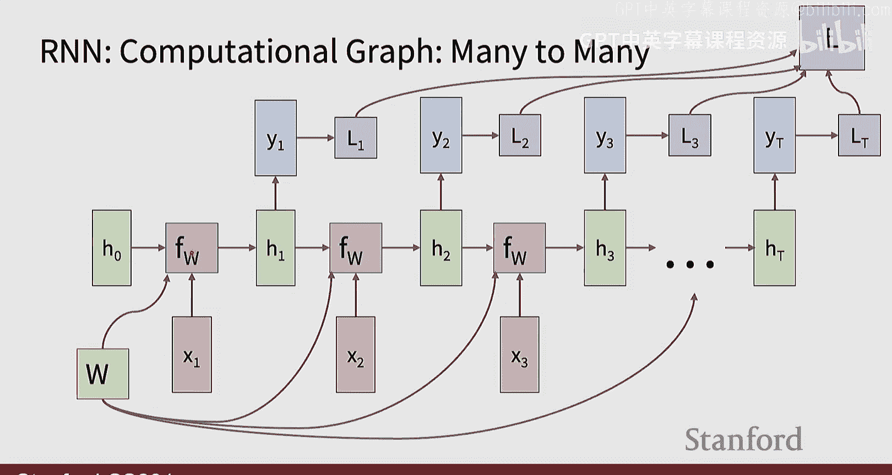

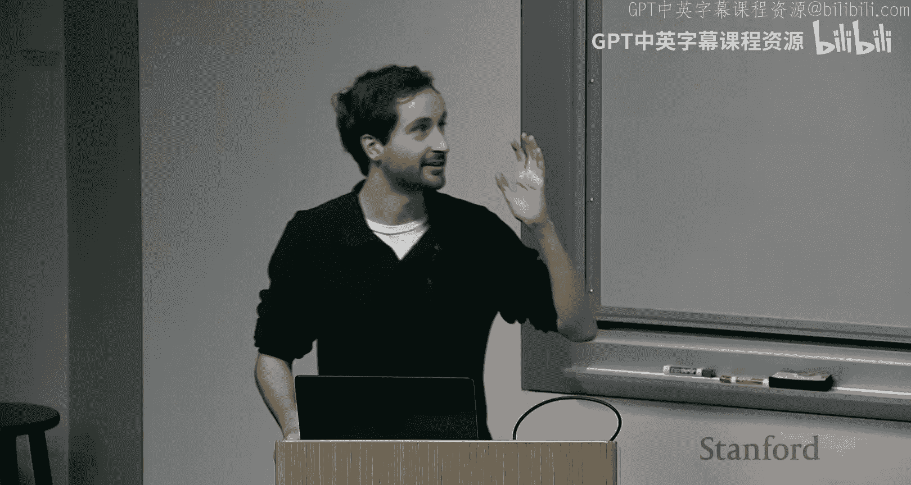

In the many to one scenario， you'll just have a single loss calculated here so and sometimes you'll only use the final hidden state to calculate the value depending the problem setting like say you're trying to do video classification it makes sense to use the hidden state from every step because you might have information about the video throughout the entire course of the video during classification。

 you can do some pooling like average pooling or max pooling or something like that to compute your y value and then sort of if you have this sort of one to many mapping like an image classification or sorry in image captioning。

 there was a question about how you could incorporate the previous y's。

 so you still need to have an inputs， input to your FW because it's sort of two different of these weight matrices one that's expecting input vector X and the other that's expecting the previous time steps hidden state so you could imagine that。

You can put a lot of values in here。 You could just put zeros。

 or you could put the previous output here。Okay， so I explain at a high level how you do the back propagation。

 but there's actually some specific issues that you'll run into when you're trying this conceptual when you're sort of looking through this conceptual framework that are very practical in terms of running out of GPU memory which is always the cause of basically all the issues when you're trying to train a neural network that I guess N loss during training。

 So when you're computing say a loss at each time step and you have an extremely long input sequence。

 you'll actually it's really easy to understand you need to be keeping the activations and the gradients at each time step in memory and then summing them all together this is gonna get extremely large as your input sequence increases So what can you do practically to resolve this issue this is called back propagation through time。

 by the way， when you have the same matrix that's being applied in multiple different time steps and then you're summing the gradient at each time step together。

So what you can do is it's called truncated back propagation through time。

 So you basically fix a time window。 and you can look at basically pretending that this is。

All the model was trained on so far。 we start with our H0。

 we calculate based on the input at time step1 and our previous H value。

 we can calculate what is the current hidden state at H1 and then we can use that to calculate our output we'll have our loss and we can run this for each of our examples and you can imagine how in this setting it's relatively easy to see how you just sort of treat the beginning sequence as if this is all we're seeing during training and moving to the next block you can now essentially you're starting your H0 with now it's the output of your previous step here So we're initializing the hidden state with whatever the output was in our final step but the gradients are no longer carrying over。

 so we're basically batching the computational graph such that we're only looking at the loss in the neighborhood of these time steps at a time and this is a fixed window size that you set So this is how you get around this relatively I would say。

Common issue， especially as you have really long input sequences。And so yeah。

 you basically are batching up it out and you can just keep doing this for the entire input sequence。

So one other thing is that， you know， you might ask。

 how does this work if we have just a single output at the very end？

So you can still calculate the gradients at each time step。

 but you will no longer have this loss that's dependent on the time step itself。

 the output of the time step itself rather you'll be relying on upstream gradients so you can imagine we're looking at the far right of the diagram here and we have our loss that we calculate based on the output at the final time step we can calculate what is the gradient with respect to our current hidden state at the end。

 and then we have our WHH matrix to help us understand how did the previous hidden state contribute to the final hidden state and we can use that to calculate the gradient and understanding based on the previous hidden state and the weight matrix。

 how can we change this transformation matrix WHH such that we would be changing our loss。

And then you can just you're basically just applying the gradient rule to WHH over and over again here。

 and you're only looking at how the hidden state changed the next hidden state and how that contributed to the loss。

So you look at the final example here， this tells you how changing the hidden state depends on loss。

 and then you know how the previous hidden states， how they change。

 how that affected the current hidden state， which is given by this WHH matrix。

So using the ws at each time using different w's at each time step would essentially mean that you're no longer modeling it as a occurrence relation。

 So basically you have you can think of it as one layer for each different possible time step so you would probably see worse performance because if you are sort of no longer modeling it as a sequence recursively。

 you're just I mean， imagine you train a neural network where you have a series of inputs。

 each one has a separate weight that it goes to。

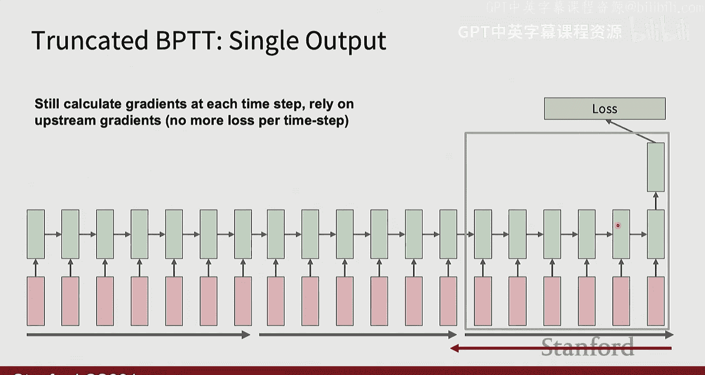

Yeah， independently that would make sense for a problem where it's not a sequence modeling problem。

 you just have a set of things that you want to classify。

 you would need to know like the amount of the sequence ahead of time。

 so I think it could work if it's not a sequence， but for sequences of variable length I think it would not work very well because you're sort of I I'm trying to think of a dis way to explain it。

 but it's sort of like you're just training one neural network for each time step。

 so it's sort of not the way to formulate it。

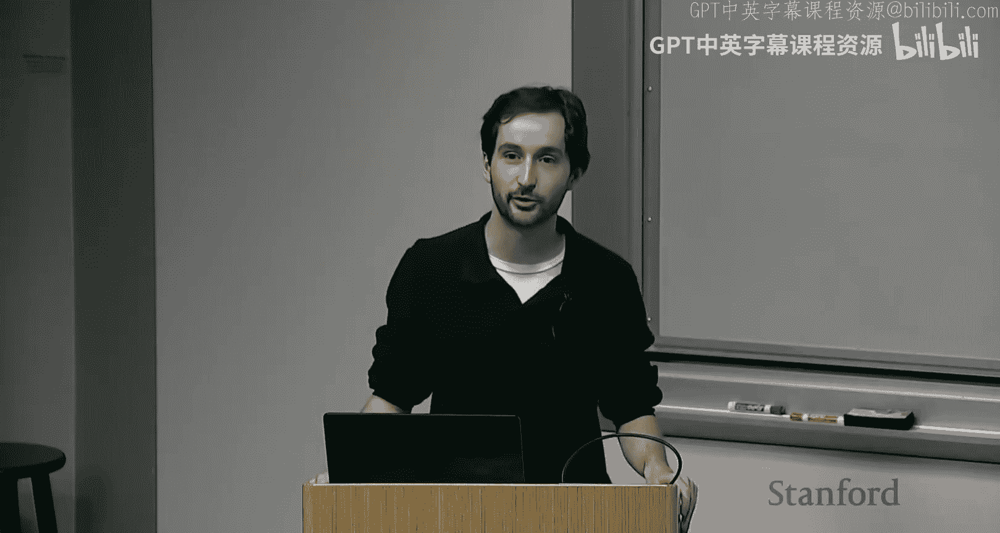

So how does this work with chunking so we have our so we we can do you understand how to this point we can at the point right here with the red dot。

 we can calculate the gradient of the loss with respect to our final hidden state。Okay。

 so if we can do that， then we can calculate the gradient of our loss with respect to our second to final hidden state。

 because we know our final hidden state is dependent on our previous hidden state times this weight matrix W。

Okay so we can do this and we can go back and forth until here and at this point we can sort of all we need to save is this final step here。

 So what is the gradient of this very final or finals maybe over using the word final but what is the gradient of this initial hidden state within our truncated batch with respect to the loss and then when we're calculating backwards we just use that value to calculate all the previous time steps So that's the overall process you're only looking at。

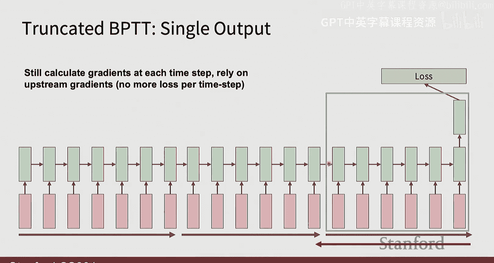

How the hidden state transforms to form the new hidden state。

 and that's the only value that's getting updated here。

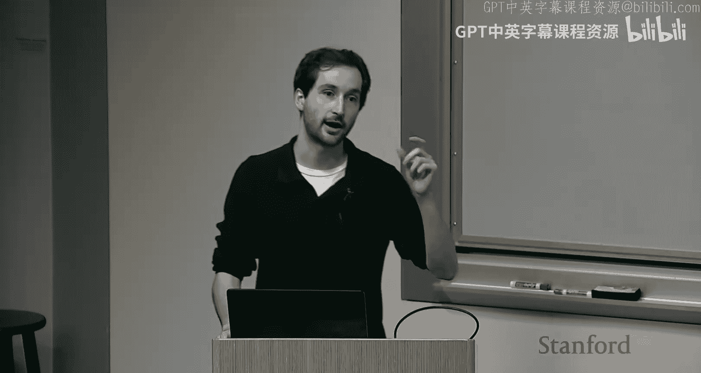

Yeah， yeah。 and also the， also how the input changes the hidden。 So you're looking at two values。

 both how the input affects it and how the input affects the next hidden state and the the previous hidden state。

 there's two values， yeah。

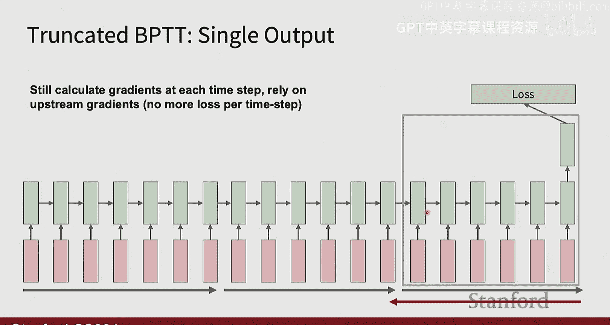

So the learning still occurs for all the batches。 So you have your loss with respect to。

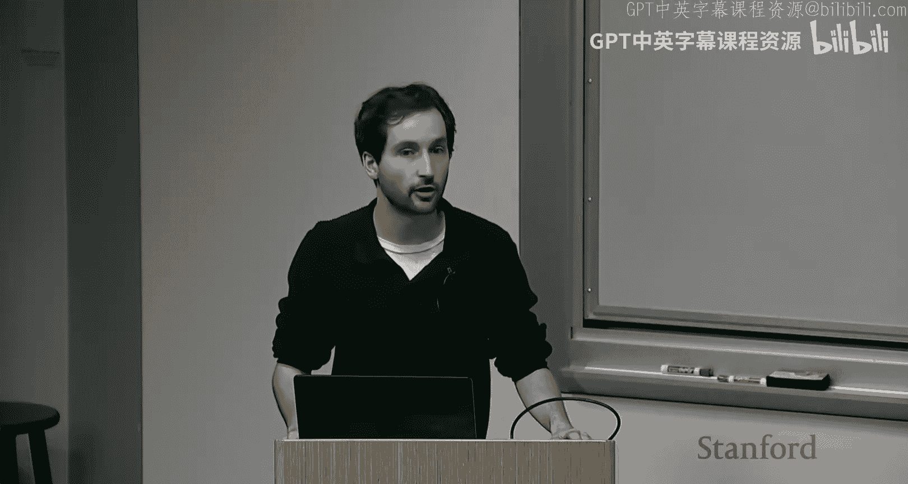

Each of your parameters in W here。 And then when you're calculating it for the previous time step。

 you basically keep this one value。 If you change the final， the initial hidden state here。

 how does that change loss， you can calculate that and then you can see how all the variables feeding into this and namely this original hidden state and the current time step。

 how will that affect the variable。 But then when you're actually moving to the next chunk over。

 you only need to look at how does this hidden state here affect the hidden state in the next chunk。

 So you're looking at this division boundary， the one variable you need to track over is what is the gradient of the hidden state that occurs after the chunk。

And then you can use that to calculate the gradient of the current hidden state。

 which is dependent on the input X in the previous。

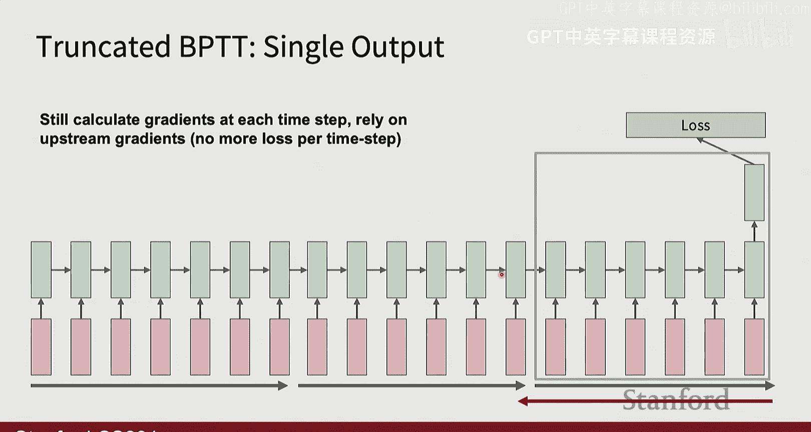

So there's different ways you can formulate it， but you can imagine we just apply the update to all the weights here and we zero out the memory。

 The only thing we're tracking is yeah this gradient right here。

 So you can apply you can do a gradient apply step where you apply all the gradient to the weights depend on the learning rate and your optimizer and all this stuff and then you move on to calculating the next batch So the reason why this is in a perfect calculation is because you're calculating these independently rather than all at once。

 So you sort of have three different updates rather than just one update at a time。

 but it should be you still calculating the gradient for each each step here。

 you keep one thing in memory， which is how does this hidden state the first one in the batch How is that how can you we update the hidden state here to to determine the loss and we throw out all the other ones。

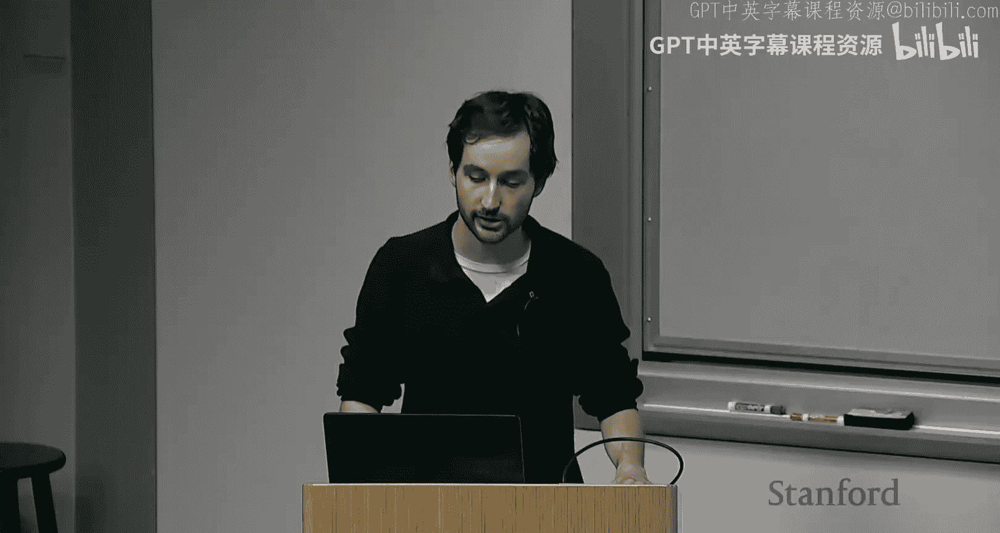

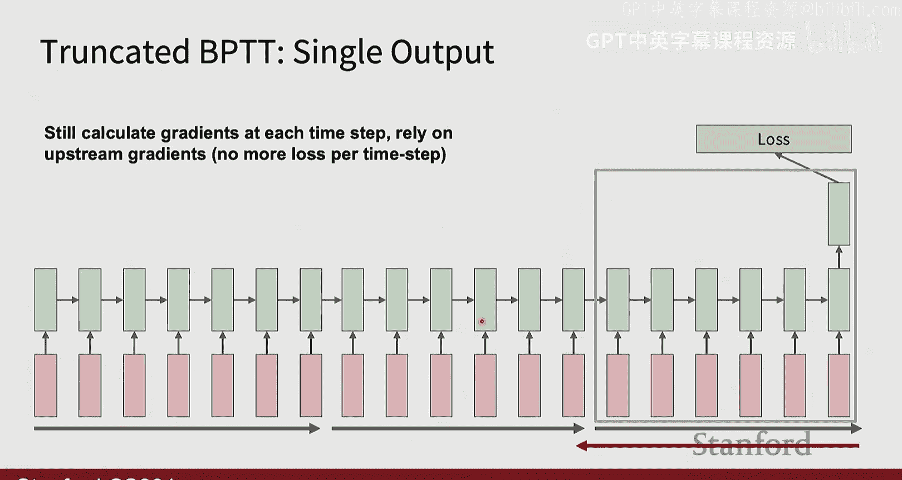

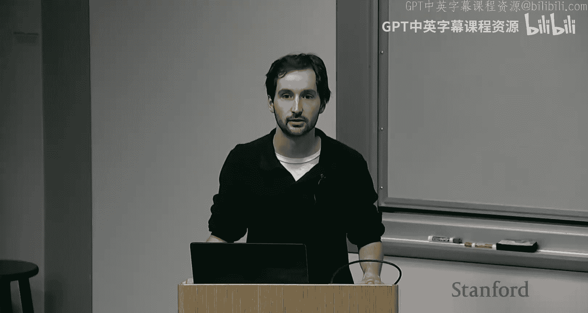

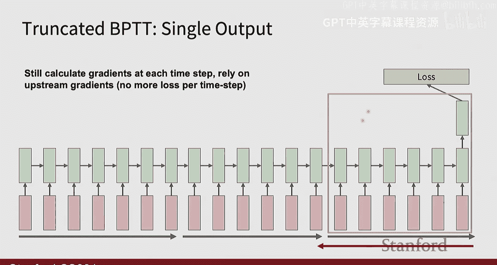

So you have the weights and memory。

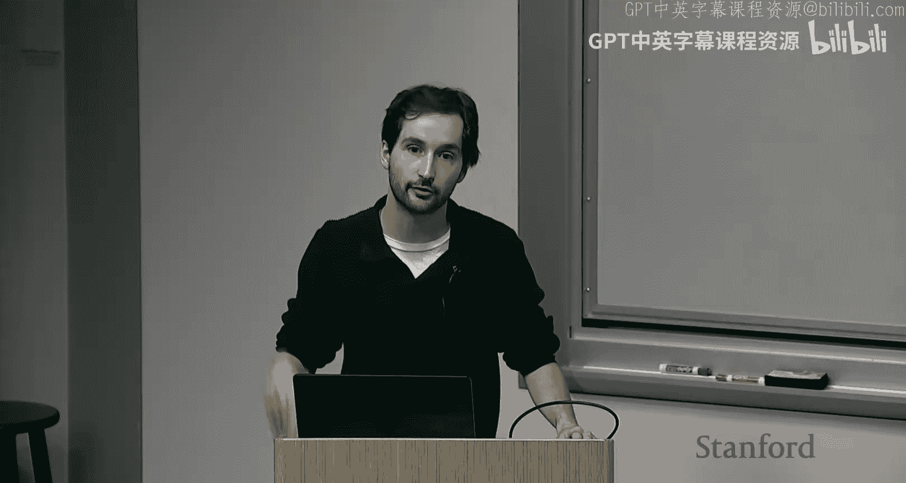

You can apply the gradient， you do your learning rate， multiply， and you apply it to the weights。

You'll also see a similar thing if you do distributed learning。

 so if you have a gradient calculated on each GPU separately。

 they will apply them all to the same set of weights， even though they're calculated independently。

 so I think we have a lecture on distributed learning coming up so it's a similar thing where you're not tracking it all in the same memory at the same time and you're applying it to the weights one at a time。

Yeah， yeah， yeah。 It would be better if you could fit it all in memory。 Yeah， yeah。

 it would be better if you could fit it all in memory。 I mean， this is mainly for this one。

 it's essentially the same。 But in this setting， maybe it's more clear how you're explicitly losing information。

😊，So here you're only looking at some of the outputs at a time。 So you。

 it's really clear how we're not looking at the entire set of the losses when we're calculating because there's losses at each time step。

 So you lose information here。 But in this case， you wouldn't lose information。

I think one more practical example where we can't fit the whole RN on the slide is this idea of a character level language model。

 And it's really funny because these were shown to be quite effective。😊，10 years ago。

 and can it's really funny because you can see how the current wave of language models are sort of a buildup of this really simple approach of just predicting characters with RNNs。

So usually when you do a model like this， you will input your characters and then people call this a one hot encoding where you basically have one。

You have a one in your vector and zeros in every other location， so it's sort of like the index here。

 you can encode this as the index。And then we can use these as inputs。

 and we can calculate our hidden layers based on the previous hidden layer。

 as well as the current input。And then we have our output layer the same where now we can look at what is the output for the corresponding correct value here。

 which is taken as the next time step so we want the output for example to be E we map it over here。

 we look at you can imagine this is something like softftmax and we have the logics so these are the scores 2。

2 it's lower than 4。1 so yeah we have we have you know this is maybe not so great of an output of this time step and so on so forth so you can really view this as a time stepwise classification problem and that's exactly what in general language model these language models are doing is time stepwise classification based on Softmax。

So at test time， the basic idea is we need to also sample characters one at a time and just feed it back into the model so it sees what it generated at the previous time step so on and so forth repeating until we generate the words so you can actually create RNNs to do this basic language model language modeling task by operating at a character level and it works quite well one thing to note is that in terms of this input layer usually we don't actually input one hot embeddings into the model and instead we'll have something called an embedding layer where this is essentially just a giant matrix which is the dimensions it's D by D where D is the number of different inputs you have to your model。

And what you do is you sort of， you can imagine the as a matrix multiply where we grab the first row。

 or in this case we grab the second row of our embedding matrix based on what our input sample is here。

 and we just use this as matrix multiply。This is incorrect， actually。

 this one should be higher probability。

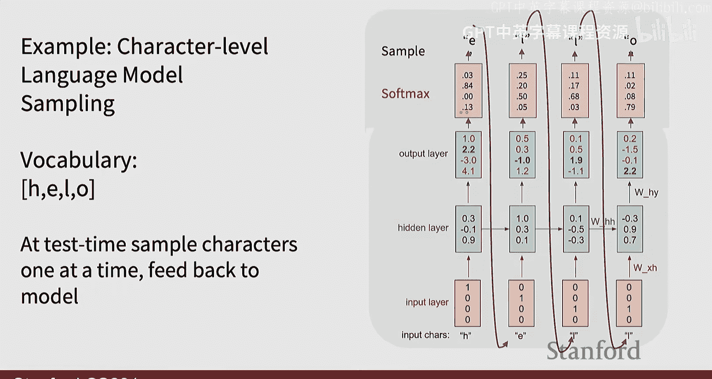

It's funny， we've had these slides for quite a few years and I guess no one noticed it。

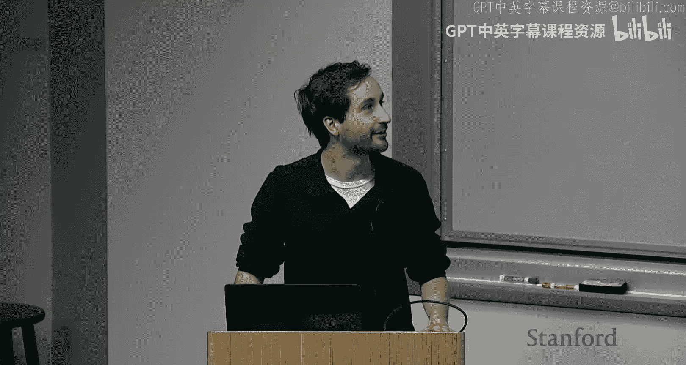

Anyway， so we have E here as a target character and so in this case you're correct that the model's actually getting it wrong。

 so we will want to penalize it heavy for this time so yeah yeah that's a good question。Yeah。

 so one of the nice things about this implementation is also， it's really simple。

 So it's like 112 lines of Python code。 and you can train these models on a variety of different tasks。

 So this is like the pre LLM era of what you could do。

 You can train it on sonnets by William Shakespeare。 And as I mentioned。

 there's a blog post by former instructor of this course。 Andre Carpathy back in 2015。

 which talked about how these R NNs are sort of unreasonably effective at what they do in generating text。

 Yeah。😊，Why you you use an embedding layer Yeah， so the basic idea for an embedding layer is that generally it's better to have vectors as input to our models and you can learn what these embedding layers are too So you know we tend to favor like spread out weights in general when we're trying to learn these so you can initialize your embedding layer to this sort of very small zero values with something like the chiing initialization we talked about and then you're just looking at one row of it at of time as your input vector rather than it being like a number as input how you would have to represent that as basically a one with a bunch of zeros and optimization the embedding works better。

Okay。So yeah， you can do it in 112 lines of Python code， which is pretty neat。

 You can train it on science by Shakespeare and it'll actually output reasonable text。

 We'll go through some examples。 So one of the cool things is you can see as you train the model more。

 it becomes more and more coherent So at the beginning it's basically just gibberish because it hasn't learned proper values for W and then as you train it more and more it becomes more like the stage three kind of looks like English。

 at least some of the words right there and then as you train more it actually starts working really well which this is I guess was a bit of foreshadowing for what was to come in the in the era of AI。

 which is pretty cool you can see full on it learns things about the style。

 how you should have someone's name and how something that seems fairly plausible as you have it generating more and more it starts making less and less sense。

 but its pretty cool to see。😊，You can train it on code like I think in this example。

 they trained it on Linux， so they're just the source code for Linux。

 they trained one of these character level RNNs and you can see it generating C code which looks pretty good I don't know if this would compile but it looks reasonable just looking at it and this idea has really taken off over the past few years。

 so I mean I'm sure you all are know especially since a lot of you work in computer science or coding or your students in this area but there's all of these different programming tools now for these language models that were essentially trained on a similar task where they've consumed a bunch of this training data that's just existing code and instead of trying to predict the next character they're trying to predict the next token which is a group of characters and how they define tokens depends on the model and there's a lot of details we could get into there but at a high level it's a really similar thing they're just predicting groups of characters autoaggressively one after the next and it's really seen a blow up in recent years。

These existing tools， yeah。Oh， what like for this？

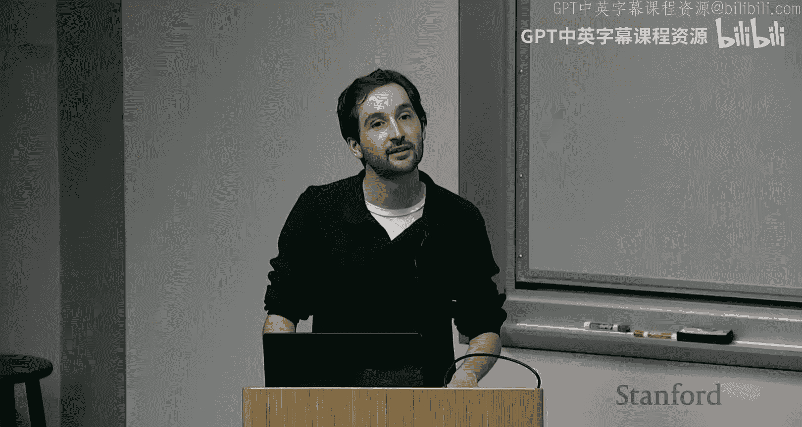

You could have the input be yeah you just maybe you start with a random character could be one way to do it。

 but you would need some initial input， there could be usually with language models they have a start token as like predetermined This is always what you see at the start of your sequence so you could do a similar things with RNs。

 I don't know in this exact scenario what they did maybe they just did a character but it's hard to know。

So the question is， how does labeling work with language models？

The neat thing about these pure language models。 All they're doing is just predicting next token。

 You don't need to label it。 You just need to give it a lot of text。

 That's why these models are so good。 It's because they scrape the Internet for， you know。

 essentially all available text。 And then they trained a model on all of it。 So that's。

 that's why they're so good。 It's because you， it's just generating the next token。

 and you don't need to label it。 So that's why language models are so good。😊，So the question is。

 if we're always taking the maximum probability output at each time step。

 when't we always just be generating the same thing over and over again and the answer is yes。

 actually so if you just took the maximum probability I guess this example is not so good but imagine the probabilitybabilities are correct here and you just took the maximum probability at each time step you would always be getting the same output given the same input in practice what people do is they don't do this is called greedy decoding。

 you're always picking the maximum probability in practice they sample based on a distribution distribution given by the probabilitybabilities output by your softmax so you won't pick the maximum probability you would pick say in this case probability0。

84 for this one or probability 0。13 for this other output variable and then you would run that for each sequence and there's a bunch of different ways you can do it too there's like you can search aheads called beam searching where you're trying different ones and seeing which one has the highest overall probability for the sequence So there there's a lot of this is like a whole active。

Of research， how do you sample from these models， But the simple answer is you don't always pick the highest probability。

Yes， the question is in the case where we have many to one outputs。

 are we outputting something each time or do we have something to look at here？

 So I think in practice to save compute， you wouldn't want to output something that's never used。

 but you could feasibly output it in each time step and it might be interesting depending on your problem to look at that and understand。

 is the output converging over the course of training or not something like that。

 So it might be useful to look at， but generally people wouldn't do it just to save compute。

 but it could be useful actually could help you understand the way your model works if there's certain triggers or things that help it predict the correct answer。

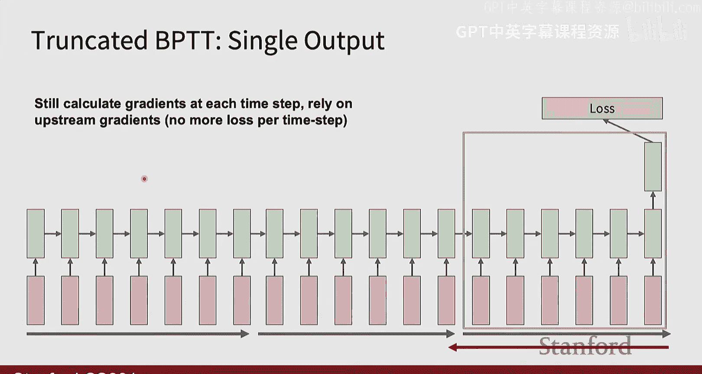

Cool， good questions。Okay， so we'll keep on chugging along we talked about these RNNs how good they are generating characters。

 we related them to some of these modern coding tools which are really neat。

 One of the cool things also about RNNs is you can look at the activation activation values and they'll actually sometimes tell you interesting things about what the models tracking so we had in our little toy example we had we looked at the output activations and you would see it's the current value in the previous value that was what the RNN states or cells we're tracking What you can also do is give it basically a sequence here and the models I'll show in these slides it's using a tan H activation so this is from one to minus1 and minus one means it's visualized as red here and very close to one would be blue we get the whole spectrum here and you can look at for each character coming in what is the activation of that cell at that time step and so that's how their color coding these plots here this one's not really showing。

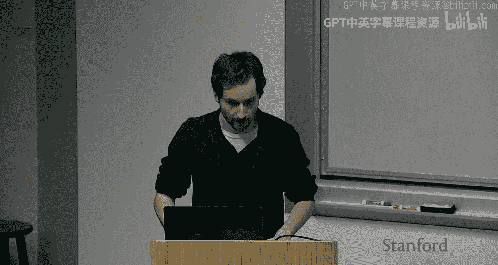

It's random， a lot of them won't be interpretable， but some of them have pretty cool things that you can track like for example。

 this one's a quote detector so it turns on basically as soon as the quote starts and it ends when the quote ends so this is basically something in the RN tracking we need to have an end quote at some point and when to put it is sort of something the model is trying to figure out but it's tracking it another cool thing is the line tracking line length tracking cell so it starts kind of very high value and then it becomes a very low value as you near where the model thinks still be a new line character So this is also kind of cool as a way to look at this other value and these are again just single activations and a layer of this model that we're looking at and mapping it to each character so it's highly interpretable。

They have this sort of if statement cell so anything within if statement is being tracked here。

 which is also pretty cool and even things like detecting quotes or comments because it needs to know to output the end of comment character here so it's something it needs to track and so you have this nice interpretable cell as well and then finally this code depth cell so as you sort of have nesting in your code。

 it activates more and more at each time step at each nottime step at each step into the sort of indentation into the into your code hierarchy so yeah this is pretty neat。

 you can actually look at the activations and directly map them onto the inputs without needing to do any fancy tricks which is actually pretty incredible if you think about how interpretable some of these hidden states are in the RN it's actually somewhat similar to what we were doing where we were manually assigning it。

 but the RNN is sort of internally doing a very similar process。😊，Cool。

 so I'll talk about now some of the tradeoffs。 Like why you might want to use an RNN。

 When is it helpful。 So the nice thing is they can process any length of input。

 So a lot of these modern language models that rely on transformers have something called a context length or context window。

 maximum context window RNNs don't have this， they can just take a sequence of infinite length。

 essentially， as long as you can keep running the model on it。 So there's no context length limit。

 the computation for the time step T can， in theory。

 use information for many steps back if it's captured in the hidden state。

 So if your model is effectively capturing all of the dynamics of your input sequence in the hidden state in theory。

 it can use values from a extremely long time ago。 But in practice。

 there might be some issues with this， which will kind of go into some details there。

 Also the model size does not increase for longer input。 So you know。

 we had an example where what if you just had a different layer different layer for each input。😊。

Time step you don't have this issue， which is nice。

 and then we're applying the same weights at each time step。

 So basically we know the update rule for how we calculate the outputs is the same every single time。

 So there's some nice like symmetry here and also just when you think conceptually about the problem。

 you're always doing the same thing at every single time step。

 which is is nice conceptually and also helps with some implementation as well。

So what are the main disadvantages so you need to compute the previous hidden state to compute the next one every single time so this can be slow if you need to you sort of have each hidden state is determined is conditioned on all the previous ones then this recurrence computation can actually tend taking end up taking a lot of time so although this is not an issue during inference time when you're always like for a transformer also you have this issue where you need to output the next token or character every single time but at training time it's actually difficult to batch all of these together and during training because in order to calculate the loss you need to calculate the previous hidden states so this can prose challenges for scaling up to a lot of data and then in practice it's actually difficult to excess information many time steps back because we have a fixed- size hidden state and we're trying to cram all the information into it。

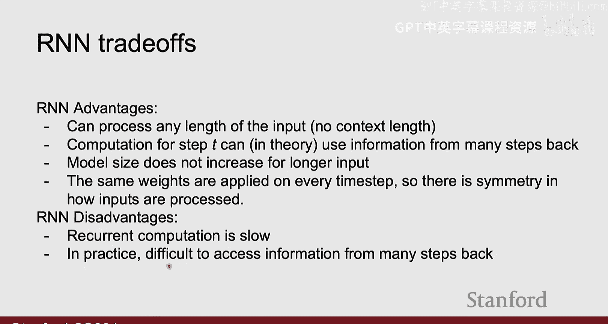

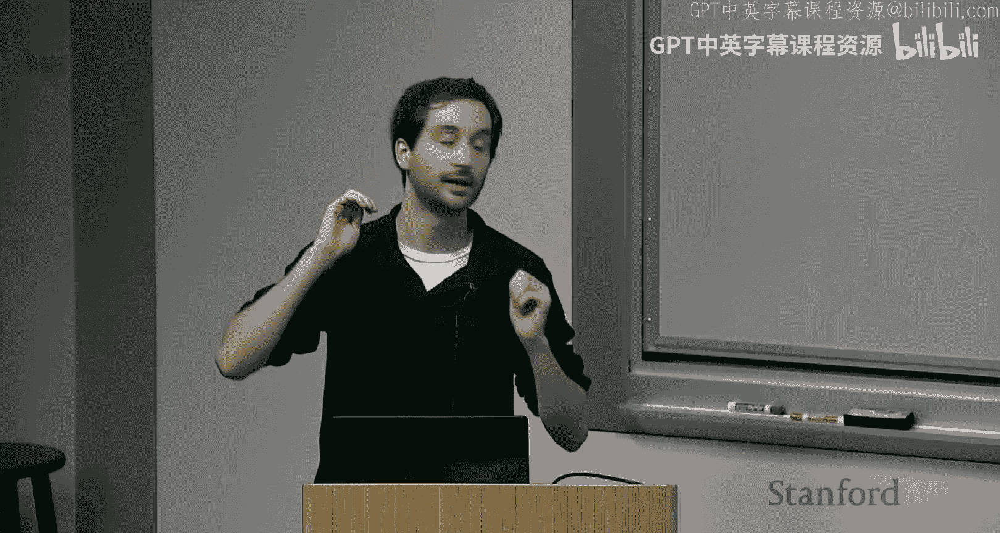

So you'll eventually lose some information as your sequence goes longer and longer。

Cool I'll talk about some applications more specific to computer vision where RNNs have seen success now So one of them is image captioning which we talked about so the basic thing here is we mentioned there's the sort of start token or start character which begins the sequence and then you will terminate when you have this end character and token in this case it seems like it's word level tokens so you could have a model like this you have the most basic way to do it is you essentially have a CNN or something with that encodes a visual encoder that encodes the image and we use that as input to our recurrent neural network as well as the previous text that was generated so we sort of have two stages here and very more concretely how would you combine the CNN and RnN you can imagine you have this test image it comes in so your model sort of going downwards here starting at the first layers at the top and then moving downwards you can imagine this is something that was like。

T on imageNe or something。 And so we're not going to use the class labels。

 but we're going to use this second to last layer。 This is sort of the common strategy we saw for transfer learning as well。

 or this sort of getting good visual representations of images。

So we use the second layer and then we can start using this as input to our hidden state and now our hidden state is also a function of this WIH value here so we don't necessarily have just a hidden state we're also tracking the visual components here but I won't spend too much time on this because this won't be in any of the assignments but just to give you a flavor of here's how RNNs were used historically with CNNs where we're taking a CNNN pret on imagenet and now we're including this information into the hidden state as well so you know we use the sampling process either greedy sampling some other version of sampling to calculate tokens at each time step we end it when we have this end token whenever we sampled the end token that's how we know when to finish and these models actually worked very well for the time I think they had a lot of great successes so you can see here a lot of nice examples of where the models outputting very reasonable。

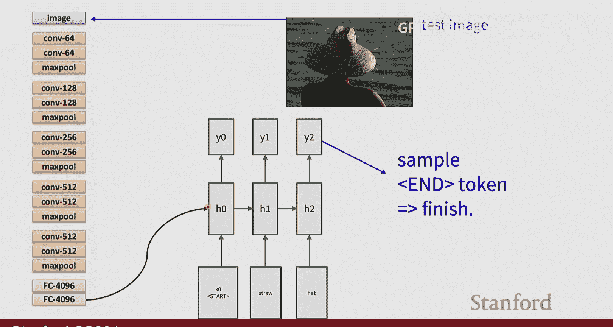

Cptions based on the input image。But also the models would struggle in a lot of scenarios too。

 so a lot of these have to do with sort of the distribution of where these images are commonly seen in the training data。

 for example someone holding something with their hand sort of cupped like this very much looks like how they might hold a mouse but obviously you know we can tell this is a phone because it's a flat object they're holding and their hand is facing up not downwards so this sort of thing is interesting to see also I guess they think the woman's holding a cat where she's just wearing some for clothing。

 you know they see a beach so they assume there's a surfboard， this type of hallucination。

 I would say still extremely common with vision language models today where it'll think there's objects present that are commonly present in a given scene but aren't in this particular scene that you're looking at。

Also， you know， things like bird being purchased in a tree or throwing a ball。

 But he's catching a ball。 These are all based on the bias in the data set。

 essentially in the model learning that。During training。

 it is most probably true that a certain object or a certain action is being performed when in the actual image is not the case。

 So in the data， there's high cocurrence of these actions or objects with the particular scene So the model learns to associate them。

 but it doesn't learn to disentangle okay it's happening in this scene because of the you know in this scene we know they're not throwing because the glove is here and the balls going into the glove。

 not in the other hand。 but you need to sort of explain it like that。

 And the way we train these models we're training them just to output the caption。

 So we're not doing any sort of explanation there。 and that's why it's part of the reason you see this cocurrence issue。

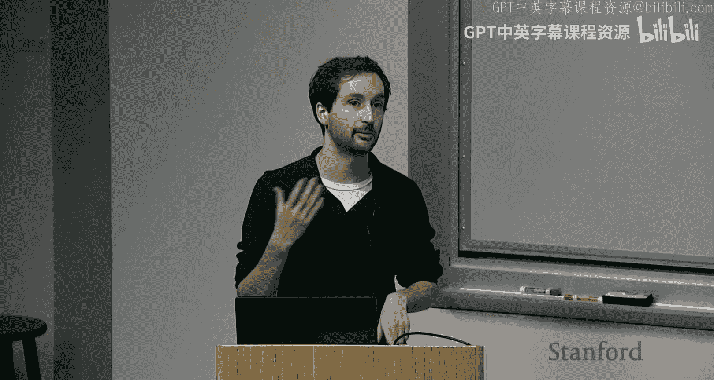

Okay so for visual question answering， this is another really common task where RNNs were used and there are sort of two formulations for visual question answering that were commonly used。

 one is to basically you say you have a model that is a captioning model and you want to see how well it could answer questions one thing you could do is to give it this question and then have an output text and look at the probabilitybabilities of each of the answer sequences so you have a probability for each character or token and you could multiply them together to get the probability of the overall answer。

 this is like one way you could use one of these RnN style models to do question answering more common way people did it is they would have basically a question as input to the model multiple different answers also as separate inputs to your model and then it's outputting essentially a probability per question so in this case it would be a fourway classifier where you have four different classes。

Answer 1， answer2， answer 3， answer 4， and you're just outputing the probabilities。

 And a lot of different ways you can formulate it。 But this is a very common task in computer vision where you need to use language and where sequence modelling helps。

Also visual dialogue， you know at the time these were all considered very separate tasks these days。

 the tasks you have sort of one model that can do almost all of these。

 but know how can you have a chat about an image we've really seen an explosion in the capabilities of these kinds of models in the last two years。

Maybe one other type of model that RNNs were commonly used for is for this visual navigation task so you have these images coming in and you want to output a sequence of directions to move in some 2D floor plan。

 how do you get to the target destination， this is another application for you all to be aware of where these sequence modeling。

 these sequence models wereuse。Okay， one thing I want to note that I didn't really explicitly mention before。

 but just in the same way where we can have multilayer CNNs or multilayer of these sort of dense or fully connected layers。

 you can also have multilayer RNNs and in practice most of the RNs I showed were multilayer RNNs Now the main difference is that you sort of treat each layer separately so the hidden state of say layer one depends on the hidden state of the previous time set of layer1 so in the sort of depthwise dimension sorry yeah in the depth dimension each of these。

Layers， you're only looking at the hidden states from that layer in the previous time steps。

 And then in terms of looking at windows in the time dimension。

 instead of so the first layer will have the actual input X as the input。

 But then the second layer will take us input the output Y from the previous layer。

 So you can sort of stack these up and it forms this grid where we have each layer is operating with regards to the previous hidden states only within that layer。

 But then in terms of passing input output， that is between layers。

 And so you can see to calculate this top right value。

 we need to calculate all of the different values， all of the different hidden states in this entire computational graph beforehand。

 So you can get a feel for how as you start training。

 this gets to be a very involved process and not very efficient。

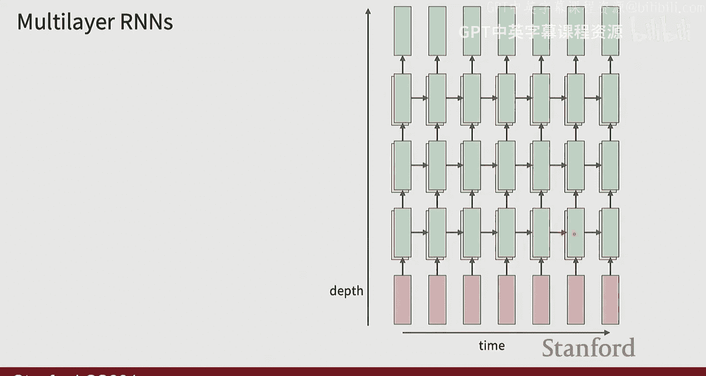

Okay I'll talk about one of the key variants for RNNs that was proposed actually a while ago in the 1990s。

 but saw a lot of success for quite some time until the transformer revolution called LSTMs。

 you won't need to know about the details of how LSTMs operate。

 but what I hope you learn is that RNNs have some key disadvantages that LSTM seek to alleviate and a lot of the more modern statebased models also try to seek to alleviate some of these same issues that RNNs face。

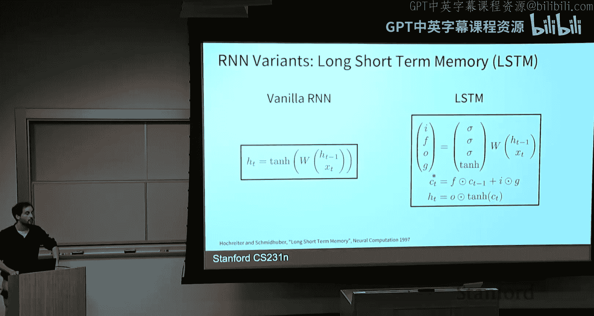

So， you know， we talked about how by default，10 Hs are really commonly used。Activvation function。

 And we also talked about how you have this WHH matrix that converts your previous hidden state to the to sort of the new one。

 and it's summed with this Wxh matrix that converts your input vector X T at the current time step into your hidden state dimension。

 then you sum these together。 you can also formulate this as sort of we have our weights here and weights here and you're sort of stacking the vectors like this。

 And so sometimes for shorthand， people will just combine both of these w's together to form one big W。

 But you should note that it's sort of like these are two blocks that are diagonally positioned together where there there would be like if you're formulating like this is sort of a lot of zeros in this W because WHH is not interacting with Xt at all。

 But this is a shorthand way to notate it where it makes thinking about it writing down the math easier。

 So you will see all three variant here。 This one's maybe the most explicit about。😊。

Where the actual values， the nonze values and the weight matrices lie。

And so one way to think of it is you stack these vectors together， which is shown here。

 we're multiplying by this W and then we pass it through T0 H， this gives us our output HT。

 which we pass to the next RNN you can imagine these are stack and then you may also have either the output directly YT or we have this layer where it's a weight matrix times HT with the activation function around it too yeah。

 question。OhYeah so the weights are shared within the layers for multilayer RNAN and so all of these all of these hidden state updates will use the same weights。

 and then each layer which you stack it vertically in this diagram。

 each layer will have a separate set of weights。😊，Okay。嗯。Yeah。

 so so this is sort of the way that it works。 and then when you have back propagation we talked about if you don't have a loss for each time step why you need to only calculate your loss based on what the losses of your output Ht and so when you do this back propagation you're multiplying by W and then you're also taking the derivative of tan H and both of these can actually have some issues so when specifically mathematically looking at what is the gradient of the if we change each component of our hidden state t with respect to t minus-1 so sorry if we change each component of t minus-1。

 how will that affect Ht this is what this gradient calculating。

 we need the derivative of tan H because it is our activation function and then we have WHh which is the multiply here for converting the previous hidden state to the next one so this is actually how we calculate the gradient and here we can run into issues so if we're calculating。

The loss at each time step and we have loss here， the total loss we just summit for each of the weights。

 so the total loss is just the sum of the loss at each time step with respect to this reus W matrix。

And so you end up getting this product of these DL。

You know you to calculate sorry the loss of at the final step LT with respect to HT。

 you need to calculate each of the intermediate hidden states and how that affects W in order to calculate this final loss here by using the chain rule we sort of mentioned an example here and just to point out why this is an issue if we look at these individual terms so if we hone in on this aspect of how does changing the current hidden state change the next one。

 which is the majority of these calculations contained in this product term here。

 we get that it's the same thing we mentioned earlier where you have this derivative of TNH multiplied by your WHH and so why is this an issue well first of all this is sort of the derivative of TNH quatic here。

 the maximum value is one and so almost always you're getting less than one so you can have vanished ingredients from this term here。

But even if we assume there's no nonlinearity or we pick some activation function that doesn't have this issue。

 if we look at this weight matrix here， that we're multiplying at each time step。

 either we're going to have a large singular value this will be as the vectors are coming in。

 what is the maximum， they will be stretched， if it's a unit vector singular value telling you what's the maximum a unit vector could be stretched by the matrix。

 so if it's very large， you can have these gradients explode， or if it's very small。

 you can have this vanishing gradients issue， and if you have exploding gradients。

 we have a fix which is this scaling the gradient so you can just divide or like clip it and somehow so that you don't so too big of a gradient。

 not too much of an issue， but this really small gradient vanishing gradient issue is actually the main issue with why people don't just use really long RNNs in practice。

Because of TNH and because you under many scenarios your weight matrix has this property where it's either you know expanding your activations or reducing them so yeah I think these are the main reasons why it motivated a change in RN architectures and why a lot of the reasons why people don't use RNNs this is one of the main issues so how do you resolve this。

So the way that people did it was this creation of the LSTM and the high-level idea。

 which I won't go into too many details because it's actually quite complicated。

 is that you have four of these different gates that are tracking different values that instead of just having one hidden state you're sort of have multiple of these values you precompute to determine how to change your hidden state and then also what information to pass through a different pathway。

 so you have the regular hidden state pathway， you have a different pathway where it's easier to pass information。

And this is the basic idea you know at a high level they call it a gate gate or like what are you actually writing to the hidden state of the cell。

 the input gate， which is deciding whether or not you write information to the cell the forget gate。

 how much to forget from previous time steps as well as the output gate which is like how much are you actually outputting for your hidden state so you can see this is like really involved a lot of design choices here and they put it all together into this。

 I would say fairly complicated diagram， but the basic idea is this part is the same where we're doing this way multiply but now we have four different values we're computing instead of just the HT we have the input gate in the gate gate to determine how much to write here and we have our output that's passed to the next hidden state this is sort of you can think of this top section here as like a highway where the goal is to not have any activation functions So no tan0 H so we avoid the issues we had where tan。

made the gradients vanish and all we're applying is this forget gate so as long as we're not basically forgetting all the information at each time step we're able to pass information more easily this is the high level explanation and then more importantly in practice people seem to see that this work very well again you won't be implementing this for the course at all but I think this is a really commonly used baseline still and some deep learning papers so it's good to know about but I think you can think of this through the lens of people are trying to construct these things to make up for all the issues that RNs had which is vanishing gradients and also the lack of information being captured you need to cram everything into this hidden state right so you have really longterm dependencies those are lost they created a separate pathway to pass over this more long-term information through the top here。

So do LSTMs solve the graviation gradient problem completely it definitely helps so it makes the RNAN easier to preserve this information over many time steps by using this top pathway diagram so its in contrast。

 it's much harder for vil RNs to learn our current weight matrix that preserves info in the hidden state across every single time step if we're always doing the same operation we're not able to just pass information directly without an activation function。

 so it doesn't guarantee it but its makes it significantly easier。

 and it helps improve learning longterm dependencies and it works very well empirically。

 so people generally don't train RNN so much and more often train LSTMs if you were going to go with this for current modeling route but I think in general。

 these are also saying I would say significantly fall out of fashion but it gives you a sense of the way that people have。

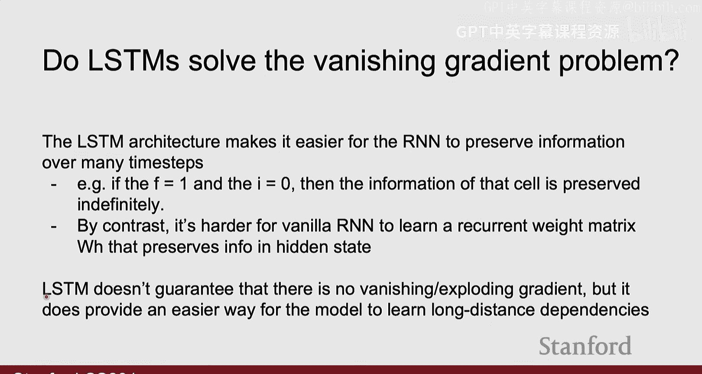

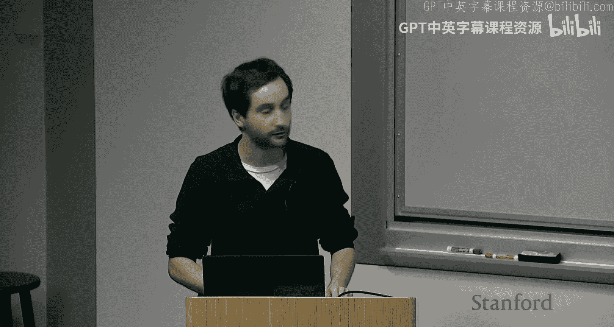

To design RNNs to account for the issues they face。

So one other thing that would be kind of cool to tie in to something you learned earlier in this course is this idea of directly adding outputs and skipping some activation functions or other layers is actually highly related to the idea that we discussed in Renets where you have these skip connections where the value is just copied over and added later in the layer blocks so you have multiple in resonance you have multiple of these convolution layers stack together and then you add skip connection where the value just gets added here and you can sort of think of in a similar light for LSTMs how it's skipping over some of these layers and it helps improve as you get in this case instead of very large depth of the model it's very long sequences of time steps so this is sort of it's a parallel but it's a little different because one is the number of layers and the other is the number of time stepss。

Okay I think the final slide for today's lecture is just a little tie in for how these RNNs have sort of made a bit of a resurgent in the last year or two。

 which is kind of funny because I think if we taught the course maybe a year or two ago I would have been much more willing to want to cut RNs entirely。

 but there are actually a lot of nice advantages they have。

 So the main one is this unlimited context length。 So one of the main issues with transformers is they have a limited context length as people are really pushing the boundaries for what these models are capable of this context length is becoming more and more of an issue。

 So if there have been various workarounds in the transformer space。

 people do things like rope and some other techniques to try to extend the context length。

 but it's a pretty significant limitation of the model the other thing is that during during inference for RNNs。

 the compute scales linearly with the sequence length or during train too but basically as you add more and more steps to your sequence you just need to re。

Compute the same operation over and over again。 So there's no operation that looks across the entire input sequence like you have for transformers。

 So these are really big advantages。 And there have been a couple of papers so to shout out a few there's this RwKv model you can check out archive link here and also Mommba are both mainly highlighting this idea of we're able to achieve linear time sequence modeling。

 So as you scale up your input sequence， the compute also scales linearly as opposed to quadraically with transformers and so you get it's better for long context problems sometimes in terms of compute。

 it works better and it has these main advantages。 So we try to get the best of both worlds and there's been a lot of research in this area。

 How can you get the performance of transformers with the。

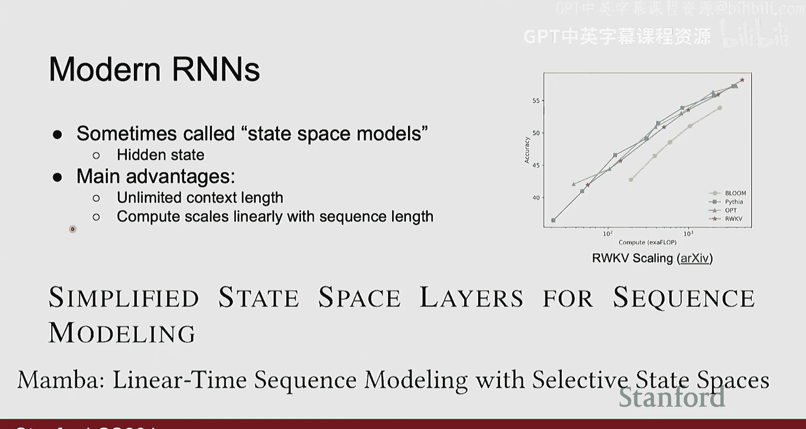

Scaling of RnNs okay so that's all for today in class。

 We basically talked about how there's a lot of different ways you can design architectures with RnNs。

 The nil RNs are simple， but they don't work that well And there's been more complex variances that people have proposed that introduce ways to selectively pass information this backward flow of gradients in the RNs can either explode or vanish depending on the activation function you use or what is the properties of your weight matrix So you often need this back propagation through time to actually compute the gradient as well。

 and then finally basically these better architectures are hot topic of research right now as well as just generally new paradigms for reasoning over sequences。

 So yeah， I think that's it for today next time we'll talk about attention and transformers。😊。

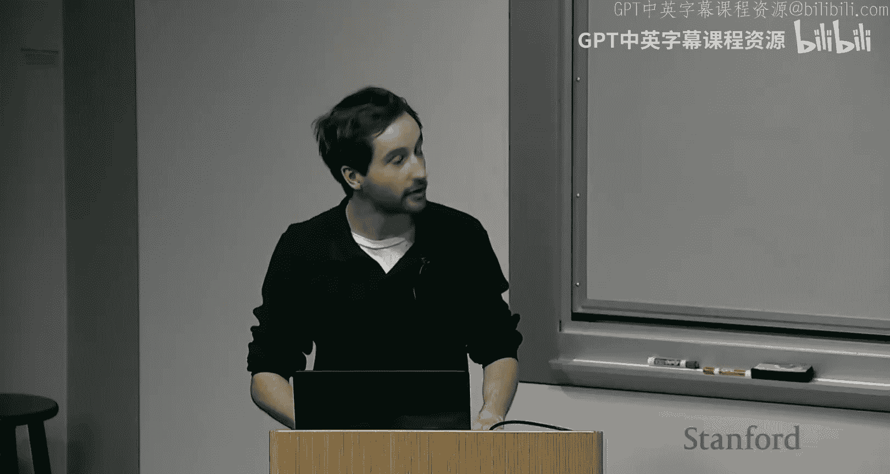

