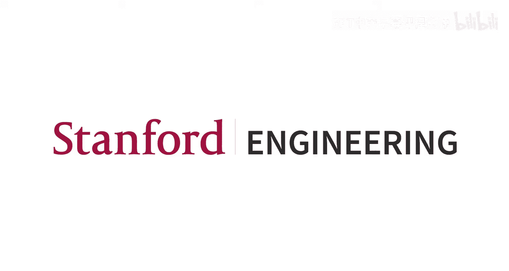
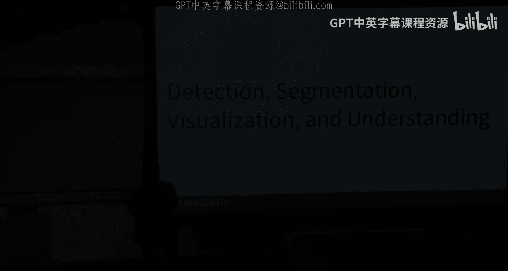
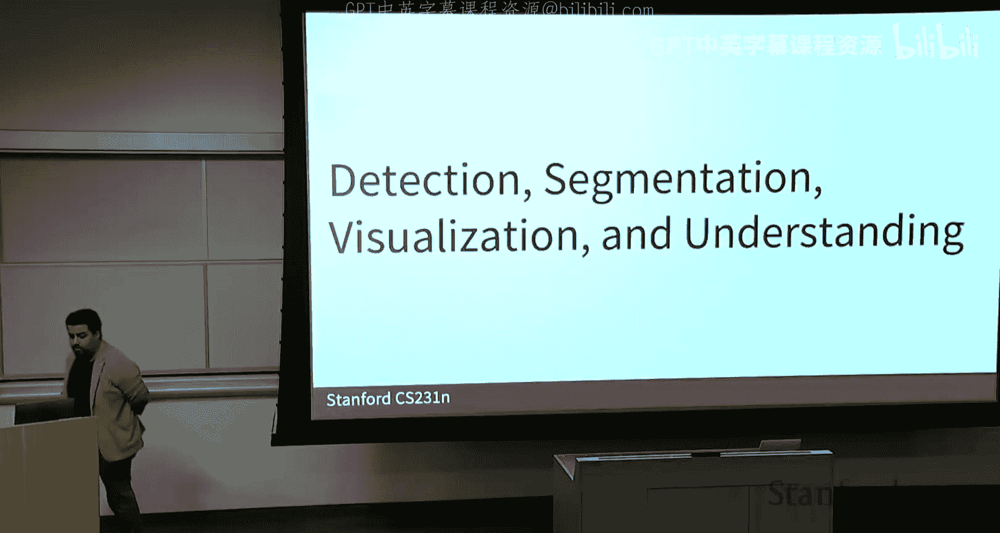
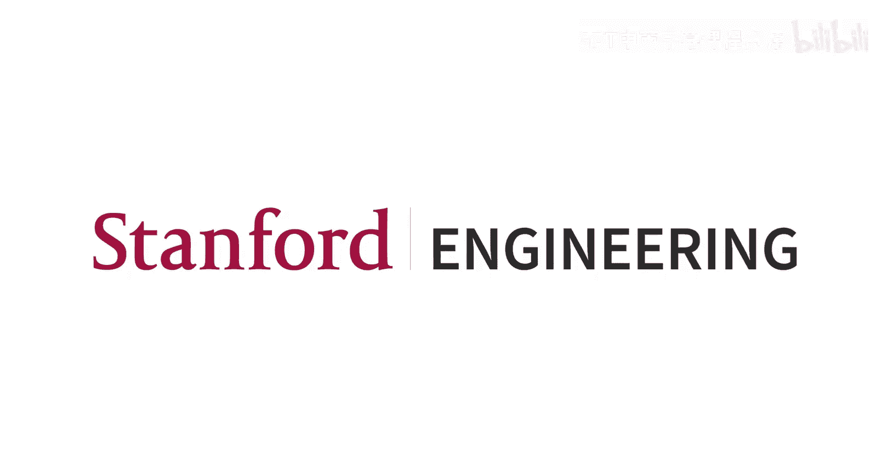

# 斯坦福大学《计算机视觉的深度学习｜CS231n： Deep Learning for Computer Vision 2025》中英字幕 p09 -09-Lecture 9_ Object Detection, Image Segmentation, Visualizing.zh_en -BV1FqazzVE6w_p9-

Okay。Today， well be talking about different tasks of core computer vision。Algorithms and tasks。

 detection and segmentation。 We will also be covering topics around visualization and understanding。

 I will cover the the most important ones。 Alright， so last。

The previous lecture last time， what we discussed was around the topic of transitioning from sequence to sequence models。

 RNNs to transformers。And。We saw that transformers were defined by having some sort of encoder。

 a number of layers which had multi headed self attention and layer norm as well as some MLP norm layers。

And this was。Ultimately called something that we now refer to as encoder encoding the sequence。

 and then if we need to decode an image or a language a sequence as the output。

 then similar type of architecture is used for decoder getting the。Encoded tokens as input。

 taking those as input and then generating what is I'm hoping that you can see my cursor too。

 what is。The the output， the desired output， we did talk。Justin talked extensively。

 quite extensively about the differences of modeling sequences。recurrence neural networks。

 R NNs and their variations that we've talked last week。

 I think on Tuesday about and then using convolution also as as another approach。

 but we talked about ultimately that self attention is what the。

Work with in many of the applications these days。 They work。

Much better than the other other two they do add， they are more expensive。

 they do add computation and memory requirements for and but but that comes with。

Much better modeling of the sequence and better results in terms of any of the tasks。So until here。

It wasIt was mostly talking about self attention。 We also talked a little bit about cross attention and。

Related topics。 And then we got to the topic of vision transformers。

 which is one of the core models that is being used in modern applications。

 computer vision applications。 We did go through this。

In the last minutes of last lecture and I went to the previous lecture and I want to revisit the topic and after that I'll stop and hear any questions or comments you may have regarding the assignments and everything that I talked about so far。

We talked about the fact that what we do with transformers， then we want to process images。

Split the image into patches。Basically creating a kind of sequence， right？

 So the image was split to S by S or。In in this case， maybe。3 by three patches。

 And each of those patches are then represented by what we call tokens。

 and tokens are often a linear。Projection of the vector。Reshaped version of the image into a vector。

 And it's， it's basically a d dimensional vector， as you can see in this slide。

 But because we have turned the image into patches。 What becomes important。 what are we losing here。

 It's， it's basically were losing the location the position， the 2D position of of the image， right。

 So that's why we often create or add something that we call positional embedding。

 And there are many different ways of doing this。 you can create a sequence。

 Just put numbers of sequence as 1，2，3 and and so on， or you can do。

A 2D version of x and y coordinates and adding these two together creates the neutrocan that goes to the transformer layer the same way。

 all of the self attention， layer norm。And everything that we've talked about N MLLP。

 everything we talked about last week。So。And then the output layer will generate the output vectors for us。

Could be used for any application。 One of the major applications in computer vision has been classification。

 We started with image classification， right， So with image classification。

 what what becomes important is to somehow be able to encode。😊。

Or generate something as the output that is， is representative of the class。

 So what we do is often we add one token， a special extra input to the transformer， which is。

Of the same dimensionality。 But it's a learnable parameter that。In the output space。

 whatever that represents is going to be turned into the class。Probability vector。

 so a see dimensional vector， which is the class probabilities， and that's what。

You often call the the class token。 So this is one of the base。And a most standard way of using VITs。

 vision transformers for image classification。But transformers are not only used for classification。

 they could be used for many other tasks that we will be covering some of those today。As well。

 but last week we also talked about this other variant of the transformers against Saint tokens and from the tokens we go with。

The transformer layers， if you remember last time we talked about these multiple layers of transformers。

 as I said， positional embeddings are added and here because images are we see the entire image altogether we don't have to do masking like we did for language because language is really a sequence that we should have using the future。

Information for， And then， ultimately。Transformers， given outputs of the。

A vector patch for for each of the inputs and the other option for training a transformer is actually to instead of having a separate class token。

 just take the outputs， run a pulling layer and then turn that into。

A probability vector4 C different classes。 So I talked about two versions of transformers， right。

 One of them was we were using the class token and the other one was for we take all of the output torkens。

 We apply pulling and projection into a vector that represents the class probabilities。

 how we supervise this。 It's the exact same thing that we talked。About earlier。

 and that was back propagation defining a loss function， binary across entropyter， soft lag。

 max loss and so on。So this was VITs， this is VITs in a nutshell。But。And and over the years。

 this type of architecture for many different applications have have remained the same。

 Many modern architectures right now use many of these。

Components are' very similar to what we presented here。

 but there are some optimizations that we had in the slides last last week。

 but I think I'll just spend quick quickly a couple of minutes on。On them。

 but I want you to understand that there are many different。Twaks and optimizations for better。

Performance and also making the transformers the training a little bit more stable。

One of them is actually the residual connections， this layer norm is basically outside the residual connection。

This means that whatever we get here we normalize it right so this doesn't really mean that we can't replicate any form of identity function anymore that resnets really wanted to do right so the solution for that is to bring in the layer normalization you often put it before。

Self attention and the second one right before the MLP layer， so normalization is there。

 but we also preserve our identity function。There are also other ways of normalizing。

 there is this RMS norm root mean square normalization， which is actually a very。

Basic type of normalization it doesn't it doesn't use the for each of the features。

 it doesn't use the mean value of the feature for normalization。

 but this makes the training a little bit more stable again there are these are all empirically shown to be。

Better options。Although there are some justifications why they work well。

 but most mostly the reason for adopting these is just。The fact that they are。They perform。

 they make the trainings more stable， the other option is to instead of using a simple MLP。

 we use a Su glue MLP where we actually do some sort of this is what we call gated non non nonlinearity instead of having two vectors of weight matrix of W1 and W2。

 we add a third one，12 and3， but here we create some sort of gated non written non linearity which。

Basically what it does is。诶。Is is。gettting more trainable parameters and not just necessarily trainable parameters。

 but creating a better non nonlinearity for a small architecture。

 even if we select the hidden layer value equal to8 divided by3。

 it keeps the same size of the network in terms of the number of parameters， but it does。

Learn higher dimensional nonlinear nonlinearities in。InIn that layer。

 the last piece is mixture of extra experts that is often used in even the very modern architectures these days instead of having one set of mP layers。

 we can have multiple sets of mP layers each of those will be an expert and what we do is you through。

A router， the tokens will be routed to a of those E experts。And in this way。

 we actually have a active experts， but then again， this， what it does is it increases。In。

Number of parameters and it helps learning more robust models without increasing too much on the compute。

 and these again are all parallel MLPs so we can have multiple experts in parallel。As I said。

 they are used in all LLMs these days， large language models and all of the modern LLMs。

Up to the level that we know of， know about are using these types of tweaks。

And this is the summary of all of the two weeks that I just mentioned。This is similar to bias us No。

 No， this is， this is completely a trainable parameter by itself that you train either a fit forward network or or just a linear projection to turn that into the probability vector。

 No， So it's it's it's not it's not just Then again， remember that you have so many。

Seerlf attention networks here right layers here and those self attention layers are basically。

Fusing the information， creating attention between all of the tokens and this class token。

 so when you supervise it from here， the loss function comes in。

 this will as the will represent the class class token， the class probabilities vector。

So the question is if there are nice intuitions， what different experts are doing。

 that's a great question。Because they are trained in parallel and they are initialized differently。

 they often try to learn one aspect or related， maybe also sometimes very much related aspect。

 but it's just adding more more compute and more parameters。

 giving the network to learn different things if it does have to learn multiple concepts。

 for example， if you have to，Cover multiple probability distributions then with these MOPs。

 you often have the power to like separate those modes of data so the question is if the number of experts is highmeter or not yes。

 definitely it's a highparmeter from what I know it's often predefined don't necessarily like over fine tune them。

 but yes， they are all highpar。So why moving the layer norm。Helps us。Learn identity transformation。

 So look at this architecture。Will you be able to create any form of identity。

 Because right after that residual connection， the feature values are changed because you have a normalization。

You will never have the identity in the features， right， because right after that。

 you see the layer normalization， right， and that's why what we do is we bring it in。We have。A few。

 quite， a few different tasks in computer vision。And these were the core more important and the most important tasks over the years for computer vision applications。

 although these days we are solving much， much harder tasks and nobody cares about object detection anymore because now we can just do it with one line of code but over the past 10。

 15 years there has been a lot of advances and we want to cover。

 I want to really cover some of those today， just so if you have to design something new yourself。

 you know where to look and how。To design your models。

 and then ultimately there is the topic of visualization and understanding。

 which is very important in many applications， for example， if you're working with medical data。

 often the visualization or understanding is more important than the classification itself or detection of tumor。

 for example， you want to know where why and so on。

And the VV started the class and this slide is probably very much familiar to everybody。

We talked about different tasks and for object classification， for the task of classification。

 we talked about this， we spent quite a lot of time over the first few lectures。

Seeying how we can create a classifier that classifies images from pixels into labels。But then。

One of the other tasks， important。嗯。Similarly， is semantic segmentation。

 and within semantic segmentation， what we care about is。

To assign a label to every single pixel inside the image。Turn each of the pixels into a label。That。

Is the label for that object or anything in the scene？So basically。

 at the when we train a model that does this at the test time， we want to。

Take an image and generate the same map as the output。

How do we do that there are many different options so let's say I can what I can do is just look at each pixel every single pixel and say what the value or what the label for that pixel should be in the very basic form as you can see here it's actually very much。

Impossible， it's hard to say what pixel that。Represent that specific what object that a specific pixel represents。

Because there's no context if you only look at the pixel itself。That's why context is important。

 We look at the surrounding areas and。And then if I take these patches。

 depict pixel in the center and the surrounding areas。

 now I can train a convolutional neural network or any network that generates the output label for us。

 right， it's the same architecture that we've talked about。Over the quarter。

 and you can select any of those that we used for image classification because now you're classifying the image the entire image。

 it could be a CNN， could be a ReNe， it could be a VIT or whatever。

This is really time consuming because if you want to run one full network for every single click pixel in an image。

 it will take forever to turn this into a segmentation map。

The other option that we often we can use is to。Instead of running one network for every single pixel。

 what if we train a neural network that takes the image as the input and outputs the entire pixel map？

The segmentation map， not just one single label， a matrix of labels， right， And in that case。

We will have our segmentation task。Solved， and in order to do that， we need to have。

A layer in the in the input that is the same size of as the image。 And also in the in the output。

 you also need some sort of an inflated layer。 You can't go to。Fully connected layers and so on。

 because now we are generating an image。 And because of that， we need to。

Keep the network inflated and then。That's what we call often fully convolutional neural networks or FCNs。

So with fully convolutional neural networks this is definitely a great idea， but there is a cave。

 there is a problem， these images are large and these networks。

 these layers will become very large and there will be so many parameters to optimize。

 especially in the early years that we then have powerful GPUs。This was a bottleneck， a problem。

 a challenge for training algorithms。 and that's why。

The algorithms evolved into starting from full size images。Going down in terms of the resolution。

 making the convolutions， the special resolutions smaller and smaller through down sampling operations and then somewhere in the middle we'll have a lower resolution。

 but somehow thick in terms of the number of channels and then from there what we do is we go back up to the same size of the image to create the output pixel。

And in order to do that， we。Know how to do the down sampling， right， Downs was was easy。

 We've talked about it。 We talked about pulling operation， stride at convolution and several other。诶。

Steps or operations that could be used here。But on the upseling side。We don't。

 we don't really how know how to to do the up sampling， right。

 because we don't have pulling or reverse of up pullinging or。reverse convolutions， right？

And because of that， we had to invent some new operations that reverses downsling。By itself。

 but before I go to the app sampling。Defining what up samplingling is。

 I just briefly want to tell you that。How this maybe I can ask you a question。

 How do you think this network is trained because now we have a network that starts from an image and ends with an image and then。

The tools that we have for training this network was a loss function， right？

How do you think is the best to train or define a loss function for this network？

We talked about softmax loss， right。We talked also about a little bit about some regression losses and SVM loss。

 but assuming that we want to use softmax loss function。

How could we define this or train this network？What would the objective be， So mean。

 you said mean classification loss for each of the pixels。 And that's， that's correct。 You can。

Add the loss function for every single pixel because every single pixel is doing a classification right。

 so you will have a sigma over all pixels of the image。And the last function is just a simple softm。

And then you can back prop， that's the entire loss function that you need。The question is。

Do we need what we call ground truths for training so that's that's actually the ground truths of segmentation and yes for these types of algorithms because they are fully supervised we do need ground truths label maps and。

Early years， there has been a lot of work doing and sitting down and manually labeling the pixels to be able to train these algorithms。

 yes。These days we don't need that because we have tools but。Early on。

 in order to train these algorithms， we needed the contract。Okay。Very briefly。

 let me tell you what we do with upsling upsling is actually not that hard。

 we can use an unpoulling operation， there are different ways of doing it one is nearest neighbor if I want to go from a two two by two。

As an example here， a matrix2 to4 by4， I just need to copy。

The data kind of for each of these take the nearest neighbor in the in the lower resolution one or bed of nails is you just select one of those in the up sampleled version。

 you only select one of those or the one and the corner。To copy the data。

 replace everything else with zero， and through multiple layers of convolution。

 these values will start。Appearing。If we used Max pool in our。In our networking in the encoding side。

 what we can do is we can save the locations of the max， the ones that were selected。

 and then copy the data in the uning max unpooling stage right over there that。嗯。The max was。Defined。

 so basically we save the locations。In the encoding part and in the decocoding part。

 in the upseling step， we reuse those saved coordinates。

The other option is to do a learned up sampling， all of these that I showed there is no parameter to be learned。

 it's just an operation， but learned up samplinglings are also possible very simply let's revisit the convolution in the convolution layer。

 what we did was applying a convolution filter for a pixel and generating the output and do this repeatedly for all of the pixels。

 right？And when we wanted to to downsample what we did was stride a convolution where instead of taking steps of one。

 we take steps of two and generate the outputs step by step If you don't remember this part go back to the lecture we talked about it third lecture I think。

And。And then we can replicate the same for the do sampling process， so this one。

Will represent this area in the upseled image， And then we define some weights here to map that to the output map。

 And then for the next one， same story。 But there will be overlaps and for the overlaps。

 We often some over the the values。 Let me give you an example， some over the outputs。

 Let me give you an example。 And that's with a simple one D。

Fun if the input is just two values of A and B， we learn a filter that that filter maps it to the higher resolution output right and for doing that we just apply the filter to each of the values and。

Write the outputs here for the parts that there is an overlap。 It's a summation edition of what。Is。

Coming from each of the two locations。So。We did talk about this fully convolutional neural networks and how they are being used。

Actually， some of the most basic and mostly widely used algorithms for segmentation。

And I want to also very quickly highlight one of the widely used。Network， unit。

 as you can see the shape U， it's actually the same architecture as I showed here。

 justs let's draw it as a similar to a U shape。And。

The reason that I'm highlighting this is that still today some of the medical applications that work on segmentation。

 use segmentation algorithms， still this is this unit or its variance。

Generate the state of the art results if you don't want to use any foundation model。So。

What it does is exactly what we explained a downsling phase that increases the field of view and loses some special information and then upsling phase that goes back to the image resolution。

 the only difference that unit has is because it's used for segmentation。There is this。

Understanding that we need to keep the， the。Their special。

Information in the decoder side because when we downsample。

 we somehow lose resolution and then upsling， if you don't have the information。

 it's going to be a little bit hard and we often get into sometimes boundaries are faded。

And in order not to get there。The feature maps in the encoder side are actually copied。

As inputs to the decoder layers in that way， you're keeping this structural。

information within the image and generate the outputs that are much sharper so this was the idea but behind unit and as I said it's actually being used quite often summary of semantic segmentation。

 what we talked about today， the fully convolutional neural networks，You have same filter as before。

That we had for down sampling here。 So you have a。嗯。呃。Actually。

to save time I actually remove some of the slides from this part and I have it in the back of the slides you should check it out this is a reverse this is a transposed convolution so we do have a three by three matrix here and then instead of convolving the input image input data we we do the convolution on the applied convolution on the transposed version of the input and it actually generates a larger output so it's the transposed convolution it's。

It's the reverse of。The regular conclusion， but why transposed。

 I would refer you to take a look at the additional slides。So the question is。

 is that filter trained。 Yes， it's very much similar to other conclusion。

 Here's all of the filters are trained， yes， yeah。Okay。Great。This was the topic of。

Semantic segmentation and as we talked about this。We only get labels for the pixels。

 but if there are two instances of the same object， we have no idea which one is which， right。

 because this is just。Generating or output within the。The labels speak the labels。

And this brings us to that brings us to the topic of instance segmentation where now we not only care about the pixel classes。

 but also I wanted to know that these pixels belong to one instance of the dog in this next one is actually a different dog right and for doing that what we need is。

Understanding objects， multiple objects in the image and brings us to the topic of object detection objectject detection has been one of the besides image classification after image classification has been。

One of the core computer vision。Problems and and tasks and for many years， many。

 many different algorithms were proposed for just doing the task of object detection。

 we are going to fly over some of them and highlight a couple of important ones。

 but again there are so many works in the literature that even in literature of deep learning that I'm not covering here so。

In the past 10， 15 years。How we can do that and solve the problem of object detection if it's just a single object。

 it means that we need to generate， we need to do the classification。Generate a label classes scores。

As well as getting a bounding box coordinates of a box right so you need the coordinates of the box X Y and H and W as the output as well as what class it is right so this is exactly the task of object detection。

 How can we solve this， It's very simple right， We can define a softm loss soft max loss function for。

The class scores， and we can define an L2 loss function， which is a simple distance metric。

 a regression loss for the box coordinates and。Having these two defined。

 we have a multi taskask class。 We are solving two tasks at the same time。 and for doing that。

 we again。Add the loss values。 and generator。Compounds， loss function， as you can see。Here。So。

This is simple， it's doable。If we have one single object， we can for sure。

Solve this problem using this architecture that I talked about。

 but this is not that easy if we have multiple objects in the scene。

 so for three objects we have to generate 12 output numbers and if there are more then it's going to be too many numbers to generate so is this algorithm is not really scalable it's just extending the classification into some sort of object detection which is fine but it's not really scalable。

So。If when there are multiple objects。One solution is。

Instead of going or getting the entire image as the input。

 why not to look at bounding boxes for each bounding box？We can say we only have one label。

And whether it's a cat or a dog or the background， right？If I。Have this。

 this way of classifying each of the bounding boxes。 I can do a sliding window。

 I can create just bounding boxes slideed。Over the image。From coordinate00 to all combination of X。

 Y and H and W and see if we can detect the object。 So step by step I can I can create。

I can find the bounding boxes that have the maximum probability of each of the objects。

But there is a huge problem here， right， again， there are so many different combinations of bounding boxes that you can use。

And again， this algorithm is not scalable。What we've been doing in the literature again early years。

 if you look at the。The years these articles were published 2014 and before。

There has been a lot of research around finding regions。That。

Are they have high probability of having the object in them。 So region proposals。

 And if I have a way to find region proposals， that's actually going to be a easy。

I problem I can do the same thing and as I explained earlier， right for an image。

 what we can do is if I have region proposals， I can just take that part， that patch out。

And run a CNN on that patch， right， and convolution neural network on the patch。

 and then classify it。And in order to even I can refine the bounding boxes。So classify。

 classify and then。Refine the bounding boxes to have the object detected so we can classify the boxes and also refine the bounding boxes if I have to change the coordinates a little bit。

And this is what is called RCNN algorithm。And although it works。And again。

 this is one of the early algorithms CPR 2014。are these are very slow because for each of these boxes。

 again， we are running a full convolutional neural network。

But there is one catch that what we can do is。嗯。Is instead of。Running。

Convolution neural network on each of these boxes because con operations， convolution operations。

 they preserve their special information right， they either downsample or upsample。

 we always have a way to track them where in the PL space they are right。In that case。

 what we do is instead of running the。Convolution neural on network on the。Patches。

 let's say we run one big convolution on the entire image and then now we have the regions in that feature map。

 which is corresponding to the entire image。 let's look at those regions and now run a smaller CNN for on top of those and generate the outputs。

For each of these two outputs that I want first the box offset like should I move the bounding box a little bit or what the object category is so this is the fast version of our CNN。

 these are some basic algorithms that we can use convolution neural networks for detecting objects。

 their bounding boxes and so on。The question is， if the number of proposed regions are predefined。

 that the short answer to that is yes， I will talk very briefly about the region proposal networks too。

So easy algorithms， right？Puts the bounding boxes of the regions。

 put the proposed regions on their images。 One puts it on the feature maps of the continent。

 And both of those generate the output class label， as well as offset of improving the。

The location of the detected object。But this will mean this requires us to do that bounding box。

Reion proposal first and have a region proposal network that tells us where in an image you should look for。

And there has been research on building region proposal networks， RPNs。

And here what we do is we just randomly start with the CNN。

 we try to randomly start in different locations in the image and through layers of convolution。

We refine those regions。There they have the higher probability of having an object in them because we have the object labels and and and locations。

 so we can opt we can supervise this。 And then each of those also refine the box coordinate。

 So basically a neural。A region proposal network。 What it does is it。Refines the boxes。

 each of those boxes that have a probability， a high probability of an object in them and the box。

The output boxes， the box corrections again I'm leaving all of the details about the coordinate coordinates and all of these dimensionalities for you to check afterwards because it will take too much time and we don't want to spend too much time on this algorithm。

 but what's important here is back to your question，We often take。The top K。

 the ones that have the highest probability of having an object in them as the proposals for this image。

 this is an simple image。So then then most of the and only has one object。 So most of the。

Regions are centered around that single object。 But in general， that's not the case。 So in in many。

Setups， we can have region proposals used in different setups。

 we can get different objects and with higher probabilities。With。

That and after talking a little bit about RCNN and mask RCNN， which again for you。

 it is important to go through the details and if you can spend some time。

Doing the calculations yourself， that would be very good， but those types of algorithms。

 RCNN and mass RRCNN， they're not being used anymore these days because they are very heavy computationally。

Although it's important to understand how we got to this point， but those are for many reasons。

 one of those reasons is that we need two separate networks。

 one region proposal network and then one。classassification and box refinement network。

 so it's like at least two passes for detecting objects for each image， right？

And that's why there has been。Advances after these using a single stage。Object detectors， SSDs。

 and one of the most popular ones is called Yolo。Ylo is probably if you work with any computer vision problem you've heard about Yolo。

 even to date， although it's a convolution heavy network date， at least its earlier versions。呃。

In many even industrial applications， Yoola is being used as as the base for。Object detection。

 because it's a fast object detector， and it's。Very good in terms of detecting the objects。

 what Yoola does。I want to very briefly tell you a little bit about it's basically you look only once with one single pass on the image。

 you generate all of the。Bounding boxes， how it does it is it maps it。

 it divides the image into S by S grid of S by S。And in this example，7 by 7。

 what happens is that for each single box in that grid， it。Tries to out。

 it creates a fully convolutional network that outwoods。The probability of。

An object being in that location。Refinments of the bounding boxes。

 so it generates B bounding boxes and new hyperparmeters， B bounding boxes。

 that is the refinement of the object that is present in that box。

 and also it generates a probability， the class probability， object class probabilities。

And in this case， for example， if it hit be equal to 2。

 it generates just two bounding boxes with different probabilities。It does this for all of them。

Boxes at the same time。 so basically it's the same network that is being generating something as the output for each of these。

Boing boxes。 and it， it， it does generate a number of different options for the。

For the the object and as I said， each of those boxes are associated with the probability and in this example。

 the probability is shown with the weight of the edges。In each of those boxes。

And for these many different bounding boxes and object probabilities， now we can do thresholding。

And also。诶。There is an algorithm that they use in the paper again I don't want to go into the details。

 non maximal suppression and some algorithms with thresholding involved that identifies the ones that have the highest。

Probabilities， so this is， this is a simple implementation or or use of the。Object detection again。

 this is something very useful if you have time spend time with the repositories of Yolo。

 there are so many different newer versions of Yolo that is being used for many applications in medicine robotics and also in many industrial applications so the question is how do we get this second image and what's the intuition behind it right as I said for each of the grids we generate B bounding boxes。

Like for this one， we generated a two， for of all others， we also generate two。This bees is again。

 a probability vector， and each of these boxes are associated with probability of existing an object in depth。

And then if I put all of them together for all of the patches， I have so many boxes。

And now each of those are associated with probabilityability。Right。Perfect。Let's move on。诶。

And one of the more recent。Approaches for object detection is data， a detection transformer。

 this is purely based on transformers。And the topic that we did discuss last week。 And also。

 I started today， same type of self attention and cross attention modules could also generate some。

Some object detections and bounding boxes for us and how this worked。

 this is actually not a very old paper22 any， almost five years ago。

 although it's now kind of deprecated， nobody uses this for real applications。

 but it's a very good example of how to use transformers for object detection。

And what we do here is basically similar to what we've explained earlier。

 we may turn the image into patches， and then those patches are passed through CNNNs。

 creating a token。 Then we add positional encoding the same way that I explained to the。

Patches and those define our tokens for the input， which are inputs to the transformer encoder。

 a transformer encoder， again， a bunch of self attention。Layer normalization or any normalization。

 as well as ML key layers that generates the output tokens after multiple layers of。

Transformer encoder。Then in order to generate the bounding boxes。

 this is the smart part for this algorithm that it does take the encoder out with tokens as input in the transformer decoder。

 but we also define some queries。Which are trainable parameters themselves。That。Each of those。

 for example， if I add 5，5 queries as input，4 queries as input or 10 or2 queries as input。

 Im seeking。Up to 20 objects to be detected in that image。And then again。

 through a combination of self attention。Layers in the beginning of the transformer decoder。

 as well as cross attention with the encoder。Output。So cross attention and self attention networks。

 layers。It generates generates the output values for each of these queries， which。

Are passed to an FFM fit forward network to generate either class。诶。

Labels and the bounding boxes is very similar to what we discussed earlier。

Or even in some cases it just says there is no object to be detected and at the end we have the bounding boxes and the classes associated with bounding boxes as the output。

So the question is， are we inputting every possible box to the transformer no。

 the input here are some channel parameters that are representing they are queries。Representing。

Asking the question that I actually want an object to be outwited in place of this。Input query。

 right so there is no box or anything as the input。

It's part of the output that it generates the class label and the box coordinates。So the question is。

 if。The queries are formed in a way that it actually represents what we want to look for and varying the image right so in this case。

What we are looking for is defined by class labels which are defined predefined and they are as a part of the output so our supervision is based on the class labels。

 we have a class probability vector， same way that we defined it for the other algorithms right so that's how the algorithm knows what type of classes to look for。

And then in terms of the outputs。Again， these outputs are supervis。

 if you remember based on the L2 norm L2 loss of the ground through boxes right。

 so we are not telling anything in the query part。What to or where to look for。Any of the objects。

 the training， the the process itself is back propagating。 if there are any losses， any any errors。

 it back propagates the the outputs。 So basically it's。

We are not determining anything in the beginning or in this part。So the question was。

The query is give me up to 9 objects。 and， and yes， the that's the。

that's basically what this means and through the self attention and cost attention。

 it will try to generate output with tokens that are ten into class handbox coordinates through that FFN operation。

Your question is if the que is over there， if they are image patches or not， no。

 they are not image patches， they are just queries for train parameters you put them in to generate the outputs。

For each of the inputs， you get the value as the output and that value is turned into class and box coordinates。

Again， the question is what these object queries， they are trainable， learnable parameters。

 So you initialize them。 The network finds the best values for them。

 And that's what you get as the output。The question is， if， if there is any intuition。

 which FFM gets which box， right。The short answer to that is no。

 there is nothing that stops the network from。 I mean。

 we are not including anything that stops the network from generating multiple。

 but remember that are so many self-at and cross attention layers over there that they are actually interacting with each other and makes each of those queries match with one of the output layers。

 So it's not generating the exact same thing as the output。

 and we also have control over how to supervis supervising those FFN as well。

So your question is if there are image segmentations。

 pixel level segmentations as part of the training。

This algorithm does not require the segment level pixel level segmentations。

 it's only supervised based on class labels and bounding boxes。

 but if you have the pixel level segmentations， you can always turn the pixel level segmentations into a bounding box to train this algorithm right。

 but it doesn't necessarily require。So the question is。

 if it's possible to generalize unseen objects。And by answer scene， you mean a new class label。

For these types of algorithms that they are fully supervised。

 often there is no way because you are creating class probability vector。

 There's no way of like adding something at the end for a new class。嗯。Withoutouts。

Previously knowing there is there is some some other classes， right， So fully supervised networks。

 they are often there is no new object。 We can have a background object or no object。 as you can see。

 we have the the label of no object， but。There are many algorithms and mixed extensions of these types of algorithms that are used for zero shot learning。

 zero shot means understanding something new without having an example of those in the training data。

 But it's beyond us this topic， What happens if you have more objects in the scene than。

What you put in as the query right so that's a great question it often generates the ones that has the highest confidence on objects so bonding boxes with the highest confidence and in those cases you often want to add more queries just so you can get more objects right？

Okay， I'll be here to answer questions if you have any after， after the class， but we have。

A bunch of other topics to cover。 And I want to make sure we go over them。 at least you get。嗯。

Familiar with the topics。 So with the object detections now back to the question I was asked earlier。

 how can we use those types of algorithms for instance segmentation。

 And that's actually not too hard。 We talked about this。

When when we were talking about our CNN algorithms where we run a CNN on the image。

 then we have a region proposal network that gives us the bounding boxes and those bounding boxes are。

Turned into either class labels。And bounding box refinements。 right。

 So this is what we've talked so far。With RCNN and so on。

 now we can turn this into a mask RCNN that also generates the mask。

So basically same architecture that we talked about earlier， now we can take one more output。

Make it more multitask。And generate the mask predictions。 So what we used to be doing before was。

Again， image。Regent proposals， CNN gives us class label and the box coordinates。

Now we add another layer of convolution that generates the mask， the the。

Mask for that object in the pixel level and that mask again。

 could be the same size as the input and and the image。And basically， under under。Layer itself。

 if we use fully convolutional neural network that's what we often get as the output for each of the objects。

 when we have that box tiny box， we can always get the mask for that， the chair。

different settings of the box itself， if you have different boxes。The bed， and。The human。

 the baby in the image， and this is what we an extension of the RCNN algorithm。

 which we call mass RCNN。And。With masscarcia and it's actually the results have been very。

 very good in detecting different objects， different。嗯。

known objects that we could train the algorithms for and then there are so many APIs and open source versions of object detectors that you can explore there are some links and resources here。

 but this all basically rounds up and summarizes some of the tasks that we wanted to cover and they are actually very important for you to understand these tasks。

 they have been core computer revision tasks， although these days computer revision is very more advanced。

 they're not bound to these tasks， but if you have industrial applications of for example。

Quality control of。Separating rotten tomatoes and good tomatoes in an industrial pipeline then with computer vision you need to be able to detect objects and then classify them into good or bad right so that's why it's important to still understand and know these steps and pipelines and how to do them in real time but now there are larger scale models that you're all familiar with。

This summarizes the first part， the computer vision tasks that I wanted to talk about。

 and the last piece that I want to spend 10 minutes on is around visualization and。Understanding。

Again， this has been a big lecture by itself and， and in。2050。

60s until 2020s that the topic of computer and an event before that 2014，13。

 the topic of visualizing neural networks has been very hard and very much。

helped us gain understanding into what the networks are learning。

 and I'm going to summarize some of those the most important ones here that you may need to use in your applications。

But before that。Let me go back to the linear classifier that we talked about。

 We spent quite a lot of time on linear classifiers。 and with the linear classifiers， what we。

We did was at the end we said if I look at the linear function， what the network is learning。

 I can have a template for each of those classes like for example。

 for this car you can always see a front facing car as a template right we can do the same with neural networks if I visualize one of the filters so here we visualize the weights of the linear function it was the visual viewpoint I can do the same with linear sorry with visualizing the filters in。

The neural networks。 So for each of the filters that the network is， for example， is。

Learning something that is basically some of the basic shapes。Orientations or simple shapes。

 as you can see here。Although this visualization is it， we can only do it for。

The layers that we have few channels like for example。

 if we have three channels I can put them in an RGB image and just visualize it。

 but as you remember in CNNs that was not the case in CNNs we had different sometimes。

Quite a few channels in the middle layer。 So it's not easy to visualize those in something that we can see。

 but， but that's， that's what you basically see in early year layers that we have fewer channels。

 we can visualize them and see the network is actually learning some patterns。

 So we start it starts learning patterns。 And then later stages， it gets。

More holistic and bigger patterns as。If we train， sorry。

 if we run something that we call guided back propagation。We can also visualize those。

 but not as simple as this。I want to highlight a couple of ways of evaluate understanding and visualizing。

The neural networks are actually kind of important。One is。诶。

The concept of salliencies so in many applications it's very important for you to know which pixel matters。

 for example， in a medical application， when you do a classification of tumor versus none you want to see which parts of that image is actually the tumor because if you want to automate this。

 nobody cares about knowing if there is tumor or not。

 everybody cares about where in the image the tumor is right。

In order to do that simplest application is we train a network。

 a feet forward neural network that generates the value。Or the class label doc。

 But what we can do is we can。Actually， before I showed you that。In this case。

 in order to train this network， what we've done was we always took the derivative derivative of the neural network。

 the weights， sorry of the loss or of the classes score with respect to the weights in order to update the weights right now what I need is for each pixel I want to see how much changing the pixel value。

 how much changing the pixel value。Would affect the dog score， right？ What does this mean。

 what I explained is， is the the meaning of deri， right， So if I this means that。

In the meaning of basically gradients。So if I take the gradient of the score with respect to now the pixel values。

 not the network weights anymore， with pixel values， I can visualize those gradients。

And visualizing those means that these are the pixels that matter in order to classify dog。

On this image， those are the pixels that matter， so if I change the values of those pixels。

 this score， the doggest score will be changed。Right。Again。

 this is the basic meaning and definition of gradients that we've talked about。 So this is。One way。

 if you run this on different objects。That you've trained in the network， then this is what you get。

So that's one way of understanding salliency， and it's very effective in many cases。

 but sometimes it's not just about the pixel values all the way to the back。 you want to see。

For each of the classes， how the activations。Work and this brings us to class activation maps or caM algorithm。

 class activation mapping， CAM or gradCm that I'll talk about in two minutes。

Are one of the most and widely used algorithms for understanding CNNs and also could be used for other architectures too。

 but for transformers we have a much better way of making sense of those which actually we talked in the last lecture。

So what happens is that for each of the convolutional layers。

 we often do pooling and the pooling generates feature maps。

 the feature maps are then turned into scores and those scores with those values of。Weates。

If we extend the math， basically we simply can highlight the classes scores in a some form。

 and this means that you can trace back class predictions。All the way back to the feature maps。

And in specific locations of the space because convolution layers are always mapped to a space in the image space too right we do convolution it the special consistency across all of the operations can help us trace back all the weight to the image space So anyways we can we can look at the feature maps and see how the class activations。

 each of these classes are actually impacting those locations in in the image and with that now if if I do this multiplication of weights versus the。

The debates that we've learned。On top of the feature values， we create some class activations。

 And this means that I have a way now to go back to the image of space。

 because as long as I'm in the convolution of space， I can go all the way back to the image。

And create these maps of， like， for example， for each of the classes， Pal， Dome church。

Altar and monastery。We can have different class。Actation maps。These are the weights。

 These are the pixels or areas of the convolution layer that have been driving the scores for these specific。

Classes。It's the same for others class activation maps for one single object in different images。

But there is a problem with this and that problem is that we can only apply this to the last convolution layer because this is the only v we can do it。

 like we can only go to the last convolution layer， the way that we did the calculations here。

And in order to solve that problem。There is one variant of the algorithm， called Grdcam。

So gradients vded class activation maps， it's basically the same algorithm。Just we need to wait。

 calculate the weights with respect to the。 we basically take one of the。Layers。

That created some sort of activation in the class level。

 we compute the gradients instead of just calculating the multiplication between w and feature。

 we go all the way back with the gradients and create a weight based on the gradients and then that is used instead of the weights。

 its aggregate of all of the weights and gradients up to that specific layer。

 and then we weight that with that and then we also use re to only map to pass the。

Be the positive ones。 And then that could also be all the way shown in the class in the image space so。

I talked about cam， which was only applied to the last convolution layer。 If you want to。

 but this is not。Possible because in most of the CNN algorithms。

 we don't have just like one convolution layer at the end right we always have some operations fully connected and so on。

 so in order to be able to carry this class activation to the convolution layer。

 if there is something else in the middle，We often use the gradients and wait。

Basically they the maps with the gradients aggregates。

 and then we can actually do the visualization that create these heat maps for each of the objects。

So this was about CNNs。But we talked about。Transformers last week rate in the last lecture that they actually。

 they inherently come with activation maps。Do you remember that language？

Matrix that Justin showed that for each of the war output words。

 there is a tension made for the input， we can do that the same thing for the pixels。

For each of the outputs， we can create these maps in the pixel space。And。

 and visualize the features of the V I T in the pixel space。

 So basically with V I T and and transformers， this is much easier。 We already have a way to。

 to visualize the the attentions， the weights， but with。CNNs， we often use GrDCm or these types of。

Algorithms， that said。I did this task that I thought I wouldn't be able to completing the topics I wanted to talk about today and next session willll have the lecture around video understanding Thank you。

