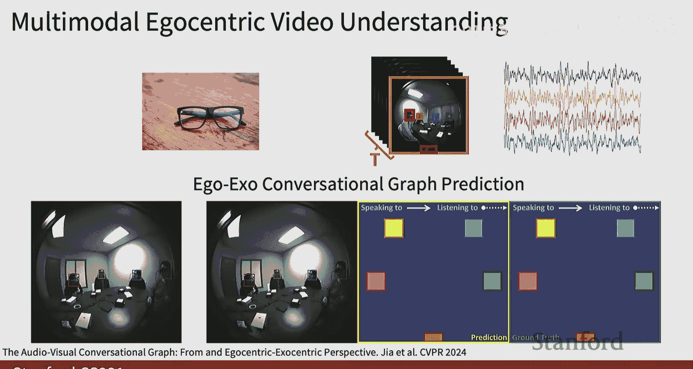

# 斯坦福大学《计算机视觉的深度学习｜CS231n： Deep Learning for Computer Vision 2025》中英字幕 p10 -11-Lecture 10_ Video Understanding.zh_en -BV1FqazzVE6w_p10-

I think at the beginning of the course， we announced that we would have a few guest lectures。

 people who previously taught the course to come and give sort of a single guest lecture about a topic that they're very familiar with。

 and I'm very happy to announce we have the first one of those lectures today so I'll introduce Dr。

 Rohan Gao， he is an assistant professor in the Department of Comp Science at the University of Maryland College Park。

 and he leads the multisensory machinechine intelligence Lab there he was previously an instructor for CS231N from 2022 to 2023。

 and this is why he completed his postdoc with Fee Fe Lee， Jo J Wu and Sylvio Saar。

 so without further ado， I'll leave it to Rohan to give the presentation today。Okay。

 thanks hell hello， everyone。 So it's really exciting to be back to the class of 231N。 And I'm Rohan。

 just like then introduced。 So as you can tell， I'm very interested in multimodel stuff。

 So not only vision， but also how we can make use of other sensory modalities like audio tactile or other modalities just like with humans to perceive。

 understand and interact with this multisensory world。 but of course。

 vision is the most important modalities， that's why we have this course deep learning for computer vision。

 and I'm sure up to this point that you guys are very familiar with image classification。

 given 2D image like this。 how to know give label to see whether it's a dog。

 It's a cat or it's a truck a plane。 That's a2 dbased image classification。

 And from the last lecture， I'm sure you have also learn some other tasks that you can do on images。

 not only you can just assign a single label to see it's a cat or lot and also you can。😊。

Do semantic segmentation to segment you know the picture into different portions components and also have some semantic meaning like where it's grass。

 where it's cat where it's tree And also you can also put a bounding box on top of the objects you detect in the image to see where the dog is。

 where the cat is and also do instant segmentation that you not only you want to know the categories。

 but also you know for each category。 you are two dogs。

 I want to have a segment segmentation mask for each category。 that's instant segmentation。

 So not of like tasks， classification recognition task you can do based on 2D images。😊。

But that's not the only thing that we can use for computer vision system to do。 right， And also。

 our world is not just static like this。 So we。Look at this image， hopefully up to this point。

 you have you know learned a lot of tools that you can train some models to know detect this classify。

 this is a living room， right， you have also have tools you have learned that to put a bombing box to see that this is a dog and this is a baby and also even you can even have a know segmentation mask to second them out to see where those objects you detect are in the image。

😊，So today we are going to focus on video understanding。 So more formal， what is video， Basically。

 video is just like this 2D image plus time。 Theres an extra time dimension。

 So we now we are tackling things not only in this3 image。 but also， but now in 40。

 we have this three times T T is typical dimension and H andW are the spatial dimension。

 Now we are considering this kind of images and videos as like a value of images。 of video frames。😊。

So an example task is video classification， just like image classification， right。

 So we are given a video like this。 some person is like running， right。

 We want to take this videos as input and also we want to train some model deep learning model。

 we want to classify whether this person is doing swimming or running or jumping what actions that he's doing right just based on this temporal pro streams of video frames。

 So we also we have from the previous lectures。 I'm sure you have already learned some know loss functions like cross centralpy and you can train a image classifier Similarlyly。

 you can use the similar tools know just train a video classifier。

 you just get some features and use the same noise functions and train a video classifier。

 So now the problem on video understanding that how can we get features of videos that you can apply the loss functions you have learned from the previous lectures right。

😊，So and also another kind of difference between image classification and video classification video understanding is that now the things the task you want to do might be a little bit different。

 just from the previous example， the images， for example， for image classification。

 usually you care more about the scene， the objects， right， You want to just doing classification。

 What is object category for videos usually just like this example， I'm showing here。

 usually want to classify actions。 It's often actions like where the person activities is the person or some some animals are doing in the in the videos。

 That's what we care about usually in video understanding。 So nature of things to recognize。

 can be a little bit different。😊，And another problem that we want to be careful about for video understanding is that videos are usually very big。

 right Well we when we talk about images， it's just like three times h times W。

 It's a single matrix of some RGB RGB numbers。 But now we consider videos， it's a sequence of frames。

 it can be like 30 frames per second。 So in movies。

 it can be sometimes you can have even higher like resolution and also temporal resolution video frames。

 And so if you consider space to store videos。 for example， we consider standard definition videos。

 it can take about like 1。5 gig per minute if we store this video。

 if we consider even high resolution like 1920 times1080。 and now it takes like 10 GB per minute。

 So it takes gig space in order。😊，To store this kind of video data。And also。

 there is no way for us to just fit this kind of data directly to GPUus， right， If we。

 we just have the input， then we can have have a lot of storage to store them to source this kind of data。

 And also， there are other things you can have to store like the weights。

 the activations in your convolutionary networks。 So then your model will be very huge。😊。

And the solution one solutions we can have know to make videos smaller。

 to make them you know process。 So one simple solution is that we just make videos smaller， right。

 So although the high definition videos and also the original videos are long we can shrink things both temporal and spatially we can just for example。

 for 3。2 second videos like this。 we can， for example， we can maybe for each for each second。

 we don't maybe we don't need all the frames， let's just take five frames。

 are a lot of redundancies in the video frames， right if we take5 frames per second and also we just have smaller。

 spatial resolution like 112 times 112， and now we can make the videos slightly smaller。 for example。

 it's588 KB for this simple video。😊，But definitely， we can also do larger resolution。

 If we have the compute， right， just like images。And also how to train a model on these long videos。

 We cannot usually like in a previous slide I showed that we are training this video classifier on 3。

2 second but videos can be very long can be minutes can be ours right So one way that people do is that we train on clips just like we train on kind of chunks of this video frames using a video classifier and what we do is that we train models to classify short clips with some though of FPS frame per second and we just use a sliding window know sample a lot of different clips and use them as training data and we train on classifier and then during testing during inference time。

 we just run the model on different clips， we sample few clips 1 clips and then we average the prediction results。

 and that is our prediction for this long video。😊，And then what is the simple post like video classification model we can use。

 So I have mentioned basically， video is just like a sequence of images， right。

 a sequence of video image frames。😊，So one thing thing that we just treat them as images that's the simplest kind of tool we already have right We just run single frame convolution neural networks because we already have all the tools right we have learned that we can train an image classifier we just take our image classifier to just run on top of this kind of video frames treat them as images。

 we can indeed get a decent predictions right especially like a video like this。

 you can see that there are not many changes across videos right the person is running maybe there are some different movements on the body。

 but generally looks pretty similar right maybe we just run image action classifier and on every frame。

 maybe all of the frames will tell you it's running and if you average the prediction results from each image。

 each video frame， then you predict running for this particular video So actually also it's usually a very。

 very strong baseline for this simple image classifier especially for video like this because there are not too many changes。

😊，cross videos。So if you are trying to design some video classifier。

 you should always run this first， because that's kind of simple things to try。

 And maybe you can already get get pretty decent results。😊，So the question is。

 whether we just run on single frame or we run on chunk frames。 So for this simple single frame。

 basically， we just you have a video of like 30 frame。

 Maybe you just maybe sample a few frames and you just use the image classifier to run on those like sample10 frames and just treat them as images。

 And you just directly average the results。 That's basically the per frame they。😊。

So I think you have a very important question is how to sample the frame。

 That's a very key question because we' giving a I'm talking about we want to sample some frames and want to run a C on the frame。

 So how to get those frames。 So that is actually also an active areaial research。

 one simple way is that do random sampling。 you have one hour video。

 I don't know where the interesting part where the important parts are We just sample maybe every one minute。

 I sample one frame。 And then I run an image classifier average results。

 So obviously maybe this is it gives some good results。

 but maybe this is not the smartest way to do the sampling。

 So other methods trying to propose smarter sampling strategy。 Maybe you can sample one frame。

 you can then use that decision to decide where else to sample I actually also have some examples in later slide。

😊，Okay， so this is a very， very simple kind of video classifier。

 just like we just adopt image classifier， a single frame Sta and。😊，Similarly。

 just maybe we we take one step further。 instead of directly just run single frame C N and average the prediction results。

 maybe we can doing in some fusion， right， across the you know features on the using the single frame C N。

 So this is all often called late fusion。 Basically， the idea is that we still take some 2D C N。

 And we have some input maybe T frames。 and for， for each frame we。😊，Use a 2DCN。

 and then we extract some feature vector。 and then we get maybe a feature feature map of D times h prime times w prime。

 And then we get because we have t frames right then basically we have T feature feature feature maps。

 And then the simple thing that we just flatten all the feature maps to vectors and then concatenate them。

 Then we have a giant like feature vector that basically contains all the information。

 all the features across all the frames， right And then what we can。

 we can use tools that we have learned like fully connected networks。

 we train an MP that maps this vector to some neural dimension。

 and we train a classifier on top of it to map it to class score C right So this is called late fusion。

 because basically can see that we extract the feature maps and we process them very independently。

 And then at the very late stage， we concate the feature vectors and run some fully connect errors to doing the classification。

😊，So， this is。呃呃。This is useful， but one drawback that you can you can already probably tell from this example from my description is that this fully connected layer right it's going to introduce a lot of parameters because if we cancate a lot of flatten them and across time and this feature vectors depending on how long how large tea is。

 then you can have a giant feature vector and use this giant feature vector。

 you want to map them into some lower dimension and you have a very large fully connected layer and that will introduce a lot of parameters。

 So it's not very efficient。 So another way to do this is that instead of concatenate we don't do concatenation。

 we don't use just use the giant feature vector and then then have fully connected layer to map them to scores。

 we can actually just do simple pooling pooling， you don't increase know the lens of feature vector。

 Basically if you have feature dimension some feature dimension for a single。😊。

Fme and you pull across time for this T frames， you're just doing a pooling to doing temp aggregation。

 And then based on this clip feature D。 And then you instead of now instead of D times t。

 you just still have a feature vector of time D。 you do pooling And then you have a linear layer to map D to some dimension C that match the cast score。

 And then you train the crosscent pillar on top of it。 and that's also late fusion。

 But now we are using pooling。 and the the good side here is that now you you don't have to have a very large fully connect。

😊，But the pu can also， you know。Get rid of information that may be important。

 So that's kind of the downside of this operation。So the reason I'm calling late fusion the important part is late right and when it's late。

 maybe you some information that has already been not so you have using this 2D convolution networks to process images for example。

 for example， showing in this red circles here。 So what is very important to recognize this video is actually the motion of this this man's feet it's moving up and down up and down and you can maybe tell that it's running So if if we just use a single 2D CN to process them independently as 2D image and extract some feature map it maybe up to very late stage of the feature maps。

 it doesn't actually already it doesn't contain the information of this movement of of the feet of this man anymore at this very late stage。

 So so some information this up and down like showing these red circles。

 which should be useful cues but now it's not there。The feature maps。The intuition is that。If you。

 you think of you extra features from the early layers， right。

 it's very close to the original video frames。 So it so it will it will be there' is larger chance it will contain this no level kind of information。

 this movement like from the video frames， right， And also you can， if you concate them or pull them。

 it will come across time， it will analyze the motion across time。

 But because we are processing a lot of convolution， pulling convolution， pulling up to a stage。

 You you at a very late stage， It contains more high level information like demanding information。

 instead of this no level motion information。 So that's why it's most likely it's lost there。

 So that's downside of late future。😊，So instead of doing late fusion。

 then we actually we can do early fusion So to do early fusion。

 if we want to make use of the feature vectors more closer to the actual video frames。

 we can just take this input and then we directly reshape them to 3 T times H times W we just directly aggregate the information from the very beginning。

 and then we use 2D convolution to the first 2D convolution here just directly map them from channel dimension 3 T to D basically we use the 2D convolution to process this temporal information in the first layer to map the channel dimension from 3 to D to process the video frames of all the information from the frames in the very beginning of the convolution neural networks and the rest of network is then in standard 2DCN and the only difference that now we destroy and collapse all the temporal information into a single single using a single layer。

😊，And then the arrest is just like image classification。

 and then you're doing this classification using standard called entropy loss。

For each frame we get a features like D， right， each frame will each single frame will give you a feature D。

 So you have T。 This feature vectors D。 So for pulling， we are pulling over the features。 Basically。

 we can doing mean pulling to average features we max pulling， we max over the features。

 Then after that， we still get a feature as D。 So it's pulling over the features， not the frame。😊。

Yeah。Okay， so that's early fusion。So then the downside of the early field is that although we explicitly trying to handle you know the motion from the early layer。

 but but then we we we are trying we are too ambitious。

 were trying to capture everything in a single layer。

 We just concate all the frames and then collapse all the temporal information using a single convolution network。

 Maybe it's not going to achieve what we wanted to achieve， right。

 So then another solution is that we instead of doing late fusion or early fusion。

 maybe we should do something in between， right， that's kind of like slow fusion。

 that's exactly what this 3D convolution，3D convolution neural network is doing。

 So the intuition is that we want to use this 3D version of convolution and pooling。

 we want to slowly fuse the information over the course of the network。

 instead of doing it a very late stage or at a very early stage。

 we gradually shrink over temporal dimension and spatial dimension to get this 3D feature maps。

 So that's the idea of 3D convolution neural network。😊。

We just use 3D convolution and 3D pooling operation。 So what is 3D convolution and 3D pulling。

 So you have learned the 2D convolution， Right， for 2D convolution error， basically。

 you take an image like this 32 times 32 times 32 times3 image。 And if if you use 2D convolution。

 Basically you have learned that you can for each kernel。 you have this filter。

 you can you can have like this convolution kernel that is maybe five times 5 times3 that that runs like in a sliding window approach。

 just you know slides across across space and goes all the way in the depth dimension， right。

 So then for for each。😊，For each computation， you， you know。

 you map that to a single value in that final activation maps。 And then finally。

 you obtain this activation map of 28 times 28 times 1 in this case。

 you come all over all special locations and map the channel dimension。

 the Dev step go all the go all the way over the channel dimension and then map 3 map from 3 to to one in this case。

😊，So that's 2D convolution。 So the difference is that for 3D convolution now。

We just have one extra dimension。 So here you can think that。

Here the input is C times t times h times W， right the extra thing is this t dimension。

 that is a temporal dimension。 So but what I'm showing here。

 because we can only show things in 3D right we cannot show things in 4D。

 Sos actually one dimension that is not shown here。 that is a C dimension。

 the channel dimension is not showing here。 So you can think that for each grid point in this feature map。

 there are many features there are C features in that in that grid point And then for this 3 d convolution。

 basically we are talking about like 66 times 6 times 6 convolution because it have one extra dimension Now instead of slide over the spatial dimension just in the H and w dimension over the images now we are sliding over this cube we are sliding over this cube of dimension T times h times W includes both the spatial dimension and the temporal dimension。

 And also it goes all the way。😊，Along the channel dimension。 So then it will gradually。

 you can you know just like 2vol the other part just like the2D convolution。

 It' just you have this extra dimension and you get the 3 d，6 times 6 times 6，3D convolution。

 and maybe another layer of five times 5。 And finally。

 after you process using these3D convolution operations and you flatten the feature vectors and then you use a4D connect layers to map them to the class scores。

 So that is basically the idea of3D convolution。😊，So let's walk maybe through some to examples to。

 you know， to better understand it， to compare the early， late and。

The 3D convolution neural networks right just to， just to give you a flavor how it works。

 in practice， actually， definitelys the better can be much larger and more complicated。 But here。

 I'm just trying to show that a to example to， to work through you know the the size of the feature maps and also the receptive field to give you a sense about what's the difference between early fusion late fusion and 3D convol neural networks。

 So for。😊，late fusion， right you can think of that， for example， in this case。

 maybe originally it's of the input is like three times 20，20 the temporal dimension and 64。

64 is a spatial dimension and use use2D convolution basically just we doing late fusion。

 we don't do anything over the temporal dimension initially we just keep the 20 the temporal dimension。

 We just build up the receptive fieldly right now we have avol2 d layer to map the channel dimension from 3 to 12。

 but just keep the temporal dimension 20 and then gradually maybe we use some pool in there still know we didn't do anything with the temporal dimension。

 So it's still 20 right but we because because of the pulling operation。

 we build up the receptive field in the spatial dimension。😊，And then gradually。

 we maybe use another 2D layer。 and we now the feature map is 24 times 20 times 16 times 16。

 and we also we gradually increase a spatial receptive field。

 but we still keep the temporal dimension 20 we didn't do anything over the temporal dimension。

 and finally， just using a single like a global average pooling。

 We pull across the feature map 20 times 16 times 16。

 So we pull over both time and and the spatial dimension。

 And now we get from this 20 times 16 times 16。 We get the one times1 times one feature point right So basically we collapse everything in a final single layer。

 and we build up the temporal receptive field in a single layer。 So that's a late fusion。😊。

So then for early fusion， what's the difference。 So now instead of building slowly in space or at once in time at end now we are building slowly in space and all at once in time at the very beginning right so the input is still that three times 20 times 64 times 64 but now we just using a single 2D layer now we just treat this three times 20 as a single channel dimension we just map everything this three times 30 just treat all of them as channel dimension and then map them to 12。

 So basically we use a single convolution layer2 d convolution layer to map to collapse all the temporal information from the very beginning。

 So we build the temporal receptive field in the first layer。

 now the temporal receptive field becomes from 1 to 20 and then the spatial receptive field gradually builds up and we use pooling and 2 d to build up the spatial dimension just as late fusion and finally we use global average pooling。

 Now we go average pooling is only just trying to。😊，Doing the a and doing the pooling across space。

So we build a slowlying space， but all at once at the very beginning。 So that's early fusion。

 So then what is。😊，3D revolutionvolution networks。 So for 3D evolutionvolutionary， basically。

 we build slowly both in space and time。 So that's why we call it slow fusion。

 So the input can still be like the same，3，2，20 times 6，4 times 6，4。

 But now we are using 3D convolutions。 So we。😊，In the first layer， we， we just。

To map things from three times to 12。 but we also just keep the temporal dimension in this case。

 and we build up a little bit of temporal re field and the spatial re field。

 And then we use a pool there。 and then like four times four times4 pulling there。

 And then we you know we pull a little bit of the temporal feature and also spatial features。

 And we further build up both the spatial and temporal re field。 And we have another comes 3 layer。

 and then to further build up the spatial and temporal re field。 And finally。

 were using a global average pool。 But now we are pulling over this four times 16 times 16 feature map。

 And then to further increase the temporal and spatial re field。

 So we are building up gradually in both space and time。

 So that's kind of the difference between early fusion， native fusion and 3D convol neural networks。

😊，So you can see that for the early fusion and 3D convolution neural networks。

 So both of them builds receptive field over time， right， But what's the actual difference。

 So let's look at it， more closely here。😊，So。You we think of it as like a feature vector for each spatial grid point。

So the the comm。Evas 2D convolution， right？For this great point， it it will consider。

All the temporal。Along the temporal dimensions， T T T is equal to 16， right。

 So so it is local in space， but extends fully in time， right， That's like the。😊，The。

 the filter in 2D convolution， neural network。But but what， what is the problem， think about it。

 So if you you we directly just go all the way through time dimension in this 2D convolution。

 What problem is's going to happen。So the shortcoming of that is that。

There will be no temporal shift in variance because the 2 d， the future now extends fully in time。

 right， So if we want to learn some like global transition in color of different time。 for example。

 if we want to because it's a video， right to recognize temporal information if there are some changes from like blue to orange at different time step。

 maybe theres some change that is happening at time step 4。

 there's another same change that is happening at time step 15。

 but it's the same change like from blue to to orange， if we go all the way through through time。

 the future extends fully in time， then if we want to learn the global transition at different time。

 then we have to have a whole separate future in order to learn this。

 So we have to learn a different this kernel in order to learn this different transitions across。😊。

Different times step。So there is no temporal pro shift invari。

So so how to recognize this kind of blue to orange transition just anywhere in space and end time。

 right just like when we are doing image classification， we want to know have some spatial invari。

 We want to be able to recognize the image contains a cat。

 no matter where the cat is on the right corner left corner we want to to share the kernels to be able to know to recognize things at at different spatial location。

 here we want to be able to learn this different types of motion。

 different times temporal patterns at different temporal time steps。 So that's kind of similar idea。

 So then that's exactly the benefit of 3 d convolution neural networks right now instead of extend fully in time right that t dimension originally for this early fusion T extends all the way in the temporal dimension T is equal to 16 now T is equal to3。

 and we can slide over the temporal dimension right just like we learn this。😊。

Fciial environment using future and local regions。 Now。

 this con filter only spend a local window in time and slide over in the time dimension。

 So the then the， the benefit is that now we can have some。Templ shift invari。

 because each filter slides over time。 So we can reuse this filter to recognize different motion patterns across these dimensions。

 So the transition from blue to orange cannot be recognized at every moment in time， right。

And then the benefit of this is that we don't have to have separate filters right。

 and now we are more efficient， more representation efficient。

 we don't need to learn separate filters anymore。😊。

So that's basically the main difference between 2 d con。

 the early fusion and the 3D convolutionary matter。And also， in the math lecture。

 I think you have already also seen some examples of some tools that we can use to， you know。

 visualize what we have learned， right in a， in a 2D convolutionial networks。 Similarlyly。

 we can also visualize。Fs just for these 3D convolution networks as this kind of video clips。

 you can see that the them not can see okay， the learned filters from the 3D convolution neural networks because now the filter extends both in space and time。

 So we can see that in as a video clip。 And you can see that for these filters some of them I just like those like filters。

 you have seen for。😊，Image image classifier， right。

 You can have this kind of color patterns and also these different edges。

 But you can also see that there are some other filters。Theres some temporal translation， right。

 from， from one counter to another or from some one edge pattern to another， so。So that's some。

 some doesn't learn motion。 and some maybe focus on just like the image the color patterns。

 but some learns motion in like different directions。

 So we can just visualize these kernels like this to， to interpret them。Basically， the。

 two difference。1 is like this slow fusion， right， basically in terms ofvol convolution operation。

 Yeah， indeed， basically 3D convolution， but 3D convolution。

 definitely2 D convolution that totally different， right you have another dimension of convolution。

 You have this temporal dimension。 So main difference you have this temporal dimension in the convolution operation。

 But practically if you use 3D convolution， your networks。

 it kind of gradually builds this receptive field over space and time， yeah。😊，So。

 we have talking about this。Tools3D convolution networks architectures， right。

 But what data we can use， just like image network。

 what data we can use to do video to train a video classifier。 So one kind of example data set。

 challenge data set that people have been tackling is this data set called sports 1 million。

 which was introduced in to 2014。 So for this data you can see that what kind of task we can do。

 we can do very， very fine grain sport category classification。

 right You can see that here the blue shows the ground shows and the。😊，Below the。

It shows top5 predictions and the green shows the correct prediction and graph shows the incorrect prediction。

 You can see that the action categories is data it's very， very fine green， right。

 There are 487 different types of sports。 like there can be like marathon， U marathon。

 actually don't know the the difference between them。

 but it's kind of very kind of fine green different types of sports categories in this data set。😊。

And here are some results we train these different types of classifiers we have talked about on this sports1 million data set。

 So one very shocking results you can probably see here is that for this single free model that I ask you to try if you want to develop some video classification model is that it actually has a very good performance right you actually can see that the single free model if you just trade it at the image classifier it actually gives like 77。

7 classification top five accuracy and for the early fusion we talked about it actually has a slightly worse performance and for fusion it's slightly better and we use 3D convolution neural networks in this case on this data it gets like 2% to 3% kind of boost。

😊，So the takeaway message here is that definitely you should try the single frame model。

 It can usually actually works pretty well and and the 3D convolution by the 3D convolution neural networks。

 I showed here is the 3D convolution neural network used in 2014， right， But over the past 10 years。

 we have seen a lot of advancements。 So the numbers are also getting much much better。

 as I'm going to talk about in the later study。😊，Yeah for both training and testing。

 it's just treating videos as images and training a image classifier。

That's exactly what a single frame is doing。 Basically， if I understand question correctly， it'。

 it's using image classifier， but it's training on a lot of frames on videos。

 It's not a single frame in each video yeah。😊，And also because this data sets a huge data。

 because like I mentioned， videos are very huge， right， when people sharing data sets。

 video data sets， we cannot just share them just like as like image that we have people can download from some database because videos are really huge like this data has like maybe 1 million videos it's not very doable to download all of them to share it actually this video actually originally when it was released is shared as list of URLs。

 YouTube URLs。 But one thing you can expect from this YouTube URLs is that people know mod their videos and delete their videos so that original list maybe have1 million videos。

 but now maybe I guess maybe the least maybe half of the videos is already gone or maybe not there。

 So this data is not very kind of stable because of this reason。😊，Okay， so。呃。

Another kind of like I mentioned，3D convolution neural networks have been like improving。 Yeah。

 gradually， right， since May 2014。 So one early kind of popular version of this 3D convolution network is this model called C 3 N network。

 So basically， it's actually very， very， very， very simple。 Basically， it's。😊。

It's very similar to the V G G architecture we use for 2D image classification。

 but it's now we just we just convert things to three dimension convolution neural network， right。

 and for example， for the 3D thing N to use three times three times3 and two times2 times2 pooling and except maybe for the first layer。

 it has some changes。s so over architecture is very similar to like V G G architecture。

 It's now just we have this extra dimension。And for this。

 So it's so that's why it's called the VG G of 3D Es。 And its the model。

 it was trained on this sports 1 million data set that I just mentioned And because it was introduced like in 2014 right And that time。

 imagine that you want to train such model it needs a lot of compute right because not many people have access to a lot of GPSUus at that time。

 So actually， this model was trained at Facebook and and literally release this model pretrain weights。

 they train says 3D model on sports1 million and the feature pretrain model as a feature extractor。

 So many people actually who cannot afford to train a video model themselves actually started to use this model as feature extractor。

 So you can just take a video and extra features from this from this。😊，Uing this pretrain model。

 this 3D model， and then it between some I don't need a classifier。

 So people start to you know use it。 That's why how it get got popular。

So the question basically is about when we're talking about what do we classification about how many frames we should take as input in terms to extract the features。

 So basically for all these models we are talking about， we assume that we are just passing a clip。

 a pretty list like 16 frames and 32 frames between train a single model that always takes 16 frames or 32 frames as input and there are other techniques were going talk about how we are going to aggregate this kind of clip level kind of prediction for now we are just doing clip level kind of feature extraction。

😊，So downside of this 3D C is that it's very computationally expensive， Basically。

 we just directly in a put way。 we just make to make this VG G kind of style from 2 d to 3D。

 And you can see that for Alex that this G， basically what it means is that it's the gig flops。

 it's trying to measure how many floating point operations you need for single forward pass。

 basically just trying to measure know whether the network is efficient or not。 So for Alexnet。

 it takes 0。7 g flops。 V G16， it takes like 13。6 g flop。

 But for this 3 directly doing this kind of mapping from 23 to 3 and it takes like 1339。5 g flops。

 So it's 2。9 times VG So it's not very efficient， right。😊。

So that's kind of the downside of this kind of network。

And you we look at a performance on Sports 1 million。

 this just 360 now gets about like 4% gain in terms of its top5 accuracy。啊不。

So this is just like one example of the 3D convolution network we can do right。

 but there are definitely can be other things We are talking about a lot of tricks that we we can do for 2D image classification。

 we can have these residual connections like you have seen in resnet right but definitely we can also do that just improve say 3D to adding some residual connections or other techlists we talk about in 2D convolutions and indeed。

 there are also a lot of work on trying to improve different 3 different types of 3D videovol video architectures and also papers on that。

😊，But apart from that， let's think maybe a little bit more on whether we should treat space and time in a separate way。

 right， Because that indeed， very， very， very different things， right， Sp kind of information。

 temporary information。 So maybe we should actually explicitly trying to model things that is exist there temporal。

 That is motion， right， So we humans actually can do incredible job。 process motion。

 So maybe take a guess what actions the humans are doing here in this simple video。😊。

You can stay it out you want。What's this？Sitting。Yeah， just from this very a few points。

 you can actually do a pretty job good job， right， just to recognize what actions that this person is doing。

 right。Or maybe two%， right。Yeah now there are not any appearance information， right。

 just a few points， right， Just motion。 We can actually have a very good understanding about some activities that is going on in these videos。

 right So so that's why how we process appearance and motion might be very different。

 Maybe we should have separate kind of networks to process them So indeed and that's kind of motivation for this work that it was introduced in 20 14 and they are trying to propose a two strip network to process appearance information and motion information separately。

 So basically one way to measure explicitly measure of motion is to use this a concept called optical flow。

 So for optical flow， basically the idea is that we want to measure the motion。

 the changes the motion of the pixels in adjacent frames。

 Basically for the first frame for every pixel， how it's going to move in the second frame。

 So it calculates the velocity for。😊，Points within the frames and kind of provides an estimation of where the points could be in in the next frame sequence。

 For example， in this case， like for frame T and t plus one， basically this flow field here are two。

 two dimensions and tells whether where each pixel will move in the next frame。

 So F X Y is equal to D X D Y。 and then the I plus1 x plus Dx thats where know the pixel in in the frame and is equal to I I T X Y in the current frame。

 So it's trying to measure a way to measure explicitly measure motion of the pixels right So there are many papers actually ongoing research and also how to actually compute opt flow given a pair of frames there are ways to make different types of assumptions like assume the opt flow just assumes brightly stays constant as things move and trying to propose some techniques to compute this object flow。

 But once you get it basically。😊，Captures the motion information for two adjacent frames。

 And also you can because there are two dimensions。

 because it's trying to capture how pixels move horizontally and vertically。

 So you can actually also visualize it separately。 you can visualize it the horizontal motion。

 horizontal flow D X And also you can visualize the vertical flow D。

 you can see that there capture some horizontal motion and vertical motion So you capture this kind of lowle motion cues。

 So once you have a way to capture this kind of motion cues as optical flow。

 then people trying to propose a two stream networks to to train a motion classifier and appearance classifier。

 So this is a famous two stream network for action recognition。

 So basically it has a one single frame model that's doing appearance classification to tell what action is。

 And then you have a separate stream that's the temporal stream that takes this。😊。

Multi frame opticalic flow for every two adjacent frames it computes the optical flow map and also it separates the horizontal motion。

 optical flow and vertical vertical flow and stack them together and then they process them using a temporal stream convolution。

 a neural network and then make a prediction and then they aggregate the prediction results for both the motion stream and pure stream to get a final prediction so that's the idea of this two stream network。

😊，And it actually works pretty good。 it's on another data called UCF 101。

 there are 12110101 action categories in this data。

 So you can see that one surprising thing you can see that is that using only motion actually works very well surprisingly well you see the performance of 3Dvol network and spatial only that's only the appearance stream and the temporal only that's the motion stream。

 you can see that motion stream actually works much better compared to the spatial only stream the appearance stream。

 So my hypothesis is that it's less easier to overfit because for the motion there are a lot of like background information。

 which may be not important for the background action classification but but for the motion stream actually contains the the key information the movement which less easier to overfi actually can get better results on this dataset。

😊，So so far we have been talking about short term structures in videos so and also we earlier I think folks are asking about how many frames you use actually to do in the classification right。

 so definitely it's very important to modeling the long- term temporal structure。😊，To。

 to recognize more， more distant in in time， right， so。We already know， actually。

 already have the tools。 We have to handle sequences to， you know， to use re recurrent networks。

 right， to process a sequence of words to doing some， you know。

It's like caption tasks and some some some prediction tasks， right。

 So we can also use similar like tools， right， You just recurrent neural networks。

 We just have a convolution neural networks， right， We can not。

 no matter whether it's a single frame convolution networks to get a 2D feature vector or use a 3D convolution network to get a feature vector from a clip。

 But if you have a much longer video， we can get a feature vector。 And then we just use like。😊。

OhThe R Ns or L S T Ms we have talked about to model the long term temporal structure。 right。

 We just process the local features using these recurrent networks and make。

 maybe make a final prediction at the last time step。 right。

 we want to do a single video level classification。 we just doing a many to one mapping， right。

 one output at the end of the video。 And we can also do like。1 to one mapping。

 like we talk about right So for each for each frame， we can make a prediction。

 Maybe there are some predictions we can want to make for each video frame。

 And we can also get this output for from like LTM or recurringcur new network。😊，And。呃。Actually。

 this kind of idea is， is already has already been explored in 202011。 Actually。

 that's kind of way ahead of his time， right， because Alex， I was introduced in 2012， right， so。

 but it's more popularized by this 2015 paper， so。😊，You can also。

 if you want to train this kind of ret architectures for for modeling long term temporal structure。

 you can。Often only back props through this R N there， right， You canfuse this C N。

 You can pre train them maybe on some clips on image classification。

 And you just otherwise you have a huge networks recurrent part， con part。

 it very hard to kind of train them it。 So you can just use this N this as like feature extract and train this recurrent new networks。

😊，So， and we have already seen two approaches， right to model the temporal structure， right。

 How about we can combine this kind of two approaches， right。

 these convolution neural networks and this recurrent neural networks both of them has some advantages。

 we can maybe just combine them in a single kind of architecture to process kind of video data。

 right So indeed， we can take some inspiration from this multi layer recurrent neural networks we have talked about。

 right， So each timest can takes this previous hidden timest from the same layer and also the output from the same timest from the previous layer。

 That's basically the idea of this multi layerer R N。 But similarly， we can just do do it for videos。

 Now we introduce can introduce use this recurrent convolution neural networks。

 right it's very similar。 It's just like now we build this grid of features。

 right where each one is kind of three dimension vector like two spatial dimension and one is a channel dimension。

😊，So each so each feature vector it's like the dimension C times H times W。

 So each depends on two inputs each vector for each feature map。

 it depends on the feature map from the same layer but the previous timest。

 it also depends on the feature map from the previous layer by the same timest， right。😊。

So if we record in 2 D convolution network， right， where we。

 we just map this feature map from some input feature to an output feature。 right。

 But here for this recurringcurrent convolution network， we can。😊，Just use as input is two3D tensors。

 right， one from the previous layer and same layer and previous timest and one from the previous layer and the same timest。

 So you record a recurrent network。 it has this of like it has some hidden hidden layer feature map H1 it takes input of this current timest have some function with some parameter W and then process the new state feature vector H T right that's basically the key of R So now instead we just change this vectors forms of R。

 we just replace all this matrix multiplication in in recurrent neural networks with2 d convolutions right now we get this recurrent convolution neural networks。

 So we have the feature map， you do2 d convolution instead of have this matrix multi。

 we get another feature map and also for features from the previous layer。

 same times then also do this。 and then we use。😊，Doing this 2D convolution， We add them together。

 use another 10 H layer， and we get the feature map for for the current。A hidden， a hidden there。

 so that's basically the idea of the recurrent convolution neural network。

 basically we combine convolution operations and recurrent operations。

 and we can also actually do this for any kind kind of recurrent neural network variants like GRU and LSDMs。

 maybe you have ordinary from previous class。And so now we can successfully combine the benefits of the two。

 right， We have this both spatial and1 profusion inside this recurrent convolution neural network。😊。

So but this model was not used too much because there's one large downside of recurrent neural networks。

 which we have already learned that irons usually are very slow for processing non sequence and videos are usually very。

 very， very long and you have to be processed in parallel， but Is are very hard to be parallellyzed。

But there's another thing， another important model you have learned like I think in the previous lectures。

 right what we can do， we can also use operations like this self attention。

 right to process videos right for self attention。 You have this kind of key queries keys and values and you and you can use self attention here as a standalone kind of operation to process images here。

 we can also do it for videos right and and one one very large advantage of self attention is highly parallelizable。

 right and all the alignment and this attention scores for all the inputs can be done completely in parallel。

😊，So indeed， people are trying to use self attention also in videos。

 right So they just post self attention directly to 3D right maybe you have some 3D convolution you you get some feature map like c times t times h times w。

 and then you can similarly you want to get some query query feature maps you can use one times one times one3D convolutions to change the channel dimension to map them to query feature map that is C prime times t times h times w。

 similarly for keys， you get this feature map for values， you get this feature maps。

 and then you want to get some attention weights basically you do in some transpose of this feature map from queries and you do in this vectorize multiplication。

 you get attention score for each query and key feature kind of pair and then you can get this attention map and then use it to conditional values you can get another value kind feature feature map and then you can map them another。

😊，One times one times one conclusionvol to map them back to know the same dimension C so that you can be concate with the original feature input。

 So that is a connection。 So in total， you can see that it's very similar to the self attention operations。

 But now we move things to 3。 And this is one block that is very independent can stand on its own can that so it's in this paper。

 It's called long local neural network。 It introduces kind of block and call it long local block。

 You can use it as a kind of building block for processing videos to the video understanding。

 For example， you can just add this on local blocks。😊。

Into existing 3D convolution neural natural architectures and to have some3DCN have long local block and and another block of 3D CN non local block and each non local block basically is very powerful to fuse across both space and time and finally you do into this classificationification。

So but one thing we haven't talked about is what is these 3D convolution neural networks。

 what we should use here。 So another a very kind of interesting idea that people have explored in the past that is can we really use the 2D convolution neural network。

 many successful architecture we have we have talked about we have learned right directly to 3D right can we just doing some inflation of these 2D networks so we can you know then we can get a 3D convolution neural networks。

 So for this work it's called I 3D architecture。😊，The idea is that we just take a2。

2D C an architecture。 They replace each 2D converpo layer the。There。

 the original is of dimension K H times KW。 But now we we， we， we replace with 3D。

Version that is a K T times KH times KW。Re， just inflated， basically。

And they use it on top of the inception block。 and then the。You。After they doing this inflation。

 then you you， you have an architecture for processing videos， right directly。

 just reuse the existing architectures。And also we now we can transfer the architecture that works pretty well in 2D to work also in 3D。

 right， But one taking one step further， people also have been。

Try trying things that not only we can transfer the architectures， but actually。

 we also we can transfer the weights， right， because we have already trained pretrained a lot of architectures models on image data sets。

 right， Maybe we can actually use the weights we have learned there。

 There are some maybe some good prior information。 So so one thing you can do is that you can just initialize the inflated C N weights。

 weights train on images。 for example， you have maybe from from from4 for one originally you have。

 you have this2 h Right， you just。😊，Copy the kernel by K T times。 and you divide it by K T。

 And you just now you originally takes one single image as input。

 Now you takes this video of three times K T times h times w as input because we have divided them by K T。

 if you just use this inflated version and use a copy the weights by copy the weights by K T times。

 And then you will get the same output。 If you just input a single frame or like a video of constant frames。

So now we have a way to recycle this kind of existing 2D image based on this architecture and weights from 2D image understanding。

 So and actually， it works pretty well。 So if you look at the performance。

 you you inflate them compared to this two stream convolution， actually has better performance。

 and you can also inflate action， not only the appearance stream， you can also inflate the， you know。

 motion motion stream。 So it actually get gets some further improvements。😊，Basically。

 this is just like a technique you can do to reuse。

 It's kind of independent from the 3D convolutionary networks。

 Those are you can build this kind local blocks。 this part。

 and what I'm trying to say that we have a lot of 2D convolution neural networks。

 the weights successful people have showing that they are very successful。

 And if we want to reuse them， people have showing that they can actually copy the weights and reuse them reuse their weights。

 So directly use them to operate on videos。 So that basically that's the kind of higher idea。

 And you just can after you doing this initialization， you can still fine tune on the video data。

 but you have the pretrained weights from images。 So then we can give you some good initialization for training the video models。

 So this is this idea of this I 3D network basically is trying to copy the weights and doing the inflation。

😊，Okay， so。There， this is also just one example of this video understanding net model。

 And there are also。many other video transfer model proposed for video understanding。 That is。

 for example， there are some this work， spacetime attention is trying to doing more factorized attention to tense both space and time and also there are some other methods trying to be more efficient in terms of transform architecture or have some this mask auto encoder you have heard about to doing more efficient scalable video video level kind of pretraining to doing video understanding。

 So I'm not going to talk here in the class。 but if you are interested。

 you can check other papers because there are also many progress has been made to have better know。😊。

Video understanding models。 And if you look at the performance of progress that we。

 I think we started from like single frame models，62。2 on this on this。

 This is another data a kinetics 400。 It's large video data set。

 And then you can see that for this video muscle encoder now it already gets to 90% accuracy。

 So there are some other。😊，Newtrans model has been proposed。

So so we are doing very well on classifying the videos and similar to the image classification in the last class。

 we can also use similar tricks for visualizing video models so we can take in this two stream network as an example。

 we can randomly initialize appearance image and the flow image doing we can doing a forward pass and then compute the score and we can back propagate with respect to the score of a particular class。

😊，And the ingredient as to you know， maximize the classification score just just like we are doing the visual for for the image based model。

 right， So if you then it's this way that if you can， we can visualize， you know。

 doing something visualization interpretation of what has been learned， right。

 So this is the left is the optimized image for a appearance stream。 Maybe it's hard to， you know。

 to guess what is maybe happening in the in the video stream on the right， it's it's optimized。😊。

Image for the throw stream， one has like some temporal constraints to you know to prevent the temporal stream to change too too fast。

 so theres so you can capture slow motion and the other is captures right motion So you can guess what the action it is and maybe this in this case is pretty clear。

 So what action is this。So this is weaklifting。 You can see that maybe the single the middle one is doing some bar shaking king。

 right， and the， the right one is doing some pushing overhead the the， the motion， right。

 So it's indeed actually， you can see that this video models。

 action from each models are learning something about this motion。😊，Okay。

So so so far I have been talking about how we can classify these short clips， the swimming running。

 but another very important thing is that how we can other task is that this is called temporal action localization is that not only we want to you know just doing clip level or classification。

 sometimes we want to localize just we want to doing object detection right we now we want to localize where in the video the action is happening right maybe sometimes the person is running。

 sometimes it's jumping So thiss another there is another task。

 this is another class called temporal action localization you can also use similar maybe ideas from like faster R you can just generate some temporal proposals and then doing the classification。

😊，And also there， you can also do both， right， This is a spatial temporal detection。

 Basically you can you want to localize not only in space。

 but also in time where the action is happening in space， where action is happening temporal。

 So this is another task called spatial temporal detection。Okay， so， so so far。

 I have been talking about， you know， the temporal strain and。How architectures we can use to。

 you know do 3DC and two stream neural networks， spatial temporal self attention。

 And we have already talked about some tools to do that。 But yeah， maybe in the final 10 minutes。

 let's just revisit。 I hope to yeah， finish in time， lets revisit example that we started today。

 right， I showed you a video， right， but。😊，That's still maybe not the full picture， right。Yeah。いえへへ。

😊，你。あら。嗯哎。So we are looking at a video or doing video understanding。

 there is another very important dimension that we have never covered till now， right， that is this。

 there's sound。 There's audio。 There's another modalities in videos， right。

 If we miss that ingredient， you lose a lot of fun， right， There's emotions。

 you can perceive there's another know interactions， you can do。

 if you combine this visual and motion。😊，So we have this audio in mind and we have this vision stream and people also have proposed many other interesting tasks and also we have explored other tasks to doing video understanding。

 Here's another example that maybe in videos that maybe are some multiple objects。

 multiple speakers and you can actually one task example task that I also personally have explore passing visually guided audio source separation and you can actually understand trying to process things visually and acoustically you can use a video information to guide the source separation。

 you want to separate the sound components originally maybe there's a mixture。

 you want to use the visual information to separate into some sound components This is called visually guided audio source separation just to give you an example for this task here is a speech mixture。

 maybe sometimes we want to hear the sounds for each person individually and then we can use the visual information。

 audio information to process them together to separate the sounds So here is what we can do we can separate the voice for the live speakers So only we can do this for people。

😊，For speech right when we have to process audio and speech and video stream but we also have to do this for other types of sound like music instruments。

 here's another example we can even do music instruments separation by analyze the motion。

 the object center information with the audio stream and doing this separation。😊，Yeah。

 so this is another example for this task and also theyre having been since once we introduce this new modality of audio。

 we just want to do video understanding classification。

 we can audio can also be useful cues right So there are indeed there are other work audio video understanding or proposed transformer attention based models trying to not only we want to images videos to patches。

 but also map those audio spectrum to patches and use some transformer architectures to doing the classification or even we want to we can do some mask auto encoder style。

 we want to predict the patches for the images and also spectrumgrams doing video understanding So and and also another aspect people have been exploring is how to do efficient video understanding。

 So I would just quickly give some examples So here throughout this class。

 I think we mainly focus on clip level classification right just giving a clip how to doing this classification。

 and after we classify a lot of clips。😊，And we want to aggregate information to get a videole predictions right That's action recognition in non videosde。

 So for efficient video understanding， why we don' want to do efficient video understanding because know videos are very long。

 we cannot afford to process every clip one by one So they work trying to increase the efficiency for a single clip building like this X 3 is trying to build better 3D convolution in your network Now also they are trying to like this sampler trying predict which which which clips the most most useful And then you can only combine the predictions only run your clip classificationifier on those important clips and also they are trying to import and learning trying to predict which which mod which to use in order to do in this action classification we can select or whether you want to use video how many videos。

 how many video clips or whether you want to use audio or other sensory data。😊。

So here's one example that yeah， we can also use audio trying to as a preview and mechanism， we can。

😊，To predict which which where are the important moments。

 And then we use that as a guiding crew to process the clips and to average the results。

 So that's about the efficient video understanding。

 So that's also one area of research So and also now there are people moving to V AR these smart glasses and for this and also now in the future I'm guessing there are a lot of egocentric video streams。

 that's another aspect of video understanding。 So not only you have this egocentric videos but you also have this multi multi microphone。

 microphone array， multichannel audios。 So then you can so how to doing better video understanding from this egocentric multimod ecent video streams is's also a hot topic maybe have explore that we can do like use process this video streams multichannel audio and visual information to doing know to predict who is speaking to whom and who is listening to whom imagine in the future you wear this smart glasses。

😊，You want to use it to help you to understand these different types of social interactions So that's egocent video understanding So my final slide。

 yeah， definitely LMs right now there are also a lot of ongoing work trying to build videole foundation models how to collect video understanding to LOMs So indeed there are works trying to just map the videos to some to tokenize them and map them into the LOM embedding space and use maybe you can ask prompt the video foundation model where the person is whether the person is doing in in the video and then you output some text to to describe the videos So there are many work trying to collect video understanding LMs So that's also a hot topic right now。

😊。

