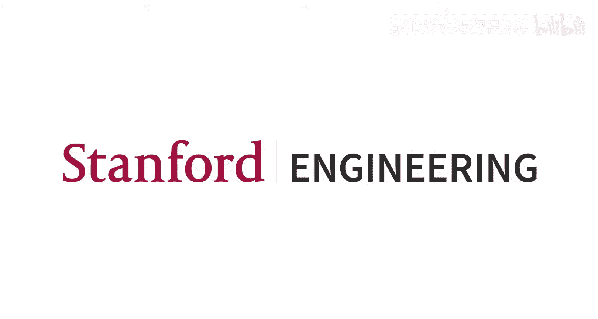
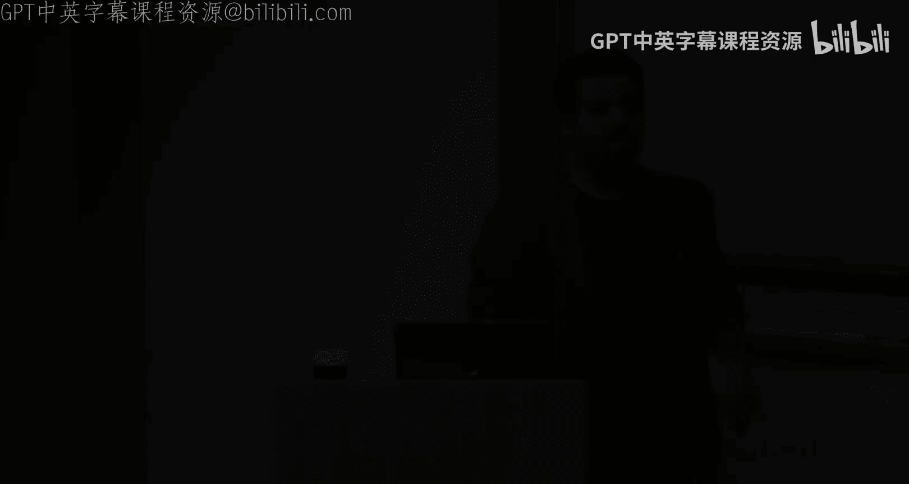
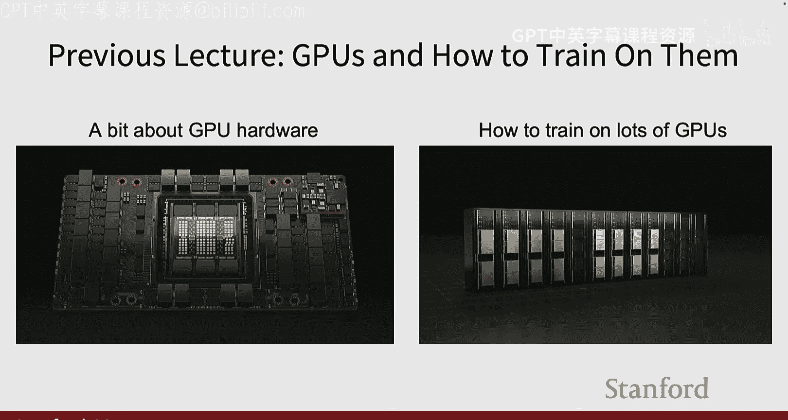
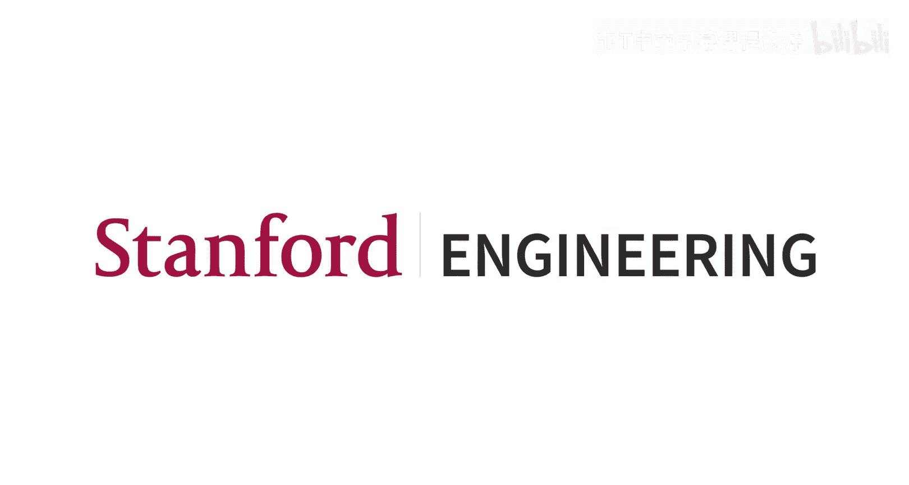

# 斯坦福大学《计算机视觉的深度学习｜CS231n： Deep Learning for Computer Vision 2025》中英字幕 p12 -13-Lecture 12_ Self-Supervised Learning.zh_en -BV1FqazzVE6w_p12-

Last。Time on on Tuesday， this week， we。Howd a lecture on GPUs and how to train how to use them and how to use multiple GPUs for training larger scale。

 scaling your trainings and so on， and exciting a new topic that we've added to this class this this year。

 which is I think timely and very important with the increase of model sizes and applications。

That you see the AI models have these days。And。Before that， we talked about。

 we covered all of the key tasks in computer vision from classification， semantic segmentation。

 object detection， instant segmentation， and so on。And we're going to revisit some of these topics。

 some of the results of the models we talk about today。And so those tasks are still quite important。

And then we talked about visualizing and understanding the。

Models and seeing what the models are learning。 One of the things that we've discussed was。

For example， using just in the early sessions， we talked about nearest neighbor and in the pixel space and how we can actually do。

Find the class of we can find the class of images based on only pixels space distances and we discussed how it's actually not efficient。

And one of the things that we talked about was。If we use the embedding layers or the feature space feature layers。

 what one of those fully connected layers in。And the feature maps there。

from a convolutional neural network or any other network architecture that we use there。

 that could actually be a good representation of images and we talked about the L2 distance if we use that as the metric for nearest neighbor in the feature space feature of these models right so this means that these features are quite。

 meaningful for the specific task that we had at hand and this means that specifically okay。

If we run a neural network， a CNN， ARSNe， or even the transformer models。And。Look at the。

Representations， the learned representations in different contexts。

 you may see these as referred to with different names， learned representations， features。

 embeddings， latentnt space and so on， but these。Learned representations or features are very good representatives of the images。

If if we have a way to extract those， we can always get the class labels out of those features as well by a simple linear model。

 as you can see at the end here。But the major challenge that exists is。

Training or building these networks at larger scale is always challenging and can you tell me why there is a challenge here？

So the thing is that at larger scale we need a lot of label data because this network is trained starting from an image and at the end we have class labels if we train this network。

 yes these features are going to be very useful for getting those class labels out right but at scale we need a lot of manual labeling efforts to sit down and label the images one by one if the task is segmentation you have to label the pixels one by one in every image and that is going to be very challenging。

So the question is， is there a a？We can train neural networks without the need for huge manually labeled data sets。

 So these manual labels are the， the challenge。 And we want to see if we can bypass them in a way to train。

Any neural network that gets us very good features。And with that。

 the topic of self supervised learning。Comes in light and that's what we are going to cover today。

Having a large data set of， say， images without any labels。

Our hypothesis is that we can train a neural network using an objective function。

 a pretext task that gets us good features。From images。 And then when it comes to。

Learning on a specific data set with a smaller set of data points which have labels。

 we we can basically train we can transfer this trained encoder and use that to extract features for a downstream task or downstream objective。

 so here we want to define a pretext task， a task that is general enough。

To be able to learn some good features from the images and then use that encoder。

 let's call it encoder。😊，To。To solve another problem at what we call downstream task。

 downstream objective， which is the application that you care about like， for example。

 you have a lot of natural images。Downloaded from in the internet。

 we can train something out of it and then we have a small data set of， for example。

 one of these industrial applications or medical applications that we have few labeled images on。

 and we can now use that transfer knowledge to extract features and then classify or perform the task that we are interested in。

So we want to delve into this topic and go a little bit deeper in understanding the different components。

In a nutshell， what cellsvis learning is， as I said。

 defining this pretext task on the data set with no labels encoder often。

Getts us some learned representations and then another module of the same neural network generates or does transfer the learned representations into the output of space。

 which could be labels or outputs that automatically are generated from the data。

 they are not manual annotations。If we can do this， then we have an objective function。

 a loss function， and a neural network to be trained with that loss function。As you can see here。

 we call the second part， sometimes decoder， a classifier， a regressor。

 depending on how we define our pretext task， I will give you some examples。

 but this could be any form of framework， but when it's encodeder and then a decoder。

 this is more of an auto encoding framework that I'll talk briefly about。Okay。

So after we do this training with the pretext task。

 now we can use the encoder and the learn representations for a downstream task， which。

We just need to add。one layer or even a fully connected neural network。

 a linear function or a fully connected neural network that you that predicts the labels。

 And these labels are coming now from the data set。 So that's， that's the major。

 That's the main concept of self supervised learning that。The pretext。Version of it。

 a portion of it doesn't require any labeled data to do the training。

But how to define the pretext task itself is not that straightforward。

There are many different ways of defining those， for example。

Just keep in mind that we want to define。The pretext task in a way that its first general enough that can get us good features and doesn't require manual labeling So the labels should come from the data itself right so one one example would be image completion where。

We mask half of the image or parts of the image and we define a task to given the parts that are unmasked。

 predict the parts that are masked， or for example。

 we' rotate the image with a specific angle and the task is to take the image as input and predict what's the rotation angle that it's gone through and the other one could be a jigsaw puzzle where we have patches of the image that are not ordered。

 but the task is to output the correct order of these patches and colorization is one of the popular ones that these are the four that willll be covering very quickly today。

But given the blackout and white version of the image predict the colors for each of the pixels。

 so solving the pretext task allows the model to learn good features。

 that's what we wanted and we can automatically generate labels for the pretext task so the two points that I mentioned。

 we need for a task that could be qualified as a good pretext task for selfupvised learning。

Some quick considerations to always keep in mind。How to evaluate a self-svised learning framework。

 there are many different pieces and areas that you can actually look into the pretext task itself because we are generating the labels and so on。

It gives us the power to do some evaluation of how good the model is able to solve that pretext task。

 so。That's one of the。Factors， then representation quality itself is sometimes very important。

Looking at， for example。on representations without any fine tuning or anything that I'll be talking about or even clustering the representations to see do we see a pattern in the representations and sometimes there are some good dimensionality reduction algorithms I'm referring to TSNE testing here which we didn't very much talk about。

 but this is a dimensionality reduction framework that you can reduce the dimensionality of their lens representations and then visualize it in 2D or 3D and see if there is a pattern that you can find in your。

Representations， so robustness， generalization and computational efficiency。

 these are all quite important。 But the most important thing。

 the most important aspect that we are after is。The。Performance on the downstream task。

 because we are doing the entire self superupvised learning and and define the tasks。

 Pret text tasks and so on to be able to improve results for a task of interest or something that we are we care about。

 Let's see some quick examples of how this could be done。 This is。

An example of let's rotate the images and then predict the degree of rotation in as the output so we can train this in a self-supervised manner without need for labels of the object in the image and we have a bunch of convolution layers in this example and then a fully connected neural network at the end to do this。

Either regression or classification task， and this means that this is giving us some sort of set of good features。

A good feature extractor， which we can at the end。Remove these these。

Task is pretext tasks specific parts， the F C layers and puts。One layer or in some cases。

 multiple layers。ToTo classify the features into the object label。

 So this time we use the object labels to do the prediction。And train these this linear。

Function itself， so。We often look for a shallow network， because if the features are good enough。

 then we don't need to do。A lot of training。On， and getting the class labels out so。

This is selfupvised learning in general and although we are talking about the computer revision applications。

 but this paradigm of self-supvised learning was actually what enabled all of these large language models。

 GP4 and all of these frameworks are trained with，Mostly， raw data。

Without any manual labeling and not just in language models in a speech and these days quite a lot in robot and robotics and reinforcement learning because when we don't need any labeling data。

 we can start capturing data。Raw data without any manual labeling and use those who are training。

 and that's why you see so many self driving cars in the Bay Area collecting data because that's that's getting them the data and they don't have to really annotate the data。

 but they can still train models based on。So with that， today's agenda will。

 will cover some of these pretext tasks from image transformation。

 And then I will talk a little bit about。A set of algorithms that are around contrastive your representation learning that。

Are slightly different from these image transformation based pretext tasks， but have shown promise。

Let's start with the first part and there we will cover the tasks one by one。So。

I talked quite a lot about rotation， predicting rotations。

 Let's see if we can actually rotate the images with。Random or arbitrary。

Degrees and predict the rotation angle with with a model。 And our hypothesis here is that the model。

A model could recognize the correct rotation of an object， only if it has。The common sense， visual。

 common sense of what the objects should look like unperturbed。

 So these models mostly are designed around this concept of visual common sense。And。And then if。

 if the model is able to to capture that， it means that it is also able to summarize the image。

 the entire image into a useful。Set up features， good features。This paper， published in 2018。

Implemented this with with just。Exploring four different angles of 0，19191，80 and2，70。

 rotating those into with with one of these rotating images with one of these angles。

 and then using the convolutional neural network to basically predict what which each of these rotations。

 the output is， And because they only created four different outputs。 This is a classification task。

 because it only has four different cases， right， it doesn't have to predict the exact value of the angle。

 the degrees， but it's。It's actually just predicting one of these four。Classes of zero，1。

 two were three。Y  zero，1，2， or3。So with that， the authorss were able to。

Learn good representations and with those representations。

 they started training the neural network at a downstream application。

 basically fine tuning the neural network。Based on fine tuning the encoders and also the。嗯。

The and the classifier， actually， we， in this case， they' they froze。First and second layers。

 And then they fine tuned at the last convolution layer and the linear layer。 So it's not entirely。

fine tuning the entire network， but they were able to get very good results。

 This is on C4 10 data set。One of the data sets that we've talked about earlier。

You see that when when the model is pretrained， it starts with a good accuracy to start with。

 so it means that it already is in a good shape and it's having a good understanding of the objects even in the very first its。

 but if the task is simple enough C410 is actually not too hard to，To train a model for。

 if the task is simple enough， the supervised version， the fully supervised version。

 and the one that starts with pretraining often converge to the same number， same accuracy。But again。

 if the task is simple enough in a very hard application， much harder applications。

 often the supervised learning framework， if we don't do any pre training， large still pretrain。

 we don't get as good results okay。So。Theyve， they've done also some application。

 some some experiments on this Pacal V O C 2017。Dataets， which involves a number of tasks。

 including classification， detection and segmentation。And these all these three sets of tasks。

 they've used different setups of just just training a few fully connected layers or all of the layers for for the classification detection and segmentation tasks。

 if you look at the imagenet labels like if we have a huge labeled data set and we pretrain on that data set。

 we already get a very high accuracy， but again have this in mind that this is imagenet with all of the labels involved for for the pretraining。

 but if we don't do any，Supervised pre training and the pre training is all based on self supervised。

 It's it's showing that this rotation framework is。

Doing a much better job than many of the other counterparts， any of the other。

Examples that are other methods that we don't actually go into many of the detail of many of those。

 but it's showing efficacy for this rotation pretext task and see how it's different how much better it is if you start with a random initialization of the weights。

 so the random initialization versus pretraining with rotation pretext task。

 the difference is huge and this rotation pretext task is not equal but it's close to pretraining on the entire image net。

One other thing that。They've， they've looked into in this paper was looking at the features and how。

How， how the learn features are meaningful， I mentioned earlier that。

One of the ways of evaluating the pretext tasks generally self supervised learning frameworks is to look at the features right。

 and you can always go from the features from the fully connected layers。

We talked about Grdcam and all of those other attention based frameworks。

 how we can go from the features back to the image space。

 So this evaluation involves projecting those into the image space and seeing what the model is looking at。

 if you look at the attention maps for the supervised model。

 often the supervised model has more focused maps because its it's only trying to solve one single task of classification。

 So if if it captures the eye and the shape around it doesn't care about the other other parts very much。

 but in。Cases of selfsupvised learning， often more features。

 more areas are covered because it has to have a more holistic understanding of the image because we don't know what the down thestream task is。

 but it's the goal is to perform。Equally valid in many of those。So that's one of the tasks。

 if you do have any questions， keep it I'll stop after going over some of the tasks and if your question was not answered。

 then I would be happy to answer that。Okay。Another one， another popular。

Pretext task was to to basically create this three by three grid and then use networks to predict the location of each of the given patches with respect to the sensor patch。

 So for for this patch， which is front here， the output should be three because we only have8。

This is three by three and the center patch is the reference。

 so this also turns out to be an HV classification task。It's getting any of these patches。 And yeah。

 it's trying to output what the location of that given patch it is with respect to the。

Input with respect to the center。🤧Patch， sorry。So。So this is this was another another example。

 but this other follow up paper paper publication which turned this into a jigsaw puzzle framework was instead of saying to to asking the model to just predict which of these eight patches it is。

 it tried to predict the exact permutation， the right permutation。

 so what they've done was they used the same tree by three grid。Took all of the patches。

 shuffled them randomly， and then asked the neural network to say which of the。

Correct permut which one should be the correct permutation？So they。

 they basically predict the the correct permutations。

 Can you tell me what is the number of permutations you can， you can have for。This setup， say again。

9 factorial yes exactly。 so it's a huge number， right， 300，000 something I think。

But what they've done was they've created this lockup table with only 64。Plausible。

 possible rotation， sorry， permutations。 And then。Only only they consider 64 perutations and when they're shuff shuffling that they do the shuffling based on one of these 64。

 And then the output will also be just a 6064 size vector。 So again。

 this turns out to be just a simple classification task with 64 output classes。

 And they've shown this is also a great idea for。Solving to define as a pretext task and on the same data set with similar type of。

Tasks that I talked about。And， and how the supervision is， is done。

 They've shown their method was outperforming some of the。More。Previous models， previous frameworks。

And again， remember that this was published in 2016。

Next pretext task is just in painting predicting what is missing so what they have done here was a simple masking strategy you mask parts of the image and then you ask the model to im paint those parts that are masked so how it was done simple masking on the input image but because we have the all of the images we actually have the desired output so an encoder turns this into a feature space and then that feature space is also there are some。

Fully connected layers in the middle， and then there is a decoder that decodes the parts that is missing。

And。The loss function is comparing the output。With what the ground truths was。

And this is basically learning to reconstruct the missing pixels。Again。

 we've talked about auto encoders a couple of times before and and this is also some form of an auto encoder that it encodes the input image into a representation that you want to decode the。

Outward， but this out encoder is trained with a masking strategy， masking objective。

Just to show you some examples， the painting evaluations。

Are a little bit interesting and tricky because when you want to im paint。

 there are so many different ways of in painting this this image， right and it's。

We can't say it's it's， it's， its。There are there is just one output to do in this case here。

 reconstruction based frameworks， earlier reconstruction based frameworks were actually creating a lot of fuzzy。

And， and very。As smooth outwards， and。That's why。This。

 this paper that I'm referring to here was actually using。

And an additional adversarial objective function， which I'm not going to go into details because this is a topic of discussion for the next lecture generative models。

 but generally how these frameworks work， we have elder loss and the reconstruction loss is basically calculating the difference between the patch between the image X and。

The image， after it's passed through the。The encoder。So。And then these。

 this is element wise multiplication。 And we also have this mask here because we want to only calculate the loss function。

 the objective function only on the mask area。 So we do an element wise mask multiplication with the mask as well。

 And this basically gives us the。Reconstruction loss for that part of the mask that we had。

 so as I said the it's also supplemented with an adversarial objective。

 adversarial learning loss function， which ensures the images that are generated are real looking right so with that they have been able to improve the the parts that are。

Reconstructed to look a little bit better。 But again， details will be。Discussed in the next lecture。

So。This reconstruction framework was actually able to again provide and this hours is is the same。

 Pro additional benefits when it's run on the same classification detection and segmentation task on same set of。

Data sets。I will come back to this reconstruction based frameworks and and masking in a bit because it's one of the most used。

Models or pretext tasks that these days are used for for pre training。 Soll I'll come back to this。

 But before that， let me introduce this this other。Pretext task of image coloring。

And this is another very simple framework setup that we turn。

A colored image because our data is mostly colored a colored images， right。

 We turn that colored image into its components or channels that that separate the lightness。

 the illumination from the color itself， there are several color spaces。

 If you've taken courses like computer graphics or CS 1，31 other computer vision class。

 you know that there are so many different color spaces， mostly in computer vision， we use RGB。

But if you want to separate lightness illumination from color， there are some other color spaces。

 For example， lab color space L。A B is one of those color spaces that separates lightness from color。

 So we have one channel for Lightness and two channels for defining the the actual color。 and if we。

Add these two together all together L A and B all three channels together we can actually get the colored image so the pretext task here is simple given the L channel predict the A and B channels right so again we don't need to do any manual annotation it's already in the data。

And this was extended into other frameworks why why should we only look at like given L predict A and B。

 we can also do the reverse right and that。LED us to split something that we call a split brain out to encoder where the input image is split is basically turned into one。

The the L channel， Lightness channel and the color channels， these two images。

 this is one channel this is two channels of color。

 and we train two functions to neural networks sets of layers to predict the other one。

 And then at the end， in order to calculate the loss function and。Back prop。

 we just merge these two to generate the actual image and loss an L2 loss。

 any distance function can help with training this neural network in a more generic framework or formulation。

 the idea is，Given one channel or a set of channels predict the others。And do the same for。X 2。

 so sets of channels， X 1， sets of channels， X 2。 So given one， we can predict the other one。

 And these are the neural networks for those measuring them will get the value。

The image and then loss function would be simple。 So if we have such a framework。

 we can run it on everything， not just color and elimination， right。

 We can have data from some of these。RGBD sensors， those that have RGB channels and depth channels。

 like， for example， connect and other sensors that they use in robotics。

 And given the RGB channel predict the。Dept and vice versa。

 And this was a very successful downstream task that was used for。

Different applications and as you can see this model and this paper that I just display brain and the papers that the model that predicts colorizes the images。

Is。Those those features themselves， they do have actually a very good level of accuracy for predicting the class labels。

 and you can see there are many different other frameworks that are used。

Also in terms of comparisons， again， this is not as good as supervised learning because there is no label involved here and it's just based on the learned features。

With concateated features out of F1 and F2， okay。So。

The image coloring pretext task was actually very interesting because now we could。

Not only use it for pretraining neural networks， but it was also itself useful somehow because now we could colorize images that we don't have a colored version。

 so we could colorize images that and videos that we don't have a colored version。Of those。

And not only that， one of the other interesting results that they've shown in the paper was this image of Yosemite。

And they have done that they colorized the interesting thing that is。

Is seen in this image is the consistency between the actual object。

 the half dome or trees or the bridge and its reflection in the in the water。

 So the model was was also able to understand that this reflection should also somehow preserve the color based on how it was trained on vast amounts of data again。

Keep in mind that these models are all pre large language， large vision models。

 and they have been trained on specific tasks， so they're not trained for solving everything。

So this could be actually extended into。Video settings， because now if we have a video。

 we can have a reference frame that has the color and do the coloring for the follow up frames and how this is done。

 this is very simple because with with I mean， this is also very useful because with colorizing future frames in the video。

 what we are doing is we。Basically try to track pixels and objects in the video and the model implicitly learns how these tracks should be formed。

 so the hypothesis is learning to color video frames should allow model to learn to track regions or objects without labels。

嗯。And learning to color videos because there are a lot of correspondences is an interesting task by itself。

 I would suggest taking a look at the details I'll very briefly talk to them Ill talk about that。

If we have a reference frame， what we need to do is for coloring the input frame。

 we need to find the pointers of where that specific object or pixel is and then based on that see what the color is and copy what the color is as the color for that pixel as the output as the target color and how this is done is very much similar to the same topic of attention that we talked about so it's about forming attention for each of the pixels for each input frame sorry reference frame and target frame we often run a CNN to see what features around those pixels should be used and using those features now we can calculate for each of the target pixels we can calculate the attention or the distance。

To all of the frames， all of the pixels in the reference frame。

And then after defining this attention with respect to the。

TheThe pixel of interest in the target frame with all the frame all of the pixels in the。

Reference frame。 Now we can do an average color。Of all of based on those attention modules。

 So attention is basically just similarity between the the two。 So anyways， with that。

 what we can do is we can just get the output color as an average with， with the attention。

 and then ultimately。嗯。Calculate the loss function because we have the values of the colors。

 the right colors of those pixels in our data， and this was able to with this reference frame。

 colorized image is， you see how consistent becomes in terms of coloring。

 if we color them separately without this consistency over time， you often see like for example。

 the person person's shirt or clothing changes color because because there is no。

Constraint to keep it consistent。And then。There has been also very interesting applications because now that you are calculating attention to a reference frame。

 you are actually able to track objects， track segments in videos。

 and even identify key points in the videos。That's a good question you're asking your question is about this slide basically。

And， and how the encoder knows about the data to begin with and。Gets us good learned representation。

 So all of these tasks that I presented and and defined are trying to do something here at either decoding。

Classifying or using regression to generate some outputs to be able to train this encoder。

 so if your original images， if these are all natural images taken off of internet or imagenet or whatever。

Then you are learning an encoder that can extract features from those types of images right with the pretext task and then when you remove the decoder and add this classifier to the end。

 you only need to train this part because this encoder was already trained with all of these pretering tasks that I just talked about。

You're asking if the labels are coming from the decoder for pretraining the encoder and the answer to that is yes。

 that's why we define the pretext tasks because we want to have some sort of labels。

 some outputs right and then based on those outputs。We try to train this entire network and。

On the way of predicting the right labels， this encoder is also trained。

Good question you were asking if encodeder and decoder of one week neural network or there is differences in different papers in different works。

 it has been completely different in some cases your encoder and not just decoder that's why I'm calling it classifier in the example that I showed you about。

Predicting the degree， this is just a simple neural network， right， The decoder is these F layers。

 So this could be one entire network。 And then you you're replacing it with something for your downstream task。

 But in some cases， for example， when I talked about auto encoding。

Encoding an image and then decoding another image， you often have two neural networks that are trained entrance because you want to make use of that representation of space in the middle。

And in the next。Thing that I want to talk about mascato encoders， even there is no。

Symmetry between encoders and decors。 they can be just two different frameworks。

 to different neural networks， even without any symmetry to to to train the task。 So this。

 this is very much task dependent， pretext task dependent， but they could be。

Belonging to the same architecture that we know about say CNN or Resnet。

 or they could be two different architectures even without any symmetry。

Remember that these are the very first。Methods for selfsvised learning。

 So they're not supposed to be solving everything。 That's just a quick disclaimer。

 But the idea is the hypothesis series。 If the model is able to say this is 90 degree rotated。

 it means that implicitly， it's understanding the right rotation。

So right orientation and direction right， and then it will be able to if given write an unroated image it's able to recognize what it is in it right。

But this is a limited task by itself。 I agree with that。

The question that you have is why here they use 64？Right。诶。That's a good question。

 but that's also an arbitrary choice， almost arbitrary choice。 As I said。

 there are many different types of different number of permutations here。

9 factorial so it's a very big number it doesn't make sense for us to be predicting all of those what the authorss did here they decided to select a few of those per perturbations that there is enough variation because many of those perturbations is just like one patch like switched only right so they selected 64 of those that they have the largest difference distance between them and they just selected 64 because they wanted to solve a classification problem instead of。

Other types of tasks。Yeah。Okay， so I've been talking about these。

Frameworks that often do some transformation on the image or the videos and so on。

 and this brings us to this newer framework which is published in 2021。

 and then there has been so many follow ups on this。And it's been a great framework for pre training。

 for many tasks， even if these days， when we want to pretrain on a。um。Data sets on raw data。

 we often use this M A E framework。 It's called mask Outenrs。

It is also a reconstruction based framework similar to that masking strategy and painting that I mentioned。

 but this is far more detailed and as you can see this framework is not just selecting one mask。

 there are so many different patches and places that they do masking with even more aggressive sampling rates。

 50% masking or 75 masking rates and ratios and through training in large scale。

 they have shown that not only they are able to reconstruct all of those mask areas。They are also。

Getting very good encoders that can summarize the images。

Into good features and how this was done was through defining a encoder and a decoder。

 and that's one of the examples that I said these are not symmetric。Encodes and decoder。

 So a large portion of the input masks， input patches are masked and the ones that are not masked。

 they are。Given to the encoder to encode in two features that are then passed through decoder。

To generate the complete image。But let's， let's go a little bit into details of what this means。

 I do have some of the details and how these models are trained here， but。

I very briefly just explained to you how these models often work， thenr。

Here is very much similar to VITs， all of them are based on transformers。

 the VITs that we've talked about， similar to the VITs， the images are split into patches。

 the patches are then sampled， so uniform sampling is what they've done in and they've shown 75% sampling is was。

Quiet， efficient in in the experiments and。They use a mask a high masking ratio and then this makes the prediction task very challenging and challenging in the set of pre pretext for pretext tasks in selfsupervised learning means the task is meaningful。

 The task is very good because the model has to learn good features to be able to reconstruct it。

So with that high sampling， high ratio of sampling。

 what it can do is they can actually augment the data by a lot too。

 because each time you mask 75% of the data so you can reuse the same image multiple and multiple times during training。

 so you will have so much of data to train this encoder for it。And。

Then that's why they use a huge encoder， a large VIT。In as as their encoder。

 So this encoder itself only sees to 25% of the samples， the the patches embeds those。

with a first linear projection to some embedding spaces。

 then positional embeddings are added exactly same as what we mentioned for VITs。

And all of these are transformable blocks and。The encoder is is very large。

 That's what I just mentioned。 And then when it comes to the decoding part。

 So we have the embedding of all of those patches that were present for。

The patches that were masked or were missing for those there is a trainable parameter very much similar to that class token that we had a shared masked mask token that is basically in some sort of average。

We can consider that as an average patch， an average representation that is put for the ones that that are missing are masked。

 And then the decoder has to transfer the them to。The image patches of the entire image and then the entire last one the entire image is the the target is the output。

 target is the output。So how we train this， this is a simple MS E based mean squared error loss function for。

Between the image and the reconstructed image， the loss function is only computed for the masked patches。

 similar to the previous one that I just talked about。 and then what it has。Is。

When we do the training， they've shown in the paper that you can do either linear probing or full find tuning to use it for your downstream tasks or any of the applications that you have in mind。

And in linear probing， what happens is you often have your encoder frozen and then use the learn representations and only learn a linear function for the final task and this mark it means that it's being trained。

But in full fine tuning， in fine tuning， the pretrained encoders are also fine tuned。

 either either all of them or just few。Transformer blocks。 And that's， that's the。

Fine tuning framework， the linear probing。Provides a measure of representation quality。

 how those representations features are， and fine tuning always exploits models near to potential to adopt for new。

Tasks， okay。So。IIf you're interested in this topic and if you're planning to use this paper。

 I highly advise looking at the paper in its follow ups。

 there are so many discussions around different aspects， model choices， high perform。

 masking ratio is one thing they've shown with the masking ratio that's 75% is actually is giving them very high accuracy so 75%' the reason that it was chosen。

 decoder depth， decoder widths mask tokens。Re constructionstruction targets， data augmentation。

 how it's， it's。hellpful and mask sampling method， I'm showing the results here again。

 mask sampling method is mostly around should they use some random masking blocks or grid type of masking。

 usually the examples here， and they came to the conclusion that this random masking was the best choice。

And finally， they've been able to to show that MAe is doing。

A much better job compared to many of the。Other methods that were used。

 so some of the other state of the art methods were actually Dno and Moco V2 if you have time。

 I will briefly go over them， but。This framework was actually。

Outperforming those that are more at the time advanced frameworks of contrastive learning。So。

I'll stop for a few questions if you have any after let me just summarize what we've talked about。

 pretext tasks were actually very important and as I said。

 their focus is on understanding a visual common sense。

And one of the things that also related to some of the questions that they're asked。

 we can see is coming up with an individual pretext task is often challenging because the learning representations may not be general enough because of the type of task that you define。

 right？For example。If you're using completion， rotation prediction or gigsaw puzzle or caization。

Your learned representations are good for solving those specific tasks。

 and they may not be very good for general pretext tasks。So the question is in split brain。

 how to encoder， how does the model knows， know how to predict the other channel， given the。

For example， L channel， the illumination channel， Lightness channel。So your question。

 let me answer your question with the question， when you're training a model to predict classes of objects in the image。

 how does that encoder know what features to extract to predict them there。The class of models。

May build data， because you have。What you're doing is you're back propagating a loss for a value that is calculated around those labels right it's the same story here。

 we define a network that takes one of the channels and outputwis the other channel。

How this was trained was by back propagating what the outputward should be。

The output which was the other channel， we do have the other channel in the data。

So instead of defining the task being the classification of predicting the class of the objects。

Here we define the task to be predicting the color of the pixels。And the color of the fixes。

 we already have them in the data sets。 So the last function still can be calculated and back propagated。

So the question is how they these outputs are used as input to the decoder。 So this is， again。

 a V I T transformer style framework encoder that。Turns every every input to a torken at as the output that is representation of that specific input patch。

 right？ So we've talked about this。But then we know that this is not the list of all patches。

 There are some of the patches that are masked。For those that are masked。

We also train this encoder outputs shared mask token。A token that is basically an average token。

 for example， it's a learnable parameter。 We can't necessarily interpret it。

 but we can say just it's probably something that is similar to mass like an average token。

So that that shared masqui token is。Put in the place of those that are missing and then this long vector long sequence is created。

Decoder and another transformer framework takes this long set of tokens and outputs those that are projected as the output pixel value。

Perfect。😊，So you only have 15 minutes。And。And a lot of things to cover。

But I think what I wanted to get out of this session was for you to understand what pretext tasks are and how we define them and one of the most used frameworks right now is Da mask auto encoder。

 which we actually covered to some good extent， but anyways。I was here that。We。

 we did look at these transformations。 and then we know that all of these transformations are。

Representing all actually the same object as the original image just in a different form， right？

 But then we also have the knowledge that in the data set。

 we have other objects that look completely different， right？ So if I define a task that can say。

These that belong to the same object， same pixel， try to bring them close in the representation of space。

 basically attract them to each other in the representational space and those that are not that they do not belong to the same object。

Kind of put try to maximize the distance between them in the latent space。

 basically repel the representation of these two images。

 then this is another task that is often referred to as contrastive learning。

 contrastive representation learning and there are quiet a number of very interesting methods to look at we have sampled there are so many papers in the space。

 especially around 018s to 2020s。And so on around those years， Sinclair， Moco， CPC。

 and then ultimately Dino， which is actually borrows concepts from contrastive learning。

 but it's not necessarily contrastive learning framework。嗯。

And what we do there is in order to define。Attract and repel。Functions。

Characteristics or regularize the model based on those we define。The reference image has x。

 and then all of those that are transformations of the same。

As positive samples and all of the other objects in the data set or in the batch as negative samples。

And these positive and negative samples will basically define。A way for us to。

Calculate the loss function。 How can we do that。Assume we have a scoring function。

 We want to get a scoring function that says the score for the reference image。

 encoded version features of the reference image and the features of a positive sample should be larger than the score that is comparing。

The reference image， and the。Negative samples。So with this type of。

A scoring function if we so basically to define this type of scoring function。

 we define a loss function based on that after training the scoring function。S。

 you can see this S is the same as a score in the previous slide。

So if we have that scoring function now in order to attract and repel。

 we can use this framework of turn them the softmax set up with EXP that turn those scores into probability values and then in the denominator you see all of the other negative samples that are used。

re considered。In order to implement， actually we use the batch learning framework。

 all of the other negative samples that belong to other objects。

In in the batch are taken as negative samples and one of the transformers as the positive sample。

 so we define the loss function like this and a score for the positive pair score for all of the other negative pairs。

And this function is very similar to what we've actually discussed before。Any ideas？

This is the cross enchopy for multi classes。So。If we have n samples， sorry， N samples， yes。

Then in this case， we have n samples。 So the softm is。If you have multiple classes。

 yet if you have 10 classes as the output， it wants to maximize the score for one of those 10 and minimize for the rest of it。

 right？ It's the same story here。 We want to maximize this score。

But kind of minimize the score between a negative and reference。

So it's the same concept that we discussed about multi class classification。

 but put in the form of formulation of contrastive for this loss function as contrastive learning。

 this function is called info NCE or the information noise contrastive estimation loss。

 which was proposed in this paper。And there are a lot of theoretical discussions in in。

 in the paper that this objective， this loss function measures the dependencies。

Sorry that it's a lower bound on mutual information and what mutual information is when you have two images and you calculate the mutual information between them it's basically measuring the dependencies or shared information between these two images right so what we want to do is we want to maximize shared information between x and x plus but minimize the shared information for x and x minuses right so the paper says and again this will itself take half an hour to go into so you should definitely take a look at the paper if you're interested that。

This， the negative of this loss function influence C E is a lower bound on mutual information between x and x plus。

 So a lower bound on mutual information， if。The negative of it is a lower bound on mutual information。

 If I minimize the in and C， I'm basically maximizing。The mutual information between x and x plus。

 So this is what I really want。So that's why we take this as the last function and start minimizing。

And that value。There is also another theoretical aspect in the influence in C paper that says the larger the number of negative samples。

 the tighter the bound， so it tightens the bound based on the number of negative samples。

 so that's why for training and loss function in neural network with this type of loss function we need a huge batch size。

With a larger number of negative samples， will get better。And more much faster training convergence。

And then this last function was used in a number of different frameworks and in the next few minutes。

 I'm just going to tell you what those frameworks are， for example。

 Sinclair is a simple framework for contrastive learning is basically taking each image。

Do the two transformation of the same image， transfer it into the representation of space。

 And what it does is it calculates the。The cosine similarity between embedding representations。

 but before doing that， it does a linear or non nonlinear projection into a set of features Z that calculates the the distance between those in this space and。

This is the way that they do this generating this positive samples。

And for generating positive samples， all sorts of transformations would make sense。

 the details are basically covered here， generate a positive pair by sampling data augmentation functions。

 so we sample a few of those， then we calculate the info and e loss on the pairs。

 and this is what we each rate because each sample has two n。

To multiply by n samples that we have created。 So what happens is we take。A list of。

Images in the in the mini batch， in the batch that we have and pass them to encoder for both。

Variations of the same image， so each of the images basically will have a version of it。

 transformative version of it and next so we have two n2 n samples in the batch now。

And then this means that for each of the samples， the next one， these two are positive samples。

And everything else is negative。 So for the first one， the second image is。Positive。

 everything is else is negative for the second one。

 the first is positive and everything else is negative。

 and it this repeats for all of the samples there。So this is a high level implemented just high level definition of Sclair。

Please note that we have an assignmentary a question related to Sclair that you will be。

Exploring this framework a little bit more。But。Be careful that the definition is slightly different from what the standard definition that I presented here and。

 and make sure you follow the instructions in the。Assignment。

So Sinclair was actually very successful， it was able to without the use of labels or。

And then a training a linear classifier on top of the features。

 it was able to to surpass all of the previous works and even be as。

Basically generate results comparable to the supervised learning。

 fully supervised learning frameworks， although we need a larger neural network because now of you are learning more generic features。

 But in terms of accuracycurac， it was not as。It was comparable to what we had for supervised learning。

So the interesting thing with Sinclair and and some of the results around it was。诶。

That there are and a few choices。 actually， let me spend time on， on the， the main main choices。

You may have this question of why did we project？The features into a new variable instead of using the same representations。

 So this， this was a design choice that they made in Sinclair because they。Rightly so。

Assume that when we have an objective function that does this contrast between samples。

You often lose some more information， some extra information that do not help with the contrastive learning framework。

 right？ So in order to preserve all of those extra。Features， representations are defined as edge。

 but then there is this linear or nonlinear projection in their paper they use on linear projection to to get their。

Z values that they calculate influence ER。So that's one important design choice。

 And the other one is。I mentioned earlier large batch sizes。 You need huge batch sizes。

 larger batch sizes to be able to get better， seemair。Performance。

 and we talked about it how and why this is the case。

But we can't always do large batch sizes for many of the tasks that we have at hand， because of。嗯。

Consts in memory and so on。 And that was why。A number of follow ups， for example， moco was。

Proposed momentum， contrastive learning， instead of。Using the samples。

 all of the negative samples in the batch。What it does is， it creates a queue and。

 and keeps a history of the。Negative samples across patches over time in the model。

 So it doesn't only depend on the negative samples in the batch。

It has a separate cu that is defined and keeps a number of negative samples and changes it。

 updates it over time to train the to do the inency loss the contrastive loss here。

 but because we have this cu we cannot back propagate because those samples are not in the batch anymore right so we cannot back propagate for the negative samples and that's why it had to separate the encoder for positive samples which are now called query and the negative samples which are now called key。

In this。Architecture。So the training only impacts encoder and over time， the Q encoder。

Using the momentum。And it updates the key encoder， the momentum encoder， right。

 So this is a framework that has actually been very successful in terms of implementation and and followout versions of it。

 There is a lot of interest， interesting results。 But then what they've done was basically。

Tried hybrid versions of using some non nonlinear projection heads。

And data augmentation from Simclair and using this mini batch style。

 the decoupling of the mini batch and negative samples from Moco。

 And they've shown that actually if you， if you do this together， version moco version 2， it。

Improves the performance by a lot so。I will stop here， but there was some notions of CPC。

 the contrastive predictive coding as another example that you can look at in the slides and then。

A better version of Moco， Moco version 3， and Dino is also one of the widely used frameworks。

 which actually has a similar type of architecture as。As moco。

 but it's not necessarily contrastive learning because now we have student and teacher networks。

 so I'll leave that for a separate discussion and if if you're interested we can discuss maybe in the future slides in future lectures but anyways this is also one of the widely used frameworks for extracting features from images and also the videos sometimes。

