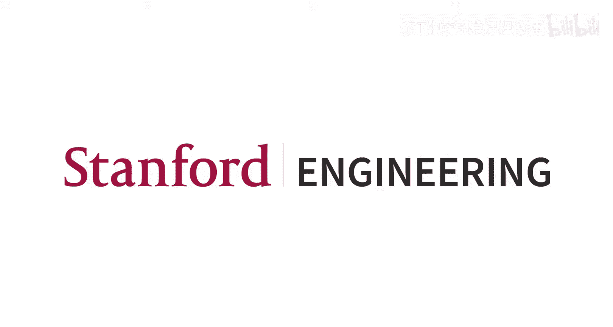
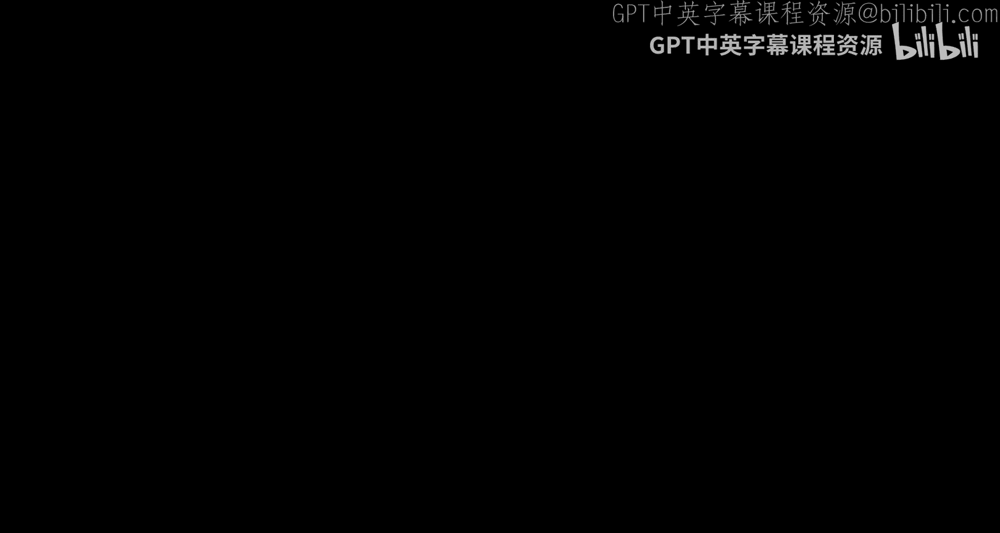
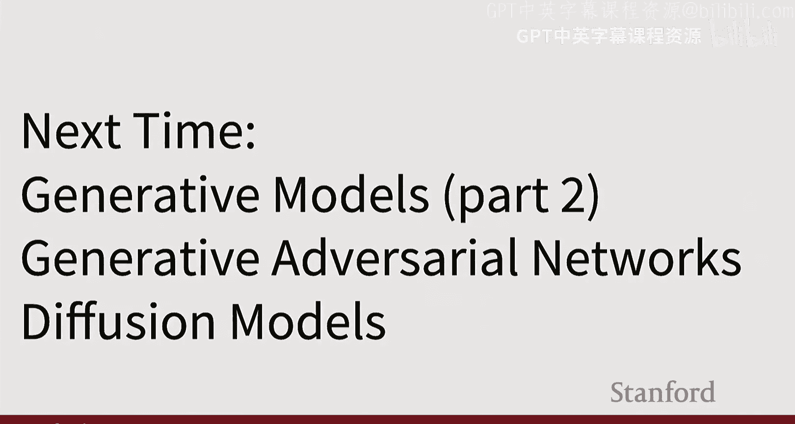
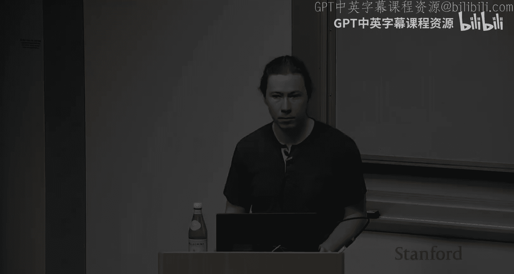
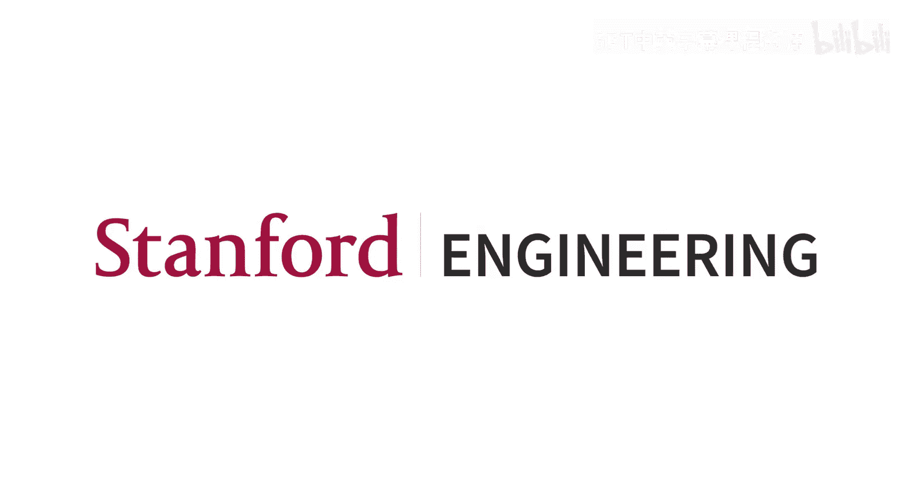

# 斯坦福大学《计算机视觉的深度学习｜CS231n： Deep Learning for Computer Vision 2025》中英字幕 p13 -14-Lecture 13_ Generative Models 1.zh_en -BV1FqazzVE6w_p13-

Welcome back to CS S 2 through1 N， Lecture 13。 Today， we're going to talk about generative models。

Last time we were talking about selfsupervised learning。

 which is this really interesting paradigm where we want to somehow learn structure directly from data with with no supervision。

 with no labels and the typical the typical formulation of self-supervised learning that we talked about a bunch of examples last time is you have your big data with no labels。

 ideal as just images。 This is great。 you can get a lot of images you're gonna to feed through some kind of encodeder that's going extract a feature representation from your images。

 then go through some decoder that will predict something from that feature representation。

 And the whole trick in self-svised learning is coming up with some kind of pretext task that you can train this whole system on without requiring any kind of human annotation or human labels then so we talked about things like rotation different kinds of tasks that we can use as pretexts for these self-supvised to formulate these self-svised learning objectives。

 And then typically this is usually a two stageage procedure where first you're gonna go and learn this self-supervised encoder decoder your self-servised task on all the data that you can find And then after that you're gonna。

😊，Throw away the decoder and then slot in some new maybe tiny。

 possibly tiny fully connected network and actually train this thing， maybe end to end。

 maybe just learn the fully connected network at the end on some small labelbeled task。

 And the idea here is that via self-supervised learning this pretext task you can train on lots and lots of data。

 millions， hundreds of millions， billions of samples where we don't have access to to high quality human labels and in the process of self-supervised learning iss going to learn something about the general structure of images or of data。

 and then you can transfer that knowledge to downstream tasks where you have small amounts of human labels So then the typical setup you should keep in your mind that we want to work towards in selfsupervised learning is that you're going to train on like a billion unlabeled images that we're getting from the internet somewhere。

 and then we're going to transfer those features to tasks where we're willing to sit down and label maybe tens。

 hundreds， maybe thousands of examples for particular tasks that we really care about but we want those tasks to be improved by this generic knowledge that we've learned through this selfsupervised pretext task。

And we talked about a couple different kinds of pretext tasks last time， including rotation。

 rearrangement， Re， all of these are basically having this sense of that you're making some geometric perturbation。

 geometric disturbance to the input pixels and then you're asking the model to somehow recover from that perturbation So in the case of rotation。

 maybe you rotate the image and you ask the model to predict how much it was rotated in the sense of rearrangement or solving jigsaw puzzles。

 you're going to cut the image up into patches and ask the model to try to predict what was the relative arrangement of those patches in the original image or in reconstruction。

 Maybe you're going to delete some parts of the input image。

 and then ask the model to fill them in as some kind of in painting or reconstruction task。

And these are fairly successful， we also talked last time about a different formulation of self-supervised learning called contrastive learning。

 which has been very successful and here I was told that you ran out of time a little bit to cover a couple of these later methods。

 so I wanted to just go over those really quickly at the beginning of today's lecture instead。😊。

So really the idea of contrastive learning is you're going get pairs that are similar and pairs that are dissimilar and you want to pull the similarilar pairs together and push the dissimilar pairs apart。

 and the way that you usually do this in the context of self-supervised learning is you're going to start with your input images。

 And again， these are unlabeled images， you don't have labels you don't have labels for them and now for each input image。

 you're going to apply two random transformations。 So in the case of the cat。

 we sort of took one crop around the cat's face， another crop around the backside of the cat and around the monkey。

 we sort of took one around the monkey's face and also dropped it to black and white and etca。

 etc ce。 So basically for each one of your input images。

 you're going apply two or possibly more possibly more than two but two is is a nice minimal subset two random perturbations to your input image。

Now you're going to feed all of those randomly perturbed versions of your input data to some kind of feature extractor。

 which could be a VIT could be a CNN， any kind of neural network that can input an image and output a feature representation then you want to apply this notion of contrastive so for each of the two augmentations that came from the cat we want those two feature vectors to be the same。

 So we color them green。 So basically basically compute this big n squared similarity matrix where well I guess it's open per N2 n close per n squared So it's four n squared。

 if if you have n images， you put two perturbations on each。

 So we have a giant two n by two n matrix for all these perturbed images。

 all these perturbed augmented samples that that we got And now basically we want to pull together the two augmented samples the two augmentations that came from the original image and for every pair every pair of augmentations that came from different original images。

 we want to push them apart so you basically。run through feature run all of these things through your feature extractor。

 compute this giant4 n squared matrix of all of your scalar similarities between those feature vectors and then pull together the ones that are similar。

 push apart the ones that ought to be different， and that's the basic idea of contrast of learning。

And one paper that really pulled all this together a couple years ago was called SimClar that applied this very successfully to self-supervised representation learning on images and that's the one I think you walked through last time。

 but one kind of problem with a SimClear setup up is that it requires a fairly large batch size to actually to get good convergence because it's sort of too easy of a problem for the network if there aren't that many samples。

 it's sort of too easy to pick out the two cat ones that looked similar so to make the problem hard enough for the network to give it good enough learning signal。

 you tend to need quite a large batch size in order to get this model to converge to good features and then once you do that。

 you need to rope in all the ideas around large-scale distributed training that we talked about a couple of lectures to go which is totally feasible it totally works but you might ask is there some way you can get away without that。

And so that leads to a couple of approaches that I don't want to go into too much detail。

 I actually don't want to walk through these and tell you exactly how they work。

 I just want to make you aware of their existence and give you the general flavor of what they're trying to achieve。

 So in this moco or momentum contrast approach to selfsupvised learning。

 The setup is very similar to what we just saw in Simclair。

 You're taking data you're getting augmented pairs。 you run them through a feature encoder。

 you want to pull together the ones that are similar， push apart the ones that are dissimilar。

But the thing that differs is that we want to get away with not having to have a gigantic batch size at every iteration。

 so to do that they keep a of negatives， they keep a queue of samples from previous iterations of training。

 and then at every training iteration I've got my X query is my current new batch of data。

 and I have this Q X0 x1， x2 key， which are previous batches of data that I've seen on previous iterations of training。

Now， my current batch of data， I'm going to run through my encoder network the same as I always did and compute these sort compute the contrast of loss the same way that we did with Simcle and then this larger queue。

 these like previous history of batches。 we're going to run through something different。

 The momentum encoder and then still get feature representations and compute the same kind of similarity that we did through the Sim clear thing。

 But the problem is that we don't want to back propagate into the momentum encoder because it has too much data。

 it has too big of a batch， we can't afford to fit that in GPpU memory。

 So we want to not have to back propagate through that part。

 So instead So that means that we're we cannot update update this momentum encoder。

 the second encoder via gradient descent descent。 Instead， we're going to do something kind of wacky。

 What we're going to do is have this momentum encoder have its own set of weights。

 We're going to learn them not be gradient descent。 Instead。

 what we're going to do is have the momentum encoder be a exponential moving average of the weights of the normal encoder。

 So the normal encoder， we're going to learn via gradient descent。 everything is normal。Ford prop。

 will back prop we'll get gradients。 We'll make a gradient update step on the typical encoder。

 That's the normal thing。 But then after we do that， the momentum encoder we're going take。

 we're going decay the encoder weights。 We're going to decay the current momentum encoder weights by like 0。

99 and then add in 1% of the encoder weights。 So then the momentum encoder。

 We have this other update rule where it's this lagging trailing exponential moving average of the encoder weights。

And I don't have a great intuition or explanation for why this exactly makes sense。

 But there's very strong empirical evidence that this works。 So I， unfortunately， so， that's。

 that's kind of the state of things。 But it's nice because it means that you can now get away with learning these selfsvised representations without having to have this gigantic massive batch of negatives at every iteration。

😊，And this was fairly successful。 There were a bunch of followup papers that push this direction。

 Another one that you should be aware of is called Dno。 Again， the idea is very similar。

 It uses this similar sort of momentum encoder， this like dual normal encoder that's learned via gradient descent and a momentum encoder just as in moco but the loss is a little bit different instead of using softmax they use some kind of KL divergence loss。

 And the reason I'm mentioning this one is because you should be aware of the existence of Dno V2 even if we don't talk about exactly what it does because Dno V2 is a really strong a really strong model for self-supervised features that's used quite a lot in practice these days So what they basically did is took this recipe from Dno V1 which was kind of similar to moco has a lot of ideas from Simclar as well。

 but a lot of unique details in their approach as well。

 but the big difference in Dno V2 is that they scaled up the training data quite a lot。

 So a lot of these previous self-upervised approaches had been trained on the imagenet data which was1 million images and Dno V2 was able to successfully scale。

😊，This approach to a much larger training set of about 142 million images。 So， you know。

 in deep learning， we like bigger networks。 we like bigger data。 We like more GPUs。

 We like more flops。 We like all of those things。 And Dno V2 is able to find a recipe for selfsupervised learning that successfully scaled up to this much larger data gives very strong selfsupervised features。

 And this tends to be used quite a lot in practice today。

 if you want to pick up features and then fine tune them or supervise them for some for some of your own downstream tasks。

 So again， I don't expect you I don't want to walk through all the details of how this works。

 I don't expect you to know。 But I want you to know that it exists in case you want to pick it up and use it for some of your own projects in the future。

😊，So that， that's basically all I had to say about self supervised learning。 Any。

 any questions about that before we move on to the the meat of today's lecture。Yeah。Okay， guess not。

So today， the main topic is generative models。This is really cool。

 this is an area of deep learning that basically went from not working at all 10 years ago to like really。

 really working in the last couple of years and this has given rise to things like language models be these can be viewed as generative models as we'll see all kinds of image generation models。

 all kinds of video generation models these really went from just absolutely not working at all when I was in grad school like you would look at these samples and peer into them and they just look like low resolution complete blurry garbage but somehow you could view some promise in them and I'm glad that people kept pushing on that and pushed through the blurry garbage and scaled it up over the past decade because now a lot of these techniques really do work and that's very exciting so this is an area of deep learning that basically didn't work at all with the first time we taught this class and that's really cool that it now does。

😊，But that said， a lot of the fundamental ideas around generative modeling actually remain the same。

 the ideas about how you think about data， what are approaches for modeling them。

 a lot of those mathematical fundamentals actually have not changed that much in the past decade but what changed is better is more compute more stable training recipes。

 bigger data sets， distributed training and the ability to scale all this up into more useful tasks I think was really what drove the progress over the past decade。

 there were some algorithmic tweaks and especially we'll see that next lecture when we talk about diffusion models。

But first， before we talk about generative modeling。

 I wanted to step back a little bit and talk about supervised versus unsupervised learning， right。

 because there's a couple of different there's a couple of different tasks that we try to approach in deep learning。

 and they can sometimes be sliced along a couple of different orthogonal axes。

 So I wanted to talk about those a little bit just so we get our terminology and our nomencature clear So supervised learning is what we've mostly been doing all semester。

 except for last lecture。 in supervised learning， we have a data set of pairs X and Y。

 And the goal is to learn some function that that maps from the input data X to the target or label Y。

 And we've seen a lot of examples of this kind of approach so far。

 something like image classification。 our input X is an image。 The output Y is going to be a label。😊。

Or image captioning， the input X is going to be an image。

 The output Y is going to be some piece of text describing what we see in that image。 Object section。

 input is an image。 outputput is a set of boxes and category labels describing the objects that appear in the image or segmentation。

 Maybe you assign a pixel label assign a label to every pixel in the input image。

And these are supervised learning problems because the task you're trying to solve the thing you want to predict is exactly what you have in your data。

 And you sort of all you need to do in some sense， is learn a function that mimics that X to Y mapping on your training dataset and then generalizes that mapping to new samples beyond your training dataset。

Now， unsupervised learning is something a bit more fishy and mysterious and hard to describe。

 But the idea of unsupervised learning or sometimes selfsupervised learning is that you don't have any labels。

 you just have data。 you just have samples X。 You just have images。

 and you want to learn some kind of structure from that data。 There's no particular task。

 You're necessarily targeting。 You're just trying to uncover good representations。

 good structure in all of that data。 why， so that you can， you know。

 as we talked about in selfsupervised learning， often you can apply it to downstream tasks later on。

 But there's， but the task itself in unsupervised learning is often somewhat unspecified。

Some examples of this are Ka means clustering， where maybe we're trying to identify clusters in the data which is some kind of structure that we can examine from the raw pixels that even though we didn't have labels for or dimensionality reduction PC where we're trying to uncover some lower dimensional subspace or lower dimensional manifold that explains the structure of our data And again。

 this is something we're trying to discover from the data itself。

 we don't have annotations of what what this ought to be or density estimation。

 maybe we're trying to fit a probability distribution to the data。

 we're trying to understand what is the probabilistic function that gave rise to the data samples that we're seeing。

 and again， we don't have explicit labels for this or an explicit training set for this。

 So this is some kind of hidden or latent structure that we're trying to uncover through the process of training。

So this supervised unsupervised dichotomy is something that you always should keep in mind。

 and you can do unsupervised learning， which is not probabilistic or not generative necessarily。

 something like clustering， something like PCA， you know often they have probabilistic interpretations but these are examples of unsupervised learning that don't necessarily have a generative or probabilistic interpretation or don't have to be thought of as such。

 So I often like to think about the supervised unsupervised dichotomy is kind of one spectrum along which methods or systems can lie。

A separate spectrum along which we can classify systems or tasks is that of generative versus discriminative models。

 And these are inherently probabilistic。 And when we talk about generative or discriminative models。

 we're always imagining some kind of probabilistic structure in our data that we're trying to uncover or learn from。

 And the difference is exactly what is the probabilistic relationship between the variables that we're trying to model。

 So in discriminative model。 So so typically， we have some some y and some X。

 And usually we think of the x is something large， high dimensional， usually an image in our case。

 And the y is some kind of label or description or auxiliary information。

 And so that would be like your text， like your caption， like a category label， something like that。

😊，And do when you talk about a discriminative model。

 we're trying to learn a probability distribution of y given x。

 so we're trying to learn a distribution over labels conditioned on our input image X and to understand to really appreciate what's going on probabilistically you need to remember one very important feature of probability distributions and that's that they are normalized when you talk about a probability distribution or more generally a density function P of x P of x is basically a function that applies that assigns a non-zero number every possible input X with the very important normalization constraint if you integrate over the entire space of all possible x's。

 it integrates it integrates to1 and this normalization constraint really gives rise to the power of probabilistic models in some sense because the normalization constraint means that all of your x's need to compete for probability mass there's a fixed unit amount of probability mass and and a and choose。

A probability distribution or density function basically amounts to apportioning out that fixed amount of probability mass and smearing it across all possible values of x that could exist。

 And all of those x's are in competition because there's only a fixed unit amount of mass to go around。

 So if you want to push up the probability of one x。

 necessarily the probabilitybabilities of or densities of other x's have to go down。

 And this and so then in these different formulations of probabilistic models， Basically。

 what's changing is what are the variables that are competing for probability mass。😊。

And that means that even though the symbols that we write on the page look very similar。

 the different competitions among what is competing for probability mass induces very different structure that the model is trying to learn or uncover。

So in the case of a discriminative model， we're learning a probabilistic model of y conditioned on X。

 which means that for every X， our model is predicting a probability distribution over all possible labels。

 So if our labels are discrete and categorical like cat dog。

 then that means we have a fixed amount of probability0 to one and cat and dog must must sum to one。

 and we have a separate probability distribution over the labels for every input X。

 and crucially notice here that there is no competition among images for probability mass。

 because every image is inducing its own distribution over the label space。

 theres no kind of competition for mass across the different images。

 the only things that are competing for mass are the different labels for each image。

 And that's very important when you think about discriminative modeling。

And one interesting other thing， so you know one interesting other facet of discriminative modeling is that they have no real way to reject unreasonable inputs。

 So once we've fixed our label space of say cat and dog in this example。

 if we feed in something that's not a cat or a dog at all， like a monkey or a piece of abstract art。

 The system has no flexibility。 It has no freedom to say this is unreasonable。

 It's forced to output a distribution over the fixed vocabulary that we assigned at the beginning。

 So that's maybe could be seen as a shortcoming， but it's just important to understand what exactly is happening under the hood when you think about modeling different kinds of data probabilistically。

Now， a generative model is something very different。 Now， instead。

 what we're doing in a generative model is learning a distribution P of X。

 we want to learn a distribution over all possible images X。 And now this is very interesting。

 This means that all possible images that could ever exist in the universe are all now competing with each other for probability mass。

 And this is now really really a hard question that requires you know it sounds kind of simple on its face。

 But this requires you to confront some very deep and philosophical problems about the world because now all images are competing for probability mass and you're forced in order to model that。

 you're forced to answer questions like you know should an image of a three leg a dog。

 How should that get probability mass in relationship to an image of a three-armed monkey probably the three leg a dog should get more probability mass because that's you you can have that happen by a dog losing a leg。

 but how are you gonna get a three-ear monkey， I don't know。

 that seems much more rare unless you're modeling scifi images or something like this。

 So once you're in this regime of all possible images competing for probability mass。😊，Now。

 your model really needs to think very carefully about the kinds of structure that can exist in the data。

 and it becomes a much， much harder problem to solve。

And another interesting thing here is that now with a generative model。

 the model now does have the capacity to basically say， no， this is not a reasonable image。

 this is not a reasonable input。 And the way that it can do that is by assigning you know low or even zero probability mass to any one image that it gets。

 So maybe in our generative model， maybe we only want it to recognize。

 know be a generative model of zoo animals。 And if we want to have a generative model of zoo animals。

 then you know if we feed in an image of abstract art， it should have zero probability mass。

 So now we have a mechanism for rejecting or saying that this type of image is not within the scope of what we care about。

😊，And now a conditional generative model is even more interesting。

 So this is where we're learning a conditional distribution over images X conditioned on some label signal Y。

 And now this means that for every possible label， maybe we're now inducing a competition among all possible images。

 So in this case， if y is say a categorical label of cat and dog。

 now for each possible categorical label， cat and dog。

 the model is separately inducing a competition among all possible images。

 So now you know in the top distribution， maybe this is the probability of all these images condition on the cat label。

 So then obviously the cat image should be high， maybe the monkey and a dog image should be somewhat higher because there're still mammals。

 at least， but the abstract art should be very low， maybe even zero。

 And then you know a different distribution among images， if we're conditioning on the dog label。

And this gets even more interesting if you imagine that your conditioning signal Y is something much richer than a single categorical label that conditioning signal Y might have been a text description。

 it might have been a whole paragraph of written text。

 it might have been another image plus a piece of text。

 So now once you talk about modeling these very rich output spaces X conditioned on a very rich input spaces Y。

 now you're actually asking the model to solve a very complicated and quite illdefined problem that requires very deep reasoning about the objects involved。

So that's why I think that generative modeling is such an interesting topic because it it looks kind of simple。

 all we did was flop the X and the Y， how hard could it be。

 but all of a sudden it required us to think really hard about what's going on in the visual world。

And what's also interesting is that we wrote down discriminative generative models and conditional generative models as three separate categories of things。

 but actually they're all related and they're related through basees rule。

 which is you you're kind of one of the one of the most amazing relationships in probability and in particular。

 it says that you know if we can write if we have access to a discriminative model。

 P Y of x and an unconditional generative model， P of x。

 as well as some prior distribution over a labels Y。

 we can compose those to build a conditional generative model P of y given x， or in general。

 you can always rearrange basees rule in some way so that if you have any two of these。

 you can always get a third one， which is pretty cool。😊，So I mean， so in practice， like in theory。

 you can in principle， build a conditional generative model out of the other two components。

 although in practice this is not really how you do it。

 you tend to sort of learn conditional generative models from all from scratch on their own。

 although as we'll talk about in diffusion， you do end up sometimes learning conditional and unconditional models jointly for some reasons。

 but this is nice to keep in mind that there's a very deep relationship across these different flavors of probabilistic models。

So then you might be wondering okay what can we do with these different flavors of probabilistic models with discriminative models。

 this one shouldn't require a lot of creativity。 We've seen a lot of these examples so far this quarter。

 So with the discriminative models after you train them， you can assign labels to data。

 you can also do feature learning in the case of say supervised learning on imagenet。

 we've seen that in the process of trying to predict categorical labels of images。

 those models tend to learn useful feature representations in the middle that can be transferred to downstream things。

 So this is so you tend to use discriminative models for just directly predicting whys that you care about or for learning feature representations that are induced in the process of trying to predict those whys。

Generative models actually these unconditional generative models I think are actually kind of useless in general。

 but what they kind of let you do is maybe detect outliers。

 they look at images and say are are they really do they really have low probability mass。

 are they unreasonable images， you can view that you can sort of use them for feature learning without data without labels so hope that in the process of trying to fit an unconditional distribution P of X。

 the model maybe learned some useful feature representations， although in general。

 these have not been super successful for selfsvised learning and typically the contrasted methods that we've talked about the previous lecture have in practice been much more successful for selfsupervised learning as compared to unconditional density estimation。

Or in principle， you could use this unconditional generative model to sample and produce new samples X。

 But I think this is actually kind of useless because it gives you no control over what what is being sampled。

 right， If you have an unconditional generative model of images。

 then you can sample from it to get a new image。 but you have no control over what what's in that image。

 So I think that's that's actually， you know， it's mathematically interesting to think about how to build such models。

 Buts， I don't think they have as much practical significance。

And conditional generative models are I think actually things are the most useful and the most interesting and these are the kinds of generative models that get trained and used in practice by far the most so you can in principle。

 use them to assign labels while rejecting outliers you could say if I have a piece of data X then look at the P of x given y over all of my possible Ys and then I could reject if that's too low among all the possible ys so in principle you could use conditional generative models to do some kind of classification well also maintaining the ability to reject outliers although I don't think that's really used too much in practice what's really useful for conditional generative models and what is used in practice all the time everywhere is sampling to generate new data from labels where you actually get to control what is generated because if yourre y is now maybe a piece of text you can write down I want to see a cat wearing a hot dog flavored t-shirt on the moon or whatever and then your favorite generative model of images when I'll generate you a brand new image X conditioned on that label Y。

So this is where I think all the juice is where all the magic is， where all the excitement is。

Although somewhat confusingly in the literature whenever you see the term generative model。

 they kind of mush up between unconditional and conditional generative modeling and a lot of the papers that you read will even sometimes drop the conditioning signal Y because it makes the math look cleaner it makes the equations look cleaner。

 but I don't think unconditional generative modeling is super useful。

 it's almost always conditional generative modeling that you really want to do in most cases。

 so just be aware that if you read papers see equations。

 hear people talk when they talk about generative modeling。

 theyre probably the one they care about training more are these conditional generative models even if the math't even if the equations or notation doesn't reflect that。

So for unconditionaljorative model， what are the increasing problems？

So I didn't really tell you that and I was sneaky there because how you parameterize that actually depends a lot。

 there's a lot of different formulations for all of these things and what exactly are they going to be the inputs and the outputs of the network are going to vary quite a lot depending on the formulation so we're going to talk about a whole taxonomy of those in a couple slides。

Okay， so， you know why generative models the main reason you want to build generative models is whenever there's some ambiguity in the task you're trying to model right So the beauty of a probabilistic model。

 P of x given y is that it's probabilistic there might be a whole space of possible outputs X conditioned on the input label Y。

 So whenever there' not in some case， sometimes there's just a deterministic mapping right I look at an image。

 I want to ask how many cats are in the image， there's just three cats， there's just one answer。

 But in a lot of cases， it's more subtle。 if I ask for a picture of a dog wearing a hot dog hat。

 like there's a lot of different images that could exist based on that query。

 there's uncertainty in the output。 and that's exactly what generative models are trying to model。

 they model a whole distribution of outputs condition on their input signal。

 So anytime that there's ambiguity in the kind of output that you want the model to produce conditioned on the input。

 that's where you want to turn to a generative model。

 And this is why and this is weve seen we'll see a couple examples of where this has gotten used a lot in the last couple of years。

 So one example。languageguage modeling someone asked about chattT a moment ago。

 So in language modeling， what you're often trying to do is predict output text X from input text y。

 sorry the x's and y's ended up flipped in an awkward way on this example。

 but here's an example from chattT the input is writing me a short rhyming poem about generative models and wow。

 it actually works。 This is crazy。 This didn't work at all when we first taught this class。

 I'm not gonna read it that will be embarrasing。 you can read it yourself。

 but you know now this is a conditional generative model you can imagine there's a lot of different possible rhyming poems about generative models that one might write and we had to pick one of them。

 and the beauty of a generative model is that in principle models that whole distribution over possible outputs condition on that input or text to image make me an image showing a person teaching a class on generative models in front of a whiteboard you're kind of looking at one example through your eyes。

 ChaT gave you a different example There's a whole different space of possible images that might match this input text and。

Geneative model allows you to model that whole space and sample from that space。

 depending on what you want。Or image to video you know input an image what happens next you know this was me holding my AirPods over a cardboard box。

 maybe I'm gonna to drop it， maybe I'm going to move my hand。

 maybe you know maybe I'm going to move my hand and the AirPods will morph into a different kinds of AirPods there's all kinds of things that could happen a generative model in principle lets you kind of model and sample from these possible futures。

😡，So are I so this is sort of why we want to care about generative modeling。

 Anytime there's ambiguity in the output， that's when you want to try to turn to a generative model to solve it。

And someone asked about what are the inputs and outputs。

 It turns out this is a huge field and this is surprisingly one field of deep learning that is quite mathematical because it requires。

 you know thinking about what are different ways to model probability distributions。

 How can we write down loss functions that cause the right things to happen So this is one area where when you read papers there may be a lot of math there may be a lot of equations and you actually might need to think through those equations pretty carefully to understand what's going on So this is one subfield that tends to have more math and more equations which I think is kind of fun kind of interesting So there's this whole taxonomy of different kinds of generative models that people build So on the one hand。

 you can imagine one part of the family tree what we call explicit density methods These are ones where the model actually does you know the whole thing is we're trying to model p of x or p of x given y and with these explicit density methods you can actually compute you can get that value out P of x for any sample X。

 and the the counterpoint are implicit density methods。 These are ones where you can't。😊。

Get that probability mass value。 you can't actually get that density value P of X out from the model。

 but you can somehow sample from that probability distribution。

 So the difference here is that in an implic model you can't actually access the value of the density function。

 but you can sample from the underlying density function somehow。

 so the model has implicitly learn to model the density。

 even if you can't get the value out and on the explicit density side it's almost the opposite where in many cases。

 even when you like you can get that explicit density value out。

 but then sampling tends to be more complicated sometimes with these explicit density methods not always but sometimes。

Right and the reason why you might turn to implicit models is because in many cases you may not actually care about knowing what exactly was the density value for any input。

 maybe all you care about is generating samples and get generating good samples。

 get generating a good diversity of samples， so if the thing you really care about is sampling。

 then maybe you don't actually need to explicitly be able to see the value of the density for any input。

And then things break down and cascade and get more fractal like from here。

 So inside explicit density methods， there's ones where like actually yeah。

 you can really compute the real P of x that's being modeled and autoregressive models are one example of that or another version of explicit density methods are ones where you can get a density value out。

 but it's not the real one。 It's some kind of approximation to the true density of the data and variational autoencodederrs are one example of an explicit but approximate generative method that we'll see。

😊，Now， on the other branch of the family tree， we can think about direct methods for implicit density。

 These are ones where maybe it requires a single network evaluation to just draw a sample from the underlying from the underlying distribution that's being modeled and a generative adsarial network is an example of a generative model in this part of the family tree and the other part is I don't know if it has a good name I call the indirect。

 but this is a name I made up yesterday， so please feel free to correct me if there's a better term for this but these indirect ones are ones where you can sample from the underlying from the underlying density P of x that's being modeled。

 but it requires some kind of iterative procedure。 There's no feed forward function that where you can input and get the sample directly out。

 There's some kind of iterative method that you need to run in order to draw a sample from the underlying density that's being modeled and diffusion models are an example of this that we'll see next time。

I told you a couple slides ago that people are sloppy with notation and dropped the Y and I did that explicitly on purpose on this slide so that someone would ask me that question and you would always be attentive to that fact。

 So yes， exactly every time I've written P of X on this slide and actually all the rest of the slides this lecture。

 I also have been lazy and dropped the Y， but you should always imagine an additional condition on Y in all of these P of Xs that you see for the rest of the lecture so thank you for asking that。

😊，So the question was like is the indirect method is it still you know can you just treat that indirect iterative procedure as a black box and then treat that as a direct sampling method in principle yes。

 but in practice， no， because your samples kind of end up approximate know depending on exactly the method。

 but like with diffusion models you kind of would need to take an infinite number of steps in order to draw a true sample。

 so instead we approximate that with a finite number of steps and that's true of other methods as well diffusion models are the most common for this today。

 but know some kind of Markov chain method or MCMC method in years past might have also had this property where there is an iterative procedure。

 but if you want to draw an exact sample from the distribution that's being modeled。

 you need an infinite number of steps to converge so we always approximate that and by taking a finite number of steps。

Okay， and I was pretty proud of this taxonomy because it's very symmetric。 there's four leaves。

 there's two branches and we're going to cover half the tree today and half the tree next time。

 So I thought that was a pretty nice breakdown。😊，question is。

 what's the difference between the approximate density and directly sampling from an implicit P of X。

The difference is that in an indirect but implicit method。

 there's no density value anywhere to be found。 you can't compute one at all。

 but you can still iterativeably sample in some way with an approximate density method。

 you can still get a value out like you can actually get a density value out。

 that's going to be some approximate or bound to the true P of X。Okay。

 so then first the first such generative model that we'll actually talk about in a little bit more concrete specificity are autoaggressive models。

So auto models， we're actually going to take a slight detour and talk about a really general idea behind all of generative modeling。

 and that's the idea of maximum likelihood estimation and maximum likelihood estimation is actually a quite general procedure that we can use to fit probabilistic models given a finite set of samples。

 So the idea is we're going to write down some explicit function for the density。

 We said that that some methods are going to explicitly model the density。

 Well let's do it with a neural network。 Let's write a neural network that's going to input the data X input the weights W of the neural network。

 and it's going to spit out a number that's going tell us what is the density。😊。

So then know we're going train data we're going given a data set of samples X1 x2 XN。

 we're going train the model via this objective function。

 We want to find the weights that give rise that make the data set most likely where we want to set because as we vary the weights。

 it's going to vary the kind of densities that are being modeled by the network So we want the network to select the density that maximizes the likelihood of the data note that we said likelihood rather than probability that's a deep philosophical rabbit hole you can fall into the difference is what we're varying If you think about probability。

 you kind imagine that the density is fixed and we're sort of sliding x around and changing what is the probability of x under a fixed distribution when you talk about likelihood instead you're often fixing the samples X and you're varying the distribution itself and saying what is how does the probability density of those samples change as we vary different distributions So you don' have to think about very carefully in these equations。

 what's being fixed and what's varying So in this process of。So likelihood estimation。

 what we're doing is varying the distribution that the neural network is modeling to try to maximize the probability of the fixed set of samples we have from that distribution in our training set and I guess the unsai thing behind all of this is that we assume that there is some underlying true probabilities distribution P data which was used by the universe to generate the data that we are seeing and in some sense。

 always what we want to do is try to model that true underlying unknown distribution P data and we can never access P data because we don't know we don't have this omniscient view of like exactly how the universe works But instead we get some samples from P data that the universe has given to us and what we're trying to do through our learning procedure is uncover that unknown distribution P data given a finite number of samples from that unknown distribution So one procedure that you can go about this is like well。

 let's select the distribution that makes the data that I saw actually most likely and that's objective that's the maximum likelihood objective function。

RightAnd then a standard trick that we do here， we assume that the data was IID independent and identically distributed。

 so we assume that each one of those x's was drawn from that true P data distribution。

 and now we want to maximize the joint distribution of all the data that we saw but because it's independent we can factor it down into independent probability independent likelihood of each of the independent samples and then the common trick that we always use is the log trick So you know that log is a monotonic function。

 So if you maximize something it's equivalent to maximizing the log of that something because log is a monotonic function and then log is also very convenient because it swaps sums and products。

 So it's common to just instead of maximizing the likelihood of the data instead we're going to maximize the log likelihood of the data and that's the same as maximizing the likelihood and once we apply the log then that product splits into a sum and sums are easier to handle。

And now you know we slot in our neural network because our neural network is now maybe directly outputting the density。

 so this gives a direct objective function that we could use to train a neural network。

 give it you know this gives it a very concrete loss function that we can use to train a neural network to solve this kind of generative modeling problem。

But we need a little bit more structure here to actually make progress this is where so this idea of maximum likelihood estimation is very general。

 it doesn't really assume anything about the kind of data。

 it doesn't really assume any structure in the data and in general need to put a little bit more structure on this to make some progress so autoregressive models basically make the assumption that there is some canonical way that we can take our data X and split each data sample X into some sequence of subparts x1 x2 Xt you got to be careful with indices here here I said the subparts these are subparts of a single sample so I use a subscript and the previous slide we had superscript to indicate different samples x1 to XN so be careful with that sub superscript on this slide is different samples X subscript on this slide means different parts of the same sample so we assume that there's some canonical way to break up our data sample X into some sequence of subparts and now we can apply the chain rule of probability so probability of x is just the joint probability probability。

Of all of the subparts， x1 to xt。And then given any probability distribution。

 you can always break it apart into this chain rule that probability the joint distribution of all these variables is equal to probability of the first one times probability of the first given conditioned on the first probability of the second condition on the first times probability of the third conditioned on the first and the second。

Eta， et cetera， et cetera。 right， And this is this is the chain rule of probability。

 This requires no assumptions。 This is always true of any kind of joint distribution of of random variables。

And then this， this sort of gives us our objective function。

 or like then you could basically train a neural network that's going to input you know。

 the previous part of the sequence and then try to give us a probability distribution over the next part of the sequence。

 Does that sound familiar， Is that something something we've done before。RNNs， yes。

 so that's exactly what an RN is doing right And RN has this very natural structure that。

 you know by passing hidden states along for through time。

 the hidden state always depends on the beginning of the sequence up to the current point。

 So then there's a very natural way to use RNs for auto aggressivegressive modeling。

 So you have your sequence of hidden states that are basically summarizing your sequence。

 And then from each hidden state， you predict probability of the next piece of the sequence condition on the condition on all earlier parts of the sequence。

 And that basically is an R andN language model that we saw some lectures ago。😊。

Have we seen anything else that can do this。Yes， transformers and particularly mask transformers。

 right， So we talk in a transformers's lecture。 Transformers can also be used to have this。

 this structure， whereby masking out the attention matrix in the right way。

 we can make each output of the transformer depend on only the prefix of a sequence。

 So we can also use transformers for auto aggressive auto aggressiveive modeling。 And this。

 and they're very commonly used for this。😊，Okay so this is but the problem with autoive modeling is that you need to break your data up into a sequence and this is very。

 very natural with text data because text data is naturally a 1D sequence and it's even a 1D sequence of discrete things which is great because it's very easy to model probabilities of discrete things we've been doing that all semester with our favorite cross entropy softmax loss the cross entropy softmax loss is always distribution over like fixed discrete number of categories。

 The network predicts a score for each one of those normalize it with a softmax trained with a cross entropy loss。

 we know how to do that So that's why these things fit very naturally for language models because language is already discrete language is already a 1D sequence So there's a little bit of fuzziness and how there's a tokenizer in there。

 we're not going to get into that but these are very naturally wellsuited to language problems because language is already 1D it's already discrete images are more tricky because images are not naturally 1D images are also not naturally discrete。

😊，Often think of images as continuous， real valued things。

 So' these don't naturally fit quite as nicely onto images。 but you know you got a hammer。

 you're gonna waxack some nails So people definitely apply auto aggressivegressive models to images in kind of a naive way。

 at least at least some years ago So one thing you can do one thing you can do to model images with auto aggressivegressive models is to treat the images treat an image as a sequence of pixels right and in particular each pixel is actually just three numbers and you in most displays and in mosts most representations of images。

 those numbers are actually discrete So Jpegs or PNngs。

 most of the file formats we use to store images are typically8 bit per channel。

 So there's actually only a fixed number of values that each pixel can take。

 So a pixel is just three single byte values。 a single byte is just like an integer from 0 to 255。

 So a pixel is just three integers， each of each integer can be0 to 255。

So what we can do is take our image and then rasterize it out into a into a long sequence where each element of the sequence is one of the subpixels values of our image。

 And now we've turned our image into a discrete into into a one dimensional sequence where each entry in that sequence is a discrete value So you can apply auto aggressiveive modeling directly to that sequence in exactly the way that you might have for a language model using an RNN or a transformer。

😊，Can anyone spot a problem with this approach？Too long。 very expensive， Very， very expensive。 So。

 you know， a kind of reasonable image that you might want to model is maybe 1024 by 1021024。

 That's not even that high resolution， really， but that's a pretty good resolution。

 But if you have 1001024 by 1024 image。 That's gonna be a sequence of 3 million subpels。 You know。

 people actually can model these days， sequences in the millions。 But it gets very， very expensive。

 There's got to be a more efficient way to do this。

 So there were some papers a couple years ago where people applied these sort of auto aggressive models directly to pixels of images。

 But they were not super successful， I think， because。

 theyre very difficult to scale the high resolution。

So a spoiler alert that we'll talk about a little bit more next lecture is that this actually has made a resurgence in the last couple of years。

 but the trick is to not model individual pixels in the sequence as individual pixel values。

 but instead to some other kind of process or procedure or model neural network maybe to break that image into a sequence of one- dimensionsal tokens。

 So that's something we'll talk about a bit more next lecture。

 but this at least gives you the sense of what is an auto aggressivegressive model。

 what's the probabilistic formulation of them， how do you apply them to language。

 how do you apply them to images。So then from autoregressive models。

 we next turn to variational auto encoders and variation auto encoders are pretty fun。😊。

So we talked about you know in these autoreive models， we talked about。

 you know we're trying to do maximum likelihood。 We broke up our data into a sequence of parts。

 We're trying to maximize the likelihood of the data。

 and variation autoencodederrs are going to do something a little bit different。 Instead。

 there's still going be an explicit method。 There're still going to be some kind of density that we can compute。

 But it's going to be intractable。 We're going be able to approximate it。 Why are we going do that。

 We have a perfectly good method that computed densities exactly。

 And what we're going to give up for that is we're going gain something。

 We're going to gain the ability to compute reasonable latent vectors over our data。

 We're going to have vectors that represent our data that come out that pop out naturally from the learning process。

 and those vectors are going to be useful in their own right and the ability to get access to those latent vectors is going to be useful enough to us。

 that we're willing to give up computing exact densities。

 and instead settle for these approximate densities that are actually lower bounds of the true density。

😊，Oh， the motivation for breaking stuff up in a sequence in autogressive models because it factors the problem。

 It makes part each part easier to model， right So imagine。

 you know imagine you're doing language modeling right and you have a vocabulary of v words。

 And I want to model the probability of two words jointly how many possible twoword sequences are there。

 There's v squared。 How many possible threeword sequences are there。 There's v cubed。

 then in general， if you have like how many tword sequences with a vocabulary of v are there。

 It's V to the T right， So that's bad， It grow exponentially。

 If you wanted to directly model the joint distribution of a sequence of t things。

 the number of entries in that discrete probability distribution you need to model is going grow exponentially with the sequence length。

 And that's quickly going to become completely intractable if we want to go to long sequences。

 So then the reason we break that up is so that we don't have to model it all at once。

 we factor it in this way and predict only one part condition on the previous parts。😊，Good question。

 Can we apply the log trick to mitigate that， Yeah， exactly。 So in practice， like。

 you'll never actually see these， these real， these like probability density values modeled。

 almost always you're gonna work in log probabilities instead。 So the model that outputs。

 the model is gonna output log probabilities， You're gonna compute your loss in log space like for numeric stability。

 You're almost gonna compute everything in log space in practice。😊。

So then the P of x is being generated because at the output at the top of the transformer。

 it's outputting a probability distribution over the next token condition on all the previous tokens。

 And it does that for every point in the sequence。 So you could actually recover this exact probability density value。

 by multiplying out the values at all points in the sequence。 So if I have an input sequence。

 I pass it to the transformer， The transformer will have predicted at every point in the sequence。

 What is the probability， What is the distribution over all the tokens conditioned on the earlier part of the sequence。

 And I can compute What was the actual next token。 What was the predicted probability of the next token and then multiply all of those across the entire sequence。

 So that's how we can recover the exact density value out of one of these auto aggressivegressive models。

 And that actually would apply either to an RN or a transformer。😊，Okay。Good questions。

So then in a variation autoencoder， things get hairy。

 so we're actually going to drop the V and talk about autoenderrs for just a couple slides because I don't think we've done that yet this course。

So in a non-varial autoencoder， this is basically going to be an unsupervised method for learning to extract features Z from inputs X without labels。

 and this actually know is kind of a kind of you know in this vein of cell supervised learning that we just talked about and our notion is that the features ought to extract useful information about the data maybe they somehow implicitly encode what is the identity of objects in the image。

 how many of them there are， what are the colors of them。

 we want this feature vector Z to contain useful information about the input X。

And this encoder itself could be a neural network of any architecture， it could be an MLP。

 transformformer， CNN， whatever you want， but it inputs our data X。

 and then it's going to output some vector Z。And then the question is how do we learn this without labels。

 We actually saw a lot of examples of this in the previous lecture， but there's a very simple one。

 which is just try to reconstruct the input， So we're gonna to now have a second part of the model called the decoder。

 which is going to input the Z and then output back an X and we when I dropped the X and we're going to train this thing so that the output from the model should actually match the input This is in some sense。

 the stupidest loss function ever， We're just training the model to mimic the identity function Why do we do that。

 We already know the identity function。 Why are we expending a lot of flops and training a neural network on a big data set to just learn the identity function that we already know It's because we're gonna bottleneck it in some way If this model had infinite capacity For example。

 if that Z vector was very wide if there were no constraints on the learning I would expect a neural network to just nail this problem But we don't want to do that because we explicitly don't care about learning this objective we already know the identity function。

 we don't need an expensive neural network to compute it What we want to do is force the network to try to learn the identity function under some constraint。

And the constraint that you often use in a traditional autoencoder is by bottlenecking that representation Z in particular。

 that means that that vector Z in the middle is going to be much much smaller than the input X。

 So your input X might be a high resolution image， maybe like a 1024 by 10 24 image that we said is composed of 3 million floats。

 But then that Z might be like 128 dimensional latent code。

 So the model is now asked to solve this problem where I want to reconstruct the output。

 reconstruct the data X， but squash it through this like bottlenecking representation in the middle。

 and we hope that this is going to force the model to learn some non-tribual structure about the data by squashing it through this representation in the middle of the network。

And then after we do this， we can apply our normal selfsupervised learning trick where you you could throw away the decoder and then use this Z to initialize some supervised model for some downstream task。

 the same story as in the super the self-supervised story that we just saw but about what if we actually want to use this to generate data then what we'd really like to do is somehow the opposite of the self-supervised story what we'd really like to do is throw away the encodeder and instead be able to somehow sample z's that match the kinds of z's that the model learned to represent data as and if we had some procedure for sample z's that match the data distribution in some way then we could sample a Z pass through our learned decoder and now generate a new sample and now this is an implicit method you said that there there's no densities floating around anywhere but if we had a way to do this it would be a way to draw samples from the model without explicitly modeling the density in any way。

But the problem is that， you know we've just kind of kicked the can down the road here a little bit because we said we if we want to generate images。

 we want to generate x's， we have a data set of x's， how do we do that。

 We said we're gonna to solve that by training this autoencoder and now we have a data set of z's and we need to sample in Z space it's not any easier。

 So kind we're kind of stuck。 and the idea of variational autoencoders is you what if we could force some structure on the Z's。

 If you have this traditional autoencoder structure。

 all you're not forcing the model to impose any known structure on the z's。

 you're just asking it to reconstruct the data given its latent representation。

 But what if we had some mechanism to force the Z's to come from a Gaussian distribution or some other known distribution。

 if that were the case， then we could just draw a sample at inference time after this model is trained。

 draw a sample from that known distribution， pass it through the decoder and now we would have have our sample。

So forcing these autoencors to be probabilistic and to enforce a probabilistic structure on that latent space exactly is what a variational autoencoder tries to do。

Why variational， it's a long story。 It says has a long history in a lot of history around that terminology in the literature。

 but basically variational autoencoderrs are a probabilistic spin on our traditional autoencoder。

 So it's going to learn latent features Z from raw data and then we'll be able to enforce a structure on that learned latent space Z such that we can sample from it at inference time after the model is trained and generate new samples。

😊，So more concretely， we'll assume that our training data X I again note here the superscript I means these are different independent samples of X。

 we assume that each  Xi was generated from some underlyingnt latent vector Z that theres some Z I that's lurking under the surface associated with every Xi。

 and in the universe's procedure for generating data first it generated the Z。

 then it pregene the Xi from the Z and all everything that the universe needed to know in order to generate the image that we seed that we saw was contained in that latent vector Z but we can't see those latent vector Z。

 we can never observe them。 we don't have a data set of them right so the intuition is that X is an image。

 Z is some kind of latent feature representation that tells you everything you would ever need to know about that image。

 but you can never observe that latent vector。And then after training， we could generate a sample by。

 oh， and the other constraint is that we're going to force those Z's to come from a known distribution。

 so then after the model is trained， then we could do exactly what we just said。

 draw a Z from that known distribution， pass through the decoder， that's going to give us a sample。

And then we'll typically assume a simple prior， almost always a unit Gaussian distribution is the most is by far the most common。

 So then how do we possibly train this。 Like this feels like an impossible problem。

 We want to basically train this network that's going to you know， get these Z's。

 find a Z for every X。 we can never observe the Z's。 This seems impossible。

 We're gonna do We're gonna go back to maximum likelihood。

 right If we indeed had a data set of xs and z's。 Then we could use maximum likelihood to directly use the same kind of log trick。

 maximize the log probability。 We could use the exact same thing that we previously saw。

 And then train a conditional generative model P of x conditioned on Z。But we don't know Z。

 but let's pretend we do for a moment。 So because we don't know Z， we could try to marginalize。

 right， We know that P of x is equal to like maybe there's some joint distribution of X and Z that must exist。

 even though we can't observe it。 And then in principle。

 you could integrate out the Z to marginalize over it to get a P of x。

 And then maybe we could do like pretend there's a joint distribution X and Z marginalize out the z somehow and still do maximum likelihood。

 You know， maybe let's see how this works。 So this term in and then here we've also use the chain rule to break up that P of x given Z that joint probability P of x and Z into P of x given z and just P of Z。

So this p of x given z， that's okay。 we could compute that with our decoder here on the left。

 That's a neural network that we're hoping to train。 This p of z term is okay。

 We're going to assume that that's a unit Gaussian or some other simple distribution that we can compute or reason about But this integral kills us in general。

 we have no feasible way to integrate over the full space of a neural network's input this p of x given z is going to be some very complicated function that's modeled by a neural network。

 there's no going to be no way that we can analytically or exactly integrate this You can train neural networks for individual parts here right So the whole underlying notion here。

 whenever you're doing this probabilistic modeling is like we're going to write down some proistic terms。

 Hopefully some of them are going be simple distributions that we can write down analytically and reason about some of them are going to be learned neural network components So we're kind of assuming that probability of x given Z is going to be some neural network that that we could in principle learn via maximum likelihood but we're starting to write down what objective could we use to learn that neural network via maximum likelihood and we're out of luck here。

Because you can't you have no way to integrate over Z。

 You could try to approximate that integral via some like finite sampling， but in general。

 that's probably not going to work very well because this z is a super high dimensional space and trying to like do doing an approximate numerical integral in the integral loop of your training is not gonna to be a very good idea so we could try something else。

 basees rule that's the other thing we always do in probability So let's try basees rule if we have bases rule。

 we have another formula that we can use to write down p of x right So p of x we can write down in basees rule using using basees rule in this equation on the screen let's see what we can do with these terms So this one P of x given z again。

 we can compute that with our decoder P of z again this ones we assume this is Gaussians。

 we can compute something with it there's no integrals here。

 that's good So we're in good shape but now we're out of luck this p of z given x term this posterior of z given x we have no good way to compute this in order to compute this term you would also need some kind of integral。

 we can't compute it。 What are we going to do？Okay。Let's use another neural network。

 So the variation autoencoder trick is like let's there's that troubleistic term on the bottom here。

 a bases rule that we can't compute。 Let's just slot in another neural network to try to compute it for us。

 So we're gonna to have another neural network Q with different weights phi。

 that's going to learn a different conditional distribution probability of Z given x。

 And the whole thing is we want this other neural network to try to approximate the true P of x given Z of the first neural network。

 And you can't really enforce this in general。 But you know。

 let's put a neural network there and see what we can do。

So then if we could somehow have this other neural network that was approximating this term in the bottom that we can't compute。

 then we could go and compute our our likelihood and max and do maximum likelihood。

 and we would all be all be set。So that's kind of what we do when training a variation autoencoder。

 we're basically going to jointly learn two different neural networks， one is the decoder。

 which inputs the latent code Z and outputs a distribution over the data X。

 the other is an encoder which is going to input the data X and output a distribution over the latent codes Z。

 and each of these are going to be separate neural networks that are separately trained with their own independent weights。

There's a question you might have， which is how can you possibly output a probability distribution from a neural network that seems confusing and hard and unclear。

 So the trick here is we're going to actually force everything to be a normal distribution and we're going to have the neural network output the parameters of the normal distribution so typically for the decoder network we're going to assume that we're going the output distribution from the decoder is going to be diagonal Gaussian where the entries in the diagonal are the pixels of the neural network and the model is going to output the mean of that diagonal Gaussian distribution and typically for the decoder we had to assume a fixed a fixed variance or standard deviation sigma squared Now for the encodeder network the same idea the model is going to input a data sample X and then it's going to output the parameters of a Gausian distribution。

 the model the distribution Q of Z given X。So in this case。

 the encoder network will output one vector， which is the mean of that Gaussian distribution and another vector。

 which is the diagonal of the covariance of that Gaussian distribution。

 And here it's very important that we assume the diagonal structure because otherwise we would have to model h squared kind of entries in that full covariance matrix so here you have you imagine an image that's h by w pixels So that means that the entries in your diagonal matrix are like you could in principle model the full covariance across every pair of pixels in the image。

 but that would require h squared w squared entries， and that would be too big。

 So instead we'll just ignore any kind of correlation structure among the different values and that means that the diagonal covariance is now a vector that's the same size as the data itself So that means this mu of z given x and the sigma of z given x are both vectors of the same shape as z So we basically treat the neural have the neural network output two vectors of the same shape and then treat them as the。

of the Scus distribution。So that's how we can output a distribution from a neural network。

If you do maximum likelihood on this thing with a fixed standard deviation and it actually becomes equivalent to L2 and that's a nice trick。

 And the reason you want to do that is because trying to model the diagonal like like you could in principle try to model the same thing on the decoder and try to model the like a separate variance of every pixel but that would be kind of useless because that would be if you're not modeling any covariance structure among the pixels that would basically be saying that each pixel is allowed to like vary a little bit and the amount that each pixel is allowed to kind of depends on the pixel and then sampling from that distribution would basically amount to fixing the mean and then adding per pixel independent noise that scaled by the per pixel variances and that would not be a sensible thing to do So in general like for the decoder。

 you kind of you kind of cheat a little bit and you kind of pretend it's outputting a probability distribution but in general we're never going to sample from that distribution instead we're always going output the mean。

Does that make sense yeah， and then it turns out like if you write this down like that constant sigma squared just comes off as a constant in the front and in practice all like maximizing the log likelihood of a Gaussian distribution with a fixed variance along the diagonal is equivalent to minimizing L2 distance between the mean and the x。

 which is kind of nice。Yeah， a good question。 Is there some kind of like weird invariance or noninvariance structure here with the pixel shifting that would be more a property of the architecture that you would choose to build the neural network。

 So you could try to build into your network architecture that's predicting these。

 You could try to build some invariance or equivariance properties into the architecture。 But yeah。

 you're right that in general， that's not accounted for at the loss level here。Okay。

 so now we've got this idea。 we've got an encodeder， a decoder there but one is inputting X。

 outputting a distribution over Z， other is inputting Z inputting a distribution over X。

 What's our training objective And here's the one slide where we're going to do some math。

 But we'll see。 So here we're gonna basically the idea is we want to do maximum likelihood。

 That's usually the single thing that we want。 That's like the guiding principle behind a lot of objectives in genderative modeling。

 So we want to maximize log P log P of X。 And then we can use base rule to write that as log P of this phase rule expression。

Right， this is this an exact equivalentvalence。 Now we're going to do something silly。

 We're gonna multiply the top and bottom of this by our Q of Z given x。 Remember。

 we just introduced another neural network Q out of nowhere that was that was modeling this other distribution Q of Z given x。

 And now we're going to multiply that density term on the top and bottom of this of this base rule expression。

😊，Now we're going to do some logarithm math and if you're have some foresight actually you'll for some reason decide to rearrange these terms in this particular order。

 and I've color coded them so you can later go and track which term went where。

 but we do some logarithms and break this up into three separate terms。😡。

AndNow you need to make another magical observation。

 which is that this p of X actually does not depend on Z right like so far this sequence of three terms。

 this is all exact equivalentvalence these are all exact equal。

 So even though there's a Z in this expression， we actually doesn't depend on Z because all the z's would cancel out and if you have something that doesn't depend on Z。

 you can always wrap an expectation over z of that thing。 So in this case。

 we know that this is a p of x， we can we can always feel free to wrap an expectation of z sampled according to any distribution that we want of p of x。

 and because that internal thing does not depend on z。

 this is always true for any for any for any distribution that we might choose to take this expectation over okay So then because expectation is a linear thing。

 we can apply that expectation to each of these three terms upstairs and now we have these three terms each of which looks very mysterious but if if you kind of。

😊，You had a lot of intuition about probability。 you memorize all these formulas that you may have seen in an earlier statistics or probability course。

 maybe you could learn to recognize some of these。 so this first one we're going to carry down as it was before and the second two are actually kale divergence are actually kale divergence terms so the kale divergence is a kind of measure of dissimarity between probability distributions and it just so happens to have this exact definition of these these latter two terms so we can rewrite this exactly as this first term which is this expectation。

 blah， blah， bla， we'll talk about it and then then plus these two other kl terms so these two kl terms are basically measuring dissimilarity measuring discrepancy or dissimilarity between these different kinds of probability distributions that we have floating around on this slide。

And now these all look kind of crazy， but if we stare at each of these terms。

 we can actually recover a like interpretable structure of like an interpretable meaning for each of these three terms。

This first one is actually a data reconstruction term。 If we walk through what this is saying。

 this is saying that we're going to sample a Z。 and the way we're going to sample the Z is by Q of Z given。

Q of z given x， which is our encodeder， so we're going to take our x， pass it to the encoder。

 The encoder is going to predict a distribution。 Q of z given x。

 then from that predicted distribution， we're going to sample a z。

 then we're going to take an expectation over all such z and maximize the log probability of x given Z。

 So this is basically a data reconstruction term。 It's saying that if we take an x， a data point X。

 run it through the encoder to get a distribution over Z and then pass any sample of that of that predicted distribution over Z into the decoder we're going to recover x。

 So this is a kind of data reconstruction term。The middle one is a prior term。

 This is saying we want to this is measuring the kl divergence between Q of z given x and p of z。

 So remember Q of z given x。 this is the encoder is inputting the data X and outputting a distribution over the latent space Z so this is the predicted distribution over the latent space of the encoder and this other term P of z。

 this is the prior， this is the prior that we assumed for the latent space usually diagonal Gaussian so this term is basically saying the model is separately predicting is sort of predicting distributions of Z given x and we want those predicted distributions to match the simple Gaussian prior that we had previously set that we'd previously chosen So this is just measuring how much does that latent space that's learned by our model match the prior。

And this third term gets us in trouble。 So this third term is Q of z given x。

 so that's the predicted distribution over z， given the input data x to the encoder and how much does that match p of z given x so that's this flippedro distribution of what the decoder is modeling and this one we're out of luck we cannot compute this term because remember what got us into trouble in the first place was this p of z given x the whole reason we introduced Q was was because we't we could not compute this p this p of z given x So now what do we do。

We're going to throw it away because we know that kale divergences are always greater than equal to0。

 So we know that this last term， because it's a kale divergence of two distributions。

 even though we cannot compute those distributions in general。

 we know that it must be greater than0 because that's a well-known property of kale divergncencies So we can throw it away and get a lower bound to the true probability。

 So if we throw away that last term， then we know that log p of x is greater than or equal to those two terms。

 our reconstruction term and our prior term。 So this will be the loss that we use to train our variation autoencoder。

 And the idea is that this is an approximation to the true log likelihood。

 this is a lower bound to the log likelihood。 So if we maximize the lower bound。

 hopefully that will also maximize the true log likelihood even though we're not doing it exactly So that's our training objective for variation autoencors。

 So that's kind of the summary you're going to jointly you're going to jointly train an encoder Q and a decoder P to maximize this variation what's called a variational lower bound。

😊，The true data log likelihood and this is also sometimes called the evidence lower bound or elbow so it's just the elbow where we're gonna to maximize the elbow and it has this particular term。

 we have these encodeder network， this decoder network that's what we do So then kind of walk through what the training procedure looks like more explicitly we're going to have this neural network we're going to have this neural network encoder inputs the X outputs the distribution over Z then we're going to apply this KL term to the predicted distribution and in particular because this is going to force the predicted distribution to be unit Gausian。

 So it's basically going to force it's going to encourage the predicted mean to be0 and the predicted sigma to be diagonal ones。

To be all ones then once we get to those predicted distribution from the encodeder。

 we're going to sample from that predicted distribution using this so-called reparameterization trick that allows you to backpro through this。

 then we draw a sample Z from the predicted distribution。

 once you get the predicted distribution this sample Z。

 you run it through your decoder to to get your normal distribution predicted by the decoder and then you apply your reconstruction your reconstruction term of the loss to the output of the decoder So even though this looked like a large scary slides of math。

 it actually led to like not too crazy of a training objective for this thing。

And I think this variation autoencoder is actually very interesting because these two losses fight against each other in a very interesting way so the because we're basically forcing the model to bottleneck through this latent space Z and these two terms kind of want different things from the latent space so the reconstruction loss kind of wants the sigma to be0 and the mux to be a different and unique vector for each for each data X because if that were the case then we could perfectly satisfy the reconstruction objective we would have a separate separate unique vector for every data point and there would be no probability in there。

 we could perfectlyconstruct everything so that's kind of what the reconstruction loss wants but the prior loss actually wants the sigmas to be all one because it wants it to be unit Gaussian and it wants all the mus to be zero which is very different what the two losses want so in the process of training of VAE you're asking these two losses to fight against each other to try to find some equilibrium between reconstructionconstructing your data well and forcing your latent space to be close to prior。

And then once you trained it， then you can sample Z from your prior。

 run through the decoder and get a sample。 Another nice thing is that because your latent space was the diagonal Gaussian。

 there's also a notion statistical independence across the different entries in your latent space Z so you can vary them separately and maybe those separate dimensions often encode something useful or interpretable or orthogonal about your data。

 So in this case we took a VAE trained it on a data set of handwritten digits and you kind of see that as we vary two dimensions of the latent space。

 the digits kind of smoothly morph from one kind of category into another and this is a pretty common property of VEes。

So that's basically it for today to kind of recap what we talked about。

 we talked about supervised versus unsupervised learning。

 we talk talked about these three different flavors of generative modeling。

 and then we talked about one branch of this family tree of generative models。

 So then next time we're going to come back and talk about the other half of the family tree of generative models in particular。

 talking about generative adversarial networks and diffusion models。

