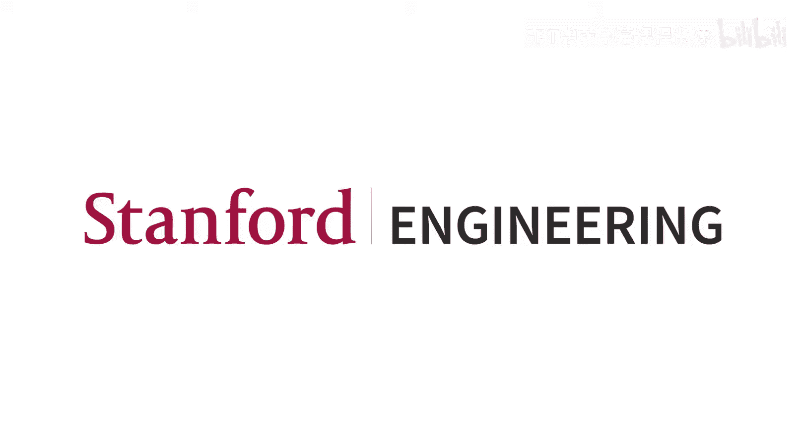
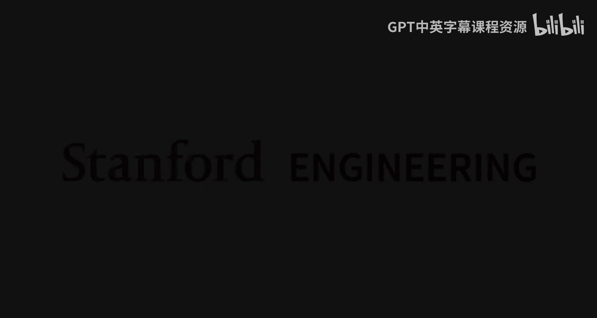

# 斯坦福大学《计算机视觉的深度学习｜CS231n： Deep Learning for Computer Vision 2025》中英字幕 p14 -15-Lecture 14_ Generative Models 2.zh_en -BV1FqazzVE6w_p14-

So last time we were talking about generative models and we started off with some discussion of generative versus discriminative models and recall that these are basically both different flavors of probabilistic models but it depends on what we're trying to predict what we're conditioning on and really critically what we're normalizing over。

 so we talked about discriminative models where you're trying to predict the label Y conditioned on your data X。

 generative models where you're trying to just learn a probability distribution over your data X and conditional generative models where you want to model the data X conditioned on some user input Y or label Y and recall that these differ in that what you're trying to normalize over because probabilitybabilities distributions introduce this normalizing effect where all things that where different kinds of things need to compete for probability mass due to this normalization constraint of probability distributions。

And last time we also went through this taxonomy of different categories of generative models because it turns out this area of generative modeling has been something people have studied for a very long time。

 with a lot of different categories of methods try to solve variants of these problems so we went through this family tree of generative models where we have where last time we talked about these explicit density models where the model outputs measure some quantity that you can some quantity P of x。

 either the exact predicted p of x in the case of tractable density models or some approximate version of P of x in the case of these approximate density models and then in the case of tractable density。

 we saw autoaggressive as a category of model and we saw variation autoencoderrs as an example of something that gives you some approximate density。

So recall that autoaggressive models， what we did is we took our image or more generally whatever kind of data we're working with。

 and we break it up into a sequence， and then for the case of image data。

 we typically treat this as a sequence of pixel values or even subpixel values。

 and we usually want these to be discrete， so you treat those subpixel values as8 bit integers that can each take values0 to 255。

 you string this out into a long into a long sequence of integers。

 and then model this using some discrete autoaggressive sequence model。

 typically an RNN or a transformer。Then we also saw the variation autoencoderrs。

 which were another explicit density model， but now they compute not the exact density。

 but some approximation to the density in particular a lower bound to the density。

 so to do this we jointly train some encoder network。

 which is going to input the data X and output a distribution over latent codes Z and a decoder network which is going to input a latent code Z。

 an output a predicted piece of data X， and we're able to jointly train these two networks。

 the encodeder and the decoder to maximize this variation to maximize this variational lower bound to our likelihood function。

 recall that likelihood， maximum likelihood is one of the key insights upon all generative modeling。

 that often our objective function for training generative models is somehow to maximize the likelihood of the data that we observe that comes from our true data distribution。

So today we're going to continue our discussion of generative models and explore this other half of the family tree。

 these implicit density models， so in implicit density models we are no longer going to get access to some actual density value P of x。

 but these models will sort of implicitly model the probability distribution。

 and even though we can't compute a density value P of x for any piece of data x。

 we will be able to sample from the underlying distribution that these models learn。

 so we'll be able to draw samples from the learned distribution even if we can't output an actual density value。

So the first such model that we'll explore are generative adversarial networks。

 or usually called GANs。And it's useful to contrast GNs with the variation autoencoderrs and autoaggressive models that we've seen so far。

 so like we just said， autoaggressive models our likelihoodbased method。

 their training objective is maximum likelihood so you write down this parameterized function that is your p of x where x is a piece of data and then you maximize this over the data that you observe trying to do maximum likelihood and variational autoencoderrs sort of follow this similar idea where can where we write down this approximation to p of x and then maximize that approximation to p of X and now generative adversarial networks will do something a little bit different they will give up on directly modeling that p of x as we just said。

 but even though they don't explicitly model the p of x or let us get out those density values they will give us some way to sample from the underlying distribution that the model is fitting。

So the setup here is that we'll start by having some finite samples of data Xi。

 which are assumed to be drawn from some true data distribution P data。

 and our goal is we want to be able to draw samples from P data and recall P data is something like the true distribution of the universe this is the distribution that the universe uses to give you samples of your data and this is likely a very complicated distribution。

 it involves physics， it involves history it involves sociopoliical constraints maybe there's a lot of complication that goes into all the stuff happening in the universe that gives rise to the data that you see and somehow we want to model that fits some approximate model that tries to match that true data distribution as well as possible and then allow us to draw new samples from our fitted distribution that look like the original data samples that we observed。

So the way that we're going to do this is by introducing a latent variable Z。

 this looks kind of like the latent variable Z that we saw in variational autoencors where it's going to give where this latent variable Z is going to be distributed according to some known prior distribution P of Z that we will write down and control ourselves and usually this is going to be a unit Gaussian or a uniform distribution but typically a unit Gaussian。

 something very simple that we know how to sample from。

 we know the analytical properties of and now the setup is that we're going to imagine some data generating process that our network is going to model so here we're going to imagine that we sample a z according to our known distribution P of Z to get a sample Z pass that sample Z through a generator network G of Z and then that x is going to be a sample from some generator distribution PG and as we vary the parameters or the architecture or the training of our generator network。

 that is going to induce different kinds of distributions that we sample from。

This PG distribution so the whole goal in GN training is to try to force this PG distribution which is induced by our generator network。

 we want that PG distribution to match the true P data distribution as close as possible and because if they match then we could sample a Z pass it through our generator and now we have now we have a sample of sample piece of data that looks a lot like our P data。

So the picture for this is something like the following。

 and we'll imagine sampling Z from our PZ to get a concrete latent Z。

 pass it through our generator G， and that will give us a generated image。

 so the generator network basically is trained to convert a sample from a known distribution Z into a sample of our data distribution。

But now the question is how can we force these outputs。

 how can we force the induced generator distribution PG。

 how can we force this to match the data distribution P data and the trick in generative adversarial networks is that we're going to introduce another neural network to do that task for us in the previous versions of of generative modeling viaEs and autogressive models we tried to write down some objective function that we could minimize that would force our fit distribution to match the data distribution here we're going to relinquish that control and basically have ask another neural network to solve that task for us so in particular we're going to train another neural network called the discriminator D and this discriminator is going to be tasked with inputting inputting an image。

 sometimes a real image， sometimes a fake image and it's going to classify whether that image was fake or real and then the idea is that these two networks are going to fight we're going to train the generator to try to fool the discriminator and we're going to train the discriminator as a classification model to try。

correctlyectly discriminate or classify between real data and fake data and the intuition is that as these two networks fight。

 then ideally the discriminator will get better， it will get really good。

 the discriminator will get really good at determining features of real data from fake data and once the discriminator gets really good。

 then in order to fool the discriminator into thinking that the generated samples are classified as real the generator data will need to get closer and closer to producing samples that look like true data So that's the kind of intuition between generative adversarial networks。

So the question is does the generator network get feedback from the discriminator on whether it's classifying correctly。

 yes， and that's crucial for this whole process working and the type of feedback it gets is gradients this whole thing。

 this composite system of the generator and the discriminator are just neural networks we know how to compute gradients through those and those communicate through that generated image so we're going to backproagate from the discriminator all the way through the generated image into the generator。

 so that's how the generator is going to learn from the discriminator。And then more concretely。

 we need to write down some actual equations， some actual math that we're going to con use to concretize this intuition。

 So in particular， we're going to jointly train the generator G and and the discriminator D with this minimax game。

 This equation looks maybe a little bit daunting。 So we'll walk through each of the terms one by one。

So here we're going to color code this and say that the generator is going to be in blue。

 the discriminator is going to be in red and the discriminator is going to be a function that inputs a piece of data X and outputs the probability that that data is real。

 so in particular d of x equals zero means that the discriminator has classified that piece of data x as fake D of x equals1 means that the discriminator has classified that piece of data as real。

 of course those are the extreme cases， the discriminator in practice will output some probability that gives you a soft version in between those two decisions。

Now now imagine what happens if we fix the generator G and just imagine this problem from the perspective of the discriminator so then from the perspective of the discriminator。

 there's two terms here one， this says this first term says the discriminator wants d of x equals1 for real data remember d of x equals1 means that the discriminator says that it's real and this expectation basically says we're going to draw data。

 data samples x from the true P data distribution， we're going to pass those through the discriminator and then take a log because we almost always work in log space when working with probabilities and remember log is a monotonic function。

 so maximizing log of x is the same as maximizing x so in this case this is this is saying that we want to maximize log of d of x for real data which is equivalent to saying d of x equals1 for real data Now on the other side this is saying that we're going to draw take an expectation by sampling priors z sorry sampling latency Z according to our no。

Prior P of Z， we're going to take those Zs pass them through the generator。

 which should give us a generated data sample and then pass that generated data sample through the discriminator。

 And now the discriminator wants to classify these as these are fake samples。

 So the discriminator wants to classify these as fake。

 So we need to somehow invert that expression on the left。

 So here we want D of x equals 0 to be fake。 So one way to say that is to maximize log of1 minus d of g of z。

 So this term on the right says the discriminator wants d of x equals 0 for fake data and the term on the left says discriminator wants d of x equals1 for real data。

Okay， so that's what the discriminator is trying to do。

 the discriminator is trying to correctly just do this classification task between samples between generated samples and real samples from our data and try to classify them correctly as real or fake。

Now look at this from the perspective of the generator。

 so imagine fixing the discriminator and looking at this setup up only from the perspective of a generator with a fixed discriminator now in this case。

 this first term doesn't depend on the generator at all。

 because this first term was just about getting the discriminator to correctly classify the real data samples so the generator only cares about this term on the right and intuitively we want the generator to fool the discriminator into thinking that its samples are real so that means that the generator wants d of x equals1 for fake data so the term is the same we draw a sample Z according to P of z。

 pass it through the generator to get a generated sample。

 pass it through the discriminator to get the discriminator's predicted probability on that sample and now recall the generator wants d of x equals1 so rather than maximizing this like we did like the discriminator wanted to instead we're going to try to minimize this from the perspective of the generator。

And that gives us this minimax game so in particular we can abstract away all this math by writing it as some scalar function V as a function of G and D。

 and then we say that the discriminator wants to maximize V。

 the generator wants to minimize V and they are going to fight against each other in that way and then to optimize this we're going to basically run some gradient descent loop taking alternating steps trying to minimize and maximize this with respect to the parameters of the generator and discriminator so loop well true forever。

 then update D according to take a gradient descent step derivative of v with respect to D and then step plus that gradient because remember discriminator is trying to maximize this so we want to do gradient ascent to try to maximize this term and then after we make an update on the discriminator weights。

 then we make an update on the generator weights by taking derivative of that V with respect to the generator weights G and now take a gradient descent step on V because。

Generator wants to minimize that objective。So that's our training that's basically the way that we train generative adversarial networks。

 we've got this this thing V， which is the value of our minimax game。

 and we're going to take alternating gradient asscent and gradient descent weights on that objective V in like alterly alternatingly update the generator and discriminator。

And one thing that's really important to realize when we're training generative adversarial networks is that this V is not a loss function that means there is no like the absolute value of V basically does not tell us anything about how well the generator and discriminator of solving this problem or how well or really the thing we care about is how well is that induced PG distribution matching the data distribution and just looking at the value of V doesn't really tell us anything about that because the value of V sort of depends on how good the discriminator is if the discriminator is really bad then it's really easy for the generator to fool this and get get good numbers or if the discriminator is really good then the generator has to be really good so there can be sort of different settings of D and V D and G that will lead to the exact same value for V and that means that generative adversarial networks are often really hard to train and even hard to tell when they are doing a good job at training normally when you train neural networks you have a loss you try to minimize the loss with respect to the parameters of your network and you want to see that loss go。

down over the course of training， but you don't have that with generative adversarial networks。

 you have the generator loss， you have the discriminator loss， you can try to plot them。

 but in general they're pretty meaningless so with generative adversarial networks。

 they're really hard to train one I think one this objective is sort of fundamentally unstable。

 You're sort of trying to do jointly maximize and minimize the same quantity with respect to different parts。

 different sets of parameters of the network。 So that's kind of inherently a difficult optimization problem and then even worse。

 you don't have any value to look at to tell whether or not you're making progress towards a good solution。

 So generative adversarial networks they're pretty effective。

 but they're really hard to train and really hard to tune and really hard to make progress on。

So that's sort of the main takeaway for aversarial networks。 You know。

 there is one little trick that is kind of useful to think about for when training GNs is that just to kind of imagine the training dynamics of these things。

 So at the very start imagine at the very beginning of training。

 your generator is randomly initialize your discriminator is randomly initialized what's going to happen Well at the very start of training。

 then your generator is producing completely random noise that completely random noise is going to look very different from real images So at the very beginning of training when the generator is terrible then the discriminator has a very easy problem。

 So typically within a couple iterations the discriminator can like really immediately pick up between real images and these totally garbage random fake images that that the random generator is given you So that means that at the very start of training the generator the discriminator is quickly going learn to classify real and fake pretty quickly with pretty high probability So then it's interesting to plot what is D of G of Z sorry。

what is this term as a function of d of G of Z because that's the loss function that's basically the loss function from the perspective of the generator so then from the perspective of the generator we kind of at the beginning of training are somewhere all the way over here so the discriminator is doing a really good job at treating generated samples as fake classifying them as fake at the beginning of training which means that from the discriminator's perspective it's trying to optimize a loss function that looks something like this and if you'll notice something this loss function is flat or very close to flat at the place where the generator is trying to optimize its parameters so this means that in practice when you use this naive objective for trainingganNs。

 then the generator has a really hard time learning at the beginning of training。Oh。

 good question is how do you assemble the data， Like how do we generate a photo of a unicorn if no unicorn exists。

 So so this P that's kind of your choice of P data。

 right So whatever data set you happen to assemble from your training set， that's you choosing。

 what is the P data that you're trying to model。 So in general。

 if you want to generate a sample of a thing that looks nothing like anything that you've ever seen before。

 you're out of luck。 It's not gonna happen。 So the only way that you're generally going to draw samples is if you have something in your training data that looks kind of like that。

So these networks do like all generative models and all neural networks really do generalize a little bit right so then the hope is that you maybe you've never seen a photorealistic image of a unicorn wearing a Santa Claus hat。

 but you've seen photorealistic images of horses， you've seen photorealistic images of Santa Claus hats。

 you've seen drawings of unicorns， you've seen drawings of horses and somehow you've got enough stuff even though you've never seen the exact composition of attributes that you want to generate。

 you've seen enough stuff that's close enough to it that the model can generalize and give you something new and that's always the hope here。

What does this look like from the discriminator's perspective So then like well。

 then if I generated this image of a photorealistic unicorn wearing a Santa Claus hat。

 then maybe all the textures are really perfect， like the lighting is perfect。

 the shadows are perfect。 the leaves are perfect。 So there's no evidence in in that sample itself to say that this is obviously wrong。

 Maybe the discriminator was really， really smart and the discriminator could somehow know that unicorns don't really exist and having a perfectly photorealistic image of them isn't likely to happen。

 but's that's a pretty hard semantic problem to solve。

 So in practice generator discriminators tend not to really be that smart。😊，Yeah。

 good good question cost the idea is why don't we look at two curves。

 why don't we look at one curves saying how good the discriminator is。

 why don't we look at one curve saying how low good the generator is， feel free to plot them。

 they tend to look really useless and there's probably literally hundreds of research papers of people trying to solve this problem and figure out how do we tweak the GAN objective。

 how do we not use a log， how do we use a War sign something。

 something something like put all kinds of crazy stuff into this to make those curves more interpretable。

 hundreds of papers written about it， like five years thousands of people's time I don't think anybody came up with a good solution so still even after like hundreds。

 thousands of papers trainingganNs that they ended up a lot of people still end up using this vanilla formulation which tends not to give you very interpretable curves even when you split it up that way。

The question is is it really is what happens to the discriminator early in training really important and the answer is no because this is unlike any other classification problem we've ever seen before because this is a nonstationary distribution when you train an image classifier on imageNe or CFFR or something like that。

 the data is fixed and the model is just trying to classify that static data well but in the case of GAN training。

 the data that it's trying to fit is changing under it during the course of training because even at the beginning of training。

 maybe the generated images look really bad， it's easy to solve the problem。

 but then the generator gets better and now the data that the discriminator is trying to discriminate changes under it during the course of training so that means that it's a nonstationary problem and with the very complicated learning dynamics？

Yeah， good question。 Can you does be these get caught in local minima Are the way to kick them out of localminma。

 train for a while， kick them out。 I think， again， hundreds of papers， thousands of papers。

 lots of heuristics， nothing really stuck。Correct， so you have to you have to train this end to end。

 So gradients from the discriminator always propagate into the generator。

 if you did like so in particular， through this term on the right。

 So the only way that you're ever getting gradients onto the generator's parameters is actually through the discriminator。

 I mean， unless you have some regularizer in here。 But there's no auxiliary term that's telling the generator what to do other than the gradients that gets through the discriminator。

 And that's again， leading to part of the unstable learning problem。Correct， so P data distribution。

 that's going to stay fixed over the course of training。All right。

 so we said you know there's this problem that the generator gets low gradients at the course of training。

 there's a little hack here where rather minimize rather than trying to maximize log of1 minus d of g of z。

 you can instead minimize minus log of d of G of Z instead you can convince yourself offline that those are roughly equivalent but the TLDR is then it gives you a better curve for the generator to get better gradients at the start of training so that's really important and whenever you're trainingganNs from scratch using this sort of log objective then this trick to use the modified loss for the generator is really important in practice so that means that there actually is a one V that you're computing for the generator。

 one V that a different V that you're computing for the discriminator and they aren't quite the same。

Okay， there's another question of why might this be a good objective and I used to have slides that walk through this proof step by step。

 but I don't think we have time for that today， so I'll just give you the TLDR and we can refer you to something offline to check but the TLDR is that this objective is good because you can write down this optimal discriminator so you this is a nested optimizationization problem where there's an inner maximization over D and outer minimization over G So if you do a little bit of math。

 you can actually solve this inner maximization problem and write down what is the optimal what is the optimal。

Discriminator， this should actually be this is the optimal discriminator with respect to a particular generator G。

 And you can just write this down。 Of course， even though you can write it down。

 you can never compute it because it depends on P data And you can never compute P data because if you had access to the P data density。

 you'd be done， so you can write this down as an equation on a slide or on a piece of paper。

 but you can never compute it。And then once you have this inner objective。

 once you have sort of maximized this inner objective by writing down the optimal discriminator。

 then you can show that the outer objective is minimized if and only if Pg of x is equal to P data so at least theoretically kind of the optimum state of both the discriminator and the generator actually occurs uniquely when PG is equal to P data so that kind of makes us feel good。

 but there's a lot of caveats to that theoretical result。

 the one is that they both assume of infinite potential capacity for G and D that those both assume that your generator and discriminator can in principle represent any function。

 which of course they can't because they are neural networks of a fixed size and capacity this also tells us absolutely nothing about whether or not we will converge to this solution so even though there is this optimum point in this objective landscape。

 this tells us absolutely nothing about whether we can ever reach there via this gradient descent gradient ascent especially with a finite number of data。

So theres this those some sort of comforting theoretical results that there is some theoretical justification to Gans。

 But in practice， this doesn't really hold or give us very strong guarantees。So these GNs。

 you in practice， your generator G and your discriminator D both are going to be parameterized as neural networks and they used to be CNNNs。

 the GNs kind of fell out of favor before VITs became popular but I'm sure they would work with VITs as well and the first GN that really gave nontrivial results was called DC GAN that had this five- layer Comnet architecture which gave these what at the time pretty exciting samples and I mentioned DCganAN because the first author Alec Raford at all。

 for most people doing DCganAN would have been a highlight of their career but for Alec Raford it wasn't nearly enough for him because the next project he worked on right after DC GAan does anybody know。

G GT so Alec Raford， you know DC began was kind of a low light in his career。

 he went on to do GT1 and G2， as well as some other amazing work at Open AI。

 so I think there's this really cool connection between people that were working on generative modeling of images。

 actually jumped over to do generative modeling of discrete text data and did some of the really important work there。

And one of the only other GAN paper that I'm going to highlight is calledStyle GAN。

 I'm not really going to walk you through the details of this one other than to kind of point you at it as like a good one to read if you want to know kind of the best practices of GANs。

 they use a much more complicated architecture， but they get pretty good results in practice。

And one really nice thing aboutganNs is that they actually tend to learn something smooth in the latent space。

 so what I mean that is that if we have two latent vectors Z0 and z1 and we interpolate between them。

 that is you like draw a sample Z0 from your Gaussian。

 you draw a sample Z1 from your Gaussian then you interpolate some kind of curve between Z0 and Z1 and for every point along the curve。

 we're going to generate a sample using our generator then if we do that we tend to get smooth interpolations to this latent space which is something really cool withganNs and here's an example of this latent space interpolation from the stylegan3 paper so you can see that these are all generated samples by smoothly varying that latent Z and then passing it through the generator to generate these different samples and you can see that these animals sort of smoothly morphed into each other so that means that the model has somehow uncovered some useful structure and stuffed it into the latent space。

So that's pretty cool。So I used to talk a lot more about generative adversarial networks。

 So the pros is basically they have a really fairly simple formulation and if you tune them right like we saw with style G3。

 then they can actually give you very nice results very beautiful images， very high resolution。

 very good stuff but the cons like one like we talked about they're fairly unstable to train。

 you have no loss curve to look at， you have very unstable training。

 they tend to blow up at the drop of a hat so you end up with mode what's called mode collapse all of a sudden you might get Nans。

 you might get ins， your generator your discriminator starts going crazy。

 your generator starts producing complete random garbage all the time。

 you have no loss curves to look at to tell to diagnose this they're kind of a mess。

 So even though that GNs can give you really nice results if you very。

 very carefully tune them and very， very carefully control the normalization。

 the sampling everything about them。 they have been in practice。

 they've been fairly hard to scale up to really big models to really big data So GNs were basically the goto category of。

Generative models from around 2016 to maybe around 2020， 2021。

 something around there and in that five years， there were like literally thousands and thousands of papers。

 people both trying to use different GAN formulations， different loss functions。

 different mathematical formalisms as well as applying GANs to all kinds of different generative modeling tasks that you can imagine。

 So like this was basically the goto generative modeling framework for about five or six years。😡。

Question is， would we just expect this， shouldn't we just expect these smooth lants to pop out？

 I think not necessarily， because one thing that can happen with GNs is the generator might just memorize a fixed number of data samples So what if your generator ignores the latent Z and just memorizes 10 samples from the training dataset somehow。

 And then no matter what Z you give it， it always gives you one of those 10 samples from the training dataset and it never gives you anything else。

 then in that case you're gonna to fool the discriminator because the generator is always given you something which is maybe bitwise identical to one of your real samples。

 And then in that case， the generator would have basically piled on sort of durac delta density like in the immediate vicinity of a couple finite samples。

 but put no probability mass anywhere else。 So that actually is kind of a legitimate solution for the generator。

 And that would definitely not give you smooth lants at all。

 So that's just one example of how these things can collapse into unintuitive solutions that are not what you want。

Oh， good question。 What is the relationship between your training dataset and your latetntance So this is actually something very fundamental about GNs is' a great question so you can map one way so the generator gives you a mapping from latent space into data space maps from Z to an x but with GNs in general have no way to map back from an x to a Z and that's something very different between GNs and VaEs。

 So VaEes will learn an explicit mapping from x back to Z but with GNs you have no such thing you can you can try to compute an inverse analytical numerically via gradient ascent there's papers that do that but there's actually like no explicitly enforce relationship between X and Z instead you can think of the distributionriminator is trying to just enforce a distributional alignment between the distribution of all the outputs coming from the generator and the distribution of all the data samples without any kind of explicit supervision between them Of course when it comes to GNs anything you probably think about there's probably at least like a dozen papers about So there's also a lot of papers about GN variants that try to learn bidirectional。

apping is both ways， but those never really took off。

Oh good question what have we gained so when we went to VAEs we gained latent vectors but we gave up density and now with GNs it seems like we gave up latent vectors that we can control what you gained was much better samples so when it comes to VAEs like VAEs tend not to give you very good samples VAEs are sort of characteristically always kind of blurry。

 they never really look good， VAEs on their own just never tend to give you very clean crisp samples。

 but with GNs， some of as you saw with some of the examples you can get very crisp， very clean。

 very good samples。But what you lost was the ability was like your sanity in trying to tune these systems。

Yeah， at inference time， you throw away the discriminator and just do the generator。

 so at inference you'll just draw a sample Z from the prior， pass through the generator。

 get your sample from your data， so it's very， very efficient at inference time。

All right so I mentioned thatganNs used to be the goto category of generative modeling for about five or six years so what displaced them and what displaced them was a very different category of models called diffusion models Now I need to put some caveats here diffusion model literature is crazy right like you read these papers they go through like five pages of math before they tell you at all what's going on and there's like three different mathematical formalisms that lead to diffusion models that are all very different mathematically and there's very different notation。

 very different terminology， very different mathematical formalisms between papers so like this is a sub areaa that's crazy so I need to put a big caveat here that I'm not going to cover fully all the different variants of diffusion models with all of their proper mathematical formalism instead what I'm going to try to do is give you an intuitive overview of diffusion models as well as an intuitive geometric understanding of the most common form of diffusion models today which are called rectified flow models and you could teach many。

Many lectures about diffusion models and get into all the interesting mathematical nuance of all these flavors。

 but we just won't have time for that in two/ thirds of one lecture， unfortunately。

So with that caveat aside the intuition behind diffusion models is actually kind of easy。

 so you like with all generative models， we want to draw samples and kind of likeganNs。

 we want to convert samples from a noise distribution Z into a data distribution PX but the way that we're going to do that in diffusion models is totally different GNs learn this deterministic mapping through the generator to map a Z directly to an x with a diffusion model we're going to do something more implicit。

 more indirect So what we're going to do first off。

 the first constraint in diffusion models is that the Z。

 the noise distribution the noise always has to have to have the same shape as our data right So if you have an image that's like H by w by 3 then your noise distribution always has to be H by w by3 as well。

 they have to be exactly the same shape。Now what we're going to do is consider different versions of our data that are corrupted by increasing levels of noise。

 so here if we have a data sample， which is this picture of a cat。

 under the t equals and then t is going to be our noise level， which is ranges from0 to 1。

So if t equals0 that means no noise， that means a totally clean data sample T equals 0。

3 is a little bit of noise， we add some of our noise Z into we mix some of our noise Z into our data X and if we go all the way to t equals1 we get full noise and those are going to be samples directly from our noise distribution so somehow this t parameter is going to interpolate smoothly between our data distribution and our noise distribution and the noise distribution again is going to be Gaussian almost always Gausian。

 something simple that we understand and can sample from。

And now what we're going to do is train a neural network to do a little bit of incremental denoising。

 so the neural network is going to receive some sample which is a piece of data which has been corrupted with some intermediate amount of noise and now the neural network is going to be trained to try to clean it up a little bit。

 remove just a little bit of the noise， so the training objective here is going to be neural network inputs an image of with some amount of noise and it tries to remove some of the noise。

Then at inference time， what we're going to do is do an iterative procedure where we first draw a noise sample directly from our noise distribution Pz and then iteratively apply the neural network to remove noise from that sample one at a time so you know the very first time we do this we're going to draw a complete sample that's complete noise and then the very first application of the neural network。

 the network will be trying to remove noise from full noise so it'll basically be forced to hallucinate just a tiny whiff of data structure in that noise and then once we get to some like slightly less noisy example。

 we're going to pass it back to the neural network and again ask it to remove just a little bit of noise from this now slightly slightly de-noise。

 slightly generated image and then it'll get a little bit less noisy and it'll get a little bit less noisy and it'll get little bit less noisy and eventually if we set up all of this stuff correctly then we want to get to a situation where we can draw a complete noise sample and then ask the network to remove noise from that complete sample Z of complete random noise until eventually。

We've removed all the noise and come up with a generated sample from the system。

So that's kind of a weird setting， it's kind of a weird thing。

 but that's kind of the intuition behind diffusion models。

As the number of steps of fixed hyperparameter， it depends。

 So on this slide I've intentionally been I was sort of forced to be very vague about all these things。

 What is the noise， What does it mean to corrupt the data with respect to the noise。

 What does it mean to remove a little bit of the noise。

 What does it mean to apply it iteratively at inference， because like I said。

 there's so many different formalisms of diffusion。

 There's a lot of different variances about exactly what these mean in different situations。

 So this slide is intended to be a fairly high level overview of diffusion。

 and then different specific implementations of diffusion models will have different concrete choices for what all these terms specifically mean。

So does this high level picture of diffusion kind of make sense so then let's make this more concrete So now now we're gonna jump from you know general diffusion models to a particular category of diffusion models called rectified flow models Some people may argue with me and say that rectified flow is not diffusion they might be some people might say that they're different things。

 I don't really care to me rectified flow is a kind of diffusion model fight me So with rectified flow the intuition is basically this know we have this same thing。

 we have our p noise， we have our P data and we're gonna to draw this geometrically because I think that's a nice nice way to gain intuition geometrically in two dimensions in particular because that's all that fits on the slide but of course these are going to be super super high- dimensionmensal images and Gaussians which is an easy way to get let astray because you know that intuitions that hold in two and three dimensions go like totally out the window when you go into a lot of dimensions。

 It's really sad it's sort of sad that we live in such a lowdial universe because our intuitions that we build in this universe just don't really transfer to like0 dimensional。

SpThat was a dimensional spaces。 So always be aware， but it is what it is。

 We're stuck with the universe we got。So you know the setup in rectified flow is that we've got you know our distribution P noise。

 our distribution P data， P noise is something simple that we understand we can sample from。

 we can compute integrals of， it's a very friendly distribution。

 P data again is something crazy that's what the universe is using to give us images。

Now at every training iteration， we're going to sample AZ from our prior distribution and sample an X from our data distribution。

 you know we can draw a sample analytically because PZ is something simple that we control and drawing a sample from the data distribution just means picking an example from your finite training set。

Now we and you're also going to choose a T to be uniform on 0 to 1。 Remember。

 T is our noise level where t equals 0 means no noise。 T equals 1， means all the noise。

So now now we're going to draw a line that points from our data sample X directly to our noise sample Z and this line。

 this vector pointing from x to z is we're going to call it V。

 this is going to be the velocity of a flow field and then we set Xt to be a point along this line which is a linear interpolation between X and Z so now we' we've got our noise sample Z。

 our data sample X， we've got the velocity vector between them V and we've picked a noisy a noise version of our data X T and this is in the previous slide when we said get noisy data。

 this is what that means in the case of rectified flow models it's a linear interpolation between a data sample and a noise sample。

And now the training objective is very， very simple。

 So now we're going to train a neural network F theta。

 so that's f with learnable parameters theta that neural network is going to input the noisy sample Xt as well as the noise level t and it's going to try to predict the green vector V。

 So that's it。 that's all we need to do in rectified flow the code for this is very simple you would be shocked like how much obscurity there is when you read papers here and it boils down to this very simple code drives me crazy that this is not made more clear in a lot of presentations of this so then the training loop for rectified flow is extremely simple you loop over your data in every iteration you get Z。

 which unit which is unit Gaussian of the same shape as X you choose a noise level t which is uniform zero to1 you compute Xt which is a linear interpolation between x and Z you give xt and t to your model and then your loss is just the mean squared error between this ground truth V and the model prediction and that's it that's your training objective for rec。

F models contrasttrat this with GNs when you train rectified flow models or really any kind of diffusion model。

 you have a loss that you can look at during training when the loss goes down。

 the model is generally better。 So like for those of us that went through half a decade of GA madness the first time you train a diffusion model and like there's a loss to look at it's like oh my god this is an amazing thing like how many hours have we spent looking at G plots and they look like this and you have no idea like reading tea leaves to tell whether or not the model is working well you train a diffusion model。

 you get this beautiful smooth exponential loss curve and it just makes you so happy So that's great。

😊，So then that's training for diffusion models。Now what do we do at inference right because GNs are kind of easy at inference。

 GNs， you just have to take a Z pass it through your generator。

 you get a data sample very straightforward， but now with a diffusion model or rectified flow model in this case。

 the model output itself is like kind of useless like we get this XT we get a V like what are we going to do with this not super clear so then at inference time is where diffusion models get a little bit more complicated compared to compared to GANs。

So you know at inference， we first will upfront choose a number of steps t which is usually a fixed constant and in the case of rectified flow models t equals 50 is usually a good number to start with sometimes you can get down to t equals 30 and that works okay then what you're going to do is sample an X directly from your noise distribution this is going to be pure noise that's sampled from your known noise distribution。

Then you're going to evaluate then you're going to loop from t equals1。

 you're going a march backwards to t equals0。 This is your noise level。 And in this case。

 in this simple version， we're just sort of marching linearly from full noise1 back to noise zero perfectly clean then at the first iteration we're going to take our Xt that was at first full noise pass it to the network along with the current noise level and get the network's predicted Vt。

 And remember what this Vt is supposed to be in the case of rectified flow。 This V。

 remember it was supposed to point from data sample all the way to a noise sample。

 So then it's kind of geometrically obvious what you should do in the case of rectified flow。

 You should take a little step along that predicted V vector right because the problem is this rectified flow model。

 it's not that V is not going to point you all the way to a clean sample It's just going to get you started。

 It's going to set you on a trajectory towards a clean sample So we take a little step along that predicted V from the flow model to get a new x2 which is now a version。

Of the data that has had a little bit of the noise removed from it by the model。

 And now we iterate this。 So once we have this x two thirds。

 then we pass it back to the model and get another predicted V vector from the model。 And remember。

 the V is supposed to point from clean data from a clean sample all the way to a noise sample。

 So then again， we can take a gradient step， take a little step along this predicted V to get another x1t repeat this thing again。

 evaluate the model again to get another predicted V and then take a step in this case all the way to no noise all the way to the end of that vector to get our predicted x0。

😊，And then that is our sample from our diffusion model。

 So you know then the inference procedure you see here got a little bit more complicated compared to GNs。

 but what we gained here was sanity when you're training。

 you've regained that and they tend to give you much better samples and they tend to scale really well to large data sets and large models。

And the code here is really simple right， so we start off by taking a random sample。

 make it be perfectly random， then march backwards for t from 1 back to zero at every noise level you get a predicted V from the model。

 given your current sample as well as your T， then you take what looks kind of like a gradient descent step on the model's predicted V and update the sample and just repeat this whole thing in a loop。

So then you can see like these diffusion models aren't so scary after all。

 you can actually fit a complete implementation of training and sampling from a rectified flow model in just a couple lines on one slide。

 which I think is very nice。Okay so you might be asked so this is pretty nice I'm pretty happy that we're able to get to a full and this will actually work right like if you take this code。

 you plug it in， like you plug it in a reasonable model architecture like this will actually this will actually work like this will actually convert to something kind of reasonable in a lot of cases you're kind of hitting on the core problem in generative modeling that I've been thinking about a lot the last couple days while reviewing these slides the core problem in generative modeling is somehow you have a prior distribution which is z's that you know how to sample from you have a data distribution which is x's that you want to generate and kind of the core problem in generative modeling is figuring out how to associate z's and x's and all your different categories to generative modeling kind of do it in different ways in a VAE you say I'm going have the model predict a Z and then predict in x and then try to force that Z to be something I know how to sample from which doesn't super work that well and again you're not supervising that relationship like the generator is kind of figuring out its own mapping from Z to X in a feed forward way through this distributional matching objective that the discriminator is giving it。

In diffusion， it's kind of figuring out by what end it ends up having to integrate these curves ands there's a lot of different actually like several different mathematical formalisms as to y objectives that look like this end up matching probability distributions in a reasonable way but again。

 like the whole core problem is that we have no way ahead of time get to pair up samples Z from our prior with samples X from our data if we knew how to make that pairing and also knew how to sample from the prior like that would be that you'd be done and in some sense all these different forms of generative modeling are different ways to square that circle and come up with a way to learn an association from Z to X。

 even though we don't and be able to sample from Z。

 even though we don't have that association at training time。

There's a lot of different interpretations of this that can get very， very heavy， very quick。

 so I've tried to avoid them。Right so but we said a couple we said last lecture that unconditional generative modeling is kind kind of pointless。

 so what we almost always care about is conditional generative modeling。

 and that's easy to accommodate in rectified flow So we can do to do conditional rectified flow we kind of imagine that there's different subparts of our data distribution here I'm saying it's categorical maybe our data is actually squares and triangles and then we have our whole data distribution。

 P data as well as our two sort of subdibuts， P data X given that y is a square and P P data X given that y is the label Y is a triangle So this is kind of the picture you should have in mind when you think about conditional generative modeling。

Then in the case of rectified flow， this is very easy to accommodate so you just sort of your data set now has pairs X and y and your model now takes y as an additional auxiliary input somehow。

 and then during sampling the same thing you get your predicted vs according and you get your predicted Vs the model takes as input this extra y and you use that so this all kind of goes through the difference is that now y is actually hopefully some conditional signal that the user can control。

 maybe this is a text prompt， maybe this is an input image。

 maybe this is some kind of user input that you're expecting at inference time which actually make these models controllable and useful in practice。

But then there's another really interesting question is is there any knob you can tune to control how much the model pays attention to the conditioning signal right it turns out if you train these things naively。

 a lot of times they don't often follow the conditioning signal quite as much as you would like so there's a trick called classifierfr guidance or CFG that changes this a little that changes our diffusion training loop just a little bit so what we're going to do is we're still going to train this conditional diffusion model that inputs your Xt inputs your y but we're on every training on every training iteration we're going to flip a coin and if that coin is heads we're going to delete the conditioning information so we're going to set it equal to some kind of zero value or null value basically destroy the conditioning information 50% of the time that could be a hyperparameter but 50 is a pretty good one that most people use in practice so we're going to flip a coin if the coin is heads delete the conditioning information so that means that the model is conceptually now forced to learn two different kinds of velocity vectors。

Right。Right， so then the model is sort of forced to learn two different kinds of velocity vectors right so in the case where we pass it this null value for y that has destroyed the conditioning information。

 then this is basically an unconditional generative model now now that predicted velocity of vector V is sort of has to point back towards the meat of the whole data distribution P data。

But when we pass a real conditioning input y that's destroyedtro， non null， non-zero。

 then we're getting sort of a conditional velocity vector that is pointing us back towards not the full data distribution。

 but towards the conditional data distribution， which is conditional on that conditioning signal that we cared about。

And then the dumb trick is we're going to take a linear combination of these two vectors to kind of push it more more towards the conditional velocity vector so in particular we'll have a scalar hyperparmeter or w and take a linear combination 1 plus w times Vy minus w times V v null so that's going to be a vector that now kind of points points even more towards the conditional distribution than it does the data distribution and then the idea is that during sampling we're now going during sampling。

 we're now going to step according to this V CFfG vector rather than the raw vector is predicted by the model and then setting w equals1 setting w equals0 here will' recover exactly the conditional one and the higher your w is then the more you're overemphasizing the conditioning signal。

So this and then this is pretty easy to implement right so then your inference code doesn't really change too much but now you evaluate the model twice at every iteration to get your VY and your V0。

 and then you take this linear combination and then step according to that。

And this is called classifier free because of a stupid reason there was an earlier paper called Classifier guidance that I don't want to get into。

 and then they removed the classifier。 and even though there was only like nine months between those two papers and it's now been four years since the second one。

 we're still stuck with the name classifier free guidance。 so it is what it is。Okay。

 so that's actually really important in practice for getting high quality outputs and that's CFG that's really important that's used everywhere in diffusion models it does double the cost of sampling though because now you need to hit the model twice on every iteration。

 which is kind of a problem。Okay， there's this thing on optimal prediction。 I think I'll skip that。

 That's not so interesting。 I mean， it is interesting， but we're writing on it。

 but I'm worried about time。 So but one thing that we sometimes need to do is tweak this this t distribution。

 So we saw in particular that we were sampling t， according to a uniform distribution in raw in like a raw rectified flow model。

 And the thing about that is that kind of is going to put uniform emphasis on all noise levels and intuitively when you're at full noise。

 the problem is very easy when you're at when you're at full noise， the problem is very easy。

 then the model like the optimal prediction from the model is basically to point towards the mean of the data distribution。

 And similarly， when you're at zero noise， then the optimal prediction is actually to point towards the mean of the noise distribution。

 So actually the model the optimal prediction from the model at full noise and full data and no noise are actually very relatively easy problems。

 it just needs to learn the mean of those two distributions。😊。

But when you're somewhere in the middle， it's actually really really hard because when you're somewhere in the middle and you sample that Xt。

 there might have been multiple pairs X and Z that could have given rise to that same Xt in the middle and then the network basically needs to solve this expectation problem and figure out what is that optimal direction to predict that kind of integrates over all possible x's and Z's that might intersect at this point X T so somehow those points in the middle are intuitively much harder for the network to solve。

So but when we sample uniformly from0 to 1 t then we're kind of putting equal importance on all levels of noise which doesn't really match this intuition so in practice you'll often sample from different noise schedules and one very popular one is this one called logic normal sampling which basically looks kind of like a Gaussian puts relatively little weight on the zero and the one with a lot more weight in the middle another thing you'll see sometimes are these so-calledshift noise schedules that are asymmetric that shift more towards one direction or the other and those are important as we scale to high resolution data the intuition being that when you have a very high resolution image then there can be very strong correlations across neighboring pixels when you have a low resolution image then the correlations across neighboring pixels tend to be smaller so depending on how strong of correlations you have in your data you actually may need different amounts of noise level to properly destroy information in a nice way so these things don't naively scale to different resolutions。

And that's actually a big problem with these diffusion models is that they're a beautiful formulation。

 but they're hard to get them to work naively on high resolution data。😊。

So that leads to actually you know I said diffusion models are the most popular form of generative modeling that was a little bit of a lie because what's actually most popular are these so-called latent diffusion models。

 which is a variant that actually gets used everywhere so here it's going to be a multistage procedure so what we're going to do is first train an encoder network and a decoder network the encoder network is going to map from our image into some latent space which I've colored in purple and ideally that that latent is going to spatially downsample the image by a factor of D as well as convert from three channels up into C channels and a pretty common setting is to get8 by8 spatial downsling and to increase to 16 channels that's kind of one some of these most common encoder decoders these encoder decoders tend to be cs with tension but some more recent papers have explored VITs for these。

Then what we do is we're going to train a diffusion model not on the raw pixel space of our images。

 but instead on the latent space which is discovered by this encoder decoder model。

 so then the training procedure kind of looks like for training the diffusion model。

 we're going to sample an image， pass it through the encoder that we learned in the first stage to get a latent and then add noise to the latent and train the diffusion model to denoise the noise latent。

 and really importantly you freeze the encoder so you do not propagate bit gradients back into the encoder。

 we're only using it to extract these latents and then training a diusion model directly on the latent space which is learned by the encoder。

Then at inference time， once you're all done training， then it will'll sample a random latent。

 pass it through the diffusion model many， many times to remove all the noise to get a clean sample。

 but that clean sample is now a clean sample in latent space。

 so then we need to run the decoder to convert that clean latent into a clean image。

 and this is actually the most common form of most diffusion models these days。

So you might be asking， okay， we've unlock this diffusion model， this encoder decoder。

 how do we train an encoder decoder， any ideas？Have we seen encoder decoders？

How about a variation autoender。 So in practice， whenever you're training these latent diffusion models。

 this encoder decoder tends to be a variational autoencoder。

 But we just said there was a big problem with variational autoenders is that they give you blurry outputs right And if youre this encodeder decoder is going to give you blurry outputs。

 the quality of the reconstructions you get out of the decoder is going to bottleneck the quality of the generations you get out of the downstream diffusion model。

 So if your encoder decoder is giving you blurry ugly reconstructions， that's not going to fly。

 That's not going to get us good clean samples。 So anyone have an idea for cleaning up the sample quality of a VE。

😊，Butut something after the decoder in particular， we can again， make it again。

So what we tend to do is actually train this encoder that encodes from an image into latent space。

 a decoder that goes from latent space back to image。

 a discriminator that tries to tell the fake images from the real images and then a diffusion model that generates these things in latent space so this is basically why we have to walk through all of these different formulations of diffusion models of generative models in order for you to understand the modern pipeline like basically the state of the art in generative modeling is is it a VAE is it a again is it a diffusion。

 it's all of them is all of them the modern the modern generative modeling pipeline involves training of VAE and againN and a diffusion model I'm sorry it's a mess。

Okay， so then you might ask what， what， what do the neural networks actually look like under the hood here。

So thankfully there is some sanity here the last couple of years so relatively it turns out that relatively straightforward transformers actually can be applied to these diffusion models and they work really well these are typically called diffusion transformers or DITs but basically these are just standard diffusion models standard transformer blocks that really don't really have much special sauce in them there's a couple questions the kind of main question you needed to solve in the architectural side is how do you conject the conditioning information and in particular the diffusion model now needs to take like three things as input。

 it needs to take your noisy image it needs to take your timestamp T it also needs to take your conditioning signal which might be like your text or something like that and then you have a couple different mechanisms for injecting that conditioning signal into into your transformer blocks so the first is to predict a scale and shift that are going to be used to modulate some of the intermediate activations of your diffusion block and that's typically the way they'll be inject the timestamp information into diffusion models Another thing you can do is transformers are just models。

sequenceequs so you can jam everything into the sequence。

 you can jam the timestamp into the sequence， you can jam your text into the sequence。

 you can jam whatever you want into the sequence and have the transformer just model that sequence of data altogether and you can do that either via cross attention or joint attention and different models sort of do both and typically we're going to typically in modern diffusion DITs we inject the timestamp through this scale shift mechanism and you inject the text or other conditioning signal through sequence concatenation usually cross attention but sometimes joint attention as well。

So then how can you actually apply this to different problems So one task that people care about a lot is the task of text image generation So here we're gonna input a text prompt。

 This is one that I wrote yesterday， a professional documentary photograph of a monkey shaking hands with a tiger in front of the Eiffel tower Monkey is wearing a hat made at a bananas。

 Tigerger is standing on two legs and wearing a suit and this is this is a real sample like is crazy that the stuff works now but I'm sure you've all seen these kind of things before and the way that this works is you'll take your text prompt pass it through usually a pretrained text encoder right so actually I lied like there's actually more models you have to train in addition to an encoder and a decoder and a VaE and a discriminator you also need to train a language model secretly to get these things to work so you'll actually typically pick up a pretrained text encoder usually t5 clip。

 something like that to give text embeddings and usually the text encoder will've frozen then those text embeddings you pass your text embeddings together with your noisy latnts into your diffusion transformer that also gets your diffusion time step that's going output clean latnts and this thing will kind go iteratively and that'll go through your。

Your VAE decoder to give you your final image。And just to put some numbers on this to make it concrete。

 one pretty powerful open source model right now is called flux1 dev， they use the T5 and C encoders。

 their encoder uses 8X down sampling， they train a 12 billion parameter transformer model on this。

 and that transformer has an additional layer of downs on top of the VAE which is kind of messy。

 so it ends up having a sequenced length of 1024 image tokens。

Another task that people care about a lot is text to video so we can input a text prompt and then output the pixels of a video that follow that text prompt and the pipeline basically looks kind of the same so you're going to input a text through your pre-trained text encoder get noisy latnts  importantly the only difference is that your latents are now have an extra dimension to accommodate the time so in addition to two spatial dimensions HW you'll also have a time dimension in your latent and that will give you clean latnts and then your decoder this is typically going to be a spatial temporal autoencor now so it will downs samplele both spatially and temporally so then it will take your latnt and then ups sampleample them into pixels which will give you a video and is actually this is actually a generated video from metata's moviegen paper that came out in last year。

Okay and that's that's putting some particular numbers on this thing and the key takeaway of these video generation models is that they get very expensive to train due to the sequence length because if you want to generate high FPS high resolution high frame rate video it just ends up with a lot of tokens so we said that with kind of a fairly state of the art text to image diffusion model that transformer ended up working on a sequence of 1024 image tokens for this text to video diffusion model。

 even though the overall architecture looks pretty similar the biggest differences in the sequence length so now they actually need to process 76000 video tokens to process this to create this high resolution video with a lot of frames。

 so that's where the expense happens in these video diusion models is actually processing these really long sequences。

So I think basically the last year has pretty much been the era of video diffusion models。

 so it basically seems like every week almost for the past year。

 there's been a new interesting video diffusion model coming out and these have been a mix of open source models。

 models that have technical reports so they give you some details about the model architecture and the training and purely industrial models where they don't tell you anything but they'll take your credit card number that you generate samples from it。

😡，So I'm not going to go through all these in all all of these one by one。

 but I just wanted to give the sense of like this has been a really hot topic the last like really the past 18 months and in particular there was this really influential blog post from openAI called SoOA they came out in March 2024 which was not the first diffusion model on videos but it was the first one that gave really really really good results and they kind of adopted this modern sort of diffusion transformer plus rectified flow actually I don't know if they were using rectified flow in SOA。

 I don't know if they said but they were one of the first to really scale up these diffusion transformers and get this thing to work really well and then that was the four- minute mile sort of moment in video diffusion models and then all the other big companies took notice of that and quickly tried to replicate SOA。

So I said it's felt like for the past year and a half that like almost every week there's been a brand new state of the art video diffusion model and today is' no exception because an hour and a half at 11 AM this morning。

 Google announced Vo3， which is almost certainly the best video which is almost certainly the best generative model of video out there right now。

 I literally like read the blog post while I was in the car on the way here， but it seems cool。

 here's some samples from Vo3。So like these are actually generated videos from a text prompt in Google's new model。

 kind of crazy， this model also models sound jointly so they can output audio along with the video frames。

This is another generated one， so you can kind of tell what you want to happen in text。

 it'll fly over here and like looks crazy。Okay， so I thought that's just fun。

 to incorporate new stuff。😊，Okay so one big problem with diffusion is that during sampling it's really slow right we said that sampling with this iterative procedure and these models are can be really big。

 these can be models with tens of billions of parameters。

 potentially operating on sequenced lengths of tens of thousands or more so these things get really slow at inference time because even with rectified flow you need like tens tens of iterations of the model at inference time so the solution is a category of algorithms called distillation which we don't have time to get into。

 I just wanted to put a couple references here， make you aware that this exists as a set of techniques so distillation algorithms are basically ways that you can take a diffusion model that normally would take 3050100 iterations at inference time to get good samples and then modify the model in some way such that you can take many。

 many fewer steps on inference and still get good samples they tend to sacrifice sample quality so the whole trick in distillation methods is trying to maintain the sample quality as good as you can while still letting you take fewer samples at inference time and some distillation methods let you get all the way down。

's a single step sampling， which is really cool， although they tend to take quite a hit on the generation quality when you do that。

So that's that's kind of， you know I'm not going to go through these。

 but I just put some references here to different papers on distillation if you want to take a look。

 and this is a really active and evolving area of research。

 so if you look at these references these are you from 2024 from 2025 so like these are stuff that people are working on right now is how do we get better distillation。

 how do we get diffusion models to be more efficient at Inverse time。So another thing。

 so I kind of mentioned that diffusion has this like black hole of math that you can get sucked into and we intentionally sidestep that by just walking very intuitively through rectified flow models。

 kind of giving you a geometric intuition for the problem without really diving through any math that proves anything so I wanted to give you just a brief sense of like what some of these formalisms are but we're not going to be able to go through them in detail So here's kind of restating the rectified flow objective we said that during training we're going to sample our x's and our z's。

 according to our data distribution and our noise distribution we're going to sample T according to some distribution PT that we choose either uniform logic normal or shifted something like that and then we'll set Xt equal to the linear interpolation between x and Z now we've changed we've written this a little bit differently in this slide now we're writing down a ground truth velocity VGT that we want the network to predict which is z minus X we compute a predicted V from a network by passing it our noisy Xt and our T then compute an L2 loss minimizing。

The VGT and the predicted V from the network。So most when I said that there's a lot of different formalisms。

 a lot of different flavors of diffusion， what a lot of these look to is sort of different functional hyperparameters in this general setup in this general setup so more generalized flavors of diffusion。

 usually you might vary what is this PT distribution usually you don't vary the noise distribution this is almost always Gaussian at least for continuous models but what you will vary is like how do you compute that noisy Xt and in general that will be some functional combination that will be some linear combination of x and z the linear combination weights will in general be some function of t but what exactly that function is kind of depends on the diffusion of formulation then what also varies is what is that ground truth target that we ask the model to predict it's always going to be some linear combination of our data sample x and our latent z and again what are the linear combination weights might be functions of t in some formulations so basically and then we're going to ask the model we're going。

That that noisy Xt and a T gettto predicted Y， and then always compute an L2 loss between the two。

 I mean， not always， but usually。And then what varies is basically what are these different functional forms。

 what are these different functions that we plot that we slot into these four different spots in this thing。

So in the case of rectified flow， it's fairly simple。

 these all take these really simple forms and CTt and DT are actually just constants。

There's kind another flavor of this called variance preserving where AT is where you kind of collapse these two into one scalar hyperparameter called sigma of T。

 and now you have these linear combinations in this particular way and you choose this because if x and z are independent and have unit variances。

 then your output also is guaranteed to have unit variances。

 so that kind of collapses these two functional hyperparameters into just one noise schedule and then you still need to choose that somehow。

In combination of variance preserving， there's also variance exploding is another one where you'll set A equals1 Bt equal to again some sigma of T and then you need to choose that somehow there's a lot of different ways a lot of different targets that people will choose sometimes they'll sometimes they'll ask the network to predict the clean data sometimes they'll ask the model to predict the noise that was added sometimes they'll ask the network to predict some linear combination of the two and in the case of rectified flow you are just predicting that velocity vector that points from a data directly to a noise but general in in different flavors of diffusion。

 all of these can kind of change then you might be wondering know choosing hyperparameters is bad enough now we need to choose hyperparameters which are themselves functions of t like this is crazy you're never gonna to set these intuitively so you'd have to be guided by some kind of math and there's basically three different mathematical formalisms。

 the people think about when training diffusion models that again we will not walk through in practice I just want to get you to know the existence of the first is that diffusion is a latent variable model。

Right that we're gonna we have our clean data samples x0。

 but then associated to every clean data sample， there exists some sequence of corrupted or noisy samples that corresponds to that clean sample and we can't observe them。

 we don't know what they are but we need to figure them out somehow so that's a latent variable model that ends up looking a lot like a variational autoencoder remember in a variational autoencoder we had a Z and an X we didn't observe the Z we wanted to train this thing somehow and it turns out you can turn a similar use a very similar mathematical trick as we did in variation autoencors and maximize some variational lower bound of the likelihood of the data and that gives rise to this latent variable model interpretation of diffusion。

a totally different interpretation of diffusion is that it models something called the score function。

 so given given a data distribution P data of x， there's this nice thing called the score function of the distribution which is the derivative with respect to x of the log of P data of x and intuitively given a distribution the score function is a vector field that points towards areas of high probability density so if for any point in the data space。

 the score function is going to be a vector that points you towards areas of high data density and now one other interpretation of diffusion is that diffusion is learning the score function of the data distribution and in fact learning a set of score functions corresponding to different levels of noise on the data distribution so there's another interpretation of diffusion which is that it's trying to learn a family of score functions corresponding to a family of noise distributions that corrupt the true data distribution with increasing amounts of known noise and that's a totally different mathematical formalism that gives rise to。

Similar looking algorithm at the end。And then the third one that's come onto the scene a little bit more recently is this notion of diffusion as solving stochastic differential equations and I got to admit like I don't fully understand this one myself。

 so don't ask me too many questions， but the idea is that you want to learn you want to write down some differential equation that's going to write down some infinitesimal way to transport samples from a noise distribution into samples from a data distribution and then an inference then the neural network is basically learning some kind of numeric integrator。

 some numeric integrator to this stochastic differential equation that we can write down and this opens up a whole new way of thinking about it because from under the lens of stochastic differential equations。

 then we get access to whole different categories of functions to a whole different categories of methods to sample from these things at inference time and from this perspective the kind of like naive gradient descent type approach that we saw in rectified flow basically corresponds to a forward euler type of integrator on top of a stochastic differential equation and then under this interpretation。

 you can imagine doing all kinds of more complicated。

Integrators to maybe do a better job at marching along this score function。

 So again like these are deep waters like there's papers that go into great detail on all these things and a blog post that I really like is this one by Sand Deman on perspectives on diffusion who actually gave eight different perspectives on different ways to think about or view diffusion models so this is an excellent post I would highly recommend I would actually highly recommend everything he's written about diffusion models all his blog posts are amazing。

😊，嗯。Auto aggressivegressive models actually come back。

 we can do the same thing on code decoder and put an auto aggressiveive model on there too so the other just sneaking this in there at the end。

 in addition to diffusion models， the other modern recipe for generative modeling is to trade an auto aggressivegressive model on discrete latnts that are computed by a discrete variation autoencoder so you know you know that's why we did the four geneative models that we did GNs。

 VAEs auto aggressiveive models diffusion because it turns out they all get used in modern machine learning pipelines。

So that's basically the summary of today today we did a whirlwind tour of two different categories of generative models we talk about generative adversarial networks as well as diffusion models and we saw kind of their modern full pipeline instantiated in latent diffusion models which is kind of a nice way to wrap up this generative modeling section because all the generative models that we saw basically come back and come together to form these big modern pipelines so thanks and next time we'll talk about vision and language。

😊。

