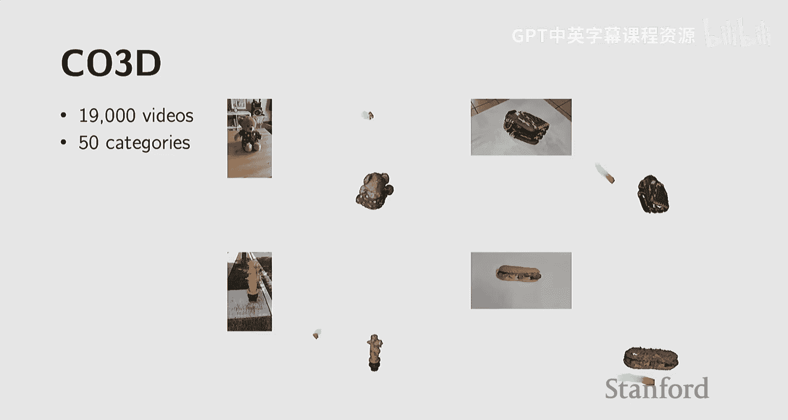
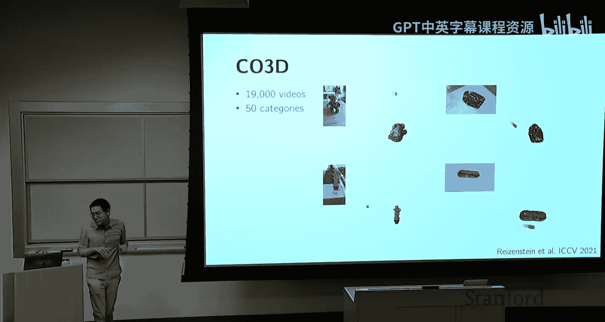
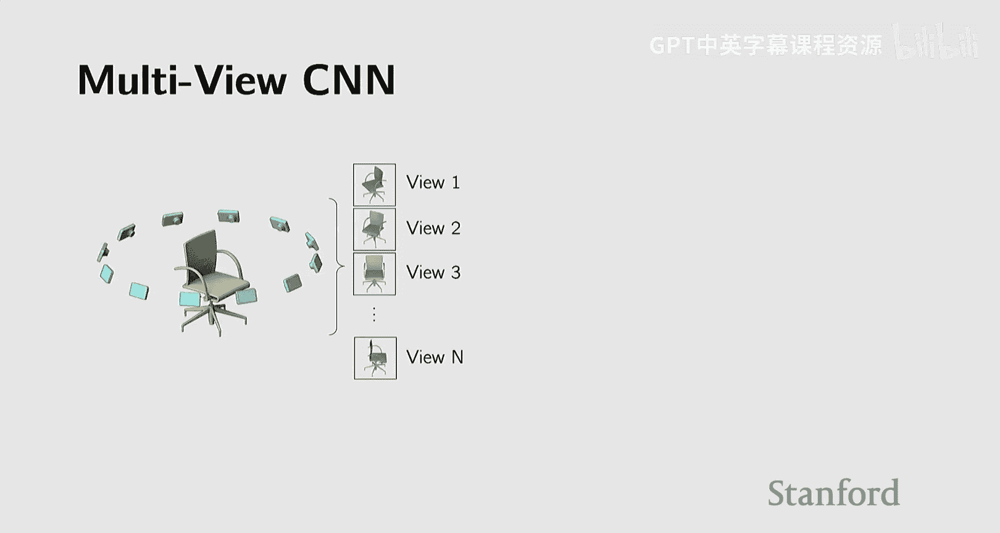
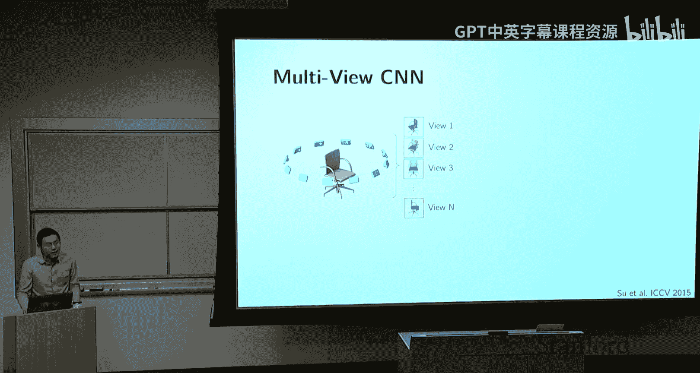
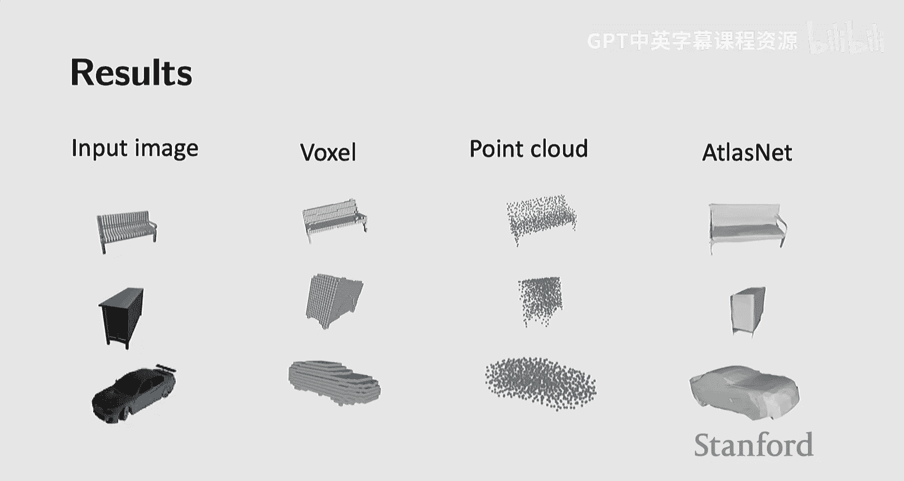
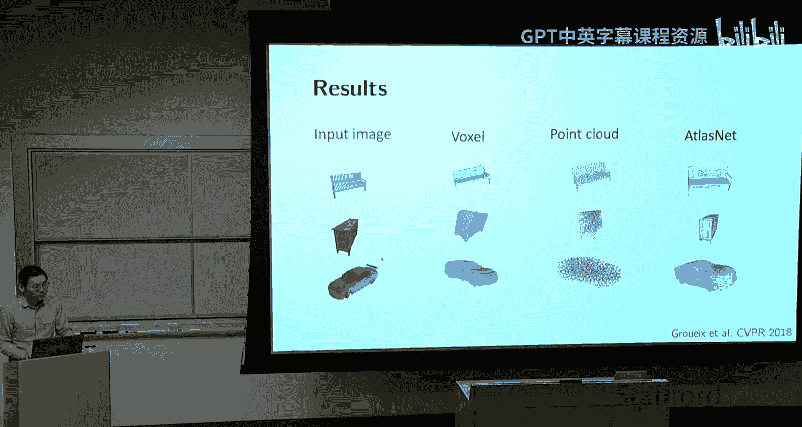
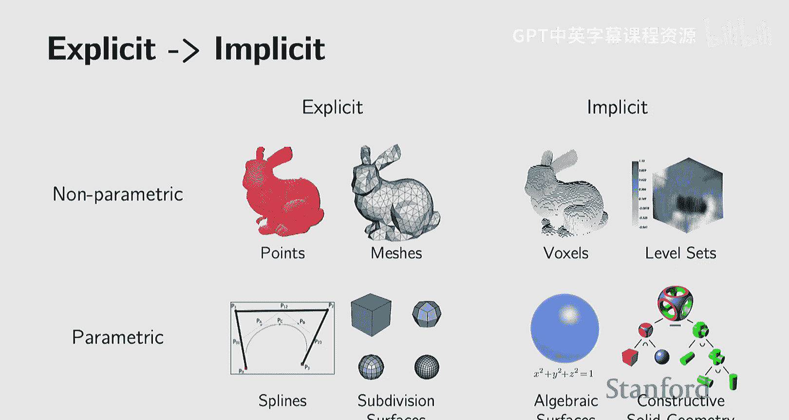
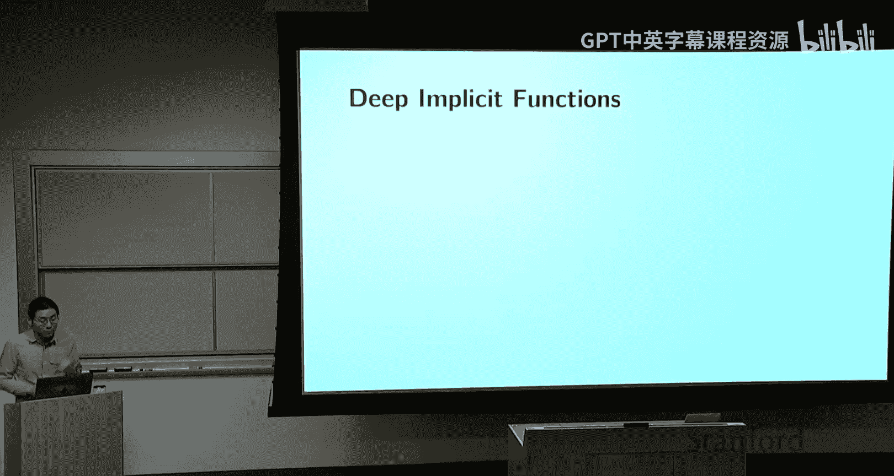

# 斯坦福大学《计算机视觉的深度学习｜CS231n： Deep Learning for Computer Vision 2025》中英字幕 p15 -16-Lecture 15_ 3D Vision.zh_en -BV1FqazzVE6w_p15-

I'm really happy to announce our next guest speaker for the course。 Professor Jajuun Wu。

 So Jajun is an assistant professor here at Stanford in the Department of Computer Science。

 And he's a faculty member of the Stanford Vision and and sorry， visionion。😊，And learning lab。

 his research focuses on scene understanding with an emphasis on multimodal perception。

 robotics and embodied AI， visual generation and reasoning and 3D understanding。

 which is the topic of today's lecture， and so I'll now turn it over to Joju to begin today's lecture。

He， yeah， so I'm Jadging， I'm a assistant professor here and I think a few years ago I used to teach this class code teach。

So I heard this year it's the 10th year anniversary， right。

 we have guest speakers from different places。Okay， so today we can talk about 3D vision。

So it might be kind of different from a lot of things you learned before because I think in the past few weeks we talked about like conversion neural networks and transformers and maybe vision language models and generation models as well for just so here for3D I think I'm going to first introduce a little bit on what are 3D representations so it's more like it's pretty distant from all the deep learning stuff but then we're going to talk about how deep learning or AI has changed3D vision and how they can be integrated in different ways know and we're look into a few different applications about3D generation reconstruction and stuff like that。

😊，Okay， so let's begin by looking to what are the possible ways to represent objects in in3D。

 Because in 2D is so so straightforward。 It looks like okay， I just have pixels。

 right I have a I loading a file of a P And G file， a Jpeac file。 It's like 200 by 200 pixels。

 But how can we represent 3D objects。 I think that's the first thing you want to look into。

And3D objects， you know， they can be diverse， they can be at different scales。

 and can be like huge large buildings and trees， complex structures， and if you zoom in。

 you know you can also see all the fine details。So what are the best3 representations to represent all these different types of3D objects at different scales with different features？

And unlike images where everyone just use pixels， you know， so we have 200 by 200， 500 by to 500。

 the way to represent 3D objects in you know objects are also like you have geometry。

 you have textures。 you have materials， but let's just maybe start by looking at geometry。

 even just for 3D object geometry， there are so many different ways to represent them。 You know。

 we can basically categorize them into two different categories。

 One is called explicit representations。So where you can， you can， in some sense。

 directly I was say explicitly representing part of objects， this includes things like point clouds。

 If you have a cloud of 3D points or a particlegon mesh or subdivisions。

 which we're going to talk about it。And others。 and there's a different categories of object shape representations which are often called implicit。

 So we're gonna to talk about them as well。 So I'm going to expand them in a little detail later。

 including level sets，ic surfaces， distance functions。

 So they are basically representing three objects or their geories as functions。

 which it is not directly iss not as in some sense intuitive as oh it's just a action points。

 but as we'll see later， they also have their own advantages and weaknesses using implicit representations。

 So every choice they have their suitable task and type of geometry in particular in context differently know。

 they may also have their own strengths and weakness。

 when you want to apply differently learning method they on top of it。😊。

So when do we choose representation you know we have to store them so pixels are easy to store because it's just a matrix。

 but then 3D point clouds are kind of more irregular and also especially if you use some implicit representation like representing object as a function how would you store that in a computer and how do they support creating new shapes and especially now let's say maybe the input is a picture or the input is a language description and different type of operations。

 you have a 3D objects and then how can you edit it simplify a smooth filter and repair it you can have to do a lot more for images sometimes you want to do that too。

 you want to edit it， you want to edit it using language。

 you want to edit it using stroke and how can you edit it or perform any type of operations on3D objects。

😊，And rendering， how can you turn that 3D objects render into computer into 2D pixels In some sense。

 you can the3D vision is is to invert a process， right。

 How can you go from 2D images to reconstruct the 3D objects。

So how they support all these different things， including NN animations。

 especially if you are modeling， let's say3D humans or animals and you want to animate them。

 so all these factors need to be considered and something else。

 of course sort of connect to all these is also their integration with different deep learninging methods for let's say shape editing。

 rendering inverse rendering animation as well。😊，So very quickly we can go through some of these representations like point clouds so point cloud is probably the simplest representations only has 3d points。

 it doesn't have connectivity so it doesn't capture how these points are connected so you basically just have a instead of having an n by n matrix which is about the pixel values of all the pixels in a picture now you have a3 by n matrix where three is x Yz coordinates of these individual points and you have a number of points。

😊，So sometimes you can represent the surface normals of the point as well so that you have not only where the point is in the 3D space also to which direction is facing。

 So you have the surface normals。Which give you a bit more information and sometimes people call them circles。

 which is points with orientations。And yeah， so why do you need surface normals because if you want to render them you want to say how the object look like。

 if that means you have to often specify a lighting source where is the lighting coming from but you know to make the render look realistic you have to consider how the lighting coming from a certain direction is going to interact with the point and this is where the surface normals is used to help you to make the render look realistic like you can see here。

😊，So how can you get points， a benefit of the point code。

 it is often a raw format that you will get from a lot of the sweetD sensors。

 including these kind of depth sensors， including some SwD scanners。😊，And， you know， nowadays。

 I think if you can even use an iPhone and I think you have an AR kit or these kind of software allow you to scan 3D objects。

 But but the raw output of those sensors， there're still kind of 3D point cloud。 Now， of course。

 after that， you have to process them and fuse them to make it like maybe objects with textures。

So yeah they often results are from scanners， they can potentially be very noisy and there' are things like this and you want fuse them。

 merge them， repair them and this in this part， you know you have to consider how these different pictures can be registered to give you the shared point cloud。

And they can， they're very flexible so you can because you can move points here and there so you can use them to represent basically any type of object geometry。

 you're not constrained by the topology or stuff like that。

 It's kind of useful for large data sets because sometimes you have to consider our very diverse set of objects。

 but。😊，And because points are already in some you consider to have being presampled right So know if you have a lot of points。

 if you're representing objects and but your points are sampled in aneven way in the sense that you have a lot of points。

 let's say the on the head of the rabbit， but you have very。

 very few points on the tail of the rabbit， then it will be actually hard to draw samples from these inner sample regions。

 So sometimes when people consider you sampling points。

 you have to design algorithm to make sure you sample them roughly evenly across different parts of the objects。

At other limitations or， you know， it's not obvious how we can directly perform sometimes the very useful operations like simplification or subdivisions on these objects。

 It doesn't directly allow you to do smooth rendering。 There' is no topological information， right。

 So， for example， here。You know， if I give you a collection of points。

 then you can't even tell you if this is like oh a Torus or this is like these kind of ring like shapes。

 right， because it doesn't tell you how these points are connected。

 So it's kind of a partial information about what the object is if you just have the point clouds。😊。

So naturally people will say， okay， how can I actually capture you know more information so that I can distinguish between these two different objects then naturally that goes to the polygonno meshes right so it represent the objects as still as a collection points。

 but then also how these points are connected so now you have not only points but also the faces or the surfaces。

😊，And this is arguably like I would say the most widely used representations for 3D objects in all these graphics engines in computer games and stuff like that。

 basically it is all represented as polygon meshes， but you can see that to represent phases。

 it is more complex because often you have to consider especially if you're looking at raw meshes。

 then every phase may have a different number of points and may have three points and have four points will have five points and how you can represent them。

 especially given their irregularity， how you can integrate them with neural networks。

 especially in early stage when people start with like commercial neural networks。

 they always assume a fixed resolution， but here you have not obviously a variable dimension of these raw information。

 how does that integrate with deep learningrun that has been some big challenge that's why deep learning with3D vision kind of start kind of late because people are thinking about how we can adapt all these deep learning method to deal with all these complex representations for objects which are not as unified as images。

The meshes are really widely used and they can be very complex meshes that capture all the details。

 you know， for example， you have scanners， you get points and you fuse them and you apply some algorithm。

 you can get you know very large mesh。 This one has like 56 million triangles and 28 million vertices to represent a sculpture。

😊，And you can have even larger ones， you know， let's say from Google Earth。

 they have trillions of triangles try to represent basically all the buildings on earth。

The nice thing about meshes is supports a lot of operations like subdivisions。

 oh I want to have more details and how can I have use more meshes to capture more details of the shape？

😊，And you can do simplification as well sometimes you want to processing things very fast。

 so I don't need that many mehe， I just want to simplify it and so I can there are existing algorithms that allows you to do that as well。

😊，And regularization， you if you get a regularular mesh and sometimes you want to regularize them so that every phase is a triangle。

 they always connect they have roughly the same size and so that it's easier for processing and they have more lets say good properties that supports future processing of different graphics algorithms it matches they have been people who develop these algorithms as well so that have you can ensure that basically points at different regions they' are roughly evenly sampled so that it won't be the case that okay let's say the head of the tail at the head of the rabbit that's much more densely sampled than the tail and these kind of things。

😊，Okay， so this is kind of one type of shape representations and there are other type of shape representations。

 for example， parametric representations， because objects are not just totally irregular。

 it's not just often a collection points and matches they're very general。

 but sometimes you lose a lot of information if you look at let's say your chairs or the tables。

 you have all these kind of straight lines right so how can you represent these con straight lines And when people design them you know they often use some of these parametric representations。

 know so you can represent shapes as a function right So think about it know when I design them I can you know。

😊，It's really if I only represent a surface or represent a curve the underlying degree of freedom is actually lower。

 know often if I have a curve。 there's only only one underlying degree of freedom。

 that's why I can represent a curve using a function F of x just varied x and get a value of y So you can use basically all these different types of functions in 2D。

 but also more often in 3D to map a certain number of variables。

 the underlying intrinsic dimensionality of the objects which are often let's say in 2 or even one and then map into the 3D space and then this allows you to represent a 3D objects in the parametric representations using basically a set of functions you can do that for curves。

 let's say in circles basically if you only represent a circle youre don't really need one way there is use simple number of points or you can even connect them like matches you using the lines Another way is you just represent a curve the circle as this function basically there's a signine function and cosine function。

😊，う。It just very one variable， which is t。 you can think about it as the degrees or angles。

 and it will map it to all the points on the circles， right。

 So here now you can use the function to represent a parametermetric representations for a curve in 2D。

 And， of course， you can do that in 3D as well。 if you want to represent a sphere。

 all you need is just like  two degrees of freedoms。😊，UMV。

 and then you can go through these functions so they you can map them to every point in the3D space for this sphere。

Right，So people have designed， I'm not going to detail here。

 but more complex parametric representations like Bayesier curves and baesier surfaces。

 which allows you to represent like these kind of pretty flexible and smooth surfaces in Swie using basically a few control points。

😊，So you basically use these basia functions to capture the underlying lower dimensionities of these surfaces。

 and then you can map the underlying low dimensionality into these kind of flexible shapes。😊。

And they also allow you to do things like subdivisions。

 you can you know trying to get more details into the surfaces and to make it more fine grain and stuff like that so that would be the second category of shape representations。

 you can represent 3D objects in a nonparmetric way。

 like a collection of anor points or their connections as it matches or you can represent in a parametric way where you have a function basically you by varying a few parameters that are underlying the true degree of freedoms of the object geometry you can map them into more complex shapes。

So basically everything here， as I said has been， you know， if you remember at the very beginning。

 we said there are two types of ways to represent object geometry。 one is explicit。

 There is more implicit。 And all of them， they fall into this category of being quite explicit。

 right， So it's like points and points are just directly points on objects And for the surfaces or the four parametric curves as well。

 You know， they directly map it right to the points on the the on objects。😊。

So theyre explicit representations， they have a lot of benefits。 know， first。

 they have you map all the points directly so you can get all these points。😊，In general。

 you know you can。And every point I have， let's say， I sample。

 I have a baseier surface representations。 I can basically sample two points and U V in this underlying low dimensional space。

 And then going through that function， I might add to a point in the3D space， right。

 So I directly get a point on the Sw in the SwD space。

 So all points are given in some sense you can see directly， I can directly get other points。😊。

So it's very easy for us to sample points right so let's say I have this tolerancerus and I have represented using this F function So now my question is can you just sample some points on the surface of the object for me。

 this is so easy because I would just randomly putting some UMV values I just randomly sample those UMV values and then let them go through this function and it would just compute and give me some of the 3D points which are guaranteed to be on this surface of the object so sampling is much easier。

😊，So what is hard about these explicit representations。

The hard thing is it's very hard in some sense， you know to test whether a point is inside or outside objects。

 Similarlyly， you know if I represent a sphere as this function and it's easy for me to sample points on the sphere。

 but it is hard for me to say， you know now I have a different I have a query right。

 say this point3 over4，1 over2，1 over4， I have this point in a 3D space is's an inside object or the outside object。

Right。I think we can maybe actually I'm not even sure about that。

 so it is actually kind of hard to test， whether the certain point is inside or outside object。😊。

So you can see that explicit representations is all these representations they have their own strengths and weaknesses and for explicit representationations。

 it's actually pretty easy to sample points which are very useful because sometimes you want to convert them into let's say points。

 then you want to apply whatever your point neural networks on it。

 but it is hard to test if a certain point。 It's inside the outside object。

 which may have some issues， for example， let's say if you want to use a newer rendering methods。

 And nows a lot of newer rendering methods requires a lot of these kind of queries about whether a point is inside the object outside object。

 what would be the geometry or density of object at a particular point。

 what would be the material or what would be the radiance or cutter of object at a particular point right So explicit representations are not very supportive it's not easy to run these operations on these explicit representations。

😊，So naturally people thought okay maybe we can come up with a different type of weights of we represent geometry and here as say imp representationable geometry。

 but as you can see later you know a lot of these newer rendering methods or different methods。

 they just extend these imp representations for only geometry。

 but also for colors and appearance of objects in Swie。😊。

So idea of these implicit representations is now that I want to classify these points。 So I assume。

 you know if the points are on the objects， they're on the surface of objects。

 then they satisfy some certain relationship。 So， for example， know， for a sphere。

 what would be the points on the sphere on the unit sphere。

 you know the constraint they satisfy is you know square of x and square of y and square z。

 when they sum them up when you sum them up， they equal to1 right So this is constrained。

 they satisfy for all the points on the sphere。😊，Alright， so more generally， you。

 you can write it down as， the constraint will be some function of x and Y and Z equals0， right。

 So in this case， F x and Y， the function will be x square plus y squared plus z square -1， right。

 So that would be the function here。 But more generally， you can think about it is。

 even for complex shapes。 You can represent And sometimes。

 you know these functions can be so complex that you don't even have a close form。 know。

 So how can represent an F。 I don't know。 I just write it as a neural network。

 My hope is a neural network will be able to represent it。😊，But in general， the idea is。

 you you have some function or some constraints that the points on a certain object will satisfy and this is the way you were represent an object。

 and this is called implicit representations， which started with geometry， but as I said。

 you now using in all these different ways representing textures， materials。

 appearance and all these things。😊，So the good thing about implicit representation。 sorry。

 let's start with the bad thing。 The bad thing about implicit representation is now it's actually much harder if you sample points。

 right， I tell you， okay， this is a constraint。 Let's say this Torah satisfy， right， Okay。

 every X and， Y and Z， you know， if I put into this function and output is 0。 then yeah。

 they must be on the surface of this object。 But then how can I get a couple of these X， Y， Z。

 you know two pole。😊，That would be very hard because they're required to solve this function。

 And this function is maybe not too hard to solve。 you know。

 maybe you can still solve that using some high school math。 but you know。

 when the function gets really complex， you for arbitrary shapes。

 it becomes much harder to solve these functions。 So it's not easy to actually now sample points on the surface of objects。

 if you are representing objects implicitly。😊，But benefit the strength of that is now it's actually pretty easy to test whether a point is inside the object。

 outside object。 Because， you know， if I want to do testing， I just have a query。

 then this is so easy because it's inside the outside。 I just send it into that function。

 I'll get a value。 Or the value is okay， -1 over 8。 Okay， this more than 0。 So， you know cause。😊。

I assume you know the object is represented by this function and all the surface point on object they satisfy that function equals0 anything that's no。

 I would say lower than 0 as' negative， if the output value is negative。

 then the point must be inside the object and if the output value is positive。

 then the point must be outside the object so now it becomes much easier to test whether a so point is inside outside object。

 although it becomes much harder to sample a number of points on the surface of object。😊。

So you can see now there is a clear tradeoff between these implic and explicit representations。

 Here we again， we talk about geometry and but this distinction and the contrast between explicit impclusive representations is I think is very important and fundamental is behind development deep neural deep neural networks when they apply to 3D data in general。

 as we'll see later。Okay so before we in 25 minutes。

 So I promise I spend another more than five minutes and we're gonna talk about deep learninging。

 So before we talk about how deep learninging can be applied to 3d representations in general。

 know a little bit more on implicit is some other features of implicit representations to good things about them it's easy to compose them So sometimes you feel if I have represent everything with a function that seems great if I have a close form。

 but also seem very constraint because every close form I can write it the geos look very very So if I want to represent the shape of a cow how would I represent what would be the function I can write for the shape of a cow it's just not obvious but nice thing about implicit representation is you don't have to write everything in one shop because it's so easy to compose them you can actually perform logical operations implic functionss say you have two objects and you find unions or intersection or differences can again theyre just values you put X Yz you get value Xyz onto that function you get。

😊，You can just do arithmetic operations on top of these values。

 and that allows you to compute unions or intersections or differences between these objectss。😊。

And eventually， you can compose them to divide a pretty complex shapes。 And this is actually。

 you know。Behind support， a lot of these industrial designs， when people are designing you know。

 complex parts for， you know， I would say， I don't know。 I mean。

 when you're doing manufacturing on the on you have a。You have to fabricate some complex shapes。

 A lot of these designs are done by these kind of cat models， computer8 designs。

 and they're composing these implicit functions using simple logic operations。😊，And。You know。

 you can also do things that beyond just logical。 you can even add things up。

 especially if you have a distance function where every point is sort of like， oh。

 no the positive value and negative value， the values actually have meanings because they indicate how far you are to the surface of object。

 So you can even add them up and this allows you to smoothly blend the shapes， right。😊。

So you can see here you know if I have a distance function and here I just want to represent a vertical line okay this is here and then anything that's minus0 is to the left of the line。

 anything that is positive is to the right of the line and you have another line representing using different function so what happens if you add them up if add them up then it naturally becomes an interpolation between these two shapes this is an example of doing things in 1D but you can imagine you can even similar doing things in sweetie in a sense okay now you can actually even blend these different shapes。

😊，And these distance functions can be arbitraryrly composed and allow you to create actually pretty complex worlds like this。

 and this is not easy， but you can even you thinking about you can construct really complex with all the details worlds by just simply not simply。

 by difficulty but compose these different functions。

 but they are actually very expressive if you're very good at it。😊，Okay， so we said， okay。

 we have parametric representation that can be explicit。

 that directly give you points on the 3D surface， or we can have parametric representations like these functions。

 but they' are implicit right So they're just like okay now you can only try to verify if if the point is inside and else an object。

 but then you can also compose them to build more complex shapes and is that possible for us to also have implicit representation and nonparametric like like point style。

 but then you also querying functions or sometimes they actually do have things like that。

 this eventually goes to methods like levels that message So implicit surfaces are very nice because as we said。

😊，It's easy to merge them。 It's easy to split them。 But sometimes it's hard to describe， as we said。

 complex shapes in closed forms， you have a cow。 how would you represent it。 you can compose them。

 But you know if every time I have to query whether certain points inside the cow。

 you have to have hundreds of functions and you perform all these add and or and all plus minus operations。

 then takes a long time。 So what if I just pre queryry I have I have a3D space。 and I just sample。

 let's say 100 by100 by 100 grid。 So I have a million points pres and for these 1 million points。

 I just precomp whether they're inside the objects or outside the objects。

 what is the distance of these 1 million points to the surfaces for complex shapes So you can precomp them。

 And then you can store all the values in the matrix This is in 2D， you can。😊。

This is for visualization， being practiced this in3ie， right， So you have a。

 you have a3D matrix that store all these precomp values of the distance functions。

 So now you're sort of in some sense， you still have inclusive representations。

 but because you have prequeried them， you， you turned it into a nonparmetric representations。😊。

And even if you just look at this matrix right in 2D you can now still find okay where the boundaries are。

 so where the boundaries theyre just basically where you know you have two adjacent values。

 one is positive and one is negative right so that means there must be somewhere in between that the point here they satisfy the function fx equals0 which means the point must be on the surface right so in that sense you are sort of turning parametric representation which are inlicit into a nonparmetric representations by precurring a lot of these points using the functions。

And this allows you to have actually more specific controls because。You know。

 you can now visualize them， you can say I have this matrix and I can visualize them based on their values and this is used a lot in things like CTs and MRIs and all these medical data and the thing is people may say okay what if I don't care about all these distance values I can prequery what's going on at all these points but then I compute all the values I say plus5 minus-5。

 but all I care about is whether this is inside object or outside object So if it's positive Ill just treat them as one if it's negative。

 which means they're inside object treat them as0， let's say So if you binaryize them。

 then this give you final representationations， which is arguably the easiest to understand this is voxels So you know you can prequery where the implicit functions are and then you have all these kind dense sample grid。

 but now instead of storing their distance functions。

 how far they are from the surface by going through the functions and give you plus5 minus-5。

 you just binaryize it， you only care about whether certain points is inside objects or outside object。

😊，Then you have a v of representationation， which is again like a sweetie matrix can be 100 by 100 by 100。

 but for every point you have go through this function and query whether it is inside and outside objects。

 you have one or zero and you can represent objects in a binary and rise way right so this gives you the final representation I'm to talk about for objects in sweetie。

😊，So Ive introduced voxels in a kind of complex way， but from a different perspective。

 people may say this is actually very easy to understand because in some sense。

 voxels actually have a lot of analogy as pixels because pixels are a 2D matrixrices and now you have a 3D matrices and voxel is basically just a3D matrix。

 right。😊，So although you can see that they have connections with all the other ways that we can represent shapes。

😊，And the way I'm introducing it this way is you know。Actually。

 when when deep learning come in right So first deep when when did it start right2010 deep learning has been there for a long time。

 but the more than deep learning thing is 2010 people started Jeff Hinton started doing that on speech recognition and then 212。

 they have Alexnet which is written on imagenet。 So we've learned all these and they're on2D now people say okay what if I want to doing3 this is a very natural thought So I want to go from 2D commercial neural networks。

212， there's no transformer so how can I apply 2D commercial neural network on SwD data And everyone else we have all these different3D representations。

😊，But which one you begin with， right？It turns out that people say， okay， yeah。

 you the people who started doing deep learning on Su data。

 theyre the computer vision people dore not like the graphics people。

 They're like I've been working with pixels and maybe the easiest thing I can do is just scale up instead of working on 2D matrices。

 I just make it work on 3D matrices。 So that would be the simplest thing I can do instead of having 2D combvolution your network。

 I have a volumeric convolution in your network。😊，Then which of these representationations allow you or support a biometric convolution。

 Turn out to be this vel representation。 This is basically the easiest you can imagine。

 but graphics people do not agree with that because the graphics people are like oh this box representation are really bad because it's very slow to compute as we talk about we have to push sample all these values and you can look at a quality it is so bad compared with meshes or point cloud So people like why do you want to start with that。

 But the reason that people started doing deepering on 3D data with voxs because I think it's like it's so easy to join analogy between pixels and vs you just have to change one and code that is instead doing 2D convolution now do 3D convolution So that's in some sense how things get started。

 but before I talk about the different learning methods for 3D data there aspects that's very important is 3 beyond methods。

 data sets are also very important imagenet really prompted atnet and stuff like that。

 So for 3D similarly we have to collect a lot of data as well so。😊，Pret sweet， pretty deep learning。

 the common data sets the popular dataset that people often use is this thing called Princeton data shape benchmarkch。

 which has 1800 models， 180 categories。 So you can see they actually have quite a lot of categories。

180 categories， but they are only 1800 models， which means they are like basically 10 models per category。

 which is so small， but。😊，Back then， it was considered pretty large and people feel like， oh。

 this is already enough to do because we can't really make any of things really work well on them。

 And there was very little machine learning there。 So prior to 20514， you know。

 all these data sets are kind of more or less small。You know。

 they may have a certain number of models even up to 10000 900 10，000， but you know。

 they also divided into so many different classes and so each class you only have like 10 models each or less than 100 LC say。

So after that， people started by saying okay， if we have imagenet can also have the 3D data sets for shapes。

 So this is behind efforts of a few concurrent work。 But really。

 I think eventually they sort of consolidated into this thing called shapenet。

 which is a lot of them are actually LED by Stanford Leo Gibbas and Sil Serazi。😊。

So they led these kind of large dataset sets called Shipnet， which has three million models。

 And so but in practice， just like imagenet you have this large imagenet。

 there's a smaller data set that people often use。 So Shipnett similarly。

 you have shipnet core data which is what people typically use it as 50 basically 50000 models in 55 categories now you can see for every category you have 1000 models on average。

 But in practice it's not a balance。 So for chairs， you have actually a lot more。

 So that's why people say oh now I have thousands of models on chairs。

 I can train some deep networks on it right before you can have 10 models you can't do anything。😊。

So that is how things started and so there has been a few years where a lot of these advances and all the results are just presented on chairs and cards because these are like the largest categories in shippNe。

😊，And people feel like， okay， that's great， but then that's not enough。

 So we should move know even bigger。 So in the past few years， this is work at AI too。

 the A Institute from Seattle。😊，Where what they did is they collected much larger data sets called objectverse and objectverse extra large。

 that you have roughly 1 million or 10 million models for different 3D assets。

 You can see they have much more categories and they also have these models on average。

 also have higher quality also with textures。So these are entire data sets。

 but also there are real data sets that are being produced， including。

 you know some some of them are from like SwD scans， you know， you just take。😊，CD scanners。

 back in 2016 people have been working on it。 This is a data set called I think the Redwood data set or something。

 so you have like 10，000 scans of real world objects。😊，And more recently。

 people have been building larger dataset sets where they also encourage people。

 I think this is an effort cola by metata in Oxford。 So they encourage people to take data for them。

 They also pay people to take data for them。 So people just using an iPhone you have object put it on table。

 You use an iPhone。 you take a 360 video around objects and then you get $1 or something like that。

 So they encourage people to take data for them。 this is the first version。

 they have 19000 videos of objects。 these are like real objects because capturing real objects is much harder and the object version and all the things I talked about before。

 it was like synthetic objects。 But these are like real objects。

 And then also because a lot of the development3 vision algorithms。

 you can actually take the 360 videos and trying to reconstruct the3 objects。

 So now you have paired data of the videos or images and objects as well as their3 geometries and textures。

😊，This is their first version。 I think they have a more recent version B2 or maybe even V3 right now。

 which is supposed to be a little larger， but still it just kind of hard to scale up。

 Think about it right now you have like 90000 videos or basically 19000 objects and I think they're skin it up but I don't think it's over 100。

000 So basically you can think about it as for real objects you have like100，000 models。😊。

AndBut if you look at what's the dataset size of the images。

 right So it's like line on 5 B or whatever that's like 5 billion images。

 and Google and Open am must have much larger data sets。

 So there's still kind of huge gap between number of data points that you can have for2D images or videos versus you can have for 3D objects。

 So I think that's a kind of big challenge。 know how we can move forward with 3D vision and people have different ideas。

 But still， you know， this is much larger than what we have before。 at least you can， know。

 it's possible that you can still more or less train some different learning models on these dataset sets now。

😊。

And quickly， there are also other data sets that people being built on part。

 And this is also from Stanford， where they try to annotate a little bit of object parts and their correspondence and hierarchies。

In integer and also there's this datacycl called Partnet where they want to annotate all the parts and there are semantics but also how they may move So a little bit of mobility information of different parts like laptop。

 you can open and close it and they are also data sets for 3D Cs。

 it's not only just objects and parts， but they are also the rooms so。

They're having things like the scan data sets like， you know。

 these are people actually just go inside your home or go inside to actually to our office as well。

 This is coming。 And then they just have a3D scanner。 They scan home。

 and then they have some annotations。 So， you know， here。😊，No， and more recently again。

 you can use you can do that even with your iPhone right now。

 but still these kind of data sets are much smaller。 right So here this one。

 the first version of scanner， you have 1500。 I think they have a plus plus the second version。

 which is roughly the same flight， maybe 200 or 3000 rooms。

 So the amount of data you have for3D data for3 Cs in particular is also even much smaller than the amount of data you have for3D objects。

 So I think it's not obvious that how can we go beyond that constraints because if you have to scan it yourself。

 youre always bounded by how much time you have and how much people you have。😊，Anyway， but you know。

 there there are attempts being made in trying to collect data。Okay， and finally。

 if want to apply differ on to3D vision。 So what are the tasks we care about。

 So there are gene modeling， just like you generative。

 just like adjusting that you can generate 2D images or videos。 You can also generate 3D shapes。

 You can generate 3 Cs。 You can make them condition right the condition can be condition on language condition on image。

 You have an input image and how you reconstruct 3D objects。😊，And you have to learn the shape priors。

 you have to do shape generation completion， sometimes you have a partial objects and you want to you know repair it。

 you want to fix it， so there's geometry data processing as well。

Other tasks including discriminative models， for example， you have a studio shape。

 how can you classify what's the category of objects it belongs to is it a chair or a table and a lot of them now actually then by rendering them into pixels right because you have very good image recognition models like GT or something so you just take a3 object you can render them into a picture you can upload the picture to G and they can do it for you right so that's in some sense one way of solving these discriminative problems。

😊，But there are also more specific things that is not very easy to solve， you know， for example。

 you have a different type of cell and you have the3D scans and how can you classify the cell and all these kind of more specialized domains where you don't have that much data。

 so how can you solve these discriminative problems？😊，In join modeling of 2D and 3D data。

 which is becoming more and more important because the 2D data， we have so much more。

 We have so many images and videos。 We have very good foundation models like our train on them。

 So how can we leverage the priors in our 2D foundation models like what image look like how to make an image look look realistic。

 how to make a video look realistic。 How can we use that information to help3D reconstruction to be more realistic So join modeling or 2D and 3D data because there are so many large scale 2D data sets and very good models and also there has been a lot of advances in newer rendering or differential rendering methods that basically connect 3D world and 2D world because we have 3D world。

 we have 3D model， you can render them into 2D the rendering process can be made differential or can be even approximated with newer networks then we can connect all these data in different modalities So differentialable neuraler networks allows you to。

😊，Bridge， the price you have in 2D data or 2D foundation models into the 3D world。Yeah。

 and then you know， sometimes you want to even do some join multimod beyond visual data。

 including textile data， but sometimes you have other data， let's say in robotics。

 you often have tactile data， So how tofuse them as well。 And sometimes for auto strib， you know。

 maybe you have Liar data or that data， how can youfuse them as well。

So want to use deep learning on 3D data to solve all these different problems。

So we spend all the time talking about representation。 So how do we begin with So as I suggested。

 know people who are initially doing that is the computer vision people do work on pixels do work on images。

 So naturally they say， why don't we start with voxs but even before that they say okay this is the old idea and this is the very first idea that people try in applying deep learning to 3D vision And now in some sense is coming back But the very first idea to try this let's don't even worry about voxels let's just say you have a 3D shape it's a match as a voxel。

 whatever I want to learn to recognize what the update is what is the update here it's a chair。

 but what if the input is 3D data， how can we process that before we have a 3D deep learning methods。

 What if I just render into images because I have very good image models。😊。

I'll just， you know render just take the 3D objects， I would just put camera at different places。

 I can render all these images， the objects from different views。😊。

And then now this becomes a 2D problem。 I would just apply a commercial neural network， you know。

 on each of these views。 and I have some ways offuse them， right， So I have some codinging， whatever。

 and then I just do image classification。 know， So this becomes an image classification problem Well the only difference being now you have multiple views So this is like in some sense one of the very first idea people apply to 3D vision。

 It just use 2D networks And why do you want to use 2D networks because back then they are pushing on imagenet and they're very good。

 So they have imagenet is much larger than 3D data sets。

 So any model that are pushing on imagenet they have very good performance。

 So the easiest way to solve the3D recognition problem is to first render into 2D。😊。

Later， people sort of move away from it because people are like， oh， you know we have more 3D data。

 we should try to do 3 native comebook with 3D native methods and people also you know come book with ideas about connecting 3D and 2D through like newer rendering。

 but now I feel like this trend is coming back because all these image and video models are getting so great。

 I don't know many of you may have seen like the V3。

 whatever was released yesterday So if they're so great maybe we should just rely a bit more on the image and video foundation models again because they're just trying on a thousand times or tens of thousands times or even more than that maybe millions times more data than3D data So how can we incorporate that but coming back this is the very first methods in some sense。

 people try to apply deploy learning on 3D data just by converting them into 2D。😊。

And they do very well in image shape classification and they have shapes。

 and you want to classify them into different categories and they have very good performance。😊，嗯。

And yeah， so you can leverage a lot of literatures on 2D image between models。

 but the issue is you need on projections， but sometimes you know the input can be very noisy。

 People like what if my input is too noisy， the point calls or whatever they're just not very good。

 If I render them， they look kind of bad。 So is that possible for us to come up with more 3D native methods。

 So later people tried a number of 3D native methods that just apply deploy directly on 3D data。

 As I said， the easiest way to do this is just to apply your pixel commercial neural network into a box volumemetric commercial neural network。

So。This is actually a deep belief network which is gen network。

 but still you you have some 3D convolal future and this is in 2015 by Princeton and you can see that they learn a gen model that can actually synthesize 3D shapes in the form of 3D boxes relatively lower resolution but this is 10 years ago now so back then this is considered kind of pretty impressive。

😊，AndYou can do all these condition generations， condition on setic labels at bats and desks and tables。

 you can synize these different shapes and because this is a general network。

 you can also use it for classification so you can do image shape classification as well。

And later something that actually we did is know what if we just applied against this generation as server now。

 you can use scans to generate 2D pixels。 there's no reason you cannot use scans to generate 3D boxes So we just this very simple thing and that is applied again to 3D boxes and actually give you a pretty good generation of 3D objects。

 This is， nine years ago Yeah yeah okay。😊，And later with J Y from CMU。

 we also did an extension that is you can use GNs to not generate 3D shapes。

 but also you can render them into 2D， you can project them into 2D surfaces so that you can get the depth map of the 2D objects 3D objects you generate and then you can use the cycle again to convert these depth map into a current current image now you can have a losses not only on 3D shapes balls on 2D pictures you want the 3D shapes the local realistic so that they can be indistinguishable from the 3D object data you have you also want the 2D images to local realistic so that they're indistinguishable from images of real cars so then you can do 3D generation as well as 2D generation at the same time and because you have different latent vectors for the shapes for the viewpoints and for the textures you also have some level controllability like you can change the viewpoints。

 you can change the textures you can do interpolation and you can transfer the texture。

One car onto the shape of the other car， you know， this is 2018。

So people tried applying deep networks like commercial neural networks。

 generate have server networks on 3D voxels instead sub 2D pixels。

And can we do a little bit better with boxels because one thing that people have complained about boxs is they're just like really slow。

 right， you have to presle them and they are a lot of wasted effort because a lot of sample points are just like empty space or theyre inside the object and give you no information。

😊，So naturally people thought， okay， can we actually make it better。

 So there are improvements to voxels like octave trees。

 The idea of octave trees is you still have explicit representations sorry。

 in some argue implicit representation， but it's like nonparmetric implicit representations。😊。

But then instead of representing every space， every point in the space at a at at a uniform scale。

 right， youre actually， you know， assuming the boxs or。😊，Yeah， basically。

 the voxels can be of different sizes。 You know， I just divide space into like different regions。

 And I spend a lot more。 And when I feel like I'm really close to the surface objects。

 I just represent objects in a much finer scale。 And when I'm like in this empty space or inside objects where I really don't care too much about what's going on。

 I just I can have like huge voxels in some sense。 So you can recursively partition the space。

 and you can have， you know， different。😊，Sizes of vels at different space。

 And this allows you to really scale up。 So you can see that compare with your director using voxels。

 you know， this is 2019 is， you know， people say， okay。

oc of trees are great because it allows me to go from lower resolution。

 That's how much you can fit into GPU memory right You can do 64 by 64 with vels。

 but with octop trees， you can do 256 right so。😊，And then you can even use that for generation as well。

 you can generate objects also， you know， they look like boxel。

 but they're kind of higher resolution because you're more efficient in representing the space。😊。

So these are like the very early attempts in applying deep learning Q3 each space and they're like。

 okay， why don't we just try boxles？😊，Then。This is a moment where people have get a bit more interesting you like。

 okay， now what if you know the graphics people feel like you know you're just doing all this wrong。

 right Because why do why do you want to use these kind of pretty inefficient。

 ugly looking representations like boxes or octave trees。 we have all these good representations。

 point clouds mehe sps why are we not using these representations But as we said。

 the challenge is point cells are here and there。 how can you even apply convolutional points and stuff like thats not just not very obvious。

 But people start looking into it， So naturally people moving into applying or developing new di methods that directly work on not only just 3D data。

 Both different types of 3D representations like point clouds。😊，So in pointNe。

 I think this is important work also from Stanford from Neil's team。😊。

What's going on here is the dev new type of deep network that directly work with 3 point cloud。

 So let's call pointnet。So the idea is， you know， for points。

 you have to be permutation environmentvi， right， Because you know， if I 0。1 and  point2， Okay。

 like 01 is here。 and。2 is here。 Okay， now I have a no different input。

 I would say 01 here and  point2 there。 So then you whatever your network should be envi to these different two types of input。

 which means know， no matter I I name this one is 01。 that one's。

2 or I name this one's 21 this that one's 2， your output should be the same because there's no the points there I order。

 There's no guaranteed order in the sense our top left thats 11 bottom right is 100100 right。

 So if there's an order。 if points are an order， you have to beal environment。 So how can we do that。

And second is， you have to be also sampling environmentvi。

 So you know sometimes you sample like say 10 points on on the head of the bunny or a rabbit and five points on the tail of the。

 and sometimes you sample 10 points on the tail of the rabbit。

 only five points on the head of the rabbit So how can you also be im to that because there's no guarantee how you sample points。

 So they're kind of a bit of an issue here and there。

 But the one idea theyly they used and I think it's basically probably the most important point is they just know I just apply it's also so simple。

 I just apply a symmetric function on the embeddings of the points。

 So basically for all the points know I first compute some embeddings for them just like you will compute embeddings for different regions or different windows of image。

 and I compute features for each point。 And then I just have to fuse them but because I want them to be permanent environment So I just use a symmetric function in a sense that for example it can be just a max function and take the maximum。

softftm， it can also be a sum function。 I just add them up， you know。So that's what's going on。

 This is so simple。 You have a you have number points，1，2，3，1，1，1， whatever。

 And then you have computer embeddings for them。 And then just aggregate them。

 You can see compute max for each dimension， you can sum them up or stuff like that。 And yeah。

 and then you have these aggregated embeddings for all the points。

 And then you go through maybe a few layers of fully connected networks and stuff like that。

 And then you use it to。😊，IllClasify， you know， oh。

 are these points really representing a chair or a table？So that's basically what's going on。

 it turned out to be quite powerful。 And of course。

 they're having a lot of the improvements on top of that。

 People have been come up with new methods that improve point9， they have9 plus。

 And there are things like people have been trying to do as like graph neural networks because you can easily translate points into nodes of a graph and then the neighborhood the proximity。

 whether points are close to each other as the edges connecting these points。

 So there have been like graph neural networks and all these other methods that have been developed for these point9 point cloud processing。

 But you know， the original idea in the。😊，Poin that paper is kind of so simple and turned out to be also very powerful。

Something else you want to consider is you also want to measure， you know， for pixels， it's easy。

 I have an output image， I have the ground truth image， I just compute differences between two。

 I have an auto2 loss or whatever。😊，For points， how would you compare the output point cloud and input point cloud。

 especially if you care about generation tasks。 If you do a classification， that's fine。

 have input point cloud and output is chair table， whatever you have a cross entropy loss。

 that's all you need。 But if you output， if you're doing a generation task。 have a box。

 it's also easy right， just do a cross entropy loss of the 100 by 100 by 100 box grid。

 But if you output is a point 100 points。 And how would you compare the output point cloud versus the ground choose point cloud。

 you have to also design distance metrics。😊，So the the two common distance metrics that people did use one is called the Chamfer distance Cha distance is easy to understand that if you have two set of points and for each point on each side or each set you just basically find the nearest neighbor So you have a collection of red points。

 you have a collection of blue points and for the red point for each of the red point。

 you just find its nearest neighbor in the blue set and for each of the blue points。

 you just find the nearest neighbor in the reset set and you want to minimize the distance minimize the distance of each point to its nearest neighbor in the other set。

And the second idea， loss function that people may use is called Earthmo distance and here you do a biparttheid matching between the two set of points and you have a one to one paired matching between these points and you want to minimize distance among all these pairs So these are the two common metrics that people use when you're comparing the distance between the point clouds and they can be madefinishable。

 which means you can now compute gradients and use it to optimize your neural network so that hopefully output better point clouds if you are caring about a point cloud generation problem。

😊，So we have moved from v cells to point clouds and then people are like， okay， this is great。

 And now I can process the points， I can output points。

 but we also have other know beautiful reitions like spies。

 you know they're very good at capturing the surfaces of objects if you use any kind of neural network to generate vox cells or generate point cloud they always look very ugly right So they don't have smooth surfaces and stuff like that So how can we have a neural network that I can output or understand objects but also represent the beautiful surfaces。

😊，So people go a bit forward in thinking about how I can integrate new networks with things like sps or functions like that and a notable example here is the thing called Alnet So what's going on here is they try to use deep learning but instead of directly outputting set of 3D point clouds right so I learn transformation function I have a latent shape representations and then you know if you remember right when we say you have this para representation objectject shapes。

 you're basically transforming let's say a 2D space of UMB into a 3D space like a sphere。😊，So。And。

 you know， for， simple things like sphere， it's easy。 You can write it down。 right。

 What is that function and sign， cosine， whatever。 But for complex objects。

 it is very hard to write that function。 And often， there's no code form， so。The idea here is， okay。

 if there's no close form， then why don't we just use a neural network to represent that right So here you can see this neural network which is implemented as MLLP。

 Just learn that function F， right You can take the two values UMV as the input to the function F and the neural networks is performing the computation of that function F and UMV and output a 0 3D space。

😊，So it's basically learning how were able to transform this 2D space into the 3D space and it might be too hard to represent the entire object using a single transformation so people thought okay we can use a couple of small neural networks so think about it is now you have a piece of paper。

 you can fold it in different ways you can fold in multiple times and all these things can put together to form the final shapes you care about。

😊，So this is you can see the differences between these two three different representations。

 you have an input image， and if you only represent any reconstructioncon using voxels。

 you can see it's doing something， but you're really bounded by limited resolution voxels。

And for point clouds， you know yeah， you're no longer bound by the resolutions and it give you maybe a bit more details。

 but points are really in order。 you cannot really get any smooth surfaces out of the point clouds。

 And for this thing called LSnet， which is basically learning transform pieces。

 you can see that they have actually smooth surfaces So using neural network to represent how you can map a parametric representations from low dimensional space to a higher dimension higher dimensional space and you learn multiple of these mappings and when they' are combined that give you the final output geometrymetries conditional to the images。

😊。

ok啊。So finally， you know。呃。No， in some。We can put it this way， right？

 So what is what is deep hour doing when they're doing image like classification， right。

 They're basically learning a very complex functions that map input images in the form of pixels into a final category label。

 Is it a cat or a dog or person or whatever。😊，That function is really complex。

 and output space is really small。 output space is like， you know，1000 dimensions。

 right So it's like， okay， its a cat or dog。 You have 100 classificationification。

 outputput space is so small。 inputput space is much larger because you have， know，500 by 500 pixels。

 So that's 25000 or something input space is much larger。 output space is really small。

 function is really hard to write how can you is it possible for to write down some formulas so that I can class input image by computing whatever some specific values and output if this is cat or dog。

 I cannot do that The function is so hard to write。 There's no code form。

 That's why I need a deep network。 input space is large output space is small。😊。

So if you really think about deep networks that way and think about what they are doing。

 then you realize a lot of the things that we have been doing with deep networks on Sw shapes。

 it doesn't seem to map that mapping into that you know I would say equation it doesn't map that well and what are the representationations that really map them map it the best what's the optimal representationations that seem to really fit into the paradigm。

😊。

And if we think more carefully， I think around 2019， people realize， oh yeah。

 know in some sense deep now is an implicit function。

 and why don't we just use it to represent an implicit function for object geometry？😊。

Right so instead of representing the kind of voxels because now you're just doing you know you turn it into pixels and but then you just scale up into3D and you apply 3D convol。

 Okay but know fundamentally voxel is really about whether this thing is inside and outside object。

 So instead of just directly precuring the space and get the voxels and apply convol on top of it。

 What if I just directly using deep power to perform that query for me。😊。

So that I don't have to run sweetD conversion anything。

 know I just query spacing sweetie and deep numbers should tell me you know if in in the output can just be one dimensional。

 you know inside and outside， right whether that point is inside the sweet shape or outside the sweet shape。

😊，So finally， I think people move that leap， you know。

 take the leap to go from explicit representations on point callss or splices into implicit representations。

 but not directly working on voxels。 But instead， you know think about it as a level set or some implicit functions that use deep network to represent that's the final step going from these alets now whatever。

 learning their transformation from a 2D space to the 3D space。

 but now I can directly doing the implicit query using the deep networks So that goes to implicit functions which is kind of interesting because around that time in 2019。

 they' are like four papers that are doing almost exactly the same thing。

 they all argue that before we have been using voxels and point calls and matches or whatever they have their own strengths or weakness。

 but really right thing to do is I should just send the query into the deep networks。

 So what it should do is they just take the input that' X Y Z coordinate and output whether that point is inside an outside object know。

😊。

Ian， that would be， in some sense， the final， I would say， one of the final。

 and that's the kind of idea that has been that was proposing to a 19 even right now in 2025。

 right a lot of people has been still using this kind of same idea。😊，That is。

I would just use deep network to tell me whether a point is inside an Al an object and normally you can go a little bit beyond then just like a binary classification of inside outside because you can also say。

 oh， maybe I care a bit more。 I say what would be the sign distance function。

 How far the point is from the surface of the object or what would be the density values of the point or later what would be the color。

 what would be the raddiance values of the point But here starting from 2 to 19 people really start to apply deep network in a way that is in something similar classification that is I take points in3D space and use it as in pitch function to query some properties of the points in the3D space。

😊，And people have tried to use it as representing a collection of inclusive functions。

 not just like how pieces are deforming into the 3D space to get different pieces of papers in 3D。

 but really are representing inclusive parts of the objects using small neural networks and they can form a complex shapes。

😊，And you know。If you can represent objects in3D using implicit functions you can do that not only for geometry。

 you can query not only the inside whether a point is inside outside objects。

 whether how far the point is from the surface of the object。

 you can also query what be the radidance will be the color of object。

 and I go directly one year later。 This is maybe one or two year later。

 No people come up with the single nerve So where they used differences here is now say I should use deep hour not only to query will be the sand function or density of the objects。

 but also query the radance。So here you can see what's going on is you query nervef about X， Y。

 Z coordinate in the3D space in addition to that， because you're trying to model the appearance as well。

 you also query the viewing directions， right， the camera viewing directions。

 and the output of the neural network is not just like one or0 inside outside。

 it is the density values in addition to the color values， the radance。And。

And if you directly train implicr functions on SwD shapes and then you require3D supervision， right。

 so you know if you have a collection of3D objects， you can use them as a supervision that give you。

 okay， you know you know you have to ground truth about whether a point is inside outside a SwD object。

😊，But here， you know， you want to train on 2D images。

 That's what's going on with Nf So they also put that together with a newer rendering volume rendering function。

 And they made this volume rendering function differentiable in the sense that you can have a rendering model。

 You can query all these different points in a Sw space。

 You can get their colors and also their densities and appearances。😊。

And then you can compute in how much light is blocked along the way， right。

 So this is basically what I'm rendering as in computer graphics others。😊。

There's very minimally changed mate because you can see even directly from the volume equations that everything here is。

 you know， this is an approximation， but with that approximation。

 everything here is sort of differentiable。 So you can compute you know how much light， know。

 if you have if the neural network gives you the density。

 which is basically like you can think about as opacity of the point in Sw space and also give you the cutter。

 then you can compute how much light has been blocked by the points I sampled ahead of the。😊。

Ahead of that point and along the rate。 And you can compute also。

 you know how much light is there contributing to what I'm going to see in this ray from any particular point。

 right， So now you have a few things。 You have neural hour to represent inlicit functions for the colors or radance and and denities。

 And then you have this model render equations， which is made differentialiable that you can learn directly from2 the。

😊，Images， so these are the two things I have changed。 And one is。

I no longer have to train on 3D shapes。 I can train on 2D images with these one render equations。

 And the second is instead of just looking into geometry or density of objects in the Swie。

 I also look into their radiance or appearance in Sw right So these two changes lead to the kind of big jump behind from nerve or from implic functions SDDF and all these earlier methods to nerve。

 So a lot of people feel like oh， yeah， nerve has been great and seems to out of nowhere。

 that's really not the case because know they're very much inspired。

 if you look at the articles they later wrote themselves know。😊。

They are very much inspired by all these advances in deep interface functions。

 although they focus only on geometry， But now I do both geometry and appearance。

 and I do learning from 2D images instead of c shapes。😊，So yeah。

 here are some birds of nerve this you may have seen many times。嗯。Okay。

 so if you remember we said you know， in the past we have been working on something like generating a 3D shapes and then also generating their 2D appearances here at the very beginning。

 we used the verprint change that is boxs。😊，But now as we said yeah。

 nerve is great and if we have implicit representations there's no need to really represent it as a voxels。

 what if we just replace that with the radiance fields so we also did that as well so we have a neural network that capture the implicit radiance fields and densities but it is generated neural network and then you can even still apply the same game rendering framework so that you can render object in Swie as well as there are 2D pictures and you can also do the same thing as controllability and you can change you can change the camera viewpoint you can change object identity。

 but you can keep the viewpoint and can do all these things that we can do before。

 but now with Nerf you can learn directly from images so you don't have to restrict yourself to the categories of cars or chairs where you have a lot of SwD data because you can learn directly from images。

And yeah， so。You can see that now the output becomes mutual realistic。

 So this is the thing we did called Pigan with Eric Chen。

 is a first author and also with mostly people from Gordon's group。😊，Okay， and finally， you know。

 Nf is great， but then Nf has this issue that is， you know， you have to sample a lot of points in3ie。

 You know， you're no longer presampling them and applying a volumetric con。

 But still just like level set right You have to sample all the points and carry near all the time。

 And now you can do learning from2D you can do all these things。

 but because you still have to do all these sampling。 It is very slow。 So people thought it bit more。

 again from the graphics people。 They're like， okay， I have this good idea about points and matches。

 And the nice thing about them is theyre freeing space。

 Theyre very efficient So iss that possible for us to integrate it to have implic representations。

 but maybe I don't have to have a fixed sampling grid。

 I don't have to sample all that times because they take so much time。

 So maybe I really should put them together。😊，Right。

 so you can argue that Np nerve try to parameterizes。 sorry， parameterize the scenes very。

 very densely。 You have to sample all the points dancing in sweet。A lot of points are wasted。

 just like in vels。 you know， you have all the points that are represent empty space。

 you don't want that in nerve。 a lot of samplings。 a lot of the queries are also query empty space。

 and network can give you like density zero or something like that， but it's taking a lot of time。

 So how can we address that， know what if I just try to sample things more sparsely I still have this implicive representations。

 But instead of you know know sampling empty spaces all the time。

 I only sample places where I know there are stuff。

 but how can I know that if what if I have a point representations。

 So this is the idea behind this thing called Gaussian sps， which you may have heard of。

 So it still has the same implicit functions， you query you an network for dens and for appearance and stuff like that。

 but。Instead of query neural an hour all the time， I have a point where after to become sweetie Gaussian blobs in the Sw space。

 which I think sometimes you can think about them as point clouds。

 but the points are not like a single point， they're like a blob， they're like some regions。😊。

And because you know where these blobs are， you know when you are sending an array from your camera to the3D space and sample points。

 you don't have to sample all the time， you just look at where these blobs are and then you can know based on the radius of these different gausses。

 you are only sample regions where you know there are some stuff。

 so this makes rendering much more efficient。😊，And so here are some of the reconstruction results using3D Gaussian spas。

And you can see that， you know， in terms of quality， right， they're actually， you know。

 not theyre comparable。 theyre comparable to nerves。 this is like different metrics P S and RM。

 They're like rendering qualities。 And I think the X is sorry the Y axis it then starts from 0。

 So this is a little misleading。 But basically， you can see these numbers are really close。

 So in terms of quality， rendering quality， Gaus and sps and nerves are similar。

 at least when they're first proposed， but gaus and splits are just much more efficient。 right。

 So this is frame per second， you can render 150 pictures per second。 Well， for nerve， you know。

 it takes you like maybe。😊，20 seconds to render just a single picture， right。

 So now you this thing is's now made 1000 times faster。 At least that's what I argued。

So because you don't， you， you no longer waste all your computingncluding power on simply empty space and query nerve。

 query neural networks all the time。On these about these points that are in empty space。Okay yeah。

 so that is basically how deep learning has been integrated on 3D data in all these different representations。

 how they get started， how they have involved and its connection with all these different shape representations and one thing we didn't talk about just use two minutes to quickly cover it is there has been also interesting things about object geometry that is not only about the element geometry。

 the specific details about the parts but also the structures know because often there could be the shares ofsymmetric so we talk a little bit about it where there's parametric surface and you can parameterize part of the surface using like sphere or stuff like that using these kind of closed form equations and that give you a little bit of symmetry but there has been also more systematic studies about the regularities or structures within object geometry including their repetitions including their symries and people can also come up with different representations for it as well know so。

😊，You know， so how can we really represent， you know， in some sense。

 you can argue that point clouds meshes， inlicusive functions。

 theyre really representing geometrymetric details maybe for individual parts。

 None none of them is directly capturing things like regularities like symmetry repetition。

 So how can we capture that。😊，A few other attempts that people have been exploring mostly from the graphics community is you know I can represent objects just basically as a collection of these simple geometric parts。

 like a part set， but I can and there has been methods that apply deeper names on it。

 you know representing using deep networks to represent different parts of the object using simple geometric primitives and they compose them or using implicit functions and compose them as we talked about before。

😊，But you know there has also been attempts to do a bit more so not just like representing objects in collectional parts without considering their relationships but also modeling the relationships between these parts。

 this is even more so the case for scenes， let's say a bed or bad is usually next to the wall chairs is usually next to a tables and stuff like that So you not only want to represent them as unrelated collectional parts or objects。

 you want to capture to their relationships as well in the hierarchies when you are when you're building youre doing some constructions。

 your architecture your architecting just on your building then of course you're not like just like representing objects or their relationships。

 you have to consider the hierarchies， what you do first there's a classroom and the classroom has there's some tables and chairs in it and chairs has parts there's basically a kind of level hierarchy and how this can be used in with neural networks as well as you have not the hierarchy also you can compose hierarchies and relationships so you have a hierarchy。

Gras。Where let's say for chairs， you know you have different level hierarchy for bases。

 for Cs for back and the bases may have different legs。

 but then also the legs themselves are related the left leg of the chair and the right leg of the chair。

 they're supposed to be symmetric and they they should have the identical shape。

 their are constraints on where these legs are。 They have to be really align otherwise the chair is going to fall So they are all these constraints that are sort of pretty useful and how can we represent them and people come up with all these different representations and for each of them there are also you a lot of neural networks。

 know the method designed to learn and to capture and to generate objects that satisfy all these constraints for example。

Like you can see， this is a kind of hierarchical graph encodes and decoders that try to represent and generate3 chairs that satisfy all these constraints while maintaining their hierarchies。

I think this is also from BOD Ba group from 2019。And， you know。

 sometimes you can even represent shapes using some form of programs， right。

 because there's repetitions and for loops and how this can be incorporated into using。

New and network to generate programs that synize object shapes and synize their relations between these object parts。

 And that's also an important topic。 And most recently， Ill say， let me end this by saying。

I think there has been a new trend。 just in it past one year or two that the deep numbers or large language models are doing so well and they understand things so well that people are exploring。

 I that possible for us to just use large language models that G to output these programs。

 because they understand the semantics and what the chairs should be like。

 What are the constraints or chairs are satisfy。 So is that possible for me to use a large language model to output programs。

 But then maybe I can use some impive functions or whatever。

 to capture the specific geometrymetric details of the parts of the objects like the chairs。

 So there's some kind of new emerging trend of research that is happening right now in these days。

 Okay， I think that's what I have。 Thank you。

