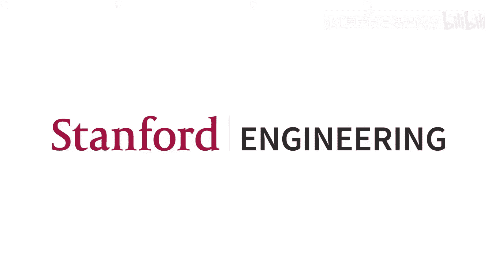
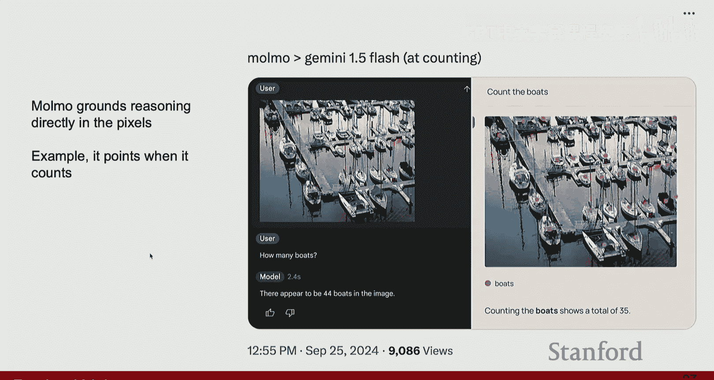
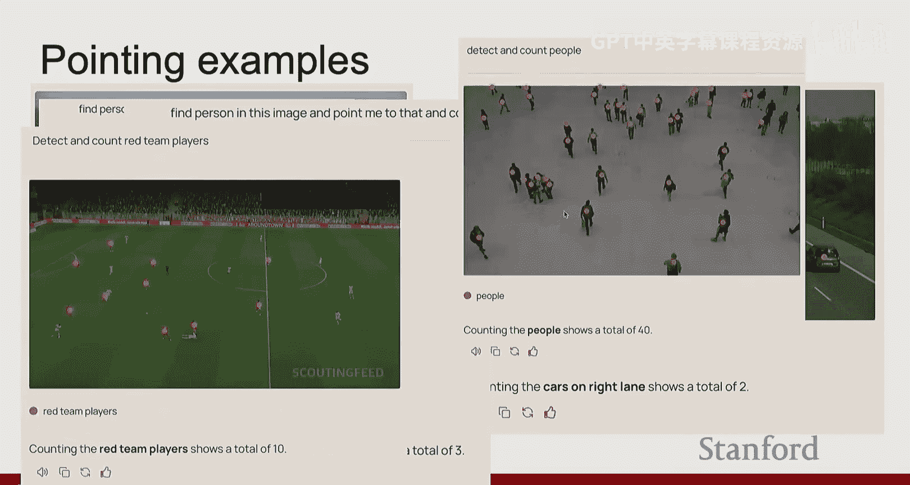

# 斯坦福大学《计算机视觉的深度学习｜CS231n： Deep Learning for Computer Vision 2025》中英字幕 p16 -17-Lecture 16_ Vision and Language.zh_en -BV1FqazzVE6w_p16-

Thank you everyone for coming。 We have another guest lecture。 And today we have Raja Krishna。

 Raja Krishna is an assistant professor at the School of Computer Science and Engineing at the University of Washington and he codirects the Raven lab he has taught previous iterations of CS 231 and in 2020 and 2021。

 and his research lies at the intersection of computer visionion。

 natural language processing robotics and human computer Inter in today's lecture。

 he will discuss multimodal foundation models and Raja the floors years。 Thank you。

 it's great to be back the first time I ever taught this course here at Stanford it was 2020 and we had about three weeks where we had to take all the material and move it online。

 yeah every year after that has been much easier to teach It's great to be back。

 So today we're gonna to talk about multimodal foundation models So a lot of the lectures in this class so far has really been focused on building。

😊，models for individual tasks so these usually follow a few steps that you've seen over and over again in lectures。

 you collect a data set， usually a training set as well as a test set。

 then you train a very specialized model for that purpose so that could be an image classification model or image captioning model like the ones you've seen in your assignments as well。

 and then you finally sort of evaluate those models on your test set。

Now what's sort of been different in the field so far in the last couple of years is this sort of shift away from these individual models into building these more foundation models and the way to sort of think about foundation models is that it really is trying to pretrain models on a wide variety of skills。

 a wide variety of different tasks and then later on adapt those things for individual tasks depending on your needs so for example。

 one very common foundation model that you all probably use in some form or the other is GPT and GPT was trained on a lot of common crawl data from the internet and then you take that model that you get and then you fine tune it for different purposes so you fine tune in that model for math problems or symbolic reasoning or trivia questions and all of these are individual tasks that this model can quickly adapt to now what's nice about foundation models is that it allows you to sort of do that update step that adaptation to new tasks with very minimal data。

 meaning you don't need to collect a large amount of training data you can usually get away with very very little。

Oftentimes， you can even get away with collecting no training data at all。

And so when you think about foundation models there's many different classes of foundation models that you might care about in language you've got ElLmo and BRT that really started this entire revolution and then we now have GPT and T5 and variants of these models these are things we're not going to talk about in this class since we're mostly going to be talking about multimodal models what we will talk about is how do you build these same kind of foundation models for image classification and we'll go into examples like C and COA today。

We'll also talk about how do you combine language models that you might have seen already in class with these sort of vision foundation models to enable all kinds of new models。

 multimodal foundation models that can solve a wide variety of tasks。

 and then of course we can do a lot more than just sort of solve tasks in language。

 we'll talk about how you can build models that can output not just text but also masks or images that you might want to generate and then finally we'll talk about this idea of chaining where you take a bunch of foundation models and then combine them to do all kinds of new things together。

Now， when we talk about foundation models， there's many different ways to classify them and it's hard because the definition is often sort of disagreed upon。

 but what you typically will see in a foundation model is that it's robust and general to many different tasks so you can apply that same model for all different use cases and I'll show you a ton of use cases today。

Also something else that's common in a lot of these foundation models is that they have a lot of parameters。

 they have large amounts of parameters， large amounts of training data and usually they're trained with some sort of self-supervised objective so of course we're not going to talk about the language stuff what we will talk about are the ones in green today and so let's get started with image classification so how do we actually go about building and foundation model that can do image classification for any sort of data you might care about。

😊，Now， if you remember from a few lectures ago， we were talking about self-supervised learning and in selfsupervised learning。

 one of those methods that you saw was S where you have this contrastive objective that contrasts against dissimilar images and pulls closer representations of the same image that has been transformed in some way or the other。

Now this idea you can think of as pulling together similar concepts。

 so different augmentations of a cat should result in representations that are similar to one another。

 but it should push away representations for other kinds of categories like dogs for example Now the hope with training with these self-supervised learning objectives is that these representations become general enough right so that when you see something new。

 maybe a sketch of a cat or a sketch of a dog， it still embeds those in the space so that it's easy to classify exactly what those concepts are Now moving on to multimodal we can take these same ideas the same objective and then start thinking about what would happen if we added text to that representation space so for example。

 if we could also embed a representation of the text that says acute fluffy cat and have that be close to the cat representations that would be great because now we can sort of query things in both images as well as text。

And similarly， if we can also embed the phrase， my favorite dog is a golden retriever and ideally that representation would lie closer to golden retrieveeverrs than other kinds of dogs。

So that's the general idea behind sort of adapting the self-servised learning objectives we've been talking about in class so far to incorporate text and other sort of multimodal inputs So in Simclear。

 if you remember the main objective was that you want to pull together again transformations of the same image so the cat should be closest to its other cat augmentation so that green arrow right there sort of indicates two things that should be pulled together and it should be further away from all the other augmentations so any other image of a dog or a monkey you want those representations to be far away Now we can use that same idea and now think about training a clip model and clip what they do is they still have that same image encoder that you have on the lefthand side but on the right hand side you now have a text encoder and this text encoder is embedding descriptions of those individual images so your dog image will now hopefully learn that it should be closer to a representation of a text that says my favorite dog is a goal。

😊，Retriever and far away from all the other representations and because this is the same formulation that you've seen with Sclair。

 the objective that you use to train a model like this is just by collecting a lot of image text pairs and then once you have those pairs feed them into a model in a mini batch and then make sure that you have this contrastive objective that we use for Sclair but now we're applying them across images and text so we're pulling together here in the numerator the representations of similar things and pulling apart the representations in a denominator for everything else。

😊，Now of course we want that image to be closest to its corresponding text and far away from all the other text。

 but we also want the inverse to be true as well， so we have a second objective as well that says every text should be closest to its image and further away from all the other image descriptions right so it's a complementary symmetric loss that you have between the two different types of modalities that you're feeding into this learning objective。

😊，Okay so of course， what's really nice about a cliplike model is that it can be trained with just associations of images and text and theres a ton of this data on the internet so you have a lot of data of corresponding images and text that you can pull up from the internet you can download and now you can train this model at a very。

 very large scale and this is exactly what openaiI did a couple of years ago in 2021 when they released their clip model So they collected a lot of that data and then they trained it using this contrastive objective using all of the images and texts that they found from the internet and then once they were done training that you follow the same sort of twostep pipeline that you saw in the selfsupervised learning class where in step1。

 you do that pretraining and then in step two， you can take that image encoder and now you can adapt it to a new task So once you have this pre-trained image encoder。

 you take it， you take its weights and then you tag on an additional linear layer on top to adapt it to an image classification task or a detection task or you can put in something。

😊，Like a decoder and even decode out semantic segmentation maps。

 right So a ton of different tasks become possible just by initializing your model from this sort of pre traineded objective。

What was really exciting when this paper came out is that linear addition of this one linear classifier on top of this clip encoder led to really large improvements in performance。

 so here in this graph I'm showing you average performance across many different image classification data sets and the clip bottles the ones in red。

 they're all the way at the top and you can see that as you sort of train on more and more images you end up getting better and better performance。

 so it was very exciting because it seemed to indicate that there's this really nice pre-training objective that we've been able to unlock and there's an abundance of image text data on the internet which means that we can train these to be very。

 very large and very， very performant。😊，Of course that's not the end of the story。

 what we want to do ideally is not to have to adapt these features for something new。

 we would ideally want to be able to use a clip model out of the box。

So in language models for example， you train a model to autocomplete usually。

 and this autocomple kind of works like this， you have a phrase that saysI love and then your model sort of fills in the next word。

 for example， cake， and then you train with this pre-training objective and what you want to do during the second stage is to basically take that same model and adapt it to a new task。

For language models you never have to retrain that model。

 you never have to retrain it on a new downstream task， every task is a language task。

 and so every task can be treated as this sort of autocomplete process。

 but with C the problem is there is no autocomplete process so we've trained this model on this contrastive objective。

 but to adapt it to a new task we still need training data and we still need a linear layer on top that we need to train to adapt it to new tasks。

So a lot of people started thinking about what we can do to sort of adapt this model for you know to use it directly out of the box and there's this clever trick that people came up with and this clever trick is basically using the text encoder as a way of guiding the model to generalize any downstream classification task and it works like this so let's say you want to classify what this image is using a clip model but you don't want to sort of retrain this model or adapt it for any downstream task what you can do is you can take。

😊，The text encoder and pass in a word through that text encoder to create a text vector and use nearest neighbors to figure out what is the right classification。

 So the way this works is you take all the categories in your new data set。 So for example。

 let's say your new dataset contains a categories plane dog and bird。

 you're going to embed all of them in the text space to get a vector for plane a vector for dog and a vector for bird and now when a new image comes in all you have to do is embed that image using the image encoder and then find the closest neighbor。

 So in this case you should find that this image has the highest sort of similarity with the correct class in this case it should be the dog vector and you can see the dog vector does have the highest sort of similarity score。

 And so because of that you can now classify that image as a dog。😊，Okay。

Now you can think of this entire process as essentially building a one nearest neighbor algorithm right so you have a bunch of centers that or embeddings that you've generated in the text space and now you can use them as your class category labels and you're doing one nearest neighbor to find the optimal classification for any new image that comes in。

😊，Now， of course a single word might not be sufficient to get a really good word vector instead what you might want to do is use a phrase and the reason you might want to do this is because a lot of the Internet data it usually doesn't have words that occur by themselves。

 C was trained from just phrases that were downloaded from the Internet and so ideally you want to pick the right phrase that gives you the best representation so instead of just having the categories plain dog and bird。

 you might instead want to embed a vector that represents a photo of a plane。

 a photo of a dog and turns out if you do this one small change。

 you suddenly get a large boost on imagenet where you see an improvement of about 1。3%。Of course。

 picking that right phrase is also something that's very difficult to do。

 and so what people typically do is they don't just pick a single phrase。

 they pick many different phrases， so a photo of a dog a drawing of a dog or a bunch of different ideas for different phrases。

 and you want to create many different vectors for all of those different phrases you might think of。

😊，And at the end， what you do is you just take the mean vector representation across all of your phrases for each category and use that as your mean dog vector。

 your mean plane vector and your mean bird vector right and then now you're back to where you started and you can do your same sort of one nearest neighbor algorithm on this it probably has been trained on INe。

This is I think， a point to show that you can adapt it to a new task。

 but I will show you other examples of data sets where it's definitely not been trained on。

 and it does sort of adapt to that as well。So you get a single vector out it depends on the architecture you're using。

 if you're using ResNe， you take the final vector representation if your text encoder is。

 let's say a VIT or a transformer， then you usually take the CLS token of your transformer。

Okay so that's sort of it for C， you could basically adapt this for a wide variety of new image classification tasks and to your question right now。

 of course it's not that big a deal that it performs just as well on ImageNe but it is still exciting that it does do well on ImNe at all what's I think more interesting is that when you look at other datas datas that were collected afterc came out so data like objectnet which contains objects that people took photos of in very weird sort of places so they put a banana on the ground and took a photo of it or they took a banana that was like really rot and took a photo of it so things that are just not common and so in this data set if you train on ImNe。

 you don't do very well because ImageNet again contains most of these categories in its most typical form。

 but if you take the clip model it performs just as well and that was really。

 really exciting for many people because this ability to generalize to a completely new data that it hasn't seen before。

😊，That's even out of domain to some degree was really great。 So why do you think this is。

 Why do you think clip generalizes a lot better than training on INe？😊。

To paraphrase your response because I think it's the right response is。

You know the text that you download from the internet。

 it contains a lot more than the category labels， contains a lot more structural information。

 contains information about shape about the colors of things and all of that adds to the representations and so these models are able to adapt a lot better to something that maybe is slightly out of distribution or an object that looks slightly different because it does have all these other things it's looking for as well and so those additional supervision really helps quite a lot the other reason it helps quite a lot is the scale of data ImageNe is only about 1。

3 million images or so， whereas the Internet contains millions and billions at this point billions of image texts that we can download very easily and so these models have just seen so much more data that this adaptation becomes a lot easier and so people started doing these experiments on a wide variety of generalization tasks so they show that you can generalize these models for not just natural images but also sketches that you can also do this on adverse。

ial datas as well and performance across the board seem to indicate that these models are just really。

 really good and robust to many different applications。

 And then here I'm showing you the difference between zero shot and linear probe and you can see that of course linear probe when you add that additional linear classifier and train it or and adapted a little bit it does improve performance in majority of the datas。

 the ones in green and but it's not always the case in some cases。

 the clip zero shot just performs really well out of the box。

 And so it just seemed to indicate that we finally unlock this capability of being able to adapt image encoders for a wide variety of different downstream tasks。

 and this is why I think a lot of people talk about clip as the first sort of foundation model for images So let's talk about what makes clip work so well。

 Of course theres no real labels as such with clip were just downloading any sort of text associated with images。

 What makes clip work so well is what I was saying it contained when it was first trained。

 It was trained on about。😊，Somewhere between well well the parameters were just gigantic they sort of scaled up the model and they changed the architecture from Resnet to a VIT and so you had this transformer architecture with 307 million parameters that was used to train this model and the second thing that helped was the amount of data right so instead of just 1。

2 million images from INe you suddenly had about 400 million image text pairs from the internet that they downloaded and used that to train so that scaled both in terms of model size as well as the amount of data helped improve performance quite a lot。

😊，So immediately after clip came out people started experimenting with this objective and there's many different variants of clip that have come out over the years。

 but one in particular that's really stood out， came out in 2022。

 it's called Koca and Koca took the clip model here you can see it's the same sort of objective here you've got the image being encoded on one side。

 you've got the text being encoded on one side and then you have that contrastive loss between the two but they added one additional thing they added a decoder as well that took the image features from the image encoder and then they fed it in as through cost attentionten and captioned that image and turns out this captioning process also helps the model learn quite a lot of rich information So the general motivation here is that it's not sufficient to just be able to say that this is an image of a cat versus a dog but to describe that image in text requires a lot more information to be learned by the model and so it's the hypothesis is that it's a stronger learning objective and so。

😊，Because of that， it learns better features， and we found that to be true overall， COka。

 when you compare COA to clip， its performance improves quite a lot across all the different image and variants。

 and overall there's like a 10% boost in performance across all of the data sets。😊。

And I think this is the first time where these sort of foundation models actually beat all the models that we had trained from supervised learning so at this point we had many different models that people were putting out onto online leader boards and in those leaderboards across the years you can see the trends sort of going upwards as models are performing better and better and this is I think the turning point where people abandon supervised learning objectives for image encoders and instead focus solely on just pre-training objectives using these sort of self-supvised learning methods from the internet data so let's talk about some advantages of clip clips got a lot of really fun things that you can do with it it's super easy to train because it's just simple contrastive learning objectives it's also really fast in terms of inference you can embed your entire data set into some representation and then all you have to do to classify is just do retrieval on that sort of embedded data so you can retrieve things very easily with clips represented。

Which makes it really useful for not just classification tasks。

 but also search and retrieval tasks as well。Another thing that people really liked about clip is that it's open vocabulary。

 you can feed in any text description and it should be able to retrieve the right images for you and so that also allows for its applicability across many different domains and of course we're going to talk about this later。

 clip is really aendable to being sort of chained with other models and this idea of chaining started becoming really popular but hold off on that we'll talk about that in a few minutes。

😊，Of course I'm telling you all the good things turns out there's a lot of bad as well clip unfortunately can distinguish between these two images so you have an image of a mug in grass and you have some grass in some mug and clip just does not know the difference between these two things okay the reason it doesn't know is because the clips learning objective really depends on its batch size if your batch size is not large enough then all of the other batch elements are unlikely to provide any useful supervis for the model if you're always comparing a cat versus a truck you're not really going to learn a representation for a cat instead what you get is some sort of representation that's kind of okay at some high level but if you increase the batch size。

 you're more likely to encounter other animals that are similar to the cat and then you learn a much better representation and then of course if you increase your batch size to let's say 32000 and you train it across many。

😊，Many GPUs， then suddenly you start learning really good representations。

 you can actually start identifying a Welsh Corgi versus another corgi。

 and this only is possible when you have gigantic batch sizes because it requires you to have other negative examples in your batch that are close enough that are sort of hard negatives that forces a model to have to learn right so that's very important for getting these models to work well。

But unfortunately， regardless of how much people have tried。

 increasing this batch size doesn't guarantee that the model will learn a good representation for things。

 and so you're sort of at the mercy of the randomness of your training data。

So increasing the batch size does help with some amount of fine green concepts。

 but of course it's still limited and training on 32。

000 amounts of batch size is just too large for most labs to even consider doing。

People have identified this error across many different benchmarks and sort of identified that C just doesn't have this notion of compositionality。

 So this idea that the mug in the grass versus grass in the mug it's really about composing different concepts like the mug in the grass and the sort of relationship in all of those individual components are not composed well in your clip representations and there's been a ton of different benchmarks like winowground or Cep or ARO and a lot of these benchmarks have actually come from my lab they just keep finding over and over again that clip has a ton of limitations and there's a ton of things that they are just unable to do Now of course。

 in reaction， the community immediately started thinking about how do I handcraft my batch so that it contains the hard negatives know so if I have one type of corgi that I should hopefully have another type of corgi in there so your model really is forced to learn good representations and so this idea of。

😊，Training with hard negatives became really popular in the community for a whole one year until we released a followup paper that said that if you train with hard negatives。

 you end up actually unlearning a lot of things about semantics。

 for whatever reason and this is something that we still don't theoretically understand we end up actually with much worse performance in generalization across different sort of environments and different kind of data sets。

 So there's a lot of work to be done still in terms of figuring out the right way of constructing your data。

 the right way of constructing your batches and training signal。

 so we're still really far away from that， but regardless people are still very excited about clip in general because it does give you some amount of supervision regardless。

Of course again image level captions are again not enough ideally what we want is more than just that right we want to be able to identify not just that there's a person crossing the street。

 but that the person is in this location， the car is here， the street is here。

 all of that information that grounding information is completely missing and clip and so ideally you'd want also your data set to contain this kind of information and your model to also be able to reason about that kind of information。

😊，Also， the final thing that's a big disadvantage for a clip is that regardless of how big your data set is。

 even if you collect upwards of let's say 5 billion images。

 it's still not going to be enough to capture all the important things that you might care about and so there's been a lot of efforts that we've been doing in data filtering so how do you filter the internet to find the best training data for training these clip models I won't go into that today but there are all of these sort of mechanisms that people are exploring that's now become the frontier of what today's research looks like in this field。

😊，Okay so that's the first branch of foundation models we talked about。

 it's about sort of generalizing classification to a whole host of tasks now let's talk about vision and language models so there's a new class of foundation models which has become popular in the last two two and a half years and we often refer to them as multimodal language models and I'll start off with this discussion by focusing on lava which is arguably one of the first sort of multimodal language models that became very very popular the motivation here is that language models which do this next token prediction this autocomplete process that process is really useful for adapting to a lot of new tasks and so can we start thinking about even image models as well doing the same thing can we give an image also start doing different kinds of reasoning that's similar to this auto regressive process and that gave rise to this class of models called vision language models or multimodal models。

😊，But of course this。Just to be historically correct。

 this idea wasn't completely new in 2022 in 2019 Wililbert actually introduced this idea。

 there's a paper called Viilbert in 2019 that took these image models and language models and put them all together to accomplish generalization across different tasks but they were all trained pretransformers and also mostly used LSTMs instead and so the rebirth of all of this is what's happening right now with lava where a lot of these models switched over to a better architecture switched over to a better set of objectives and now aren just training on individual tasks。

 but are training on a foundation of a variety of different tasks using some sort of pretraining objective from the internet So how does this work how do you sort of think about lava so to sort of talk about lava。

 let's take a step back and think about the transformer model or self-atend。😊，In particular。

 so when we think about language models， what they're doing is they're attending over the past。

 so you have a sequence of words that are coming in。 So for example。

 cats are so and then your model to generate the next word will attend over that historical context and then generate what it thinks the next word should be so it might think that the phrase should be cats are so cute and here's another way of sort of representing that same sort of objective you've got the input text coming in at the bottom and your model will generate the next word。

 which is cute So when we think about vision language models what people usually are referring to is adding in additional context by grounding that conversation that we're having with some image that we care about so we might care about tokenizing our image somehow and feeding those tokens into our language model and along with the historical context of cats are so and then using that to autocomplete the rest of the description。

So that's a basic idea behind Lama is sort of feed in these image tokens along with the words that are being generated to continuously generate more words about that image。

So of course a question comes in which is how do you define these tokens。

 what should these tokens be in the first place and lava。

 their solution was to use the clip image encoder， so they took the clip model。

 they took the image encoder， and then they basically extracted tokens from that encoder。

So the first thing you might think about doing is just using the CLS token so here you've got let me see if mouse works here Oh it does okay so you've got the image coming in over here and then they're getting patched each patch turns into a representation that's fed into your transformer architecture and clip it goes through a bunch of layers of processing and then at the end you get a bunch of different tokens for each of the patches along with a representation for the CLS token and so far we've only been considering the CLS token we've only been doing things with the CLS token for doing any sort of classification task but there are all of these other tokens in there as well now the problem with these other tokens is that they're never supervised right so the CLS token is supervised with this contrastive objective with text but the other tokens are never used for any purpose。

😊，So they might not actually contain any useful information and empirically people have shown that these features are not very useful。

 but what they have shown is that if you go one more layer back。

 the penult layer in your clip encoder these features are actually very useful so these features are used to generate the final clip embedding in the final layer and they contain a lot of spatial information about where objects are in your entire image and so this is what people typically use when combining clip encoder with with a sort of transformer sort of LLM based model so this is what the entire lava architecture looks like。

 you feed an image through your pre-trained clip encoder you extract a bunch of features from it you take those features and you pass it through a linear layer that you need to train and what this linear layer will train to do is convert your clip representation。

😊，It is something that the LLM can understand and make sense of。And once you have these tokens。

 you now basically pass in all of your tokens to your language model。

 and it can now generate some conversations about that image itself。

So lava was one of the very first sort of popular models that were out there and following up Google quickly released fllamingo and in Flamingo。

 it followed very much the entire lava setup of being able to combine a vision encoders features with a large language model。

 but the place where they innovated is how do you do that fusing of these different features。

 so in lava you had the features coming in through a linear layer and fed in as part of the input in Flamingo what they did instead was they basically took all the features coming out of your vision encoder and fed them into every layer of your LLM。

So they had to make some changes to the LLM architecture itself and this is how they made those changes so here's an example of what fllamingo's training data looks like。

 you've got images that are encoded so you've got this dog and you've got this cat they both get embedded and they're both going to be fed into every single layer of your LLM。

And down here you've got a data that's sort of describing every single starts with the image and describes that image then the next image describes the next image and so on and so forth and they're sort of fed in as input to your LLM and your output is going to be to autocomple that last image so you got one image followed by description of the dog second image and you start the description and your model will be trained on autocomplet that description for that second image so what do they do what do they change to the model itself they added this sort of gated cross attentionten module to every single layer of your LLM and they made one other change they also added this perceive sampler right here then basically samples and downsles your image representations so there's smaller dimensions and a fixed number of tokens for every single layer so let me go into some details with what they look like So this is the full architecture。

😊，Overall， most of the components are frozen， all the language model weights are frozen。

 all the vision model parts are frozen， the only parts that are trained are these perceived sampler components and this cross attention layer that's sort of added into every single layer of your LLM。

So let's talk about what this cross attention module looks like this is me zooming into that cross attention module so every single LLM layer right before the LLM layer you have this crossat component and what its purpose is is to look at the image features and then decide what parts of the image features it wants to keep around and what it thinks to be useful for the language model to know about and they designed it as a set of components that you've already seen so far so you attend over the image features using a cross attention layer and then following that cross attention they added this 10h nonlinearar activation and this is basically deciding what parts of these components do I want to keep around which one which parts of the image do I want to forget。

😊，And then it goes through this fully connected layer where it adapts those representations a little bit and then again a tenational linearity to decide again which parts it should keep and which parts it shouldnt。

😊，Once it goes through those two components and each one has a residual connection across a ver。

 it then goes to your normal language model processing and then continues to generate the word it needs to Okay so this additional layers are being added just as a way for the language to sort of incorporate and attend over the vision features at every single layer。

😊，so the actual modification itself， if you're interested in what this looks like in code is just about two or three lines of code where they added this cross attention layer and then this10h nonlinearity in between and that's really about it so in terms of code it's a very minimal change although for the model it's a very gigantic change because now it can sort of choose what parts of the image to attend to and every single layer of its processing so you give the model a lot of ability to decide when and how to attend over the vision features。

😊，Okay， so flamingo was very， very exciting， but training it was very difficult。

 and they had this really ingenious way of training it that allowed our models to adapt to many different tasks。

 The way they trained it was through this concatenation of a bunch of different images together so you didn't just have one image and one description you had a description at the beginning that says here。

 a sub cute pictures of my pets and of sentence beginning of image and then a description of that first image and of that first component and then。

😊，The second image and a description of the second image Okay so you had the training setup so that it looks like a long sequence of image text image text interleaved data。

 And of course， when describing any single image， you don't want the model to look at the entire context。

 you wanted to only look at that one particular image。

 and so they created a masking scheme where every single image when when generating only looks at that particular image features and not the other ones。

 meaning that when you're generating the description for my puppy is sitting in the grass。

 you're only looking at the features that correspond to the puppy， only when generating those words。

 similarly when generating the description for the cat。

 you're only looking at the cat image and not the other image。

 So there is this sort of distinction where they created this handcraft and masking scheme to make sure your descriptions are always following and looking at only that particular image。

 but when trained the model does get to see the entire context。😊，Of everything that it's generating。

So why is that helpful， why is this entire process helpful of being able to see all of this stuff together Well it's helpful because it allows you to do these kinds of applications So here is three different applications that fllamingo is able to showcase and they all center around having multiple conversations or dealing with multiple images so in the first case you've got an image that's fed in and the fllamingo model describes the image by saying that this is a picture of two teddy bears on the mood and then what it allows people to do is then ask another question so people can ask what are they doing and because it's already being it's training using an existing large language model that large language model reasoning capabilities are inherited and now it can reason and answer this particular question it can now answer and say there the teddy bears are having a conversation and then a user might ask what objects are they using and again flamingo can say that it looks like it's a computer and so on and so forth so you can enable this multi-turned dialogue about an image。

😊，Simply by doing two things you train by first pretraining the language model and then incorporating that language model into flamingo and secondly。

 allowing your model to see many different images and many different turns throughout its training data so we can adapt to longer sequences of text you can also give it multiple images and ask what is a common thing about these images and now the flamingo model will look at each of those different components and sort of reason and say that they're all flamingos so you can start doing a lot of these kinds of really cool applications。

 people also showed that you can start doing in context learning I don't know if this is something you've seen already with language models but I'm sure you've used in contextex learning with GT where you tell GT here's an example of what I want give me more things like this and you can do the same thing with fllamingo where you can pass in an image and a description an image in a description and now when you pass in a new image it'll give you a description。

Or you can say here's some image here's a question and answer。

 here's an image question and answer and then when you pass in a new image and just ask the question。

 it'll give you the answer right so you're not training it to do these different kinds of tasks but you're providing it with examples of behaviors that it should have and it should just generalize some new kinds of behaviors that you might care about similarly you might care about just classification and you can use flamingo to do classification as well so you can give it an image and say this is underground this is Congress and then you can ask what is this and you can also even teach it to do OCR and math where you give it an image and say oh this should correspond 2 plus one equals3 and so eventually when you give it a new image it should be able to autocomplete and extract out three times six and then also give you the output by reasoning through this entire process yeah so this would be an example of fu shot learning where you give it some examples a few examples of things and then you ask it。

😊，What the new thing should be， if I were to throw away all the in context examples。

 that would be zero shot learning。So we're not concatenating them。

 we're technically passing the image tokens through this perceived sampler into every single layer of your LLM instead。

 and so only the text is ever concatenated and fed as input to your flamingo model and it chooses when to attend to which parts of the image。

You give it to it once， but behind the scenes， of course this is the interface。

 right the web interface， but behind the scenes， what they actually do is they cache the model assuming that the user will want to continue talking and so the model is cached and ready to accept more tokens。

 Yeah， but if they did not cache it， then yes， it would pass in this entire conversation as input。😊。

Okay so fllamingo was super cool because they have these really big tables in their paper that you can go check out。

 but what was really cool about it is there were all of these tasks that were very difficult and you had to adapt clip to do them but flamingo was just able to do it with zeroshot or few shot and you started seeing these gigantic improvements across many different benchmarks and this is when I think the field shifted from reporting on a few classification benchmarks to reporting on any sort of understanding task at all。

 as long as you can frame it as a question answering process you can build benchmarks for wide variety of skills and we started seeing that become the norm in the last two years in the computer vision field。

😊，Okay， so this is where we were， I think sometime last year and seeing the success of lava。

 a lot of companies started investing quite heavily on these models。

 And so you started seeing a lot of API models like G40 G 4 v Gemini 1。5 pro Gemini 1。

5 flash a lot of these models started become being released and even enthropic came into the picture with Clade 3 Ous。

 And now， of course， Cla 4 Ous is out。 And so you had a lot of these models come out。

 And they were performing a lot better on a bunch of these benchmarks。

 So here I'm showing you the average performance across 11 of the more popular visual understanding benchmarks in the field。

 And there's this gigantic difference right So the difference between lava。

 The model we talked about。 that's open source。 that's down here at about 43% accuracy on average。

 Meanwhilewhile， G and all of these other models are performing much。

 much better at about somewhere like 80s。😊，or high 70 right so a big difference in performance between these two different kinds of models of course immediately seeing this sort of difference。

 people started distilling G and Gemini into distilled variants and trying to release those models so Alibaba which is a company in China they release this model called Quin and then there's intern VL there's Phi。

 there's all of these different models that started coming out and all of them were distilled from G and if not G than Gemini Now that led to a big problem in the field a problem that's become a big part of what my own research agenda has been trying to sort of focus on which is we don't actually know as a research community how to build really performant phss language models the tricks behind how to build them only the people in openaiI and Gemini in Google those teams know how to build these kinds of models but the open source community they're down here they're down here this is where the research community was。

😊，As of last year。Of course you can argue these are really nice open models。

 but they're not really open because they're distilled。

 we don't actually know how to reproduce these models right we can only produce them but if GPT exists。

 but if GT doesn't exist， we don't know how to create these other models and so when my own research agenda has been focused on over the last couple of years is figuring out how do you close this gap。

 how do you build really good multimodal language models and disseminate that sort of understanding to the entire community and so。

😊，What we've done over the last six months or about a year now is we've created our own sort of class of models that we called MoO and I'm showing you MoO's performance up at the top and what sort of sets MoMO apart from all the other models out there is that it's completely open source。

 meaning it's open weights so you can download the model， it's open data。

 meaning you can download the training set as well as the evaluation set， it's also open code。

 meaning you can basically train your own MoMO in your own home assuming you have enough GPUs and you can also evaluate add on you evaluations。

 adapt this model for all kinds of new things and of course start using it for a wide variety of different contexts。

😊，Now， of course， academic benchmarks are not enough right because what we care about at the end of the day is are people going to use these models will people want to use these models over GT and so to make sure we had that evaluation properly done we released a playground with a Momo and we did a gigantic user study where we actually compared head to head outputs from our models versus outputs from all the other models and our model has the same elo rating as GT it comes in second with a difference of one in elo ratingating versus G40 this is that same graph rotated so that I can show you some examples this was a gigantic evaluation。

 by the way， this is about 870 users that we showed these model outputs too and we did about 325000 pairwise comparisons we asked people which models output do you prefer Our model。

 the Momo model ranked again like I said second more or less a coin flip between what people prefer between GT and our model but it already。

😊，out Gemini 1。5 pro and cloud 3。5 Now the big difference is we are a small research lab and we're beating out Google's billions of dollars of investment into Gemini as well as entropics billions of dollars of investment and already matching G。

 And so we were quite excited by this entire process。

 but we also developed a7 billion model that comes in right after those big models and that 7 billion model is really exciting because you can put it on a single GPU So you can now have this model capable of doing a wide variety of vision tasks that works on a single GPU meaning a lot of people can now use it and find tune for all kinds of things。

 We released this model in September 25 and the community was very excited by it。

 this is the first time a very performant multimodal vision language model was released and a ton of people started talking and writing articles about all the ways they want to use it。

 One of the use cases that kept popping up over and over again。 was this idea of using Momo fine。😊。

For robotics applications and I won't talk about robotics today because you're going to learn about it in the next class。

 but I do want to give you some examples of things that people were excited about with robotics。

But a ton of people， even like folks at NVDdia started chatting about how this is。

 you know you should never bet against open source。

 regardless of how much model development you do in private。

 eventually the open source community will catch up and we were catching up at that point and so seeing our model out meta quickly released in response their Lama 3。

2 model and a lot of people did evaluations comparing MoOO versus meta's Lama model and again I'm very happy that we came up on top of Lama as well。

So let me show you why Momo does so well Mo was the sort of trick to getting these models to work very well The trick was to ground its decision making in the pixels itself。

😊，So usually when you give a model a question like count how many boats there are。

 it'll give you some number and oftentimes it hallucininates。

 but what sort of sets our model apart is that it actually points to all the things that it's counting so it generates points to all the boats and then it outputs a final number so its decision making is grounded in the pixels itself and this allowed us to essentially train a model that unlike Lama for meta that was trained on about 6 billion image taxpayers。

 our model was trained on only 700，000 image taxpayers。😊。

The big difference was that we hand curated this 700，000 image taxpayers。

 and that was the biggest sort of difference between what we were able to do versus what these models that these companies were building were doing。

So a lot of folks are trying to currently download these image taxpayers from the internet that's been the foundation of how a lot of people train these vision language models。

 you collect a lot of internet data of images with their associated text but the problem with Internet data is that it's incidental The text that's often associated with an image describes something subjective or something that the uploader felt about the image it rarely actually talks about the contents of the image itself。

 And meanwhile， this is what our data looks like right so for a single image we have a dense description of the actual contents of that image and we have things that people never talk about on the internet。

 There' is a ton of tasks and knowledge about the visual world that we just never speak about I will never tell you that something is to the left of something else。

 just because it's unnatural for us to do that It's just so obvious that something is to the left of something。

 Why would you ever communicate that information So that's the kind of information we started eliciting from people We started talking about。

😊，Geting people to talk about how things have particular size like large or shape like rectangular we talked about material like polished and rich and it's positioning across the image like it spans the horizontal sort of plane of the image So all of this information really is what makes these models more performant Here's another example from the data Here's a very simple image of a phone screen or tablet screen and we have information here that again is completely missing from the internet things that people would find helpful things like this is a tablet device the time is this the amount of power left in your device is this This is the kind of information that would help people use these models but this is again the kind of information we never talk about on the internet and so to get this kind of information we designed a lot of different questions we spent two years doing different kinds of elicitation studies to figure out what are the right things or pieces of information that are missing from the internet and how do we elicit them as effectively as possible one thing。

very important is we had all of our annotators not type descriptions but talk about descriptions。

 talking automatically breaks a lot of stereotypes around Grs maxims and so by getting people to talk。

 we got them to speak about things that they would never usually type。

The model itself didn't look any different from lava。

 we had the same sort of setup of clip enco coming in。

 you had a connector that was just a linear layer， and then you had a large language model that would take in all of these tokens and then output any sort of thing that you care about so the model itself looked very similar to existing models。

 the biggest difference was in the data and the quality and density of the data itself。😊。

And because of this sort of grounding capability where the model grounds its decision making in the image itself。

 you could get Mo to do things that you can do you can't use any of the other models to do things like point to the menu。

 it actually tells you where that menu item is or you can tell it to sort of point to where I can set my search options and it'll show you okay this is where you might want to set those options or point to where the mid-sized data sets are and it'll tell you what option you need to move。

😊，And I already showed you that you can point to count。

 but you can also point to do really fine grain things like being able to sort of ask what is a route number on this bus Momo doesn't just simply give you an answer。

 it actually points to where in the image in this case there is this area right here that contains the bus number and then returns the bus number to you you can ask it a reason about how many cars on the left versus how many cars are on the right you can ask it a reason over depth images or overhead images or even really crowded scenes and sports areas What's also really exciting and again we'll talk about this in a few minutes is this idea of chaining that keeps coming up all across multimodal models today the idea of chaining Momo to other models what you can do is chain the output of Momo to become the input of another model like Sam2 and so you can tell Momo to point to the cricket bat and now you take that point you feed it to a model like Sam too which does segmentation and now you can do segmentation of that cricket。

Across time and so you can start enabling all kinds of new applications here's one that we played around with in the office。

 which again you're going hopefully learn about in the next lecture with when you hear about robotics but we asked Momo to point to where the water bottle is and then we move the robot using simple motion planners to that water bottle next we ask it to go move that water bottle to where the dirty dishes are。

 it points the dish to the sorry sink and then move the robot there and then we tell it to go point to where the free spaces in the sink and put that bottle in that location So again。

 you can sort of combine all these capabilities together now and chain them to even sort of automate a lot of robotics applications this has been a lot of focus in my group now is sort of adapting a lot of these vision language models and enabling a lot of generalization in the actual physical domain So the question is around would these models be able to sort of point if you were always sort of changing。

😊，The resolution of the image to be a fixed resolution right Well turns out that you can actually adapt these models to be any resolution nowadays there are these mechanisms like flexviIT that has introduced a way of allowing for any variable size image input and you can adapt them to sort of point in that new space instead so your models's position embeddings basically changed depending on how big your image size is and your models you typically tend to generalize well so that was sort of the conversation around adding vision and multimodal models together in the last sort of 20 minutes that we have left I want to talk about generalizing these foundation models and not just deal with image classification and text but be able to sort of generalize to any sort of output space you might care about and one of those models that's become really popular in this space is this segment to anything model。

To segment to anything model or Sam and for short， what it tries to do is it tries to build a segmentation model that's a foundation model for all kinds of segmentation tasks。

 So really what they're trying to do is allow anybody to sort of point to things that they care about in the image and then hopefully have that thing be something the model can sort of output a mask for So for example。

 you want a model that generalizes beyond just a fixed number of categories to any sort of category you might care about and youd ideally want these outputs to be masks for any sort of category that is of interest to the user right so those are the two goals that we want to generalize to any category。

 a huge number of categories and we ideally want to be able to very specifically output something that they user or really cares about So they're both challenges they're both challenges in figuring out how do you collect a large amount of data that spans a wide variety of categories as well as how do you design an architecture that really pinpoints what the user。

Really cares about now let's start with the second question first it's really ambiguous when when we want a mask for something so imagine a scenario where you have two cats in an image and a user comes in and says。

 hey， I want a segmentation for the cat but it's really not clear which cat they want a segmentation for ideally again。

 if you had almost pointing capability， you could actually point to which cat you care about and then depending on the point you could create the masks that matter Now of course。

 these are not very good masks and ideally you want these masks to be very。

 very good and quality that can sort of support a wide variety of downstream applications like image editing or any kinds of other things you might think of。

😊，So to build this architecture that allows any user to be able to specify exactly what they care about。

 we need it to go beyond just simply typing in text what you care about right so what the Sam architecture has is two components or three specifically it's got the image encoder which is again it could be a clip encoder and it's got a prompt encoder which is something special this prompt encoder really types to encode text or points or bounding boxes is or any way that a user might want to specify what they care about and then given these two things it passes it through this really lightweight decoder that outputs a mask and the decoder looks very similar to like the segmentation decoders that you've already seen in this course。

😊，So overall this is what the model looks like given an image we encode that image using an image encoder and then you have a bunch of different prompts that are going through and interacting with these image encoding through a decoder and you output a mask so this is the overall architecture design now there's one big thing that is a problem with segmentation so let's say a user does point at this particular location and says hey I want a segmentation mask for this location now the problem with that segmentation mask is that it's still ambiguous even with a point it's still not sufficient because that point might be referring to the entire scissor it might only be looking and referring to the parts that you can hold or it can be referring to one of the parts that you can hold so this ambiguity is really difficult to sort of resolve for and you don't want to penalize the model for picking the wrong one so what the same architecture does is instead of outputting one segmentation mask it actually outputs three segmentation。

😊，Masks at different levels of granularity and then it picks the one that is the closest matching to ground truth and then uses that to calculate the loss and therefore not penalizing the other ones。

 So the hope is that overall over time， this model will learn to output all different kinds of masks and then the user gets to choose basically which one is the most appropriate for their use cases and if you put all of this together。

 the only thing you need now is data you need a lot of data across many different categories to really make this model possible Now the problem with data is that until this model came out in 2023。

 this is about a year and a half， maybe two years ago。 when this model came out。

 most of the segmentation data sets were extremely small。😊。

What the authors of this paper did is that they grew the amount of segmentation data sets that were out there。

 the amount of images by about 6x and the number of segmentation masks by about 400x。

 so they significantly grew and collected a lot of masks to make this model as performant as possible so again the message is very similar to the message we had with flamingo。

 the message we had with Momo and the message is you really good highqu data to really get these models to be as performant as possible and for a lot of vision tasks the data is completely missing from the internet and you need to go out and find and collect that data to get these models to work very well and so to make this data happen。

 they created this sort of in the loop process where they initially had some amount of data annotated from that annotation they created a training data they trained a model and they use that model to annotate more data and then they iterativeably refine that model generated segments using users and continued this process。

😊，They had this human in the loop model in the loop process of proposing segments and then fixing the segments using human annotators This is what an example image looks like from their data you have quite a lot of categories each individual vegetable here is annotated with its own mask so they're quite expensive to collect and they did this across a lot of images millions of images here's another example where again all the single umbrellas are annotated again here's another one with underwater C and of course paintings as well they have segmentations of paintings and so all of this together is really what was foundational to making this foundation model for segmentation so that's for segment anything and I want to use a last couple of minutes that I have left today to really focus on chaining which is the last part of multimodal language models。

😊，The idea behind chaining is something you've already seen I've given you hints already throughout this lecture and the idea is to be able to combine different models together to enable things that a single model can't do alone Here's a fun little exercise we can do as a class so I'm giving you four images。

😊，And I'm also giving you four categories。And these are potentially categories that some of you have never seen before。

And there are also categories that C hasn't seen。 And so C actually fails of these categories because it doesn't have any idea which one's associated with what。

Does anyone here know which one is what？Marimba， yeah， the second one is a Morimba。 That's right。

 Yeah， there's one that's a little easy， the viaduct。Right yeah。

 I think a lot of you know which one that is， but yeah， which one's the dog and which one's the bird。

 What if I gave you these instead？So now I'm giving you descriptions of these things。

 and it suddenly becomes very easy for you to associate each one with the right category， right？

And that's a basic idea behind chaining， that even if C has never seen these images。

 chances are these concepts have been talked about on the internet to some degree。

 and it's likely that GPT might be able to describe it， and if GPT can create those descriptions。

 now those descriptions become really good ways of classifying exactly which category is which one。

And that's the idea behind chaining is that you take the strengths of one model and you combine it with the capabilities of another and suddenly you get all kinds of new capabilities that you didn't have before and so you can take a ton of categories that have no training data and clip but if you can describe all of them because clip is seen a lot of descriptions for things it can now start classifying all of them very well and you can start getting clip to generate classifications for individual flowers or individual cars or individual spaces or even different kinds of pets and you start seeing these improvements on a bunch of different data sets that are about more fine grained specialized categories and the only way it's able to do that is because GP has ingested some ability to sort of describe those things。

And this idea of being able to generalize the new capabilities is something that was extremely popular last year and it still remains very popular this year and it's through this idea of chaining for any sort of question at all so for example if I asked you how many are there three people in the boat the way you might want to do this is by again asking a multimodal language model to answer this question or what you could do is use all of the hundreds of specialized vision models that we've been developing over the last few decades so there are object detection models that you learned about in class if you use an object detection you'd be able to get a detection for each of the three people and then you could just say。

 oh there' are three people because therere three detections so that's a general idea is you can chain other models outputs together so that you can do new kinds of capabilities here's another example if I asked you how many total people there are across these two boats。

😊，six and again you can do the same thing you can write a program that does object detection on image1 and then object detection on image2 and then adds up all those components together right so this is the basic idea behind what we now call training and this was popularized by a paper that won the best paper award last year called Viprog and in this Vipro paper。

 the visual programming paper the idea was that you take any image or any sort of question and you generate a program you generate a program that says answer something about image one answer something about image2 and then combine those answers together to give you the final answer so you write a function in Python and then in that Python function you have individual calls to other models that we've already seen in training so for example when asking this particular question deciding if this statement is true or not the left and right image contains a total of six people and two boats you can ask。

😊，GPT to actually create a program that tries to answer this question and then you can take the answer from its program and you can also get GT to do in context examples where you give it examples of programs that you can generate using other functions and we can see that it generalizes to new sort of questions and sorry it's using all of the functionality that it has available Of course the one thing you need to do is give it the functions themselves so you need to tell it that hey you have these capabilities from other models that you can use。

 you can localize things using an object detector you can localize faces using a face detector and you can have all of these different capabilities across many different sort of other models that people have created and you can chain them together to do different kinds of tasks。

😊，Yeah， so there's two different ways of doing it， one is a static way of doing it where you want to give it as diverse examples as possible and then hopes that it generalizes another one is to dynamically choose。

 given this question， what are the best in context examples I should use and so you can treat that as another retrieval process where you retrieve the best examples and then you ask it to generate a program and that tends to perform a lot better。

 but only if you have a good retrieval system。Yes， it would require a lot of compute so there's compute in terms of calling GPT which you have to do through an API and then you have load each of these individual models into your memory and then run each of them sequentially so it could actually be a lot more costly and so what people are trying to do is figure out can we distill these capabilities into a single model and that's a big part of what research looks like today in 2025 but of course people are also still trying to figure out how do you change these things effectively very well。

😊，Yeah， you can think of it as like an agent yeah， so you have an agent that's basically deciding。

 hey， given this question what are the other models I need help from and how do I sort of stitch them together to do new kinds of capabilities so that's what it looks like yeah。

Here's another example where you might want to do image editing。

 you might care about replacing the desert with lush green grass。

 of course image editing models are still in its infancy and so what you might want to do instead is call a segmentation model。

 identify the desert and then only replace the desert parts， those pixels with grass。

 and then you can sort of composite them together to make a new image。

that's sort of all of the things I wanted to talk about in terms of different capabilities。

 so you've got here some capabilities around how to think about foundation models。

 it really is at the end of the day an ability to sort of train a model for a single task and then from that single sort of task generalized to many different downstream applications。

😊，And we talked about in classification how you can create these models by just taking a lot of image texts from the internet training them together to do different kinds of tasks。

 and that allows you to generalize to new kinds of data sets that might not even exist in the real world or have any labels for in the real world you can also combine them with language models and train them to do in contextex examples like captioning or counting or OCR and these are again capabilities that enable many different applications and then of course the outputs don't always have to be language or categories they can also be segmentation masks where you can take different kinds of masks depending on different user inputs and you can generalize this even further by combining many of these foundation models or even smaller models together through programs and do all kinds of new things so hallucinations still happen all across the board what we're showing is that it seems like pointing does sort of reduce hallucinations quite a bit because it does need to find some evidence for its generation。

But that being said， there's no guarantee that it's going to point to the right thing at all。

 So there's many different ways of sort of fixing for this。 One is， of course。

 collecting more data related to the kinds of reasoning that you want it to do but a better one is to even have verification methods that verify based on the points whether the output is something you should trust or not so a lot of the bigger models and bigger companies what they typically do when you use any of their models is they don't have a single model that's generating an output you usually take that output and pass it through other sort of verifiers before it even gets to the user and then mitigate some of these sort of problems but it is an active line of inquiry right now。

 how do you sort of reduce hallucinations and also improve these models actual accuracy。😊，Yeah。

 so so repeating your question is it possible for these models to build new tools when capability requires a tool that it doesn't have yes。

 it can we have a few sort of preliminary experiments in those directions as well where you can tell a model here's a capability that I want and what you can build is a system that automatically tries to collect training data and builds a tool for specific use cases but that line of work is still again in its infancy it's one that we're actively working on but you know a lot of folks are excited about that direction。

