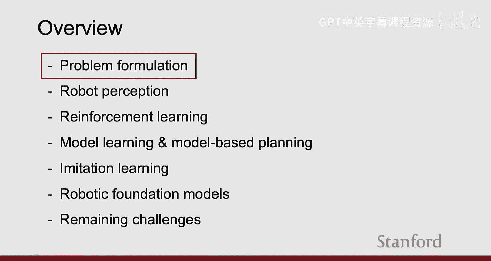
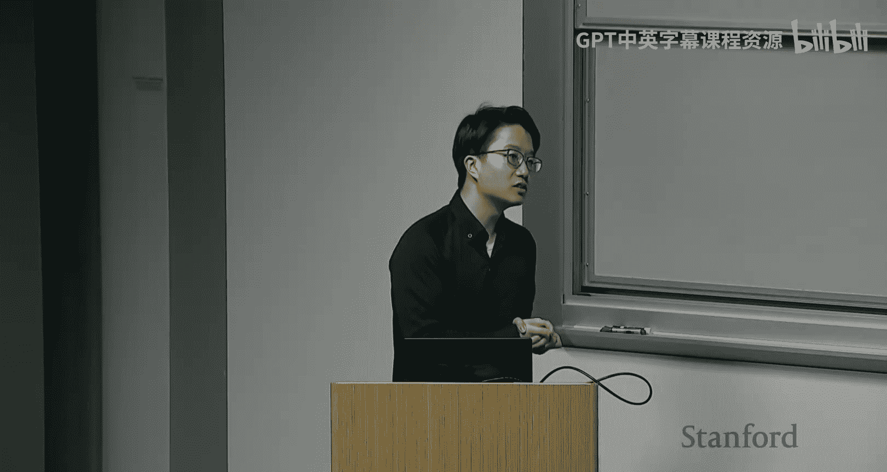
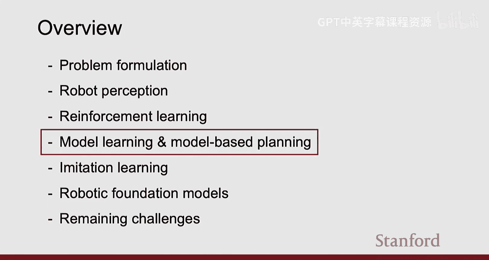
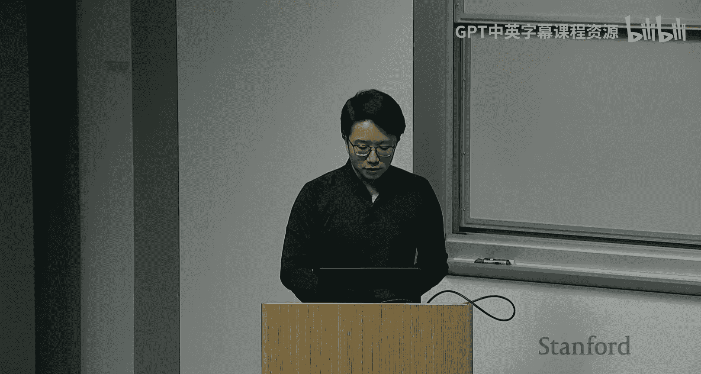
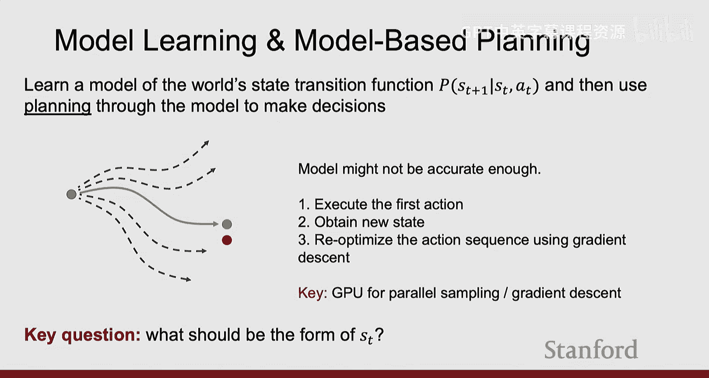
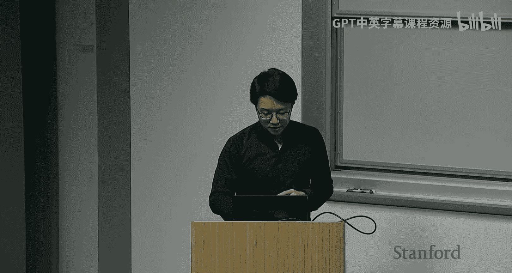
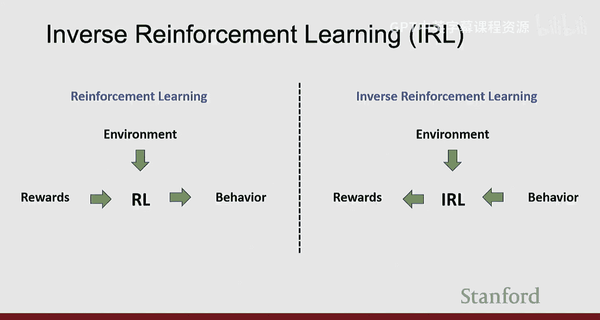
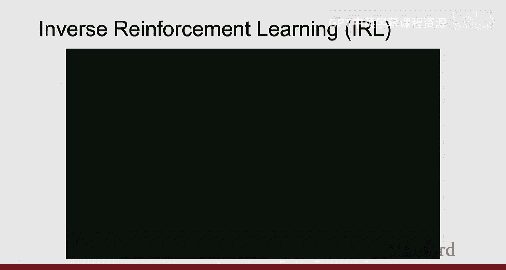

# 斯坦福大学《计算机视觉的深度学习｜CS231n： Deep Learning for Computer Vision 2025》中英字幕 p17 -18-Lecture 17_ Robot Learning.zh_en -BV1FqazzVE6w_p17-

We're here with our final guest lecture for the course and today we have Dr。 Yunjuhu Lee。

 he is an assistant professor of computer science at Columbia University where he leads the robotic perception。

 interaction and learning La he is also a former instructor of CS231N like all of our guest lecturers and he taught the course in 2023 while he completed his postdoc here at Stanford with Professors Feifei Lee and Jajun Wu his research lies at the intersection of robotics。

 computer vision and machine learning and specifically his work focuses on robot learning and aims to significantly expand robot's perception and physical interaction capabilities in today's lecture。

 he'll be discussing exactly that topic robot learning and I'll now hand it off to Yunju for today's lecture。

Yeah， thank you， then for the very kind introduction。 I'm super excited to be here。

 Like last time I was here giving lectures was two years ago，2023。 and similar likely。

 like I was going through many of the lectures。 And today。

 I'm gonna talking about like some of the things that I have been working on。 And also。

 it's also a very coherence piece of this overall pictures on deep learning for computers。

 And this is specifically on robot learning。 So I'll be discussing like what are some of the interesting considerations。

 especially in enabling the robots to better perceive and interact with the physical world。

 and how some of the considerations might be different from some typical computer task and computer like methods。

😊，So first of all， like you guys have already learned like a lot about supervised learning。😊。

The thing and setup for supervised learning is that you have data X and Y， X is the input。

 and Y is a label， and you are trying to learn a mapping that maps from the input X to the output Y。

 There are examples you have already learned， like classification， regression， object detections。

 etctera。And you have also learned about selfsvised learning。

 where instead of having labels in this case， you are just having the data without any labels。

 When you are trying to do is you come up with learning algorithms that is able to extract or identify the underlying hidden structures of the data just by like working or designing some auxiliary loss。

 some typical example， including like autoensures， and's many other like examples in trying to do unsupervised learning or selfsupervised learnings on top of this amount of unlabeled data。

😊，And the special thing and the unique things about robot learning is that robots has to make physical interactions that make interactions with the world。

 So not just you have the input and outputs and mapping from the input X to Y or some kind of latent representations。

 It's really about your influence evolutions of the environment。

 So no matter what action you decide to take in the real world。

 the world will change as a result of that actions。

 and the world will give you some kind of new observations or reward。

 telling you like how the thing how the environment has been changing and how good you are in executing certain tasks。

 So the goal is trying to actually come up with a sequence of actions with feedback from the environment。

 that is to maximize some reward or minimize some cost。😊，And robot learning。

 like especially in the recent like a years， has attracted significant attentions。

 both within academia and also within industries。 So we have seen like many like startup companies and including for physical intelligence like a Tesla bos or figure。

 They are producing those like a very seemingly， very nice and fancy videos of robots doing a wide range of very complicated tasks。

 like floating shirts， like many plating coffee beans or trying to have this human noise like doing interesting tasks in the real physical world。

So this fields like I mentioned， has attracted a lot of attentions and also a lot of investments here are just some examples of some recent startups in the field of robot learnings that is able to attract a huge amount of investments。

 trying to build these general purpose robots that can make physical interactions with the environment So obviously not only those startups。

 many like a big established companies are also having their own robotics investigations and initiatives。

 trying to develop their own like general purpose robots that is able to make general purpose and highper physical interactions with the environment。

😊，So for today's lectures， I'm going to give you some kind of overviews on some of the key techniques enabling factors of the current success and boom of robot learnings。

 who starts with like a problem formulation， so how can we more concretely define the problems we have been building and how can we formally thinking about the robots interactions with the environments？

😊，So I will then discuss on the more perception sides。

 I will talk about the difference considerations between how robots perceive the environments and how people typically consider in the computer vision community and what's special about the robot's perception。

😊，They're talking about reinforcement learning， model learning， model based planning。

 imitation learning， like also some of the recent trends on robotic foundation models and also like using the remaining time to discuss some of the challenges we still see like a lies ahead of us。

So we will starts with problem formulation。So this is in general like how the problem should look like at least in a graphical illustration。

 So in the middle we have this agent。 The agent is given some task objective。

 This task objective could be， for example， language instructions from human or some kind of objective functions measuring how good this agent is in doing some specific task。

😊，This agent is taking states from the physical worlds or some kind of environments。

 and the agent decides what action to take like this A here that needs to be executed in the physical world。

 and this physical world will be updated and given this agents。

 this states S T plus1 as well as the rewards keeping the agents how good it is doing its task。

 So this is how the framework in general look like。

 So you have to be very clear on this type of formulations that consists of goal states actions and also rewards。

 that's specifically defines the problems of the robot learning like type of scenarios。

 Its very different from the computer visions。 I would like to say like computer vision is mostly about trying to learn some kind of representations of the environment based on the inputs like high dimensional data But for robotics。

 it's basically trying to solve some kind of optimization problems where you。😊，Have the constraints。

 which is the physical world of the environment。 You have your objective functions defined over your goal。

 and you are essentially trying to solve this optimization problems by coming up with a sequence of actions that can maximize or minimize your objective functions。

 So that's a key difference between like robot learning and what people typically consider in computer vision。

So some specific instantiations of this problem， like for example， carppo。

 the goal is can be balanced a pole on the top of a movable car and the state of this environment essentially describe the physical state status of the systems。

 which can include the angle， the anglengular speeds， positions， horizontal velocityities， etc。

 and the action would be the horizontal force that is applied to the car and you could have the rewards were one indicating at each time step if the pole is being kept as an upright position。

Some other example could including like robots locomotion。

 or the goal is to make these robots moving forward， and the states could include the angle position。

velocities of all joints within this robot， and the action could be the torque applies to each one of the joints and the reward can be like one at each time。

 the robots like make a step forward and also being kept in an upright positions。😊，And also。

 like some like interesting example， including the Atari games。

 The goal can be complete the gaming with the highest score as high as possible like you can get。

 And the states would be the raw pixel inputs of the gaming screen。

 and action could be the gaming control， like up down left and right。

 and reward could be the score increase and decrease at each time step。😊。

And some of the like more famous examples you probably have noticed like earlier。

 especially with the development of alpha go， and the definition and problem of goal can also be defined in similar ways where the goal is to win again in the states will be all the pieces that are currently already on the go board and action could be where to put the next piece down on this board and reward could be on the last term。

 if you win you get a reward of one and if you lose， you get a reward of zero。😊。

And this not only applies to， for example， gaming domains。

 like even with the recent like developments of large language models。

 you can also like thinking about those problems， especially for sequential like a generation problems in a similar manner or the goal could be to predict the next words in the state could be the current words in the sentence and the action be what the specific next words you only puts there and if it is correct。

 you get the reward， if it is incorrect， you get rewards of zero。😊，And similarly， now。

 you probably have already played with many of the chatbots quite a lot。

 And you can also define a problem like similarly， where the goal is to be a good companion to the human user。

 The states could be the current con conversation and action that should be generated by the chatbots would be the next sentence you are given to the human user。

😊，And according to the human evaluations， we could define reward if the person is happy like if they are satisfied。

 you get a rewards of one and if you are not happy or neutral， you get some other rewards。😊。

And more specifically， for example， in the robotics domain and the task could be to fold the clothes and one of the clothes we folded nicely in the states is the current observations the robot is getting from this environment which could including the multi view RG or RGBD observations of the environment and the robots needs to decide its actions and how to move its ine。

 should they close or open its scrapers in order to manipulate this close。

 And according to human evaluations if the close is properly folded。

 you give the robot a reward of one and if the clothing is not folded， you give the rewards of zero。

 So here is actually how you want to like a more concretely thinking about the robot learning problem。

 It really is a way that allowing the agents to interact with the world it considers the effect of an and also this sequential decision making problems that is different from what people typically consider incomp。

 which just needs to predict the outputs。😊，And the goal， states。

 actions and rewards and objective functions are the things you need to keep in mind whenever you are thinking about problems along this direction。

So this is about problem formulation。 So the question is like how specific the reward needs to be designed。

 like in many of the tasks， the reward can have many different types of specifications。 For。

 in the selfdriv， The reward could be like as fast as possible or reward could be like we want the passengers to feel comfortable as you are driving along the road。

 So even for close folding， depending on the user's preference。

 a clothes can be folded in many different ways。 Some want the total area to be as small as possible。

 Some want it to be as like smooth as possible。 There could be a difference like a types of rewards。

 here， I'm just talking a generic terms， like if a person look at the clothes。

 like do they think this is folded or not。 But more specifically in terms of the reward design。

 there's actually a lot of nuances in like satisfying a specific needs of a specific application。😊。

Okay， so I will continue。 So this is how we are thinking about those robot learning problem that allows the agents to interact with the physical world。

 Now I'm moving on to robot perception， especially in discussing how the perception problem within this robot learning domain is different from what typically people typically consider income pre。

😊，So this image again， you you're actually going to see this image again and again。

 like through today's lecture。😊，So this is essentially in the question of how we are handling the whatever information you are getting from the physical world。

 the physical world can give you freedom high dimensional RGB observations or RGBD observations。

 It could also include some other sensory data like tactile and。😊。

And this robot perception problem is essentially trying to distill or harnessing some structure knowledge from those high dimensional data that is useful for the robot to do the downstream decision making。

And essentially， the question we are trying to tackle is trying to make sense of this unstructured real world and the real world can be very messy。

 So essentially， the observations the robots are getting from the environment can only contains like incomplete knowledge of the objects and environments。

 There could be occlusions。 There could also be like errors from the sensorly like data。

 and the imperfect action may also needs to failure。 For example。

 like the robots can try to grasp some objects。 but that grasping behavior may not always be successful。

 Sometimes you accidentally drop that object， which will also cause like evolutions and unexpected changes of these environment。

 There will also needs to have dis perception system that is able to handle those scenarios。😊。

And also this environment can change it is dynamic， consists of not just rigid object。

 but deformable object， clothes， robes， granular medias。

 there could be other agents like dogs or other kids or other humans and are also in the same environments messing up with the world and your perception system needs to be able to cope with all those kind of changes。

So that is why like in the robotics domain， people typically not just working with like a camera data。

 They will try to add as much sensor as possible to the robots as long as they can provide some useful information。

 It really considers like， for example， like tactile sensor， the audio information。

 the depth informations， etc。 and typically we have to like a design systems。

 It is able to put all the sensors together It allows them to complement each other where the audio information might tell you things about the physical contacts。

 and the tactile information might tells you about whether a graph is stable or not。

 and the camera information tells you about something that is more on the higher level on the grand scheme of things about the overall states of this environment。

 So how these sensors can be composed together and work together is very。

 very important to design a capable robotic system that are working in the real physical world。😊。

And besides the numbers of sensory modalities。Very important difference between like robot vision and computer visions is trying to really understand the effect of actions and also affordance of this environment。

On the left is the very typical examples you have already seen in computation。

 which is trying to do instant segmentation。 What you are given is this 2D image。

 You are segments different instances from this 2D image。

 like by drawing like a contours over these 2D pixels。😊，But what's difference in the robotic domain。

 for example， on the right， The robot can， for example， given one object。

 and this objects seems to be maybe just one object or maybe some a lot of pieces that are。

 for example， stacked into each other。 The robot has to know like what type of actions will allow it to have better understanding better perceptions about this environments。

 I this one piece of objects or multiple pieces composed together。

 The robot should come up with actions like perturb and actively interactive with environments for the robot to get a better perceptions about the states of this environment。

😊，So that is why a robot vision is。Embbodies， active and also environmentally situated。By in bodiesd。

 what we mean is robots have this kind of physical body。

That is directly experiencing the physical world directly。

 Their actions are part of a dynamic with the worlds that have immediate feedback on their own sensations。

And active， meaning the robots are active perceivers in knows why it wishes you sense and chooses what you perceive and determines how and when and where to achieve that perception。

 you can move your head around， you can know like what's behind this table。

 you can just move around to see what's behind the tables， So this is the active parts。

 which is different from what people typically consider in computer It are mostly by work with a passively collected data sets。

The third point is about situated。 the robots are situated in the world。

 They do not deal with abstract descriptions， but with the here and now of the world directly influencing the behavior of the systems。

Her robots really have to understand， especially in closing this perception and action loop。

 It sees the world and understanding its goals and be able to act in the environment upon its perceptions。

 Sometimes the robot don't have to know the full state of environment。 For example。

 if I'm buttoning my shirt。 I only have to know the local regions near that button for me to button that shirt。

 So some of the perception has to be tightly coupled and co designigns with the task and downstream decision making systems for the robot to focus on the relevant region or task relevant regions of the environment to be properly like a close perception and action loop。

😊，So this is about some very specific considerations and how robot's perception might be different from what people typically consider income pre。

I was starting to discuss some of the algorithms that not only allow the robot to see。

 but allow the robot to act in the world and rule starts with reinforcement learning。Remember。

 earlier we have like seen this image。 the robots has to act upon this environment and get rewards from this environment。

 So one very typical ways of trying to solve this optimization problem is allow the robots to interact with the worlds as extensively and as massively as possible you just collect all the experience data and do this type of like trials and errors allows the robots to understand this action needs to higher reward and that action needs to lower rewards and we can pivot the agents behaviors towards the actions that give the agents some higher rewards this is like the general ideas of reinforced learning is really a way to allow the agents to constantly interact with environment and do this trials and error to maximize the reward or minimize the cost。

And here I also want to be a bit more specific in discussing the difference between reinforcement learning and supervised learning。

So this is a typical framework of how reinforcement learning look like you have the environment。

 environmentron gives the agents some states， agents generate action and environment like give the agents the feedback which is the reward and environment will change where the environment will give the agents the new state ST plus1 and it is essentially a sequence like a temporal sequence on the temporal domain where the robots has to the agent has to make the sequential decisions。

😊，And here is a typical like image typically look like for supervised learning。

 So you have the data sets。 The data sets will input to the model with X。

 and this model will generate the prediction Y。 and you will be able to calculate the loss。

 according to the model's predictions versus the ground truth from this datas。

 So this is a typical setup of supervised learning。😊，And the key difference。

 some of the key difference between reinforcement learning and supervised learning is that the environments might be stochastic or the same actions。

 the environment might change in a different manner。 let's say if you are pushing a box forward。

 depending on the distribution of the supporting force。

 The same exact actions will leads to can potentially leads to the box rotating into different angles。

 meaning there can be uncertainties and stochities in the environment that will like leads to like stochastic behaviors of these environment。

 which will also give this agent stochastic like rewards。

 where the same action may not always leads to the same rewards。

 So this is very different from supervised learning We are dealing with an uncertain dynamical system。

The second is about the question of credit assignments。So for supervising， you give the inputs。

 you predict the output and directly calculate the loss。

 like you directly know like what are the mistakes and what are the error you are making by making a specific predictions。

By in the reinforcement learning or sequential decision making domain， the rewards can be delayed。

 meaning if you like play the game of goal， like only until the very end of these episode。

 do you realize you were winnings or you were losing。And that's rewards 0，1。

 M is because of some very， very early like steps， maybe even the first like steps or some steps during the middle of the games。

 So how to properly assign the credits you are getting along these sequential decision makings towards all the actions is also another very like tricky and important questions。

 people hope to answer esing reinforcement learning。😊，The third thing is the nonde。

 def abilities of these dynamical systems。 For example， for supervised learning。

 like you have the inputs， you feed the input through the model， you get output。

 you calculate the loss。 So everything along this process is differentiable。

 So you can directly get the gradients of the loss functions with respected to the parameters within the model。

 but that's typically not the case for reinforced learning。

 or the environments can oftentimes not differentiable。

 So how to probably get the gradients of the rewards with respect to actions can be tricky Sometimes people have to rely on a massive sampling to do like those type of zeros order estimations of the gradients for you to do proper learnings。

 That also is another difference。Like the last difference is about this non stationities of this。

Scenas where the evolutions and states of the environment is really a result of your actions for supervised learning。

 no matter whatever you predict， it doesn't influence other data points you are getting from this data。

 but your actions will influence the next state you are getting in this sequential decision making problems。

 It is also one makes this kind of reinforced learning problems a little bit more like nuanced than supervised learning。

So here are some more specific examples， like， for example。

 playing these Atari games like I mentioned earlier。

 the goal could be to complete the games with a higher score in the states would be the raw pixel inputs from the gaming screen and the action could be up down left and right from the keyboards and I'm trying to like the reward are the score increase and decrease at each time step。

😊，And some typical algorithms within this domain either lies in the field of， for example。

 like Q learnings or， for example， policy iterations。

 Here's then one examples of like trying to learn this Q function。

 Q function essentially measures the discounted， expected future accumulated rewards like when you apply a specific action A at a specific state S。

 and you will be able to get this Q functions through like interactions with these gaming environments。

And after you have learned these Q functions， if can evaluate， for example。

 like what are the Q values you are getting but applying different actions。 in this case。

 there's left and right， ups and downs。 So they are potentially before actions。

 And given these four actions， you can look at their Q values。

 and just execute actions that give you the highest Q values。

 So that is what allows you to do this type of like decision makings in this domain。

 So because today we are gonna cover a lot of materials。

 So we won't go into the details of the reinforcement learnings。

 But some of the current state of the art reinforce learning algorithms， including S。

 like soft actor critics。 and also PPO like proximal policy optimizations。 So if you are interested。

 you are like very welcome to look at those algorithms in details。

 there's a lot of like open source like implementations and tutorials online。😊。

But here I want to highlight to you some of the results you could potentially get by going through this reinforced learning specifically like Q learning process。

😊，This is developed by Google Dmites that is trying to develop these agents that is trying to play the game。

 breakouts in this kind of artari world。So just after like a 10 minutes of training， the robot。

 the agent can already like a。Touch the ball。 but often timess。

 I can still missing the ball like quite often。And after some more times of learning， for example。

 like two hours of training。And the， the， the agents can control this kind of pads in a much more reliable and consistent fashion that can nearly like all the time。

 can catch the ball and be able to like constantly getting more and more rewards by like。😊，Bye bye。

 bye， by bouncing back。And after like a four hours of trainings。

 something that's interesting happens where the agents come up with actually a novel strategy。

 which possibly is not known to many of you that is trying to like push bounce the ball back to create a tunnel on the left side of this wall。

 And then it will push this ball like on the upper side of the wall to do this very efficient like reductions of those bricks。

 This is the type of strategy that can be discovered by reinforcement learnings。

 So this is like what's nice about reinforcement learning。

 meaning you allow the agents to do very extensive and comprehensive exploration and interactions with the world。

 And it is totally possible for this reinforced learning agents to discover some strategies that are better than even the best human players。

 like a very typical examples would be the game of goal。 So when alpha goal came out in January 2016。

 it was also。😊。

Like about the time when I was trying to decide like what type of like research directions I'm gonna go before that time。

 I was just working on deep learning for computers。 But when Alpha goal came out， I'm like。

 I have to work on this kind of decision making problems。

 So that's when I started to touch upon reinforcement learning。

 imation learning and all the way until now to do robot learning that allows the robots do physical interactions with the environments。

 So I'm， I wasn't satisfied with just working with a passively collected data。

 but we really want an agent that can do active interactions with the environment。😊，So questions was。

 but how does specifically this Q functions like works。

 So you can see this Q take as inputs the state S and also the action。

 And this setup would essentially be the parameters of these Q functions where the queue is instantd as a neural network。

In this specific case， like I mentioned earlier， the states is the raw pixel inputs that directly getting from the gaming screen。

 So the inputs could be this kind of four steps， four frames that directly input it to these Q function。

 And if you are dealing with images are very like a straightforward way of instantiating this Q function is to use convolutional neural networks。

 So you have convolutional layers like show in this kind of orange blocks。

 and then you'll be able to go through these fully connected layers to directly derive this like a Q value。

 And in this case， because they are like a four discrete actions like in this case probably just left and right。

 but let's say there's like four discrete actions up and down left and right。

 So you'll be able to have like different Q value estimations。

 that is the result of this specific action A and that's how you can use this Q values to make decisions on what action to take。

 that is the most effective and maximizing this Q value Does answer your question。😊，嗯哼。😊，Yes。

 like this is when AlphaGo came out and obviously since there has been a lot of developments and evolutions in making this type of gaming agents better and better。

 so then later there's like alphaGo zero that is essentially a simplified versions of alphago。

 they're no longer using any imitation learning to do any initialization and is able to beats like at that time the number one like a player like a coJ。

😊，So this is actually one thing one lessons like people learn inside this AI communities。

 which you can call it like the bitter lesson from the rich Suton。

 where sometimes you want to find the simplest recipes that is the most and best compatibles with the scaling。

 you want to leverage the scale like the power of scaling and sometimes like making this method simpler。

 will actually give you better performance by like making it more compatible with whatever infrastructure you can use for scaling things up。

 and then later the develop alpha0 that is able to general the same set of algorithms into not just chess not not just go but other games like chess and Shoji。

And then they they design like a move zeros that's like not just like do this kind of model free reinforced learning。

 but it's able to learn latent based dynamics models to plan over that give you like even better performance。

 So for this specific domain， like I would say， especially in the gaming developments that really empowers a lot of like design and developments in how people can do better and more simple efficient and more scalable design of those reinforced learning like agents。

😊，And in November 2019， like Li Siido， like who was beaten by Alphago， announced his retirement。

 and he realized there just no， it's just not possible like at that times for any human players to beat the best like a goal like AI agents out there。

And obviously， since then there has some been other like more complex games like Starcraft and dota that shows that as long as you put enough compute。

 as long as you have like a good， like very well designed like algorithms and infrastructure for you to do the reinforcement learning。

 you can get very， very good performance in games that are actually noticeably and all more magnitudes more complicated than the game of goal。

 So I would say like if you have a game like reasonably designed games。

 like there's like a very legit chance， like if you put the sufficient resource， you can have very。

 very powerful gaming agents。😊，So not just in games。

 people have also been developing these reinforced learning algorithms and agents that can work directly in the real physical world。

So this on the left is a work from ETH that was published in science robotics 2020。

 Yet essentially changing my minds about how useful reinforcement learning can be for real physical robots。

 because before it was just mostly games， but could argue in games like there's a lot of you can just like a spa as many games as possible。

 But for the real words there's always like seem to real gap where you are training on the same game。

 you are also testing on the same game。 But for robots， if youre training on the simulation。

 like how much does seem to real game matters for the agents you general to the real environments。

 And this paper really convince me that sometimes the same to real gap just may not matter that much。

 So we are not simulating the bushes we are not simulating the snows。

 but the agents that's using reinforcement learning that training simulation it give you some very。

 very robust performance in the real physical robots like snows and sleeppers very slippery like a surface。

On the right is a very recent video released by Uniry that shows just another levels of like a dexterities for locomotions that can do this kind of thing to real transfer。

 allowow these robots to do like very， very crazy and dynamic behaviors that can navigate into some very rough and challenging terrain。

 I would say in the domain of robot locomotion。 It close to be a solved problems。

 And the solution to this problems is exactly reinforcement learning。😊，So this is about locomotion。

The other domain is about manipulations， or the robots has to manipulate the objects in the real physical world。

So in 2019， when open AI was still like a touch upon like robotics， they design the systems。

 they are trying to do dexrous manipulations of rubrics cube。

 they are able to do the reinforcement learning in simulation and do seem to real transfer。

 they allow this kind of robots to like solve this rubs cube But one caveat is that their success rate is very。

 very low although this video seem to be very beautifully done， but their success rate was very low。

 And if you really look at the papers， they only tested a very limited amount of trials and given that number。

 possibly the real is not very like satisfying。 but still like since then people have been able to like extend upon this Dxrous manipulation problems it allow the robots to do enhance Dxrous manipulation and reorientations of different types of objects into like target configurations it's all thanks to the developments of reinforcement。

😊，But we can see until now， our examples。In locomotions and in hand manipulation。

 it doesn't really solve the problem。 For example， if the robot can just fold the clothes for you or doing the laundry for you in your home。

Like phone inflation is still in these kind of very like isolated domains。

 like working with these kind of isolated like environments。

So this is actually some of the key challenges and bottlenecks of existing like a model free reinforcement learning。

This mostly learns from the trials and never with environments。

 and it requires extensive like interactions with the world。 For example， for the alpha go 0。

 like it actually learns from 3000 years of human knowledge in 40 days， which is amazing。

 but like it still requires like many， many， like years of computation。

 like years of like equivalent computations for the agents to learn if in domains where there's like a huge symmetry gap。

 And you want to do the reinforced learning in the real physical world。

 that will be a huge bottleneck for learning this reinforced learning agents very effectively。😊。

And also， of course， if you're simply to real gap， if you only can learn the model in the real environments。

 there's a lot of like safety concerns。😊，For them， here is an example of showing this kind of learning progressions of an agent that is controlling this humanoid robots to move forwards。

 you can see that during this learning process， although at the very end。

 the robot is able to like move forwards， but there's a lot of like very weird behaviors that you can totally imagine if you apply these agents and real physical robots It will like fail catastrophically。

😊，And it also have like very limited interpretabilityities and sometimes very hard to correct things when things go wrong。

😊，And like one interesting thing， if you're really thinking about how humans learn to interact with the environment versus like pure reinforce learning。

 you realize that we humans have a very intuitive understanding of this environment。

 We can imagine how the environment is gonna to change if we apply a specific actions。

 So it's exactly this predictive capabilities that allows we humans to plan our behavior in achieving some specific targets and this predictive capabilities is also actually learned from we humans physical interaction and everyday experiences with the real physical role。

😊，So going beyond reinforcement learning， the next topics I want to discuss would be how we can indulge the robots like with similar capabilities in imagining the effect of their actions and to do model based planning for the specific examples。

 we have simulation， typicallyy the simulation people use would be for example。

 IacG or Iac S developed by aV。😊，And there are essentially a bunch of average body simulations where the robots like just touching this kind of like a polygam type of represented like a like a representations of the floor。

 It is not simulating for them， the bushes。 It is not simulating those snows。

But what people do is to randomize the simulated environments a lot。

 they randomize the friction geometry and many other physical parameter inside this environment。

 such that people will assume whatever you encounter in the real physical world。

 its just one data points within the distributions you randomize within your simulation So if your policies can be robust like ir robust in controlling this robots within that distribution and if the real world is just one data point within that distribution the policy can generalize and so far at least from this empirical evidence this type of assumption actually holds and the policy actually works very reliably and robustly in the real physical world。

So the question is about like what is actual command， So actually in many of the existing demos。

 there can be a person providing highlel command to the robot， for example。

 which direction to the robots like walk should the robots that rotates in place or just still like keep working forwards condition on that high levell actions provided by human The robot has to decide this kind of lowle actions。

 The low actions are typically， for example， the joint torque that applies to each and every one of the joints on top of this robots。

 So that is how like this typically like looks like， meaning humans give high level command。

 conditional high level command， robot has to use this policy to decide this kind of low level like actions which is instantiateated using like joint talkrque。

So like I mentioned， one biggest lesson I learned from these lines of work on locomotion is that the simulation doesn't have to be perfect。

 As long as you randomize enough， you can generate very robustly in the real environments。

But such lesson hasn't really been generalized like very well in the manipulation domain。

So in the manipulation domain， like how actual simulation needs to be and how much does the symptom real gap matters。

 Its still a research question people hope to answer。 So I can give you one specific example。

 if in a simulation， you are pushing a box forward。 if in simulation， the box rotates for 10 degrees。

 but in reality rotates for 12 degrees。 it may not matter that much。 But if in the real world。

 your grasping was successful， But in simulation， the object should just flies away because of some kind of numerical issues。

 or if the object like sleep like away between your fingers。 that's problematic。😊。

So there are regions where symptom real gap matter。 There are other regions。

 C real gap may not matter that much in the manipulation domain。

 and people still are trying to trying to answer and trying to understand like how symptom real gap can happen and what are some of the most important like recipes and characteristic that this simulation needs to have for the most reliable like symptom real transfer。

So if I understand your questions correctly， you're asking like there are still a person like providing highlel command to the robots。

 Your question is， can the robot come up with better plans than a human。

 So can actually give you a more nuanced perspective Although many of these videos seems very nice。

 There is a human operators operating the robots to choose which route to go For example。

 like what people typically do is， for， let's say there's of rough rings or some pile of rocks and humans can actually try to command robot to going forward trying to climb those kind of rocks。

 if that fails， humans can actually providing some other high levelve command to get around this pile of rocks。

 So there can be some kind of learning also on the human size in understanding the capabilities of those robots。

 So this is also why some of this video can actually looks very nice because humans select the routes that human nose can show the limits and also the capabilities of this kind of lowle controllers and how to do that auton。

😊， actually， and very interesting like questions。 People are also doing research upon。嗯哼。😊。

So then I'm gonna continue。 So I've discussed like some of the successful examples and power of reinforcement learnings。

 and I also discussed the limitations of reinforcement learning。

 and we still haven't really seen very， very successful and wise scale deployment of reinforcement learning in manipulation yet。

 and we humans may not just learn from trials and error。

 We actually build this type of internal model， So we're asking the question。

 Can we actually learn the models from the robots interactions with the environment and using that model for the robot to do better physical interactions。

😊，So specifically， what you are touching upon again back to this figure is how we can learn and approximations of the real physical world and how can this approximated physical world that runs on the virtual domain can help guide the robot's actions and decide what action to take in the real physical world。

😊，So let's say if you already have the model， for example。

 let's say you have already learned the models like we humans have in our like mental like environments。

 we can predict given the current state S T and also the action T。

 how the state of the environment will change in states T plus1。😊。

And then we can use this essentially is a forward model like given the current state and action prediction next states。

 so what actually is the problem for us to do the planning。

 which is essentially an inverse of this forward model or the planning is to give the current state and the target states to come up with the action that can allow the robot to achieve the target states。

😊，Fra given the current state showing the blue dots。 We have the targets showing the red。

 We can have maybe some initial guesses of how the actions might look like and our model。

 our approximated learned models， will be able to predict the sequence of the evolutions of the states。

 which is shown in this green， like a trajectory。😊。

And then we can measure the distance between these green dots and red dots and back propagates or doing optimizations using the gradient of those their distance with respect to all the actions along that trajectories to do this type of optimizations in order to know like what actions can guide us to getting us closer to the targets show in the red。

And obviously， the model may not be accurate enough， so we typically only execute the first actions。

 and we obtain the new states from the environment。

 and we can reopim the action sequence using including descent or any other optimization techniques you use to do this trajectory optimizations。

😊，And one of the key benefits， especially recently with the development of GPUs and also neurodynamic model。

 is that you can use the GPU for parallel and simultaneously sampling to allow you to do like large scale sampling optimizations of those action sequences。

 which is actually quite efficient。😊，So like given this like a general framework， you have the model。

 which is this kind of forward process and you can always use the kind of forward model to do this inverse optimizations to come up with the actions that can get you closer to your target configuration。

😊，And one of the key questions has always been， what should be the right representation of the。

 what should be the right and most effective state representation is and how we can learn this model based on this state representation。

And over the years， there has been many different investigations on choosing or investigating different type of state representations。

Some earlier work， including howo can use for just 2D images as a representation of the states and trying to learn pixel dynamics。

 meaning how the image might change if you apply a specific actions。

 This is a work called deep visual foresight， which set up some of the initial works in the whole domains of like world models。

😊，And by learning these kind of pixel based dynamics models。

 people can come up with strategies that is able to。

 for example minimize the distance between the current observations。

 and some can rotate objects and pushing the objects around in order to achieve the targets show in green and the current states is shown in red。

So this is about like a pixel dynamics and what people can also do is to use key points as a representation of the environment to learn like a key points dynamics models and here like what we can do is to track the movement of the key points on top of this box over the 3D space and also learn dynamics model of those key points as a result of some pushing actions and then we can allow the robots to use these forward predictive models to plan the robots behaviors in order to track some specific trajectories in order to push this box to achieve a target configurations。

😊，So besides using key points， So what if you are encountered some objects with even higher degrees of freedom。

 So if you go like one levelfinr， you can also represent those objects using a sets of particles。

 essentially a set of points here like which is actually a work that was done when I was here like as a postdoc where representing this pile of granular pieces using a bunch of particles and trying to predict how those particles will move around if you apply a specific actions and this forward model can allow the robots to do this inverse decision makings that handle a wide range of granular objects of different like a granular sizes and we come up with strategies that can gather those pieces into the target region show in the bottom right like a corner of each like a segments and the same model with like a good feedback from the environment and allow the robots to correct from the models's error and come up with strategies。

That can be very reliably aggregates all the object pieces into the target region。And obviously。

 this model not just can general to like a difference like graular pieces of different granular sizes。

 You can also change to different target configurations。 Here。

 you will very quickly realize what the target configurations are。

 the robot has to come up with a strategy that to do nontri redistributions of the granular pieces。

 And after the redistribution。 you have to align the fine green details with the targets like shape。

 You order to accomplish this like a pile rearrangement tasks。

 The task here is actually to rearrange these granular pieces into different letter shapes all the way from letter A to letter Z。

 And with this kind of forward models will be very successful in coming up with a sequence of strategies。

 Of course， with feedback from the environment to allow the robot to rearrange these kind of object pieces into the target regions。

 And this is actually a highly nontri task。😊，And going beyond that。

 we also have this like a subsequent work， which I was also involved and done when I was here at Stanford and we designed this kind of dumpling making robots。

 that is actually equipped the robots with 15 different 3D printed tools。

 We have four are GB cameras looking at the environments to do our reconstructions of the geometry of this do。

 and robots will have to decide what tool to use and what action to take You to get this dumpling into getting this dough into a dumpling。

 and key enabling factor is also this like a forward prediction models represented like using particles。

 right here the red dots are representing the shape of the tool and blue dots are representing the shape of the objects。

 The first row is our models open loop prediction。 and second row is like what's actually happens in the real environments。

 So this learned model that directly learned from this real world interactions。😊。

Can very actually predicts the change of the shape of the dough when using different tools。

 applying different actions。 and in the end allows us to have this integrated integrated system that can make a dumpling out of a dough。

 What's interesting about this video， is there a person constantly perturbing the robot from doing this job。

 The robots will take the realtime visual feedback from these environment to realtime understanding the shape of the dough。

 And then using the current observations and also the learned dynamics model that predicts how the environment is gonna change how the dose shape will change if use a tool to apply a specifics。

 and based on this forward model is making this inverse decision。

 This decision is happening at two levels both at a high level， which is to decide what tool to use。

 which is a task level decision making and given this tools。

 the robot is also have to make like a lower level like motion level decisions in deciding what specific action to take to progress into the next。

😊，Task stage。 human are just so annoying。 adding pieces， folding the dough。

 The robot is very robust to this external disturbance in continuing its progress in doing the task。

 Here's what's interesting。😊，After robot cut a circle， the humans shows no mercy， destroy everything。

 The robot knows you actually has to start from the very beginning。

 like review the task from the beginning in order to progress with this kind of task objective。

 So this really shows the patience and also the robustness of our systems with this type of external disturbance and all of these capabilities is enabled by this kind of neurodynamic model that predicts how the shape of the dough will change if you apply a specific actions。

😊，In the end， the robots will place the skin on top of this dumpling clip and move these kind of feelings on top of the dumpling skin and using a hook to close the dumpling clip。

 You are to use this general purpose robots equipped with 15 general purpose tools to make a dumpling out of a dough。

😊，So this is about like how can learn the model and how that model can be useful for downstream like model based planning。

😊。

So for this specific case， like。

If we want to describe it more rigorously， we are not using reinforcementally we just learn the model and using that model to do planning。

 although the plan can be distilled into a policy， they can be executed in the real environment in a more efficient manner but some people also call it model based reinforcementally decide which background you are coming from you can either call it like model learning and model based planning。

 you can also call it model-based reinforcement learning。

 but the key idea is we want to learn the model from the robot's physical interactions with the real physical world and using that learn model that is very effective in helping the robot to decide its behaviors to like a progress with a task objective。

So in this specific case， it is the high level plan and low level decision making is done by two different models。

 So over the high level we are given the current states like current observation of the environment and targets that what help to achieve it is essentially a classifier and classify which tool to use and conditional on this class like tool label it's a low level like policies that decides what specific action to take in order to like progress into the next task stage。

😊，Very good question。 So back then this work was done in 2023 at that time。

 vision language model wasn't like a very powerful。 So at that time。

 like what we did was you allow a human operator to do the data collection demonstration of the task for 10 times we use that data to train this kind of classifier to classify what tool to use that allows us to actually jump back and forth over this chain。

 like I mentioned earlier， after the robots cluster circle， the human destroy everything。

 the robot knows to jump back to some earlier stages like that fit to its current observation in order to do the proper like recovery from the external disturbances。

 So in this specific case， like what we have been doing is a combination of sampling base trajectory optimization versus like a policy learning So what we have been doing is to give the current states of the do。

 we have our like forward predicting models。 We'll be able to sample a bunch of actions and sample a bunch of tools to like predict like what is the evolutions of the shape of that do and。

😊，We compare the models' prediction with the targets like we hope to achieve。

 which is similar to what I showed earlier。 For example。

 our model predicts the shape of the dough will go into this green dots。

 but the target is this red dots， We are comparing their distance。

 And then that allows us to select the most effective actions that can get us to the target to be as close as possible。

 and we can do a lot of samples like this。 But sampling during the test time is very time consuming。

 So we do this type of sampling in offline fashions， which give us a data。

 and we can use that data sets to train a policies that can be inference at a very。

 very like using a very short period of time to do the inference during the test time。

 there is still a neural network as policies。 Yeah。

 although that policies learn by distilling from our models like predictions over a huge amount of samples。

For this specific work， there's no physics based simulation at all。

 We actually have a baseline that use a state of the arts deformable object simulator。

 which is called NPM material point methods。 What we realized is that even if we do very extensive system identification estimating the parameters of those physics based deformable object simulator。

 The identified model is noticeably less accurate than the model that directly learned from the real world interactions。

 Like I showed earlier， for them， the first row is our modelss open loop prediction。

 The second row is the ground shoes。 Our models's prediction align very well with the ground shows。

 which is just much more accurate than。😊。

Whatever F space simulators out there。O， so if there are no more questions， I will continue。

So what we have discussed is this kind of model learning and how this learned model can be effective for the downstream like a model based planning。

And the next category of algorithms is imitation learning。 So like just like a recap a little bit。

 like we discuss reinforcement learning。 that is directly learning the policies by doing trials and error with the environments。

 which has a lot of troubles， for example， the sample efficiency。

 the safety concerns and for the model learning， what we have been doing is actually force back to the category of supervised learning where have the evolutions of the environments。

 We use that data to do supervised learning to train this model and using this model to do model based planning。

😊，And instead of just using supervised learning to do to train the model， people are also asking。

 can we do supervised learning also for the policies， This is a general idea of imitation learning。

 meaning， can we have a。Big datas that shows how a task needs to be done。

 And using these datas like to train these kind of policies。 I'm showing this figure again。

 This is trying to learn this kind of policy， taking the state as inputs that predict the actions and all of these kind of learning signals and learning procedures are done through a large scale collected data from human demoing to the robots。

 how a task needs to be done。😊，So learning from demonstration is， of course， not new。

 It has been investigated for decades， is also constantly how we humane is actually learning to perform a lot of like physical interactions or social activities in the real world。

 like since we are very， very young。😊，So one of the most like earlier classic like imitation learning algorithms is called behavior coloning。

😊，Essentially trying to learn this kind of mapping。

 The map currently like from this observation O into the action A。

 and this policy is represented using this function pi paraized by the setta。

So one of the key issues for behavior coloning is called cascading error because like I mentioned。

 the key difference between the robot learning in or agency interaction with environment is it is a sequential decision making problem。

 It differs from like a typical like supervised learning in the typical computer domain in that your error can accumulate and being amplified over time。

 Let's say at the very beginning， you made a very small error。

 and small error can lead to your state that is slightly deviate from the distribution of data used between your model that will lead a policy to make even larger error and this error will be amplified over the temporal horizons that leads to a trajectory that can deviate quite a lot from the demonstration trajectories。

 So that's a typical issues of behavioral coloning。

So that's why oftentimes when people are trying to make imation learning work。

 people follow this type of pipeline。 where on the top。

 we have the demonstration collected by the experts。

 then well use that as a training data to do supervised learning to train this policy and we rule out the policy in the real environment and observe those failure cases and we either collect additional data or provide corrective behaviors that allows this data sets to not only contains the initial demonstrations but also those corrective behaviors that gets the errors from the policies back to the canonical trajectory or get back to the trajectory that can still successfully accomplish the task。

 So this is actually a typical like life cycles we are trying to develop any imation learning agents or imation learning algorithms in the real physical world。

😊，And along these lines， because like if people do this kind of imitation learning。

 there's not very explicit definitions of what the task actually is。

 the task is implicitly hidden within those demonstrations。

 So there's a class of algorithm called inverse reinforcement learning where on the left is what people typically like thinking about foreign reinforcement learning。

 Where on the right， where people are trying to use this inverse reinforcement learning to like summarize the rewards from your demonstrations and be able to use that rewards to do typical reinforcement learning to learn this kind of algorithms Some of the earlier like examples were actually also developed as Stanford by Peter Bi and also Andrew in it allows them to control helicopters to do some very。

 very crazy behaviors And this is all actually a very old work and be able to achieve this type of like agile and and effective behaviors on this。

😊。

physicalhysical helicopters is very impressive at that times。

 So this is the power of learning from demonstrations and using that demonstration to summarize the rewards and in connections with reinforcement learning。

 this is what we are able to achieve。So obviously over the years like people have been making the imitation learning algorithm more and more effective。

 especially in connecting with， for example， energy based models。

 So instead of learning these kind of explicit policies show on the left that directly do the mapping from the observation O to the actions who are coming up with kind of implicit policies that takes idea from energy based models that direct taking the observation actions to predict the score and using this kind of like energy based model to do inference to get this kind of predicted actions A has allows the robots to handle demonstrations that are very multimodels or handle scenarios where the optimization landscapes may not be very。

 very smooth and robot is able to come up with this kind of strategies like dist these policies from the demonstrations in doing this kind of contenting rich manipulation tasks。

😊，Another to say like some of the recent， very recent success of robot learning as a whole is the results of this work called diffusion policy。

 which again， is also taking some of the advances in the community of generating models from this one like for the implicit behavior calling。

 people are joint inspiration from development of energy based model。

 energy based model is a type of generating models developed in the deep learning community。😊。

And there's another class of like more powerful models in the deep learning community is called diffusion models。

 and you are also trying to use the diffusion models to use it as a policy function class to allow the agents to also like inherent benefits and properties from those diffusion models。

 So this work was originally done at Columbia that's where I am right now。

 and the leads like a P of this work now come to Stanford。

 you can see like many of the work I selected has a lot of like roots like here at Stanford like she's currently like at the WE departments at Stanford and this policy really shows some like a very diverse set of capabilities allow the robots to do not just like a planner pushings。

 but many like a fine grants like manipulation task， not only pick and place。

 but for example here spread butter on top of the spread and also like like like a scramble。😊。

Like also peeling the potatoes and sliding the books。

 So really shows that this type of recipe where you collect a bunch of demonstrations and using the best like policies like learning mechanic you can get a policy that work in the real physical world in a very。

 very efficient manners meaning you collect data in the morning。

 you train the policy in the moon in the afternoon。

 you can have a working policy working in the real physical world。

 So obviously there's a lot of caveats in how reliable your policy is and how generalizable your policy is how divifies the initial configuration can be for the policy to still work very robustly。

 but still im learning is the most efficient way for you to get a policy that can do something interesting in the real physical world。

 and for the policies to be very effective and robust to the real world variations This type of iterative like data collections will needs to be in place for the。

to cover those kind of like unexpected behaviors or some kind of devastating behaviors。

So this is about imitation learning， so any questions？Okay， so if there's normal more questions。

 I will use the remaining time to discuss some of the recent developments that drive all the craziness about robot learnings。

 which is like a robotic foundation models。😊，And of course， like this is a very involved domain。

 Actually， for each one of these items， you can actually have a course around them。

 So like for today's lecture， I'm just like skiming through them very， very quickly。

 I only tell you the gist， like the high level like knowledge you need to get by looking at those terms。

😊，And for robotic foundation models。It is a typho of models that is very similar to like a reinforced learning or imation learnings in their function class。

 There's no explicit representation for them of the state or this kind of model。 For example。

 this robotic foundation model doesn't learn the model of the environment。 It is still a policy。

 That map from the observation and go into the actions that still like represented。

 can be very nicely represented using these figures So you have this agents。

 which is a policy that taking the current state and also the goal as input that trying to generate this actions that can be executed in the real physical world。

But you might say that this is very similar to imitation learning and reinforcement learning。

 So what's special about these robotic foundation models。

 So this is actually all rooted back to all the developments within the foundation model domain。

 especially those language related foundation model and also the vision language related foundation models。

 meaning it is a policy， but it needs to generalize much better than a policy that just work for one specific task。

😊，Like here is actually my definitions。 I'm joining analog from the current developments of vision language models。

 meaning their output may not always be the perfect one。

 but to always generate something reasonable as you promise this kind of foundation model。

So what we hope to achieve with this robotic foundation model is the synthesized action may not always be the optimal actions as conditioned by the observation and the task。

 but the general trajectory will always be beautiful and reasonable to execute in the real physical world。

 like beautiful meaning it shouldn't use any like jigglegling emotions it should be smooth and continuous。

 reasonable meaning it should listen to the language instruction you are given to the robots。😊。

So obviously， there are also many different names describing exactly the same things。

 Some people call it vision language action models like V As。

 Some people call it like large behavior models。 But in the essence。

 they're all describing the same thing， meaning this policy。

 taking the observation and language instructions or whatever like task specific is trying to generate the actions that generalize widely across a wide range of scenarios。

😊，So this area is actually quite noisy。 noisy meaning it's very。

 very like hard to quantify the progress of different kind of robotic foundation models。

 because you're calling it foundation model， what does that mean。

 that means you expect this model to generalize like very broadly over a wide range of scenarios if that's your expectation you actually need significant evidence to show it actually general broadly so that's why evaluation and quantitative measurements of their progress is very challenging。

😊，But still， by looking at the empirical videos， you can still see a lot of very interesting and concrete progress over the past few years。

😊，So a lot of the earlier investigation starts like with like R T1。

 which was released in December 2022。 and since then I would say maybe roughly every half a year。

 there's a new model example R T2 RRT X Open VA and some of the recent ones like pi0。

 Thats is making concrete progress along these lines of developing more and more generalizable robotic foundation models and actually this year that's a boost there's the whole like a first of a lot of like a foundation model like Helix high robot general robotics pi 0。

5， etctera。 So there's a lot of investigations and also investments in this domain in not only like a capital investment。

 but talent investments in developing better， better and better and more generalizable robotic foundation models So due to the time I clearly cannot go into details of all these models。

 So you are interested。 I actually gave a tutorial two months ago。😊。

Tple AI specifically describing and discussing some of the models along this axis。

 If you're interested， please go and watch it。 And for today。

 I will mostly give you a high level overview of what actually is essentials for this kind of foundation models and what it actually looks like with an examples from pi 0。

😊，So pi 0 was first released in October 2024。I think this is a word that convinced me that this type of robotic foundation model can do some very reliable like textrous manipulations in the real world environment。

 you can handle like close folding and box folding and many other different types of manipulation tasks at a very reliable manner。

And here's how the framework actually looks like on the high level。On the left is datas。

So for any model to be called foundation model， it needs a fuel for that foundation model and that field is data。

 So they aggregate a lot of data both within academia and also data collected by themselves across many different embodiments where the robots is doing like some kind of interesting and useful task in the real world environments and they use this data to do pretraining。

😊，And one important caveat of this pretraining is this starts with a pretrain like vision language models。

 The vision language model that's already trained on vast amount of like a vision language related data that can naturally adapt those kind of semantally like knowledge from those models。

 and together by doing cofinine tuning， what they call cofin tuning using both objective for action predictions and also the objective adapted from those vision question。

 answering those type of tasks。 you will be able to first preserve the semantic knowledge within those models。

 But at the same time， you can predict the robot actions。😊，And this is a pretraining stage。

 A very important like a design for many of the existing robotic foundation models is called posttrain。

 which is also inspired by many of the developments in the large language model communities where you have the space model。

 base model can give you some reasonable baseline performance but you really want the performance to be very。

 very good on a specific task you actually have to collect task specific data to find two models to posttrain on the data for that specific task for the performance to be satisfied。

😊，So they are evaluating their whole systems over three different categories。

 The first one is to directly using their base model and their base model can already be good enough for some very simple indi indi data。

😊，The the task like is actually the task that might have already been encountered during the preing stage。

If for industry task， but slightly more complicated。

 you can do post training to allow the base model to further improve on those instruction tasks。

And for uneen task， typically you have to do post trainings by collecting those task specific data and fine to your pretrain model on these tasks for it to be performance。

And this pi0 model is actually open sourced and you can just download the checkpoints。 My lab。

 the students in my lab have already been starting to playing with this like their models and trying to do post training and we are starting to see some very promising like results。

 So if you are interested， highly encouraged to try it。😊，That is a very good question。

 So you are essentially asking about the efficiency of the existing robotic foundation models。

 So that's a lot of reasons why the policy is actually slower than humans。

 One of the major reason is actually adapted from how the data was collected。

 how the demonstration data was collected， typicallyy， for many of these scenarios。

 The demonstration data was collected by human teleopering the robots on that exact same robots to do the data collections in。

 for example， folding this box。And human tele operations is actually slower than humans just using their hands to do these tasks。

 Even if you have gone through for hours of training。

 This is because you are just using a different embodiment than embodiment that you person is the most familiar with。

 and also at the same time， because the robot arms are still like certain distance away from you。

 There will be acc。 Sometimes you have to look very closely carefully like changing your head changing the viewing angles in order to really understand。

 I it the time to progress into your next task stage or not。

 There's a lot of like caveats and inef inefficiencies of the current data collection regimes。

 That is why the policy directly trained on those data turn out to be slower than like human speeds。

 So that's why there's a lot of like investigations in how we can do those kind of data collections to be even more efficient to be at human speeds。

 That is actually a very active research direction。So this is a very good question。

 So for this like a box folding task， I would argue this is already a very long horizon task。

 So I was very impressed by how good this one single policy is able to handle this long horizontal task。

 But you could argue if you really want this policy to be useful in some like a more larger scale。

 like in the white scenarios in your home。 you not only want the robot to fold the box。

 you wanted to fold the shirts and clean the beds and clean all the masses on the floor。

 If in those type of scenarios like currently me personally。

 I don't believe one gigantic policy is able to be able to adapt to those scenarios。

 Some higher level obstructions or some kind of single graph。

 some symbolic representations needs to be in place as a condition for this vision language action models for those like a policy to be the most effective and useful to steer into different type of tasks and skill to larger scale environment and more complicated tasks。

So they start with a pretrained vision language models。

 So that's why like there's already a lot of semantic knowledge that are learneds through this large scale pretraining using this vision language data。

 So that is why like some of these generalization are coming for free。 meaning。

 the base model can actually have surprisingly good levels of generalizations at a semantic level。

 And it's just like you have to find to this model with those robot data to making sure you can also general not as a semantic level。

 but also as action level。😊，So we can have the question maybe at unknown。

 because we are early of our time。 I still have maybe one the last maybe two three minutes。

 I will discuss the some of the remaining challenges。

 especially along the developments of robot learning models。😊。

So one of the major challenges the whole community recognize is evaluation。

Evaluation currency is primarily done in the real world。 For example。

 this is a picture of Google robotics。 They have a agreed of this kind of teleoperating like aloha systems that they are doing data collection and also evaluation。

 and real world evaluation is both costly and noisy。 Their exact words to me was for evaluation。

 They have large enough budget such that they can still make progress。 This was their exact words。

 meaningan if you were to do the evaluation or I were to do the evaluation。

 the results can be very different from each other。

 depending on how we specify the initial configuration and how the lighting condition might change Even the friction parameters of any factor can make a huge difference in how robust your downstream policy is。

 So this is very costly。 and they have to wait for two days for the results to come back。😊。

And currently like there's very weak correlation between the training loss and real world success rates。

 This is another very important caveat difference between supervised learning and also this kind of sequential decision making this kind of policy learning is for supervised learning like your training loss directly measures how good your model is。

 but for this kind of policy learning， your training loss measures how good this one step prediction is。

 which sometimes may not be an actually often times。

 is not indicative of the performance of policy over like long task horizons even if your loss is low but for long task execution。

 your policy can actually be worse and the training objective versus the task specific metrics like training versus horizons are some of the reasons explaining like why it is very hard to come up with even approximate or approximatexy metrics to measure the performance of the policy and people have to rely on real world evaluations。

So then the question is what about doing the evaluation in the simulated environments。

 there has been a lot of an investigation for behavior。

 which is done in Fi's lab here also at Stanfords and also the Ha 3。

0 from Me people are trying to come up with these expensive simulated environments trying to do evaluation and measurements of the robot policies。

😊，And obviously， there has their own issues， especially with regard to seem to real gap。

 like how can you do very accurate simulation of rigid body deformable object and clothes。

 They have good correlations with the real world performance and assets is also another major issues where large skill generations and generations of those assets is a huge pain I can elaborate。

 but like maybe after the lectures and also how to digitize the real world is an issue and how to do procedural generations of realistic and diverse things are all issues of using simulation to do evaluations for robot learning policies。

😊，And really， we want to find a correlation between Sam and real and its calling upon the imagenet in embodied AI。

 Like the reason why Inet was successful is because at least for a few years。

 any progress in imagenet meaning progress in deep learning and configuration。

 We want the same thing。 We won't have this platform。

 meaning any progress on that benchmark or platform， meaning progress in robot learnings。

 So that's something that we really want。😊，And I can maybe skip through like we talk about how to build these foundational policies that can also be investigations on how to build like foundational world models。

 especially now people are collecting large scale action condition robot interaction data to train this foundation policies。

 but there's a lot of dynamic knowledge embedded in those data if we just use those data to do policy learning that would be such a waste So we are also thinking about how we can use this large scale action condition robot interaction data。

 It was already collected to train those foundational policy to train this foundational word models and how they can do interplay between each others。

 and there are some existing works that are thinking about along the direction of building this kind of foundational world models and some like like interesting like characteristic you might thinking about like do you want it to be 3 want structural prior how much learning versus how much physics and how it can correlate with the real physical world maybe actually I think we are about time so。

😊，Will it here。 And this is the future we hope to achieve to really build this foundational robotic model that can work very widely and generate very well in the unstructured data environments around us。

 And next lectures will be human centered AI。 And that will be the end of today's lecture。

 Thank you so much。😊。

