# 斯坦福大学《计算机视觉的深度学习｜CS231n： Deep Learning for Computer Vision 2025》中英字幕 p18 -19-Lecture 18_ Human-Centered AI.zh_en -BV1FqazzVE6w_p18-

Welcome to the last lecture of the quarter for CS 231N and it was great to see you guys at the beginning and now at the end。

 this lecture is a little bit of a departure， we're not going to teach any new materials in terms of algorithms。

 it's more a talk that I'd like to give to students to put a perspective both on on a more longer term research evolution。

 but as well as a。😊，Another dimension that is important to today's AI。

 which we would call it the human perspective， so for the completeness of the material there's a little bit of an overlap that you might see from other parts of this course but hopefully it makes sense in a in a fuller way so the title of this slide or this lecture is what we see what we value AI with the human perspective and I know that some of you have already heard about this is really the beginning the origin of vision both in terms of evolution as well as in terms of our technology and we did talk about the first slide that came to the animal world back in back 540 million years ago and that was when animals or trilobits to be specific developed。

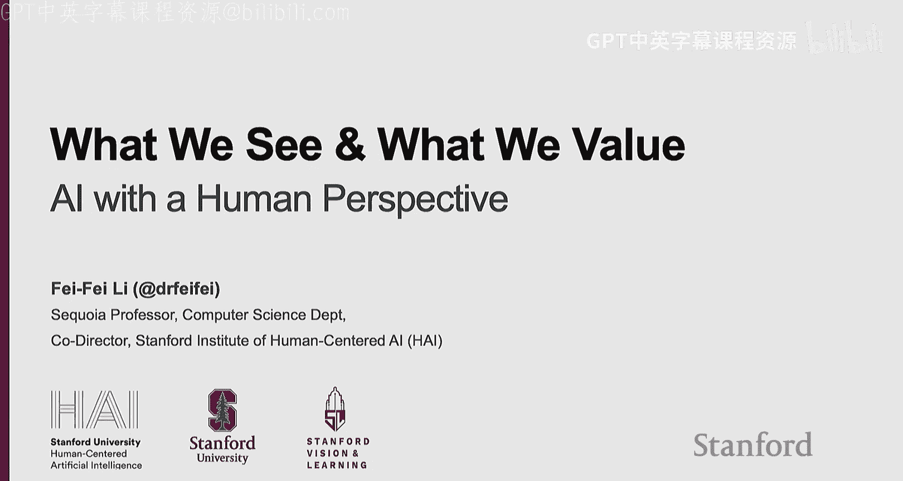

A photo sensitiveensitive cells to gleing what the outer world is about and according to zoologists like Andrew Parker。

 what happened is that because of this first the onsite of vision it set off an evolutionary arms race where animals either evolved or died and that arms race gave rise to the speciation or explosive speciation of animals。

 which now zoologists call the Cambririan explosion or the big B of evolution and of course。

You would be surprised that vision is still to this day， a primary sensory。

 intelligent system in many， many animals， not all animals use vision， admittedly， but many do。

 And that's also one of the primary sensory systems for humans。 And we use vision to to， you know。

 to everything from survival to work to entertainment to socialization to learning。

 development and many other things。 So that's the the the。😊。

Recapture or a summary of evolution and we also briefly talked about computer vision being a summer vision project back in the 1960s as an attempt to use a couple of undergrads to construct the significant portion of the visual system。

 and that was very in line with the history of AI where we tend to have clarity of the North Star but under how long it would take。

 we are still probably experiencing that today， but a lot has happened like you don't need me to tell you that from empowering self-driving car to understanding images to the generative AI revolution we're seeing vision is playing a huge role and also in many parts leading the wave。

so。Maybe it's time to just take a different look at this both historically and going towards the future is where have we come from and where are we going and this is an important topic to discuss because a lot of what has happened will inform what will happen so I'm organizing this talk in three chunks is。

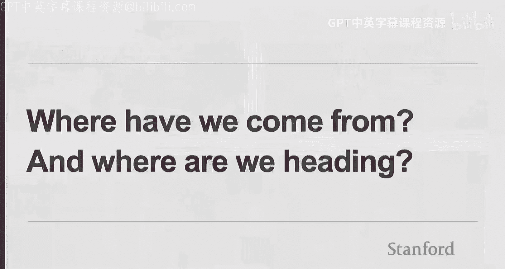

First of all， building AI to see what humans see。 that's where we came from。

 that we were so inspired by human capability that we want to make machines that do the same。

 And then we'll talk about building AI to see what humans don't see。

And then we'll finish with building AI to see what humans would like to see。

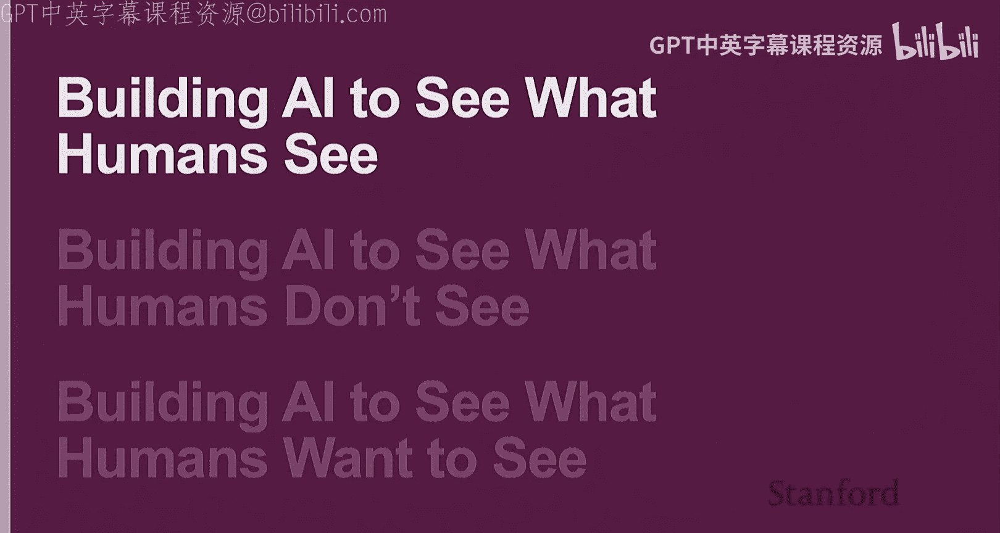

Let's start with the first one。 Do to see what humans see。 Again， just a little bit of a review。

 Human are so good at seeing。 We know this。 This is a very half a century old experiment showing us that even。

😊，Watching a video you've never watched play at 10 hertz。

 which means every frame is only about on the screen for 100 milliseconds。 You've never seen that。

 It's still no problem for human eyes to detect a target in this case。

 a person in this complex scene where you have no idea a prior knowledge about what this person is。

 It really underscores the superb ability of human visual understanding。

 especially object focused understanding We also have briefly mentioned that around the turn of the century。

 neuro neurophysiologists are measuring the speed of speed of vision in terms of human seeing complex objects in in the form of brain signals。

 electrical signals measured from each。Cs and we see that differentiating or categorizing animals versus animals is a very complex task yet humans are capable of doing that at 150 millisecond after the onset of the stimuli and this is remarkable speed given the wet where we have between our under our skulls also neurophysiologists have taught us that。

Objects is a very important functionality in our visual intelligence in humans。

 so important that their neuro correlates in our brain。

 areas that are dedicated to object understanding such as face areas or place areas or body parts areas。

 this shows that evolution has really spent time to hone in our visual intelligence skills when it comes to object recognition。

So all this built up the history for the field of computer vision that a few decades ago。

 object recognition became a fundamental building block for visual intelligence and we want to empower machines with that and in order to do that。

 we define the problem or at least the original problem as given an image， how do we empower。

 enable a computer to call out the objects or what the object is in the image。

That's such an effortless task for humans， but if you think about it now that you've learned enough computer vision to know that mathematically there's infinite possibilities to actually recognize any object because of different lighting texture。

 background， occlusion， viewing angle， scaling and you know whatever you name it。

 So this is actually fundamentally a difficult tasks， difficult task。

The history pretty deep learning is also very interesting there were some pretty heroic attempts at solving the problem of generic generalizable object recognition and the first wave of attempt was actually very inspired by psychology itself with self-introspect sometimes sometimes even to the detriment of over self-introspection。

 we think that humans compose parts right like we look at objects we can see geometric parts and then we can compose them into different objects and that idea of using predesignated parts or shapes and to you know compose them in specific ways was the first wave of object recognition so these are different work or models coming from the 70。

😊，These80s are even going all the way to 90s of using different parts and configurations to recognize objects。

 Of course， it didn't really work。 It's mathematically beautiful and simple， but it didn't work。

 So a second wave of object recognition， Pre deep learning was actually a really important era in in the field of AI is really the beginning of machine learning。

 statistical machine learning。 It was the marriage between computer programming and statistical modeling。

 And with that marriage， we start to realize the world is so complex。 These problems。

 this intelligence problems， whether it's visual intelligence or language intelligence or other kind of intelligence in order to generalize we need to learn learn the parameters。

 It's very hard to use hand tuneed models to to。😊，To you know get good good learning。

 we now know we need data， even though we didn't at that time know how much data。

 but we also know that we need to design architect statistical models so that they have the capability of learning through different so different learning rules and because of that we saw a blossoming of models in that era where we're learning you know random fields or base nets or support vector machines and all that。

And in fact， a lot of progress was made by the time we are in the first decade of 21st century in object recognition that we even have international benchmarks of a small number of object classes to encourage everybody to compare their algorithms so we're inching together the last unlock for object recognition as we have learned again goes back to cognitive science。

 so this particular psychologists Earth Beaerman had long conjectured that humans can recognize a huge number of objects and this is intuitive for our common knowledge。

 but he actually put a number on it， I personally call it the Beaerman number。

 which is that by you know age six or seven children he conjectured， were able to recognize about 30。

000 to 100。thhou different visual categories he used this where did he come up with this number It's a combination of looking at dictionary。

 the number of nouns， as well as visual studies of how kids recognized different objects。

 but it's a number that's pretty daunting and pretty sobering for the field of computer vision。

 because up till now this is middle of the first decade of 21st century。

 we were working with tiny number of object categories and a tiny number of images to work with compared to what humans experience and this was。

 as you know， the onset of the the motivation for imagenet project which。😊。

Took this beumman number really seriously and constructed we constructed this data set that is on par with what the psychologist or Biumman conjectured which is around 22。

000 object classes over 15 million images and of course that's the beginning that you start to come into this class is that because of the large data provided by Inet we start to see that powerful algorithms like neural network at the beginning it was convolutional neural network of course now we use transformers and all that start to really show their power through big data and and this is a generic slide for those of those people who didn't learn about this I'm going to skip this because you all know this so the quick history is as soon as we have imaged that as soon。

We used convolutional neural network a few years after the beginning of image that we saw this store blasted open in terms of solving the problem of object recognition now we have algorithms that we can take to look at any picture in the world and be able to recognize objects in the big or small and in any kind of you know orientation it's not is it 100% off no。

 there's always long tail problems we can solve but as far as industrial application goes。

 this has come a long way and really has been a matured problem and of course all of you know and all this came at the convergence point which is the year 2012 where the image that challenge provided the data for the convolutional neural network and they used two GPUs at that time and the three ingredients come together。

And brought brought the moment of deep learning the birth of deep learning and in this class we also talked a little bit about different various architectures that image that challenge engendered throughout the past decade or so in terms of you know convolution on your network or renet and so on so thats that's you know that's the beginning really about deep learning revolution and of course in terms of the quest for visual intelligence we're not going to stop at just being able to label objects in a scene for example in this two things right if you just label objects youll think it's just a lama and a person but if I show you the second scene with the lama and a person the story is completely different even though you have the same object you have very different relationship so。

Cognitive scientist once again was head of computer scientists and inspired us to think about visual intelligence beyond just naming objects or categorizing objects in this particular paper Jeremy Wolf。

 who is pretty prominent psychologists wrote this beautiful paper that called out that relationships between objects must be coded as part of our understanding of complex natural things and inspired by that work the field of computer vision start to look at how do we understand relationships and this is early work you guys got a lecture from Randja and last week or yeah last week this was his PhD thesis looking at learning object relationships using S graph as a representation in this case。

Sing graph is defined by these entity nodes that are objects and the relationships are defined by the connectivity between the nodes or sometimes they have attribute relationships that defines the particular objects and even a scene as simple as this with mostly just two people you know。

 one feeding a cake to the other you can form a very dense graph S graph because of the richness of the visual scene and this was R's thesis after the。

😊，The， the image， that object recognition era where we try to rebuild a data set。

 called visual genome， where we try to put together object relationships。

 object and also story descriptions。 and one of the work that Reggie did。

 I thought that was really fun was zero shot learning of unusual object relationships。 for example。😊。

It's not unusual to see person riding a horse， it's not unusual to see person wearing a hat。

 but it's unusual in general to see horse wearing hat and in the era of big data training it's hard to get this kind of data repeatedly because you just don't have too many of that but using this compositional scene graph representation were able to learn the more common relationships and then derive uncommon relationships in that representation and again this is another example of zero learning where you know person sitting on chair and fire hydrant on the long or on the field are all common relationships but person sitting on fire hydrant is the one that would not you know it's hard to get data and we're able to do that to make that happen and this is just a figure from the paper that shows that R's work at that time achieved state of the art。

Condition rate compared to many other methods。But relationship is not enough right。

 The ability to actually tell a story that is a lot more richer or also using natural language is actually the next big go So around the year 2014。

20 around 2014。 we start working on that problem and think about it。

 That's just two years after the image that Alex that moment。

 but the field was starting to evolve so fast we're so inspired by。

By what we can do using a combination of convolution neural network as well as a language model called LSTM and this is the thesis by Andre Cappathy that we were one of the first teams that showed how to do image captioning or storytelling。

 as well as dense captioning which is also part of the work that Justin Johnson did and I know he's one of the co instructors of this course and that was around the time between 2015 to 2018。

 a lot of work has happened to solve the problem of course today using multimodal LLMs we have taken the solution of this problem even to another notch but this is the beginning of that line of work and frankly。

 I myself as a computer vision scientist。😊，who entered the field at the beginning of the century was very surprised by how fast our field was able to solve this problem as soon as we've got data as well as neural network algorithms。

But a much harder problem is actually in dynamic things， in dynamic things。

 we we tend to have much more complex relationships。

 much more complex movements and the camera also the camera movement or the。😊。

Entity the actors within the scene can do a lot of different things。

 So in this work that a collaboration with Ian and a bunch of students in our lab。

 we call it multi objectject， multi actor activity understanding， this is a much newer work。

 We only published this a couple of years ago to capture the relationship between these actors and their activities in dynamic scene is still。

 I would say an unsolved problem。 And this will have profound implication。

 You know that you're in Siltica Valley。 So you， you're hearing so much。😊，Excitement of robots。

 for example， if we ever dream to have everyday robots that work amongst us。

 robots need to solve solve this problem， understand how complex a thing is， what people are doing。

 who is doing， what， what is next。 And this is an unsolved problem。 so。😊。

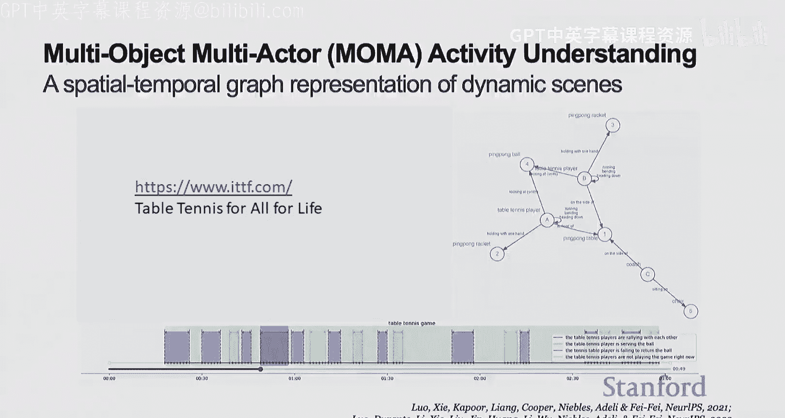

Also， you know， in addition to what I have shown you。

 you have learned a little bit in this class and related computer vision problem。

 but not we didn't have time to elaborate， for example。

 3D computer vision or human pose understanding and of course generative AI and generative models。

 so this is just to show you that the field of computer vision since the rebirth of modern AI has been just moving extraordinarily fast。

But the take home message in this section for me， is that。

Two things What is that data compute and neural network algorithm truly have converged about 10 years ago or 13 years ago。

 and that was the moment that modern AI or deep learning revolution has happened but the history of that and so much of the problem that we have been working on is truly inspired by cognitive science and psychology and neuroscience and that to me is is going to continue to happen is that we will continue to be inspired by what the brain can do or how the brain does things and also willll continue to use AI to help our brain brain research so there is a very intimate relationship between today's AI and cognitive science。

 neuroscience， brain science and all that so that's the first section and of course a lot of people students andab。

have contributed to what I have just presented。Now let's talk about going beyond just building AI to see what humans don't see。

 This is where pushing AI beyond the capability of humans or you can call it superhumans for example。

 most people don't recognize a ton of dinosaurs you can probably name a few some kids really can name a lot well let alone thousands tens of thousands of birds species or tens of thousands of car categories。

 So this is the line of work that I call fine grained object categorization。

 humans are just not that good at it and this is still a problem that I don't think we're fully soft yet to be honest。

 in this generative AI era， especially we're talking a lot about multimodal LLMs。

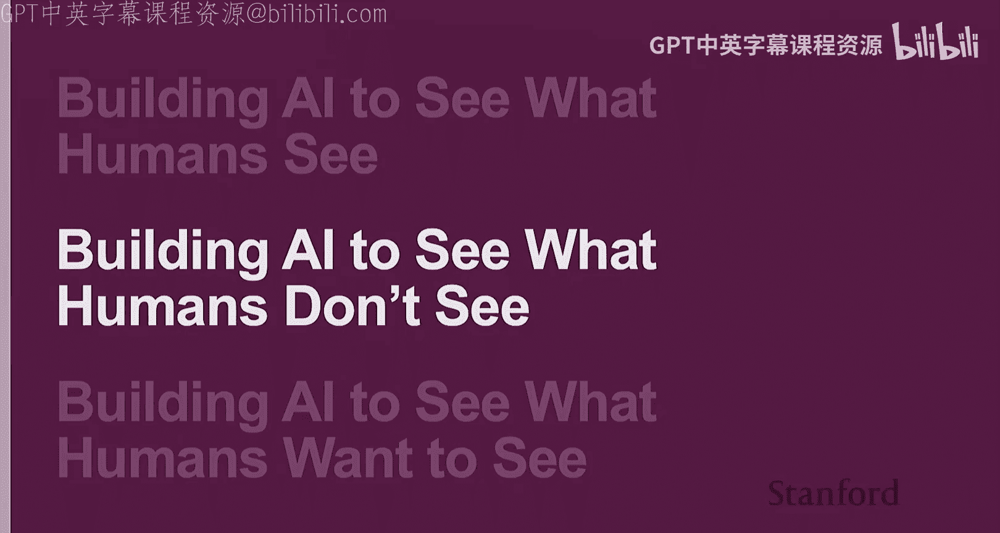

This problem has somewhat be neglected or or it just is not a mainstream problem， but it really will。

 you know， still will and play an important role。 So in this early work of fine grain bird species recognition。

 we put together， you know， a data set actually， we used a data set of 4000 birds。

 And as you can see， as we go down the tree of the species， the the。The the errorss， actually。

 as we go up the species as we have generalizable more general names， the error decreases。

 but which means it's a convoluted way of saying by the time you' the fine grained level。

 we still make a lot of errorsess， the algorithms are still not totally totally，Ready。

 another work that I find fascinating is that a few years ago。

 a group of students in my lab train a fine grainined car classifier in terms of make model a year。

 it turns out after 1970s， there are thousands of car， make a car models。

That are defined by different。Make model an year。 and then you can take we took Google Street view images from 200 or 100。

 I think major cities across the country。 and then we use the fine grain car detectors to detect what are the cars on the street of these cities。

 and we use it as a lens to study social patterns for example。

 what is the pattern here I showed education patterns you know。

 car models and education patterns are highly correlated or or income patterns。

 highly correlated in that paper we show voting patterns， highly correlated correlated。

 or even environmental you know patterns， highly correlated。

 it's a really interesting way of using computer vision as a lens to study our。And no human。

 no individual human， not even a collection of humans can do this easily at all。

 So AI is really pushing the boundary of what humans can see。嗯。To drive home this idea。

 let's do a cup of tests。 Human are actually have our limitations， right。

 I just talked about celebrating humans' ability of seeing， but we also have our limitations。

 This is a very famous visual illusion test called Stroop test。

 And the idea is that you all can read the words。 But if you。

 if I ask you to read the color of the word as fast as possible。

 going from right left to right and top to down。 You find it's not that easy， right。

 Try to read it like red， yellow。😊，Green。Purple， blue， black， orange。 it's， it's fighting with you。

 This is the fight between visual attention and and all that。 Here's another example。

 There are two alternating images of the of the picture。 And there's one change。

 A pretty big change that's happening between the two alternating pictures。

 I don't know if you spot the change。 Do you spot it。Yes， it's the engine， right。

 So it takes a while to， to spot it。 So this is a very famous psychology experiment called change blindlindness。

 Now， all this is fun。 Strop test is fun。 This is fun。 This is love fun。😊。

That human attention is limited and in some situations in our work and life。

 that kind of attention limit can be dire。 For example。

 medical errors are the third leading cause of death。 in in America's healthcare system。

 and of course， leaving this pair of scissors in the body of the patient is kind of the iconic image of medical errors。

 but there are so many medical errors， pharmaceutical errors， there's you know， procedure errors。

 clerical errors， diagnostic areas。 So so one has to be very careful。 for example， in surgery rooms。

 honestly， scissors don't get left in the body is typically but much smaller things like su needles or a piece of gaze and all that。

 So we today。Most of this is still just track by hands， right。

 like we have these checklists to track in the surgery rooms if somebody is missing。

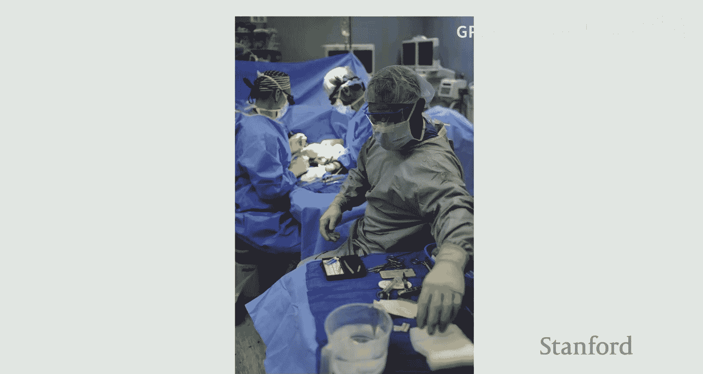

The surgery has to be paused， on average， that pause is close to an hour。

And think about the danger for the patient， the exposure to bacteria and the bleeding and all that。

 just because we have to search for the item。 So if there is a way to use AI to help our our doctors。

 surgeons to track item that would be so powerful。 And this is just a demo。

 This is not a deploy system， we're not there in terms of fidelity。

 but this is a demo to show that we can use AI to count in this case， Go。 you know and all that and。

And this is just an example of pushing AI to see what humans don't see。

Here's another example that is really fun， I don't know if I showed this before。

 but this is one of my favorite visual illusions where I'm just giving you the answer if you look at the two square A and B on a checker board。

On the top， it is so hard to believe they have the same gray scale or lunance。

 And then you look at the bottom， and you're like， of course they do。But why。

 even though you have the bottom picture。In front of you。

 seeing the top is still gives you the illusion。 Why， because evolution has prewired us in。

In conjecturing or understanding our world in its common way with the common physics of the shape of objects。

 lighting source， how shadows are made and all that this is so deep in our evolution in our visual development that it's hard for us to see see it another way。

 so what I'm trying to get at is there's bias in our visual in our human visual system。

 the bias might come from evolutionary construct， the bias can come from our social experience。

 the bias can come from the data we're exposed to but some of these biases can be harmful right when the bias happens that became unfair to a group of people。

 a community and we have to be aware of this a few years ago。

Face recognition algorithm was not good and it tends to recognize certain skin color and even gender better than others。

 and it has consequences think about self- drivinging car think about you know many other medical use cases so so we have to be vigilant about this I do believe that。

AI bias has been a problem that people now are carrying， you know， a few years ago。

 this problem was so new that many people are not even paying attention， but fast forward to 2025。

 I' not saying we have solved this problem， but I'm personally a law happier to see that so many people are paying attention to this。

 not only just in academia but also in industry。And then there is another kind of na。

And this is interesting， sometimes not seeing is exactly what we want。😊。

Because you want to respect privacy。So how do you create AI that helps people？

To see yet you still want it not to see what people don't want you to see。

 This is a very deep it's a technical problem as well as a human problem so from a technical point of view。

 there are many ways to consider ML machine learning privacy and'm just listing here from a visual approach point of view a few years ago。

 our lab wrote this paper about using smart cameras in patient rooms or patient homes to help doctors to see better but even there we have to recognize issues like faces or just full body information and evil homes and this is a list of potential solutions。

 for example， you can do blurring or you can do masking you can do dimensionality reduction but you can also you know try to do different approaches。

 for example， federated learning so that you。

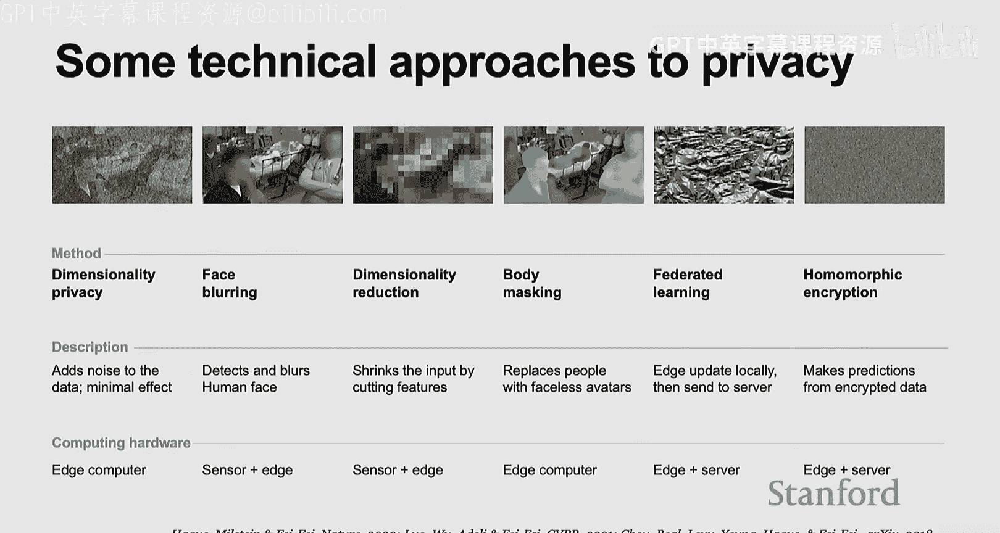

Don't send all the data to the server or encryption and and other things。

 So I'm not gonna be labor this， but there's one work。 I want to show you。 It's not been my work。

 but I really like this work。 And it's a work about。

Taking videos of people and try to recognize the action of people。But yet。

 respecting the privacy of people， How do you do that， right， For example， in this case。

 you w to take a video of this kid moving in a scene。

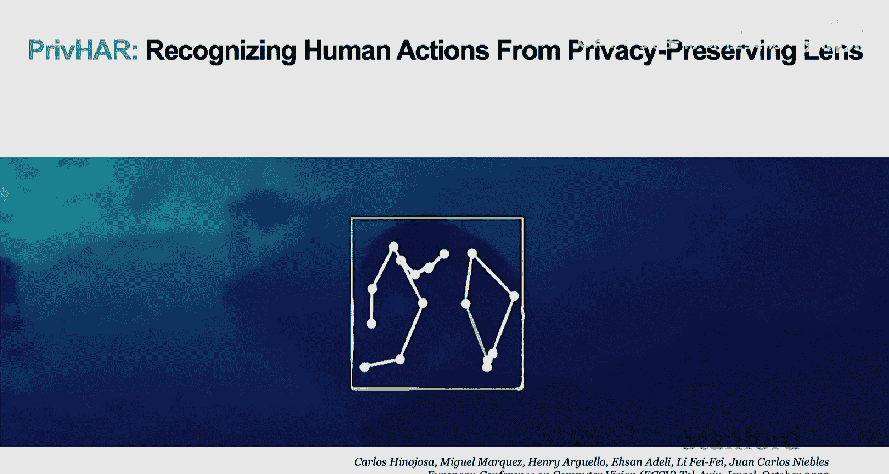

There are ways to do this if you blur this or deffocus this or do some of these it kind of。Yeah。

 you can。 you can provide。 you can protect privacy。

 but you also lose enough information that you might not even know what this person is doing。

 And for many applications， the whole goal is to know what this person is doing。

 So in this particular work LED by Hu Kaos and students。

 they actually did a combination of hardware and software approach where they had crafted a lens that is actually。

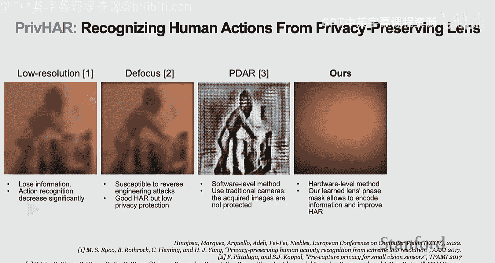

That that actually filters visual data in a particular way。

 so particular that if you look at the top row， the lens what the lens captures into the camera protects the privacy a lot。

 you don't see the person's face， you don't see the body and so on。

 but because it's a lens that's particular designed in connection with a piece of software。

 it can help to back out the movement information or the human activity information without backing out face information。

 so that's a really interesting approach that's a hybrid between hardware and software aiming towards important applications that you want to see people to protect them。

 but you don't want to see too much because you want to respect privacy so that's a work I really like really like the spirit of that work。

So， okay， so in this part of the lecture， I shared with you a number of things just considerations of building AI to see what humans don't see。

 Sometimes we're pushing AI like fine grain recognition of birds to go beyond human ability。

 Those are superhuman ability。 Sometimes we know humans are not good。

 We have bias or we have attention issues and then we want to use AI to help us and then sometimes we generally have situations we don't want anyone to see and then how do you use AI to continue to help without violating those privacy concerns。

 So you can see that AI is a very interesting， powerful tool， it can both help but amplify。

U and if we have bias， if we have issues， AI can amplify us too， so when we build AI。

 it is so important not only to take that technology perspective。

 but also to take the human perspective to commit to study forecast a guide AI to understand its human impact and respect human values。

 so that's the second message take home message and again a number of collaborators and students participated in this work。

Okay。Now let's talk about beauty AI to see what human want to see。 and in fact。

 we're going to go beyond seeing， we're going to connect seeing and doing together。

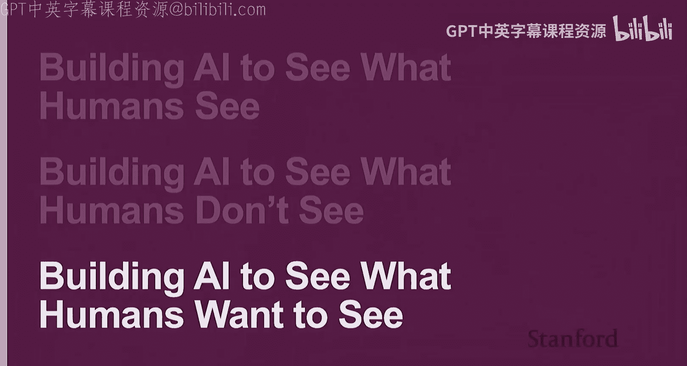

So if you think about today's societal anxiety about AI， one of the biggest anxiety is labor。

A lot of headline news will say labor is under threat， robots taking over jobs。

The truth is the picture is complex， You know， denying job change is wrong。

 Every technological shift in human history has caused labor market change。

 And some of them are very painful。 Some of them can lead to even civil wars and worse。 But， but。

 but also that change sometimes is inevitable。And。Tiny diggression。

 a lot of the labor threat rhetoric that we have been hearing think about physical labors today in the past two years。

 if you look at GI's impact is white color jobs that are drastically being impacted especially software engineering and and analytical work in offices so there's just definitely labor change。

 but in the meantime we also need to recognize that AI also can be helpful we actually fundamentally have human labor shortages in many situations。

 especially in elderly care as well as healthcare first of all as modern medicine improves human life expectancy increases and that just inevitably pushes a society towards longer living and that's a good thing。

But in the meantime we have shortages of labors， young people need to work and that's how to make this society vibrant economy vibrant。

 but who is taking care of our elders who are taking care of our chronically ill even in America's hospital we have such a attrition of healthcare workers。

 especially nurses， that we don't have enough hands ears eyes to to help our patients。

 so instead of thinking about this word replace we actually can think about AI augmenting and you got a glimpse of that in my surgery room example。

 indeed in healthcare there's so many spaces in a healthcare that we don't have enough pairs of eyes and that's what I call the dark spaces of healthcare from surgery room to patient room to。

Pharmaceutical to homes and so on。 So how do we make AI help？

 And this is something that Isam has been leading a ton of this work Also with Zing is that we have been looking at this problem of ambient intelligence for healthcare where we combine smart sensors with machine learning algorithms to glean health critical insights from these situations in healthcare set so that we can alert the patients or family members or doctors in time to help patients。

 And again the fuller paper is in this particular paper we published a couple of years ago。

 Let me just give you a couple of examples。 One example is this hand hygiene project。

 which actually started way before coVd。And hand hgie turns out to be really important for keeping hospital infection low。

Hospital acquired infection is actually one of the leading causes of American patients fatality in our hospitals。

 It kills more than three times more people per year than car accidents nationwide。

 and it is really hard to control Most of these germs are passed from patient room to patient room and then they they kind of just brew together。

 So what do we do， The hospitals trying to use human auditors。

 but we just talked about we don't even have enough nurses let alone hiring auditors and also this is。

 you cannot hire enough of them。 there are human fatigue。 We just talk about human attention problem。

 is not a pretty prohibitive solution。There were some technological solution like RFID。

 you know put the badge if the badge or the person wearing the badge is close to the sink or the he hygiene hand sanitizer dispenser it gives you the hint that the person or most likely the doctor or the nurses is washing their heads。

 but that's very non-specific you can now guarantee in the hospital rooms are pretty small corridors are small and just standing next to something doesn't mean you're doing it So a few years ago we did this project where we put smart sensors that provides protects privacy by just only gleaning depth information like the blue screen the blue video there and then we use vision computer vision algorithm to classify actions I the person washing hand or not washing hand and the result is that if you compare ground truth with the algorithm output versus。

Human outputs or human detect detection results。 You can see algorithm is so much better and more consistent than humans。

 You have to almost show the same video to four humans to get。😊，Almost as good as AI。

 And this is just not plausible。 if it's one person， you can see how sparse the detection is。

 and that's all good。 So this is one application。 Another application we we worked on is IC。

ICU is where patients fights life and death。 ICU is also where。

1% of US GDP is spent so making ICU as effective as safely as possible is a top priority one of the goal the goal of ICU is to get our patient safely out of ICU and going to step down units or even go home so one of the most important thing people have learning in ICU is to help patients to move。

Proper movement which we call mobilization is' actually important for recovery but this is a very dicey situation you have to get nurses to help doctors have to give orders you have to move properly and it has to be in different time like designated time and you have to assess the movement and all this is not easy right so we collaborated with Stanford as well as Utah's Inter hospital to put these smart sensors in ICU units and help doctors to monitor patient movement in this particular case for different kind of movements getting out of bed。

 getting in bed， getting out of care， get in these things are so important for ICU patients I know that its for us it's a no brainer but this really is critical and you can see that AI can help to do the kind of detection and prediction that that is so helpful for。

Doctors， especially when there is a labor shortage。

Last but not the least example is aging in place and this is just so important for you know many。

 many reasons people seniors want to live home independently and healthily and remember during the beginning of COVID when we had so much fatality among the aging seniors a lot has to do with hospital overrun and overtaxed hospital systems。

 so putting keeping singers safe and well in their homes is really critical and using smart sensors。

 we can help you know early detection of infection， especially using thermal cameras or mobility。

 which is talked about ICU somewhere here or understanding sleep patterns or understanding dietary patterns all this roundgs of possibilities by AI and smart sensors。

And then last but not least， what if there's still labor shortage after smart sensors。

 the thing about smart sensors is that their information gathering system。

 boom they cannot go there and help to turn a patient or bring water and medicine pills to the elderly so this brings us to the last technical topic which is embody AI。

 or we would call a large part of embo AI is robotics。

 and this is where I find it extremely exciting because it closes the loop between perception and action。

 and if you think about the Cambrian explosion of evolution when ice when there's an onset of eyes animals start to move so the area of robotics is where we can close the loop between seeing and doing。

But it's not easy， right， robots as much as we're very excited by them still are very， very slow。

 they are very， very clumsy， it's very hard for them to adapt to a generalizable situation。😊。

And in today's robotic research we as a field have made a ton of progress and Stanford is definitely one of the centers of robotic learning。

 but still most of these work are kind of constrained in their setup are short horizon tasks like pick and place and it has you know it has anecdotal setup and lack of clinical sorry lack of standard benchmark so let me just share with you a couple of work in our lab One work is a few years ago we're looking at how to bring robots to the wild if we have to predesignate the set of tasks it's kind of unsatisfying on the other hand。

 if you look at today's LLM It's totally in the while you can talk about anything so my students went along and a few students want to close this gap。

So this idea is that how do we give an open instruction to a robot？

Any instruction without pretraining everything in a closed world and the robot can do some tasks。

 So let's say your training set is open a door like that in the wild you have doors like that So how do you how do you make some progress in that problem。

 And so the goal is is is in the wild generalization。 And here's a result you know。

 or overall algorithm。I don't know if this is so glitchy。

 but whatever what you're seeing is we want to tell this robot arm to open a drawer by planning a motion path that avoid knocking down that flower and all this is all these instruction we're not pretrained so what we do is actually we borrow the latest advances in LLM as well as in visual language model and the idea is that we use LLM and LLM to give us an instruction set and then we use visual language model to help us to recognize or understand the environment and then we turn that into a motion planning map so that the robotic arm can execute and because we're using LLMs as well as VLMs we don't have。

To。We are we get rid of the problem of training robot in a closed world and bring them to a more generalizable or in the wild。

 And the details is the instruction of open top drawer comes in。

LLM turns this into like literally codes and then because of these instructions like draw or handle。

 we send this information to a VLM model and that model detects draw and handle in the scene and then。

Because of that。It understand that it updates its information and then it updates a motion map this is presented by a heat map to show you where the robot arm should focus where it should not focus and with that then you give it to another instruction but watch out to for the vase again it goes through the same thing with LLM writes the code or generates the code send it through a VLM model。

 VLM model detects the object and then updates the motion planning map in this case it's the negative now the positive because you want to avoid that and then combining with a previous map you get a heat map of knowing where to avoid and where to go and eventually what we do is we do this for the motion planning map we do a rotation to gripper velocity and then this is the result。

Actually， let me just show you this。 This is the actual result of a of the of the robot。

 And then we do this for many different tasks， right。

 we can do it for articulated object manipulation。 We can do it。We can， you know。

 hear just many different examples， you know， napkins or sweeping the floor。

 what is this getting to to setting up table。And also dealing with online disturbances and so on。

 so this is one work。Another work I want to just show you quickly is that。Overall。

 robotics research is still lacking good benchmark and while we're still experimenting in the labs。

 we know real world is so much more complex， so much more uncertain。

 have large variability is so interactive and social and has a lot of multitasking task。

 and then we know that both natural language and computer vision has benefited a lot from setting up important large scale data sets for both training and benchmark。

 so in our lab we have been working on this project that is towards an ecological robotic learning。

 building an ecological robotic learning environment and try to encourage researchers to benchmark against a large and diverse set of activities。

And that's the behavior benchmark， which is benchmark for everyday household activity in virtual。

 interactive and ecological environments。😊，Now， here's a question because this lecture has a lot to do with human values。

 is who's to say which tasks robots should do。I know that every graduate students who are working on robotics just want two tasks。

 one is laundry， the other one dishwasher。That's great。 but moving beyond G school。

 what are this what are the tasks we should get robots to do for us。

 So instead of us coming up with this task list， we actually did a human centered survey to ask robots sorry to ask humans。

That what would you like robots to help you， Let me， let me test this。

 Would you like a robot to help you to clean the kitchen floor。Say yes or no。 Okay， good。

 normal people would say yes， shoveling snow。Okay， fold laundry。Okay， good cooking breakfast See。

 we're getting mixed answers， right， What about opening Christmas gifts right exactly people are different Like I actually think robot can do this pretty well。

 but we don't want it and there is we even ask one of the task we asked is buying wedding rings。

 Can you imagine that So so what we did is actually we want to respect human preference So we took a bunch of government surveys from a labor office in US and Europe and so on。

 and cling together put together thousands of everyday activity tasks。😊。

And though we went online to find people， we want to be as diverse as possible。

 but I think we have room to improve， but we found 1400 people and to answer these tasks and tell us which tasks they want robots to help。

 And then we rank that。 And you can see that just like grad students。

 people want robots to help with cleaning， a lot of cleaning To cleaning， floor cleaning。

 but people don't want robots to play squash for you。

 or to buy wedding ring or to even mix baby cereals。

 There is a lot of tasks that matters to us as humans， emotionally or socially or whatever。

 So we our goal is first， we decided we doesn't we we have a principled way to decide which are the thousand tasks that we want to。

Train robots for。 And those are the tests that humans prefer to get help。 And with that in mind。

 we have to actually build a virtual environment。 So we， we。

 we scan or or acquired 3D scene from 50 different。

Real worldl environments from restaurants to apartments to grocery stores to offices and so on。

 and then we acquired this number is actually outdated， we acquire more than 10000 object assets。

3D assets that has a lot of properties， whether it's articulation。

 deformability and all those properties， and then we have to build a simulation environment a lot of people have built simulation environment。

 let me just fast forward but our particular simulation environment with a collaboration with NVDS omniverse group and we were going for building a physically perceptly and also interactively high quality simulation environment and this you know。

 especially taking account for example， physical effects like thermal。transransparency。

 deformability and so on We also tested our behavior environment against other environments in terms of perceptual realism for from human user study and you know hear some of the examples of physical interaction such as cloth or liquids and so on so there's a lot of nuance that has gone into this work and let me just fast forward and these are some benchmark we did compared to other other work okay。

 let me just fast forward so this is ongoing work actually in our lab and because of this we're able to you know we are using behavior to help us to learn robotics to help us actually to push us to more interesting data and also to to use that for。

For even cognitive studies， let me just fast forward。呃。One thing I want to share with you is that me。

Let me just share these numbers is today's algorithm still cannot do behavior tasks。

 And of all these roles。The top role is。What we wish robots can do。

 give them no privileged information， they have to be dropped in the environment and do these tasks and we benchmarked three behavior tasks using today's robotic algorithm and the performance is just zero and once you start to give more privileged information or make assumptions that make the tasks simpler。

 like magic motion or some you know perfect memory and all that things start to get better。

 So this is if you look at it， you know， only look at the top row you get pretty depressed by today's robots。

 but as grad students hope you're inspired because that means we have a lot of room to grow。Okay。

 these are just different papers from our lab， I'm going to actually fast forward because I think we've talked enough about this。

Well。By the way， we're also doing digital twin of behavior in the digital environment。

 as well as in in the real world environment。 And that's that's a great way of test testing real to Sim transfer。

 Again， this is an unsolved problem and。And there is a long way to go this in this particular case。

 we're showing you that this robot， without speeding up。

 you can see how slow it is is trying to clean up this room and。You know， okay， Hooray。

 This is actually some of the mistakes that this robot makes in。For example。

 it cannot pick up the bottle。Or。Earlier， it just went the wrong way and placed it in the wrong place。

 So there's still a lot of mistakes。 Okay， let's let me let me fast forward。 We're actually。

 we're also using this environment to study visually impaired patients。

 And this is a great way of putting patients in a safe environment to to to study one last thing I want to show you。

 is really super cool。 And and this is the last。

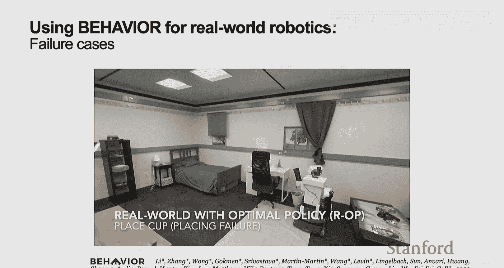

Technical work I want to show is that we also now are collaborating with psychologists and doctors to study how we can use brainwa to control robots So what you're seeing here is a demo where a grad student I think is wearing this EEG cap and that just as sending instructions and the robotic arm is cooking a Japanese meal purely from thoughts There's no invasive brain control。

 This is from electrical signals， what we have to do is to pretrain these thoughts you have to pretrain the robotic arm with say lift or place or drop or whatever and once you do that this is an entire meal cooked based on the waves this is really scifi and this has happened。

Last year， so I'm pretty excited by where all this is going。

 combining vision and perception and robotics and also you know helping helping people in clinical setting。

 this is really the future of this is helping severely paralyzed patients。😊，Okay， so。

So behavior project is really aimed at augmenting people。It's a large scale。

 diverse benchmark and it has realistic and ecological， you know physics and perception。

 and this is the last part of what the last take home message is that。

We not only want to build AI to just do things or see things。

 We really want to build it to help people。 AI being an augmentation tool or enhancing tool for humanity is very important instead of a tool that replace us。

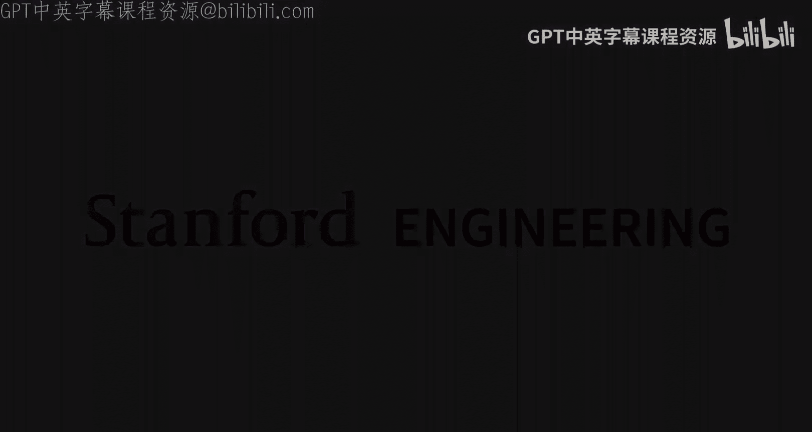