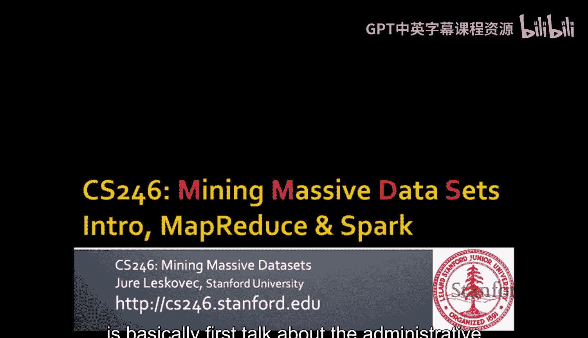
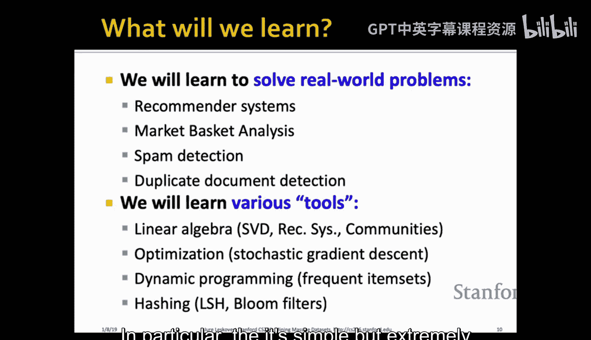
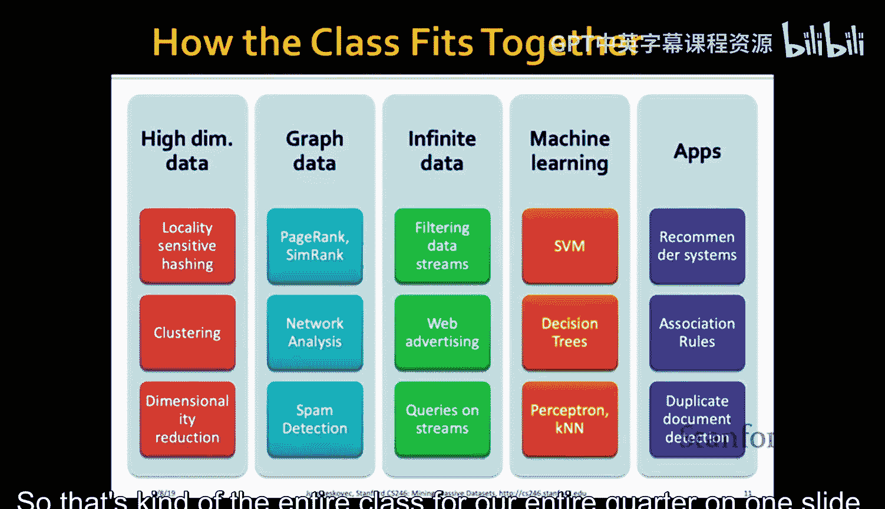
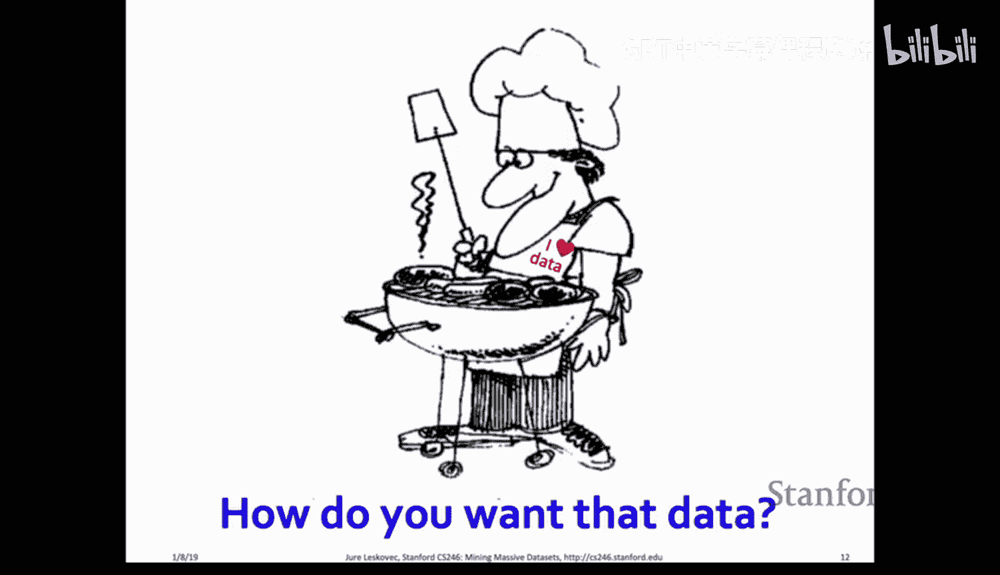
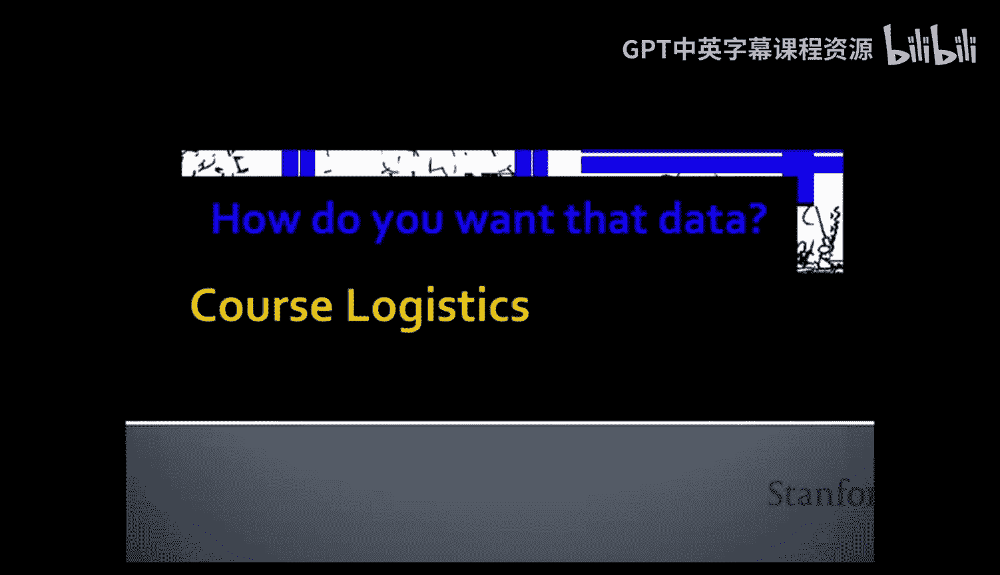
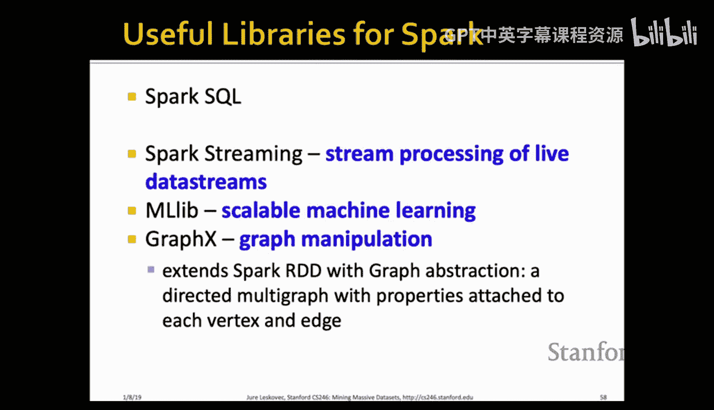
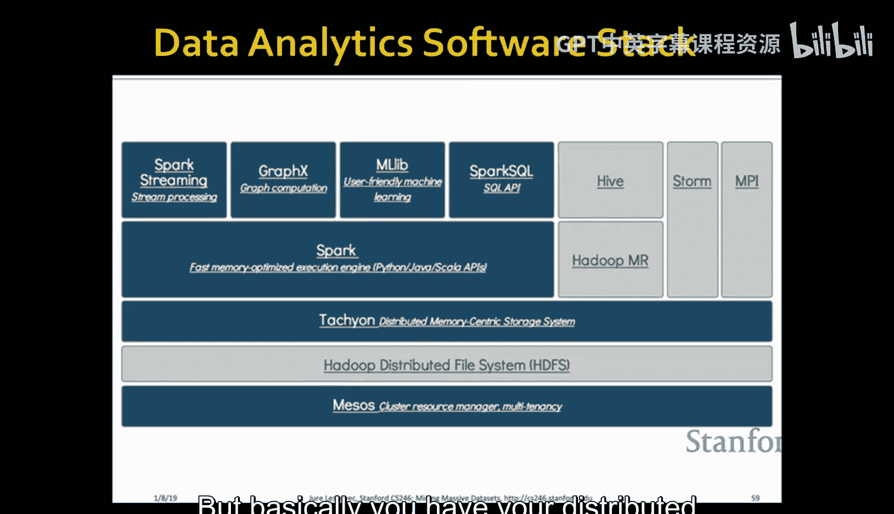
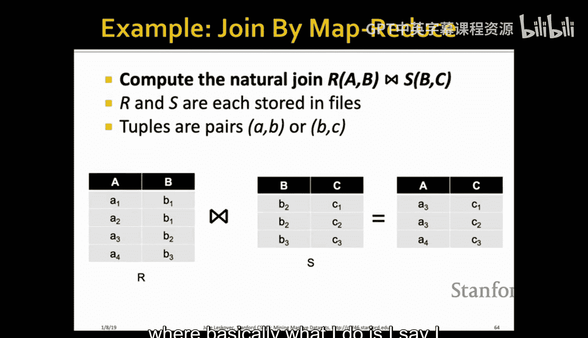
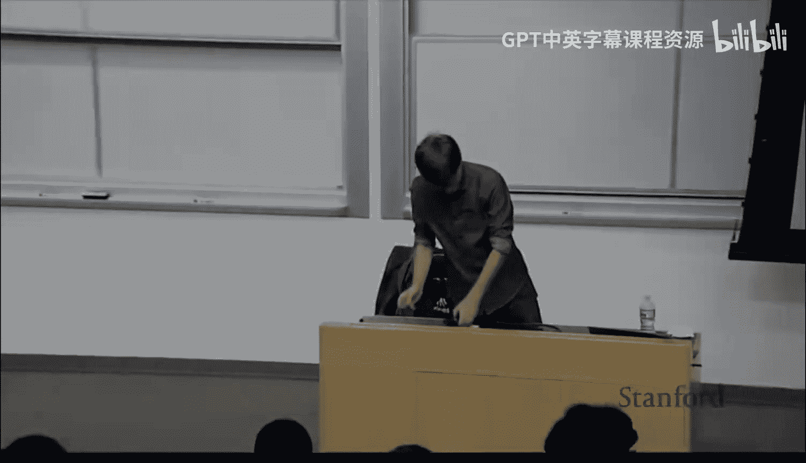

# 斯坦福大学《海量数据集挖掘｜CS246： Mining Massive Data Sets 2019》中英字幕 p01 -P01-lec1 Introduction； MapReduce and Spark.zh_en -BV1raSjBuE3d_p1-

Okay， great。 We are We are online and on video。 Great。 So welcome， everyone。 Hy new year。

 I hope you had good holidays that you didn't gain too much weight。 but you know。

 got a lot of energy and rest as well。 So welcome back。 It's a new exciting quarter。 Wee to Cs 2，46。

 mining massive data sets is is the course。 My name is U Letz。 I'm the instructor for the course。

 I'm associate professor in computer science。 doing research on these types of topics。

 What I w to do today is basically first talk about the the administrative kind of operational part of the course。

 And then I wantna do the first starter topic to kind of talk about computational tools and architecture that we will use to analyze or make big data talk to us。

 So first some motivation and then operational。😊。

Otherwise， I will just mention， we prepared a handout for you。 Most of you got it。

 If you don't have it。 it will be at the back of the room at the end of the lecture or come to us and we'll give it to you。

 So nothing is lost。 all the slides are posted online。 so you can follow that as well Okay， great。

 So why is this exciting。 the reason why this is exciting is in some sense。

s for the first time in computing history， computers are not producing data。

 but computers are analyzing data right， if you think about big computer in the past was about running some physics simulations of airflow and explosions and things like that。

 right， So computers were producing data。 Now， for the first time in some sense， in history。

 computers are not used to produce data， computers are used to to analyze large amounts of data right when we today think of big big computer。

 we think of computers analyzing large amounts of data and。😊，You know。

 some people say data is the new electricity。 Other people say data is power。

 but the bottom line is the data contains value and knowledge。

 And what we'd like to do is wed like to extract this value and knowledge from data。 And， of course。

 the idea is that the more data I have the more data I can process analyze。

 the more value and knowledge I can extract from it right， but this is a heart。

 this is a hard process， right in order to extract this knowledge and and make predictions。

 we need to be able to store these large amounts of data。

 we need to be able to manage these large amounts of data。 and we need to be able to analyze it。

 And while， for example， how to store and build systems that can that can store data is taught in the computer science systems classes。

 how the data is managed and indexed is taught in our data classes。

 this classes about how do we analyze the data right So we will kind of assume we already know how to store it。

 we'll assume we know how to manage it。😊，But now the question is， what kind of methods。

 algorithms do we apply to extract value out of this data？

 And one thing I will say is that the following terms， in some sense， theyre very much related。

 right if you think about data mining， data mining is extracting knowledge from data。 Then， you know。

 a few years later， the term big data became became very popular。

 in a sense that if you have large amounts of data， you can extract more more out of it。

 right then from then it's not just extracting kind of statically from the data。

 but it's also making predictions into the future， and people will were calling this predictive analytics。

 right， then you know， the new term came out called data science where the ideas can I extract knowledge truth from the data。

 And then， of course， machine learning and AI are also in some sense。

 just a sequence of progression of the same idea being reincarnated。

 But it's all enabled by these three steps that we finally have a lot of。😊。

Data and a lot of compute power。 And by fusing the two together， magic can happen。

 That's essentially the bottom line。 right， So what do we want to do。

 We w to extract actionable information， usually from very。

 very large data set that is and this today， right is subject to extreme hype， fear and interest。

 right all all the three at the same time， right， It's not all about machine learning。

 But a lot or some of it is， But there is much， much more to it than that。

 And kind of what's the emphasis， the emphasis is on the scale， right， even the the latest kind of。😊。

A revolution that is happening in machine learning and and and deep learning and so on。

 It's a consequence of having large amounts of data and having the compute， right。

 So that is kind of the reason why things work so well as they do。

 because we are able to finally train models on large amounts of data and really fit the entire distribution。

 right， So this course will focus on the issues of kind of how do we do with large big data sets and how and parallelization in these cases is often is often important。

😊，How can we break out the methods， We can break break up the methods in terms of what we could call descriptive methods。

 these are methods that that allows us to describe the structure of the data。 So in some sense。

 find human interprettable patterns that describe what is happening in the data clustering finding different classes types of that appear in our data is an example of that。

 or we can use predictive methods where what we want to do is given some variables。

 we want to predict the others right you kind of want to predict the future or we want to predict something we haven't yet seen a good example of this is recommender systems where given your history。

 I want to predict what movie are you going to like and we will talk quite a bit about commander systems in the grand scheme of things where does this class sit I think a good way to think of it it sits in the of kind of theoretical computer science in terms of algorithms and theory will be used。

😊，Machine learning， statistical， machine learning and kind of systems。

 database systems for managing large data sets， right， and we will。

 we will move in this in this area where we'll be using scaleable scalable algorithms。

 Mach learning models plus kind of methods to to， to process large amounts of data to do something useful。

 That's kind of the， the way to think of this course。😊，What will we learn。

 we will learn how to extract value make predictions from different types of data。

 We'll talk about super high dimensional data。 we'll talk about when data is a graph well talk about when data is infinite or never ending this means data is a stream so you never you never see all of it and when kind of data is labeled or the data is unlabeled。

😡，We will also talk about different computing architectures that allow us to process these data。

We'll talk about map Red as a distributed framework to。

 to easily write programs that allow us to process a lot of data。

 We'll talk about streaming and online algorithms。 These are algorithms that see kind of one data point at a time。

 decide something and kind of throw it away because the new one is coming。

 and we'll also talk about kind of single machine in memory algorithms kind of classical stuff。

We will also talk a lot about different real world problems， right。

 So we'll take these different types of data， different types of computing architectures and connect them to different real world problems。

 We'll talk a lot， as I mentioned， about how do you build the real recommender systems。

 We'll talk about something that is called market basket analysis。

 We'll talk about spam detection We'll talk about kind of web search and duplicate document detection and many other things。

 And of course， we'll also learn various tools that allows us to do this kind of tools in terms of mathematical tools。

 We'll be using quite a lot of linear algebra。 in terms of singular value decomposition。

 So this will be an important tool that will allow us to solve recommender systems。

 We'll talk about optimization methods for large scale in particular。

 the it's simple but extremely useful stochastic gradient descent We'll talk about dynamic programming and we'll be using a lot of hashing。

😊。

Especially for bloomfield person， locality sensitive hashing。

 So this is kind of a C S theory type of machinery。 This is also algorithmic machinery。

 This is from optimization。 This is from linear algebra。 Right， So again， willll be。

 willll be taking methods coming from many different areas of， let's say， of computing。😊。

How does the class structure look like。 Here is how the class is is organized in terms of what will be learning about processing high dimensional data。

 graph data， data streams， we'll talk about machine learning。

 and then we'll also talk about some applications of these methods to this particular domains。

 So that's kind of the entire class for or entire quarter on one slide。

What do I want you to be at the end。 I want you kind of to be like this， right。

 Like so if you have some data， somebody comes to you and says I have this data。 you'll be like。

 how do you want it， What do you want， right like medium rare do you want， know， sausages。

 What do you want。 So this is what， you know， I hope you are this master chef who just like you know。

 single handedly does everything。 So it will be awesome。 Good。

 So now course logistics and how how we are going to do this， So it will be a busy quarter。

 and we have a really super awesome T team。 we have 12 Ts Most of them are here and we have Miela。

 who will be my coininor and the H T A and will help run and coordinate everything do maybe you guys wantna stand up Whoever is here or raise your hand。

 So this is Michaela。 Youll see quite a lot。 And let's say there are other people around。 Okay。

 great， then we will be holding office hours， we will。😊。

The schedule posted it on our website。 we will start office hours next week。

 Our goal is to hold two office hours per day and probably one office hour over the weekend so that you are really well taken care of I will hold my office hours on Tuesday is 9 to 10 a Miela has office hours on Thursdays 5 to 7 pm for SPD students people that are remote use Google Hangout the link is posted on Piazza right our goal is to make you learn as much as possible and to support you in the learning process this is a quite nontrivial class so it requires a lot of work but it's our responsibility as the teaching team to allow you to gain all the skills and be able to kind of complete the class even if it may be very challenging and very hard but we are here to support you so come to us because we want to make your experience good and we want you to learn and kind of exc beyond what you thought is possible for you。

We really wanna， we wanna help you。 Okay， in terms of resources。

 there is a course website on there will be posted in posting lecture slides。 General。

 I'll post the first version the night before。 And then the final version will be posted just before because I usually do little tweaks to the lecture will be also posting some readings。

 Homeworks and solutions。 We will， we will most likely be posting on Piazza so that it's not public for people who are not in the enrolled in the class to to download and save for the future。

😊，We'll be using the textbook book called Min of Maive datasets。 you can buy paper， if you like。

 or you can get free Pdfs out of this URL。 And basically for every lecture。

 there is a chapter in the book， the book is a really good companion to the class。

 If you'd like to preview topics of the class there is a MOOC based on on the CS S246。

 you can find the videos there。🤧う。Now， we will also organize three special tutorials in the first two weeks of the course。

 First one will be about Sp。 Spk is a system。 a distributed system that allows us to analyze or work with large amounts of data。

 And then we will have two theory based recitations。

 one about linear algebra and one about probability and statistics and proof techniques。

 This is just for people who are rusty。 It will be useful to bring everyone on the same page。

 Spark tutorial is something I think will be very useful for everyone。 We have fixed the dates。

 We have fixed the time。 So it means it's right after the lecture。 We haven't fixed the location。

 we will let you know。 Yes， great， yes， all the all the all these sessions will be recorded and the videos will be posted as part of the SD thing。

 So yes， everything will be recorded。 Thank you for the question。 Allright， good。

 now how do you communicate with us。😊，The most important thing is that we use piazza。

 make sure you log in， make sure you read it。 and that's the the main part of where we will be doing communication。

 If you need to reach any of us， don't send us email individually。 like really， don't。

 if you wna send me an email， Don't send it to me， send it to the mailing list。 right。

 don't contact people individually use the mailing list。 General。

 you shouldn't need to send us email because you can ask questions through Piazza。

We will post course announcements， any kind of homework corrections and so on。 through piazza。

 We will have people T is dedicated to piazza monitoring。

 Our goal is to have an average response time of less than 20 minutes。

 So you shouldn't need to wait for your questions to be answered。

 if there are people who are auditing， you are welcome to sit We to the class。

 So no need to worry about that。 one thing about piazza。 Piazza。

 I think is very important that we think of piazza as a forum where we can kind of help each other and answer each other's questions。

 So piazza is not a place where the T A team is answering questions。

 but Piazza is a place where you guys can answer each other's questions。 And the T A team can come。

 and then I know endorse the answers and so on。 So it's very important。😊。

For everyone to participate on Piazza。🤧And。And in some sense， answer each other questions and doubts。

 this way， the communication will be much faster。😊，And this way。

 you won't have to wait for us to answer your questions。🤧Sorry。So， this is important。And well give。

Extra credit based on that。Hey， me killer， could you get me some water。🤧。🤧。How。

 how will the work for the class look like we will have four large homeworks。

 each one will account for 10% of the grade。😊，The first homework， which is called homework zero。

 it's basically a Spk tutorial is already posted。It's a very short homework。

 It should take you about one to2 hours to complete。

 but it's important for you to complete it because， again。

 it will allow us to troubleshoot any problems you have with the software。 Otherwise。

 the big homeworks will take lots of time。 Usually people need about 20 hours per homework。

 So the important thing is to start early and not start too late。

Homeworks are submitted through grade scopepe， here is the course code that you can use。😊。

And then please make sure to upload your code on this website。 The reason we do this。

 you upload your code because we check your code against plagiarism。

I'll talk about honor code more later。 Here's the schedule。 Basically， homework0 is out。

And then homeworks will be out on Thursdays and then they will be due on Thursdays two weeks later there are for homeworks。

 the quarter is 10 weeks。 so every two weeks there is a homework。We allow you to do two late periods。

To use two late periods， basically， if you wan to take a late period， you just submit late。

 Subting late means you have to submit by Monday at midnight Pacific time。

 So rather than submitting on Thursday， midnight， you will be submitting your homework on Monday。

 So you get three extra days。 And for two of those homeworks， you can get to do that per homework。

 you can use one late period， right， We won't accept your homework after this date。Thank you。

 So that's what I wanted to say。 Then another part of the course is what we call gradient squeezes。😊。

And Grquies see that every week， there will be a short quiz。

These are electronic quizzes and then we will generally release these quizzes on Tuesday and then they will be they will be due nine days later on Thursday again at midnight。

😊，It is super important to note that the system does not allow me to， to。

 to give you any grace period。After this time， it's over。Right， like really， I cannot do anything。

 It's， it's written like it doesn't even allow me to， to extend the submission date。

 I cannot do anything。 So really it's a really， really hard deadline。 right， again。

 the first quiz has already posted or do you register。

 Either please use your sunnet I D or use your legal first name underscore legal your legal last name。

 why do we care， because at the end， we have to match your gradients username with your Stanford Ids to compute your grade。

 So and we do this based on the username。 So either please do this。 this is important。

 especially for people who have， let's say， I know Spanish or Asian names that are very long。

 And then you know， somebody is called Johnny， But really they are Jonathan。

 make sure that you use whatever is your real name in the passport and whatever is your name in the Stanford register and don't call yourself Johnny。

 okay。😊，Because you won't know who you are。And then you can do this。 you can do this here。

 What is about these quizzes。 These are quizzes that you can submit as many times as you like。

 But every time the answers change and the parameters of the question change。

 So you can submit as often as you want。 you won't be penalized for multiple submissions。

 the only thing that counts is the score on the most recent submission。

 So one advice is that after you got a perfect score， don't submit another one where its0， okay。😊。

It's not smart to do that。 Okay， and then， as I said， after the due date。

 you can see the solutions of the problems， but you will be only able to see the solutions if you submit it at least once。

Why am I saying this is that if you don't。 if you forget to submit the quiz and then later on。

 you come to us and say， hey， I wantna see the quizzes because I want to study for the final。

 you won't be able to see the results because you haven't submitted。

 So make sure to submit every quiz at least once。 you can submit as often as you want most recent submission counts。

 more about gradients the best strategy is that you should work out each problem independently and and then submit once。

 this way， right， you won't have to repeat the questions because if you get something wrong。

 the entire quiz gets regene and everything will change So the best thing is to solve everything and then submit and there is a 10 minute delay between the submissions to kind of prevent people from just randomly trying but you will get a sense it's actually quite cool And the technology behind its using some final automata to figure out how to change。

😊，Questions from， from trial to trial。Okay， and then the last part is final exam。

 The date has been set。 It's March 19。 3，30 to 6，30 location will be figured out。

 We don't have a plan for an alternativeernity final， but if you feel。That， you know。

 you can really not make this time。 We will figure something out。 And then， as I mentioned。

 we will give extra credit up to 1% of the grade for participating in piazza discussions。

 especially valuable our answers to， to questions of other students and for reporting bugs in the course material。

 So if you find bugs， let us know we wan to fix them so that people are not confused。😊，So。

 prerequisites。We expect relatively strong programming background， either in Python or Java。 we。

 you need some basic algorithms background。 So this will be C， S 1，61 is more than sufficient。

For probability， C S 1，0，9 or stats，1，1，6 is the input the good。

There will be review sessions that bring you to the same level。 linear algebra。

 we will post some review session and review documents and for multivariable calculus and database systems。

 you know， if you took 1 45， that is sufficient sufficient but not necessary。

 So these are things you can you can pick up。Right， you can ask yourself， okay。

 but what if I don't know all the stuff you mentioned。

 each of the topics that I listed is important for kind of a small part of the the of the course。

 So don't worry， you will always be able kind of to catch up or build up that part of the skill。

 right， So if you are missing an item or background， you， you know。

 you can consider it kind of just in time learning and you will be fine。 what is important。

 the the exception is programming。 right， if you to do well in this course at the end。

 you will need to write some software。 not huge amounts of it。

 but you need to be comfortable writing code in Python or Java， right。

 like I don't know this much code。 whatever that means right like So it's good that you have written code in the past。

 right。😊，So one more thing is the Stanford honoror code that you all， I'm sure are familiar with。

 but we will follow the standard kind of computer science department approach which means you can get you can get help。

 but you must acknowledge the help that you that you received right。

 the failure to acknowledge who you discussed your homework with is is basically is is a violation of Stanford honoror code and and lots of be things can follow from that。

 We will be using mos to check plagiarism of the code。 So again。

 this is usually another place where a lot of thison honor code violations happen when people have have identical code or they have code that they download it from some Github repository on the web or they have code that is similar to one of the previous year' submissions and so on so。

All this is an honor code violation。 So write your own code。 Don't copy other people's code。

 How about homeworks， For groups and， and， and， and do the， and help each other。

 I think is important， right， So it means you can talk to each other about algorithms to be used in in the homework and so on。

 But you have to mention who you talk to。 and you have to produce your solution yourself。Right。

 so you should not use the code of others when you write， but you should write your own code， right。

 you can talk to people， but you have to write your own code if， and again。

 if you fail to mention your sources your， in some sense， people you discuss with again， and， and。

 and most most sketches you， you will be again charged with an honor code violation。 and。

 and it's unpleasant for everyone。 Okay， one more thing I should mention。

 we also have what we call 2，46 H。Which is a sister class to CS246， 246 H runs on Wednesdays。And。

What it covers is one lecture a week。 It's a one unit course that basically goes deep into the internals of distributed systems used for data processing。

 So it talks about Hadoop file systems， talks about map produceuce， talks about spark。

 talks about a lot about kind of。Kind of more advanced techniques and operators that that appear in these systems。

 right， So in some sense，2，46 discusses theory and algorithms。

To 46 h tells you how to implement them the instructor is Daniel Templeton from Clouddera and also 46 lectures are recorded so you will be able to to watch them。

😊，🤧咳。🤧。one last thing I want to say what happens after the course after the course we are running what we call CS S 341 projects in mining massive data sets where you can take the knowledge you took in this class and bring it to practice which basically means is that we go and collect interesting large scale data sets。

 you guys foreign groups of three we will provide data computing resources and mentoring to work on a 10 week data intensive research project basically and then we also have RA positions open for people who are interesting that。

So to conclude， what are some final final thoughts， CS24 to6 is quite fast paced， right。

 requires programming maturity and strong math skills。

Coourse tiing commitment is about 20 hours for homeworks。

 Grd quis take about one to two hours per week。 There is， there is 10 of them。

 And I suggest you form study groups。 But， you know。

 what's important is going to be a lot of fun and a lot of hard work。😊。

To summarize what you guys need to do， you need to go and register on Piazza。

 You need to go register on gradecope。 You need to go register on gradients and you。

 you need to go to complete the homework 0， the spark tutorial。

 This homework is really meant to be a to homework。

 So it should take about one to two hours to complete other homework will be much harder， right。

 But if this is， if this homework is challenging for you。 if it takes you 20 hours to complete。

 then this class is probably not for you。 Okay， so that's what to say， anything more is here。

 If you have additional questions。 let me know。Are there any questions。ok。No questions。

 so now I'll start with my starter topic。Allright。I want to talk about largescale distributed systems for processing data。

 The way this looks like today it looks like this is basically huge data centers of commodity machines wired together in with a commodity network。

 right So large scale computing infrastructure for data mining problems on commodity hardware。

 This is how So in some sense， we are not using supercomputers， But we are using commodity hardware。

 lots of small machines connected together through the network， right， What are some challenges。

 The challenges are how do you distribute computation。

 How can you make it easy to write software that trends over these thousands or tens of thousands of machines。

 And then what do you do when machines fail， right， So here's a simple calculation。

 imagine one server fails every three years。 That's let's say 1000 days before the servers fails。

 if you have thousands servers， then you can expect one failure per day right。😊。

But if you have a million servers， then 000 machines will fail every day， right。

 So kind of it's a fact of the world that machine fails all the time， right。

 So you have to have software written in such a way that it's resilient to when machines fail。

 And I'll talk to to you about that。Right， so how do we deal with that， right。

One issue is that copying data over the network takes a lot of time right so you could say here I have the storage。

 here I have analysis。 so I have to take this data from the storage。

 bring it to the analysis and take the result back and that takes a lot of time。 So what is the idea。

 the idea is to bring computation to the data right So basically to store files locally and then and do the computation where the files are and then how do you deal with failures。

 The idea is to store the same file in multiple locations so that if one machine goes down that information is stored somewhere else as well and spark and Hadoop are two systems that are built to solve or this type of problems so that let's say as an engineer or as a scientist you don't have to worry about this slowle details。

 So what do they do they provide you a storage。Structure or a file system。 So， for example。

 Google has its own file system called GFS。 Hadoop has a file system called H GFS。

 They give you the file system。 and they give you the programming model。

 like the mapre programming model。 I'll talk to you about or the spark programming model。

 So you as a programmer， just right in this programming model。

 You don't have to worry about how the files are partitioned， how they are stored。

 What happens if machines fail and so on and so forth。😊，Okay， so first， let's talk about storage。

 right， the， the question is， if a node， if a machine fails， how， how， how。

 how do I store data persistently。And the answer is。

 use a distributed file system where basically you have a global file namespace。

 but the files are stored in a distributed way。 and a typical usage pattern is that you have huge files。

 Maybe files that are of size of hundreds of gigtes or terabytes。 So you have this huge files。

 and these files don't change， right， So kind of the data is uploaded only once。

 And then what you do with the data， you apply reads and appends to the data。 Okay。

 so these files kind of only grow or are generally static。

 but you read the multiple times because you analyze that set of data。

 Okay that's that's a kind of the usage pattern。 So how does Hadoop generally deal with this。

 You have this notion of a chunk server。 so a huge file is split into multiple chunks。

 And each chunk is relatively small。 You know， it used to be between 16 and 64 MBs。

I think today the chunks are bigger， but they are relatively relatively small compared to the full data size。

 and then each chunk is replicated multiple times and saved on multiple different machines and what they even try to do。

 they try to make sure that these replicas are not even on the same or in the same box but that they are really distributed across a data center。

 so even if one part of the data center goes down， the data is not lost。😊，Right。

 these are the chunk servers and then you have the master node in Hadoop it's called the name node and this stores the data。

 the metadata and stores the information where all the chunks are saved and so on。

 and many times you want to have your name node replicated or duplicated as well。

 because if it goes down you lost the map where the data is stored and then the last thing you need is a client library to access files right and this basically this library talks to the to the master node to the name node to find the correct chunk server and then goes to the chunk server to obtain the data to to do access so basically what this allows you to do is to have a reliable。

 distributed file system where data is kept in chunks spread across multiple machines each chunk is replicated in many different machines So if one machine fails。

😊，When it wakes up， it can go to the name node and say， okay。

 what are the chunks I am supposed to have and then copies the chunks the corresponding chunks from the machines that have them to kind of rebuild itself。

 right So the way you can think of this is that you have these chunk servers。 these are our nodes。

 And then you these are different chunks and you know chunk D0 is stored here here and here and chunk C1。

 you know， is stored multiple times， let's say here in two cases。

 right So now if one machine goes down now now data gets lost because you know C1 is stored here。

 C 0 is there and so on and so forth。 But kind of you get the idea。

 So now I told you how the data is stored across thousands of machines and this provides these distribution provides reliability Now what I need to do the second thing is that now I want to compute over this。

 And the idea is not that I have the files， the servers that stored files。 and then。You know。

 I know here on this side right here。 I have data that servers that do compute and these servers that do compute would go to this chunk servers get the data and do compute。

 The idea is that the chunk servers also serve as compute servers right。

 so that each of these guys is also doing computation on the data。

 So that data does not leave the machine。 That's the idea。 Yes， Cam。😊。

On a chunk in a given server requires information that's from a chunk on a different server。

 What if a Comp computing on one server requires data from a chunk on on a different server。

 It is no problem。 one server can request that data， right。

 But that's your problem as a programmer that this will be inefficient， And you will， you will。

 you will want to spend a bit more time。To make sure maybe you don't do that。 Okay， but Ill。

 I will come to that and it will actually answer your question in a different way。 Okay。

 good question。 super， so now that we know how the data is stored。

 we need to be able to write programs that compute over this data。 kind of what Camililla was saying。

😊，And there is this way of writing， distributed。Software called Mapreduce。

 that is basically a programming model designed for easy parallel programming。

Invisible management of hardware and software failures， easy management of large scale data。

 And this mappre model has several implementations， including Hadoop。

 which is the open source thing Spk， which is what well be using in class。 there is fllink。

 another open source map produce implementation。 But the original map produce was implemented in Google。

 and there is a famous paper called map produce。 So map Reds kind of the first implementation of this paradigm was at Google。

 And then these are kind of the successors that are open source versions of that。

 So now how does this map produce programming model look like， okay。😊。

So map Red says that you can write programs that operate in three steps and here is what how these programs operate。

 right you have map phase， you have the group by key phase and you have the reduce phase。😡。

Let me explain。 So what is a map phase。 Ma phase will go and apply a user written。

 So a programme written map function to each input element So this means that the mapper applies a map function to a single to a single element and multiple of these map can be mapped into can be combined into a map task。

 which is kind of one unit of parallelism。And the output of the map functions is a set of key value pairs。

 Okay， so the idea is that you can read the data and in the map function。

 you somehow transform it to up output the key value pairs。😊。

What happens then is the second step which the system does for you and this is group by key So basically it will take this key value pairs and it will sort and shuffle them so that it groups all the values does that belong to the same key right so the system will go and sort all the key value pairs and give you the output will be key and a list of values okay yes。

😡，No， can I， can people give some feedback。 Is it clear what I'm saying。 Okay， awesome， Thank you。

 And then now the last step， which is also written by the programmer。

 is the reduced step and the reduced function will now go。 And for every key。

 get this set of values and somehow aggregate them into some useful information。 Okay， so as a。

 as a programmer， you write two functions。 You write the map function and you write the reduced function。

 That's all you can do。😊，And。What this means is that outline of all map reduced jobs is the same。

 What changes is the map function and the reduced function。

 and the system will do the group by key step for free， yes。You can output multiple values。

A function can output more people key value pair， yes。Okay， let me give you an example。 How would。

 how would this work， right， the way you can think of this is the following， right， like and how。

 why is this so useful， You can think you have a huge input file。

 You can think this huge input file is set is somehow split into chunks。 right。

 The idea is that the map that the map task will read its part of the input file。

 and it will output some key value pairs。 And then， you know。

 some other map function will output some other key value pairs。And then some other map function。

 other key value pairs。 then you will get the group by key right after all。

 these map functions are complete。 the group by key will will happen where， you know， for key1。

 we collect all the values for key2， we collect all the values for key3 all the values and so on and so forth。

 And now for every of these guys， a reduced function will be called that will take these values and somehow reduce them to something else。

 And that's a final output Okay so as a programmer。

 you get to write two things you get to write the map function and you get to write the reduced function。

 and that's and that's it。😊，Why is this useful Because you can do this in parallel right。

 if these are our chunk servers， what you can do is you can run multiple map functions on each chunk server separately and all all these data processing happens in parallel。

 all these key value pairs get output。And what happens then？Is that。

Is the group by key that happens in here when basically then the reduced tasks get run after all the mapper tasks have been run。

 And again， certain keys can be sent to one reduced task server and certain key values can be sent to the second reduced task server。

 right， But the point is that all these computation up here over this giant file can happen in parallel and then all these reduces can happen can happen in parallel。

😊，Yes， so all the math functions have to be done first。

 So if we have one that takes longer than all the other ones correct， super cool cool question。

 right， So the question was， all the map functions have to be done before you can start reducing。

 correct。 So what do you do。 And many times you may have one machine that is super sluggish。

 So what happens then is that the master who's coordinating all these jobs Not is that maybe this map task on this chunk is very slow。

 So what you can do is you find some other chunk server where this chunk is saved and run the same map task on that machine on that on the same chunk and maybe that will finish faster。

😊，And you just kill this task， right， So you have this problem that， you know。

 just one machine and one task can be super sluggish。

 But because you have that same chunk saved in multiple times。

 you can preemptively start the same task on those chunks。 and maybe one of them will finish faster。

 So you can then start doing the group by key and the reducers can start doing the work。

 But you are right， right， Like the blocking part is that all the mappers have to finish before you can start reducing。

 right， The reason is because maybe these guy outputs， you know。

 some value that needs to be added here。 So we cannot start reducing before everyone has finished。

 That's a great question。 Actually， super cool。 Allright， good， Yes。😊。

Com keys that are used to to group this。 Great， I know this is very abstract right now。

 I will give you examples about what can you do with this。 Okay， so I'll come to that。

 There was someone here， yes。What happens after reduce， What happens after reduce， You know。

 after reduce， we are done and we go get a beer。Right， but really。

 what happens after reduce is that you can have another map task。

 right So you can chain these things together。 But this is one step。O。So。Kind of what's the pattern。

 The pattern is that the input get gets mapped through these mappers。

 Then the group by key happens so that the right keys are sent to the right reduces。

 And then there is the output。 And this is one map reduce job。 right， But you can， of course。

 chain multiple together， if you like， okay， now giving you were asking there。

 Give you some examples of map reduce task。 So here is the the kind of the prototypical example。

 It's。😊，It's a work counting example。 Imagine you have a huge tax document。😡。

Maybe you have all the all the web or all the books ever written in one file。

Any you want count how many times does each word appear in this huge document？😡，Okay。

 and there are many applications of this， right， So for example， you may say， oh。

 I have web server access logs。 and I w to find how many times each URL appears in that access log。

 That's the same as kind of word counting example。 or you say I want to do statistical machine translation。

 if I need， if I want do that， I need to count the number of times every five word sequence appears。

 I know on the web or in a collection of books。 Again， this is， this is a word counting example。

 right， so the idea is I have a huge document。 And I want to find how often does I know in this case。

 each five sequence，5 word sequence or one word sequence。 How often does it appear。

 How would you do this in mappreduce， right， the way to think of this is here is some document。

 right， This is our huge big document， our huge big file。 And what we will do is。😊。

If we apply map task to it， our map task will be very simple。

 The map task will read the word and output that word as a key with value 1。 Okay。

 so I will take the and output the comma 1。 Then I will say crew， and I will output crew comma 1。

 and then off。😊，You know， of comm1， you get the idea， right， Like。

 so my mapper will go take every word and use the word as the key and value of one as a value。 Okay。

 then what will happen。 What happens is that now the group by key happens， right， So basically， this。

 this well， this set of key value pairs will get sorted。😊，Okay， so， you know。

 all the crew appearances of the world crew will come together。

 all the appearances of the word the will come together and so on and so forth。

 So now when the reducer gets， gets called， all the reducer will say is， oh。

 here are all the occurrences of the word the1，2，3， I will output the comma 3。😊，Okay。

 and what have we just done， We have just counted how often does each word appear in this。

 in this huge document。Okay。Yes。It like you can like。But get the effects from the reduce。

Can you get the original attacks from the reduced？No， you can。like。

 can you get the original text from the reduce， That's not our task。 Our task is to count。

 How often does each word appear。Right， I just want to count how often the situation word appear。

 And how do I do this in the map produced framework。

 I write the map task that takes a word and output which is as a key comma value1。

 Then the group by key will group all the all the all the same words together。

 So the reducer just goes， sums up the values and output the word comma the sum。 and that's it。😊。

Right， yes， does the group key happen taken the great good question。 So where does the group happen。

 This is provided to you by the system。So this is what the system implements for you is this thing。

 and， and it executes the task the， the map task that you write and the reduced task that you write。

 right， So what is important to notice here is that the way I explain this now。

 this is all sequential， right， This only requires sequential reads， right， I'm reading this。

Word by word， I'm outputting this thing key key value 1 by one。 Then this。

 this group I happens that I， that the system provides for me。 So I don't have to worry about it。

 And then all I have to do is again， just sequentially go over this file。

 Whenever I see the new word。 I keep going， I count how many lines I see。 and I output。

 It's like the simplest way to do the word count， No hash table， not， no dictionary， nothing。

 nothing， right， I need no memory。Right。Yeah。Why does the reduce happen after everything's finished。

 couldn't it consolidate the data before it transfers it？Why does the use have to happen before？

Yeah it happened before as well because you see three times111 can you say that shorter great super good right。

 It seems a bit silly to output these things three times。

 there are this this there is this notion of a combiner。 that's exactly what you said。

 But it's just an optimization。 This is kind of theory。 Okay， so now how do you do this in parallel。

 You can chunk。 You can split this big document into chunks。 You run a mapper here。

 It does its outputs。 You run in parallel a mapper here。 It does the outputs。

 you run another parallel mapper here， parallel mapper here。

 They all do these outputs after they all finish。 you do the group by。

 and then you can again just run the reduces in parallel。😊，Right。

 so you see how this is trivially parallelizable。 Okay， so right now。

 each mapper outputs different key value pairs。 Then there is this blocking where all these guys have to finish that that that the that the group by key happens and then again。

 you can partition this outputs so that， you know， all these data get sent to one reducer。

 all these data get sent to another reducer So they give you the final the final word comm。

 And I just wna give you the pseudocode， This is the this is the pseudocode， right。

 like the what does the mapper do， the mapper says for each for each word。

 Imagine that what you get key value for the mapper is line number and the entire line in that file。

 you say for all for each word in that line output word comma1。

 And then how does the reducer look like the reducer says。😊，Right。

 it gets the word Id and list of values。 a list of ones。

 And all you have to do is you say for each count in in in in values result is plus equal that value and output the word comm result right？

 It's as trivial as possible， right with you know， this five lines of code。 you can write you can。

 you can， you can now do the word count over terabytes of data。😊，Okay。

 so what does the mappre environment take care of， right？

 So the first thing it takes care of is partitioning this input data across multiple servers。

 The second thing it does takes care of is is scheduling the program execution across a set of machines。

 it's performing the group by keystep for us， right， and in practice this group by keys。

 the bottleneck because a lot of data has to be swapped across the machines。

 it's handling machine failures， and it's managing all the communication between the machines。 So me。

 as a programmer literally have to write， you know， these four lines。 and I can。

 I can run this over all the web pages on the web and just sit back and relax。😊，Right。

 so this is why this is so amazing。 because so little code allows you to。😊。

To then efficiently write a job that that runs over tens of thousands of machines。 Yes。

 grouping actually more of a virtual grouping where。

keep them separated and just I guess to the user pretends that they're on the same machine。It really。

 it really is a group buy。 I think what they really do is they sort。

 I think the Hadoop really just runs the sort of your mapper outputs。

 And that basically means that all the keys， all the keys with the same value are grouped together。

 So it's really physically sorting it。 So the way the Hadoop does it。And I will come to that。

 It's a good question because other systems don't do it。 I， I'll， I'll address your question。

 It's a good one。 Yes， So honestly the key need to be like sortable。

 or there any other requirements on what the key is to be like pro from a test。Like cashable or。K is。

 It doesn't really matter。 Key is a set of bits。Like， you don't need。 you don't care， right。

 Like it's a set of bits so that you can say， are two keys equal or are they different。

 That's all you need to know。 Nothing else matters， right， and your key can be whatever you like。

 It's a sequence of bits。 That's all they need to be。

 I'm I'm not sure what else they would be on a computer。 right。

 sequence of bits is There is nothing else than that， right。

 So there is no special requirement for keys。🤧Yes， a particular like sort algorithm that is used by the systems is merge sort more use because the data is already great。

 So you're asking me lots of details about what kind of sort algorithms are used。

 I I think so as I said， I think Hadoop is really using sort。

 And I think they were using some kind of distribute merge sort。 If I remember correctly。

 But things can may may have changed。 The best way for you to get his answers is to go tomorrow to 2。

46 H and talk to Daniel because he real expert。 and he will love your question。😊，Alright， great。

 awesome。Okay， so how do we deal with failures， De with failures is easy because right， if。

 if a machine fails， that is running a mapper task， then it's easy。

 We just rerun that mapper somewhere else， wherever that chunk that original machine was having is stored。

 And then right， if this happens。And reduce workers are notified so that they know that they have to wait for that task to be rescheduled and and and rerun。

 What is more harder is， if a reducer fails。 if a reducer fails， then。

Only in progress tasks need to be reset， and the reduce tasks needs to be restarted， right。

 so reduce reducer failures are a bit harder。 But this is now what I told explained to you is the basic old school map reduce model。

 I think from 2004， if I remember， correct。 right， so like ages ago。 Okay。

 so now something more modern。 something that is more modern is called Sp。😊。

Spark is trying to solve two major problems with map reduce。

 First is that even though the map reduce programming model is amazingly useful and elegant。

 it's also， sometimes difficult， right， many problems are not really described well in this map reduce framework。

 They don't land themselves into the separation of the map and the reduced tasks。

 and there are quite a few performance bottlenecks because。😊，Because because of this。

 because you have to kind of make tweaks to make the mapreuce work on certain problems。

 then performance is not satisfactory。 And then the other thing is Hadoop tends to persist everything back to disk。

 and and this makes Hadoop in some sense， relatively slow or mapreuce relatively slow。

 And then the second thing is mapreuce does not compose well for large applications。

 What I mean by this is you ask me a question about what happens after one mappreuce step。

 What happens is that many times you want to now run the second mapreuce task。

 And you want to chain multiple of this task together and mapre or Hadoop doesn't do this well。

 because it loads the data does the thing dumps the data。

 And then the next task has to load the data again， do the thing and dump it。

 So you are spending lots of time just dumping the data on the disk and reading it of the disk so。😊。

Hereies where Spark robot what is called data flow systems come into play。

And the difference is the following that map reduce system uses kind of two ranks or two types of tasks。

 right， It uses the map tasks followed by the， by the reduced tasks。

 and the data flows from the first one， from the map to the。

 to the second one to the reduce and data flow systems kind of try to get away with this limitation。

うふ。So data flow systems generalize these in two ways。 First。

 they allow for any number of tasks or ranks， right， They allow functions。

 Other than map and reduce and as long as the data flow is in one direction。

 we can have what we call the blocking property and allow of recovery of tasks rather than need to restart the whole job。

 right， So if you have data only flowing one way and something fails。

 then you can just restart from the failure point and continue。 That's generally the idea。Okay。

 so Spk is the most popular data flow system。 It is expressive computing system。

 not limited only to the map reduce model。 What does it allows us to do。

 It basically has the kind of the map reduce， but other things as well。

 It allows us to have fast data sharing。 It avoids saving intermediate results to disk。

 which is good from the performance point of view。 It cachees data for repetitive operations。

 It allows us to have general execution graphs。 I'll give you an example later， where basically。

 I said the data flow has to be one way。 This means that the data flow is is a deck is a direct thecyclly graph。

 right， and basically have these jobs that send data to each other and you just execute that。 Okay。

 and allows us to have richer functions than just map and reduce。

 and it's also kind of compatible with Hadoop。😊，Right。

 this is open source written in in Java Basically it supports Java Scala and Python。

 and the key construct or the key idea is something that they call RDD or resilient。

 distributed data， which is basically a chunk of data that is that is kept kept in memory and passed around。

 And they also provide very nice highle app As in terms of what what is called the data frames and data sets。

 which is introduced in the recent versions。 And there is a lot of additional packages to do machine learning and SQL and so on and so forth。

So I'll just quickly talk about the RDD。 So this resilient distributed data set。

 This is basically a partition collection of of records。

 and basically its it generalizes key value pairs and it is spread across the cluster and it is read only right。

 and it is cached in the in the memory， right， So you can also persisted to disk。 but generally。

 you keep everything in memory。😊，So， and the idea is that this RDDs can be created from Hadoop or by transforming other RDDs。

 right， so the idea is that you have kind of a block of key value pairs。

 you apply some function to them。 and you get a new block of key value pairs。

 And these RDs are then kind of being being transformed， moved around and so on。Right。

 and these R DD are best suited for applications that apply the same operations to all。

 all elements of that RDD or of the data。Right， and now what kind of operations can you can you or what can you do with the with the RDDs。

 What kind of operations can you do， You can do transformations， right。

 which are basically you where you build a new RDD based on deter deterministic operations on of the other RDD。

 right So these operations include map filter， join union intersection and distinct。

 and everything is done in a what is called lazy lazy evaluation。 So right。

 nothing is computed until it needs to be computed until somebody requests that value。

 So these are the transformations And then you also have actions that return value or export data and actions include count collect reduce and save right。

 save means dump on this right and actions can be applied to RDDs and actions force。Computations。

 right， once I do count of something only then the transformations will be run that allow me to。

 to execute that particular count that I wanted to do and then return me the values。

What I really mean by that is that the way you can think of this is that in Sp。

 you can write jobs like this， right， where， you know。

 blue are the RDDs and this is now the flow of the data， right， you can apply map functions。

 you can do filter functions， you can do group by and you can kind of write these complex jobs where data is passed in a given way。

 And when you say I want particular particular output basically what is happened that a particular particular line will be will be executed。

 right， So now this is a direct， basically graph that describes how the data is passed through the stages using different operations。

 And in spark， all all this is done in memory So all these RDs are kept memory and passed across the machines in the clusters。

 right， But if you know， map reduces just this type of structured computation。😊，Spark allows you to。

 to change your computation in arbitrary ways。 right， so you can have general task graphs。

 Here is just one example。 and the system will then try to cache this RD and organizes them in the proper way so that it avoids shuffling。

 It avoids dumping things on the disk and everything is fast。So。

There is there are other constructs that were introduced in the more recent versions beyond RDs。

 These are data frames that is basically almost like a table in a relational data and and relational database and then data sets that basically allow us to do typeafe object oriented programming on this。

 But this is kind of beyond what will be doing in this class。

 there is a lot of very useful libraries。 there is spark SQl。

 So basically you can run database queries on top of Sp。

 you can do machine learning you can do graph computations you can do streaming jobs on spark。

 So there is a lot of application libraries。 And then one last thing I will show you is you know is this stack of software tools that what people call this is a modern software data analytics stack。

 right， where basically you have your distributed file system across the cluster。

Have， you know， a system that allows us to monitor and manage the cluster。

 One such system is coming from Berkeley called to Meos， which is a resource manager for the cluster。

 right， Then you have your spark up here， right， Or you can have a Hadoop。Right。

 and then on top of S cord。You can have different libraries that allow you to run the jobs， right。

 But the idea is that you have these software stacks stacked one on top of each other。 right。

 so on top of the file system， you can do Hadoop map reduce。

 or you can do spark and so on and so forth。 And this is basically how modern large scale data processing stacks look like today across。

 across all the companies that have significant amounts of data。😊，Right。

 so now how about spark versus Hadoop。 Here is the difference。Normally， Sp will be faster。

 but with very important caveats。 First is that spark really processes data in memory。

 So and Hadoop persist to disk。 So if you have lots of data。

 Hadoop will be better because you don't have enough memory， right。

 So spark will generate outperform mapreduce， but if you need。

 but you need lots of memory to perform well， because all the computations are done in memory across the cluster。

 right， but as soon as you don't have enough memory spark will get totally totally slow。

 while mapreduce uses very little memory persists everything to disk， its slower。

 but kind of doesn't fail， right So mapreduce so this also means that mapred easily around。😊。

Along with other cluster software and doesn't degrade their performance while Spk kind of clos the machines and takes all the resources and all the memory it can。

 So other software kind of the has harder time to run in terms of ease of use。

 Spark is easier to program because it allows you more kind of high level access to the data。

 And also Sp is more general， but it is also more resource hungry。

 This is what I wanted to tell you about Sp and map reduce。 Are there any questions。😊，H。

About how these things， how these things work and how they distribute Yes。

 you were comparing sparking。what time difference what the difference would you say you get by using？

Oh， I think it's huge， right？It can be orders of magnitude， but it's almost unfair to compare them。

Right， the reason for that is that Spark assumes that your entire data fits in memory。Right。

 while may produce needs。Zero memory。Or like， like may produce all you the amount of memory you need is。

 I mean， in， in principle， to store one key value pair。And or， and， and plus the counter or whatever。

 That's all the memory you need。Right， put put a machine。 So it's like。Negligible amount of memory。

 Well， while what spark requires is， essentially to have almost entire data set in memory distributed across the machines。

 So， of course， it will be faster， if you have enough memory to just juggle things around and don't have to put them on the disk。

 While Hadoop puts everything on the disk and just keeps this summary statistics individual key value pairs in memory and then dumps them and reads a new one。

 So the usage in terms of memory， it can be orders of magnitude， And then in terms of speed。

 its also can be an order of magnitude。 It was a good question， yes。😊。

So it spark has like other functions， like group by。我了。

What other functions can you live with like spark？双方发。So。

What has been built on top of Spark is a lot of domain specific libraries。

That then basically people use like， like a SQL engine， right。

 basically an engine to answer SQL queries， a Hadoop based or a mapreduce based engine to answer to do SQL queries on mappreuce is called hive。

 It is developed at Facebook and open source， right。

 So hive is a mapre based SQL and spark SQL is a spark based sqL， right， hive runs over bigger data。

 but the slower spark SQL runs over over spark jobs， right。

 I would say the following in terms of the adoption Sp is probably more widely adopted。

 but on super big data sets is still map reduce the twins because spark just doesn't scale because its to memory to memory intensive。

 right， But at the end， like if you go here。😊，Right what Spark allows you to do is it allows you to define jobs。

😡，That take these R D， transform them， filter them， join them and combine them。 And that's it。

 And in some sense， it's just a system where you define how the data will flow。

And then the spark system itself will take care of the computation of creation of these RDDs and how they get passed through。

All right， thank you for the question。 Great， anything else。Good。I want one thing。

 one thing I wantna finish with is some problems that are suitable for mapre in the last few minutes so。

Things that are very suitable for this type of methoduce jobs is basically where you have a huge file and you'd like to count something。

Right， or right， you'd like to kind of process it sequentially and compute some statistics over that。

 That's kind of perfect for mapreuce。 right， So one way to think about it。

 imagine you have a very large web corpus where you have a huge file where it says URL size and date Okay。

 so for you have a URL that's a web page， How big is this in number of kilobytes And when did you crawl it。

 And imagine you w to find for every host for every domain name， What is the total number of bytes。

 that that domain name is serving， right， So basically you wna go and take the URL。

 extract the domain from the URL and then add up the sizes right。

 and that's very easy to do in mapre right what the mapper will do is it will read a record like this it will output the key to be the domain name where you be the size and then what the reduce will do。

 It will simply collect all the the domain the。😊，all the domains that are that are the same and sum up their sizes and output the final value。

 right， That's like one example， how to do this。Other other things that are that that develop well for this is also link analysis and graph processing。

 and also machine learning algorithms can be implemented quite efficiently and well on top of mapreuce。

😊，Another example， as I was telling you before， is when you build language models， right。

 language models are basically models that try to predict what is the next next word that is going to appear and you do this when you do translation when you do text modeling and things like that。

 right How is how is how these models generally build is basically you you take you take a lot of text and you want to account how often does every five word sequence appear so that you when you have first four words you can then predict what is the fifth one right how do you do this in inre。

 it's a very simple extension of what we were already talking， right。

 like the map function extract a five word sequence come account from from the document and then the group by key happens and then all that the reduce needs is to combine this to add discounts together and output the result and off you go。

And you have the 5，5 word sequence comma count over， over the entire the corpus of the entire web。

 right， again， because you can， you can do this independently for every， let's say web page。

 Then then the big shuffle face happens。 And then just the reduce collects the counts together and outputs the sum of those counts。

 So that's another example where map produces a naturally good。😊。

Another example is is are joins of different tables， right。

 So basically you want to compute natural join between relations let's say R and S。

 and you w to do this on column B， right， So the idea is if I have my table R。 and I have my table S。

 and I want to join them on column B。 Then the result will be this table where basically what I do is I say I take the records。

 and then you know， I take the I match them on on the value B。 but I then take the value of a。

 and I take the value the corresponding value of C。 And then again。

 doing that in map produce is quite easy。 I can go through this。 I use key here， this is the value。

 I go through this one。 I use this as the key and that is a value。

 and then I just I just merge to produce that。😊。

Right， so doing join on map produce is amazingly easy。 I need a map task。

 a map task and a simple reduced task。😊，Do you see how to do this on mappreuce。Clear or not。Yes。

 so this idea yes。 How about this site。Yes， okay。 great。 How about it。 Yeah， Yes。

 exactly the group Iki combine。😊，But the group of key would just say that B1， A1。

 And then herell just say B 2 A3。 right， But for example， what will I find， I will get， I will get。

 I will get these。 So I have key B2， and I have B another key B2。 So these guy these guy will be。

 will be， will be grouped together。 So I will just output， output them。Right。

 so should be no problem， right， And I can， of course， label that this A 3 comes from the。

 from R and that this C2 comes from S。 So I know what to take and what to put together。

 But should be no problem。 right， But I can do this in a， in a big distributed way。 Okay， great。

 good question。 Here is， here is how I can， I can do this as I explained， you can check it yourself。

😊，What is not problems that basically problems that are great are problems that can kind of be done sequentially that and that are large batch jobs。

 This is what mappreduce is great for。 What what is inefficient。

 what mapduce is inefficient for is when you need random accesses。

 This means when you have interdependent data， or when you have graphs where you need to kind of do random accesses to move around。

 That is less efficient。 What is super efficient， when you have kind of sequential access from top to bottom。

 you just scan through that that's where mappreduce is super efficienticient。

 And then last thing I will say is in mappreduce， when we think of computational complexity or computational cost。

 We generally don't think about you know， is it linear， is it cubic， Is it quadratic。

That's not the bottleneck。 Generalerally， what is the bottleneck is the communication cost。

 So what we really care about is how much data， how much key value pairs are we producing。

 how much do we have to shuffle。 And how much do we have to persist on disk。

 So computation itself is not the main bottleneck。 The main bottleneck is the communication cost。

 which is basically how much intermediate key value pairs do we produce and how much of that shuffling has to happen。

 And that's the main bottleneck。 So when you write real world may produce jobs。

 you really worry about the intermediate data size。 You don't want that to explode。

 keeping that as small as possible， makes your jobs very scalable。 So I wanted to finish here。

 I will just remind you to grab a handout。 Thank you again for coming to the lecture。

 And I'll see on Thursday with the first serious topic。

