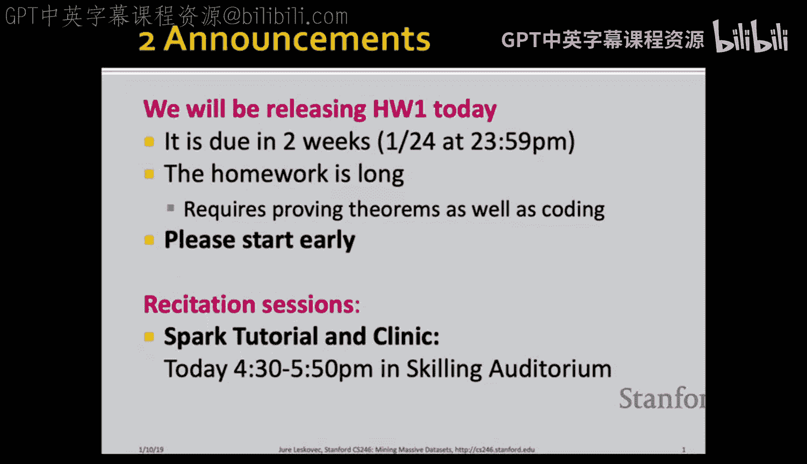

# 斯坦福大学《海量数据集挖掘｜CS246： Mining Massive Data Sets 2019》中英字幕 p02 -P02-lec2 Frequent itemsets and Association rules.zh_en -BV1raSjBuE3d_p2-

Welcome to the class。 So 246。 today is the first real class。 and I have two first real announcements。

 First is that we are going to release or we are releasing homework one today。

 So this is the first big long homework is due two weeks from now at midnight Pacific time。😊。

And everything everything that I said in the last lecture applies for this homework。

 Another important thing is that today， basically， right after the class in the skilling auditorium。

 we will be holding our first of the recitation sessions called Sp tutorial tutorial and clinic。

 So this is basically the idea is to to go here if you have any trouble with installing Sp any trouble doing the homework 0。

 So essentially， we will go through homework 0 here。

 show you how to do it and help you debug your installation of Sp so that then you are ready to do homework one and everything else。

 So if you have any trouble， this would be a great place to go to seek for help， yes。😊。

Yes， all the recitation sessions will be recorded。 Of course， if the session is recorded。

 it's kind of useless if you have problems because you cannot ask questions。 So plan accordingly。

 Okay， great。 So now topic for today， will'll be talking， talking about frequent item set。

 mining and association rules。 And the way I'll do the lecture is。

 I'll first tell you kind of what's the idea。 What's the goal。

 And then we'll develop Algar items that will allow us to do that。😊，And association rule discovery。

 the idea is that we w to do that we are a supermarket right and if we are a supermarket。

 we want to manage our shelf space right and we will be living in what is called the market basket model。

 which means that our goal will be to identify sets of items or groups of items that are group that are bought together by sufficiently many customers right so we can be whole Foods in Palo Alto。

 we can be Amazon dot com or anything else where customers come select sets of items。

 consume buy them and leave you could be even like a music listening website like I don't know Pandora or Spotify where people collect items and then go right or items in that case would be songs that get collected into the play playlists and our approach in this kind of market basket analysis case that we want to process point of sales data collected。

😊，By let's say barthco scanners or whatever to find the dependency between our items， our products。

 things that users buy and our goal is to find association rules like rules， for example。

 here is one very famous。 you know， if somebody buys diapers and milk。

 then he or she is also likely to buy beer and using this type of knowledge。

 we can optimize shelf space， we can use this to make recommendations to people and so on and so forth right And so don't be surprised if you see diapers milk and beer kind of close together in the store Okay。

 so how are we going to think about this。So the idea is that we have a large set of items。 These are。

 for example， products or things sold in a supermarket。 These are。

 let's say all the songs on Spotify。 And then we have a large set of baskets。

 And each basket contains a subset of items。 So right。

 when you go in Who Foods in your cart and you put it on the in front of the cashier。 That's your。

 that's your basket。 Those are the items in your basket。

 Or when you take the songs and put them together in a playlist playlist is your basket。 right。

 and then we want to identify association rules。 Basically。

 we want to identify things that say people who bought X， Y and Z tends to buy also V and W。😊，Right。

 this is an association rule right from based on these three things。

 this tends to follow right So for example， up here， I have an example of five different baskets。

 each one containing a different set of items and out of this。

 I could discover association rules that people who buy milk also tend to buy coke or people who buy diap person milk tend to buy beer as well。

 Okay， so this is what we will w to compute。 If this is our input， this is the output。

 given the baskets， I want to figure out what tends to be bought together。

 and given these set of items here we predict what other items the user is going to buy。

 So in some sense， you can think of this association rules as predictors。 given these two things。

 I predict that lots of people buy beer。 given that you bought Coke。 I predict sorry。

 given that you bought milk， I predict you will buy coke as well。

 Okays that's essentially what we want to do the input the。Now， of course。

 we'll talk about how do we， how do we do this on large data and how do we do this in a scalable way。

 right So more generally， what we are doing is we have this general many to many mapping between two kinds of things。

 right， and we are asking for connections between items that that that belong to baskets， right。

 So now here are some examples of what items and baskets might be。 For example。They are abstract。

 So you can take many different domains and put them into this into this， right， So， for example。

 you could say items and baskets can be products and shopping baskets。 That's the easy one。

 For example， items could be words and baskets could be documents。

 right all the words that belong to the same document。 So items is a word。

 basket is a collection of words， it's a document， you could think， for example。

 in in in computational biology， bioinformatics， items could be base pairs and baskets could be genes。

 right， I have a gene gene has a set of base pairs or amino amino acids。

 if you think of proteins right， So items are base pairs， baskets are genes， right， or for example。

 you could say I have a patient， a patient is a basket。

 What are the items in the patient drugs that the patient is taking right。

 So now you can start saying given that you are taking these。Drugs， I predict you will。

 you will take these other drugs as well。 or you could think of， again。

 basket being the patient and diseases being the items that are in the patient， right Like， you know。

 the cold diseases in my is in my basket right now。

 That's why I'm coughing right But you can start asking given that you have these two diseases。

 Here is the third disease that is going to follow。 So this would be association rules。

 So our algorithms that will discuss today can be applied to any abstract setting where you have items and baskets。

 right， as I said， we'll talk a lot about items being products and and baskets being sets of products。

 and we'll talk about our kind of running example use case will be you are a chain store。

 You have terabytes of shopping data， the question becomes how do you discover these association rules。

 in a sense， you know， people who bought X also bought Y。 This is what Amazon。 Amazon is famous for。

We were looking at product X。 Amazon tells you this is what other products people people buy。

 Those things are computed using the algorithms I'll talk to you about today。

 So essentially it's the simplest association rule that says people who by X also tend to buy Y right are but willll be able to discover more complex association rules。

 Second set of applications， for example， I was mentioning before that you can think of documents right。

 you can think of baskets as words or sentences and documents and documents as as baskets。

 but you can flip things around， right， you can say items are the documents and sentences are the baskets。

 right So now you say I'm taking this sentence。 and I'm looking in what other documents does it appear。

😊，Right， and what is， what is interesting as this， Because now if you find an association rule。

 it will basically say， if you have a sentence in this document。

 then you will find it in these other documents as well。 across all kinds of sentences。

 and this will allow you to identify plagiarism。 right。

 it will allow you to identify sets of documents that share sentences among each other。

 And it will allow you to identify documents that are interdependent， right。

 So for plagiarism detection， you could apply this way。 And as I was saying before。

 you can think of baskets as patients and you can think of items as drugs or side effects or diseases that people have。

 And now， right， you can this will allow you to detect combinations of drugs that， you know。

 lead to particular side effects。 What is an interesting distinction here is for example。

 that is not that is interesting is that it also requires you to model the absence of an item， right。

 not not having these disease。😊，Not taking this drug。

 And there are extensions that allow us to even model the absence of an item。

 not just presence of the item in the in the basket。 Okay， so that's kind of the motivation。

 What are we trying to do today。 So here is now the outline of of the rest of the lecture。

 What I'm going to do is first define what do I mean by frequent item sets。

 What do I mean by association rules。 How do I measure the quality of the association rule in terms of support。

 confidence and interestingness， And after we are done with that， we'll talk about the algorithms。

 How to identify and actually compute these rules and item sets。 Okay， so that's the plan。

 First Ill kind of define the concepts， and then we'll do the algorithms。

 and we'll talk about how do you find frequent pairs， And that is already interesting。

 Then we'll talk about dynamic programming based a priori algorithm。

 and then other kind of more clever hashing based techniques。

 But that's the that's the plan for today。 if you。😊，Questions， just raise your hand and stop me。

 and I'll answer。 Okay， so don't。🤧Don't wait too long right。

 first thing I want to define is the notion of item set and a notion of frequent item set， right。

 So the simplest question is find me sets of items that appear together frequently。 Okay。

 so item set means a set of items。 And when I say frequent items set。

 I just means find me sets of items that coop in baskets frequently， right。

 then what do I mean frequently， I define frequency based on what is called support。

 right So I say if I have a set of items I， then the support of that item set is the number of baskets in which these items appear Okay。

 So and often we express this as a fraction of total number of baskets。

 So if I go back to my five transaction 5 five customer data set where I have five basket and I say what is the support of the item set。

Beer comma bread。 I go through this and I say in how many baskets were bread and beer bought together。

 Here is one basket。 Let's find Here's the second basket。 and that's it。 right。

 so the support of this is true because is two because there are two baskets in which bread and beer were brought were bought together。

 Okay so now what is our goal。 Our goal will be that given some user defined user specified support threshold S I want to find all sets of items that appear in at least as baskets。

 and those those item sets are called frequent item set， right if you if your frequency。

 your support is above this user defined threshold S。 then you are called a frequent item set。 Okay。

 so right now I have one parameter S that is specified by the user by the user of the algorithm says。

 find me all。Item sets that appear in more than 10 baskets。

 Then all those item sets are called frequent item sets。Alright， good。

 so now we know what an item set it is。 We know what the support is and what does it mean to be frequent item set。

 So those are the three important things we just learned。 I'll give you an example。

 Imagine I have5 items milk， Coke， Pepsi beer and juice， not very exciting items。

 the user decide gives me the support threshold of three baskets。 Here are my8 baskets， right。

 so this would be coke beer and juice that's milk and be for beer。 Okay， so now I have this。

 I could say what what are frequent item sets that appear in this in this in this data set。

 So for example， trivial real item set of M is frequent。 Why is that。

 because M appears in more than three baskets。 It appears1，2，3，4，5。 So support of M by itself is 5。

 That's more than3。😊，So it's frequent。 Now I can ask， how about item set M B。

 I that frequent as well。 And it is right， because it appears once M together here in B1， B2。

 B 5 and in B6。 So it it means it appears in four basket。 So the support of M is4。

 So milk can beer is4。 that's above my threshold of3。 So M is a frequent item set。 Okay。

 B C also appears in4 and C J appears in in3， which is above， at least the support threshold。

 So that's frequent as well。 Now， of course， you could go and try a threepl。 Like how about MP B。

 is that a frequent item set， You know， it appears here， and it doesn't appear anywhere else。

 I think， right， So that's not frequent。 It doesn't appear in three baskets。 So we are done，right。😊。

Right， but here are some examples of frequent item sets for this case。

 So now that I defined what a frequent item set is。 Now。

 let's switch gear and talk about association rules。What is an association rule。

 Association rule is a if then rule of the forum like this。

Which basically means if a basket contains all of the items I1 to IK。

 then it is likely to contain item J as well。😡，Okay， that's the idea。

 So if I have all the all the items on the left in the basket。

 then the the basket then then the item on the right is likely to appear in the basket as well。

 right， And in practice， there are many， many rules that that that appear in the data。

 And we want to find kind of significant and interesting ones。 So we need to define how。

 how significant or interesting is the rule。 So one way to do this is to not define a notion of confidence of an association rule。

 which is basically the probability of J given I。Right iss just saying how often that I had I1 to IK in the basket。

 does J also appear in the basket。 And the way you compute the confidence of the rule from set of items I follows an item J is simply the support of I union J divided by the support of I。

😡，Right， I'm saying out of all the cases in which items I were in the basket。

 What fraction of those were items I plus the item J in the basket。

 And that ratio is essentially the probability that this is true。

 So it's the confidence of the association rule。 And， of course， the higher the confidence the。

 the more often from this follows that。😊，O。😊，Yes， happy， happy， great question， yes。

Why is that not divided by the support of J， It makes no sense to divide by the support of J。

 because the question is out of how often does the left hand side。Occur。

 How often does the right hand side occur。 So it's from left to right， not the other way around。

 right， You are given I want to I K。And then out of that fraction of times。

 How often does also J appear next to it， right， So I'm saying this is what I'm given。

 And then how often does J appear next to it。 So that's the right way to do it， yes。还以。

How do you choose a support threshold you， you choose it once you see the data。

 If you choose it too late， you'll get too many rules。 If you choose it too high。

 you'll get too few rules。 So the idea is that you try out a few support thresholds and find as as high support threshold as possible where you're still seeing interesting rules。

 There is it's a user specified parameter depends on the use case and use case， yes。これま。系怕手先佢系。

Great question。 So what happens if J appears if J is always bought， right？ Imagine everyone's bias J。

 then then whatever is on the lefthand side， J always follows。 This is this is a great question。

 And you know， here is my answer to Camilla。 Okay， so right。

 not all high confidence rules are interesting， right like as Camilla said， if milk is always bought。

 then anything on the left will imply that milk is going to to be bought。

 So that that rule will have high confidence。 but it's a boring rule。 So how do you get around this。

 you define this notion of an interestingness of an association rule where you say this is the absolute difference between between the confidence and the fraction of baskets that contain J。

 right， So now I'm saying this is the confidence we cared about before。

 And this is the prior probability of that。 And if I see significant difference between the two。

 then that is an interesting rule。 but。😊，If the two are about the same。

 that basically means everything is driven by the prior probability of J。 Okay， great question。

 Thank you so much。 It motivated this slide quite well。 Okay， great。

 so this is what I wanted to show。 And I'll give you one example Here is again， our8 baskets from B4。

 If I want to have an association rule from milk and beer follows Coke。

 this association rule has support3 of two， Why， because M B and C appear in two item sets。

 It appears in B 6， and it appears in one more。 B1。 Okay， so it appears here。

 And here this three items together。 So that's why it support of two。 What the confidence。

 confidence is2 divided by4。 Where does the four come from M should appear in4 in four baskets。

 Let's find them。 Right， So M B， It's 1，2，3，😊，ほら？Okay， so M B by itself appears in four basket。

 MC appears in two baskets。 So the confidence of this rule is one half。

 Then we can also compute the interest。 This is the confidence minus the。

 the prior probability of Coke。 Coke should be appearing in 5 out of 8 baskets，1，2，3，4，5。 Okay。

 so that's the interestingness。 So it means it is relatively accurate association rule。😊。

But it's not very interesting， right， So we probably wouldn't want to look at it， yes。

SoIn is absolute value， so can we think of low confidence and high probability。

 giving high interest because we'd assume that it would imply the hybrid probably in， but it doesn't。

It's a great point。 I defined confidence as， as the， as the absolute value。

 You could even think of it as non absolute value。 and then it becomes interesting whether the difference is highly positive or highly negative。

😊，Right， and that's interesting as well， because if the difference is highly negative。

 then it's almost like a negative association where it says if this， then not that， right。

 So both are interesting。Okay， great question。 So now I kind of gave you all the。

 all the all the all the all the terms。 I explained all the， all the things we need to know。

 Here is now what we would like to do。 So here's now the definition of the problem。

 The problem is that we'd like to solving the lecture today is find all association rules with support greater than S and confidence greater than C。

 right， So S and C are given to us by the user by the data analyst and our goal is to design an algorithm that will click quickly find all association rules that obey these two criteria。

 right。😊，And as I said， support of an association rule is this is the is the support of the set of items in the rule。

 So it's left side plus the right side and confidence we identified。 Now。

 what is the hard part when we w to solve this。 The hard part is finding the frequent item sets。

 And you are saying， why do you care about finding frequent item sets。

 The reason why I care is because once I have the item sets。

 I take support of one item set and divide by the support of the other to find the confidence of association rule。

 So I care about finding support of item sets so that I can compute confidences。 right。

 So if we have。Item sets that in their supports， I can quickly compute confidences。😡。

Another thing is， right， we say， I want association rules with support greater than S。

 This means that this support has to be greater than capital S。

 and this ratio has to be greater than than than C。 Okay。

 so this has to be greater than S and the ratio has to be greater than C。

 That's why we care about frequent item sets， because discount by definition is then greater than the threshold S that is given to us by the user。

 right， So the point is the following， right， if association rule has high support。

 This means that both the lefthand side and the entire thing the entire rule will be frequent， right。

 if you are。😊，Above support threshold， then it means the left hand side。

 as well as the right hand side， will be above the support threshold， right。So now。

 how are we going to， to do this， There are really two steps to the algorithm。

 First step is to find all frequent item sets。 Okay。

 and we will really spend most of our lecture around step 1。

Because once we have all the frequent item sets， generating association rules is quite easy。😊。

🤧The way we generate an association rule is the following。 we say we have a frequent item set I。

 We will take some set of elements of it A， and we will put those on the left hand side and the rest will put on the right hand side。

 right， So basically， the idea is if I have a frequent item set I。

Then I'll take a set of items a and I'll put it on the left and whatever I haven't taken。

 I'll put on the right。😡，Okay， that's I just generated an association rule。Right。

 since I is frequent。 This means that the association rule itself。 the is， is also frequent， right。

 see basically because this thing up here is the support of the association rule。

 and that's exactly a。 sorry。 that's exactly I， right， So what do I do in the in the。

 I could do in I could do the following。 I could take every frequent item set I。

 I could generate an association rule out of it。 I already know what is the support of entire I。

 And now all I need to divide is divide by the by the support of a， and I get the confidence， right。

 So you know， imagine I I， I'm looking at the item set ABC D。

 I can generate an association rule out of it like this。

 And then its confidence is support of ABC D divided by the support of the left hand side。

 which is A B。😊，I divide this， and I get the value。

One thing that you should notice and will be kind of popping up in this lecture over and over again is。

 is the following thing is that if a given association rule is， is below confidence。 For example。

 if ABC follows D is below confidence， then A B follows C D is also below confidence。

 And you will say， how can you guarantee that。 And the way you can figure this out is。

 if you look at our formula for confidence right on the on the on the support side here。

 I union U I union J both this rule and that rule are composed of ABC and D。

 So they'll have the same， the same count count in the numerator But what in the denominator right in thenominator。

 we divide by the by the by the support of the left hand side。

Here of the support of the left hand side is this much。 and here。

 the support of the left hand side is that right So now if this has some count that is below the confidence。

 then the count of the left hand side here will only be will only be smaller than the count of the left hand side here right because how many does ABC appear the the AB appears in everywhere where ABC appears plus somewhere else where C is not present right。

 So we have this notion of monotononicity where bigger item sets have lower frequency than subsets of them right So you can use this procedure。

 this strategy to generate association rules after you have found frequent item sets。

 So let me let me give you an example again， here are my eight baskets we had before。

 I will have support threshold of three and I will have a confidence of 0。75 So as a first step。

 I will find。And item sets here they are。😡，These are all the item sets that appear at at least three times or more。

 And now I will generate the rules out of this1， I can generate from B follows M and from M follows B from this one I can generate the same way B C and so on。

 And then from this one here are the rules I can generate And now for every rule。

 I can simply compute the confidence right how do I compute the confidence is the support of BM divided by support of B is is support of BM divided by support of M and so on and so forth。

 And now that I have done all this I cross out the rules that are below my support threshold of 0。

75 and whatever I didn't cross out that is what survives and I show to the user。Okay， so this。

 this is this is， in some sense easy。 Once I have the frequent item set。

 I exhaustively generate the rules。 I compute their confidences， toss out whatever is not confident。

 And the rest I output to the user。😡，Is that that does that sound good？Okay， right。

 What I haven't told you yet is how do you do step 1。I told you how to do this。

 and it should be kind of clear after you have these things that are above the support threshold。

 then you worry about the confidence threshold。😡，Yes。Happy， happy， happy。All right， good。

 are there any questions about this？Yes， go ahead。怀理。

Why do I want only frequent item sets Because I want only the rules that have support of S。😡，Right。

 so frequent item sets means give me items， give me item says that have support more than S， right。

 So here support is three。 So I want item sets that have support more than3。 Otherwise， you know。

 you could say， oh， I will take what is like， for example。

 I will take item set M MP appears once twice。 right， you can generate association rule out of M。

 but because M only appears twice， it's below the support threshold。 So no。

 so we have to toss it away anyway。 So the strategy first find everything that is above the support threshold。

 And then generate the rules that are that are above the confidence threshold。

That's why I care about finding frequent item sets。

 because I want my item sets to be above the support threshold given by the user。

 And now that I found everything above the support threshold。

 I want to generate the rules that are confident。😊。

And I know those rules are already above the support threshold because I only generate them from frequent item sets。

Yes， awesome。 Okay， great anything， anything else。 I think this is a really good question。😊，Yeah。

 anything else to clear out。 This was good。 I think it cleared some things。 Okay， so this is。

 this is what we are doing right now， sorry。嗯。What I wantna， I will skip this。

Now what I want to talk next is really talk about how do we find frequent item sets。

 because after I have frequent item sets， I can go generate the rules， check their confidences。

 toss out the rules that are not confident。 and I I have done my job。But the question is。

 how do I find frequent item sets， That's what we want to talk about next。

 So let me try to define the problem a bit。So the way we will think of this is the following。

 We will think that we are given our transaction logs in a big flat file。

 So right data will be kept in big flat files and stored on disks。

 and they will be stored a basket by basket。 So you can think of that baskets are small。

 but there are many baskets and many items right So the idea is that imagine you I have a file like this where the first five items are one basket and then another three It's an x basket and x basket and so on and so forth。

 And I would be like to kind of be reading this file in from the beginning and do my do my analysis right。

 baskets are relatively small。 There could be many， many。

 many different but there could be many different items。

 and our strategy will be that we will start with。😊，Identifying first。

 what are the frequent items and from frequent items。

 we will create frequent pairs and from frequent pairs。

 we will create frequent triples And from triples， well create quadruples and so on。

 and we'll be able to build this up and use very little computational resources right So rather than having some kind of nested four loops and creating gold combinations of everything。

 which would be this like computationally impossible。

 we will build the our frequent items kind of size by size。

 We'll start with singletons to pairs to triples， quadruples and so on。😊。

So that will be our general strategy。So how are we going to measure computational cost。

 The true cost will be about how many times do we need to do we need to read through or scan through our data。

 right？ So it will be the number of disk corporation。

 The number of times we have to go over through our disk file。 This is what we want to minimize。

 right。In the， in practice， right， association rule algorithms， we read the data in passes。

 We will go through once， twice and so on。 and we want to minimize the number of passes as we pass through this huge file with lots and lots and lots of transactions。

So the way we measure the cost is we measure it in the number of passes needed over this file for algorithm to compute what we want。

And there will be one main bottleneck and the bottleneck is main memory。

 and I'll show quickly demonstrate to you why this is the case。

 right so as algorithms will go through this main memory will be the crucial resource right because we'll be reading basket baskets will need to count something。

 we need to count the occurrences of pairs or triples， right， well need to count occurrences。

 the number of times item sets were seen in baskets， right but the number of different things。

 different counters you can keep in memory is very limited。

 So I know swapping counts in and out of memory will be disastrous So our goal kind of our strategy will be how do we cleverly only keep count of things that at the end will turn out to be frequent So that will be kind of this whole game we will play we will only keep to we will only want to keep the counter for a given item set if we will be like。

This item set will likely be frequent。Right， so that will be the trick。

 How do we not even need to count the frequency of item sets for which we don't believe that are frequent。

 That's kind of the main。Thing we will try to do to make this feasible and work。Okay。

 so here's the first case of this thing。 right， Like the， it turns out that when we do this。

 when we go from to pairs， So item sets of size 2，3，4， and so on。

 finding frequent pairs is usually the most expensive task。 right？

 So the task keys give me all the pairs of items I and J that appear more than S times in our baskets。

Right， and why is that the case is because frequent pairs are common。

 but frequent triples are relatively rare。 right， What this means is that probability of being frequent drops exponentially with the size of the of the of the item set。

 But the number of different sets of that size grows more slowly with size。

 So for this reason kind of finding frequent pairs is generally or usually the hardest problem。

So how are we going to， to do this。Here is the general approach， the intuition， right， The point is。

 we always need to generate all the item sets。 We always need to generate all the pairs or consider all the pairs。

 But what we would like to do， as I said， we would only like to count。

 meaning we would only like to keep track of the item sets that， at the end turn out to be frequent。

 If something doesn't even have a chance to be frequent。 We don't even want to count it。

 We don't want to waste memory on that， We want to just discard it。 So the question becomes。

 how do I know that something cannot be frequent。 if I haven't counted it yet。Right， how can I。

 ahead of time know that something that something is not promising and discard it before I even know itss frequency。

 That's， that's the hard thing。Okay， so let me first give you the naval algorithm and then we'll we'll see why it doesn't work and we'll fix it。

 Okay， what would be the naive approach。 The naive approach would be， keep scanning over the baskets。

 And then you know as you read in the basket， have the two four loops generate all pairs of items in a given basket have a big dictionary or something and just keep track of every pair of the frequency of every pair you've seen across all the all the baskets。

 Okay so let's see how would this be， imagine you are Walmart， Walmart sells around 100000 products。

 if you are Amazon， I think you are selling about 10 million to 100 million products if your items are web pages。

 you are talking about tens or hundreds of billions of items right But imagine we are not ambitious。

 We are just Walmart。 we have10 to the five items if if we count items。😊，With 4 by in integers。

 This means we assume everything appears less than 4 billion time times We need 4 by。

 The number of pairs of items。 if we have 10 to the five items is， you know，10 to the  five times。

10 to the 5-1 divided by 2。 So that's basically 10 to the 9。Right， so if I。

 so this basically means that I need and if I multiply that by four。

 basically it means I need about 20 gigy of memory if I have hundred000 products。Right。

 now this is 10 to the5。 If I would have something that that's 10 to the 9。

 then I would need 10 to the 18，10 to the 19 B of memory to count all pairs。

 I don't know how much that is， but it's， it's a lot of terabytes。Right， so very quickly。

 I couldn't do this in an AE way。So let's first simply say， how could I keep track of pairs of items。

 and then we will come up。 how do we prune and not need to keep track of every pair of items。 Okay。

 so there are two approaches， how can you keep track of counts of pairs of items。

 One is what we will call using a triangular matrix。 and the other one is use use a dictionary。

 right， basically use a hash table or a table of triples of I J comm count。

 right I J or the items and seize the count。 Okay， and here， of course。

 you will need to do some bookkeeping because you are directly storing I J and count。 But first。

 let me tell you how I'm thinking of triangular matrix to be working right。

 triangular matrix idea is I just allocate the space so that when I given an item I and give an item J comes。

 I only make a look up here and I update the the appropriate。Co。 So in some sense。

 I have this dense data structure where for any pair of items。

 I have a cell already pre allocatelocated， and I just increase the counter in that cell。

 While if I'm using the dictionary， then I'm not pre alllocating all the all the data。

 but I'm just counting for whatever are， are the three are the pairs that occur in my data right here。

 I'm preallocating counts for everything， and I need4 B per pair。While here。

 I'm not pre alllocating anything， but I need 12 by per 2 to remember I N J and one to remember the count。

 right， So， and right， So that's why the difference， right？ So now the question is。

 when should you use this one， When should you use that one。And if you think of it。

 the difference will， the difference will show up， depending on how many different pairs actually occur in the data。

 If out of all possible pairs almost all occur， then this approach will be very will be much better。

 But if you have lots of items。 But only few pairs tend to occur together in practice。

 then this particular approach will be better because it's a sparse data structure。

 While this is a dense data structure。 Okay， so。Let's discuss a bit the triangular matrix approach。

 right， If I have a total number of items and then the idea is， I will， I will， I will。

Alloccate memory in this shape and I will basically for every item， I and J。

 I will already have a pre allocatelocated cell where I will keep the counter for that I and J right And you could even like flatten this matrix into a long vector。

 and basically keep counters in this way， right， like1，2 is at position 0，1，3 is at position 1，1。

4 is at position 3 and so on and 1 n is I know what position n-1。 And then it's know 23，2。

4 and so on and so forth。 right And this is different indexes in that array。

 And then given I and J here is a long， complicated formula that allows me to compute the index into the array where the counter for that Ij is being stored right What is how much bytes do I need to allocate if I have an items then the number of pairs is n times n -1。

😊，ided by two。 So it means I need to allocate an order of memory that is squared in the number of items I have in my in my data。

 right， But what is good is that I only require one counter4 by per given pair of items。

 How about the alternative approach in the alternative approach。 I require 10 B per occurring pair。

 because I need to store I J and the counter。 But I only need to do this for counts for pairs that actually occur in the data。

 While here I'm wasting a counter for everyone。 regardless whether it occurs or not， right。

So who wins basically。Depends on the data， right， Appro 2 will beat approach one。

 if less than one third of all possible pairs occur in the data， right。

 So if out of all possible pairs， less than one third occur， then I you go with this approach。

 But if lots of different pairs occur in the data， then you go with the top approach。

 it just depends， you know， is it one third or not， if it's less than that。

 use the sparse data structure， if it's more than this， use the dense data structure。Great。

 how would you pick between approach1 and approach 2。

 The best way I think would be to to have a quick sample of data， do some estimation， count。

 see what happens and then run it on the full。 that would be that would be the suggestion。

 Good question。 Allright， so now what is the problem。

 The problem that like really the crux of this lecture is the following。

 What happens if you have too many pairs and you cannot count you cannot count them。

 You cannot feed them into memory， Can you do anything。 Can you just like can you cry。

 or can you kind of stand up and do something about it， right？ And the thing is we don't have to cry。

 we can， you know learn in this class and and and life will be good。

 So what can we do Like how can we do better。 Okay。

 and the way we can do better is to use what is called the a priorial algorithm And what this will be。

😊，Is we will exploit this monotonity of frequent。 And the intuition is very simple。 The intuition is。

 if item A is frequent and item B is frequent， then A And B will likely be frequent。

 But if I have item A that is frequent。 And item B is not frequent。

 Then A And B will never be frequent， right， And we can exploit this to even decide what pairs will we keep track of in memory。

 right， And this is what we mean monotonity of frequent。😊，Right， if。

 if this particular product appears in hundred0 baskets and this product appears in only 10 baskets。

 then these two together cannot appear in more than 100 baskets together。 So if this is frequent。

 and that is not。 then this plus that will never be frequent。 right。

 That's the what we mean by monotonity of frequent。

 And then we will have this notion of candidate pairs and extensions about from pairs to triples and so on。

 So let me explain the a priororial algorithm。 It's kind of a dynamic programming approach。

 And it's a two pair approach。 that limits the need of main memory。 And the key idea is monotonity。

In a sense， what it means is if a set of items， I appears S times。

 then also every subset of it will appear at least S times。Right。

 it cannot be that a subset of of items is less frequent than the superet。

 It can that that cannot happen。 right， So the idea will be that we will use this notion of contra positiveitive pairs。

 which means if item I does not appear in as baskets。

 Then also no pair that includes I can appear in as baskets。Right。

 if my support threshold is0 and this was only bought 10 times。

 then this plus that can never be bought together more than 10 times。 So if this is not frequent。

 these two are not frequent as well。 Sorry， this is not。

 I'm not trying to sell you anything or endorse a product， right， But that's the， that's the idea。

 So how are we going to use this to exploit。 Okay， so what will we do in the past one。

 we will read all the basket and count in my memory。

 just the number of occurrences of each individual item。Right， I'm just asking。

 how often does each product appear in， How many baskets， right。

And this means I only need memory that is proportional to the number of items。

 not to the square number of items， right。And items that appear appear at least as time。

 I will call them frequent items。 So now in the second step。 while what will I do。

 I will read baskets again， and I will keep track of the count of only those pairs of items where both elements of the pair are frequent themselves。

 right， Because if I have hope for these items set to be frequent。

 then this has to be frequent and that has to be frequent， And if one of them is infrequent。

 Then together they cannot be frequent， right？ And this means that the memory required will be proportional to the square of frequent items and not the to the square of all items。

 right， And this is what makes the approach feasible。 So here is the idea。😊。

I'll show you these graphs a couple of times。 But basically。

 the idea is that this is all my available main memory and the boxes inside show how am I using my main memory。

 right， So in the past one， I will keep the， I will count the individual items I will need some memory for that after I'm done。

 I will only remember what items are frequent。 what individual items are frequent。

 So now when I'm reading through the through the data again， and I'm seeing this pair occur。

 I will only I will only keep a counter for a pair， if it's composed of two frequent items。

 And if one of the items is in the pair or both items in the pair are not frequent。

 then the pair itself will never be frequent as well。 So I won't even count it。

 and that's essentially the strategy。😊，Right， so。Are there any questions about what。

 what we just did。Right， this simple strategy where we are not keeping count of everything。

 but only count of things that potentially can become frequent hugely saves。

 saves us huge amounts of， of memory and computation and how much we have to keep track of。

Any question。Alright， so let me now tell you about one detail of the a priororial algorithm。 right。

 What you can do is in this case， you can use when you count pairs。

 you can use either the triangular matrix approach or you can use the the， the dictionary。

 the hash table approach。 And if you w to use the triangular matrix approach。

 Then what you have to do is you have to do the following in the first pass， you keep。

 you count the items。😊，Then you determine you remember what are the frequent items。

 But because now you want to use the matrix to keep the count。

 you have to map the the old item I to new item I that go between one and and K so that you have the dense data structure right so you need that little thing there that will allow you to map from original item Is that may not be contiguous to the item Is that are that go between one and whatever is the number of individual frequent items。

 And then here you you， you have the memory for your triangular matrix where you keep the counts。

 Okay， so this was now a priori to go from frequent singletons to frequent pairs。And， of course。

 we can generalize this to generate anything of any size we would like。

 And the idea is the following， right， The idea is that we will have these candidates and from。

 sorry， we will have the frequent elements for frequent elements。

 we will generate the candidates for the next level for the next size we will count them prune them and。

 and from those we will generate the next set of candidates， right。

 So the idea is that for every K where K is the size of the item set2，3，4。 we will do the following。

😊，We will construct the candidate set C of item sets of a given size。

 and this will be a set of item sets that might be frequent sets。

 meaning that their support trash that their support could be more than S based on information from the previous pass and then we will make a pass over the data。

 we will count these guys after we are done， we will check their frequencies。

 we will toss out the ones we support less than S and this will be then the truly frequent item sets of their size right and the idea will be right。

 we start with frequent candidates for frequent pairs。 sorry from frequent singletons。

 we go through remove the ones that are that are not frequent and here are our frequent singletons。

 we can then construct all pairs of frequent singletons to come up with candidates for frequent pair。

😊，We make a pass over the data to count all these candidates。

 prune out those that are not frequent and these are now frequent pairs and now from frequent pairs。

 we can generate candidates for frequent triples， we make another pass over the data。

 count their frequencies and tos the ones that are not frequent。And right。

 the idea is that basically through this， I just actually went through this， right。

 I started all items。 I count them。 I end up with frequent items。

 I generate all pairs of frequent items to come up with frequent with candidates for frequent pairs。

 I count them I filter them。 Now I can generate candidates for frequent triples。

 So let me show you how to generate candidates for frequent triples。 This is a long slide。

 But let's go through it slowly。 because you'll see how this works。 right。

 so I'm back to my coke beer example。 Here are the items I get。 right。

 So I would say my candidates for frequent items are just all the items I have。😊。

Then I go count the support of all the items。 And after I counted the support。

 I prune out the ones that are not frequent。 the ones that don't have the support threshold above about S。

 Let's say that the items that survive B C， J and M。 Now out of this I。

 I know I can go and generate candidates for frequent pairs。

 and candidates for frequent pairs are only those that are composed of frequent items， right。

 so it's like B C， BJ， BM， C，J， CM and MJ。 Okay， so I get six of them rather than this would be what for this is 6 rather than 15。

 right， rather than have 15 possible pairs， I only need to keep track of 6 in this small little example。

 right， These are now my candidates for frequent pairs。 Why are they candidates。

 because every subset of it is actually frequent。So they they， they have some promise to be frequent。

 Now that I have these candidates for frequent pairs。

 I count them and then I toss out the the pairs that are actually that don't survive my threshold。

 and let's say here are the pairs that are above the threshold Okay now。

 given these pairs I can go and generate candidates for frequent triples。 How would I do that。

 one way would be to say， I can take a pair of items and join them and see if I get a set of set of three and create a candidate。

 right， So I could say， let's take BM and B and join that into BM and that's a candidate or I could go。

 for example， to say， let me take B and CJ join them and I get a B CJ right。

 that would be one way to do and here would be now my candidates for the frequent。😊。

Ts that then in the next step， I would go and count and then again。

 prune to figure out which of them are truly frequent， yes。😡，这乖。Exactly。

 this will require k passes over the original data set to get where K is the size of the item set。

like。Maybe个 is now marketing。人啲个拆自嘅按装。That I we。Great， great question。 If you have free memory left。

 I'll explain what you do with it。 But what I wanted to give you now is this idea that you generate the frequent item sets of order K。

 you generate the candidates of K plus one test which ones are frequent to the infrequent ones generate new candidates and so on。

 One thing I did that is I have a double star here。 So people who are extremely careful。 For example。

 you can， you can figure out that B CJ has no chance of being a frequent item set。😊，Why is that？

Why can this never be a frequent item set。Great， super， right。 You guys got it， right。

 Like for this to be a frequent item set， then it means every pair also has to be frequent， right， B。

 C， yes， it's frequent。 C， J， yes， it's frequent， but BJ is not frequent。😊。

So this will never be a frequent item set， right， So this means that when I was generating these candidates。

 I could have been even more careful and not even generate these guys because there is no hope they will be frequent。

 I already know They won't be frequent because on this on this information right。

 so we can be very careful what you generate。 So essentially only generate candidates and keep track of those that that really have chance to be frequent。

 Okay， thank you。 This was this is great。 I I， I， I see you understand。 Okay， so。😊，As it was said。

 right， we need one pass for every for one pass for every k。

 So if I want to generate item sets of size K， I need k passes。

 I need to first do the singletons and then pairs and triples all the way up to k right and what typically means。

 as I mentioned before， for any kind of reasonable support。

 K equals2 requires the most memory and this basic idea that I showed you today。

 there are many possible extensions。 For example， there are association rules with intervals where you could say things like man over 65 have two cars right if men and if greater than 65 then two cars or you have association rules with items that are in a taxonomy that you could say。

 you know bread and butter follows fruit gem， you could abstract these association rules to say big。

Bked goods and milk products follows preserved foods， right and， and and so on and so forth。

 So there is a lot of extensions I mentioned before。

 also try to model that items are not present that are missing and so on and so forth。

 So this is a very rich research area。 And there is lots and lots of papers that go in all kinds of different extensions of this basic idea that I talk to you about。

 Okay， are there any questions。大週だと。Yeah。You also so。To this algorithm missed this type association。

Why would it miss it。我追个。你说的。Correct， so， but I would argue that that what you just suggested it is kind of is not particularly interesting。

 right， If you have this item that is always bought， then it doesn't matter what's on the left。

 The the item A always gets bought。 So that's kind of not interesting。

 So we don't care about even finding that rule。 So it's fine to miss it。 It's good to miss it， okay。

Good， so let me now tell you some extensions that get cleverer about how the memory is used and require less memory。

 So here is one extension， right that uses hashing in a very clever way。

 This method is called PC Y by the authors of the algorithm。 right。

 the observation is that in pass one of a priori， most of the memory is idle。

 right because we only count the the frequency of pairs of individual items， lots of memory is idle。

 And the question is， can we use this idle memory to do something useful。

 And here is what we can do right， The idea is that in the first pass。

 in addition to the item counts， we will maintain a hash table of buckets。 So caveat here。

 bucket is in a hash table， bucket has nothing to do with basket。 Okay， so when I say a bucket。

 I just mean something in the hash table。 Okay， so I have a hash table with as many buckets as I can fit in。

😊，つもり？And the idea is the following， I will keep I will keep count for each bucket into which pairs of items are being hashed。

😡，And the idea is that for each bucket， I will just keep the count。

 not the actual pairs that that are hashed into that bucket。 And let me tell you how this will work。

 Okay， so here is my the pseudo code， right， I go for each basket for each item in the basket。

 Add one to the items count， This is what we had so far。

 This first three lines where the first pairs of a priori， Here is now what is new in PC Y， I say。

 okay， for each pair of items in the basket。 has that pair into a bucket and add one to the count for that bucket。

 right， And the question is， why is why later I'll ask， why is that useful。

 But it turns out this is very useful， So let me， let me give you first a few details and then well go to why is this useful。

 right First is that。😊，Pairs of items need to be generated from the from the input file。 right。

 They are not present in the input file。 So here is where we generate this pairs of items from that basket。

 right， and in note that we are not just interested in the presence of a pair。

 But we need to see how what is the support， How often does it occur。

 So here we are actually adding count to the bucket in which that pair hasshes， Okay。

 So now the question is， why is this useful， Why like why are you doing this to yourself， right。

 and here is the important observation， right， if a bucket contains a frequent pair。

 then the bucket will be frequent， right， Basically。

 if I have a frequent pair that hashes into the bucket。

 then the count in that bucket will be greater than S。😊，O。😊，But right。

 even without any of the individual pairs being frequent， the bucket itself can still be frequent。

Right， so if I have a pair， like if multiple different pairs， pair A B。

 F and G and Z and Y all hash into the same bucket。

 maybe this one appears 30 times this one appears 40 and this one 40 altogether， the frequency。

 the count that will be more than 100， even though each one of them individually is not above the the support threshold of00。

 That sounds disappointing， right， which means we cannot use the hash to eliminate any pair in a frequent bucket。

 But heres， here is what we can eliminate， right， If a pair of items。

 hasss to a bucket that is not frequent。 then we know the that pair itself is not frequent。Yes。😊，好起。

No。People see what I say or not。Yeah， all great。 awesome。 super。 I'm happy， right。

 So this is essentially the trick。 right， When I take a pair and I hash it， the， the counter in that。

 in that， if the counter in that bucket is greater than the support threshold didn't it means that less than S pairs hashed into that。

 regardless of whether there were collisions or not。

 I know that whatever hashed in there did not occur S times so I can ignore it， yes。😊，What这。No。

 the idea is I， I would like to have as few collisions as possible， right， But if I have collisions。

 those will be my fake， fake candidate pairs that later will turn out to be not frequent。

 but the fewer collisions I have， the better this will be。

 because I will know that something has no chance to be frequent， right， So again。

 if will allow me to eliminate a lot of pairs that have no chance to be frequent。 And again， I I。

 I only need to count less pairs。 right， so in the second pair in the second pairs。

 I will only count pairs that hash to a frequent bucket and that are composed of frequent items。

 Okay， so how would I go and implement this in the first pair， I would have this。😊。

This hash table with buckets。 I would keep account of how many pairs hased into each bucket in the then I would create this what we will call a bit vector where one means that the bucket that a given bucket in the hash table exceeded the support count of S。

 This means it's a frequent bucket and otherwise it means0。

 right And then in the second pair when I need when I need to decide whether to keep track of account of a given pair。

 I'll say is are the individual items frequent， does the pair hash to a frequent bucket。

 If the answer is yes， let's allocate counter for for it。 That's essentially essentially the idea。

 right right as I said， what I exactly said， I and J both need to be frequent。

 and I J needs to hash to a bucket。 whose beat vector is one， which means it's a frequent bucket。

 and only then I will keep a track of it， right， and both conditions are necessary。

For a pair to have a chance to be frequent。 How does my main memory picture look like in the first pass。

 I keep counts of individual items as before， but I have this hash table of pairs。

 And what I do is I take this hash table at the end of the first pass and transform it into this bit vectorctor where for every bucket here。

 I determine whether it's frequent or not， So I have a bit here， And then here will be。

 and here I will now initialize counts of candidate pairs。

 but I'll only initialize count if it's composed of frequent items。

 And if this pair hashes to a bit that is set to one。

 which means it hashes to a to a bucket that is frequent right， And again。

 this way I'll be able to save a lot Any questions。 right， So this is quite clever。 right。

 I'm using this hashing trick to in some sense。😊，See if a pair of items has any chance to be frequent。

 And again， it， and it allows me to eliminate the need for the bookkeing of many pairs who have no chance to be above the support threshold S。

All right， awesome questions， yes。we may not have。Great， exactly here。

 we don't have enough memory for all pairs。 So there will be collisions here。😊，Right， if。

 if all you can allocate yourself is one bucket。Then you will have 1 bit here。

 and if this will be useless。But as soon as you have two buckets， you already done something。

 It allows you to eliminate something， right， General， you'll have some number of buckets here。

 But yes， less than the number of buckets will be less than the number of all possible pairs。

 So you'll have collisions。 But that's fine。😊，There was a question here， yes。说了。

What you could do for triples， you could try to do something similar。

 right when you go from pairs to triples， you could， you could do this type of approach as well。

Right， generally， as you go to bigger， the， the， if you can survive this from single to get to pairs。

 you are generally golden。 Then the rest， the data gets so much smaller that it's not the issue anymore。

But you could， you could imagine developing something like that for triples as well。

 It everything still goes。不。Great question。 So the question is。

 what happens if we have lots of collisions here。Right， imagine you have only one bucket here。

 So you， everything collides。Then you are basically back to where we were。😡，Right， like we。

 if you don't even use this hash table。 So you haven't gained anything。

 but you haven't lost anything。 So as soon you as you can have more than one bucket here。

And it's ridiculous to think you can only have memory to allocate one bucket。

 Then this will already start helping。 So if you can allocate， I know， a few million buckets。

 It's already good， regardless of how many collisions you get。い屋中番で。です。Yes。

 if you have only two buckets and both of them are frequent。 you still， you still don't have any。

 that's correct。Right， so this only starts to work when you have buckets that are not frequent。

 Those buckets help you。 So we wna have as many buckets here as possible。 No question about that。

 right， So we w to make this as big as possible because you want as many buckets so that as many of them will be able to be to be。

 to be nonfrequent。 You want as many buckets to be nonfrequent as possible and you want to have as many of them as as as you can afford here。

collision at all。 It doesn't。 Its meaningless as well， right， sorry。

 if there if there's no collision at all， then it's meaningless。 If it's no collision at all。

 then you have already counted them。So that's even better， right。Either way， it's good， either way。

 it helps。😡，Okay， great， good。 And I will say there is many more extensions of this。

 There is something that is called multist and multi hassh。

 And you can read by your on your own in the book that is associated with the course section 6。

4 that goes into more details of this。 if you'd like to see the video Here's the video of the same lecture starts at position 1010 and you can learn more more about this and more details about how it works and what it helps and so on and so forth。

 What I want to do to finish this lecture in the next few minutes。

 I w to give you a few examples of how could you do frequent item sets in less than two passes。

 right， we said now， if you want to save item sets of size K。 you need K passes over the data。

 The question is， what would you do if you wna less than less than two passes or less than K passes。

 So one way to do this is to say。😊，Do random sampling in a sense。

 sub sampleample the data so that it's small enough that you can load it into the main memory。

 And once you have it in the main memory， you can， you can identify all the all the items cells。

 right don't sneer。 like， don't be unhappy。 random sampling is often the good solution to the case when you have。

Too much data。 We'll also talk about two more methods。

 One is called S O N again by the authors of the paper。

 And then we'll talk about the toy1 and algorithm that all all of them kind of take this random sampling idea。

 but extend it in different directions， right？ So how would the random sampling look like。

 The idea is take a sample of the market baskets and run a priori or one of one of its improvements in the main memory so that we don't pay for the disk I O time and the computation then goes very quickly。

😊，And as we make this， right， you can actually you also go and reduce support threshold proportionally to make sure that you match with the sample size。

 right， so if you are working with， if your sample sizes，100th of the data。

 then your support threshold S should also be 100th of what you wanted to use on the entire data。

 And the way your memory consumption。 we look like here is set of the data。

 here is the data set you load in the memory and here is the space you will need for counts right。

 So the idea is rather than read these baskets from this at every pass。

 just sample them and load them in memory and then you can run all the iterations of a priori in memory and it's all cheap and quick and done。

 Okay So that's one way how you could do this without needing to make multiple passes over the data。

 Now what can you do in order to avoid false positives after you've done。Your， your。

Your computation on the sample。 you can actually now you could go and make another pass over the entire data and just make sure that everything your random sample claimed was was frequent is also truly frequent。

😊，Okay。😊，So in some sense， the idea is create the sample， find frequent item sets on the sample。

 and then confirm there through frequency or through support on the entire data。Okay， this is great。

 but there is one， one problem that this won't count sets that are frequent in the whole data set。

 but are not frequent in the sample。😊，Right， this is what kind of the， the the。

 the random sampling approach suffers from。 What do people suggest to， to， to， to， to， to。

 to go to go around this issue is to further decrease the threshold， right， The idea is。

 if you are working with 10th of a data set， then don't decrease the support threshold count to。

 to 10th of the account but decrease it a bit more， So you will catch a few more false positive。

 frequent item sets and then make another pass over the data and really figure out what are the ones that are truly frequent。

Okay， is it clear how this works， right？ create the sample。

 find the item sets of whatever size you want， Whatever you think they are frequent。

 make another passover the data Tru confirm that those item sets are frequent。

So that's number that's random sum sampling idea。 The SO N algorithm is similar but a bit different and the way it's different is rather than say create a random sample and then compute the item sets the SO N algorithm says reads small subsets of baskets into the main memory and run in memory algorithm to find all the frequent item sets right so the idea is that we are not sampling。

 but we are processing the entire file in in chunks chunks as big as we can fit into the main memory and then we'll say an item set became a candidate if if it's fine to be frequent in any of these subsets of the data that we loaded in memory and now that you have this candidates again in the second pass you can go and then determine which。

😊，Of these candidates are truly frequent。 Okay， so both random sampling and S O N， the idea is take。

 take somehow sample or read through， identify candidates for the frequent item sets。

 And then in the second pass truly verify that they are， they are frequent， right， And again。

 the key idea in both is that the item set cannot be frequent in the entire set of basket unless it's frequent。

 at least in one of the subsets。 Thats that's always the case。

 And that's kind of what allows us to do these things。And then the last thing I want to mention。

 the last kind of extension is the toy1's algorithm。 And here is how toy1 is is smart。

 What toy1 says is， you know， start with a random sample but have a bit lower threshold and find all frequent item sets with this particular。

 let's say， threshold。Right， and we will find frequent item sets in in this sample。 And then he says。

 add and now these item sets are frequent in the sample， we will call this item sets。

 we will add them to what we call the negative border for this item sets。

 And how do we define the negative border。 the negative border an item set is in the negative border。

 if it is not frequent in the sample but all of its immediate subsets are frequent， right。

 immediate subset means delete exactly one element from the item set。

 So let me give you a pictorial example， right， So if you think of this as singletons pairs。

 triples and so on。 you know， and they are here。 some of them are frequent and some of them are not frequent。

 And the idea is to keep track of this negative border。

 where basically what we want to ensure is that every So if I have an item set here。😊。

Every subset of it is frequent， but it itself is not frequent。 And the reason why。

 why we would want to do this is that this will allow us to make sure that we found all frequent item sets so basically we be moving forward here and whenever we penetrate into the negative border。

 then we have to kind of spread it around to make sure that whatever item set is bigger than itself that is not frequent。

 So let me quickly explain that right So in the first pass。

 we will start with a random sample lower the threshold slightly and add the item sets that are frequent in the sample into the negative border of this item sets and then we will go in the second pass over all the candidate frequent item set from the first pass and also。

 but also we will count sets that are in the negative border right so we will count。😊，呃 the。The。

 the things in the negative border as well。 And here is the， the， the key。

 the key observation is that if no item set from the negative border turns out to be frequent。

 then we know we found all the frequent item sets， right？ So basically， the idea is。

 if I have item sets here。And none of the things that is in the negative border。

 When I do things over the entire data set turns out to be frequent。 Then I know I found everything。

 But as soon as this gets penetrated。 then it means I forgot to count something。

 And I essentially would have to restart right So if we find something that something in the negative border。

 some item set in the negative border that is frequent。

 then we have to start over with another sample maybe decrease the support threshold so that you would catch those examples as well。

 right And here's the picture right， if this is frequent。

 And our belief is that these things are not frequent， but one of them turns out to be frequent。

 this means that some other super set of item sets can also be frequent and we have to be more careful。

 So I will finish here。 I know I covered a lot。 But what I wanted to convey today is this idea of frequent item sets and association rules all the way。

😊，How we measure them and in particular， these exciting dynamic programming algorithms that allow us to scale this and count pairs and have the candidates only for when there is belief that they will be frequent。

 So thank you very much Spark tutorial homework See you next week。😊。

