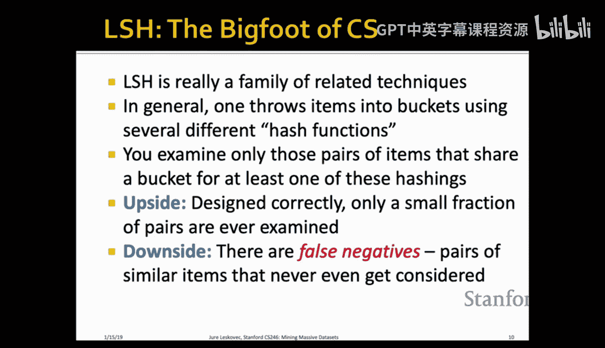
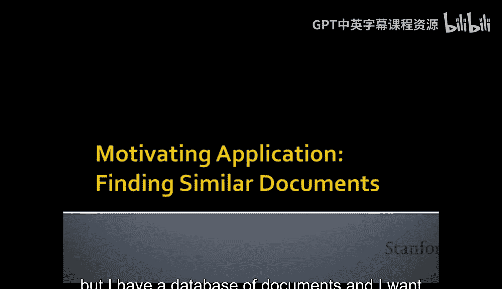
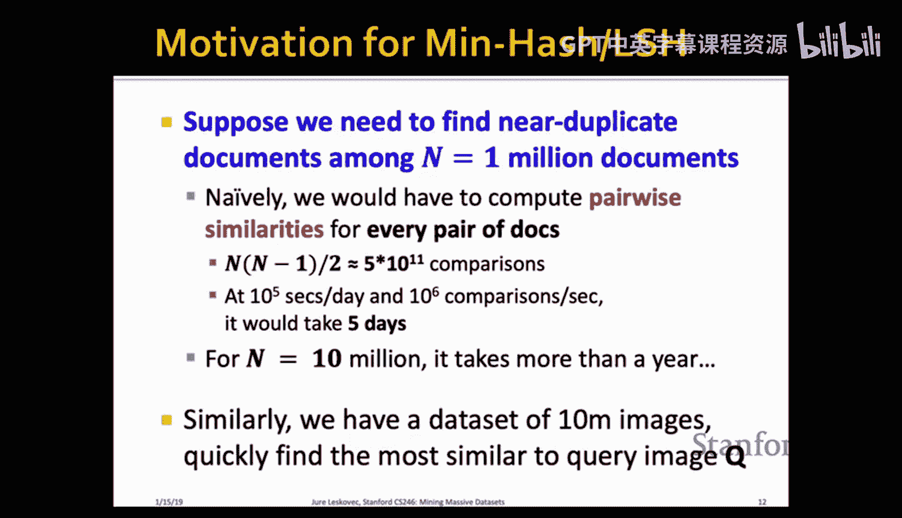

# 斯坦福大学《海量数据集挖掘｜CS246： Mining Massive Data Sets 2019》中英字幕 p03 -P03-lec3 Locality-Sensitive Hashing.zh_en -BV1raSjBuE3d_p3-

Okay。Great， hello everyone。 welcomele to the class。 So before we start， I have two announcements。

 we are doing two more recitation sessions today。 both recitation sessions will be recorded and the videos will be available we are doing one on proof techniques and probability today right after the class in Gs B1 and then on Thursday will talk about the basics of linear algebra basically the background that is needed for the class and this will also be taught in Gs B1 As I mentioned all this is recorded and and the materials we will present will be posted as well。

 So the topic for today actually the topic for two weeks is this amazing technique called locality sensitive hassing and this is kind of one of the cleverest use use of hash functions I've ever seen and it's amazingly impactful and amazingly important and I'll tell you why So to remind you where we are in our course。

😊，We are talking about high dimensional data and today we'll talk about locality sensitive hehing。

 and then we will talk about clustering and dimensionality reduction in the future weeks so that we can use this machinery to start thinking about how do we build recommender systems So all these will be in some sense。

 the theoretical basis for for building methods for real world recommendations and recommender systems that's where this is going。

 So even though some of these things will be a bit more theoretical。

 they will serve as a basis to build principle recommender systems Whats the what the task will talk about today。

 the task is the following how would you do how would you do this type of image search right I have an image I select subpart of it。

 You have a database of billions of images and very quickly after I select some subpart of image you want to give me more similar images that's the task will be looking at right like how would I do this super fast right。

😊，This is a problem， for example， that Pinterest cares about deeply。

 Pinterest is a collection of about 4 billion images a user can come select a random subset of the image just with with the fingers of your hand you select it and very quickly we'd like to take this image and do a query into a big database of images and say here are here are the results these are the images that are similar to what the user has selected so how does this work how do we do this。

😊，So the first thing is。We need to come up with a representation for an image。

The way we do this is to use deep neural networks， right。

 The idea is that I have an image and I send send it through a deep neural network so that at the end。

I get some encoding some embedding of that image。 Think of it as a sequence of zeros and onces。

 And the idea is that this sequence of zeros and one kind of represents the image really well。

 and then at the query time when somebody selects some random part of the image I send this query image through the same neural network I get some other encoding and now I'm doing what I'm trying to do is I'm trying to do nearestna search between my query vector embedding and my image target vector embeddings right I have3 billion of these images。

 each one being represented as a vector of zeros and onces。

 the user comes selects a part of the image I quickly send it through the neural network to to figure out what is its encoding and then I have some distance function to measure the similarity of the query to all my 3 billion images and I want to find the images that are most similar to my query and to give。

😊，An idea how these feature vectors， these descriptors of images look like。

 Here is here is basically taking the 3 billion images。 These are not 3 billion。 it's less。

 but taking this high dimensional representation of them， but only plotting it in two dimensions。

 So this is kind of the coordinates of all the images right so whenever you have a query point。

 what you want to do is to say this query point maps something in somewhere in this space and you want ask who are the nearest neighbor of that point and of course you cannot go and take every image from the entire data set。

 compare the similarity to your query and give out the answer because you want to do this in real time you want do it this fast right you have a person they select something you recommend bags they select something else。

 you do the query， you recommend shoes right and you want to be doing this in real time。

 So the question is， how do you find nearest neighbors in real time。

Over a collection of3 billion3 billion items right So that's the question the technology or the algorithms we learn about today will allow us to do。

 How do we do nearest neighbors， not in linear time in the number of data we have。

 but in time that is constant that does not depend on the amount of data we have。

 So Whats the common metaphor we talk about the common metaphor is。

 how do we find sets of items sets of objects that are similar。

 right What does this mean is we want to find nearest neighbors in high dimensions。

 What are some examples。 you can there are two ways how you can use this。

 One is to say I have a query and I want to find nearest neighbors of this query that's one way to think of this。

 another way to think of this is to say I have a set of objects。

 and I want to find all pairs of objects that are closer than some distance。 Okay So for example。

 you could say I am Google。 I crawl the entire web。 I have these billions of web pages。

Wanna find near duplicates， right So for every web page。

 I want to find others that are super similar to that web page。 This is， in some sense。

 a harder problem because it's not one query point versus the index of points。

 But every point in the index is its own query。 if you want to think of it that way。

 Or if I want to find pairs of similar similar customer。

 This is usually useful for recommender systems where I have a customer， And I say。

 which other customer is most similar to my customer so that then I can see what other things did these similar customer do。

 And I use that to make recommendations。 I need to do nearest neighbor queries。 in computer vision。

 I want to find images with similar features。 As I showed in the example of Pinterest for nearest neighbor image retrieval or for image completion。

 I could say， can you feel in this part of the image。

 The way you do this is to take this query image find nearest neighbors and see what do they have here and kind of sloty team。

 So you need this nearest。Neighbor， right， And as I said， in the commander systems and search。

To to abstract this up。 Here is what we will try to do at the abstract level。

 We will assume that we are given a set of high dimensional data points。

 This could be images as these binary vectors that I told you or this could be documents with the words they contain and I'm given also some distance function that tells me how similar to documents or how similar are two images and this distance function is given and what is my goal。

 My goal is to find all pairs of data points that are closer than that some distance threshold S。

 So I want to find everything that is very similar right that distance is less than little less right how would you do this naively。

 the way you would do this naively is you would have a double nested for loop where for every x1。

 you would go through all other x measure the distances and pick the closest ones or whoever is less than these distance and output it this solution would be quadratic in the number of data points you have。

Right。Right， so what is the the fact， the fact is that this can be done in time that is linear in the number of data points。

 right， even though you are trying to search over all pairs of points and the size of the output can potentially be quadratic。

 this this can be done in linear time。 So let me tell you how this can be done in real linear time。

 As I mentioned， this we are looking at the case where I want to find all pairs of points that are similar。

If I'm given one point and I want to find other points that are similar to it。

 that's an easier problem and everything we talk about today here can generalize to that easier problem。

 but we will talk about these harder one which is find all pairs of points that are at the distance less than S apart and what are we going to talk about we are going to talk about a technique or a family techniques called locality sensitive hashing so this is a family of related techniques and the idea will be that we will take our items。

 our objects， our images well use hash functions to throw them in the buckets and the idea will be that we will only look at the pairs of items that hash into the same bucket and the idea is that if this is designed correctly then pairs of items that are similar will hash in the same bucket and pairs of items that are dissimilar。

 they will hash in different buckets that's our。peOur hope is to basically look at look at one item。

 hash it to a bucket， and then other item that might be similar to it with high probability will hash to the same bucket as the original item so that we only need to look at the pairs of items that hash to the same bucket。

 Of course， the question will be， how do we design this magic hash functions that are what is called locality sensitive right that preserved distances that objects that are close to each other have the same hash code。

 objects that are different， have different hash codes That's the magic property that our hash function will have to have is what will be what will also happen is that our approach only bullet proof。

 our approach will have some false negatives， meaning sometimes we will miss a pair of items that is similar due to chance and that is okay。

 So we are willing to tolerate a bit of error so that but on the computational side will get a lot of benefit。

😊。

Okay， so I'm going to motivate this， even though I showed you the use case of pinterest。

 where the idea is you have a query point and you quickly want to find nearest neighbors。

 the way you would do this is you would first hash your your images into buckets。

 And when when your nearest neighbor when your query point comes。 you just hash it into a bucket。

 see what what other points are in the bucket。 And those are your nearest neighbors。

 So that's an easy problem。 What we will do here is we'll talk about finding similar pairs of documents。

 So I don't have one query document that I query against an index。

 but I have a database of documents。 and I want to find all pairs that are similar to each other。

 where similar means some similarity threshold S。 Let me now define how are we going this use case that we are going to use through the list of the lecture。

 So imagine we want to do near duplicate document detection。

 right This is what Google Google cares about。 They crawl the web， They get a lot of web pages， many。

😊。

Pages are near duplicates of each other and they want to filter them out so that your search results are not garbage right。

 So imagine we have 1 million documents， right， How would you do this naively。

 you would go and compare all pairwise similarities。

 There is about right if you have 1 million documents。

 there is about five times 10 to 11 different pairs right it's basically n times n-1 divided by two。

 So it's entries two different pairs。 So 10 to 11 different pairs。

 a typical day has about 10 to the5 seconds， and imagine you can do a million comparison a seconds。

 which is a lot。 It will still take you five days。 Okay。

 so even if you have just a million documents and you can do a million comparisons a day。

 it will take you five days to compute all pairs right but a million is tiny。

 Think that now you have 10 million， which is still tiny， It will take you more than a year。

 Imagine you have a billion and the universe will end before you compute。

Over pairs of points， right， So we need to do something more clever， right？

 How do we quickly find nearest neighbors or nearest neighbors of a given query point in time that does not does not need us to scan through the entire database。

 So how are we going to do this。 we are going to do this to apply three steps。

 And the way this will work is the following today。

 I'm going to give you a concrete iniation of locality sensitive hashing for this concrete problem。

 And then on Thursday， we will give kind of a more abstract mathematical。

 We will basically generalize what we learn today and explain it in more mathematical sense。

 But today we are talking about similar finding similar documents。 And here is what we will do。

 We will have three steps。 In the first step， we will take a document and we will represent it as a set of elements。

 Basically as a0，1 Boolean vector。 The same as I set for images。 We'll take here a document。😊。

And they represent it as a 0，1 vector。Then we will apply the locality sensitive hashing technique that is called mean hashing。

 And the idea will be that we will convert these large sets。

 these vectors of zeros and ones into short signatures that preserve similarity。😊。

And as we create these signatures， we will then apply locality sensitive hashing。

 which will allow us to focus to on pair of images of documents that are likely to be similar。

 and these pairs we will call candidate pairs right this will be pairs that with high probability are similar with each other。

 So that's the idea。 So well have three steps， let me give you a different way document will come in。

 We will apply the shingling step， which I'm going to explain。

 and this will allow us to basically take the document and represent it as a set of strings of length K。

 that appear in the document。 These strings of k words are called shingles。

 Okay or in natural language processing， they would be called k grams。

 Okay now that I have represented a document as a set of shingles or as a set of k grams。

 I will apply mean hashing， which means I will take this big binary representation of the document that tells me whether。

😊，Single appears in the document or not。 And I will compress this into short signatures where the similarity in the signature space will equal to the similarity in the original space。

 So in some sense here， I'll do a lot of compression。 If you want to think of it that way。

 And then I will apply a locality sensitive hashing technique where I will take each documents。

 I'll take the signatures， I'll hash them into buckets。

 and the idea will be that if two signatures are similar。

 they will likely be hashed to the same bucket。 So that then when I say which pairs of documents are similar。

 Only the pairs that hash into the same bucket are the candidates to be similar。

 That's the idea that's the overview of the lecture today。

 So what I'm going to do is now I'm going to take you through the steps。 First is the step1。

 which is shingling。 When we want to take a document in and convert it into a set of shingles。

 Okay So what is shingling， the idea is that I want to convert a document into a set of。😊。

Elements and a K shingle or a K gram of a document is a sequence of K tokens or a sequence of K words。

 right， tokens can be， as I said， words could be characters， could be something else。 For us。

 let's assume tokens are characters just， just for the sake of it。😊，Right。

 and the idea is that if I have these sequences of characters， I can。

 I can hash them so that each sequence is represented by a unique unique integer。

 let's say a 4 byte integer。 right， And now I'm going to represent a document by the set of hash values of its k shingles。

 right， I'm taking a document and representing it as a set of shingles。 Here is an example。

 imagine I have a document that has， you know， words or characters， A B， C， A B， Then， you know。

 what are the two shingles of this document， It's A B B C， C， A， A B， So the set of shingles。

 I C is here， I could now go and hash these shingles and here are the hash codes and that's my representation of the document。

 right， So the document is just a set of K to con sequences that appear in the document。

 What value of K do we use in practice in practice you would use K of around 10。

 So we are looking at sequences of 10。😊，Or 10 characters， right。

 What are the benefits of this approach， documents that are intuitively similar will have many shingles in common。

 So they will be similar in the shingle space and changing a word will only affect a couple of shingles。

 So even documents that use different words will still be quite similar， right。

 So it's something that we want。Now that I have represented a document with a set of shingles。

 I need to tell you how to measure similarity between documents， right。

 so I have a document and I represent it as a set of its shingles。

 Let's call D is the document C is a set of shingles that appears in the document Just to remind you。

 you know， if my document D1 is this。 then the set of shingles that appears in the document where I'm looking at two shingles is the following set These are the two character sequences that appear in my document。

 I'm just taking a set， and I'm not counting things multiple times。

 Okay so now if I have each document represented as a set of shingles， it contains。

 then what is the natural similarity measure， a natural similarity measure between documents is Jakquard similarity What is Jakquard similarity。

 It simply says what is the size of the union sorry。

 what is the size of the intersection divided by the size of the union。 So this says。😊。

What is the number of shingles that the documents have in common divided by the total number of different shingles that are that the two documents have right so it's intersection divided by the union。

 Here is a simple picture。 If this is one document it has this shingles。

 and that's another document and has some other set of shingles。

 then the Jaquard similarity between these sets is three in the intersection divided by the total number of shingles。

 which is 8。 So the jaquard similarity between these two documents between these two sets。

 It's three over 8。 Now I'll be using the word Jakquard similarity。

 How do I go from similarity to distance。 Jakquard distance is one minus the similarity right so I'll be using the two kind of interchangeable in some sense。

 but similarity similarity and distances one minus similarity and notice that Jakquard similarities on an interval 0 to1。

😊，Right，If now shingles are in common similarity is 0。

 if all the shingles are in common similarity is one。Okay， so this is about creating shingles。

 Now here is what we will do next is we will take these sets and we will represent them as 01。

 meaning bit or boolean vectors。 Okay， so what we will create is we create this matrix where rows are shingles and columns are documents or sets and a given row in a given column we have a value 1 if that document contains that particular shingle and otherwise it will have0。

😊，And then what you also can notice that we can still measure jakar similarity between these different between these different columns because this because basically I have a 0。

1 matrix。 So I can define what is a union， which is an or between these two bit vectors and an intersection is an end between these two vectors。

 So give you an example。 Here is my， my representation of my data set right now。

 I have different documents as columns， I have different shingles a zeros。

 If a given shingle appears in a document， I put a value1。

 If the same shingle does not appear in the document in some other document， I put a 0 there。

 This is my big0，1 matrix。 Yes， a question。This number of rows and not explode because if you have k grams。

 then you have size of vocabulary raised to the K number of rows。 Great question。

 So what if you have K equals to 10， And I know you have 10000 different words or 5000 different words。

 So the number of possible shingles is what 10000 to race to the power of 5， right。

 That sounds a lot。 what do you do， The first thing is words are not random。 So in reality。

 we have a much smaller number of shingles than what I just said。

 The second thing you can do is you don't work with raw shingles， but you hash them。😊，Right。

 so it means that maybe two different shingles will hash to the same value， but that's okay， right。

 So generally， you would think maybe that you have 4 billion rows here。Right， so that's one way。

 one way to think of it when you apply the， let's say a 32 B hash function。 So in some sense。

 you wouldn't even want to with shingles， you would quickly has them suit to some Ids and then work with those I。

 And yes， you will get some collisions。 but you know， universe is good to you。

 and that doesn't hurt too much。 Okay， so that's good。 And as I said， we can still。

 if I have this binary representation， I can still measure jakquard similarity。 right。

 intersection is the number between two documents is the number of rows where I see a one。

 And union is number of rows where I see at least1，1 between the two the two documents。

 So I can still measure Jakquard similarity and define it。 So I haven't lost any information。😊，Okay。

 let me give you a quick out summary what we did。 We took documents and we presented them as sets of shingles and we took this set representation and we represented it as a sparse Boolean vector like this as I show here okay。

😊，This is what happened so far。 Now what we now we need to do the following thing。

 Now we really need to go to our problem， which is find similar columns。

 find similar documents while computing signatures and the idea will be that similarity of columns corresponds to similarity of signatures So we will compute some signatures where similarity of signature will equal the similarity of the column。

 what are some warning As I said before， comparing all pairs of will take too much time。

 even all pairs of signatures will take too much time。

 So later we will come up with a method that will allow us to use hashing to identify similar pairs。

 But first let's create these signatures。 Okay so we did the step of shingling now we will be applying mean hashing which means that we will take we will convert large sets and convert them into short signatures while。

😊，Preserving similarity， right， So this is what will happen next。

 So rather than us working with those long sparse Boolean vectors。

 we are going to create a compact signature for every column。

 And then the similarity of columns will be the same as similarity of those long binary vectors。

Here is the key idea that I'm going to explain， but at high level the key idea is that we want to hash each column C into a small signature such that the similarity of two columns is the same as the similarity of the corresponding signatures right so I want to take a long binary vector hash it into something smaller and the jaarard similarity of the long binary vectors will equal to the similarity of the corresponding signatures what is our goal。

 what is the magic our goal is to find the hash function H with the following property if the similarity between two columns between the documents is high then with high probability the C1 and C2 will be mapped to the same hash value they be mapped to the same bucket。

😊，And if C 1 and C2， the similarity is low， then with high probability， the hash。

 the hash function will give us different value for C1 and C2。 Okay， so the idea is that。

That pairs of documents that are similar， the hash function will return in the same value and pairs of documents that are different。

 The hash function will return a different value。I， right now， I use this with high probability here。

 I will make this precise later。Okay， but if we have this type of magical hash function and notice is magical because the hash function only takes C1 and outputs the value。

 and then， you know it independently takes C2 and outputs the value。

 but somehow both objects have the same value have the same hash code right theres something magical about that right So what will be the idea the idea will be that if I have this type of hash function。

 I will hash documents into buckets。 and I will expect that most pairs of near duplicate documents hash to the same bucket。

 because if two documents are very close or near duplicate， then they hash to the same bucket。

 and if two documents are not similar。 they are different， they will hash into different buckets。😊。

And if I'm able to do this， then Im able to identify all pairs by just hashing documents into buckets and see what is in the same bucket。

😊，That is what is similar。 Okay， that's our reasoning。

What do we need to figure out is what is the hash function H that allows us to do this？😡。

Okay saying again our goal is to find a hash function H such that when pairs are similar they hash to the same value。

 when pairs are not similar they hash to different value right and clearly this hash function will depend on the similarity metric right depends how I measure similarity here right and not all similarity matrix have a suitable hash function but there is a suitable hash function for the jaquard similarity in this and this suitable hash function is called mean hashing okay。

😊，So mean hashing is a locality sensitive hashing technique that works for Jakquart similarity。

 On Thursday， we'll talk about different hash functions that are also locality sensitive。

 but that work with cosine or Euclidean distance。 But today。

 we talk about Jakquarard distance and for Jakarard distance or similarity。

 Min hashing is the right hash function。 Okay， so now what is mean hashing。😊，Here's the idea。

 I'll give you an example when I give you the example。 it will all make sense。

 The idea is the following。 I will select some random permutation pi。

 and I will reorder my row of my Boolean matrix， according to this permutation。😊。

And then I will define a hash function called mean hash that is defined by this permutation And for a given column and a given permutation。

 the hash function will return the number of the first row in which this particular column C has value 1。

 Okay so the idea is I reorder the columns， I go through that shuffled list。

 and I keep progressing until I hitta1。 And then I just remember what is the row I that I see that one。

 right And of course， depending on the permutation， depending on the ordering。

 the index of that row will be different， right So for every column for permutation the hash value returns the index of the row where I first see a value of one。

 Okay the way I will write it here here， I have this written in some notation don't worry too much about the notation okay。

😊，And now， of course， the idea is that I can apply this hash function to all columns using several different permutations pi。

 and this will create a signature for the column。 Okay， And as a result。

 I will get a signature matrix where columns will be my documents and rows will be my mean hash values will be basically indices of the original Boolean matrix where it the first time we see a value of one。

😊，That's kind of abstractly。 Let me give you an example。 and it will make things easy。 Here is my 0。

1 Boolean matrix， columns are documents， rows are shingles。 Here is my permutation。

 permutation is just a shuffling right So now with this first permutation。

 I want to create a signature。😊，Right， here is my， here will be my signature matrix。

 And now for this particular hash permutation， for this particular hash function。

 here are the mean hash values for the each of the four documents。 Now， let's figure out why。

 for example， is here a value of two。😊，The reason why I have a value of  two is because I take the the first element of the permutation。

 So this is the first throw。😊，For the first column， does it have a one。 No， it doesn't。

 So I continue。 I take the second row。 Here's the second row。 Does it have a value of one。 Yes。

 it does。 Let me store the index of that row。 So I store it as number two。

 because that's the second element of the permutation where I found a value of one， right， then。

 you know， why do I have a value of one here。 because I take the first row of the permutation。

 Do I see the value of one in the cell。 Yes， I do， I'm done。 I write it out。

 I take the third document。 again， the first row of the permutation。

 I don't see this the value of one。 So let me continue。

 Let me take the second row of the permutation。 This is second， I see a value of one。 I stop。

 and I write a value of two here， because it was in the second row of the permutation that I did this。

 right， And then， of course， I I take another permutation Here it is。 and I repeat the whole thing。

 right， Like why is there a value of four。😊，Here， let me explain that。 right。

 So I take the third document， and I start at row 1。 It's a 0。 I go to row 2。 It's still a 0。

 I go to row 3。 It's still a 0。 I go to row 4。 It's a 1。

 So we took me four steps to get to the first value of one。 So I write4 here。😊，Right while。

 for example， for the first document， let's try that first row，0， second row， one。

 we stop and we write two， and that's it。😡，Right， and I can pick more of these hash functions。

 And here is now my signature matrix。 right， The number of columns is the number of documents。

 The number of rows is the number of hash functions。 The value here is the mean hash value， right。

 for that particular column， How many steps did it take before I hit a cell with value 1 under that ordering defined by that permutation。

 What is magical。😊，What is magical is that the similarity of these guys equals similarity of these guys。

 Ill I'll make that an explanation。😊，One subtle point I will make is sometimes people will ask me。

 what should we use when you do the mean hassh， Should we use the original number of the row or should we use the number in the permed order。

 So to go back right？ So， for example， here， do I write a value of two or do I write a value of one Because this is the first row。

You see what I mean。The answer is it doesn't really matter。 You just have to be consistent。

 You can write it in terms of the permutation or you write it in terms of the original ordering of rows。

 It Does't matter。 You just have to be consistent。 Okay， so kind of it's not a question。

 So now let's。Show that our mean hash hash function has this locality sensitive hashing property。

 It has the property， that probability that two columns， you know， here they are hash。

And there some random permutation pi hash into the same bucket。

That probability equals the similarity between the two columns。 So how do we reason about that。

 Let's say x is a document， a set of shingles。 and let X be some random shingle in that document。

 right， then basically， the first claim is that。Because our permutations are random。😡。

The the probability that that particular shingle is the is the first shingle in the reorder columns。

 according to the permutation pi is one over the number of shingle shingles the document has。

 So basically what this is saying it is equally likely that any shingle Z is mapped to the minimum element because the permutation is random any of the shingle in the document is has the equal probability to be the first shingle in that ordering right makes sense。

 Okay， So now let's say that there is some some shingle y that is the minimum of the permuted order where we take the columns C1 and C2 and take a union of them。

 right， So this is the the the first shingle of the union of the two columns。

 right So I'm using permutation pi， but union the columns together。😊，Then when， when will。

 when will this happen。There are kind of this will either happen right when y is is the minimum of C1 or y is the minimum of C2。

 Because if I take the union， I'm taking all the all the cells with ones。

 So whatever is the minimum of the union is either minimum of the first one medium of the second one or minimum of both right So now if I say what is the probability of that of y being the minimum shingle of both that is that is that means that the y is in in the intersection of the two of the two documents in the shingles of two documents。

 How likely is that to happen， how likely is the minimum the mean hash of the first column equal to the mean hash of the second column is the number of shingles they have in common divided by sorry。

 is the number of shingles they intersect that they share。

Divided by the total number of shingles that that both bow sets have。 And if you look at this。

 what is this， It's exactly the Jakart similarity。 right， So what this shows is shows that。

If you have a random permutation sp and and you have the mean hash hash function and you have two columns。

 then the probability that the hash function will return in you the same value equals the number of shingles they have in common。

 the size of the intersection divided by the total number of shingles the two documents have and if you look at this formula。

 this formula is exactly the Jakqu similarity。😊，Okay。

 so it means that Jakquard similarity of two columns equals is equal to the probability of my mean hash function。

 taking this column C1 and C2 and hashing them into the same bucket。 Okay， that's。

 that's one way to look at this。 Here's another way to look at this。 right。

 You can say I have columns C1 and C 2。😊，And let's say there are four types of rows， right。

 I can have a row of type A where both C 1 and C 2 have a value of 1。

 I can have a row of type B where C1 has 1 and C 2 has 0。 C the other way around。 So C 1 is 0。

 C 2 is 1。 and row D is 0，0 right， And let's say that little A is the number of rows of type A between C 1 and C 2。

 So it's the number of rows where they both have a 1。

 If you now say what is the jakarard similarity is the number of rows of type A divided by the number of rows of type A type B type C。

Okay， why is that the case， Because rows of type A are where you share the shingles。

 So that's the intersection。 It is the number of shingles you share in the intersection。

 And then size of the union is the， is the number of shingles where at least one of the two has a one。

 So here we see at least one one here and there。 So that is。A， B plus C。Okay。

 so that's the Jakqut similarity。 If you have this kind of sufficient statistic。Right。

 and then what is the claim， the claim is that the probability that that the mean hash of C1 equals the mean hash of C2。

 which is equal to the jaqucarard similarity between C1 and C2。

 Why is that the case Because you can think of the two column of the two columns being permuted the rows and now you are kind of looking from the top and you are you are going from the top and until you see a value of one in at least one of the two hash functions right if you if you hit a row of type 1 then then both of the hash functions will stop and they will hash to the same bucket But if but if you hit a row of a different type then one hash function will stop and another hash function will keep going。

😊，Right， so how likely are you to find how likely are you if one of the hash functions stops。

 how likely is the other hash function to stop as well is the fraction of rows in which at least one of the one of the one of the columns has a one and you take this as and。

This is this is， this is this part。 And when will the above hash functions stop。

 they will stop when you hit a row of Taipei。 So when you hit a row of Taipei divided by any other row that has at least one1。

 which means one of the hash functions will stop。 So it's again， a divided by a plus B plus C。

 which is exactly the jakart similarity。 So again， we derived the same expression as we had before。

 Okay， So what does， what does this mean， what we just showed is that similarity of signatures equals the similarity of the columns itself。

 right， So now what are we going to do is we are going to generalize this to multiple hash functions。

 We said this is true for one hash function。 What if you have multiple hash functions。

 And we will say that similarity of two signatures is the fraction of hash functions in which the two signatures agree。

😊，Right， this means the expected similarity of two signatures equals the jaquarard similarity of the columns or sets that the signatures represent。

 And， of course， the longer the signatures will be the lower the expected error of this approximation。

 Let me give you an idea。 right？ Here is my original Boolean matrix。

 Here is my signature matrix created using three hash functions。 I could choose more hash functions。

 and it would have more more rows。 So now I can say。

 what the jakquard similarity between first and third document。 First document， Third document。

 I say， you know， how many shingles they share。 It's 1，2，3。😊，What and。

 and here is one where they don't share the shingle。 So the jakart similarity will be 075。

 But if I look at here scenarioity between 1 and 3， how many hash functions they agree on。

 The first one。 the third one。 So the it's 2 over 3。 it's 066， right， So the real similarity is 0。75。

 similarity of signatures is 0。66。 It's kind of close。😊，Right， I can also compare second and fourth。

 the jakarard similarity in the column space is again，075。

 If I look2 and 4 and say how many was the similarity in the signature space。

 they share all the hash values。 So the similarity equals one。 But again， it's close。

 If I look at one and2，1 and2 share no shingles in common， So the similarity is 0。

 if I take one and 2 and ask， do they share any hash values， they don't。

 So their similarity is one as well。 So you see how similarity is preserved similarity of columns。

Approximately equals similarity of the signatures where I say basically that the that the two are similar if they hash。

 if they， if they share a hash value， okay。So this is what I wanted to tell you about about mean hashing。

 what I will skip， but you guys can look look at as well is how would you really implement this and how do you make sure that you can do this as a onepa implementation and the way the way you basically do is the first thing is you never really permute the Boolean matrix but again you use hash functions to give you random ordering and then you don't reorder and then read linearly。

 but you read linearly， but but keep your statistics in the permed order。

 you guys can check this yourself because this will become very handy for the homework okay now I can take a question and we can then talk about the next step you had a question。

If we increase the number of presentationation， we is similar to。Approach the great question。

 So if we increase the number of rows in our signature matrix。 And we。

 if we increase the number of hash functions， then yes the。

 the similarity of the columns and similarity of signatures we get arbitrarily close together。

 So in practice， we wna keep as many row， as many hash functions。

 as many rows in the signature matrix as we can afford given the size of the data set and other constraints。

😊，Good question。 Yes，ling on characters versus words。

 What's the difference between shingling characters versus words， Sorry。So it it depends a bit。

 What is your goal， right， if your goal is to to find documents that have misspelled words or things like that and you w to predict how to。

 I know complete the word or whatever， than you w to do it at the character level。

 What you would really want to do to compare document similarities。

 you would want to do shingles at the word level， not at the character level， right， So generally。

 I'd say word level is better to to understand documents。 character level is。

 is better if you are interested in kind of more fine grainined local similarities。😊，Okay， good。

 Any other questions。So just to summarize what we did so far。

 we took documents and created shingles and then what we did right now。

 we defined this funny hash function that permes the order of columns and then goes in that order until it hits a cell with value 1 and we record what was the index of that of that row and we saw that if this is how we define a hash function。

 then the similarity of the signature， meaning probability that two documents that the mean hash function returns the same value equals the jaquard similarity and this is called locality that this hash function is locality sensitive。

 because。😊，Because basically， it gives me the same value based on whether two things are local in the space。

 whether they're close together in the space。 That's why it's called locality sensitive。

 It's sensitive based on the location in the space where these documents are。 Okay。

 so now what we will do is the。The last part， which will be the， the locality sensitive hashing step。

 And this is a general step that can be applied to any locality sensitive hashing function， right。

 so mean hassh is a hash function for jakarard similarity。 Now that we created the signatures。

 We will apply a general technique of locality sensitive hashing to basically go and identify pairs of signatures or pairs of documents that are likely to be similar。

 That's our last step。 okay。😊，So step back， breathe in。

 breathe out what is that we want to do right we want to find documents that have Jakquard similarity。

 at least S。😡，Okay， for some similarity threshold， let's say  point8。Okay。What is the general idea。

 The general idea is that you want to use a hash function that will tell me whether x and y are a candidate pair。

 right？ What does it mean to be a candidate pair It's a pair of documents where we have high evidence that they are above our similarity threshold similar to。

 in some sense， in a priori where we have candidate pairs to be to be pairs of items that are frequent。

 that's a candidate pair for the frequent item set here。

 The idea is that we want to identify candidate pairs for which we have good evidence that they are that there similarity is above our similarity threshold S okay。

And what are we going to do？😡，We are going to apply yet another set of hash functions。

 We will take our signature matrix and this is the matrix we created using min hash and we will split this matrix into into different rows and bands as I will explain。

 and then we will has the columns of this matrix into many buckets。😊，And if a pair of documents。

 if a pair of columns hases into the same bucket， we will proclaim this to be a candidate pair。Okay。

 and this will work out and we'll be happy。 And even the rain cannot take that away from us。 Okay。

 so the overview， we pick some similarity threshold X S。😊。

Then we will say that columns X and y of our signature matrix m are a candidate pair if their signatures agree on at least fraction s of rows so I will say that I know columns1 and 2 are a candidate pair if their hash values agree on at least fraction s of rows right here it would be 0 but imagine I take let's say1 and 3 then then then this would be a candidate pair for a similarity。

 anything less than two thirds right because one and3 agree on12 hash values right two out of3 so their similarities0。

66 so we will say that one and3 are a candidate pair if the corresponding columns in the signature matrix agree at least on fraction S of values of this hash codes and the idea。

That we expect if the documents agree on the the on the values in the signature matrix。

 then they likely have similar similar they they say they have high jaquard similarity in the original space。

 That is the idea。So now what is the big idea we want to exploit。

 What we want to do is we want to hash the columns， the documents several times and and you know。

 and we want to do this in such a way that similar columns are likely to hash into the same bucket with high probability。

 So the idea is that I'll take columns I will has them and if two columns are similar。

 they will end in the same bucket and the candidate pairs will be those documents that hash into the same bucket Okay so now how are we going to do that。

The way we are going to do that is we'll take our signature matrix Sam。 This is this matrix。

 and we will split it into R rows and each sorry， we will split it into B bands where each band will have R rows。

😊，Okay， so you know， maybe I pick 5050 different hash functions so I can split these into five bands。

 each one having 10 rows Okay and now of course this is still one document right but I split the the signature matrix into this bands and each band has R rows right and naturally M equals B times R okay。

😊，So what we just did is we partition our signature matrix into bands where we divide the matrix into B bands each one of our rows each band then what we will do is for each band we will hash it into a hash table with k buckets and the goal is to make k as big as possible because we want to only have collisions when documents are similar and we will say that。

😊，A candidate pair， a candidate pair of documents are those that hash to the same bucket for at least one band。

 Okay， and then I con B and R， right， How do I do this splitting of of my of my signature matrix into bands and rows such that I catch the most similar pairs。

 but very few non-similar pairs。 So let me just give you an idea and then I'll unpack what I mean by this。

So this is the first thing， right， I have my bands。 Each band hasarrow rows。

 I will take a particular band， and I will hash this sections of the matrix。 And the idea is， if。

 for example。2，2， two columns， for example， column 2 and column 6 hash into the same bucket。

 then they are a candidate pair， but for example， you know columns6 and 7。

 they hash into different buckets， so they are not a candidate pair。And the idea is that， right。

 that because columns 2 and 6 are similar， they hash into the same bucket， but 6 and 7 are different。

 so they hash in different buckets。 Yes， do you need to split in Awesome question。

 Why do we have to split it into B bands and arrows。 Please stay tuned。 The answer is coming。

 it's essential to do that。 Otherwise， this won't work。😊，This is the technique is to do this。

 the splitting， it may sound crazy， but it works。😊，Alright， anything else。Yes。😊。

How many hash functions do you use when you create the signature matrix， Great。

 The question is how how do you determine how many hash function do you use when you create the signature matrix。

 The answer is， take as many as you can。As many as you can afford， more is always better。

Right the more it's a fine tradeoff if we really think about it。

 because the more he functions you take， the more computation you will have to do and the more memory you will use。

😡，Right， but it will give you higher accuracy。 So we will have this interesting trade off between accuracy and computation。

 right， If you will take too much， the computation will take very long time。

 but it will be very accurate， but you can make， you can make， take fewer。😊。

The computation will go faster， but your results will be less secure。

And I'll give you away to reason about that in the next few slides。 It's a good question。 Thank you。

Good， anything else。Maybe decide excited about the question。 No， okay， so good。

 So let me now make one simplifying assumption。 And then I will tell you。

 why does this bands and rows technique。 Why does it work。😊，So， right。

 let's make the following simplifying assumption。 Let's assume that there are enough buckets that columns in the band。

 right， that are unlikely to hash to the same bucket。 unless they are identical in a particular band。

 Okay， so let's say that basically we will assume when we say hash to the same bucket。

 we will say they are identical in that band。Okay， that's a simplifying assumption。

 And this is only needed to simplify the analysis， not for the correctness。 Everything goes through。

 There is just a little factor if we don't make this assumption and it's kind of tedious。

 So everything is still correct， even if we don't make this assumption。

 But it makes the explanation easier。 So let me give you an example now。Imagine。

I have 00000 documents。 So this means my signature matrix M has 100000 columns。

 And let's say I take 100 different hash functions， which means my signature column has 100 rows。

 right？ So if you now say right， I have 100000 times 100 times 4 by printerr。

 that's 40 MBbys of memory pens， right， So now I say I want to find pairs of documents that are at least 。

8 similar That's my task。 And let's say that I choose 20 bands。 each one having five rows。 right。

 notice that  five times 20 equals 100 because you have0 rows total or 100 different hash functions。

 So now I chose this， let's do a little calculation。😊，Right， so our settings is。

Let's find pairs that are more than  point8 similar where we have 20 bands each one having five rows。

😡，Lets do the thought calculation and say thought experiment。

 let's say the similarity between c1 and C2 is point8， right？😊。

Because similarity between C1 and C2 is greater than our threshold。

 we want C1 and C2 to be a candidate pair right they are above08。

 So we want them to have at least one bucket in common。

 meaning I want them to have at least one band in common What is the probability of that right Here is how I can compute this right I say probability that C1 and C2 share a hash value。

 share a value in a given row equals their similarity So probability of them sharing the same hash value in a given row is  point8。

 a band is composed of five rows， which means that all five values have to match。

 So it's point8 raised to the power of five。 Here it is right This is the probability that C1 and C2 have have a band that is identical that it means that all five rows of that band share the hash values。

😊，How did we compute this again？😡，The probability that they share a value in a given row is 08。

 Why is that that's exactly because the similarity that C1 and C2 are 0。8 similar。

 which means that in a given row， they with probability point8， they share a hash value。

 That's a locality sensitive hashing property。 Now a band is 5 rows。 We want all values to match。

 So it's  point a raised to the power 5， that's 0。3。

 Okay So this is that they are equal in one particular band。😊，Now。

 what is the probability that C1 and C1 are not equal in all of the 20 bands right This means we will miss this as a candidate pair。

 It means that they will differ in all 20 bands right？ What's the probability of that。

 This is the probability they equal in a band。 So 1 minus that is probability that they differ in a given band and they have to differ for all the 20 bands。

 That's the probability。😡，Okay so what does this mean this means that with probability 0。00035。

 this pair of candidates c1 and C2 that is 0。8 similar will differ in all the 20 bands and we won't proclaim it as a candidate pair。

😡，So now， if this is the probability that they differ in all 2020 bands。

 then the probability that they share， at least one band in common is 1 minus this。

 So that probability is 99。965。 So its just 1 minus that。So what does this mean。

 this means that with the following probability， 99。9， the pair of documents。

 C1 and C2 that are 08 similar will share at least one band in common and will be a candidate pair。

ok。So what does this mean， this means that our bands and row techniques will hash the C1 and C2。

 which we are assuming are point8 similar into the same bucket。

 which means they will share at least one band in common with probability 99。

965 Okay so it means that。If that we will find 99。65 pairs of truly similar document。Okay。

 so now we are basically saying， let's assume a pair is similar how likely it is to share at least one banding in common。

 which means how likely is this to be proclaimed as a candidate pair。 Here is the probability。

 So basically well share willll catch near nearly all the pairs we need to catch okay。Yes， great。

You have a question。 Oh， you have a question。 Do the rows in one particular completely be identical。

 like every row has。If rows in one band have to be completely identical， Ex， we say。

 we say a pair of documents is a candidate pair。 If all the rows in that band are identical， that's。

 that's our simplifying assumption。 That's why I made this assumption。O。So this is now for C 1， C 2。

8。 Let's try to do similar calculation for C 1， C 2 being  point3 similar， right。

 If they are  point3 similar， that is below our threshold。

 So these two guys shouldn't be a candidate pair。Right。

They shouldn't has to the same bucket because they are below our similarity threshold。

 We don't want them to share up band。 So let's make the calculation， right， So as I said。

 because C1 and C2 in this case are less than 08 similar， they should share no buckets in common。

Which means all bands should be different。Let's compute the probability of that right The probability that C1 and C2 are identical in one particular band is 03 ratio of the power of 5 right 03 because we are assuming c1 and C2 are 0。

3 similar。 So band has 5 rows。 All the five rows have to match it's 0。

3 ratio of the power of 5 That's the value。😊，So now let's say what the probability C1 and C2 are identical。

 at least in one out of the 20 bands we have right。

 they have to share at least one band for us to proclaim it as a candidate pair right So here is the probability that they that they are identical in a particular band1 minus that is probability that they are different。

😊，That raised to the power of 20 is the probability that they differ in all 20 bands。

 So one minus that is probability that they equal in at least one band right What's that probability it's about 4。

7%。 so what does this mean This means that approximately 4。

7% of documents that are 03 similar will become candidate pairs right， These are our false positives。

 if you like， these are pairs of documents that shouldn't be candidate pairs but they will become candidate pairs。

 about 5% of them right So our false positive rate is about 5% right so these are false positives because they will share a bucket but they are below our similarity threshold and we will have to prune them out later。

😊，Okay， so what is important。 What is important is that we are just witnessing this kind of tradeoff where。

 you know， certain candidate pairs get missed and certain candidate pairs sorry。

 certain pairs of similar documents get missed and certain pairs of documents that shouldn' be candidate pairs become candidate pairs right So there is a trade off between how many hash functions we choose and then as we have this matrix。

 how do we split it into rows and bands right and the only thing that has to be true is that M equals be times are right basically you get to choose two things you get to choose M and then you get to choose how many rows a band has and that's it。

😊，Right， so for example， if I I like we could like we， if we had， for example。

 rather than splitting into 20 bands of five rows， if we would split into 10 bands of 10 rows siege。

 the number of false positives would go down， but the number of false positives would go false negatives would go up。

 So depending on how I change these values of BNR， I will get different trade offs。

 and let me now try to explain this idea。😊，So here is how we will think about this and we'll go much more into this on Thursday。

 but let me try to explain what we would like to do is we'd like to be in this threshold type situation where what I'm plotting here is the similarity between the two documents。

 you know similarity0 similarity1 and here I'm plotting the probability of sharing a bucket when we basically probability of having at least one banding common and if we would have a perfect solution then the idea would be if the similarity is above below the threshold the probability of being a candidate pair is0 and if the similarity is above this threshold the probability of being a candidate pair equals one。

Okay， this is what we want， right， We'd like a technique where if we are left of the threshold。

 we are not a candidate pair。 Basically， the probability of candidate pair is being 0。

 If C1 and C2 are their similarities above the threshold。

 the probability of being a candidate pair equals1。Okay。

So basically there is no chance to be a candidate pair because the similarity is less than the threshold and here we want it with probability one because the the the similarity is above the threshold Okay is it clear why this is trying to show yeah so now how do we get to this type of threshold function right。

😊，Right if you look at what do we have， we have this straight line。😡，Right， we have a way to say。

You know， the similarity of C1 and C2 is the probability of sharing a bucket。

 That's the mean hashing technique that we have， right。

 We say how likely our our C 1 and C 2 agree on a given hash function， hash value。

 It is equal to the to the， to their similarity。Right， so the question becomes。

 how do I take this straight line。And bend it into something like this。Right。

 that's what we want to do。 right， I have on our basically， again。

 what this is saying is the similarity， If the similarity between C1 and C2 equals T。

 then the probability of them。Sharing one hash value equal is the same。 So。

 so I have this identity function。 I have this straight line at 40 degree，45 degrees。

 And what I wna do is I don't want a square line。I want， I want a threshold function。

 I don't want a candidate pair here， and I want a candidate pair with probability 1 beyond that threshold。

 Okay， so what do we want to do， right， like the， the thing to remember is that probability of having equal hash values equals the similarity。

 That's why this line is straight。 But what what this。

 what allows us to do is that if we pick a given threshold。 What we'd like to do a given threshold S。

 we'd like to bring this probabilities down。 and we like to take those probabilities and push them up。

😊，Why is that because the mass here are false positives？😡。

RightThese are the cases that shouldn't that are below threshold。

 So they shouldn't be candidate pairs。But because they are。Candidate pairs with nonzero probability。

 They will become candidate pairs。 So these are false positives。 And if you think about up here。

 these are false negatives， right， these pairs， like they have， they have similarity greater than S。

 So they should be， they should share a bucket with probability 1。

 but they share it with probability less than one。 So this will be false negatives。

 meaning this will be pairs of items that we should catch， but we won't。

 because we have a straight line。 Okay， so this is what would happen if we would have one hash function。

 which means if our similarity matrix has one row。 Then this is how this this。😊。

Picture this would look like。 So let's now see what does this bands and row techniques。

 What does it do to this straight line， How does it transform it， right。

 So let's say I have column C 1 and C 2 that are that have some similarity T。Right。

 and let's pick some band R rows。 and let's work out what we did before。 Right。

 So the probability that all rows in this given band between C1 and C2 is equal is there is the similarity T raised to the power R。

 because the band has R rows。 So that's T to the R。 Then the probability that。😊，Bs are not equal。

 right that that they they differ is1 minus the probability that they equal。

 So it's 1 minus t raised to the power R。 right now I'm saying this is the probability that that the two bands that two bands differ。

 So what's the now the probability that across all the bands we have no bands are identical。

 It's the probability that one band differs， but all bands have to differ。

 So it's the probability that probability raised to the power of B。

 So it's this thing raised to the power of B。 Now this is the probability that no bands are identical。

 So what's the probability that at least one band is identical is one minus that none are。

 So it's one minus the probability that none are identical。

 None of the bands matches right So it's that thing one minus that。 Okay So here is this function。

 This is how now the。Probilities get banned。And what is interesting is if you plot this function。

 this function looks like a step function。😊，It has this type of shape。Okay。

 so basically what this means it goes to the question Camillo had， which was。

 why do you need these bands and rows， You need it because you transform your probability from， from。

 you know， this relationship between the the similarity and probability of sharing a bucket probability of being a candidate pair。

 we started with a straight line， but with these bands and row techniques， in some sense。

 we bend the straight line to have this kind of threshold shape。So to give you an example， right。

 if we have 20 bands of five rows each， then if I now write what is the probability that at least one band is identical given the similarity of the two documents。

Here is， here is the curve。 right， This is my X axis， and this is my y axis， right。

 So this means that if the two are 02 similar， the probability of sharing a bucket is point is 06%。

 If they are， let's say，80% similar， as we said before， here's the probability of sharing a bucket。

 You know， if they are 60% similar， It's  point8 per it's 80% probability。 they will share a。

 share a bucket， right， So now， for example， depending on where I want my threshold， I， I， I。

 I put it， I put it somewhere， right， So if I now take this function and plotted。

This is how our linear function got banned。 This is now our probability curve， right？ And， you know。

 if our threshold is 0。6， then it means that these are the false positives。

 These are the candidate pairs that we shouldn't proclaim these are pairs of items that we shouldn't proclaim as candidate pairs。

 but we will because the probability of sharing a bucket is greater than0。

 And then here these are the false negatives。 These are candidate。

 these are pairs of items that should be a candidate pair。 They should share a bucket。

 but they don't share it because the probability is not one。

 So these are false false negatives and sorry， false these are false positives and blue are false negatives okay。

😊，So this is essentially what the bends and rows techniques gives us。

 It allows us to take this straight line and bend it according to this function and and this now allows us to basically by changing B and R。

 we will change the shape of this function so that you know depending on what threshold code we want to pick。

 we con tune B andR to get to get this to be as close to the step function as possible and the more hash functions we take the more sharp this S curve will be。

Okay， so just Im， we have some time。 So I'm very happy to take questions。 Are there any questions。

 yes。😊，Don't we want to minimize the blue area and increase the green area？

We can do another pass and just like grip green area。 Awesome， A question， right， The question is。

 don't we w to minimize the blue area， but we don't care so much about the green area。Right。

 why would that be， right， Because these will be false positive pairs。

 This will be pairs that are not similar， but they will become candidate pairs。

 I can do one more pass over the data， Comp similarities on the real data。

 and I can filter these guys out。 So this is easy to fix。 The blue guys are harder to fix。

 These are pairs of items。 They should be candidates， but they are not。

 So they are lost for me forever。😊，So what this means is that maybe this S curve。

Is not so good for a threshold of 0。6， but would be great for a threshold of 0。8。😊。

Right because if you think of for a threshold of point8。

 I will truly catch all the pairs that are that are above point8。

 and of course I will catch a lot of other pairs， but I can filter them out with another pass over the data。

 That's exactly your question right So yes， the point is。😊，You will choose B and R differently。

 depending on what your threshold is。 I chose it here as 0。6 to illustrate this blue and green。

 But you are right that what I want to do in some sense is minimize the blue。

 and I don't care so much about the green because I can do another pass over the data。😡，Right。

 so if I can afford myself another pass over the data， I would。

 I would want to take this blue curve and shift it more to the left so that this blue area gets mini gets minimized Okay。

 and on Thursday， I'll tell you about how changing B andR moves this curve around so that you can move it to the left and you know。

 make it drop somewhere here and reach value of one wherever your threshold you want it to be。😊。

Of course， this is for the offline case where you can afford yourself to make one more pass over the data。

 for example， in the Pinterest use case， when when you first hash all your database of images and then the new image comes and you just hash that image to a bucket you want more something like this because you want to prevent false positives as well right you don't want a picture of a hamburger next to the pictures of chandeliers。

😊，Right， so， you know， this would be hamburger together with a picture of chandeliers。

 You don't want that， right， even though they are kind of popular in the White House。

 you don't want to recommend hamburgers， right。So， you know， you want to be a bit careful。Okay。

 so what I'm saying is depending on where， where， depending on what your threshold that you w to have will be。

 you will choose appropriate bands and rows will basically determine the shape of this function。

 It's an excellent question， yes。signature is kind of simple，0，1ling。 How should we think about it。

 if they're kind of more complex output of like deep neural ads。 Great， so the question is。

 we only thought of outputs as right now as shingles。 right， So basically， what shingles did。

 they took a documentary presented it as a binary string。

 So if you do your deep neural network that gives you a binary string for the image。

 Then everything applies。😊，Okay， but， right， but why did we took binary strings Because our similarity metric was Jakquard similarity。

 right， if， for example， what we will talk about on Thursday is what if your're。

Description of the image of the document is not a 01 vector， but it's a vector of real numbers。

 If it's a vector of real numbers， then you need a different similarity function。

 The similarity function can be Euclidean distance。

And we will talk about a different hash function that works with the Euclidean distance。

 or you could use cosine similarity， which is the dot product。 And that， again。

 has a different hash function that allows you to do the same。 So basically。

 what changes is the the bands and row techniques always stays the same。 Only the hash function。

 The mean hash changes depending on the similarity metric you are using。

 So we are able to handle real valued vectors， binary vectors， whatever you like。

 because we can change the similarity function， yes。😊。

I see this would give us a speed up in a real world case。 but wouldn't it still be where for example。

 like every single document was actually identical Great question。 won't this still be n squares。

 everything if everything is similar。 Yes， I mean， if everything is similar then then it's kind of futile。

 right， So the assumption is that there is a small part of documents that are similar or that the threshold is high enough。

 right， if you think of， again， the rescue case， I care about the hundred。

 maybe 100 most similar images out of a data set of 3 billion。Right。

 so I want to pick a threshold that gives me the top thousand0 nearest neighbors。

 not top 1 billion nearest neighbors， right， So really， we care at the the at the end。

 we care more about here than than where you get lots of pairs。

 We want to really find those quick nearest neighbors。

Where do we get the O event run time that he spoke about in the earlier slides。

 We get it because we are only interested in very similar， very similar repairs。 Of course。

 your runtime will be proportional to the size of the output。

 So if you say I want to sell detect everything that's  point1 similar， That's everything。

 So it's kind of why， why， why in the world would you w to do that。😊，Right。In practice。

 when you're generating these bands， do you keep the order？And it ever means to toy shov。

So the question is， when you generate the bands， do you keep the orderning of rows the same？It。

 the ordering of row doesn't really matter of the signature matrix， right。

 Because all you are saying is， do the two bands match。 So it makes no。

 no reason to permute them in any way once you have them。so I'll just finish with the summary。

 So what was the summary。 What we learned today is we learned what shingling is that takes a document represents it as a set as a binary vector we talked about mean hashing which is a locality sensitive hashing technique that preserve similarity so that probability that two documents share a bucket equals the jakard similarity and once we have this signature matrix that depends on the similarity function the hash function depends or is associated with a given similarity function then we apply these general locality sensitive hashing techniques of bands and rows that basically takes that straight line and bends it into into a step function and this allows us to identify candidate pairs What we will do on Thursday is we will talk more about this banding and how does this happen and we also talk about different locality sensitive hashing techniques。

😊，For different similarity functions。 So thank you very much。 See you on Thursday。😊。

