# 斯坦福大学《海量数据集挖掘｜CS246： Mining Massive Data Sets 2019》中英字幕 p04 -P04-lec4 Theory of Locality-Sensitive Hashing.zh_en -BV1raSjBuE3d_p4-

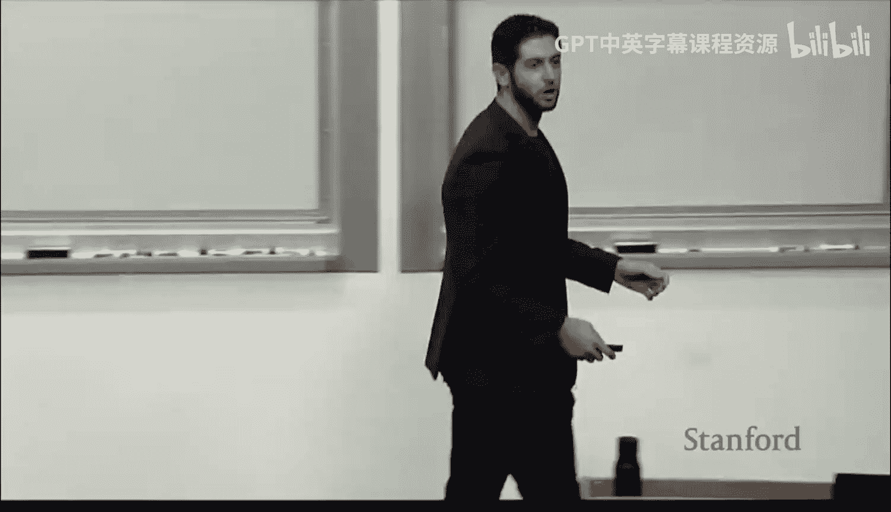

Alright， welcome everyone to the first lecture of C S 2，46。 I'm Mia。 I work with you。

 I'm gonna be your coin instructoror throughout the quarter。

 If you're wondering if it was about on piazza。 just replying to answers I exist as a person。

 So you're gonna be seeing around until the end of the quarter。 And before we start this lecture。

 just let me give you two important announcements。 First one is right after the lecture。

 you just have 10 minutes to run two gates B1， we're gonna have a refresher on Leonar algebra。

 is's gonna be extremely useful for your homework and the final exam。 So recommend you to be there。

 we already put the handouts on the website。 and we're also gonna be putting the video line by tonight or tomorrow。

 So don't miss the refresher on Le algebra。 Second thing。

 next week is gonna be quite intense for you guys。 So we have a bunch of deadlines。

 we're gonna be having homework0 and one。 I've seen on grace codepe many of you submit to the radio mark0。

 So good job。 make sure that you're working fast。😊，On number one because it's way longer than or0。

 as you might have realized， we're also gonna be having two quizzes deadlines on gradient。

 So we decided to postpone the first one because some of you just realize that you have to work on quizzes or some of you are still deciding if they want to drop out or not。

 So we make sure that they would be the first one would be postpone one week。

 You can use as a reminder， you can use late periods for the homework。

 you can use late periods for the quizzes。 So by Thursday and midnight， that have to be submitted。

 okay。

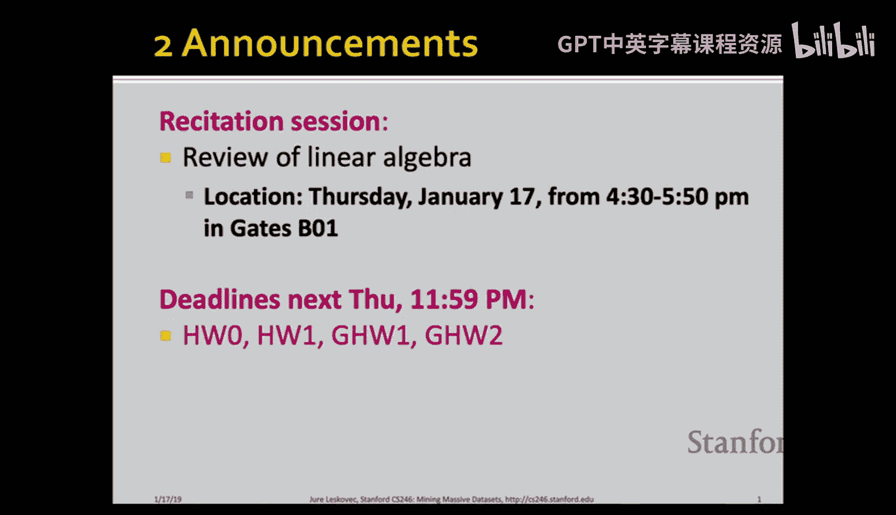

All right。So let's start today's lecture。 Top is going be the theory of locality sensitive a。

 So on Tuesday， you I give you an overview of L stage。

 and today we're going try to understand exactly why it works in the in the way we want。

 and also we're gonna try to generalize it to different similarity functions， okay。

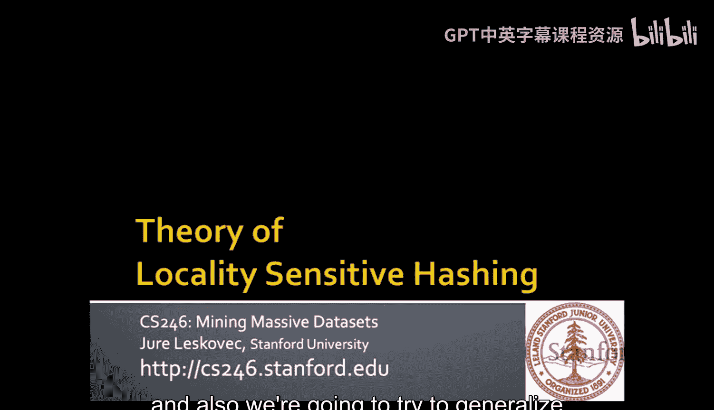

So first of all， let me give you a recap。 So we're sure you one is on the same page on L H。

 and then we can build on top of those foundations。So what is the task， What do we care about。

 Basically， when whenever we're given a large collection of documents。

 say when the order of it's in the millions or in the billions and we want to find similar ones。

 We want to find near duplicate case。 This is an extremely important task。

 If you're a search engine and you don't want to reind again， again， pages are similar。

 It's an interesting task。 If you are running something like a CI crime show and you want to match the fingerprints。

 So that's another very common scenario where're gonna do well stage or anything where you basically want to find similarity in very large dataset sets。

Why is this a challenging problem， Because if you wan to do pairwise comparisons。

 you just have too many pairs。 This is a quadratic problem。 And inherently。

 whenever want to make something scale， we hate when the complexity is quadratic。

 We want it to be linear or even better subline times。 So basically。

 what we do with L H is we bring a quadratic problem into a linear problem。Everything， okay， alright。

So what's the solution that we're gonna apply。 What we want to do is we want to ash these documents so that the similar documents end up into the same bucket。

 And aching is a very fast operation。 We can do this on each single document。 So it's a linear one。

 And then once the ashching has been performed。 what we want to find is we want to just work on some of the candidate pairs that we were able to identify。

 And were gonna perform the expensive similarity comparisons only on those pairs。 Okay。

 that's how we bring down the computational cost of running similarity on such a large dataset set。😊。

How do we do this。 So it's a straightforward pipeline。

 The first step is we do this shingling representation of our documents。

 And I'm gonna give you in a while a reminder of how it works。 But basically。

 the output of the first step of our pipeline is a set of strings of blank K that are appearing recurrent in the document。

 Once we have these representation。 we want to make it even more compact。

 So we're gonna be performing mining there。 And the output of mining is just a set of signature is coming from the document。

 Okay， and this signature， in the case of mining are just short integer vectors。

 And the important property of minning is that the signature that is outputting are maintaining and reflecting the similarity between the documents。

 So we have a more compact representation， which still retains the similarity property among the signature。

😊，And the last step is， we're gonna be performing L S H。

 So I'm gonna be reminding you today about rows and bands and so forth。

 And the goal here is that we want to generate only few candidate peers。

 And these are the candidate pairs where we're gonna perform the similarity check。 Okay。

 so let's go one step at a time and I will refresher on each element of this pipeline。😊，So first one。

 shingles。 So we said that a K shingle， sometimes also called k gram is a sequence of k tokens that appear in the document。

 I recall the question that we get lost on Tuesday。

 What is the granularity of K of what is the granularity of these tokens。 They could be characters。

 They could be words， They could be sentences， It really depends on what is your task。

 If you're performing spell checking。 then you want to find common K shingles in terms of characters。

 If you're just trying to find similarity between documents。

 then usually your tokens are gonna be words。 Okay。

 so the granularity depends on your domain application。Now let's， let's have an example。

 So we set K equal to 2。 So we're gonna have two shingles。 This is our document。

 and the the output set of two shingles that we obtain is just A， B， B，C， and C， A。 Okay。

 so we're gonna do a this thing to only keep the shingles that are unique。😊。

And this is the way in which we obtain our representation。 Basically。

 it's a set of a values Hos K shingles。 Now， you will realize that up to here。

 this part of our pipeline is domain dependent because now we're working with documents from now on。

 whatever we're gonna apply down here doesn't depend on what is your input data。 Okay。

 because at this point， we reach representation that is in form of sets。 Okay。

 so now we we we whatever we can turn into a set then can be fed into our similarity measure。

 And one very natural similarity measure that we have been using throughout the past lecture is the jaar similarity。

 very common using a lot of context， I'm gonna give a reminder。 So basically， what it does is。😊。

We have our two documents， C1 and C 2。 And what we do is， first of all， we take the intersection。

 So the common shingles， and then we divide it by the union of all the shingles。 Okay。

 and this intuitive tells you how many shingles two documents have in common。 Okay。

 this is the similarity measure that we're gonna be using the jaar similarity。

Once we have this representation in place， then we'll move to the next step。

 which is performing the mean hashing。 And what is the main property that we care about in mean hashing。

 So we want to go from this very large sets of shingles。 So you can imagine that， you know。

 very large corpoa with millions of documents， we will be finding hundreds of thousands of the shingles。

 depending on the size that we set and the grown art of the token。 So basically。The。

 the height of this metrics is gonna be very， very big。

 So we wan to convert it into a more compact representation， still preserving the similarity。 Okay。

 so basically， what we want to do is that the probability that two documents are two sets are gonna be having the same hash is equal to their。

 to their similarity。So how do we do this， We take our input metrics。 Cols are the documents。

 rows are gonna be our shingles， and then we perform our permutations。 Okay。

 this was the trick that we applied on Tuesday。 So just let me give a reminder。

 Let's say why this value here is 4。 So we're working with document 3。😊。

Then we're working with the second ash， the yellow one。

 What we do is we keep the first instance of a one appearing in our collection of shingles。

 So you see we number one， we check here， it's 0。 Then we have number  two， 0 again。 we had number3。

 yet another0。 Then we go to 4。 and we find a  one。 and we put here the index of our permutation。

 Okay， that's how we perform this conversion。 So we're going from a。😊。

From a wider and more expensive representation into more compact one。

 the beauty or the magic of this three is the following is that the similarity of the columns。

 And remember that each column here is representing a document is proportional to the similarity that you're gonna be funding on our input metrics。

 Okay， so we can go to read just as an example， to check if it's actually working。

 So let's say we want to compare document  one and document 2。

 as you see the internet any values in common。 I invite you to check the same on the bigger metrics。

 But say you want to check one and3。 So we're gonna be having these two top values in common。

 the bottom two in common。 So。😊，Our signature similarity is gonna be two third。

 While if you go and check on the column 1 and 3， you will find that three。

4 of the values are in common。 Now， you might say。This is an approximation is not as close as we will wish is absolutely true。

 And the trick that we're gonna be seeing today is that we can make the similarities。 We。

 we can make those two values getting closer to each other， each other arbitrarily。

 And the trick to make the happen is to have more hash functions。 Ha easy as that today。

 I'm gonna teach you how to choose exactly those functions， how to choose the size of the bands。

 the the number of rows and so forth。 But。😊，As pretty much anything thats in computer science。

 what we are gonna be doing is a trade off。 The more a functions we introduce and the more computations we have to perform。

 Okay， so there is a trade off between how much work we' are gonna be doing and how well these two are mapping to each other。

 Okay， so that's first trade off that I want you to keep in mind for today。😊。

And last step of the recap is we're moving to the locality sensitive aching。

 So we have our signature representation now。 we ash the columns of our matrix exam。

 And what we're gonna do is that we want to put similar columns into the same buckets。

 Okay And once you have a bucket。 And so keep in mind that this step is basically linear because we're computing a set of ashes per document。

 We place them in different buckets。 And then we're gonna be performing the similarity check only within a bucket。

 Okay， that's where we go from quadratic to to a linear complexity。😊，So as we were seeing last time。

 rather than just doing the comparison between two documents。 So two columns。

 we can subdivide our space into bands。 Okay， so this is our column representation that we've seen before。

 and we consider a candidate pair。 if it's matching on two bands only okay。

 So let's have an example from here， for instance， say we have document 7， I think in document 4。

 You see they're aing into the same buckets。 So these two guys are gonna be candidates for our similarity check。

 if you take 6 and 7。 They're aing to different buckets。

 So we are never gonna be performing a comparison among them。 alright。So ideally。

 what we would love to happen is the following is what we see here。 So on the x axis。

 we have the similarity， the actual similarity between the two documents and on the y axis。

 we have the probability of sharing a least one bucket。

 which means there are gonna be a list matching on one band， right？ So why do we want this behavior。

 say we want all the documents， all the sets that have more than 0。6 similarity。

 we want to be able for to retrieve all of them and be part of the same buckets so that we're gonna be comparing to each other。

 But anything else it is below the treasure of 0。6。

 We don't want it to be part of the buckets where we're gonna be performing the similarity comparisons。

 okay。😊，So the whole goal of today is how to turn this plot from a line into a N curve that is as close as possible to our treasure line。

 Alright， and I'm gonna be explaining you the trade offs of what happens when we introduce false positives and false negatives。

 I'm gonna be repeating this a couple of times。 So let's start from now。

What do you think is more worrisome for this kind of task， having false positives or false negatives。

And also， there is no strictly correct answer。 So if anyone wants to give it a shot。

 I'm happy to talk about it for a minute。Anyone wants to try。そしなけれど。Yeah， why humantuition。

 why I think is worse。诶再嘅。Exactly， so whenever we introduce false positives in the second step。

 were actually computing the similarities， you will be able to discard them eventually。

 because they just come at the price of performing more computation。 Alright， while if we introduce。

 if we have false negatives in our pipeline。 What actually happens is that we are never gonna consider them as candidates。

 So this is data that we are going to be missing。And。

So my my goal for the lecture today is basically to give you one of those eureka moments where you you know that is。

 it was worked to get a master undering computer science。 know。

 rather than going on stack overflow and copy pasting code。

 I I wna give you a reason why it's worth to study so much math for so many years。

 because then you will be mastering this， this tool。

 this technique and you're gonna be able to understand why you're choosing certain parameters。 okay。

Alright， so let's go one step at a time and reach that。

And the other goal for today is to generalize meanching and make sure that LH is not gonna be used only for documents where we can perform these shingles extraction。

 but it can also be applied to basically data points。right。

 And this is extremely important because as you know， data comes in many different forms and shapes。

 All right， especially you seeing all thes that we have today with deep learning the fact that we can do great with images and multimedia data and so forth。

 So data cannot always be represented as shingles。 right。

 and this technique is equally powerful also on different type of data。

 So we're gonna try to generalize it in that way。😊，Alright， so what what do we need to。

 to make the happen is we have to design a localative sensitive ash function that is gonna be working for a specific distance metric。

 Alright， so the distance magic that we' be seeing last Tuesday and up to now is our jaard similarity。

 which we're gonna see later we can be converted into a distance。

 But we want something that can be applied to different distance matrix。 Okay。

 we're gonna be seeing Euclideon co similarity and so forth。 then everything else stays the same。

 We obtain our signature as short integer signature that are reflecting the point similarity。

 And then we're gonna be applying our LH technique doing some of the magics with the bands and roses we're gonna be seeing later。

 And eventually， at the end， we get our set of candidate pairs where we're gonna be performing a similarity check。

😊，Alright。Okay， any questions up to now or shall we dig into the technical part。Alright。

 let's do this。So as I， I I， I spoiled my lecture at the beginning。

 So I told you that most of the magic that we're gonna be seeing today lies in this S curve。 Okay。

 that's where the magic happens。 And why is this the case， so。😊。

Say we selected only one single ash function。 Okay that is able to retain the similarity between the documents。

 What we will be seeing is exactly a straight line as in this plot。 So again， we have x axis is。

 the similarity of the two sets， axis is the probability that are at least sharing one bucket。

 So what happens0 is if have only one ash that is able to represent the similarity between these two documents is gonna be exactly proportional with the actual similarity between them。

 Okay， so doesn't really make us any service because we're not gonna be able to filter out the bad candidate pairs with just one ash。

 So the trick is we want to introduce more ahes and we want to end up having shape of this form。

 So whenever our similarities below the threshold， we don't want any chance of those candidates appearing in our in our buckets。

 if the similarities above the threshold， then we want the probability to be as close as possible to one。

😊，So ultimately， we want to turn that line into step function， okay。

And everything that we're gonna be seeing today is an expectation。

 like many other algorithms to make your pipeline scale with large data。 you。

 you can really expect to work with billions of elements and making sure that you're gonna be doing a deterministic。

 perfect job one another percent of the time。 Okay。

 so what we wantna do today is to reach a status where we can do very well99% of the times。

 And that's really a great result question。 confirm So that is technically one bucket read general Yeah。

 so' it's a to example。 is just to show you the two extremes。 That is useless。

 this one will never happen。 We're gonna try to approximate this step function as much as we can。

 Allright， thanks for a question， great。😊，Okay， so how do we shape in the way we like our S core。

 So we have two tuable， two parameters。 Okay， we have the number of bands in which we' are gonna subdivide our input metrics。

 And then we have the number of rows which are gonna be composing each single band。 Okay。

 so these are the two parameters that we play with。 So let's start with having。

Our similarity between our two sets equal to S。 And what is the probability that at least one band is equal。

 So we're gonna be basically getting a。Eventually， eventually。

 I'm gonna be able to give you a formula on how to compute exactly in the， the probability。

So we pick some band。 and then the probability that the elements in a single row of these two columns are equal is equal to S。

 Okay， now， if you want that， instead all the rows in a band are equal。

 we need to take S to the power of R。 Okay， so we have R rows。

 So that's what we get with the probability。😊，And if you want instead the probability that some row in a band is not equal。

 that we're gonna be taken inverse of that。 So 1 minus has to the power of R。Now bear with me。

 We're gonna another couple of steps。 And then we get into the final formula。 Now。

 the probability that all bands are not equal。Is gonna be a following。

 We are gonna be getting this to the power of B。 So the number of bands。

 because we want all of them not to be equal。 And ultimately。

 what we care about is the following result。 So we want the probability that the list one band is equal。

 Okay， remember， this was the condition that told us these two pairs are a good candidate to be checked。

 Okay， only when when the match list on one band。 So that's the probability that we just found。

 which is gonna be one minus this step， the step before。😊，The cool thing is that。

This is the probability that see wants it is a candidate pair。 and we can simply plot it。 Okay。

 so that's what we're gonna be doing in the next 20 slides or so。

 You can plot this curve and then find this sweet spot that exactly matches your use case， okay。😊。

So here is one example first， say that we， we want to pick R and B to create the best possible S core for our scenario。

 and we want to afford the budget of computing 50 ash functions。 Allright。

 So this is one possible configuration。 We can have R equal to phi。

 So5 rows per band and 10 bands in total。 But as you can imagine。

 there are way more combinations that you can find here。

 So this is the S core that you obtain as an output。 Again， x axis is actual similarity。😊。

We is probability that are sharing at least one bucket。 And therefore。

 we're gonna be computing the similarity between them。 And our threshold， in this case， is 0。6。

 What do you think about this has curve。 Do we like it。

 Is there something that we dislike or we could do better。We're missing a lot of the positives。

Exactly， so this is the area that we don't like， right？ Okay， so how could we。

 could we still use this S curve in another context where it will still make sense。Right。

 what can we do here。Exactly， so we can take the treasures from 0。6。 Let's say we move it to 0。8。

 We reach this intersection， which is gone probably 98，99%。

 And this S curve is gonna be great when you want to find all the candidates， that's similarity of 0。

8 or above。 Alright， So that's why I was sending it to you before R and B are tuneable。

 You change them in such a way that once you know， what is the treasure that you care about。

 you shape the S curve to make it sure that you will not return too many false positives。

 but you're still okay。😊，With the false negatives。Sorry， the other way around， right， yes。

I make them。Okay， here I just。I showed you the， the answer that we were talking about before。

 So with a treasure of 0。8， this S core all in a sudden becomes a very good fit。

So how can we shape our curve。 Let's， let's fix one parameter， change the other。

 And we're gonna see how the S curve is modified thanks to that。 Okay， so first of all。

 we fix our threshold so we can take our 0。6 from before。

 And then what we wantanna ultimately may happen is that we choose R B in such a way that the candidate pair as a step right around us。

 Okay， so the S curve in a sudden has this ho hoistic growth exactly on the threshold。😊，So。

 let's check， first of all， the top left aes are exactly the same as before x similarity Y the probability of being a candidate pair。

 So we fix the number of bands equals to one。 And then we vary the number of rows。 Okay。

 so we go from。We go from this straight line with one row to this curve down here when we have 10 rows。

Can you give me the intuition on why this is happening。Why do you think that keeping。

 Why do you think that considering more roles at the same time makes the probability curve of change in that way。

 What is the intuition behind it。Decreases the probability of the。Exactly， exactlyly。 so basically。

 what we're doing is were we are considering more rows at the same time。

 and we're gonna be finding if their hashes are matching or not。 If you have only one row at a time。

 the probability is gonna be higher。 But as soon as you consider more rows together。

 then a then our condition becomes stricter。 Okay， so that's why you will see here that you will start to return。

😊，Potential candidates who you have like 0。8 similarity。

 The problem with a curve that is stretched in this way is that it's unfortunately not gonna be returning a lot of interesting candidates。

 Okay， they are just about the intersection line。 So is's not enough basically to tune only hard。

Let's see another example here。 We are fixing are equal to one。

 and then were we're playing with a number of bands。 So once again， one，1， we got the straight line。

 the more bands we introduce， the more we stretch it on the top left here。

 we're doing exactly the opposite for what we did with the rows。

 the more bands we introduce like the more we subdivide our metrics into bands。

 the areas the probability that at least one of them will be matching。 so when band is equal to one。

 it means we are we are we are comparing the two columns for each single value。

 the more bands we have the areas the likelihood that at least one of them will be matching。

 Okay so we have these two very nice contrasting trade offs。 and when we start to tune both of them。

 then we we reach this nicely as shaped curves， okay。😊。

And as you can see here in these two plots on the right。

 we're fixing the number of rows either equal to 5 or to 10。

 And then we are changing the number of bands。 And， as you can see， for instance。

 if hard goes from 5 to 10， everything is gonna be shifted on the right because the more rows you get。

 the stricter the the condition becomes。 So you will be returning candidates only if the similarity is higher question。

你 just。Yes。Yes， so the question is， once we have our own treasure。

 can we reverse engineer our and be in such a way that it matches。

 It gives us the best possible S core。 The answer is， yes。

 I'm not gonna be spending too much time today telling exactly detail on how to compute it。

 But it's in this slide then I'm gonna be giving you all the intuitions on how that can happen。

 Good libraries for our S do that for you。 likely so。😊，Okay， now before I jump into the ti of L S H。

 Any questions。三个。Ha function before do a passover。可。So the question is。

 how do I decide how many ash functions I want to use， right。Oh， yeah。 That's question so。Basy， your。

 your question is， what if I choose a certain amount of ash functions and only in a sudden they realize they are not enough to have the performance that I care about。

 and I will have to recompute， give another full pass on the data。

 That's the reason why we're doing this lecture today， because basically。

 you can tune or you can find out what are the values of R And B。

 And those two values give you the number of ash functions that you're gonna need。

 So you can approximate what you need before you have to give a pass。

Other there ways to make the app are also So whenever you have a very large data set。

 you work with samples。 That's a very good recipe in general life。 You know， if you know that it。

 the data distribution is not too skewed， you take a small sample。 You work with that。

 Make some assumption。 And then when you give the full pass。

 you're gonna find out if your assumption holds or not。 Okay， Thanks， for great question。Okay。

 then let's jump to the tier of how L S H really works。So again， we want， we use it。

 We use LH chapter2 now to find similar documents。 So in our case， were working with shingles。

 So similar sets。 Can we then use LH for other distance measures。 Alright， so you on distances。

 co and distances and so forth。 So let's try to generalize what we learn。

Quick refresher on what is a distance measure。 So it's a function that。From given a pair of points。

 x and y， it will return real numbers with the following properties。 So the the distance。

 the distance is always greater or equal to 0。 It's equal to 0。

 if and only if x and y are the same element， It's symmetric。

 So the distance between x and y is the same as y and x and。The triangle inequality property holds。

 So given any other point other than x and y， then you know that the distance between x and y is always less than the distance between x and the third and the Z point。

 the third point plus the distance between Z and the y point， okay， so。

Very easy refresher from the past and。How do we turn， for instance。

 our jaar similarity that we use for for documents into a distance assymmetric is as simple as doing one minus the jaar similarity。

 As you remember， the jaar similarity was between0 and1 when two documents are exactly the same if it turns one in our case。

 instead， we want two documents to be the same when the distance is equal to 0。

 So we just take one minus the jaar similarity。 other distances that we're gonna see today。

 for example， are the cosine distance for vectors where we are analyzing the angle between those two vectors。

 or another distance that is very for every1 is the Euclidean 1。 So usually call the S to norm。

 And what we do here is just we take the square root of the sum of the squares of the differences between x and y。

And this is the most common notion of distance is used in many different contexts。 Also images。

 N P and so forth。 Another interesting one is the L1 norm。

 which is the sum of the absolute value of the differences in each dimension。

 Sometimes called the Manhattan distance， because it's basically the distance you will have to travel in a city that looks like a grid。

 So one block at a time。 and you're gonna be making the sum of all the steps you do along the coordinates。

 This works well in the US， very bad in Europe， as you can imagine。

 because our cities are not thatsque。 question。你。关于说系我。Yes， we're gonna be seeing how。 Yeah。

 it's gonna be a relatively different function from whatever we've seen up to now。

 It's based on projections。 But Ill give you the intuition why then can work called in dimensions。

Great。Okay， so。Another key concept for today that really want to be hatching your mind is what are the families of ash functions。

 So let's say we have our minching signatures， we have minsh functions for each possible permutations of the rows。

 As you can remember， this all this was the space of all the possible ash functions we could be using for minching。

 Okay so basically， as a reminder， the ash function is just any function that tells us whether two elements are equal or not so what is then a f of ash functions。

 Okay is any set of any set of ash functions from which we can pick one at random efficiently。

 And here， the keyword is efficiently。 Okay， it's relatively easy to code something that will give you proper fe ash functions。

 but if it's extremely expensive to compute that then we cannot defined the purpose of doing LH。

 Okay so we。😊，Be able to create those families very efficiently。 And so we saw the。

 the example for the minache is all the possible permutation of rows。 They are very easy to generate。

 We're gonna be seeing similar tricks for the other ash functions that we're gonna be seeing today。😊。

Now， let's define a a locally sensitive family。 Okay， so suppose we have our space of points S。

 where we define our distant measure， our distance measure。

 So fammin ash functions is defined in the following way， is set to be D1， D2 P I， P2 sensitive。

 if for any x and y values in S。 So for every candidate pair that we work on。

 we' are gonna be having the following progress of this。

 So if the distance between x and y is less equal to D1。

 then the probability overall the possible lashes in our family is gonna be at least P1。😊。

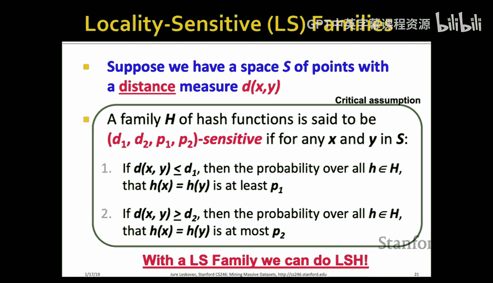

And conversely， distance between the two points larger than the2 than the probability。

It's gonna be a most pet。So here we're basically defining boundaries， right， We're saying if。

Our two elements are close to each other within a certain threshold。

 Then we want the probability of the ahes to be equal to be above a certain probability because these are the candidates that we care about。

 Theyre close to each other。 we want our P1 to be as big as possible。 Alright， conversely。

 if x and y are far from each other。 then we want our probability P2 to become as small as possible。

 right And what we are gonna be seeing today is going from the standard mean that we saw last Tuesday that as not very exciting values for P1 and P2。

 We want to stretch them in such a way that P1 is gonna become almost close to1 and P2 is gonna go straight down to 0。

 okay。😊，And that's why this is the most important trick for L S H。

 because it really makes the difference on how much computation we have to perform。

Heru is a visual clue of what was， what was going on。 First of all。

 first thing that I want you to pay attention to。This is a distance。 Alright。

 So we move from similarity to distance。 Keep always in mind that when you have jackal， for example。

 similarity is nothing but one minus the distance。 Okay。

 and that's the reason why our S curve now here is flipped。 right。

 don't get don't get confused by this。 Okay， we just mirror the curve。

 And what we want to happen is the following。 When there is a small distance we're gonna be having a high probability that the washes are gonna be the same。

 When the distance is I once again， we want the probability of hashing to the same value to be very low。

How do you think we want to squeeze this plot？ Like， we have these four moving dash lines。

 What would you do with D1 and D 2 and what would you do with P1 and B2， What should happen to them。

W wants to give it a shot。So the， the piece should be very easy， right， We said1。

 P1 has to become as big as possible and P has to become as long as possible。

 So we want P1 to go on the top P2 to stretch to the bottom。 Now， what do we want between D1 and D2。

 Do we want these two dash lines to get close to each other or to get further from each other。Closer。

 alright， perfect。 So why， why do we want to get them closer。 Ially。

 our threshold will lie between the1 and the2， right？ So we want to make sure that this。

 the shape we look in such a way that everything that has a distance less than the1 will have a high probability。

 everything they will have a distance， larger than the2 will have a very low probability。😊。

And that's exactly what we're gonna be seeing now。 Okay， so this is our distant tra team。

And this is how basically， we approximate the B O R S curve。

 We're gonna be playing with the parameters so that the one and D were squeezed P Y and P will get far。

 far from each other。 Allright， all clear。Great。Okay， so let's apply now this lesson than to minash。

 So once again， as space of all the possible sets， These are our jaard distance that we already use。

 Each is a familiar minsh functions for all the possible permutation of rows。😊。

Then for any ash function H belonging to the a capital H family， we want this property to hold。

 So the probability that the two will be aching to the same value is gonna be 1 minus the distance。

 Okay， we just put， we just went from similarity to distance here。

 We haven't done anything different from what we have seen on Tuesday。 Okay， perfect。

So what is our claim， What， what， what do we wanna。

What do we wantna analyze from the behavior of mining is that this is a one third，2 third，2 third。

 one turn sensitive family sensitive family 4 S， our space of options and for the jaard distance D。

 Okay， so this is the behavior of minashing without playing at all with bands and rows。

 And that's why I was saying before these values are not exciting once again。

 it's way better than doing quadratic comparison。 Okay， because here。

 what this is this is telling us is the following。 You're gonna be if the distance is onet。

 which means if the similarity is two third， because we have to take one minus onet。

 then the probability that the candidate will be returned is twot。 Okay。

 so not nothing better than doing a standard ash function。 So we wna do better than this。

 How do we make it happen， okay。😊，And we go faster otherwise， we run out of time。

 So can we then reproduce ouras curve that we we saw before for any locality sensitive hashing family。

 Okay， so first week that we're gonna apply is our bands technique。 Okay。

 that we've seen also last Tuesday。 and we're gonna be having two different constructions。

 As we said before one both of them are trade offs。

 First one is the end construction whereas we're gonna be working with a number rows in a band。

 the second one is gonna be called the ore construction， which is tuning how many bands。

 we're gonna be extracting from from our input metrics。 alright。Okay。

 so how do we amplify our a functions。 How do we amplify our s curve。

 we can play in in the following way。 Okay， so first of all。

 we start from our large family of a function H。 and then we wantna we want to get a subset of those which we call H prime。

 and here were talking about the end constructions。 Okay。

 so we are trying to reproduce the effect of the band size。 So the more rows we have in a band。

 the stricter this becomes。 Okay， so eventually， what we want is that all the a functions between element X and y。

 well be matching for all the elements in that band。 Okay。

 for all the rows that are contained in in that band。 now in a sudden。

 what we do is we go from this function sensitive just to P1 and P2。

 to something this is gonna be sensitive to P P1 to the power of R and。😊。

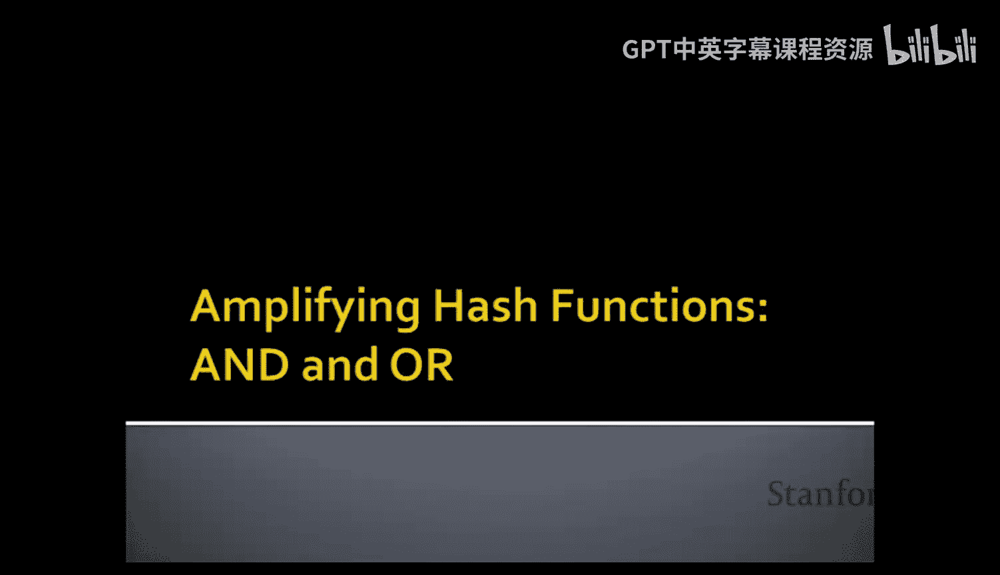

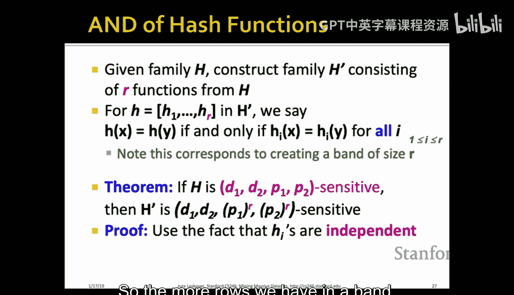

P2 to the power of R。 Okay， so we are making those probabilities smaller， right。And。

To make sure that this happens， we， we have to make the assumptions that our ash functions are independent。

 Okay， we're gonna be seeing in a while why this is important， so。

Do you think that both these changes are beneficial or one of them is beneficial。

 and the other one is detrimental。Some one wants to give it a shot。在提供。Anding together。

 you're making that probability smaller and that's the probability that they're similar， right。

 and so that's not good。You're making， but it's good on the other hand， exactly too， right， exactly。

We lower the probability for the large distance。 Remember， D two is when two elements are far apart。

 So we， we're lowering that probability。 We're doing something good。 But at the same time。

 we're lowering the probability for the small distances。 and this is bad。 right。

 So that's why none of the two constructions taken in isolation is useful。

 We're gonna be having to play with both of them at the same time。😊，Now。

 before you ask me a question of。Why do we make these assumptions that the Esh functions are independent。

Let's jump to this slide。 You can read it more with more attention on your own later。

 but use the gist of the idea， especially for meansh。

 there will always be some permutations that are very much correlated to each other。 Okay。

 but we are not talking only about the worst case here。 like in general。

 among all possible members of our hash functions。 the average case is not gonna be the worst case。

 So the two has functions will be pretty much independent。

 Okay so this is another reason why we're introducing a bit of error into L H。

 And that's why I told you before。 This is a problem that we're studying expectations。

 We don't expect it to have 10 percent perfect performance。 Okay。

 but this is just to reassure you that the assumption we made for the independence makes everything more tractable today to talk about it。

 And it doesn't introduce a lot of additional noise， alright。😊，So this is for the end construction。

 We jump to the or construction。Very similar。 The only thing that is changing here is that we want our ash functions to be equal for at least one of the elements。

 Okay， so for one of the bands。 so here what we're saying is we take one ash function per band。

 say our B is equal to 10， for instance， only one of them S to match。 If they match。

 then we return those two elements as a candidate。 So once again， we took our original function。

 and then we modified it in this way。 distance are retain the same。

 But then we are moving to P1 and P 2 S press as 1-1 P1 to the power of B。

 And it follows the same for P2。😊，It shouldn't come as a surprise now that we're doing something good and we're doing something bad once again。

 Okay， so we are raising the probability for the small distances here。Okay。

 seem to D y because were doing one minus a quantity that is getting smaller。 And at the same time。

 we are raising the probability for the large distances， which is bad。 Okay， so once again。

 that's why we need the two constructions happening at the same time。 Otherwise。

 we only optimize one aspect of the problem， okay。So is the intuition。

 The end are making the probability shrink， but which when we choose our correctly。

 we can make the lower probability approach 0 while the higher does not。 Okay。

 so this is the first probability that we care about the probability of having candidates among elements that have very low similarity values should be go should go as close as possible to 0。

 And that's what we tune by making our larger。 And at the same time， as we said before。

 the construction stretches this curves on the top left。

 So we are making higher the probability that。😊，Whenever the similarity。

 the actual similarity value is higher， then we return it as a candidate with probability very close to one。

 Okay， so we went from the intuition now to the mathematical instrument to make this happen in our S curve expression。

Any questions？Or here。Cool， great， Okay， so。So we， we combine， we。

 we can combine the two constructions together。 I'm gonna be going very quickly to to the next slides。

 The the other I w to give is that they can be composed in many different ways。

 You don't have to apply strictly First the end and then the， you can apply them as a chain。

 You can do end or and or the outcome that you care about at the end of the day are P1 and P2， okay。

😊，So let's see， for instance， here are composing construction。

 Let me just go to an example with the curve。 So here we chose。4 bands and and four rows per band。

 Okay， if you remember， this was the formula that we were using before with B and R on top。

 So what happens， for instance， when we have 02 as a similarity Okay so the chance that a candidate will be returned。

 if the similarities equal to 0。2 is this varies more probability there conversely with 0。

8 is gonna be 087 probability of returning that has a candidate。 Okay。

 so we went from a family of this with this properties。

 So not as powerful as we hope to something way stronger。

 especially for the candidates that have very low similarity values。

 Okay so we're starting to stretch this S curve as we need。 And as you can imagine。

 you can make those number bigger and this shape is gonna keep on changing。

 So now we're gonna be addressing your question， how do we choose R and B in a way that that's exactly what we care about。

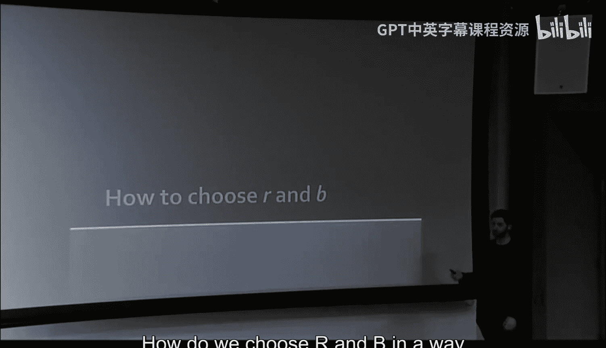

Okay， so we want to pick hire and B to get our desired performance。

 So say we fix once again 50 ah functions。 So we have r equal to 5。

5 rows per band and then 10 bands in total what we what we can accept how this curve once again is our green area here because it represents the false positives As we said。

 we want to make it as small as possible but we can still afford having it because we can compute the actual similarity in the sequence in the next step and then discard the bad candidates。

 What we tend to worry about instead is this blue here here because it contains our false negatives that will never become candidates okay。

😊，Alrighty。Now， here we start to see some curves that behave in a totally different way。

 even if we have 50 ashes in total。 So the computational cost for running L stage with 50 ashes is gonna be exactly the same。

 But just changing those two， the behavior is drastically changing。 Alright， so， for example。

If you take the blue curve， which is a recall 5 b equals 10。

 is is probably a subpar curve for a similarity of 0。

6 because you will be having the blue hair there that we don't like。

 And something like the red curve with 10 and 5 is gonna be even too strict。 Okay。

 because it's gonna be returning with probability equal to1。

 only similarity values that are very high。 Okay， so by changing those parameters not too much。

 you can change the behavior of the system dramatically， okay。Okay。

 so I will go quickly through this basically here。 What I want to show is that。

You can also do the or construction before and then the end and you get different numbers。

 You just have to plug those two parameters in our formula plot the curve and see how you behave Okay。

 and you can chain them as I said before。 So now I just give you a real world example with a number that is not shocking。

 So let's say you're using a total of 256 hashes in total。

 So you do a4 n construction of 4 or and n and an or once again。 You get this number in total。

 And this is the behavior of our family hasing family。

 Okay this a pretty cool behavior means pretty much probability equal to one for anything that is above 0。

8 similarity。 And this number is extremely small for anything as below 02 So you can see that the performance explodes very quickly as soon as you are adding a few more hashes。

 you don't need to compute a million hashes per data point because you will be def the old point of doing LH basically So it gets it's still very cheap。

 but it gets extremely more。Powerful by doing that。Okay。Okay。Now you check the time。Right。

 is we can check later。 So let's go just to the summary。So with the。

 with the key points that we saw before。 So you pick any two distances。Between our， our two points。

 and then you start with a standard L S family that is， that is the following sensitivity。

 And then you apply different constructions to amplify the behavior of this family。 Okay。

 and you wanna make P1 almost close to one and P2 almost close to 0， okay。

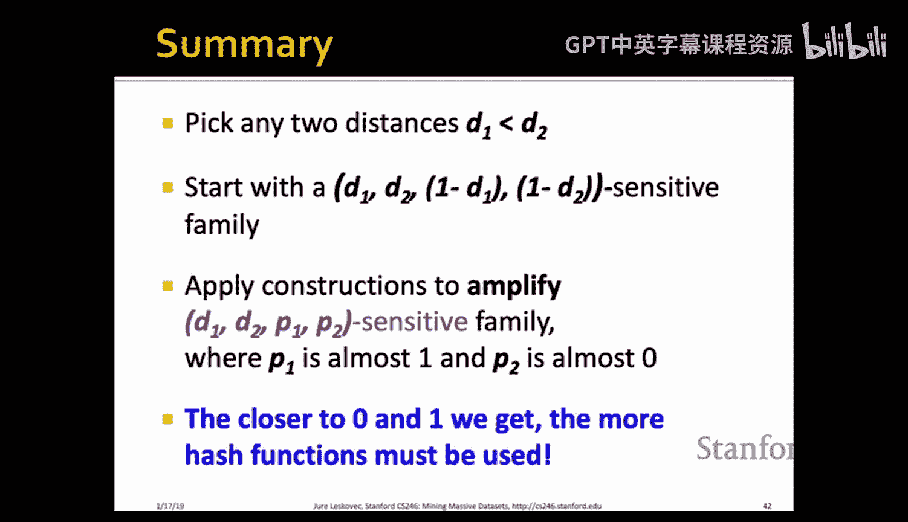

Alrighty。Questions before we jump to order this as metrics。And some of the curve you showed it。

Like a lot straighter。

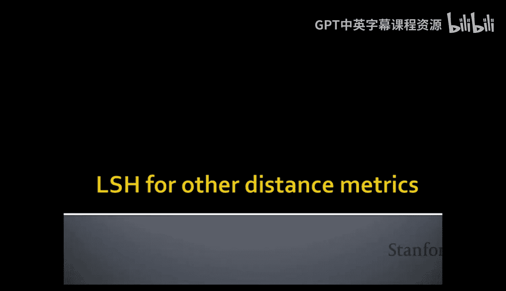

Even though we get。对。Thank two。It seemed a lot less like the burden curve we want。

You mean something like this。 Yeah， because here we are always plotting curves that are not very extreme。

 You see， we have like， we have four ashes for the。

 we have these are four end construction for construction。 So you still see this kind of behavior。

 as soon as you plug in。You know， one or the magnitude moreshees。

 Then these curves would be almost looking like a hockey stick。 Okay。

 this was just for the sake of having values in this column in this rows that are different。

 Otherwise， we'll be seeing everything equal here and everything equal on the top。

 Thanks for question。生。Or。Here， let's let's go quickly back to take a look at that。

So an an end construction is the is the following。 You wna make sure that you。

 you' are considering a bend。 Remember what we were seeing before。

 So you have all the rows in in a bend and you want all of them to be aching exactly to the same value。

 Okay， so this is the the end construction。 It means if you want your band to be formed by 10 rows。

 then you're gonna be need 10 different ashes。 If each one of them is matching。

 then you would say this band is matching。 Okay， and that's why it amplifies the probabilities in that way。

Conversely， the or construction is when you want you have B bands in which you subdivide your metrics。

 And then you will be applying an ash for each band。

 And you' are happy if just one of them is matching。 Okay。

 so we are just putting in numbers the trade off that we talk about at the beginning， right。

 makes it more clear now， great。😊，Anything else， or we jump to the。Question， yeah。でてって。

You can do bands within bands。 Yeah， that's， that's the。I construction here。 Okay， so the 4。

4 or N construction， followed by the 4，4 and or construction。

 you can do pretty much any kind of composition， and they will change the numbers。

 they will turn the curve in different ways。 So as I was saying at the beginning。

 depending on your context， let's say you are trying to do matching of fingerprints。

 then it will be extremely bad for you。 if you don't consider certain candidates。

 But if you're using this as a basis for recommender systems。 For instance。

 to recommend shoes and clothes。 if you're missing 10 good candidates。 Nothing happens。 Okay。

 so that's how given your requirements， you play with those numbers， okay。Great。

 thanks for your question。嗯。Exactly， because I'm still working on these examples by letting you think about Jaardi because it doesn't get。

But。We're gonna be seeing from the following slides， works with a different distance metric。

 And then we're just gonna be applying that， you know， straightforward vendor， okay。

Thanks for your clarification。Okay， oh question。Number of hash functions match。

 the number of rows in the signature。Does the number of a functions matches the number of rows。No。

 it matches the number of rows in the， in a band。So you're。

 you're gonna be having ash functions for how many rows you consider in a band。

 And then you're gonna be having ash functions for how many bands you have in your metrics。

 Otherwise， if you have one ash function per row in your dataset。

 you would be working with a billion as， right？ And that's that's something that doesn't work。

 It doesn't scale。Makes sense。So wait， so they're as times B。Number of patch functions。

Isn't that the number of roads this？OhThat's that's a space of possible ash functions that you can have。

 It's like with what we saw with meanashching。 You can get all the possible permutations of the rows。

 The number is extremely big， but you don't need to use all the ash functions in your space。

 Okay so that's why we went from the space of possible ash functions to the family that we care about。

 which has the properties that we like for P1 and P2。

 Okay We're gonna be seeing exactly the same in the following examples that I'm gonna be giving you It's basically a base of all the possible ash functions that you can generate。

 if you remind linear algebra。 So you have this base。 you can generate many of them。

 but we're gonna be selecting all the subset that we care about。Makes it clear， no。Great。

Anything else。Okay， let's jump to the， to the last part。 So now we're gonna be seeing。Are we。

Plug in different distance metrics into L S H。Okay， so this should look familiar。

 by now we' have seen it probably 10 times。 So we're feeding now points in general。

 data points in our rash functions。 We want to generate short integer signature。

Now we learn how to design our D1 D D2 P1 P2 sensitive family a functions。

 But what we w to do here is we need to come up with a way to generate this family from a our particular distance metric。

 up to now， we have seen it with a jacker similarity and the jaar distance。

 Now we're gonna see it with different examples。 Everything else that we learn up to now is gonna be applied exactly the same way。

 So that's another beautiful thing about L agent。 once you perform this conversion and you obtain the signature。

 then whatever is the input data， the rest is gonna be working exactly in the same way。 Allright。😊。

So in the ling of machine learning， you can think about this as some sort of feature engineering。

 And this is the model where were doing the outdoor parameters。 Okay。

 I guess plenty of you are taking 2 to 92 to 4 in the period。 So I try to make your life easier。Okay。

 now。We have seen how this works with the minash。 So we have our band technique， and we。

 we go from these representation with the input metrics to something more compact。

 The first example that we're gonna be seeing later on， it has to do with cosine distance。

 And for instance， instead of using minching， we're gonna using the random micro planees。

 And this is the kind of representation we get everything else is gonna be working。

Exactly in the same way， okay。So let's jump to the cosine distance。Why do we care about it？ Why。

 Why is it important， It's used a lot of different contexts。 It has been used a lot in。

Information retrieval， when you want to retrieve documents that are similar to each other。

 for example。 So you you do， you have a vector representation of a document and you want to measure the angle between those two documents。

 There smaller is the angle。 the higher is the likelihood that these documents are similar。 Okay。

 and what we want to do with L H is once again， returning only few candidates where the document vector should be then checked。

Okay， we can express the similarity。 You would find it in papers and textbook in。

 in a lot of different ways。 What we care about is that clearly there a range between 0 and pi。

 And you divide our hang theta by pi so that we normalize our distance in the range between 0 to 1 and。

As before you can obtain the cosine similarity just by doing one minus the distance。 Okay。

 so the two things are connected in in that way。 you will also find it defined at times in the following way with the do product between the vector A and B divided by the product of the norms。

 everything can be normalized to the other representation easily。

 So I'm giving you basically this advice in case you see it implemented in libraries or you find it in papers。

 the two expressions are pretty much the same。 What we care about though is the following。

 so as we were saying before， two vectors that are very similar to each other are gonna have a very small angle。

 So the cosine goes to one vectors are orthogonal。 therefore clearly not similar to each other are gonna have a cosine equal to0。

 and interesting enough， if they have opposite scores， the cosine will go to minus-1。

 And that's also very interesting in case you wanna。Fine， in case， for instance。

 you want to do you gonna to have ser deing your recommender system。

 such as trying to recommend items that are as different as possible to each other。

 So this is why so it's interesting to have this measure that tells you if two documents are at this similar as it gets。

 So now that we have this distance define how do we create our ash family。

 we have this technique called random hyper planes。 similar to me aching。

 So a lot of ideas will be in common。 but we need to apply foot tweaks here and there to make it work。

 Okay so we start from our standard family， which is the12 is are our distances。 and this our pro。

 So one minus the distance once again normalized by by pi。

 and this is just a reminder of what this means we have seen it 20 minutes ago。

 So it's not worth going to it again。 So this is our definition of the random hyper planes ash family。

 how does this work。 How are we gonna use。And why does it generate us slightly different signature compared to mean aching。

 So we do the following for each vector B， we determine an hassh function H V just as two buckets。

 Okay， so the return values are gonna be either plus1 or -1。 Okay。

 And let's see what these very simple ah function does。 So it takes the dot product。

 and it returns plus1， if the dot product is equal or larger than 0 or -1 if the dot product is less than 0。

 What are we doing here exactly。 So what what is this telling us。

Anyone wants to try if you have fresh linear algebra in your brain， yeah。

So which part of the upper plane， the two vectors are lying， right， Okay。

 so if they're lying in the same part of the upper plane， we're gonna be getting a plus one。

 If it does's not the case we're gonna be getting a-1， Okay， so it's very easy ash functions。 Okay。

 and how do we build a family。 Basically， each possible vector。

 then we can have in our vector space is a potential good candidate for an ash function。 Okay。

 so we just take an arbitrary vector， and then we use it to do the dot product between the vector of our element。

 Okay。😊，And what use our claim is that the probability that the ash between the two elements is gonna be the same should be equal to one minus the distance between those two points。

 Okay， so one minus the angle between our two points。 Okay， so the closer is the angle。

 The I is the probability that our ash function will return up plus one， okay。Now。

 let's try to make this intuitive。 We're gonna see it visually on the slides of what's going on。

 okay。These are our two data points。 X and Y is a angle theta between them。

And we select our first vector B。 We don't care that much about the vector。

 We rather care about the upper plane that is this is normal orthogonal to our vector B。

 exactlyly for what we were saying before。 What we care about in our ash functions is to understand on which side our points are lying。

 Okay， its on the right side or on the left side of the hyper plane。And。So。

 and it's important the fact that the upper plane is outside the angle。

 not that the vector is inside。 Okay， if if the vector is inside。

 we don't care because it's not gonna change the output of the ash function。

 But if the upper plane cuts between the two points。 then the ash function。

 the ash output of x will be different from the ash output or y， Okay。

 because they are line in different size of the upper plane。

 So intuitive what are we trying to build here。 we subdivide the space with different different hyper planes and this set of ash functions will just define an upper polygon in our space。

 Okay， so we cut the space with multiple planes。 And then we all the outputs of the different ash functions。

 we're gonna be understanding if the point lies within or outside of that upper plane。 Okay。

 so as easy as that。And let's try to see it here now why the。

 the output probability is proportional to what I was showing to you before。 So again。

 let's go step by step。 We have。I just lost my punter。 Sorry， so I'm gonna be waving。

We have our point x up there。 Y here。 Then we have two hyper planes， one defined by the red vector。

 So it's the red dash line， another one defined by the blue vector， which is the blue dash line。

 So what happens here。X and Y are gonna be hashing the same within the blue upper plane。

 are gonna have a different hash for the function defined on the red upper plane。 Okay。

 because one vector is on one side and the other one is on the other side。

 So why is the probability proportional to the angle。 The mo is this angle。

The less is the likelihood that there will be an upper plane cutting between those two vectors。 Okay。

 that's the only intuition that you care about。 Okay， the closer there to each other。

 the fewer our hyper planes will be cutting between those two vectors。 Therefore。

 most of the ash functions will be returning a plus1。 Conversely， if this is your your initial angle。

 Then there is a high likelihood that will be an upper plane cutting between them。

 Therefore a lot of values will， a lot of ash functions will return -1。 Okay。

 that's the only intuition about these random a planes technique is working。

Everything clear questions。Yeah。お对。なです。Great question。 So you ask。

 are we gonna sample our vectors that are defining the ash functions in a uniform way or not？

 And I can also add on top of that another question that could come up to your mind right away。

 How expensive it is to generate random vectors of different norm and with real values。

 It turns out that we don't need to do that， okay。😊。

So the only thing that that we have to do is then I。

 I'm gonna go back to this slide is we just wanna generate vectors that have components equal to plus 1 plus 1 or -1。

 So they're all gonna be in the unit sphere。And in this way。

 we also make sure that all the ash functions we generate are not skewed because we。

 we can just take random values plus plus 1-1。 And then we can have a uniform distribution of our vectors that are creating the ahes we need。

 Okay， so that's why it's cheap because we don't have to generate random real values。 And also。

 that's why we can make it uniform just by permuting the plus minus-1s on the components of the vectors。

 okay。Clear， great。Question。And then it's plus or minus one through each spot the area two。Yes。

 correct。 So the the the question great。 The question was， if。

 if your data is and dimension doesn't mean that you cannot have more than two to the power of n hash functions。

 The answer is， yes， and the anncellor answer is it's way more than enough， right。

 because if usually we， we care about L H when our data is has a very high dimensionality。 Otherwise。

 this technique is overkill。 which and 2 to the power of 100 is or written astronal number。

 So it you can generate more than enough hash functions in that case。 Okay。

 thanks for the clarification。😊，Okay， then， let's go quickly through the， to the example。 Now we。

 we covered L H。 Now， let's try to get the intuition of how this will be working with the Eucan distance。

 Now， we have another family of ash functions that we are gonna be using。 And those are all based on。

Projections。 Okay， so what we do is our ash functions are just corresponding to lines。

 We take lines in our Euclidean space。 Okay， and then we partition our line into buckets of size a。

 we take uniform buckets。 We partition this line。 And what we do is we ash each point to the bucket containing its projection onto the line。

 We're gonna be seeing a visual example。 So it becomes super easy right after that。

 but it's sold based on this constant。 generate lines。

 very cheap operation to do in a Euclidean space， subdivided in buckets， take the projection。

 whenever you're a member of a certain bucket， that's the output or ash functions。 Okay。

 and the key intuition here is that nearby points are always close to each other， right。

 and so there is a high chance that they're gonna be belonging to the same bucket。

 Conversely distant points will not belong to the same bucket。 So the ash output will be different。😊。

Now， let's see the visual explanation。 So we start from the lucky case。 Okay。

 so we have one ish function here。 We only have our line。 sub dividedividing in buckets。

 then points that are close hashing the same buckets。

 So our green and blue are gonna be hashing together。 and red is in another bucket。 Perf scenario。

 It's not always the case。 So now we see the two un luckyucky cases。

 The first one is when we are not lucky with the quantization。

 So with how many buckets we create on our line。 So sometimes we， we could just be unlucky。

 And the the the。😊，The boundaries between the two buckets will lie within two points therefore they。

 they are split。A simple workaround for this is simply to have more buckets。

 But then it becomes more expensive。 So it's the same trade off there we've seen before we mean aing。

 for example， and another。Unlucky case is when we are unlucky with the projection。

Here we are always talking about two dimensions。 and I think I'm answering your question now。

 Can we generalize these two multiple dimensions。 The is clearly， yes。

 you can now see why because you can project on n dimensions easily。

 But the reason why you need multiple a functions is because if you are a direction that is unlucky。

 like in this one， you might have hold the projections ending up in the in the same bucket。 Okay。

 even if， if you do the projection in in an ortho direction。

 they could be belonging in all different buckets。 Okay。

 so that's why we need more than one line clearly， to make it work well。😊，Great。😊，Okay。

 so we have our animation。 that's， that's how it can work in case we have multiple directions。

 So you see in some of these lines， we are getting lucky and the projections are good in some others that are bad。

 So similar to what we've seen before with the cosine similarities。

 Some of the ashes are not gonna be ideal， but the majority of them will be putting the points together in case they're close and we get the output that we want。

 One interesting thing to see here is if the distance between the two points is a lot smaller than a。

 then the chance that the points are gonna be in the same bucket is at least one minus d divided by a。

 Okay so closer there to each other， the more chances you are to end up exactly in in the same bucket。

😊，Conversely。Weho have。Another case where if the distance instead is larger than a， then the point。

 the， the angle between the two， the two points， basically the projection line and the two points should be close to 90 degrees。

 Okay， so in this case。With when the angle is not close to 90 degrees。

 even the projections will end up in different buckets。 Now。

 you can imagine those two points having almost angle of 90 degrees compared to the projection line。

 And that's the unlikely case when they will be projected exactly in the same bucket。 once again。

 the trick here is multi functions。 It's not gonna be working in this case。

 It will be working with another one。 and we can easily then make the members of different buckets。

 okay。Perfect， now， here， once again， we are gonna be able to play our tricks with the bands and with the rows。

 So the the standard family that we obtain from this is the first distance is a divided by two horse two a。

 And these are the two probabilities that we were seeing before。

 playing using our end and whole constructions， then we can amplify the behavior as curve as we have seen before。

 Okay， so basically as a summary， and then I'm gonna be taking some questions so that we can clarify everything。

 What we've seen today is。😊，We have data that comes in very different shapes， could be text。

 could be vectors， could be images。 whatever you want。

 As long as you can represent it in a way that allows us to build fam ash functions with the properties that we care about。

 Then this can become the input of our LH pipeline。 Okay so we produce our signatures。

 then we go through the LH pipeline， obtain our candidates and we can play with the behavior once again with our and or constructions。

 if it makes it either for you to remember， just remember with our band and row construction because ultimately those are the two parameters that we are modifying。

 And we've seen that this can work easily with mean ash or it can work with the random upper planes or just with the last set of ashes that we've seen alsos in the Euclan space。

 okay。😊，Questions。Y， earlier said has functions correspond to lines didn't quite get how。

how the ash functions correspond to to rows。 Well they they， they don't correspond。

 Theyre applied to the， to the rows。 We said we have ash functions for the rows in a band。

 and then we have ash functions for each single band。Like the， the rows。 Oh the rows。 Okay。

 these are rows。 So it really depends on the representation that we have of the data。

 in the minash is gonna be the output of the minash。 So from the premuts from the cosine similarity。

 we have seen this sketch representation with a plus 10 -1。Okay。

 so this result is a signature sketch， where each component of our signature is gonna be a plus or -1 in the。

 in the Euclidean version， we have seen that it's based on the distance。

 So regardless of what is your output at the end of the day。

 you're gonna be having this same shape of an input metrics。

 And there you can subdividide it by bands。 You can decide the many row tab in a band， apply yoursh。

 get your S curve and the magic happens。

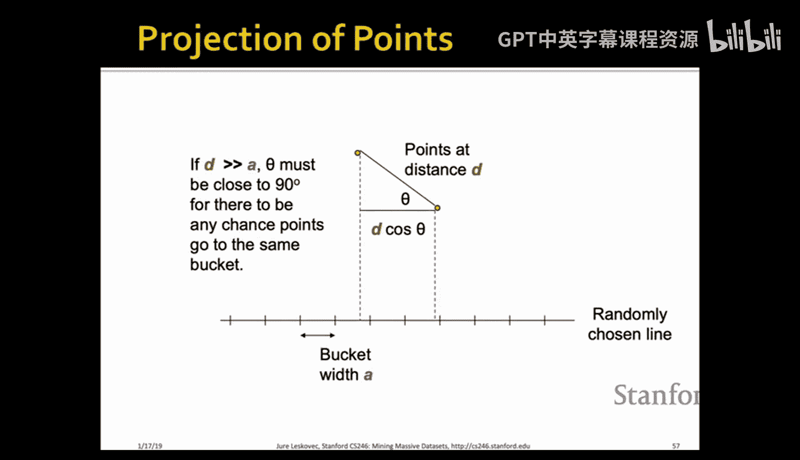

给。Thanks。Okay， let's go to the recap slide so that we are on time。 and then。

I'm happy to get any final questions。 So the two important points I want you to take out from this room today are the following。

 First one is we talk about the property where if the probability that two sets C1 and C2 are aching the same value。

 then this is proportion to the similarity among those two documents。 Okay。

 so we can build hash functions that have that kind of property。 Okay。

 and this is the essential core of L stage without that， we cannot really do anything at all。 Okay。

 if we weren't able to build those hassh functions that everything has we talk about would be impossible。

 Okay， and。😊。

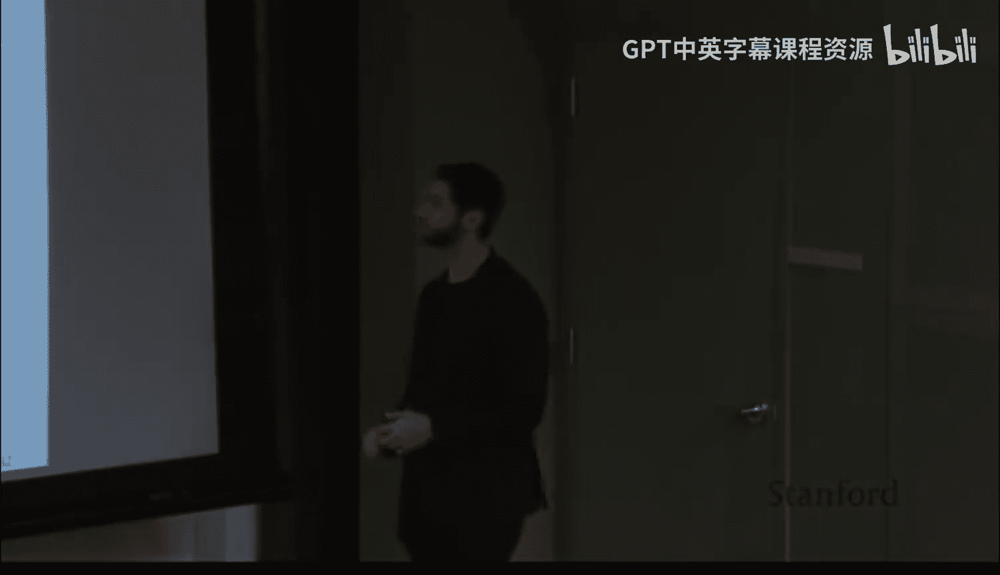

The additional trick that makes L S H from a very elegant solution to one scalable and extremely powerful with large data sets is the fact that we can play with our bands technique。

 so we can decide the size of the bands and the number of bands with which we subdivide our input metrics。

 and once we apply this， we can make L H behave in drastically different way。

 depending on our domain。 Okay， so I wrap up the lecture here。 I'm happy you to take questions。

 clarifications。😊，Chat， yeah。So what is。You you you're not necessarily using a gosh function。

 after you've got the candidates， you wna check their similarity。 It could be， it could be anything。

 No， you could be working with softer plagiarism， and then you're gonna be having functions that tell you if they have similar constructs or similar blocks of code。

 You can have images and then you're gonna be analyzing objects in images。

 So it really depends on the， on the use case。So the， the beautiful thing of L H is that first part。

 you go from your input into something that is a set of signatures。 You get out of there。

 You have the members of your buckets， and then you can refer back to your data。 Okay。

 so it's a transformation like when you do linear algebra。 You go， we go to it in a different domain。

 we do the dimension I reduction that domain。 And thenof， we go back to our real data。Make sense。

Great， question。How are you going to the line， How are we going to partition the lines。Or， in the。

 in the Euclean space example。Okay， yeah， great question， thanks。

This is a problem in case you have outliers， for instance， Like。

 if you know that you have points far away from the others。

 then you will have to stretch your lines and your buckets are gonna become wider just because of those who outliers。

L stage， like planning other techniques working with dimensionary reduction。

 They do require some preproing of the data。 first of all。 So if you leave your outliers there。

 this will underperform。 If you remove them， you cannot define an area in your the dimensional space where the points are line within。

 and then the lines are gonna just be going from one extreme to the other。 Okay， thanks。

 great question。Yeah，可。第阵次爱我我个。SoRe question。Yeah， I repeat the question for the sake of the other people in the classroom。

 how do we overcome the course of dimensionality with L S age。The。

 the answer is LH doesn't help you to address that。

 You need to figure out your own way to get rid of it。 So basically。

 what is telling you is that if you're using cosine similarity and you're aware that your data is highly dimensional and you're gonna be returning a lot of sketches with minus-1。

 So when the the vectors are orthogonal， then you know that either cosine similarity is the wrong similarity measure for your your case or you want to prepos your data in a way that removes the course。

Great question， thanks。Anything else。I think we're also running out of time。 Thanks。

 We'll see you next week。Thank you。