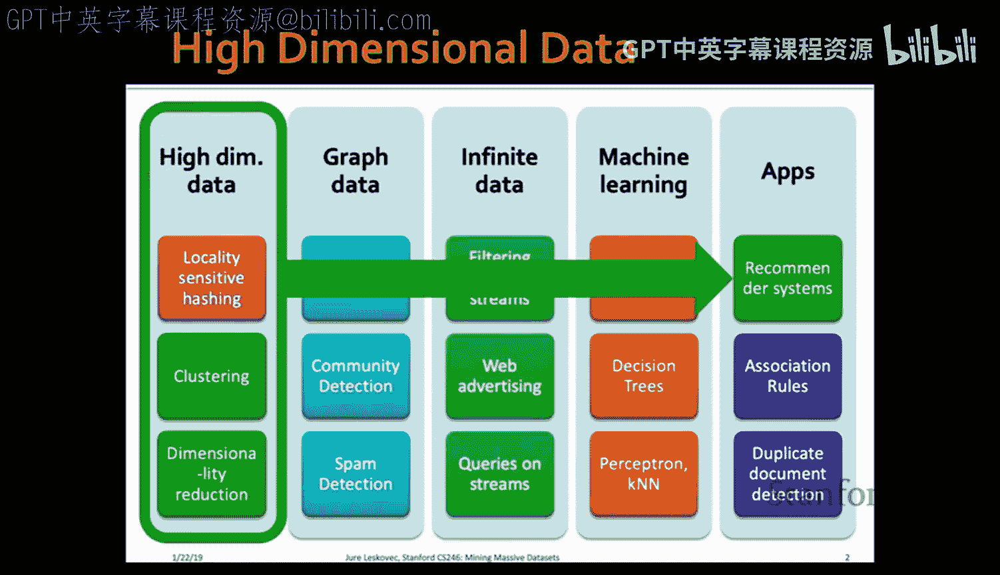
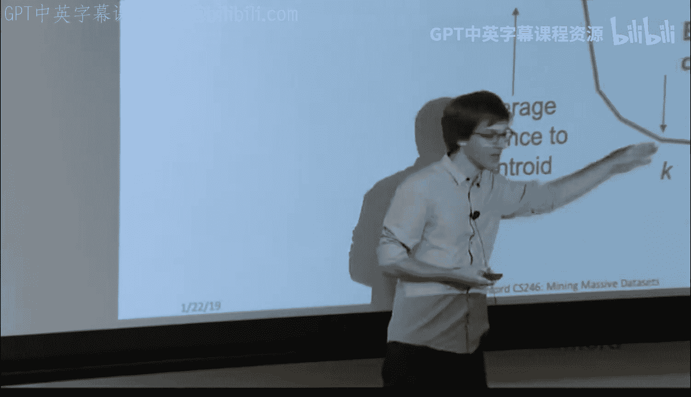

# 斯坦福大学《海量数据集挖掘｜CS246： Mining Massive Data Sets 2019》中英字幕 p05 -P05-lec5 Clustering.zh_en -BV1raSjBuE3d_p5-

Okay， great， hello， everyone。 Wee to the class。 Thank you for working hard on the on the homework。

 If you have any， if you need any help， please come to the office hours and we'll help you。

 But thank you for working hard on that。 So what are we doing where are we right。

 we said that the first part of the course will be about dealing with high dimensional data。

 And we last week， we talked about locality sensitive hashing that allow us to identify nearest neighbors in super high dimensions。

 And we talked about different distant metrics。 and then we talked about locality sensitive hashing techniques and and or constructions。

 What are we going to do this week is we are going to talk about two other important topics。 today。

 I'm going to talk about clustering。 and on Thursday， we will talk about dimensionality reduction。

 So these are all techniques to deal with high dimensional data。

 And then after we are done with this So the week later next week well talk about。😊。

systemsss where essentially we will take what we learned here in kind of in theory and apply it to to the problem of a recommender systems。

 And that will be a very useful and a very interesting Greek。

 So kind of we are building up our knowledge towards the recommender systems。

 today we are talking about clustering。 And the way we think of clustering is the following task right we are given a set of points again。

 in some high dimensions。 we are given a distance matrix。

 So some way to measure distances or similarities between the points and we'd like to group group the points into some some set of clusters into some number of clusters some number of groups so that members of our cluster are close or similar to one another right and members in different clusters are dissimilar。

 And the way we usually think of this is we are given points in high dimensions and similarities defined using some similarity distance function like Euclideian distance coine distance Jakar。

😊，Distance， edit distance and so on。 And essentially。

 the reason why we are trying to do this is because we would like to discover some structure in the data。

 right we are given some data。 We'd like to understand what is the structure。

 What are the clumps of data points that fit together So a good way to think of this is if I'm given some simple data in two dimensions。

 maybe the data looks like this。 what I'd like to discover is I'd like to discover these clusters。

 these sets of points that are kind of close to each other and far from everything else and what this really means is that we want to be given data and we want to discover what is the structure of the data so that we can describe that data to someone who has never seen it right so the structure here would be that we have these three clouds of points and we have a couple of outliers like this point here right And this way we can take a super high dimensional data。

 but somehow give some interpretation to it。😊，Give you an example of this is this is a real example from astronomy。

 right？ you have the telescopes looking into the sky and the telescopes see various types of planetary space objects right and one basic question is right you take several billion of these types of pictures and you want to ask what are types of you know objects in space。

 What kind of what are the types classes of images do I see And the way you can think of this is that you can take every of these images represent it as a high dimensional vector。

 for example， here as a seven dimensional vector and7 in no ways and then the idea is that you can now cluster these two billion points to discover what types of what types of classes of objects are there in space right So you may figure out that you know some are galaxies。

 some are stars， some are quas and so on。 and the way this would look like is essentially you are given。

😊，2 billionion points in two dimensions。 And hopefully， you know。

 there is some structure to this space by basically asking。

 what are the classes of sky objects that we see in the universe。

 So that's one way how clustering would work， you have no labels。

 you just want to say what's the what's the structure in the data。

 So clustering one thing I will say is sometimes also called it's called unsupervised learnings because learning。

 because we want to discover structuring the data without any supervision without any any labels。

 nothing external just data is given and we'd like to describe the structure of it right sky objects are given and you want to figure out what types of objects are there Another example is if you think about music。

 you can think that music naturally divides into categories is genre and wed like to discover them right how would we discover given。

 let's say a lot of music C。 How would we genre。 One way we could do this is to say Ill take every C。

😊，I'll represent it as a high dimensional vector of all the users who bought it and I'll say the two Cs are similar if they are bought by similar customers right and now I basically what I did is I was able to take the Cs and I represent them as these high dimensional vectors of sets right and I can now be basically thinking of C as a point in the space where you know this where I have one dimension for every user and if that particular user customer bought the C I set that part of the vector to1 and if they haven't bought it I set it to0。

😡，Right， and now I can say what is a good similarity metric between these sets of customers。

 You know， maybe I would， I would use jakquard similarity。 And I would say。

 let me now cluster these Cds into clusters。 and hopefully I will discover genres， because， you know。

 people who have similar taste， They buy similar Cs。

 And I can then use this to let's say make recommendations to create to organize my music catalog to explain to a person what genres they like and so on and so forth。

 And more generally， right， like you can take Cds。 But more generally。

 you can take any sets of objects and try to cluster them。 So for example。

 you could take a set of documents， represent each document as a binary vector。

 whether it contains a given word or not。 And now you say what are the clusters of documents。

 And what is this， This is called topic modeling， Because you want to identify sets of documents that are close to each other。

 which means that sets of documents that talk about the same topic。😊，Right， so in some right。

 so basically， the idea is that documents that use similar sets of words talk about the same topics。

 And we w to do， in this case， clustering would be topic modeling。 Okay。

 so these are some examples of how clustering might help and where we would use it， right。

 So one very important thing here is that I won't devote in some sense too much of attention is how do I。

 how do I design or how do I choose my similarity function。

 Because this is almost like the most important thing。 How do I measure similarities between objects。

 right， And if I think of objects as vectors， I can measure angles between them and I can talk about cosine similarity or cosine distance。

 If I think of my objects as sets。Right sets of customers。I can use jakarard distance to say。

 what fraction of customers do the two Cs have in common。

 And if I think of these as some kind of points in Euclidean space。

 I can then measure Euclidean distance， right， So depending on how do I think of my points。

 my objects that I want a cluster， I will choose a different similarity function or a different distance function。

 And， of course， things can get more more complicated， if you say， oh。

 what if my object is a time series， and now I want to cluster time series。

 I may use special time series matrix or you could say， what if my objects are strings。

 then maybe want to use string edit distance for your clustering。

 So the choice of the distance matrix will depend on the particular。😊。

Application or the particular domain you are working with。

 Another thing that is important is that even though everything looks simple in two dimensions and in all and all my examples we look trivial。

 when you go to high dimensions， things are highly nontrivial。

 Here is one example of a projection of a multidimensional data set on two dimensions。

 And you see things are no longer trivial right， And it seems that these clusters are not so well separated。

 right， So why is it hard， right， the reason why this is clustering is hard because in two dimensions。

 everything is easy， and also clustering small amounts of data is easy， But in most cases， you know。

 this kind of simple things are deceiving And the way we can formalize these kind of deception is the following in two dimensions。

 you know， things look easy in 10 they are still relatively easy。

 but in 100 thousand00 or a million dimensions， things are much， much harder， right。

 And the point is that high dimensionmenal。Spaces look different。

 So what I wna do now is give you a bit of intuition why high dimensional spaces are hard and different。

 And this is called generally， it's called curse of dimensionality。

 right basically the dimensionality of the data is almost like the curse。

 And the reason for that is that once you are in high dimensions。

 it seems that all the points are equally far from each other。 and they are all kind of super far。

 And let me give you an intuition。 why when you go to high dimensions。

 it seems that basically your space is completely empty and there's nothing there。 right。

 So here is one way to think about this。 Imagine I take 10000 points。 and I randomly put them on a 0。

1 interval， right， So I mean one dimension。 every point just it has a value between 0 and one assigned to it。

 And imagine I want to do some nearest neighbor query。

 And imagine that the query point is the origin the coordinate 0。

 And now I'm asking how far away do I have to go。From 0 to get to get the 10 nearest points， right。

 So if points are distributed uniform a random and I want 10 nearest points。

 then I need to move1 10 over 10000 kind of away to get the 10 nearest points。 right。

 So that would be， you know，0。01。 So if I want。To in some sense， in， on average。

 get my 10 nearest points， I need to move 0。01 steps from the coordinate origin to get those 10 points。

 right， now， let's say I still have 10000 points。 But now I put them in I put them in two dimensions。

 right if I would put them in two dimensions， how far would I have to go from coordinate origins。

 if I have two dimension if I have 10000 points in in a square of you know，1 by one unit。

 how far away would I have to go， I have to go00 point03， right， So in some sense。

 I have to go farther out to get my 10 nearest neighbors， right， And in general。

 if we are in in the dimensions。 And I have， let's say10000 points and I want 10 nearest nearest ones。

 This is the combination the calculation I had before in one dimension。

 if I now I want to do the same thing in dimensions， I have to take basically raise this to the。

Power of one over D。 So what does this mean， for example。

 if I would have 10000 data points spread uniformly in a 10 dimensional cube then。

 and I w to capture， you know， the 10 nearest ones。 So basically， I want to capture 01% of the data。

 this would mean that I have to go half of the range out from the coordinate origin。Right。

 so before we had to go， you know，0。001 step from the coordinate origin to get the 10 yearsest ones。

 If I， if I live in 10 dimensional space， I need to go half of the distance half of the size of the hyper cube out to get my 10 years neighbors。

 right？ So essentially， what am I saying。What I'm saying is if you have some the dimensional space and you have a fixed amount of data in there。

 and then you increase dimensionality and you hope to cover kind of the same part or cover the same fraction of the space。

 this cube has to get bigger and bigger and bigger， right if I'm measuring how how big is the cube。

 you know， if if the length of of this embedding spaces between 0 and1。

 how long is the side of the cube that covers the 10 years neighbors， right。

 and what is this trying to say is to say how far away from coordinate origin do you have to go to cover a given fraction of volume on a one dimensional line。

 if you go， you know， if you want to， if you go half the way from 0 to1。

 then you cover half of the line， right， So here it is。

 that's the linear relationship if you do if you go into two dimensions。

 you already see you have to go further out to cover smaller volume， right。

 And if you say how about in 10 dimension。If I wna cover， let's say。30% of the volume。

 This means I have to go almost like 90% out in terms of the distance， right， So basically。

 this cube has to go till here till point9。 If the size of the embedding spaces。

 the length is one right So basically， the point is that as the dimensions get bigger and all you care is just getting the 10 years neighbors。

 you have to go farther and farther out。 So all the points are kind of super far away from each other as the dimensionality increases。

 And thats that is what is called curse of dimensionality。 Okay， so this is why clustering is hard。

 So now what are we going to talk about today's lecture。

 we are going to talk about two different types of clustering methods。 First。

 I'll quickly talk about what is called hierarchical clustering and then we will talk about point assignment methods。

 hierarchical clustering， There are two ways。 One is bottom up and the other one is stop down。

 And in both cases， essentially， what the output will be will be some， what is called den。

GRight where I have my data points at the bottom。 And this shows how these data points are being combined into clusters that are bigger and bigger。

And of course， you can see that you can， you can create this dogram top down where you would say。

 first， I'll take all my data， split it into two clusters。

 I will take each of the clusters and further split them into two and you keep doing and you create these three of how clusters are split that top down bottom up is that you take the nearest points。

 you take two points that are very close and you join them to create a new cluster。 And now you know。

 you keep doing that and you keep joining these clusters together until no cluster until you have one big cluster and you have kind of build these dandogram。

 these hierarchy bottom up， right， And now how many clusters are tearing the data。

 you have to decide where you want to cut these dtroogram and whatever are the elements。

 those are those are your clusters。 And then point assignment。

 the way this works is that you maintain a set of clusters and then you assign points to the nearest cluster and we'll talk about this as well。

 But first， hierarchical cluster。😊，rinkRight， where the concept that I want to convey is this notion of a denandogram。

 this type of hierarchy that tells me how these clusters fit together， okay。

So what is the key operation of hierarchical clustering。

 It's basically that we want to repeatedly combine two nearest clusters。 That's the idea。

 So what are the three questions we have to answer， we have to say。

 how do we represent a cluster of more than one point， Because if a cluster has only one point。

 then that point represents the cluster。 That's easy。 But what if I have a cluster of five points。

 how do I represent the cluster。 right， then now that I figured out how to represent clusters。

 I need to determine what's the distance between two clusters and decide whether I want to merge them。

 And if I merge them， then the question is， how do I。

 how do I merge them and when do I want to stop the process， right， So going back to my d here。

 what I'm trying to say is I can start with every individual point as being its own cluster。

 And then， you know， points that are close， I join them into a bigger cluster。 And now， you know。

 I can keep joining clusters until。😊，I decide to stop for one reason or another。Right。

 so let me give you a bit of intuition。 What， what would we w to do in each case， right？

 So point assignment methods will work well when clusters are nicely separated。

 and they have this kind of nice round shapes。 And then， for example。

 hierarchical clustering will work really well when we can have clusterings that are of very weird shapes。

 right， because I'm kind of joining points that are similar。

 So all these guys will be joined together in one cluster and all these guys will be joined together in in another cluster。

😊，Right， so now， how would we design a clustering method that would maybe be able to identify this。

 this as a cluster and this everything around as a， as a separate cluster。 Okay。

 so hierarchical clustering will allow us to do that。 right， So as I said。

 we wna repeatedly combine nearest clusters。😊，So the the first question was。

 how do I represent a cluster of many points， right。

 I want to take many points and kind of merge them， aggregate them into one point。

 because I only know how to measure distances between points。 right？

 So the key problem is when I merge clusters， how do we represent the location of each cluster and then kind of determine which which two clusters are closest to each other。

 right， And if we think of data points in the Euclidean space。

 then there is this notion of centroid and cent is simply the average of the data points in the cluster。

 Okay， So the idea is， if I have a cluster of points。

 how am I going to represent the location of the cluster。

 I'll just take the average of those those points。 And if average sounds arbitrary to you， it is not。

 And the reason why average is not because average of the points is the location that has the shortest average。

Distance to every other point in the cluster。Okay， so centroid is really what is the center of the mass of the of the points in the cluster。

 And in the Euclidean space， it turns out that average of the points kind of gives you the center of gravity。

 It gives you the center of all the points。 right， It's the distance。

 It' the distance that is closest to all other points in the cluster。

 So that's the magical property of average that we want here is that I want to find the center of the cluster。

 and average gives me that if I live in the Euclidean space。 So centroid is。

 is is is an important concept， which says let's， let's summarize all the points in the cluster in one point。

 If points are in Euclidean space， we can do the average that's called the centroid。 Now。

 how do we determine how near or far to clusters， Basically。

 we just want to measure the distance between the centroids。 If I have two clusters。

 I just represent each one as a centroid。 And I ask how far away are the two centroids， right。

 because centroid is just a data point。😊，So to give you an idea。

 imagine I'm given these six data points。 So the first thing I will do is I think of every data point as a separate cluster。

 You know， here are my 6 data points。 and then I measure pairwise distances between the data points。

 and I merge the two closest one right and the two closest would be these blue points。

 So I combine them， I compute the centroid， which is just the average of the two。 So it's 1。51。5。

 And in my dogram， I denote that I merged the two points。 Okay。

 so now I have a data set with four points。 sorry，5 points。 the original four， but the two blue。

 I joined into one。 So now I have5 points，5 clusters。 If you want to think of it that way。 And again。

 I can measure distances find the closest pair merge them here in the dogram and compute the centroid And now I have one data point less。

 So now the number of data points I have is4。 It's this one。😊，The centroid。

 the centroid and that one。 And again， I can ask who is closest to each other。Right。

 it turns out that these red red point and the blue X are， are the closest。 I again。

 compute the centroid。 I average all the three data points together。 And that's my new centroid。

 And here I denote that the blue。 the sorry that the red point merges into the blue cluster。😊，Right。

 so now I have three data points left。I find the closest pair。This is the closest pair。

 the distance between this X and the red 1。 again， I compute the centroid and I merge the red point into the green cluster。

 Now， what is left is to， is two data points， right， is the red centroid and the other red centroid。

 And I can， you know， merge the two as well。 And， and， you know， I'm， I'm done。

 There is only one cluster left。 right， So this is now the dandroogram and hierarchical clustering of this very simple。

😊，Data set， and I'm doing this， as I showed in the bottom， bottom up way。 Okay。

 are there any questions。Yes， go ahead。 How do we know when to stop clustering。

 How do we know when to stop clustering， That's a good question。 You don't have to stop。

 You stop when only one cluster is left。If you like。

 But if you have certain criteria how many clusters you want or something like that。

 you could stop early。 But essentially， this process will stop after you merged everything into one huge cluster。

 right， How would you decide to stop， I'll give you some ideas later。 It's a good question。

 It's a good question， But if the data set is not too big， we would generally just run it to the end。

There was a question。 Okay， good。 thank you for the question。 Yes。

 and then how do we interpret the lital hierarchy of the clusters like that blue one with the outer red one like more important still an inner cluster than outer Great。

 How do we， how do we interpret this， right the way you。

 you can interpret this is you can actually draw this hierarchy in such a way that here is the distance that here here you plot the distance that you have to go out before you merge something。

 right， So it means that the height of this levels will tell you how distant clusters did you have to merge。

 And that can then allow you to decide where do I want to cut。😊，Right， like， for example。

 when I join these two clusters， I had to combine two cents that are very far apart from each other。

 right， So the way I could draw this is to make this line very high and say， oh， this was too far。

 This is where I will cut， right， And I will conclude that there are two clusters。 right？ Good point。

 Thank you。 right？ So this was the easy case。 It was the Euclidean case。

 What about in the non-uclidean case， right， in the non-uclidean case。 Imagine you have sets。

 the only locations we can talk about are the points themselves， right。

 we don't know how to take the average of two sets， right， we don't know how to do that。

 So we we are not able to compute averages， right， So there are two approaches how you can now represent a cluster。

😊，Another way to represent a cluster is to have a notion of what is called clster。

 right before it was a centroid。 Now it's called clsteroid。

 And the reason why we want to do a clusteroid is because we want to pick a data point that is closest to all other point。

 So in the centroid， we said let's create an artificial data point。

 right If I go back that doesn't exist， but is closest to all the members of the cluster。 Now。

 if we are in nonuclidean space， we don't know how to create this artificial data point。

 So I'm just saying search over all the members of the cluster such that you find the the member of the cluster that that is closest to all other members。

 and that's your representation for the cluster。 This is great， because this is a real data point。

 So it gives you interpretation。😊，Right， if you think about it。

 right rather than averaging together some weird things and getting some artificial data point here。

 The cluster is actually defined by the representative data point for that cluster。

 which is something that can be very useful， right。

 And then how do we determine the the the nearness， you basically clusteroid。

 as it were the centroid。 So when you are computing cluster distances。

 you are computing distances between clustersters。 Okay， so that's essentially the idea， okay。😊。

So as I， as I， as I mentioned before， like the way we can now define the notion of classsteroid is that there are many ways how you operationalize。

 what does it mean to be closest to all other points。 I could say。

 I want a point that has smallest maximum distance to other points in the cluster。

 You could say I want the smallest average distance to to all other points。

 or you could say I want the smallest sum of squares of distances to other points in the cluster。

 right， So for example， you could say the classoid is a point that minimizes this expression， right。

 I go over all the members of the cluster and I measure the distance between the the classsteroid and and the members square that and added up。

 And as I mentioned before， the the difference between centroid and clusteroid is that classoid has to be a real data point while centroid is an artificial data point。

😊，Right， and in Euclidean space， you can create an artificial data point。

 If our objects are are sets and so on。 we don't know how to take averages and create artificial sets。

 So we just take the one that's kind of closest to all others。 and as I mentioned。

Cllusteroidide are very nice because they allow you。

 They are interpretable because they are real data points。 They are whatever is in your data。

 which is， which is great。 Okay， so this is what I wanted to say about No the nonuclidean case。

 how to represent a cluster。😊，Now， we need to go and answer the second question， which is。

 how do we determine the the distance between two clusters right？

 And what I suggested is treat the clustersteroid as if it were a centroid so that the distance between two clusters is the distance between their centers。

 right That's one option。 you can be fancier and say， oh， no。

 I won't represent the cluster by one by one data point by the cluster。

 but I'll just somehow define the distance between two clusters and I'll represent a cluster as truly all the data points that belong to it。

 So one option be to say， the cluster distance is the minimum distance between any pair of points1 from one cluster。

1 from the other cluster， right So this would say if you have two clusters， how close they get。

 What's the closest they get to each other。 So it's not the distance between their centers of gravity centers of mass。

 but it's really how close are they by the closest point， right。

And this should be one way one way to do this， okay。Now。

 there is more that you can do when you define。Distances between clusters。

 And one way to define distance between cluster is to say， I wna， I wanna。

 I don't wantna measure distance between clusters。 but I w to say that after I merge something together。

 I want it to be cohesive， right， So I won't measure the distances between two clusters。

 But I'll say if I merge it does it look like a good cluster， right， that's a different approach。

 So how could you measure this notion of cohesion， right， So the idea is that right。

 I'll take a pair of clusters， merge together and see if that looks like one。

11 kind of clamump of points。 And if， if it looks like a cohesive clamump of points， I'll say， oh。

 yes， this was a good thing to merge， right， one option is to say to characterize the cluster by its diameter。

 which is basically the the distance the max the distance between two farthest points in the cluster。

 right， And you could say I will merge to clusters。 if the diameter does not increase to much。😊。

Right， or you could use the average distance between all the pairs of points in the cluster。

 So you have two clusters。 you proclaim that as a new cluster and and ask， you know。

 what's the average distance between the two clusters And the smaller the older the points that I that I merge together and the smaller the average distance is the more cohesive my clusters。

 right， or you could use some kind of density based approach where you could take the diameter or average distance and somehow divided by the number of points in the cluster。

 right， So why am I saying this， Because， for example。

 clusters that are small and tight will have small diameters， right， But if you do density。

 you kind of normalized but the number of points in the clusters。 So it means that larger clusters。

 you allow them to have bigger diameters， because they have more points in。Right， so choice。

 specific choices will depend on the specific application that you have in mind and the specific goal you want to achieve。

Ne a clustering。 And then。As there was a question before， when do we stop。

 how do we decide decide when to stop merging clusters together， right， The simplest thing is to say。

 let's stop when we discovered some K number of clusters and K is provided to us by the user。

 or we have some stopping criterion that is met。 And the examples of stopping criteria could be you know。

 we have clusters that have two big diameter。 So the diameter exceeds some threshold。

 and I want to stop。 Maybe the density is below some threshold。 right。

 My clusters become become two spars they are not densely enough populated with points。

 and I want to stop。 or if merging a cluster。Mging to clusters yields a bad cluster。 right。

 for example， you say， oh， the diameter jumped up。 Obviously。

 I cannot keep merging by keeping clusters compact。 so I will stop， right。

 And one way to stop is to keep doing the work until there is nothing left。

 right which is basically you keep merging until one cluster is left。

 And then there' is nothing else for you to merge。 So you have to stop right again。

 depending on the particular application。 you may w to use these types of metrics。

 especially like measuring some kind of cohesion of clusters and how it changes as you keep merging and as you see a big jump。

 you you stop if you are lucky enough that somebody tells you how many clusters they want。

 you can use that And if you wna just visualize the entire dogram。

 then just build it and that's good as well， right So it will depend a bit right So now you can ask。

 you know， which of these approaches that I gave you in terms of distance matrix。Clusterroid。

 centroid。 How do you measure distance between clusters。

 Do you have this cohesion metric that tells you what to merge or do you measure distance。

 And based on the distance you merge， it will depend which of these methods work best。

 It will depend a bit on the structure of your data。 So it's kind of。

 you may not know what will work ahead of time。 So let me give you one example to kind of give you this intuition。

 what may happen。Right， if we take clusters and merge them based on the smaller smallest distance between the centroids。

 right， So this would be one approach。 and then another approach would be merge clusters with the smallest distance between any two points。

 right， you know， one from one cluster 1 from another cluster。 right。

 how would these two approaches differ， right， So imagine I'm given data that right that looks like this。

 And this shades are trying to give to give you the shape of the of the data right。

 then imagine I I'm working right now with three clusters and I'm trying to decide what to merge。

 right， in this case， for example， centroid based approach will work well。

 And because A and B have closer centroids。 So I will merge A and B together， right。😊。

But if I look at clusters and say the distance between the clusters is the this is the shortest is the shortest distance that these two clusters come together。

 So it's like， you know， it's the the right most point of cluster A and the left most most point of cluster C。

 then under that metric right under that thing up here， then A and C are closer than A and B， right。

 And in that case， I would go and merge A And C， which would be wrong in this case， right。

 So if data has this type of structure， then merging based on the centroids would work would work better。

 Okay， But let me now give you a counter example， right， imagine my data looks like this。😊，Right。

So in this case， linking or merging based on closest members will work great， right。

 because in this blue area， I'll be just mergerging this little clusters that were wrap around and the distance between the clusters is the。

 is the distance between the two closest points in each cluster。 So， you know。

 this thing will kind of connect around。 and it will work well。

 But if I would merge based on centroids， then you know， sooner or later。

 I would kind of merge the green and the blue part together and I would lose the structure。😊，Right。

 so which one do you use depends on the structure of the data。 If you。

 if your belief is that clusters have this nice around kind of Gaussian shapes， then， you know。

 you centroids are a good idea how to do things。 If you think that your clusters are of these types of super weird shapes where you know。

 one cluster is kind of surrounded by a different cluster， like I try to show here。

 then measuring the distance based on the closest numbers is the way to go。 right， So， again。

 it will depend。Okay， are there any questions so far。All good。All good。 Okay。

 so this was hierarchical clustering methods that are essentially based on merging clusters。 right。

 we start with each point being its own cluster。 and then we have some criteria that says which two clusters should emerge into a new cluster。

😊，And， and then we need to decide how do we represent the cluster and how do we measure distances between clusters。

 right， This is what we discussed so far。 Now， we are going to move to what are called point assignment methods and the。

 the， the most。Basically， the method that is most well known from this class of methods is called k means。

 or sometimes they call it K means plus plus。 I'll tell you the， the better version of k means。

 which is called k means plus plus。 Okay， so how does K means work。

 So the first thing is that K means assumes Euclidean distance and space。

 right So hierarchical clustering。 we can do over weird sets and so on。

 K means we can only do over Eucidean space and Euclidean distance。

 And we will basically pick number of k， which is the number of clusters we want to identify。

 So we need to know K ahead of time。😊，And then the way we will do this it will be our iterative。

 updating algorithm。Where we will first go and pick K points that will serve serve as our cluster centroids。

 right， so we will kind of pick one point per cluster， right。

 And you could pick this K points a random。 But picking them a random is a bad idea。

 So a better idea is the following。 You pick one point a random。 And then you know。

 you pick the next point that is kind of as far away from your first point as possible。

 And then you pick the third point that is as far away as possible from the first two points。

 And this way you keep you select the K points。 The reason why you want to do this is because this K points that you select。

 They will start as your， they will serve as your initial centroids。

 So this means that you wantna kind of cover the breath。

 the entire space rather than pick more points where there is a lot of data and not pick anything where there is little data。

 So that's why you want to select。😊，Your cluster centers as far away from each other as possible。

Right。So that's， that's the first thing。 And then in the K means plus， plus。

 there is a bit different idea。 The different idea is the following。

 The idea is before you cluster the big data set， pick a small sample of points S and cluster that using some hierarchical clustering algorithm or whatever you。

 whatever you like。And after you identify the points using your hierarchical clustering algorithm。

 use those centroids as seeds for your for your clusters。 And in K means plus plus basically。

 it says that the size of your sample in order to discover the clusters。 what it has to be。

 it has to be some K， which is some parameter times some logarithmic fraction of the total number of data points。

 All right， so you take a exponentially small sample。

 So basically logarithmically large sample cluster it。 And then this will define your。😊。

Your cluster centroids， right？ now， as I said， how， how do you pick a sample。

 How do you pick a sample of points if the data is so big， you cannot put in memory。

 One option is that you visit points in a random order。

 but the probability of adding a point to the sample is proportional。

Proportal to the distance squared where this distance squared is the distance between the current point P and the nearest peak point so far。

 Again， why are you doing this because you want to find points in the in the parts of the space where you haven't sampled yet。

 So the farther away the the given point P is from the points you have currently picked the more likely you are to take it Because again。

 we want to sample the entire space and go into regions of the space where there might be few points and this type of strategy to generate the the sample that I'll be using up here。

 that's the way to go right when I create the sample。

 I need to make it to be size logarithmic in the in the amount of data。

 And this is a way how do I pick that sample。 Okay， again。

 I'm trying to pick points that are far away from what I have already picked right And now this will now give。

Me the cluster centroids。 So now that I have these centroids。

 I need to now assign the rest of the data to these centroids。

 So this is what is called populating clusters。 right。

 So the idea is that each point I place it to the cluster whose centist is the nearest， okay。

And so this is simple。 Right， So what we did， what did we say， we say。

Take a sample of points using that distance way of sampling them as I describe。

 Run your clustering method， find case cents。 remember them。

 Now do a single pass over the data and for every for every data point。

 assign it to the to the cluster whose centroid is the closest， right and you could stop。

 you could stop there。 right， Now， if you w to be fancy， you can also do steps to n3。

 The steps to n3 are the iterative portion of the algorithm where after you have assigned all the points。

 you can now update the centroids。😊，Right， and this will move the centroids a bit。

 So it means that in the in the next pass， you can reassign the points based on these new locations of the centroids。

 right， And again， you could go and update the centroids again and keep repeating steps 2 and 3 until convergence。

 conver convergence means points don't move between clusters and clusters stabilize。 Okay。

 so now I want to give you an example of how would this work。 Okay。

 so imagine I have this is my data set。 right， It's this kind of hockeyistic data set， right。

 every x is a data point into dimensions and imagine the square that that will appear is a centroid。

😊，And imagine somehow we decide that for one cluster。

 the centroid will be here and for another cluster， the centroid will be here。 right。

 So I have two centroids， somehow unfortunately picked， but that's what we picked。 Okay。

 So what do I do next。 What I do next is for every data point， I ask it。

 Are you closer to this centroid or are you closer to that centroid。

 And whatever centroid is closer to I assign it to that cluster。 Okay， so for example。

 all the all all these blue points， they are closer to the blue square than to the while square。

 So they all get assigned to this cluster。 And these two points get assigned to that cluster。 right。

 and this could be the end of the running of our algorithm。 But what we can also do now is to say。

 okay， let's now update our centroids， right because this is off center for this cluster。

 And this guy is also off center for that cluster。 So I can go and update the centroids。

 This means that。😊，That the red centroid will move here in the center of the cluster。

 This blue guy will move further out。 And now I can ask all the points。

 I can ask them do you want to switch your cluster membership， right and this point will say no。

 I'm still happy。 I this is my closest centroid。 So I stay where I am But if you ask this point this point will actually want to switch the membership because the centroid the blue centroid to which it belongs right now is actually farther away。

 then the red one， so it will switch the membership to the red one。

 So in the in the next space stage， what will happen is that now the cluster the vit cluster move the bit to the right。

 which means that now we can go again and update the location of the of the centroid and of the two centroids and ask all the points again。

 Does anyone want to shift。😊，Right， and in this case， you know， these two points will say， oh。

 we actually are closer to here than up there。 So the two points will switch the clustersters， sorry。

 the clusters O， sorry。啊。The cluster centroids will get updated。 And again， we can ask the points。

 Does anyone want to switch。 And at this point， no point， no。

 no data point will want to switch because everyone is assigned to their closest cluster and nobody has an incentive to switch anymore。

 So the method will stop right， So even though our initialization was not perfect。 In this case。

 Kamins method with this iterative updating would discover the right set of clusters。 You know。

 the the two parts of my hockey stick。 Okay， so this is the idea here。😊，嗯。Are there any。

 any questions about this。Right， so what Kmin is amazingly sensitive to his initialization。

 How do we set those initial case centroids and putting some effort in choosing them。😊。

Makes all the difference when you start running this iterative updating procedure。喂。Good。

 so maybe I tell you next， like there is one。 if you are reviewing a clustering paper and you wna and you want to tank it and reject it。

 you you ask the following question。 you say， but how do you select the number of clusters K right and usually people have no answer because it really depends on the on the data and what are you looking at One way。

 how to select the number of clusters is to try different values of k。 And then you know。

 look at the average change in the distance between centralroids right。

 And as the if the average false rapidly until kind of you get you get your your number of clusters correctly So here you say here is K versus what is the average distance of the point to its cluster center。

 this will as you increase the number of clusters， this will be this should be monotonically decreasing And whenever you kind of see that this starts to stabilize or you see a。

😊，In this curve， this is kind of the best value of K。😡，To give you an idea？

Imagine you are in some high dimensional space and you discovered these two clusters。

 Then what I try to show with these lines is that the that the the the average distance of the points from the centroid of the cluster that is here is very large。

Right， if so it means I have too few clusters， right， If I go back， you know。

 we are somewhere here on this curve。 If I keep increasing the number of clusters and I find something like this。

 I essentially see that now if these are the centroids and these lines kind of show the distances of the points to the centroids。

 You see that distances to the centroid are relatively small， they are much smaller than， you know。

 what they were， what they were in this case， where I had a centroid just kind of in the middle of the two clusters。

 right， So this would be better。😊，And， of course， if I pick even more clusters， right。

 Like now I keep increasing。 Okay， basically， what happens now is that I'm like just over over clustering my data set。

 So my average distance to the cluster centroid will actually stop decaying rapidly。

 So I know that I have too many clusters。 right， So this， this regime。😊，Would be， you know。

 somewhere here， the just right would be somewhere here and too few is here， right。

 so but based on the shape of this curve， you can select the true the true number of clusters you want。

 Yes， question。the shape of the curve， let always be crisp to giving me a best a value。

It can also be like smooth， like a according optimal curve where I won。So the shape， the question is。

 what will be the shape of this curve。Right， now， if your cluster。

 if your data truly contains clusters， then this shape should have some knee， right。

 there should be this optimal number of clusters where everyone is assigned to the right cluster and everyone is close to the centroid。

 and it's all good， right， So this will be this point。 And， of course。

 you can over cluster it and the distances will decrease， but they won't really decrease that much。

 right， And if you come up with too few clusters。 this means that the that certain clusters will be merged together。

 So your So you will be， in this case， where the centroid will be in the。

 in the middle of two clusters。 So all these distances will be huge。😊。

Right so if your data has the clustering structure， then this is how this should look like。Allright。

 good point。 Yes， it kind of looks like a bias variance straight off， right。

 but we're only looking at the bias decreasing， not the variance increasing。

 I there a way to kind of add in the variance so you can find some minimum point there。😊，嗯。

That's a good question。 So yeah， yes， yes， you can。 And there are clustering techniques that。

 you know， that would have some kind of minimum shape。 But what I would say is at the end。

 clustering is a very， it's a very manual process。 right。

 It's really a process where the the result of what you get out is more a function of you than a function of the method。

 And generally， clustering clustering techniques kind of have to be really slowly developed so that they give you the result that you want or need。

 right， So it's very hard to say， oh， around K means， look， this curve here is the minimum of you go。

 clustering is a data explanation process So we have to treat it like that。 And very rarely。

 we would just automatically run clustering can kind of just lift our hands。

 it doesn't that's not go。 but good question。 All， So what I want to do next。 is I want to give。😊。

1， at least one， maybe two more algorithms that try to be a bit smarter and are are basically extending。

 in this case， came means to very， very large data sets。

 right in what we assume so far is that somehow。Our data fits in memory。

 and we can process it efficiently and so on。 But the question becomes。

 what if our data is very large。 So this algorithm will call we'll talk about。

 It's called B FR and named after the， you know， the first letters of the， of the authors。

And it's essentially a variant of K means designed to handle very large data sets。Essential。

 this resilient data sets。 And what this method will do is it will make an assumptions that clusters are normally distributed around a particular centroid in the Euclidean space。

 So we'll make an assumption that our cluster are either kind of circular。

 or there are this axis aligned ellipses。 Okay， and I'll explain why why this right。

 so this means that essentially， we will assume every cluster is characterized by centroid plus the standard deviation or variance in each of the dimensions。

 right so here the variance is bigger than in that way in this cluster variance along these dimension is bigger than variance in that dimension。

 Okay， and as I said， clusters are a aligned。 So I cannot have a diagonal diagonal kind of cucumber。

 cucumber are this way or that way， okay。😊，And the， the goal is to find cluster centroids。 And。

 and then you could， you could do the， the point assignment in the second phase。

 or you could actually do it at the same time。 It either way is good。 So let me tell you。

 what is the idea。😊，The key idea is that we want an efficient way to summarize clusters。

 and we want the memory requirement to be proportional to the number of clusters。

 not proportional to the amount of data we have right。

 So the idea is that rather than keeping data points， the BFR will keep summary statistics。

 And for every cluster， basically， when we run clustering。

 we wna keep kind of three sets of summary statistics。 We w to keep what we call cluster summaries。😊。

Well w to keep something that we'll call outliers and we'll also keep kind of points that are yet to be clustered。

 Okay， and then the algorithm will have kind of the following five steps。

 We will initialize the K cluster centroids we will then repeatedly load a bag of points from the disk and then the idea here will be that when I read a new point。

 I will do one of the few things。 You know， I can either decide to assign that point to the one of the K K nearest clusters。

 if that point is in some sign distance threshold but I can also decide not to assign the point to the cluster And if I decide not to assign the point to the cluster。

 I will take all this unassigned points and I can cluster them by themselves to create new clusters that maybe I haven't initialized yet and and as I create new clusters。

 I can either decide to merge them with one of the。Ssisting clusters or keep them on the side。

 And then I will be repeating this step。 Okay， that's essentially the idea。

So now let me give you the next level of details， right。

 So I'm reading points from this disk in these batches。

 and the idea is that most points from previous memory loads are summarized by simple statistics。

 Okay， so the idea is that in the initial load of points。

 the goal is to select k centroids by some sensible approach， right， As I said。

 I can take K random points。 I can take a smaller random sample and cluster it optimally。

 or I can you know， pick a sample， pick a random point。

 and then find other points that are as far away from these starting point as possible。😊，Now。

 this is to initialize the case centroids。 Now， I need to be ready to， to。

 to process the next batch of points。 So how am I going to do this。

 The way I'm going to do this is that I will have， I will kind of put class points into three bins。

 I will have what is called discard set。 And this will be points that are close enough， close enough。

 close enough to a current cent so that I can assign them and forget about them。 Okay。

 I will have what is called a compression set。 This will be groups of points that are close together。

 but are not close to any existing clusters。😊，And the idea is that， these points are summarized。

 so it means they are compressed， but are not yet assigned to any of the big clusters。

 And then I'll have the retain set， which are isolated points， I don't know what to do with them。

 So I'll just save them for later to see if I get more samples from that region of the space。 Okay。

 so then maybe I can assign them to compression set。

 and maybe later compression sets can be can be assigned to discard sets or a new cluster can be created。

 Okay， so here is the picture how this would work。 so I can have existing centroid。

 and I have points assigned to that centroid。 And whenever whenever a point appears close to the centroid。

 I just assign it to that existing cluster。 and I forget about it。

 So this would be called the discard set okay。😊，Then compression sets would be these small dense sets of clusters that are。

 that are not close to the existing centroids， but I wantna kind of summarize them。

 but keep them on the side for the future。 The reason why I wantna keep them is because maybe I haven't yet seen all the data in this area。

 Maybe I haven't seen all the data in this area。 Maybe there is more data here。

 So I'm just kind of summarizing this sets of points。

 but I'm not yet assigning them to the cluster and discarding them。 And then the the retain set are。

 you know， little leftovers that I don't know what to do with yet。 Okay， that's the idea。

So now the question is， how do I do this summerization of the。

 of the discard set and the compression set， And here is a simple but effective idea。

The idea is that I will summarize each cluster with three numbers。Or to one number and two vectors。

 right， I will have the number of points N。 and then I'll have this vector。

 sum whose I component is just some of the coordinates of all the points along that I dimension。

 right， and then I'll have another vector。 I'll call it some Sq。

 which is basically some of the squares of the coordinates on that dimension。 Okay。

 so essentially to summarize the cluster， I keep a counter of number of points。

 And then I keep two vectors。 One is just some of the coordinates and the other one is some of the squares of the coordinates。

 and you can see where I'm going with this， right， the reason why I want to do this is because with these two numbers。

 I'm able to specify the shape of the cluster。 right。

 how am I able to specify the shape and the location of the cluster。 right。

 basically I can compute the average in in each dimension by taking the sum vector and dividing it by n。

😊，So this is just the average of all the data points in the cluster。 So that's the cluster cent。

 And then I can also compute the variance along each dimension。

 And the way I can compute the variance is to note that sum and sum of squares are kind of sufficient statistics to compute the variance。

 So the way the variance in a given dimension is is the sum of squares along a given dimension divided by n minus the sum sum along that sum of the coordinates along that dimension divided by n。

 but square。 And this difference is the variance in a given direction。

 So this means that now with you know the n sum and sum of squares。

 I essentially define the shape of the cluster。 I from sum， I can compute the average。

 which means I compute the cent。 and using this formula。

 I'm essentially computing the the variance along each of the dimensions， right。😊，One comment here。

 I've wrote it here for you is。😡，Like I as before， I'm assuming that that these clusters are axis aligned。

 The reason why I'm doing this is because I specify variances only along the D dimensions。Right。

 if I would want this to， to be able to have a diagonal shape。

 then I would need to specify the full covariance matrix， which would have size D times D。

 So size d square。 And that's too much。 right。 So by basically assuming cluster clusters are x is aligned。

The all the summary statistics I need to describe the location in the shape of this cluster is two times d plus one number of points。

 right，1，1 counter。 This is n。 and these are the two vectors， one for each one has the dimensions。

 So I need two times d plus one numbers to store the cluster plus plus its location assuming that the cluster the variances or the cluster shape is x is aligned。

 Okay， so that's good。 So that's the how do I summarize a set of points。

 Now we need to talk about steps3 to 5， which is I load an next batch of points。

 And I want to process that。 right， So the idea is I want to find points that are sufficiently close to this cluster centroid。

 And and add those points to the discard set， right So the idea is that points that are easy to cluster to the existing clusters。

 I just do that。😊，Okay， so the idea is these points are so close to the centralroid that they can be just summarized and thrown away。

 and I don't have to worry， right？ And then the idea is that I can use any in memory clustering algorithm to cluster the remaining the remaining points and whatever reason in the retained set。

 right， and whatever these clusters are， these clusters go into the compression sets and outliers are maintained or retained in the retain set。

 Okay， so basically， the idea is whatever I can assign an I assign whatever I cannot assign。

 I either keep in the retain set or I cluster it and put it in the compression set。 Okay， that's the。

 that's the steps 3 and 4， What is the step 5。😊，The step 5 is that of course。

 when I assign something to the discard set， I have to adjust。 I have to update the statistics。

 right， I have to add plus one to the counter， and I have to add the coordinates to the sum。

 And I have to add some of the squares of the coordinates to the sum of squares right and of course。

 what I also need to consider is merging the compressed sets in the in the C。

 So I need to consider merging these little clusters into bigger clusters。

 maybe consider merging these little clusters into existing clusters or actually create a new cluster out of the compressed set。

 right And of course， if I mean the last round， I can decide what to do with the outliers and what to do with compression sets。

 Do I throw that away or or do I proclaim that as new cluster， But this is essentially the idea。

 So the idea is that I describe every every cluster with these two。😊。

Vctor and a number and a counter。 as new points come if they are close to the existing cluster。

 I just assigned them。 If they are not， I cluster them and summarize them and later decide what to do with them。

There are two details I'd like to talk to you about that require a bit more explanation。

So the first question is， how do I decide if a point is close enough to the cluster to be added to the cluster？

 And then， you know， the second， the second thing is。

 how do I decide whether to compress sets deserve to be merged into a bigger one， right？

 How do I do these things。 How do I come up with this distant threshold。

And here is a way how BFR suggests to answer this question right And what we'll do today is we learn about this notion of Mahaanobi's distance and Mahalanobi's distance is a super cool concept because it measures distances along different coordinates with kind of at a different resolution It measures it at the resolution proportional to the variance in the data along that along that axis right and what is nice is that basically Mahalanobi's distance will will normalize for the spread of the data in different dimensions。

 So really， in some sense， what BFR is doing。 it's modeling each cluster with a Gaussian distribution。

😊，And if the clusters。Cl the shape of the cluster really follows a Gaussian distribution。 Then。

 you know， the mean of the Gaussian。 let's say is 0。

 Then I know how many standard deviations out I go and how much data do I expect here in the tail。

 So it means that I can use this intuition to decide on the threshold and that threshold is essentially data set independent。

 So let me show you what Mahalanobi's distances。 right， So idea is the following。

 Imagine I have a point X and a centralroid C。😊，Then the idea is the following。 I wna。

 the way I want to compute the distance is essentially the following。

 What I'm doing is over all the coordinates。 I'm taking the difference between x and C in that coordinate。

 And if I would just do this take the square sum it up and take the square root。

 this would be our usual Euclidean distance。 But what I do is I divide by the variance or standard deviation along that dimension。

😊，So this means that if along one dimension， the data is very spread out。

 This means that x minus c along that dimension will be very big。

 That will be normalized by the variance in their dimension。 So in this sense。

 the space gets wrapped warped according to the variance of the data in that dimension。

 Okay so this means that kind of all the dimensions have equal variance because they are normalized by by the variance along those dimensions。

 Okay So why is this nice， this is nice， because if clusters are normally distributed in the dimensions。

 then after the transformation， one standard deviation equals square root of D。

 And if clusters again， are normally distributed， this means that that you know。

68% of all the points will be Mahalanobi's distance less than number of dimensions square root of that right So this means that。

I can decide to accept a point that belongs to a given cluster if the Mahalaobbi distance between the point and the center rate of the cluster is less than some threshold。

 Let's say two standard deviations， right Because I know that in two standard deviations from the center。

 I will cover 95% of the data， right like 2。5% this way and2。2。

5% that way right So this is how we can come up with a principled way to decide on the threshold when to assign to point to the cluster right well assign it if the Mahallaobbis distance is less than two standard deviations give you pictorially how does Mahalaobbis and Euclidean differ。

 if data is kind of evenly distributed， then the two are equivalent。 But if data is， for example。

 more spread along one dimension versus the other。Then。

 then the Euclidean distance will penalize distances along this dimension where the data spread more。

 What Mahalanobbi's distance does， it kind of spreads it out along this coordinate right So if these are now is the blues blue are the shapes are the points that are at the same distance from coordinate origin。

 right， in Euclidean distance， These are these concentric circles。

 But in Mahalanobbi's distance in this case， you have this ellipoids， right So you know。

 this point and that point these two points are at the same distance from the coordinate origin。

 because in this particular in the y direction， the variance is smaller。

 So the distance here gets penalized more then the variance in x direction is bigger。 So， you know。

 the point the distance between the coordinate origin and this point is the same as the distance between coordinate origin and that。

Okay， so you see how kind of nicely the space gets wrapped。 Yes。

 so we're talking about a gasian distribution of points。

 but we also talked earlier about in the cur dimensionality that most points are really apart from each other。

 So do we still have that nice Gaussian distribution and high dimensions。Great， great question。

Ha do we still have the the， the， the that nice Gaussian distribution in high dimensions？ Yes。

 we like， depends on the data。Right， so the， the point， I think， is the following in。

 in high dimensions， generally， things are more spread spread out。

 But if there is clustering structure in the data， it will still be there。

 So these assumptions are still valid。 right， But， you know， at the end。

 all these will crucially depend on， on what the data is and how。

 how nice the clustering structure of it is。Okay， yes， you have a question。

 So the elector probably be in different directions in space PC to identify the。

So what's the question like PC A to identify。 Oh， yes， Could you use PC A to identify this。

 We'll talk about a better version of PC A on Thursday。 Yes， you could。

 But PC A is something that's amazingly computationally expensive。😊，Right， you have to do。

 you basically have to do matrix factorization。 right， That's hugely expensive。 right。

 What Mahalanobe's distance does。 It just says measure the variance along the dimensions and and it renormalizes。

 So it's amazingly， its， it's amazingly elegant。 But in some sense， yes， you could use PC A。

 define these things and rescale by PC A， But it'd be like using a tank to to to peel an orange or something。

 right。😊，Yeah， sorry。 I know it's a good comparison， but it almost feels like a good one， right。

 Like， it's not clear what you get， not even orange juice， right， So， but good question。

 Thank you for asking。 It's a good。 Like yes， you， you're right in some sense， right。😊，Alright， good。

 Ask me more questions。 So good。 And then the second thing I w to say， you know。

 when should two compression set clusters be combined。😊，Right。

 and the same thing what you can do is you can compute the variance of the combined cluster。

 and then， you know， you can combine the two clusters if the combined variance is below some threshold。

 right， And again， if I have a compression set here and a compression set there。

 then then the way I combine it， I sum up the the ends。

 I sum up the sums and I sum up the the sum excuse。

 And then I can ask what's the variance of that of that cluster， right， And if you think here。

 if I would add these two guys together， basically the variance would be quite large， right。

 So I wouldn't I wouldn't go or wanna do it， And of course， in practice， you know。

 there can be many alternatives to this approach。 Okay， so this is what I wanted to say about BFR。😊。

Where kind of the main idea is this idea that you wanna。Summarize clusters as quickly as possible。

 There is this idea of Mahaanobi's distance。 And then， you know， this kind of how do I sign。

 how do you assign points and what do you do with the compression sets。

 Are there any other questions。Yes， where do we maintain which points are in which clusters。Great。

 Where do we maintain which points are in which clusters， you you don't necessarily have to， right。

 Like for a compression sets， as soon as you see the point you assign it。

 you can write that on this can forget about that point。

 So you don't even have to memorize the points right all you have to all you have to keep track of are these statistics。

 And as soon as the the point is is assigned， you either to a compression set or or a cluster in the retain set。

 in the discard set， you don't have to do that。 The only place where you keep track of data points is for the retain set。

 right， So the elegant thing here is that the amount of bookkeeping you need to do is a relatively small。

 just keep the clusters And as soon as the point is assigned。

 you can forget about the point and you don't have to waste time for it。 So at the end of the。😊。

This Im assuming like we have to write somewhere maybe it this。 Yes， So how do you determine， right。

 if a point is in the discard set， it's been assigned。 and you wrote that。 And that's the truth。

Right， if the point is assigned to a cluster in the compression set， you。

 you write that out for the compression set cluster I D。

 And the only thing that may later happen is that you decide to merge certain clusters in the compression set。

 But that's not， but that's a rare event。 So， yes， you may， you may have to do some bookkeing later。

 But amount of that is a relatively small。😊，All， great。 yes。は原人。

Do people use Maharanobis distance for normal Ks， Yes， you could。

 because the way you can really think about this is in some sense。

 just transforming the data and normalizing it so that the variances are equal along each dimension。

Alright， so this is sensitive how we initialize Yes， so is this is this sensitive。 This is， this is。

 of course， sensitive。 How do we initialize the discard set。

 So we especially the discard set is amazingly important because those centroids are there。

 And the idea is you just keep assigning other data points to them。 So that the。

 so the cluster centroids in the discard set won't change。 So， so if your initialization is off。

 everything will be off。 So that's kind of the crucial step then that makes everything else work easy and fast。

😊，Okay， let's see if I can tell you the last， the last thing。

And the last thing is called is an algorithm called Q。

 where the idea is that we want to extend K means to clusters of arbitrary shape， right。

 because so far BfrR， you know， allowed us to to detect clusters like this。

 clusters like that that are kind of diagonal that already has troubles with。

 But then if we think by you know， clustering this type of clusters。

 This is called two moons because it's like two moons touching each other。

 Another hard case is is called Swiss roll， which is basically like a dishs like wrapped around。

 right， So the method I want to quickly tell you about is called cure。

 And the idea is you you we want to cluster using representatives。 again。

 we assume we are in a Euclidean space。 and the method will allow us to assume clusters have any shape And we to use a collection of representative points to represent the cluster okay。

😊，Here is a slide I borrow out from Jeff F Fullman。 This is。

 this is supposedly the distribution of Stanford salaries。 This is age versus salary。

 These are humanities and that's engineering， And the question is， can we find it really is this way。

 believe it or not， right？ So the idea is， can we find these clusters that are complicated， right。

 that I， I have right， this data， I w to find the clusters。

 So how would cure allow us to find these weird shaped clusters， okay。😊，The idea is the following。

 the algorithm will have two passes。 And again， in the first pass。

 we'll try to identify these representative points。 and in the second pass。

 we will assign points to the clusters that are described by the representative points。

 The idea is the following。 We want to pick some random sample of points that fit into main memory。

 come up come up with initial clustering by using hierarchical clustering。

 And then we want to pick representative points。 So for each cluster。

 well pick a sample of points as dispersed as possible。😊，Right。

 and then as we found out these points that are as dispers as possible， we will do the second step。

 which is from this dispersed points。 we will take these representatives。

 and we will kind of how to say move them closer to each other a bit。

 by let's say by the 20% of the distance， right， So the idea is that I'll take the representative points。

 But then I'll move it a bit closer to the center of the cluster。

 And this will really help with the robustness of my algorithm。 Okay。

 so the idea is that given my data。 I may I will load some sample of it into the main memory。

 I will compute hierarchical clustering。 Let's say I will find this。😊，3 clusters。

 And let's say now that what I want to do is for each of these clusters。 I w to pick。

 let's say four remote points， points that are far from each other as a representative points for each cluster right So。

 you know I could point I could select points that are far away from each other like this。

 and these are the representative points。 Now I don't represent the cluster by this points But I also compute the centroid。

 And then I move the points a bit closer to the centroid。

 So I this means is that these points will move a bit closer to the center。

 And these are now my representative points for this cluster。 And then in pass number two。

 I will now rescan the whole dataset set load every point P and place it into the closest cluster。

 where you know， what am I using as a definition of the closest。 it will basically find the closest。

😊，entative point and assign my point P to the whatever is the cluster that that representative is a member of。

 Okay， and that's it。 So one last thing to comment here is。

 why do we want to move points20% closer to the center。

The reason why we wna do this is because if I have a large dispersed cluster where points will be very far away from each other。

 then when I move them 20% closer， this will kind of shrink that cluster by quite a lot。

 while small densely packed clusters won't be won't be sharingring that much。

 they won't move too much。 So it means that my method will favor small dance clusters that rather than。

 you know rather than big rather than big dispersed clusters。

 right So if I have a point that is kind of in between a small dance cluster and a big sparse cluster。

 the big sparse cluster will get compressed more。 So that point will more likely be assigned to a small dance cluster。

 Okay So this is what I wanted to say about cure， here is the summary of of the lecture today of the clustering。

😊，Problem hierarchical clustering K means and then2，2，2 improvements。 the BFR and the cure method。

 So with this， I'll finish for today。 Good luck for the homework。 and I'll see on Thursday。

 we talk about SVD。😊。