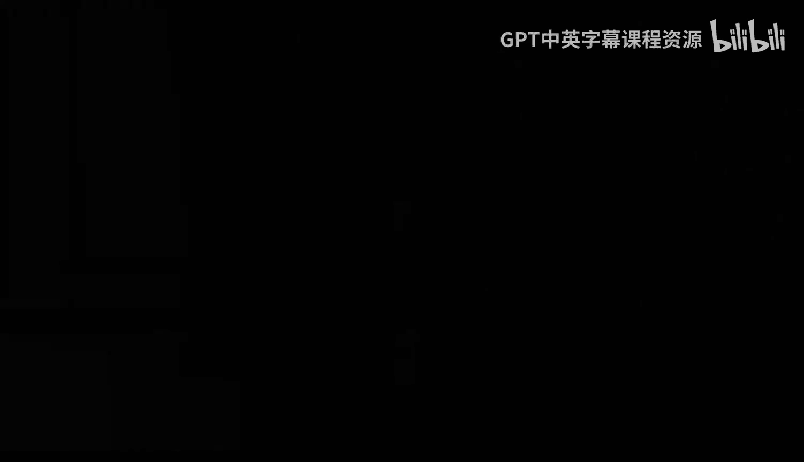
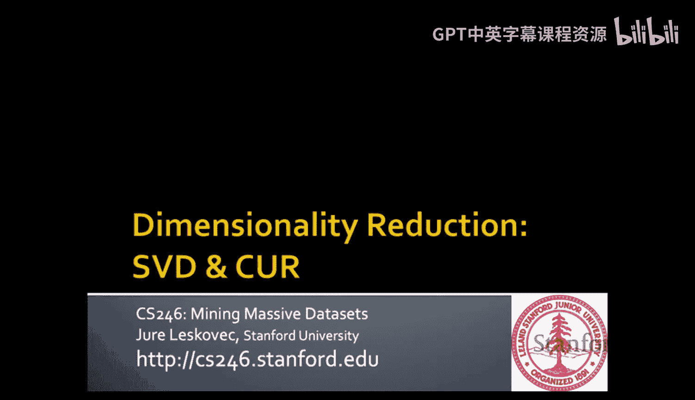
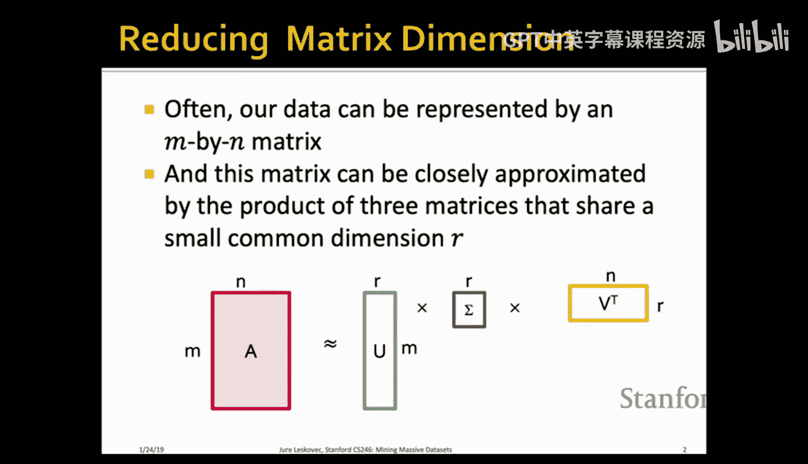

# 斯坦福大学《海量数据集挖掘｜CS246： Mining Massive Data Sets 2019》中英字幕 p06 -P06-lec6 Dimensionality Reduction- SVD and CUR.zh_en -BV1raSjBuE3d_p6-

Okay hello great。 welcome everyone back to class So today we will be talking about dimensionality reduction and we'll talk about two methods one is called the singular value decomposition and the other one is called the CR decomposition and both these methods will kind of the idea will be that we want to reduce dimensionality of the data and this will become very handy next week when we talk about recommender systems the lecture today and then again next week on Thursday will be kind of linear algebra heavy so we'll be thinking a lot about matrices okay and here is kind of what we will be doing and what we want to do right we can often take data and and represent it as a big M by n matrix where we have M rows and M columns right as you know as we did it with shingling and so on right and and the idea is。

😊。

This matrix can be closely approximated by a product of matrices that share small common dimension R right so the idea is that I can take this m by n matrix and represent it as a product of three different matrices of you know I have matrix U that's very skinny very very narrow but has M rows and some R columns where r is let's say something small I will then have this R by R matrix here and another matrix that is wide that has as many columns as the original matrix and it has r rows right and this is what we mean by matrix decomposition where we want to take one matrix and and decompose it into a product of smaller matrices and this is kind of what we will be doing today So with this intuition or this kind of high level。

 let me now give you some examples and what do we want to do and how would this work right so what we want to do is we want to compress our data we want to reduce dimensionality。

😊。

Right， and you know， idea is that we are maybe willing to do that if we have a bit of error， right。

 So imagine I give you this type of data， this is my data matrix where I have different customers。

 And you know， how many orders they placed every on these particular days， right， So this would。

 for example， mean that， you know， this particular GCI incorporated。

 placed one order on Friday the 12， right， And I can think this of this as my data matrix。😊。

And what I can do is I say I want to reduce dimensionality。

 I can find out that I really have only two types of rows in in in this matrix。

 I have rows that basically have something， something。

 something00 and others that have 30 and something something right So what this means is that my data is really not you know let's say five dimensional right that every customer is five dimensional data point。

 really my data matrix is only two dimensional。 What does this mean this means that I can represent every row。

 either something that is you know 11，1，0，0 or00，1，1 And if these are my new let's say coordinates。

 my new dimensions then every row here can be now represented in this new coordinates right So for example。

 row number number4 can be represented as5 comma 0 because I take five times this row and I add 0 times that row。

😊，Right， while， for example， this row here or this on here in red can be be represented as 02， right。

 I take0 times this particular row plus two times that particular row， right。

 And if I multiply these by two becomes 0，0，0，2，2， which is exactly that row right So what did we do。

 rather than represent every customer using five numbers。

 I can represent every customer using just two numbers in this new coordinate system， if you like。

 where these are now my axis a customer are along these two axis。 So this is kind of how you know。

 high dimensional data is really low dimensional data。 So this is really two dimensional data。

 even though it seems it's in 5 dimensions。 Okay so this was an example and of course what we'll do today is figure out methods that automatically discover these dimensions and allow us to compress dimensionality of the data。

 That's the idea right So kind of whats the idea of dimensionality reduction。😊。

The idea is that I have data in high dimensions， but really data occupies kind of a lower dimensional manifold in this embedding space right so I can think my coordinates are given in two dimensions but really my data just lays along this line or I could think that my data coordinates my ambient space is in three dimensions。

 but really the data itself only covers this plane that I show you here right so really you know even though the coordinates are in three dimensions。

 these data is two dimensional， if I know the two actors describing the plane。

 I just have to say where on this plane you are rather than thinking of three dimensional coordinates or in this case if I know the line all I have to say is how far along the line appointees of course I will get a bit of error because dots don't perfectly sit on the line but I can just say how far along along the line are you to determine the position of the point in。

😊，This way。Reduce dimensionality。 And these latent dimensions of the data。

 They are called latent factors or latent dimensions。

 These are these intrinsic dimensions of the data that the coordinates themselves don't don't reveal。

 And our goal is to identify this， these dimensions in which the data really is positioned。

 Okay So and right how would you how intuitively， how would we do this， right， this dimensions。

 this latent dimensions， these latent factors。 the way we will think of them is that the first latent dimension is the dimension in which the data has the highest variance。

 right， And then， you know， the second dimension is the direction that is orthogonal to the first。

 but has the second largest variance， right， and so on and so on until， you know。

 we are able to sufficiently describe the data and the remaining variance is low right。

 So the idea is that we want to find。😊，Aes of， in some sense。

 maximal variation so that our data will be well described。 And if we have axis。

 let's say if I would have an axis this way， where the variation is small。

 I don't care about that dimension， I really care about this dimension because the variation。

 The variance， The spread here is very large。 And you know， the orthogonal dimension to this one。

 I don't care so much because data is really like close to the line。 right。

 So the variance there is small， Okay and now with kind of this intuition。

 let's start to build more of it， right， So one question is。

 how would I measure dimensionality of the matrix。 and rank of a matrix matrix。

 essentially measure the dimensionality， right， because you know what is the rank of the matrix。

 rank is the number of linearly independent rows in the matrix， right。

 so if I go back to my original example， if you think of this。

 there were only two rows that are linearly independent， right is it is。😊。

One row from here and one row from there， all these other rows linearly depend on each other。

 They are just kind of a scaled version of the first row right so if I would say what's the rank of this matrix。

 the rank of this matrix is 2 which means that with two dimensional coordinates we can exactly represent this matrix so you know give you a bit more interesting example here I have a matrix。

😊，And you can ask you know， is this a rank2 is it a rank3 matrix and you know it turns out this is a rank2 matrix because if you write it out in in the following coordinates right 100010 So this is kind of this is x axis is this is y x is this is x then your points can be represented that way。

 but if you define new basis vectors， new coordinate system that is let's say the following。

 then you can rewrite your original data points with only two coordinate each right so now coordinate。

 so the data point C which is3，50 is really the first vector minus the second vector right so in the new coordinate system the data point C has the following coordinates where this is the new coordinate system right So again what do we notice we reduce the number of dimensions from three dimensions write3 number。

per point to two numbers per point right So if you would were to compute towards the rank of this matrix。

 this matrix has rank2 because it's really two dimensional， not three dimensional。

 Okay right and what's the goal of dimensionality reduction is to discover this axis right to automatically discover this axis so that we can reduce dimensionality of the data or more compactly represent our data right and right the idea is that rather than using the original ambient space。

 we want to compress the data。 And by doing so， we may incur a bit of error but we are fine with that right because we really kind of want to see what is the large scale structure of the data。

So that's the idea for what we want to do and how we are going to think about it。

 So I'll talk now about singular value decomposition where here is what singular value decomposition is。

 I take my original data matrix say that doesn't have to be square it can be whatever is the dimensions and I will represent it as a product of three matrices U sigma and v transpose and there are strong constraints that I will explain on the structure of U sigma and V that result in a unique decomposition So any real valued matrix has a unique decomposition into these three matrices U sigma and v transpose and from these decomposition we can choose R to be to be to be whatever we want right so this are we can choose what is how many dimensions do we want to reduce our representation to in this case if I would。

😊，matrixtri A and fully decompposed， then R would be the rank of the matrix。

 but I could also choose R to be less than the rank of the matrix。

 And this way do the do the dimensionality reduction and S weD does it in the following way that it minimizes the reconstruction error。

 and I will explain what minimizing reconstruction error means so defining singular value decomposition。

 we take data matrix A and we represent it as a product of three matrices。

 a is the input data matrix。Matrix U I will call the matrix of left singular vectors so every row of this matrix U is a singular vector the dimensionality of matrix U is it has m rows and R columns or R singular vectors then I will have a matrix sigma of what we call singular values matrix this is a diagonal matrix so we'll only have non-zero values along the diagonal and then I will have the matrix3 this is the the matrix up here。

 this one which I will call the right singular values the singular vectors and this is now n columns and sorry n rows and R columns or if I write it in the transposeway then it's n N columns and R rows where again R is the rank of the matrix cell so now how can I write this out one way I can write this out is using the。

😊，The the matrix product up there on the left。 but I also can write it in this other way。

 which is the the outer product where this is， you know。

 I go over all the over all the singular values。 This is the singular value times the left singular vector and then I do the outer product with the right singular vector right And here is how am I visualizing to do this。

 right so I can think of it this way to to reconstruct matrix a or I can think of it that way to reconstruct matrix a okay。

😊，So that's the idea。 Now， what are some properties of this singular value decomposition。

 The first properties is that for any given matrix， say， the U sigma and V are unique。

 So it means there will always be just one solution， not multiple but one unique solution。

 What are the constraints， The constraints on U and V is that they are column orthoormal。

 So what does it mean， It means that every column is orthogonal and unit length。Okay。

 so normal means it's a unique length。 It has Euclidean length 1。

 and orthogonal means that if you take dot product of two columns， you get 0。What does this mean。

 mean that if you take if you take the matrix and multiply it with itself。

 you will get an identity matrix。 why， because every two vectors are orthogonal。

 they multiply to a 0， and whatever is on the diagonal。

 It means you take the vector and multiply it with itself。 and you get its Euclidean length squared。

 So if the Euclidean length is one。 then the length squared equals one as well。

 So we get once on the diagonal and zeros elsewhere， this is called the identity matrix。

 Okay and then our matrix， Sigma is diagonal， which means that the entries。

 which we call singular values are positive right， and the way we will think of these singular values。

 we think of them as sorted in decreasing order。 So we'll say sigma1 is the biggest sigma 2 is the second biggest all the way。

 and they are all greater than equal to0。 So they are all positive。 So that's the idea。

 Now I want to give you a first example。 Here。😊，The example I was able to come up with this is imagine this is a matrix where every row is a user and every column is a different movie。

 I hope I'm not told and you recognize these movies So right the idea is that this particular user gave this particular set of ratings to these three movies and you know some other user gave these particular ratings to you know these two movies and they also rated the alien movie and now the question is if I take this as my data matrix and I do the decomposition what is it going to happen right and the idea is that this rows and columns of you and we will somehow define me the concepts along which the data varies a lot so it will give me what is called latent dimensions or latent factors and if you think of these data set it seems that there are two types of movies or two types of people there are people who like these three movies and there are people who kind of watch these movies。

😊，And there is very few people who watch both from both categories right so these latent dimensions。

 latent concept concepts should reveal something about the structure of our data so now if I type this up and use my favorite linear algebra library to do my to call my singular value decomposition function here is what I get right so if I take this matrix here is my U here is my sigma and here is my V transpose as we said。

😊，All these all these columns are unit length。 they are orthogonal matrix sigma is diagonal right I have zeros and only nonzes on diagonal singular values are greater than zero and they are sorted in the decreasing order okay so this is this is the decomposition So now the question is what does it mean but you have a bigger question first。

😊，To three。Did I trunccate to three points。 Oh， why did I get only three points， Why， great， Why did。

 Why do I only have three， And I don't have five， Because there's five columns here。 The reason is。

 is， because this matrix has ranked 3。Why does it have rank 3 because I have rows of this type。😡。

I have rows of this type， plus these two errors。So I need， I have kind of three types of rows。

 So that's why I I got only three because the S is 0。 The rank of this matrix is 3。 It's not 5。

 So it's not a fuller rank matrix。 So that's a great question。 Thank you， right， so。

This is if I want。 And now， of course， if I multiply these matrixrices together， I get this matrix。

 So this is now exact。 And so the rank of the matrix is 3。

 So I have three singular values three singular vectors and three singular values。

 right If now there there would be more like if this wouldn't be so nicely done as as I did it beautifully。

 right， then yes， in general， if this would be a random matrix， you would get all five here。

 But it's not， you see it has some structure embedded， very mysterious， good。

 thank you for the question。 Great， So now that you know why we only have three， this was super cool。

 let's figure out what does this all mean， right， So now you can start saying， okay。

 what does it mean， right， it means that for example。

 the first the left singular vector kind of for every user tells me how much does it belong to let's say different concept。

 right， it seems that this seems like this is the science fiction concept。😊，Science fiction topic。

 and you know， the first three， the first four users seem to belong to it quite a bit。

 And then there is this other concept called Roman where this。

 where this last movies So last users here belong to it。 right， And then there is， you know。

 something else， Okay， that's the first thing。😊，The second。

 the second thing is that you can think of the value here， right。

 This kind of tells you how users belong to these concepts。

 How much is user number one belong to the first concept， Second concept， Third concept。

 right So it seems that this this first four belong a lot to the first concept and then you know the last three have high values here。

 right， So they belong to that one， even though the values the values are negative right。

 So that's the first thing。 So the way we think of the matrix U is the user to concept matrix Okay then what are the what do the singular values tell me singular values tell me how strong。

 how important a given concept or related late dimension is right So it tells me that the first two are very important。

 but the last one is really not。😊，Right， because if you look at this。

 it's essentially two types of people plus a bit of noise， right， So this last。Concept is very weak。

😡，Right， so in some sense， the way you can also think of this is what is variability along a given dimension。

 And there is a lot of variability here and here and much less there。 Okay。

 so that's the that's the intuition。 And then what is the matrix3。

 matrixtri 3 is movie to concept matrix。 right， If I have this movies。

 then we tells me how much does each movie belong to each concept， right。

 and it tells me that the that the first three movies really belong to the first concept。

 The second two movies。 So movies4 and 5 belong to the second concept。

 And then this last one tells me that this movie number two belongs a lot to it， right。

 so there are the first three movies， they belong to our first concept。

 So the science fiction then we have the last two movies Here they are。 because right。

 they belong to our Romans。😊，Concept， and then there is this weird movie number two that the only it belongs strongly to this third concept。

 right， So this is here where we have these two guys， right， So that's the second movie， right。

 So what this means is that matrix V is the movie to concept factor matrix， yes。

How do we interpret the sign？Val。How do you interpret the sign？Just。But essentially， ignore it。

It doesn't matter if something points this way， then it can point that way as well。Right。

 so it's okay。 So think of magnitudes more than the science， right， like。

I can define that way or that way。 But the coordinates are just flipover。 right， So good good point。

 Okay， so what did we， what did we， what is the first interpretation for SVd is that we have this kind of movie users and concepts So I can think of user to be of you to be a user to concept matrix we to be a movie to concept matrix and sigma is diagonal elements kind of tell me the strength of each of these concepts。

 Okay， so now this is what we did。 What we did so far， is that we took our original matrix。

 and we use singular value decomposition to decompose it into a product of three matrices。

 And the important thing is that here is a equality sign。 So if you multiply these matrices together。

 you will get back exactly this values like exactly the values。 So this is equals。

 But when we do dimensionality reduction， we will incur a bit of error。 right。

 So the idea is if I have。😊，My data spread in some dimensions。 then， you know。

 I want to find the axis of maximal variation。 So I want to identify this axis。

 and if I decide to do dimensionality reduction， then you know whatever then this means that this particular data point would be would be projected down to my to my axis。

 So when I would reconstruct it， I would incur a bit of error right So in some sense。

 if I want to do dimensionality reduction on this data。

 instead instead of using two coordinates X and y to describe the point I could decide only use one coordinate。

 which would we kind of the distance along this line from the origin right But this means if I do that that I will incur a bit of error because obviously I cannot reconstruct this point。

 I would have to project it here。 Sos that's the idea。

 So how does SVD discover this latent dimension。And how do we then do dimensionality reduction。

 so far notice， we haven't done any dimensionality reduction because we can directly reconstruct this。

 So there is no dimensionality reduction going on， just like something that seems like five dimensional data is really three dimensional data。

 But we still are exactly reconstructing that thing， right， now I gave you。

 I asked before what are the dimensions， what are the coordinates of latent dimensions。

 the V transpose gives me the coordinates of these latent dimensions。

 These are the latent dimensions， right， So these are the coordinates of the red arrow。

 If you want to think of it that way。 And then you know。

 these are the coordinates of of the arrow that's orthogonal to the red one。

 And this is yet another that's orthogonal to the first two okay。So that's the idea。

 So as we said before， right we said that singular values。

 the magnet tells me what's the variance along that dimension。

 So one sensible strategy to that we what we can do is now that we have the variance that tells me what is the spread along a given axis I can take my user to concept matrix and multiply it with my sigma matrix right And if I do that。

 then what I get is the coordinates I get are now the projection of the points on the on my on my projection axis right So if I take u times sigma。

 then here is here is the matrix I get right and what would this mean is that this is now projection of users on the scifi axis on the Romans axis and on the third axis right So this is the scifi concept Romans concept and you know whatever else disease。

 and you see。😊，for example， this user number four is kind of the farthest along or along this concept while this first one is kind of not too far from the origin and the reason for that is that this person gave very high ratings stole three movies while the first person gave low ratings to the three movies right and then you know for the second axis for the Romans again you can compare the distances here and they correspond to the magnitude of ratings there so that is the first thing。

😊，Now， let's ask， how do we really do dimensionality reduction， So if I take my data matrix。

 do singular value decomposition， and I want to do further dimensionality reduction。😊。

And the way I do this is quite simple。 O， the way I do is I zero out some singular values。 So I go。

 So what am I saying is if I w to now take this original matrix and。

 and project it down to only two dimensions。 The way I do this is I compute SVD and then I0 out the smaller or the smallest singular values。

 So here I could0 out 1。3， so I can replace a 0 here。😊，And if I replace a0 here。

 then what this means that I'm effectively removing this guy and I'm effectively removing that guy from my。

 from my matrices。 So now let's assume I take this skinny two column matrix multiplied with this two by two matrix and then multiplied with this。

 What do I get。 And here is what I get。 right， it's not yet， Okay， so。😊。

animations right because I will zero this thing out now my equality sign becomes not necessarily equality but something close and then because as I said because I zero out the 1。

3 this means essentially I remove this column and I remove this zero。😡。

So now Im representing every data point rather than using three coordinates。

 Im representing it using only two coordinates right and now if I do right and if I do this this is now what are de matrices I will multiply right they are smaller and if I multiply them here is what I get。

😊，Okay， so this is the matrix I get。And what do I want you to see I want。

 I want you to see that this is the ma， this is now the reconstruction。

 reconstructed version of my original matrix。 But notice that this reconstructed version is quite good。

😊，Right， what does it mean that， for example， this row of 55，500 got reconstructed to， you know，4。8。

5，4。8 and something very close to 0。 Or， for example， you know。

 this row of 010 to 2 gets reconstructed to things that are close to 0 and then things that are close to 2 right？

 So this reconstructed matrix。Is quite close to the original data matrix。

 even though original data matrix was three dimensional was rank 3。

 and now we are approximating it with a rank2 matrix。 Okay， or a rank two set of matrices。

 And as as we do that， our reconstruction is close， but is not perfect。So。Now， the question is。

 you know， I just zeroed out here some singular values right。

 the smallest ones and you know why did I do that and is this principle then you know why didn't we zero out some other ones can you can easily ask right And the point is that that the reconstruction error which is measured by the Frrobinus normum between these two matrices and Frrobinius normum I define it here is nothing else then basically Euclidean distance between two matrices right so you take corresponding cells in the two matrices you subtract them take a square sum over all the cells and take a square root So in some sense it's a Euclidean distance between two matrices if you want to think of it that way right and what is what is the super cool fact the super cool fact is that the reconstruction error that can be quantified by the Frrobinus normrum is。

😊，L as possible。 Okay， so let me quantify what I mean by that。 So what did we learn in so far。

 What we learn in so far is that I can take some matrix A here， right。

 and I can decompose it into these three matrices。 right， And then we said。

 let me now take my decomposition， set some singular values to 0。

 which basically means I kind of gray out this part of the matrix。

 And then I gray out this two other parts of the matrices。

 And if I multiply now these things together。 I get a different matrix B。

 And now I ask what is the difference between A and B。😊。

And it turns out that SVD gives you the best possible way to do dimensionality reduction， right。

 So if I do dimensionality reduction this way， then the difference。

 the Frbius normm between A And B will be minimized。😊，Okay， so what does， what does。

 what does it mean to be to be， to be minimized， It means that along all possible ways。

 how to represent my matrix A using some， let's say， K dimensions。 This is the best way to do it。

 So it's the best， So is the minimum forbinius Norm approximation of the original matrix with a rank K matrix。

 Okay， so SVD， in some sense， is optimal， right， So what did we learn so far。

 we learned that SVD is unique。We learned how how what is the the rank of the matrix are。

 and we will talk more about how do you select the number of the dimensions in which you want a project and what are we going to do is now talk about how do you actually go and compute singular value decomposition If somebody didn't hand you in a linear algebra library。

 Okay， are there any questions。😊，Before I go into how to compute things。Okay， so so far。

 we should have a good kind of intuition understanding of what this is。

 Now let's talk about how do we compute it。 Okay， so what we want to do is we want to compute the singular value decomposition。

 So what we need we need to find before I show you this I need to tell you if you take a square symmetric matrix。

 How do you find the principal eigenvalue in and the corresponding eigenvector， right。

 So I'm taking some matrix M that is real value than symmetric symmetric meanss that it' symmetric across the diagonal right that M J So the cell Ij has the same value as the cell J right。

 it's kind of flipped across the diagonal， right， and how do you what's an easy way to find the principal eigenvector and the principal eigenvalue is that you start with some guess of your eigenvector。

 let's call it as x 0。 And then you you it the following iteration， You say I'll start。😊，With x0。

 I'll multiply it with my matrix M。 I will divide by the length of that resulting product。😡。

And this is my new guess。 And I keep iterating this， right。

 And I will stop when this X K stops changing。 Okay， and this method is called power iteration。😊。

And just to give you an example how this would work。

 if I have my matrix M and my guess for the eigenvector to be 11。

 then you know the first iteration would be m times x0 divided by the length of of the x0。

 So here is my new my new x1。 Now I can take my x1 and multiply it with the M again and divide by the Euclidean length of that of that product。

😡，Here is the math。 This would be my X 2 and so on and so forth。 But notice that， you know。

 it seems it's already starting to stabilize。Right， so if I were to run this a bit longer。

 basically it would converge to the vector very close to this one。

 and this would be my first eigenvector So now the question is how do I find the corresponding eigenvalue right how do I and the way I find the eigenvalue is given here so my eigenvalue that corresponds to the eigenvector x is simply that I take x transpose m times x Why is that the case the derivation is easy all you have to remember that by definition eigenvalues are lambda x equals m times x right if m is an eigenvalue and x is an eigenvector So if I multiply the above equation from the right with x transpose then I get x transpose times x times lambda x transpose times x equals1 because eigenvectors are unit length so this will be1 and then。

😊，On the right hand side， I get x transpose times M times x right， So it's exactly what I had above。

 So a very simple thing。 right， So now if my eigenvector x is like this。😊。

Then if I compute my product， I will see that the corresponding eigenvalue is 4。25。

 So we just found the the first principal eigenvector and the corresponding。Eigenvalue。 Okay。

 so now how do you compute the second and the third。Eigenvector and the eigenvalue。

 The idea is the following， right， Basically， the idea is that I'm able to compute the first。

 and then I can I'm able to eliminate the portion of the matrix M that can be generated by the first eigen pair。

 So what do I do， I say my new matrix M star。 Let's see maybe we do it this way。

 my new matrix m star is M minus the outer product of the vector x with itself times the value of of of the eigenvalue right So basically I'm saying this is what this is the amount of space variation that the first eigenvector captures。

 So I just subtract that from the matrix M。 and that's my new matrix And now I can take my matrix m star and run the same thing again。

 and I will find the second eigenvector and the corresponding eigenvalue。

 And I can keep doing and I'll do the entire and I can obtain this entire decomposition。

 This is not the most efficient way to do it， but。😊，Very easy way to do it。 Yes， guaranteed to work。

 no matter how bad your initial guess is。Yes。嗯。We yes， with probability 1 or yes。

 with probability that approaches the one。 You can come up with a super bad gas。

 Or what could happen is that your gas is， if you are lucky that your gas is a seventh eigenvector。

 then。😊，It will， it， It won't change。 But if your vector is random。Right。

 so if it's not one of these finitely many bad choices and there is infinitely many other random choices。

 then， yes， with probability one or with probability approaching to one， it will always converge。

Was there a question。 No， I good。 So we I told you how to do eigenvalues and eigenvectors。

 But you wanna do singular value decomposition。 So how do I do singular value decomposition。 Yes。

 Does it like what eigenvector you find， Theres always the biggest one。😊。

And there is a beautiful proof in the， in the book that tells you why does it always convertverge to the biggest one。

 Yeah， I don't have time to do it the one with the biggest corresponding eigenvalue， yes。😊。

Deten might have a huge data set。 You run this on a sample of your data set。

 figure out the aenvector and then apply it later。 No， you don't have to。 You can run this on。

 on map produce。 Like， you can run this over your entire data set， right。

 as we will see later in the class， Google is running this on entire web graph。😊，Every day。

Or even more often than everyday。 So this is amazingly scalable because usually。

 I know you need a couple of iterations， maybe 10 or whatever。 and you convertverge。

 So the matrix can be as big as you want。😊，Alright。

 you can just keep loading it from this because it's so simple。Right。

 it doesn't require any random access， nothing。Good point。 Okay， good。

 So what what do I w to what do I want to do， I want to do SVD， right， So the way we do this is that。

 I want to compute a and decompose it into this U sigma V transpose。

 And what I'll do is I'll do some linear algebra here to show you how this can be done right， first。

 I'll ask what is a transpose right， And I say if I have the decomposed version。

 then I have the transpose sign there， I will distribute inside， right， and。

 and because of the rule of transposition， the order of the product changes and my transpose sign distributes inside。

😊，And then， you know， V transpose transpose is V Sigma transpose is sigma because sigma is diagonal。

 So nothing happens and u transpose remains u transpose。 Okay。

 so now I said I compute it to U what is the decomposition of a transpose。

 So now what I do is as the second step of my derivation。 I take a transpose times a。

 So I already know how to decompose a。 here is the Svd decomposition。

 This is the SVD decomposition of a transpose。 So now let's see what happens。

 and what happens is that u transpose times U is is a identity matrix right because columns of U are unit length and orthogonal。

 So So u is ortho normalmal。 So U times U transpose gives gives me an identity matrix。

 So this goes away。 sigma is a diagonal matrix。 So sigma times sigma is just sigma squared。

 and this is what I'm。😊，To it， Okay， so I'm left with。

 If I take A A transpose and do the singular value decomposition of it。 then what I'm left， what I。

 what I， what the result is is V sigma square V transpose， okay， so。😊。

What does what can I what can I now do is I can now take my AA transpose and multiply it from the left with V。

 And again， if I do this on the left hand side， I get that but on the right head side what I get is I get V。

 I get the sigma transpose here I multiply by v again v transpose times v is an identity matrix。

 So this thing disappears。 Okay so I did kind of three steps of the of the of my of my calculation right So what does this mean now right what this means now is that essentially I can I can if I look at the equation up here。

 what really this is this is you know my this is basically iigen decomposition if you think of it that way of my matrix A transpose times a。

 So this means that I can take my a transpose times a。 This is my data matrix。😊。

I multiply it with the transpose of itself from the left hand side。

 and I can use my power iteration to find the eigenvectors of this of these matrix。

 and those eigenvectors will be the vectors I put in V。

 and then the eigenvalues they will correspond to sigma squared。

 So this means that the eigenvalues I find are the squares of the singularvalues。😊，Right。

 so I can take the square roots and I will get the singular values right。

 And now by very similar argument， if I would start with a times a transpose and to the decomposition of it。

 I would obtain the matrix U and again， matrix sigma squared。 right。

 So I can use this eigen decomposition to to compute SVD。 Of course。

 there are much more advanced and much better methods that allow us to do this， that， you know。

 the field of linear algebra and scientific computing has been working on for 30，60 years。

 but it is one simple way how you could compute this， you know。

 if kind of you are on a desert islandand with a computer。

 no linear algebra library than in this kind of survival situation， this is what you would do。 Okay。

 if you have to do it to survive。 Yes，😊，those here can be symmetric。Yes， exactly。乜滚。Okay， great。

 So what now if you use the if you are not on a desert island and you have access to linear algebra specialized methods for computing SVD。

 what is the complexity， the complexity is basically squared of the value in one dimension times whatever is the other dimension。

 So in some sense， the complexity is n times m squared or n squared times sum， whichever is less。😊。

Okay， right， but of course， this is to do the full decomposition。

 But if you can do less work if you just want the singular values or if you want the first case singular vectors and corresponding values if matrices are spae and so on and so forth。

 right And the implementation of the specialized methods are in something called Li park。

 There is one in matlab that is in S plus in Maematica and so on and so forth。 So generally。

 we would take these decomposition as given and we wouldn't implement it ourselves。

 and these specialized methods can scale quite well。 Okay。

 so what I want to do now is I want to give you an example of how these SD would work in practice and what it would teach us。

 And then I want to talk about the C R decomposition。

 and we have half an hour to do that So it should be good。 Are there any questions before I move on。

😊，You guys were asking me really good questions。 So， so thank you for that so far。

 But if you have more， just raise your hand， you have a question， No， or hey。

 So if you have raised the hand， then I'll， I'll be happy to answer。

 So going back to my users and movies example， the question is， right。😊。

I would like to find users that that like the movie matrix， right？ And the question is。

 how would I do that， right？ And how would I do this is to take the query and map it into the concept space。

 right， And then do comparison there。 right， So how do I find users that that that like or would like movie matrix。

 right， So imagine what is my query。 my query is the following point， right， I have my five movies。

 and I like， I would like to find people who are similar to the following vector。

 They really like movie matrix and you know， the rest I don't care， right。

 So the way I can think of this is that along， if I live in some latent dimensions。

 then if this is the matrix concept， I have this query point queue。

 and I want to kind of do the nearest neighbor here， right。

 But I don't want to do that directly over the。😊，Over over the ambient space。

 but I want to do this in this projected this dimensionality reduced space。

 So how do I do this is that I want to take this vector Q and project it into my lower dimensional concept space and then I can and the way I do this I do the inner product with each concept vector V so right and as I make that I'm essentially figuring out in this new coordinate system is the what is the position of my node of my query query point Q so let's do that lets we have our original matrix。

 let's take a two dimensional dimensionality reduced version of it So here is my movie to concept vectors or singular vectors V I have my query point I multiply it Here is now my query point Q。

😊，In this concept space， in this embedding space， right， it has two coordinates 2。8 and 0。

6 right And this is now expressed in this two dimensional concept space where we had the first dimension we called sifi and the second dimension we call Romans。

 right And And you see how this gets mapped into that。

 Okay now how do I map a user that let's say rated alien in serenity to be very high。

 I can also map that user into the concept space。 right So here is my user。

 they haven't rated anything else yet， they just rated this to movies again。

 here is my movie to concept factor matrix。 I do the multiplication。

 And these are the coordinates of of that user right， So 5。2 and 0。4。 right So why。

 why is this so cool。 The reason this is so cool is because I have a user and a query point that have nothing in common。

 They seem to be like， I don't know。😊，To do with this， right this user like this movies。

 this query point says find users who like this。😡，I cannot measure distance between these two points well in this in this space。

 but as I move it into this concept space， it becomes clear that that D and Q are quite close。

 right and really。What is this doing， It is， it is exploiting correlations in data， right。

 essentially by doing our embedding into the embedding space， using this movie to concept matrix。

 it allows me to map these two points that in this space seem to be amazingly far apart into something that is very close in the embedding space and why does why is it embedded close is because if you look in our data matrix。

 there is this correlation that whoever liked these two movies also like that one and the other way around。

😊，Right，And our way of embedding things kind of says whatever the coordinates here are。

 I will just map you close， even if some of them are missing。

 because the correlations between them are so strong， right。

 So it means that the query and the user get mapped close together。

 even though in the original space they seem to be very far apart。 right。

 because of the correlations or dependencies between these ratings。

 And that's what is so cool about SvD that in some sense。

 smooths out and gets read of the noise in the data。 right。

 reduces dimensionality and removes this low low dimensional high frequency noise。

 you can think of it that way and allows us to compare things that in the original space would seem very far。

 But in reality， they are really not。 Okay， and that's kind of what I wanted to show you about SD。

 So what are some drawbacks of SVD。 So the first。😊，Maybe not towards the drawbacks。

 What are the advantages of SD， The first advantage of SVD that it's an optimal low rank approximation。

 What does this mean， this means if I have a matrix， say。

And I want to decompose it into some product of rank k matrices then the way we then basically the optimal way to do that is to take the matrix say decompose it set the small singular values to0。

 multiply that back together and that gives you the best approximation to the original matrix so essentially what this means is that SVD gives you the optimal reconstruction or the minimal reconstruction error。

😊，Of any method under the Frbinus norm。 So SVD is optimal in terms of reconstructing data under the Frbius norm。

 So it will basically give you the， the reconstruction that has the lowest error， right， Of course。

 having the， the， the， the rank constraint。 If you say over all possible reconstructions with the given rank。

 S weD gives you the smallest error。 That's， that's guaranteed。

 And that's that's why this is so awesome。 What are some issues。

One issue is what people call interpretability problem。

 and the problem is that the singular vectors specifies some linear combination of all input columns and rows。

😊，Right and it was this this second point is very similar to what we were talking about on Tuesday。

 when we talked about clustering and we said， oh， if you're in Euclidean space。

 you can take the centroid。 But if you are not in Euclidean space。

 you have to take the clusterster because we don't know how to average points。 And this is。

 in some sense， a very similar point， right like in Svd these concepts are some arbitrary vectors。

 And when we want to go and interpret them we don't know how to interpret them。

 We give them some interpret， you know， I called one scifi and I called the other Romans。

 because I know what the movies that I selected were。 and I can make that interpretation。

 But it's kind of completely interpreted and and made up in some sense。

 right So what this means is that these singular vectors are linear combinations of all input rows and columns。

 So it gets。😊，Complicated to， to， to， to interpret them。 And then the last thing to say。

 if my input matrix is very sparse。My SVD will be dense， meaning all these。

 like even if I have a matrix where mostly zeros and only these are nonzes。

 when I do the decomposition， basically every element of U and V will be nonze。

 So I get from something that is amazingly sparse to something that can be quite dense or the T's dense Okay。

 and that may be a drawback because you took something that's amazingly sparse and now represented it with these bulky dense vectors。

 Okay， those are the two disadvantages。 are there any question。😊，Sorry。

 maybe I was rushing the first part of the lecture too quickly。

 but I was worried I won't be able to finish。 but now I see I have time。 Sorry。

 so maybe you should ask me all the questions you wanted to， to ask me。

 but you were not able because I was going too fast。Yes。😊，Can you go back to the last slide？

So here like when you're projecting that second person into this context。

 So that's the query and that's the person。 you're you're treating this person as a person who' is like rated matrix of5。

 Mike said that he doesn't like anything else。 or they haven't yet rated anything。

 But't like when you're doing the projection， you're multiplying zeros and like you know， you're yes。

That's a great The math is not aware that he doesn't have opinions about the other movies。

 It's treating him like he gave them0。 That's an amazingly good point。

 This is a super excellent point， right， Like and we'll talk about exactly this point on Tuesday。

 right， But what you， what's the observation you are making is。😊，I have the zeros here。

And the math sings the I rated all these movies zero。But， really。I haven't rated them， right。

 They should be kind of question marks， underscore scores， stars， whatever。 I don't care。

 I want people who will like this thing。And then the same way as we think here。

 right rating 0 generally doesn't exist。 It's rating1 that exists right so the math is not aware of missing versus0 okay but still right because of this。

 if I compare this to things here， I would say this and this user have nothing in common right even if I would write a custom similarity function that would say how similar are these to users right。

 you say do they have any ratings in common， where I'd say yes， they have something in common。

 they have zero in common So theres no way I could you know for this query say this is this is the candidate right。

 but when I do this projection here。It's clear they have something in common。

 right So even though the math is not aware of these zeros。

It kind of mitigates this because it's almost like filling in the data here and it's filling in the data here because of the correlations。

 Allright， So that's what you ask is is， is amazingly good question。 It's a clever question。

 And we are going to address it next week very carefully。 Allright， so it's great。😊，Super good。

 So continuing our journey， we， I will now talk about the second method that tries to fix this issue of SVD。

😊，And the method is called C U R decomposition。 Okay， so what is C， U R decomposition， C。

 U R decomposition tries to take the matrix A and decompose it into a product of sparse matrices。

 right？ So the idea is that。It is common that matrix a。

 we want to decompose it into something that is sparse。

 and U and V from the singular value decomposition will not be sparse。 They are dense。

 dense means every cell is nonze， right， and sparse means we want most of the cells of the matrix to be 0。

 right， and C R， the way it solves this problem is by using only our randomly chosen rows and columns of a。

 So this will be a randomized algorithm。 and it will give us kind of U and V here they will be called C R that are sparse。

 Okay， so the idea is if a is sparse， then our basis vectors。

 Our singular vectors will also be sparse。 So let me give you the give you the example。

 the idea is the following， right， I want to take。😊，I w to take my matrix a。

 and I want to decompose it as a product of matrixes C U and R。

 and I want to make this Frbinous norm between the a and my approximation to be small。 Okay。

 so the way I will represent this is to say I have my data matrix。 I have C。 I have U and I have R。😊。

And here is how I will construct things。 So the way I will construct this is that C will simply be some set of randomly chosen columns from my A okay and similarly。

My R will be a set of randomly but carefully chosen rows for my matrix a okay so。

 you know in Svd this was computed and this was computed。

 but now in C R we' just sample some columns and throw them into C and will sample some rows and throw them into R okay but what will be different is that matrix U won't be diagonal So matrix U won't be like won't be like matrix sigma that was diagonal matrix U will be a dense matrix and it will be something that is called pseudo inverse of the intersection of cR。

 I will explain what this means okay but this is the idea。

 The idea is that I'm decomposing by selecting random rows random columns and then I do a bit of computation to compute U。

 So let me now explain what is a pseudo inverse。😊，Right。

 so the first thing is I'll define this matrix W。 That is the intersection of the sample rows and columns from R。

 What do I mean by that， if you have your matrix A and you sample apart a couple of columns and you sample a couple of rows。

 then wherever these rows and columns intersect。 So these dark green squares。

 those are your you throw those into matrix A。 Okay。

 so it's wherever your rows and columns intersect， that's your sorry， that's your matrix W。 Okay。

 now that you have the w。😊，You can define w plus to be the pseudo inverse of w。

 And the way you compute pseudo inverse is the following。

 you say I'll take my w and I will compute S with D of it。 so I will decompose it into S Z。

 sorry into x Z and y。 just I'm not using S sigma U sigma and V。 I'm using x Z and y。

 And then I will compute the pseudo inverse of w， I'll call it here v plus to be y times z plus times x transpose。

 Now what is z plus the way I define z plus z plus is1 over z。😊，Okay。

 so to decompose this a bit more for you， right， So what did we do， We took this matrix W。

 We did the pseudo inverse we computed the SvD Z Z is a diagonal matrix of our singular values。

 And now we we said that well compute this matrix v plus that is simply the matrix y times this matrix Z plus。

 which is where I basically just take the singular values and take one over one over them。

 And then I multiply that with x transpose。 And I'll call this pseudo inverse。

 Now you may ask you why do you call this a pseudo inverse。

 And here's the reason why we call this the pseudo inverse。 Here it is right， basically the idea is。

 If I have w。😊，Imagine W is now square and and symmetric。 so that inverse exists。

 Then if I do the SVD of W， then， you know， what is the SVD of the inverse of if I take W and now invertted on the left。

 And now I also do the inverse of the of the SVD。 this is what I get。 And then due to orthoority。

 the inverse of matrix X is simply x transpose。 And the inverse of y is simply y transpose。 again。

 I'm here using X and y， But this is really U and this is V and this is sigma from what we had before。

 Right， So now if this is my SVD decomposition。 and I take the inverse on both hands。 I get。😊。

Inverse of v of w。 And then if I take the inverse of this entire thing。

 it will simplify into y transpose inverse of it inverse of z and inverse of x inverse of x is x transpose inverse of y is y transpose and then what is the inverse of z Z is a diagonal matrix。

 So the inverse of z is just1 over the values on the diagonal。Okay。

So what is this long way of saying it is a long way of saying basically that if w has an inverse。

 then the pseudo inverse that we computed， right， is exactly the inverse， but if w is singular。

 which means if w doesn't have the properly computed inverse。

 then the pseudo inverse is as close to the inverse as you can compute。😡。

Okay so that's essentially what this means right so if w is square then pseudoinverse equals the real inverse and if w doesn't have the inverse then the pseudo universeverse is kind of an approximation of the inverse of the matrix okay so now that I explain this I have to explain how do we decide what rosing columns to sample so how do I choose rosing columns。

Are there questions here。Hopefully， people follow that。 Okay， yes。Yeah， allright， right。

 and you should， yeah， that's all good。 Okay， and you should see how this thing is actually that thing。

 right， It's x transpose Z to the Z to the -1， which is z plus and y transpose transpose is y。😊。

Right， okay， good。 So how do I sample rows and columns， The idea is。

We want to decrease the amount of error between a and its decomposition， right。

 And in order to do this， we must select these roing columns in a non uniform way。

And the way we do this is that we will compute the importance of a row to be a square of its Fbinus norm。

 So it's basically for a given row， you just take the values square them and sum them up， okay。

So this is basically the sum of the squares of the elements of a given row or of a given column。

 And the idea is that we wna when we are picking rows or when we are picking columns。

 will we will pick them with the probability that's proportional to their importance。

 meaning it's proportional to the square of their Frrobinus norm。

 right So the idea is if I have a given row with values 3，4，5， then this will have in importance 50。

 because thats three squared plus4 squared plus5 squared。

 And then if I have some other row that has3，0，1， then its importance will be 10 because that's three squared plus 0 squared plus one squared right So probability of me picking this row will be five times bigger。

 then the probability of me picking that row。 that's the idea。

 And why would I want to do this is right， if you think about reconstruction error。

 I want low Frrobinius norm。 So if I pick rows with high Frrobinius。😊，Norm。

 they will reconstruct those rows well。 And this short rows。 they don't add too much to my error。

 I won't sample them so often。 So I won't reconstruct them so well。 Yes。

 you have to be some sort of normalization across rows and columns like 5。

1 column represents k per hour and one column represents like miles per hour。

 those are on different scales。 And so the call the k per hour。

 It' gonna have a different like average or different。Like scale into it in the other column。

 That's a great What you ask， right you are asking。

 do I need to normalize column somehow because they might be in units that are not comparable。

 That may the answer is yes。 So the the blunt answer is's that's not Cs problem， That's your problem。

 right， what Cs problem is to give you low Frveous nor reconstruction。 Now。

 if you don't care about reconstructing one column more accurately than the other column。 Then yes。

 you would want to renormalize those columns to be in the same units。

 But that's a kind of an application problem on domain problem， not the mathematical problem。

 So your your question and your intuition is exactly correct。嗯。And in some sense， yes， you are right。

 But this is not trying to solve。 You have to solve it as a scientist， as a domain expert。Okay。

 great。 So now what is our algorithm to sample columns。 And very similar will be for rows。

 So basically， all it' saying is for every， for every column。

 let's compute the square of its provenvenous norm。

 So I'm just running over all the all the all over all the all all the columns。

 I'm adding up the squares。 This is the normalization factor。

 So this is the probability for me to to pick a simple column。

 And then I'm saying now I'm go and I will go and I will sample。😊，The C columns。

 I'm just basically picking a number based on this distribution and I and I take out that particular column and and I save it and what is rough intuition。

 why we w to do this right our kind of rough and imprecise intuition。

 why we want to sample columns with highminous Norm is that COr is more likely to pin peak points that are far away from from coordinate origin。

 right So if we assume smooth data and no outliers， these are the variations。

 these are dimensions of maximum variation， right So if I think of singular vector to to you know。

 to do something like this， if I have data like that， right。

 then you know I'm more likely to pick in this case。

 data points that are farther away that have highminous Norm。

 So I'm more likely to pick I know one of these three data points。 So my CO R。😊，Singular vector。

 you know， will be how， how this red vector is， right， And you know， if I have。

 I know more complicated data， I will again pick two different columns and they will likely be like I show here in red。

 right， So basically， the idea is that。If we have two clouds at an angle then what SVD will do it will identify the two black lines right because the first one is the direction of maximumim variance and it will go kind of in the center and then the second one has to be orthogonal to it so it will point into this useless direction but if you do see you are chances are that you will pick something that looks like this right so you know you pick one dimension and then you pick kind of the other dimension and they are not orthogonal but we don't care。

😊，Right， so that's the， that's the difference。 So now what does the， what does the math say。

 I the math says the following。 The math says that the C R composition is probablyably good approximation to S VD。

 And the idea is the following， right， if you select， imagine you have a rank K。

 K dimensional S VD of a given data matrix。 And this is saying if you pick K log K columns。

 And if you pick K log K rows。😊，Of this a and you compute the C R decomposition。

 Then the difference between the matrix A and the and the and your reconstructed version of matrix a will be some。

Some factor times the here。 I denote the S error of SVD， right， So this is my a。

 and this is the optimal approximation of a of rank K。Okay， so。Let's try to think again。

 what does this mean。 So I'm saying if I want an approximation of rank K。

 I need to I need to sample Kello K rows， I need to sample Kello K columns and the difference between the actual data and my approximation will be two plus epsilon times the optimal error right so this is the best I could do because SVd is the best rank K approximation and I'm doing at most two times worse。

Alright， so what this is saying is that。I am inside a factor2 of the what SVD can do， right。

 My error is at most two times the error of SVD。S UD is of Frank K and I am of Frank Klock K。

 right so Im。Paying lock K up here。 And I'm paying a factor to of error plus thisceptionil。Okay。

What do I do in practice in practice？😊，I would pick four time number of case rows and columns to get a good rank K approximation。

Okay， that's the that's the idea。 People understand this。Yeah， great。

Good intuition for by using the intersection and taking the pseudo in from that is a correct way to set you。

Great， whats the inter why， why， is what is the intuition， Why to take the intersection。

 There are a few intuitions。 One， one possible intuition would be that you can do this because at the intersection。

 these are the， the high these are high values， right。

 Because this means that the robot chosen because of them and column got chosen because of them。

 So they are likely high magnitude values。😊，So that's why taking the。

 taking that and taking the inverse of that is a good thing to do。 again， in hope to have low error。

Okay， good， so let me now tell you what are pros and cons of this method， right。

 This is easily interpretable because every， every axis is a real data point。

 So every axis can be explained by a very clear given data point， right So if you think about genes。

 or if you think about movies or whatever， it's a particular movie that that defines a given axis。

 So that's great。 The second thing that's great is that these vectors are sparse。

 If your original data is sparse， then the data points you choose will also be sparse。

 It means you maintain the sparsity in the decomposition。

 What is one con is that you you you have duplicate rows and columns， right。

 So essentially columns with large for venous norms will be sampled many times。

 The way you can fix this is that basically you can rescale your data right that you don't take the duplicates。

 but。😊，A rescale， a given row or a given column。 How often it was sample。 And that's， that's， that's。

 that's an easy fix。 right， So what's the， how does do， how do the S VD and C R。EComp。In SVD。

 let's say I have big but sparse matrix A， I can decompose it exactly into three matrices U sigma V transpose。

😊，Where U is dense and big， V is dense and big and sigma is sparse， meaning diagonal and small in C。

 U R， we are decomposing into C， U N R Again， A is big and sparse。

Here I should have an approximate sign C and R are big but sparse because they are just columns and row from A and A is also big in sparse but U is dense but small so this is not big so it's okay and I have I think more one more example to give you how well how well would these two things work imagine I have the following data matrix I there is this service called DBLP that essentially stores all the publications of all the computer scientists right so and this means that you can create this matrix where let's say every row can be a scientist and author a computer scientist and a column is a publication right and because computer scientists publish at a small set of conferences but there is a huge universe of conferences。

 this matrix is very sparse right so AIJ would be the number of papers。😊。

Published by author I at conference J。 And you can imagine that every author publishes I know at 3。

5 conferences out of thousands of them。 So it's very sparse。

Here we have almost half a million authors and let's say3。6000 conferences。

 okay and now we want to reduce the dimensionality of this matrix and you can ask several questions。

 How much time does it take， What is the reconstruction error and how much space， memory do we need。

And I'll give you two examples。 Here is， here is the idea。Accuracy is。

 you know kind of it tells you what is your Frrobius s normorm。

 It tells you how what is the relative sum of squares。

 what is the relative Frrobius normorm So the bigger the accuracy。

 the lower the reconstruction error and then y axis is is the what they call space ratio。

 which is the output the amount of the output， the size of C and R or the size of S U sigma and V versus the number of entries in the in the input matrix and what this is trying to do is the following。

 it says for a given accuracy how many non-zero entries do you need。😊。

And what you see is that CR requires much less information to maintain high accuracy。

RightSo this means that because the data is so sparse。

 CR will be more kind of space efficient than SVD because SVD gives you these dense vectors and of course。

 if you also ask how long how much computation time does it take CR is a very is a very quick method I just kind of randomly sampling So it's much much faster than SVD right So。

😊，It's actually a good method to keep in mind because it allows you to do dimensionality reduction very efficiently very cheaply。

 but of course what you are paying is you are paying with some error right so if you would now say given the dimensional representation。

 what is the error or what the accuracy of CR versus SVD for a given d dimensionional representation。

 SVD would have much lower error but because the dimensions of CR or sparse you can blow up the dimensions。

😊，And still have very low error and only need to keep a few non zeros。Okay。

 so what I'm trying to tell you， I don't know if I explained well is that you can measure the efficiency two ways。

 you could say I want。K dimensions。 and then SVD is optimal。

 It gives you minimum forbinous Nororm with K with K dimensions。C。

 R won't come even close with K dimensions。 but because your dimensions in SD are are are dense。

 then you can create a sparse C U R that takes。 I know four times as many dimensions and gets close。

 if not better in terms of the reconstruction error than SD。

 because now it has more dimensions to work with， But those dimensions are sparse。

 Yes you could do similar things that you do with S， you can also do with C R。Yeah， good question。

Good， so this is what I wanted to tell you about SVD before we go and talk about recommender systems next week。

 where we'll actually use a lot of this machinery。 Yes， dimensions we are here the。😊。

Can we take the exp and then approximate to the C you are in get。So you are saying。

 so you say let me take the data， let me compute SVD， but now that I have SVD。

 let me do a CORD composition of it。😊，It's a good question。 But here is。

 here's why this is not a good idea。 Okay， so let's， let's， let's figure out， right。

 So why is it not a good idea。 C U R works well if this guy spae。

 because I'm just taking these sparse full of zeros， throws and columns and throwing them here。

But if I say， let me take U and V and now do C R of them。 For example， U and V are dense。

 So C and R will be dense。 So it will be futile。Alright， good point。 Actually， it's a good question。

 it should be a homework question。Good anything else。Great， yes。 can you also what we do ensure them。

If you don't want duplicates， then what you do is。Sorry。What happened。Okay。

 you go to last slide of my presentation and there is a beautiful paper I cite。😊，Here is this one。

 less is more compact matrix decomposition for large sparse graphs that explains what you do with duplicates and essentially you just rescale things and everything is good。

😊，It's a simple solution。But the details are in this paper。Okay， great。 Let's finish here。

 Thank you very much。 Have a good day。😊。