# 斯坦福大学《海量数据集挖掘｜CS246： Mining Massive Data Sets 2019》中英字幕 p07 -P07-lec7 Recommender Systems I.zh_en -BV1raSjBuE3d_p7-

All right， welcome everyone，7 lecture of CS 246 and today I'm going to be talking you about recommender systems。

 more specifically this is the first lecture out of a model that will span until the end of Thursday today we're going to be focusing on content-based systems and collaborative filtering。

So let me give you first of all a recap of what we've been doing in the past few weeks and to understand why everything that we've built is going to lead us to having a working recommender system solution。

 So mainly we've been dealing with ideal dimensional data in the past few weeks right we've seen techniques like locality sensitive hhing that basically they help us to find the nearest neighbors then we work with clustering。

 basically find career and sets of data that have certain characteristics in common and last Thursday we also work with dimensionality reduction。

 we have seen techniques like HBD and so forth。 So today what I'm going to be telling you about is the first application from this course and we're going to be talking about basically personalization So how can we show to users data that is must be relevant to them okay。

Let's start from an example。 So this is me 15 years ago。 now I'm kidding。

Though my musical tastes were probably arguable as much as this guy。 So I was listening。

 you to Meica and Megadat and metal in general。 I didn't have this amazing walletet。 but you know。

 let's use this as our customer X。 And say that in our online platform for buying C。

 we also get our new customer Y， And this person search searches for Meica。 So ideally。

 what we want to do in this case is not only to recommend Meica Cs because that's what the user search for。

 But we also want to tell you that hey， there is this very cool bank called Megadat that you might be listening to that you might love。

 So why don't you buy those Cds as well。 this is the old foundation of why we care about recommender systems。

 Clearly， they don't apply only to e-mer platforms。 but as you can imagine。

 those where the main drivers Why so much research so much development has been done in recommender systems。

 So let's have some other examples that don't relate only to。😊，Music， so we have our users。

 And then know we are large platforms。 let's say we are Pinterest or anything that is a very large catalog and the user searches for something。

 This search could be exploit。 like it could be a textbook where you're writing for something。

 You could be clicking on a certain item so that it means there is some implicit interest for you to buy or to look for I don't know。

 new pair of shoes and the system will start to recommend you similar things。

 Okay So that's the the data flow the user doesnt search。

 and then it gets back some kind recommendations。 It turns out that there are plenty of platforms。

 There is just as small subset in there。 Clearly， the big examples are like Amazon dot com the meta fortune how of being able to build a very fast and effective recommender system。

 which you're public using on a daily basis。 We have platforms like Google news orienting where you get recommended relevant news YouTube is mostly driven by recommendations。

 you get recommendeding new videos new。😊，nelsAnd there also a lot of platforms related to music and so forth。

 So I don't think have to convince you that recommender systems。 And in general。

 the concept of personalization is extremely pervasive。

 Okay to the extent that they say it's gonna be driving the， economy in the next decade or so。 know。

 this will be one of the main driving factors。 not only when it comes with commerce。

 But you can also think about personal health or anything else where the user profile matters so much that all the information that is shown to the user is stemming from。

He is very own interest。Now， why is why are recommender systems so relevant today compared to the past。

 So the reason is the following， we move from a context of scarcity。

 So a space on our ability of showing new information in your items to users to an extreme abundance。

 So is the example， if you go to a traditional retailer， big box store。

 the shelf space is a scarces to the extent that they sell it。

 know if you want to sell your very new cool gadget at best Bu or anything like that Usually you are the person who's paying them to get shelf space。

 That's so important it is， because acquiring shelf space in a very big box retailer means that is's working like a recommender system for you。

 because people are just gonna be working around and the more premium is your shelf space。

 the more it close don't know to cash she， the more opportunities you will have customers to look at your items。

 so let's call this like primitive recommender systems。 You were buying shelf space。😊。

The closer you re to the customer， the more chances you had for them to buy your items， okay。Now。

 we move to the web instead where disimulating information comes to pretty much zero cost。

 Sometimes you would say also unfortunately， because then we get all this simulationmination of fake news or you know。

 any trivial content that you might not care about。

 but it turns out that platforms like Amazon or anything like that。

 They go from a scarcity of space to an abundance。 You know。

 they have catalogs with hundreds of millions on itemsoms。

 and they would be to show them hold to you。 The bottomneck is not Amazon。

 The bottomneck is you is your cognitive abilities of know being getting a waterfall of recommendations and atoms every day。

 Okay so we went from this scarcity to abundance。 So and what we have to do to make these platforms more efficient is to being able to filter the content that is mostly relevant to you。

 so that's why we built recommendation hes。 And I'm gonna be telling you a short story about a couple of books that have both become best sellers。

 And first of all， I recommended to go and read。😊，Article。

 which you will find on these slides online。 It's a very nice story regarding long tail and recommendation engines in the。

 in the past decade or so。 So let's take a look at this example。

 So both this book came to thiner and touching the void are books about mountaineering disasters。

 You know， like。😊，Moez would try to go up to certain mountains and then you know wear storms and they got stuck and so forth。

 So I'm not gonna spot the books in case you didn't read them。

 it turns out the following that in Tu Tier is a more recent book than touch the boy And for some reason。

 know like other content that goes viral， it got very good reviews by New York Times wrote in larger newspapers。

 and then it became a bestseller。 But only in a sudden this book， which was published years before。

 and it was about the same topic。 first of all， know the sales of this book started to rise very fast。

 So the publisher had to know do some reprints。 And as of today。

 this book is selling at least twice the amount of copies of Hi Ter。

 What do you think happened there。 And I'm gonna give a clue。

 It's related to Amazon And the role that Amazon played in this story。 What do you think happened。

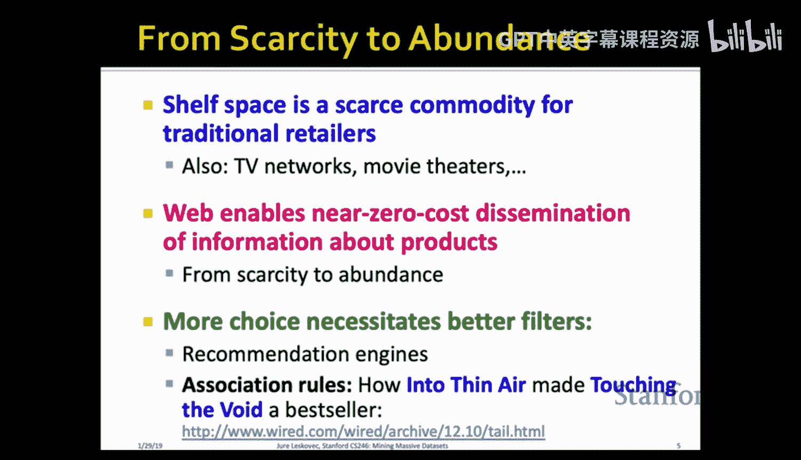

Sorry。Reviews change。 You're close。 It has more to do with recommendations。这在上多。Correct。

 exactlyactly so Amazon was recommending touch in the void because they learned that it's about the same topic。

 People usually give high reviews to both of them。 So they say， yeah。

 why not through association rules， which is what we've seen during the first week。

 the rules recommending touching the void。 And then it turns out that people started to love that book and the reviews were amazing and the sales called up and it turns out that it became a bestseller years after it was published。

 Okay so this was very much unlikely in the past。 but now it happens quite often thanks recommender system。

 So it's a nice side effect。 if you think about it okay and it also makes you hopeful in case you're gonna be a writer or anything like that because you never know when your content is gonna become very appreciated by people。

 So all these concepts relates to long tails。 So the fact that there are a lot of items which are popular and everyone cares about and'm gonna explain why what this plot is about。

 But there are also a lot of items that you are part of this long。😊，Heill and。People enjoy them。

 And people buy these products。 You know， here we're talking about music for instance。

 And the context in in which we were before， let's say our you know。

 primitive recommender systems driven by shell space。 werere only targeting the very popular items。

 but it turns out that there is a lot of interesting stuff senior。

 So let's go through this through this plot。 Okay， so the Y axis we have the average number of plays per mountain Rappssody。

 Rapsody is like is the old say the grandparent of Spotify Apple music and so forth。 Okay。

 it's stream。 It was a streaming service for music。 I think it still is a streaming service。 Yes。

 which stand out of Naster and。😊，On this part of the plot。

 we have the songs that are available both at Walmart so that were shown in their shelf space and also's available are Rasso。

 Okay and you see that more or less the number of timess that they were played were pretty much similar。

 like popular items are popular， pretty much everywhere。

 But these are the songs that instead are available on your raps today because Walmart couldn't really afford to have all these Cs shown in their shelf space。

 and what we want to try to understand today is how big is these long tail。

 Like how much traffic is driven there and how much purchases purchases can you drive from these parts of the long tail。

 and it turns out is it's an extremely。😊，It's it's a big part of the traffic of this platform and also the purchases that you can get。

 So let me give you another example， for instance， for instance。

 like documentaries are kind of a niche sector。 You wouldn't say that are watch as much as， you know。

 a blockbuster movie and。😊，You see that， you know， Amazon has pretty much the lion's share of them。

 It was selling back downner almost 20000 titles。 Netflix had only 1000 of them and Brobuster。

 which I presumably few of you still remember because it bankrupted a while ago and you couldn't find around the US in the past few years or so was a service where they were renting to U DVDs or in the past even BHs。

 It turns out you know， something like blockbuster where they have to rent tangiblebo physical items couldn't have so many documentaries available。

 Okay， they were betting more on having the blockbuster movies。

 So it turns out that they were missing out。 for instance， Disney completed。

 which instead you could get from some average services like Amazon or Netflix。

So here is now I'm gonna give basically some numbers about these long tail。 So take， for example。

 Amazon， which has a total inventory of almost 2 million books。 And these 2 million books。

 it turns out that the long tail is driving 57% of the sales。 Okay。

 so if Amazon didn't have such a big catalog。 And at the same time。

 if Amazon wasn't able to recommend you those books， those niche books that you know。

 are not in the top best sellers， they would be losing more than half of the revenues on books。 Okay。

 so that's why recommended systems are so important。

 It's not only because today I'm going teach you some basic techniques on how to build them。

 But also because if you bring them to a company， they can drive， you know， higher revenues。

 So that's why this is extremely interesting。😊。

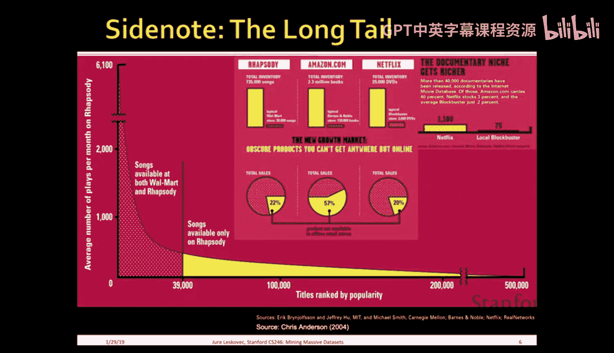

And at the same time， I think we have a small problem with the projector。Okay。

 let me try to close and reopen in the that the graph we show。Okay。

 I I'll be talking in the meanwhile， so。In this plot， we had the following。

 So we had with a few music artists。 I think on top， we had B peerers。 And then here we had pink。

 and here we have some bands that were less known。 The point is， once Amazon starts to， you know。

 sell you content from Bni Peers back then in the past。

 then they were also recommending you other bands that you know， other pop bands that were related。

 And it turns out that this pop band that ended up being recommended at the same time with a large。

 you know， with an artist that was getting a lot of traffic。

 this slowly went up in the ranking very fast。 Okay。

 so this is a similar example to what we were seeing before about those two different books and。😊。

In here basically you can see that there has been a shift in terms of how these large companies have been managing their catalog。

 So we went from the physical retailers to what we were calling back then the hybridbri retailers。

 So let's say Amazon is still kind of an hybrid retailer because they both rent you and send you digital content and at the same time。

 they ship you like books at home。 and now we are we're going forward these pure digital retailer。

 let's say Spotify Netflix and so forth。 where all the data stream to you and naturally their catalogs are just growing bigger and bigger。

 So the more you move on the right with the number of titles and the more you are in dire need of having up working recommender system in your platform okay。

😊，So how can we generate our recommendations， What type of recommendations do we have， First of all。

 you can have editorial and hand curated recommendations。 They're， They're very nice for sure。😊。

They come to a very high cost and and it's basically the cost related to the people。

 to the humans that have to come up with those lists。

 right So you have this often in music streaming platform。

 we have playlist created by Apple by Spotify and so forth。

 There is always a person behind them who's taking care and you spending their time to create those recommendations。

 So you can afford having this popular playlist， but you cannot really afford having humans recommending to other people what to listen to so so that's one side of one extreme of our spectrum。

 then we have simple aggregates， very famous like from billboards so you can have a top 10 most popular。

 the recent applas that you got on itTunes and so forth。 And on the other side， instead。

 we have recommendations completely tail tailored to the individual user。

 Okay and that's what we're gonna see today。 So what you experience on a daily basis on Amazon Netflix。

 we're gonna see the techniques behind why they're so good at providing you relevant recommendations。

Alrighty， so let's try to formalize this a bit。 The model from today is relatively simple。

 So X is our set of customers of users of the platform。 S is our set of items。

 and ultimately what we want to have is a utility function so that from the Cartesian product of X and S we want to get the set of ratings。

 So we want to understand how much is going。 this user is going to enjoy a certain item。

 Okay and the ratings could take many different shapes。 you know。

 you have seen this model of the one to five stars。

 which are following basically the concept of a liquor scale。 They can be a real number from 0 to1。

 they can be just a bullet and flag。 So yes， I like it。 No I don't like it。

 I think ebay recently moved to that model as well。

 each one of these rating schemes comess with pros and cones。

 There are like countless papers that we will explain if you are in this context。

 then this is the best rating scale that you could be using but for today。

 we're not gonna be focusing on。😊，That aspect， rather， given the rating scale。

 we are going to be able to build our utility metrics。Let me see what's going on here。

 because if we keep on having issues with the slides， it's not gonna be easy。

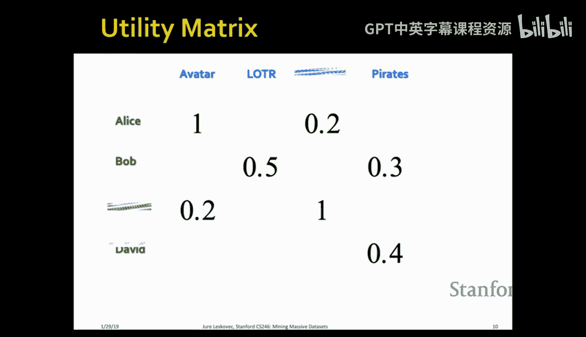

呃。Okay。

Letcros fingers。 perfect。 Alright， so we have our utility metrics now working。

So it is our utility metrics。 It iss not about a matrix to of items。 So in this case， we have movies。

 how are metrics and so forth。 And then on the on the the rows are the users。 Okay， our Alices。

 Bobs and so forth。 And these are the ratings that those users have given in the utility metrics。😊。

What is the first thing that you noticed how of these metrics。 What。

 what do you think is a potential problem here。Sorry， sparssity， exactly。

 So that's gonna be the the main theme of today。 How do we feel the values missing in these metrics。

 In an ideal world， we would have ratings per for each user per each item in our catalog。 Okay。

 clearly， this is not the case。 We're gonna see also that is relatively hard to elicit those ratings from the users。

 so our goal is to find algorithms and techniques to fill in the values missing in this parrsse metrics。

 Okay， and clearly， the parrser this gets the other how our job is gonna be。 Allright。😊，Okay。

 so here are the key problems that I was telling to you about。 First of all。

 is gathering non rate ratings for our metrics。 And this is mostly driven by the platform every time you're on Amazon and you rate a certain item or you put a like on song and Apple music or so forth。

 That's what you're doing。 You're giving them your non ratings in their utility metrics。 Okay。

 and as we said， is relatively hard to make sure that every time you listen to something or or you consume some content。

 you would be rating that item。 Okay， so that's why we get these par matrix。 and second problem。

 which is gonna be the main theme of the lectures is extrapolating via non ratings from the non ones。

 Okay， so from the signal that we already have containing our matrix。

 we want to try to fill in all the missing values， Allright。😊，And。Here， we're。

 we're not gonna try to cheat。 but let's say we're gonna try to relax one constraint。 Ially。

 we would love to fill in each single value that matrix and to be as close as possible to the real taste of the user。

 In reality， most of the times what we care about are the high ratings。

 So we we care about the things that you might likely want to buy or you want to listen to。 We don't。

 we don't care that much knowing that you will hate completely that movie。 Okay。

 because usually you don't recommend things that you're gonna hate。 Alright。

 so this is one aspect that will make our lives slightly easier today。And very quickly。

 at the end of this lecture， we're going through some techniques on how to evaluate those extrapolation methodss。

 because you have to realize that this is the first time that we see a system that is user facing。

 Okay， when we were talking about SBD or L stage， we always had some kind of objective way to evaluate if the system was working well or not。

 but here it turns out that we have users， you know， this recommender system is user facing。

 So we want to understand from the user， if our recommender system is doing a good job or not。 Okay。

 so ultimately， a proper evaluation always as the user in front。😊。

And it turns out is less trivial than you might imagine。 It's not only about， you know。

 your on Amazon。 you recommend a search on item。 and then you try to see how many times there is a click through。

 So like every time a person is interested in actually clicks on an item or either converts and buys that item。

 So let me give an example when this could be more challenging。 Think about a search engine。

 for instance， most of your clicks will go on the first or second， you know。

 result on the on the result page。 It turns out that。

It doesn't always mean that you believe that content is relevant。 Okay， so there is this kind of。

 you know a noise Noisy signal that a search engine is getting every time you click on the top link。

 Most of the times we do it just out of know master memory。 We know that most of the time。

 the first link is correct。 Therefore we're gonna click on that。

 And if we take that as a signal that your recommendation was great。

 It turns out we were bringing in some noise。 Okay so this usually calling the literature deposition by as the fact that when something is in front of your eyes and you're compelled to click on it。

 you might do it。 even though at the end of the day。

 you will find out that that content wasn't relevant to you right So just to give it easier and why this problem is hard than than what one might expect。

 Okay， now let's go one issue at the time。 So we said gathering ratings relatively hard。

 usually we ask people to read the items or to tell us what's their taste。

 So every time you buy something on Amazon， you get reminders please leave a review。

 it doesn't work very well in practice， most。😊，The time people don't like to be bothered， you know。

 to， to leave reviews。 And one potential solution is to do crowdsourcing。

 You basically pay people to label the items。 This usually backfires。 Can you give me an idea why。

What， what is the problem in paying people to leave reviews on your system。Anyone。要。可话我。每个。Exactly。

 yeah， or any variation of that。 So the answer was they're not gonna accept review in case it's negative because they're paying you。

 Basically， it means that most of the times if you're being paid。

 you're not gonna be leaving a truthful review。 you will be paid to leave a certain review。

 It turns out that there is kind of a ghost business out of living reviews on Amazon。

 there are few articles from not many months ago where they discover Facebook groups you know。

 moving a sizable amount of money， to buy reviews on Amazon， and the reasons are you know multiple。

 if you can imagine if you put a new item on Amazon， if you start to get a lot of five star reviews。

 This will create some kind of hering effect。 people would say， oh， this is amazing。

 Everyone think is amazing， I should buy it right， So if you can get a good kickstar。

 if you start with very good reviews at the beginning。

 Usually that decides the fate of your item on a certain platform。 Okay， so that's why。😊。

Mostly relying on that can backfire because you're not getting the real opinions of people。

On the other hand， there is this class of ratings or feedback called implicit ratings。

 And we can gather that by learning from the user actions。 So， for instance。

 if you purchase something on Amazon， usually it implies that at least your expectation is that the item is good。

 right， So you would be leaving a4 or five stars reviews to that item。😊，And。At the same time。

 if you're watching a video on YouTube， if you watch only the first5 seconds。

 probably means that you skip away。 If you watch the whole length of the video。

 YouTube will use that as as an implicit signal to say， okay， you。

 you must have liked the video to spend all the time there watching it， right？

 So this is how implicit feedback works。 There is still the problem of。😊。

You cannot gather the low ratings there。 Okay， because for what I just told you。

 say the example of YouTube， you might have closed the videoca you， you have to run to another class。

 not because you didn't like it。 Okay， so it's very hard to distinguish between low ratings and just very short attention span。

 Okay， so that's another problem with gathering the ratings。Okay。

 so this was our first problem in the， in the list。 Second one is extrapolating utilities。

 So filling filling in our metrics， our sparse metrics and。😊。

The first problem is the fact that we're gonna be facing the， the call start issue。

 So call starting recommender system means the followings。 First of all。

 whenever you have a new item coming to the system， it doesn't have any ratings。

 So as I was saying before， new product on Amazon comes with no ratings at all。

You're not gonna be able to recommend easily for that item because you pretty much know nothing about it。

 You don't know what other people think of that。And that's why we end up sometimes they end up sometimes paying the reviewers for that reason。

 And at the same time， if a new user registers on your platform， the user comes with no history。

 and you can imagine that going on a platform like Amazon or Pinterest and getting a blank screen with own recommendations means that most of the time you will stop going there you will forget about it or you will not be doing your business there。

 I'm sure you use some systems where at the very beginning when you register。

 they were trying to elicit information from you if you register to Apple music， for instance。

 you're being asked what the genre you care about， It's not because they couldn't do that after a month。

 because they could easily understand what music you like studying your listening history。

 they want to do it so that right away， they can start to recommend you content that is relevant to you。

 so that's why they waste one minute of your time asking you that。

 so that they can produce recommendation right away。 And that has been studied to。

To increase the user retention on the platform quite a lot。

So what are the three main approaches to building recommender systems。

 we're gonna be seeing two of them today content based and collaborative filtering。

 And then on Thursday， we're gonna be going through the latent factor model。

 which is more powerful and tries to combine information。 both from users and items。

 I'm gonna be giving you a easier about that at the end so that you get an idea what I'm talking about。

😊。

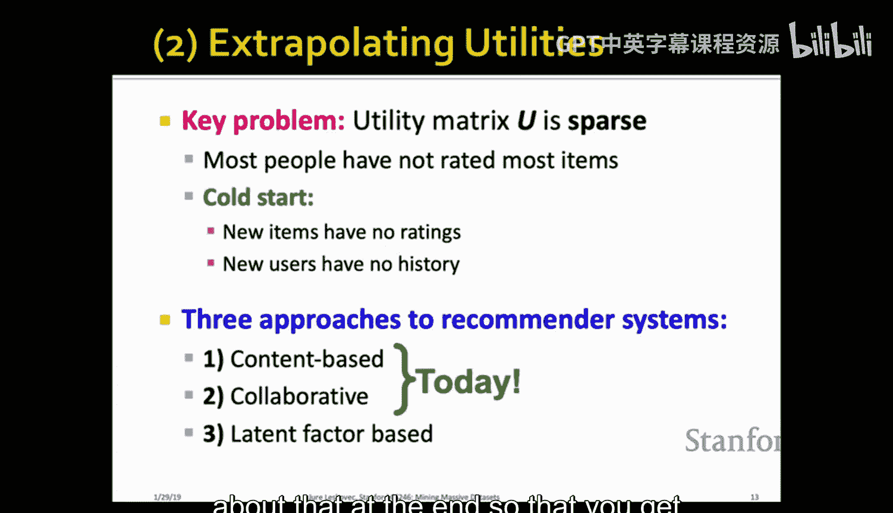

Any question before we start to the， before we jump to content based。

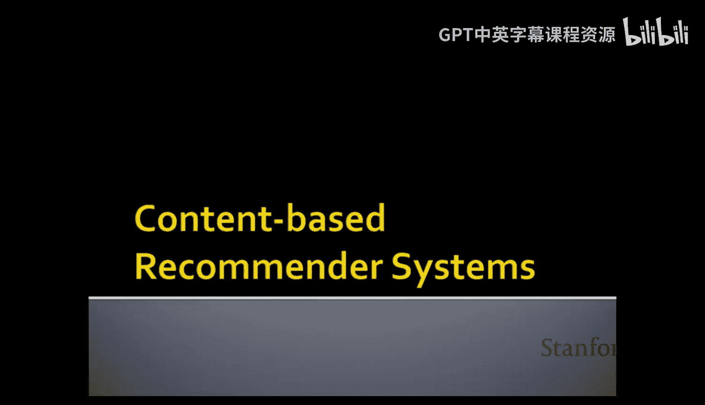

Alright， let's do this。So contentbased recommendations。 What is the main idea here。

 We want to recommend items to our customer similar to the previouss items rated highly by customer X。

 let's go back to our fan example from before the metallicica guy。

 Okay so if this person has put five stars to most of the metal Cds that he has in his library。

 then our content based recommender system will tend to recommend in items that have similar to Meica and that have been rated highly。

 okay so basically what content based system does is it understands your profile。

 the music that you care about the movies that you care about。

 and then well start to recommend you things that are related to it in terms of John or in terms of anything like that。

 Okay so in the case of movies， the kind of features that we can tap into， for instance。

 movies with the same actors from the same director， Sam genre and so forth。 or say we move to text。

😊。

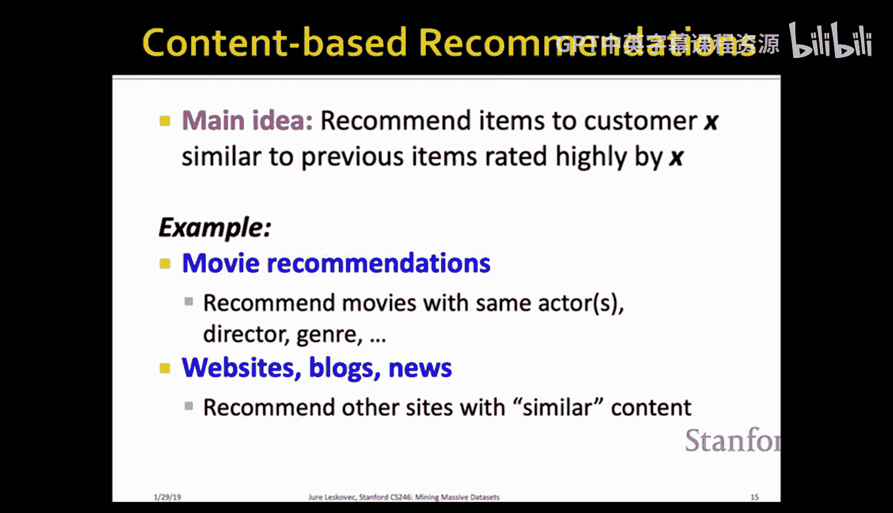

content。 So we are on， I don't know。 Google New that has to recommend us relevant news every day。

 and basically would recommend us other sites with similar content。 So if you tend to read always。

 I don't know， news about MB， then you will keep on getting those articles more and more because the system will understand what you care about。

 okay。So let's have how as most schematics as before to understand what goes on at a very high level。

 you know， content based recommender system。 So we have our user， this is a example。

 as you can see from the figures。 So the item profiles for this user are red circles and red triangles。

 And we build what what what is the preference profile of these user。 So what do we know from there。

 We know， these user likes red。 The user is about circles and triangles。 Okay， very easy。😊。

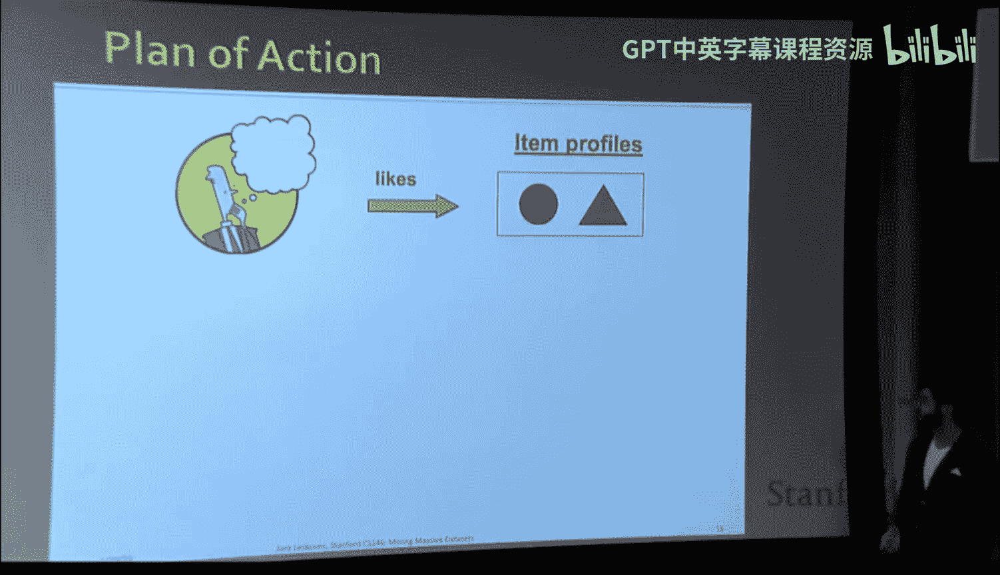

Now， we want to match this profile with our catalog。 Okay。

 so this is the amazing catalog of items that we have available。 We have a red xxagon。

 a green circle and square and a blue square。 So what are we gonna do here。

 we're gonna try to find features that are in common and boom， we got our recommendations。

 which in our case will be the red exxagon because we have the color in common And then probably we're gonna also recommend the green circle。

 because we know that the user cares about circles。 Okay， as this is that。😊，So as we said。

 for not only for the users， but also for the items， we have to create a profile。 Okay。

 so in the toy example from before， the features were the color and the shape。 And right now。

 if you think about slightly more advanced data。 So we have movies。

 we can take the metadata of that movie， Or if we have text， for instance。

 we can try to extract the important words in a document。😊，How do we pick these important features。

 So today， Im just we're just gonna do the example on how to do it with text。

 and we're gonna be using something coming from a few decades ago for the informational retrieval field。

 which is called TDF。 So it's term frequency and inverse documented frequency。

 But this should start to give you the idea that one of the main shortcoms for a content based recommender system is the fact that you need to come up with your own features。

 And if it's text or if it's relatively trivialrieval data， then this job is not very hard。

 But let's say you want to recommend movies。 but you don't have any metaada about those movies。 Okay。

 you don't know the director or the actors and so forth。

 then you will need to tap into the actual movie file。

 So you will need to go to the video content and being able to extract features out of there。

 And as you know， apart from the last few years where the learning has done some crazy improvements that allow us to。

😊，K to videos in a very proficient way。 This was very hard just a few years ago。 Okay， so basically。

Content base work well when we know to extract features in a relatively easy way。

 it can get a lot harder in case the data is more complicated。So。

 let me give you a brief overview of what is TF or D F so that you can follow me after when we do the example with the articles。

 So as we said， T F is the term frequency。And what we want to do here is that we want to find the frequency of a certain term。

 which is gonna be basically our fi in a document。 and in a document or item J。 Okay。

 so first thing that we care about is the Tf， which is nothing but the frequency of a certain term in a document。

 So the number of occurrenceencies。 And then we normalize it by the is frequency among all the terms appearing in the document。

 And that's a way basically to discount for long document。

 So say that document is a book rather than an article。

 then the most occurring term will be there a way higher number of times compared into when we are considering a short article。

 Okay so it's basically just normalization factor if you go Wikiped that you will see at least 10 different definitions of what term frequency is okay that's been used in many different ways。

 But I just want to retain the concept So Tf term frequency。

 And then the inverse document frequency is。😊，In the following way。

 So our n high is the number of documents that mentioned the term high。

 and then n is the total number of documents in our full collection。 Okay。

 so what the IF capture is how discriminative is a certain word is a certain term。

 Okay So if you have an actor that appears only one movie。 and only into movies， let's say。

 and you watch one of the movies with the doctor， then you will know that quite for sure you will want to watch the other movie from the doctor。

 Okay， if you're instead， I dont know， using as a featuresure。

 the fact that a certain movie as being released by。

 I don't know Uni or one of these major companies that is releasing hundreds of movies per day。

 sorry per here。 then the IF will have a low score。 You will basically tell you， okay。

 that's not a very strong featuresure。 You know， the fact that you like a movie from that。😊。

From that company。So this is what the f IDF capture。 And basically to generate the score。

 you don' you do just the product between the two。 Okay so how do we build now the profile of our document。

 which in turn is the profile of our item。 We just take the set of words with the I the FDF scores and then we take their scores into account。

 Okay so say we have I don't know the collection of all the handouts from C S to 46。

 then the highest word with the FDF will probably be， I don't know the title of the lectures。 Okay。

 so you will find at stage there recommender systems and so forth。 Okay。

 and that will be the profile of the documents coming from those lectures。Now。

 now that we know how to generate these profiles， how do we generate the predictions， okay。

So there are different ways in which we can generate our user profile。

 The easiest one that you can think about is just the weighted average of the rated items。

 So everything that you rated in your， in your past， in your history becomes part of your profile or。

A variation that is very marked and enough is the fact that you can weight all those different profiles by the rating that you gave to the certain item。

 Okay， so that you will know， this person watched that movie。

 but he or she didn't like it because the rating was very low。 Therefore， that component will。

 will have a lesser weight in your profile compared to a movie that you loved。 Okay。

 so that's how you build the user profile。😊，And so our prediction heuristic， for example。

 will be the following。 We just compute the cosine similarity of the user and the item profiles。

 Okay， so we， we know how to compute our user profile X。 We know our item profile high。

 and then we just do the cosine similarity。 you is just the dot product between x and I divided by the product of their norms。

😊，Oh， how do we find。The closest items to X。 Okay， how how do we find all the movies that that person might be interested in with。

 as you recall， we don't want to do all the possible pairwise similarities because it's extremely expensive。

 And that's where we bring back a S from two weeks ago。 Okay。

 that's so that's what will help us to find the best candidates in our recommender system。

 It will tell us， okay， if you like C from italica。 These are the。😊，The。

 the other albums that are related to it。 And those will be your candidates to put now in our prediction heuristic and decide if it should be recommended or not。

 Okay， yeah， question。哎。Like LSA get things that are all moving。

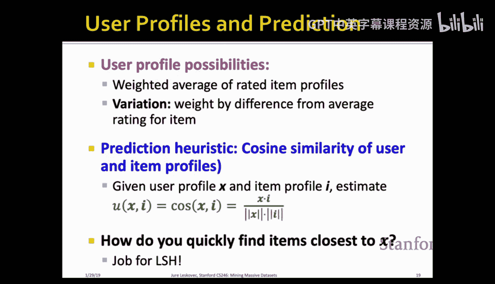

To close， maybe to something the users already seen。

 like maybe a first edition of a book and a second edition of the book you。

it's something new that's still close to the。Great， so great question。

 You pinpointed one of the main shortcomings of contentbased systems。 I'm gonna to repeat it。

 So namely the question was， how do you make sure that there is some diversity in the recommendations produced by a content based system so because you might be having in the case of documents you might be producing recommendations for different editions of the same book or you a different revision of a same document and it turns out that this is one of the main problems of content base。

 And the only way to work around it is to come up with heuristics the model per se will always recommend you what is closests to your profile。

 then what you can do is， for example in the case of multiple editions。

 you will make sure that every time you know that you rated additional number the third additional certain book you will not be recommending the same book with different additional numbers but but it becomes very cumbersome as you can expect so we're gonna be seeing ways to solve this。

😊。

Problem， exactly。Okay， so perfect question。 Now， we're gonna see basically the pros and cons。 First。

 I give you the pros of content based。 first one is there is no need for data on other users。

 So content based system works exclusively with your profile。 Okay。

 I know the documents that you read， I know the books that you like。 So it doesn't。

 is not bothered by the cold start or the sparsity problem。 as soon as I know something about you。

 Okay， I know the few things that you like。 Then right away。

 I can start to generate relevant recommendations。😊。

And is also able to recommend to users with unique tastes。 So if I listen to some niche music。

 then the system will just match， you know， similar albums and recommend them to me。 you know。

 even if they're not popular at all， okay。And with for the same reason。

 iss also able to recommend new and unpopular items。 So if something。

If a new item comes to Amazon and it receives no rating at all。

 it doesn't mean that it will not be recommended to me。 Okay。

 because basically these recommendations are completely decoupled from the ratings that they receive。

 It's all based on the fact that they're similar to my interest。 And last but not the list。

 And this is a very hot topic today， especially in machine learning in general。

 This model is able to provide explanations。 So if you try to understand why am I being recommending a certain item。

 It's very easy to produce an explanation of these， right。

 You can say that's because you were listening you both these 10 albums before。

 Therefore we're recommending you these other two metal albums， for example and。

This turns out to be very important， not that much， for instance， for ecommercecommer websites。

 But if you see ads that are shown to you on Facebook or Google， for instance。

 now you can go and check why they're being shown to you。 Okay。

 so we're moving towards trying to have models that are interpretable。

 so that we we always want to understand why certain content is showed to the user。

 And that's one of the nice features of having that we get from a content based recommender system。

Conversely， without the shortcomings。So as I was saying before。

 finding the appropriate features is our both finding them and also constructing them in some cases。

 So as we were saying before， multimedia data， it gets harder to build a a good content based system。

How do we build recommendations for new users。 This is an example that I was telling to you before。

 for instance， about Apple music， The fact that you register and they're gonna ask you what are the genres that you care about。

 if you don't have this initial kickstar with a few information about the user。

 then you will not be able to recommend the user anything at all。

 And last but not the list related exactly to the question that we just heard of is the overspecialization。

 The fact that you will never recommend items that are outside of the user scope。

 So the user will only get things that you already listen to or you already read about and another issue is the fact that people tend to have multiple interest。

 unless you're on a very niche website where I don't know。

 you're selling on a certain specific type of item， Most of these large platforms。

 they will sell you pretty much everything， or you will find any possible genre music on the stream platform。

 So it's very hard to pinpoint a user on one。Civvic taste， right。

 So and that's another shortcoming of these content based systems。Now， last but not the list。

 and this will help us to jump to the next part of the lecture is the fact that we are not exploiting at all the quality judgments of the other users。

 So if you remember when we started today， I gave you this you know initial introduction about how you gather the ratings。

 how the ratings look like utility metrics and so forth。

 Now if you the past ten years or so we totally skipped the quality judgments。

 we didn't use them at all。 Okay， so it's clear that there is a low hanging fruit here that we can exploit。

 And that's exactly what we're gonna be seeing now。 Okay。

 so that's why now we're gonna be jumping to the collaborative filtering。

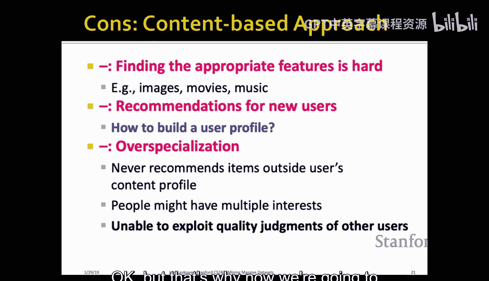

Any question before we were on this section。Okay， so first of all。

Why is it called collaborative filtering， Co， Because every user in the platform collaborates to get a higher quality in the recommendation generated by our system。

 So every time you leave a rating on the platform， then you're giving additional information to the system。

 Okay， so this is the collaborative part。 and filtering is basically recommendation is what we were saying at the beginning。

 The fact that there is just too much choice from this very large catalogs。

 So you want to filter them out only to the information relevant to our user。 Okay。

 so that's why we call it collaborative filtering。😊。

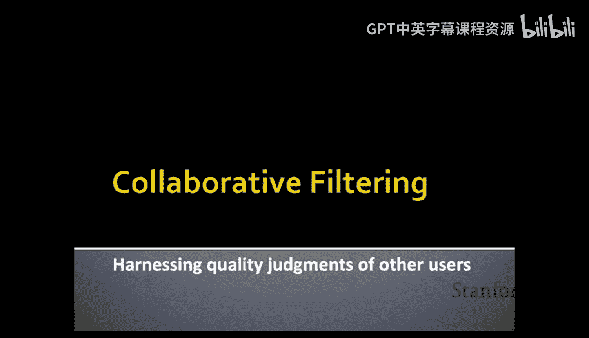

And what is the setting of the problem？ So we're back to having our user X。

And what we want to do here is that we want to find a set of other end users whose ratings are similar to the to the ratings of X。

 Okay， and then we're gonna be trying to estimate the ratings of x based on the ratings of the other users。

 Alright， Okay， so everything explained well here。Here we have our database with all the users from which we can search and get the nearest neighbors。

 We will see that this is one of the expensive operations， as you can imagine。

 but we learn how to find nearest neighbors in an efficient way。 Then on top we have our user X。

 And we're gonna try to match with a group of users at the left ratings。 And then we say， okay。

 whatever these similar users I liked， we're going be recommending them to X。 Okay。

 that's the whole setting of collaborative filtering。😊，And。😊，As you might have realized already。

 we just went to the opposite direction of now completely ignoring the content and just working with the ratings。

 Okay， so now we're at the opposite side of the spectrum。

 A system like this can recommend you pretty much anything， you know。

 like your own Amazon can it can recommend at the same time。

 a movie and and CD and a piece of clothing。 Okay， because it doesn't know at all what is the item behind it。

 It just knows the rating that the item received from the users。😊，Okay， so it is our setting。

 We have we have the ratings of two users。 So we have， you know。

 the ratings of x and the ratings of y。 So x left。 there are five atoms in total in the catalog left X left one star for atom 1。

3 stars for Ats 5 and so forth。 And as you can see from there。

 there is not always an overlap on the atoms that have been rating。 Okay。

 so sometimes people are rating clearly different atoms。😊。

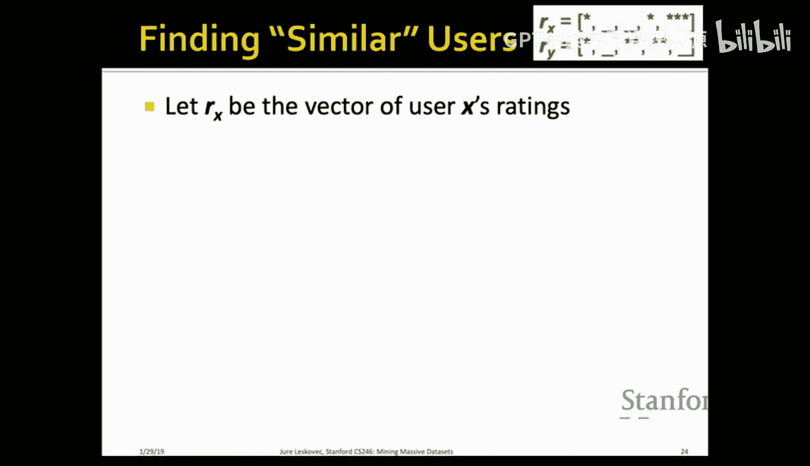

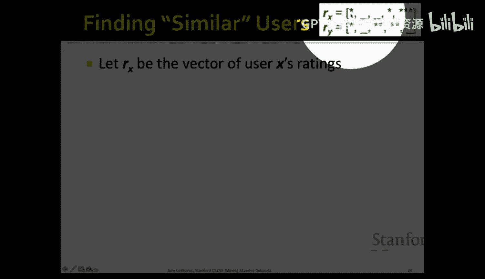

So we get ourarrowobback， which is the vector of all the ratings left by x。

 And the first thing that we might try to do， for instance， is to use the jackard similarity。

 We've seen that in analysis H。 We know that is a quite nice similarity measure。 say。

 why don't we use that。 The reason is it ignores completely the values of the rating。 Okay。

 so what basically we will represent Arobbacks and R Y assets。

 And then here it will tell us that there are only two ratings in common。 Okay。

 but it doesn't tell us if the users are really liking the same atoms or not， question。😊，Proで。

Similarity as multi sets。What， what do you mean by that？ So if someone gave an item  three stars。

 you'd put the item in this at three times。 And so， oh， yeah， yeah。

 that that's a cool work around what， what I will show you today is that there are basically measures。

 similarity measures that are even more powerful than that。 it will work。

 but it makes it also less computationally efficient compared to what you are ability。 yeah， yeah。

 it's a cool hackck。😊，Okay， second idea， we we we could be using the cosine similarity， for instance。

That we are reminded before I works。 The problem here is that whenever a certain rating is missing。

 And as you recall， ratings are missing。 oftentimes， they will be treated as negatives。 Okay。

 so they will be treated like a 0。And this is this is a noisy signal。 Okay。

 this is not a zero in reality。 We don't know what the user thinks about a certain item。

 So whenever we do the cosine similarity， we have these components where we don't have the rating that go to0 and kind of squeeze towards the wrong direction。

 the profile of that certain items。 So we don't we don't want to use cosine similarity for that reason。

 So the good similarity here。 the good coefficient to use is the pearson correlation coefficient。

 Okay， and what it does is the following。 So， first of all。

 we take into account only the items rated by both the users。 Okay。

 so we have a user X and y and the similarity between x and y， as you can see。

 is only is only based on the items that the ratingd in common。

 and what we do here at the end of the days。😊。

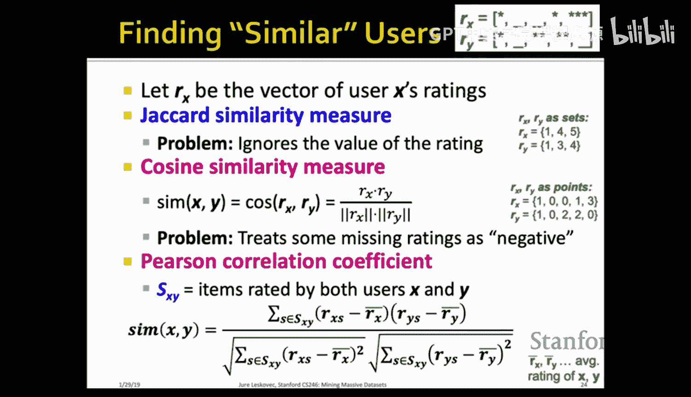

First of all， we we compute the average，These are the average rating for X and Y。

 Why do we have this kind of like correction factor， Because as you know。

 some users are extremely critic。 You know， if you go on Amazon or MDB。

 you would see people destroying pretty much every single item by or or every movie they watch。

 And conversely， some people are more lineient。 know。

 they tend to give five stars and are enthusiastic about everything。

 So we get this correction factor。 And then we go and check for each item how far away we are from the average rating of that user。

 Okay， so if we are above of the average， then we know that ideally。

 the user should be more enthusiastic about it。 if we are far if we get far less than the average。

 then we know that for sure the user hated that item or movie or so forth。 Okay。

 so if you go and check the definition， the person correlation is basically the covariance divided by the standard deviation。

 the intuition that I want you to keep out of this coefficient is the following。

 we just want to see if these two。😊，Variables are linearly correlated related。 Okay。

 so we wan to find users that tend to like the same atoms and tend to dislike the same atoms。

 That's what this coefficient captures for us。 Okay， and that's why it's very powerful。

 And we're gonna be using it throughout the election。😊，So as we said intuitively， for instance。

 in this case， we have our metrics on the columns we have movies and on the rows we have users and we want the similarity for instance。

 between A and B to be larger than the similarity between A and C for example。

 right So the reason why we want A and B to be more similar is because on the first Harry Poter movie that have very similar high ratings okay conversely if you check A and C have in common just。

These two movies。 and you see that their ratings are flipped。 Okay， whenever user A likes a movie。

 then user B dislike likes a movie。 Okay， so that's why。As I was saying before。

 the person coefficient tries to capture the covariance of these two variables， okay。

So let's see what happens now with all the different similarity metrics that we mentioned before。

 So first of all， we we want to check the jaar similarity。

 which gives us exactly the opposite result。 So you see similarity of A And B is one fifth where similarity to A And C is two fourth。

 So it will tell us that among all the movies that have been rating in the in the jaar similarity。

 we just find that A And B I rated only one movie in common。 Okay。

 so it doesn't capture the fact that they like the same movie。😊。

If we compute the consign similarity， at least now the direction of the inequality is correct。

 but as I was saying before， this is considering the missing ratings as negative。

 So it's kind of squeezing those scores close to the same value。

 And you can see that the difference between user A and B is pretty much negligible。

 so we don't like these values to be so close to each other because A and B and A and C instead are very much different in our profile。

 So we bring in our person coefficient and we do some of the math。😊。

And we found out that there is now a substantial difference between the similarity of user and B and the similarity of user A and C。

 right。This example basically should convince you that this is the right way to go in terms of selecting a similarity measure。

Okay， so now that we pinpoint what can measurea we want to use。Were gonna be doing the following。So。

 where have our。Again， our R X vector， which is the vector of all the user ratings。

And then we get we have M to be the set of k users more similar to X where rated the item I。

 So basically we' are gonna be finding the nearest neighbors。 We're gonna be finding a set of users。

 which is similar enough to me and those users will I will leverage the ratings of of those users to produce my own recommendation Okay so how do we do that。

 How do we produce the recommendations。 The first very easy way to do it is once I selected my neighbors。

 then I just take their ratings on the item that I haven't rated yet and just do the average。

 Okay so that's already a good way to to generate our recommendation。

 If I know that users similar to me you have similar music taste and I will get their own average recommendation on a new album or what else can we do。

 which is even slightly better we can try to weigh。😊，え？

The different recommendations generated by my neighbors based on the similarity that I have with them。

 Okay， so the more similar I am to a certain neighbor。

 the higher weight I will give to the recommendation of the neighbor， okay。Quson。应。えに？Oh。

 so for the cos similarity， unfortunately， first， I will repeat the question。

 How do we deal with the missing ratings in our utility utility metrics up there。

 In the case of the cos similarity， Unfortunately， we don't deal with the missing ratings。

 That's the problem。 They go to 0。And when they go to 0。

 we get this issue that they're considered as negative ratings rather than as missing。

 So that's why we see those two scores basically squeezing and getting close to each other。

 And the reason why we like to use the Pe and coefficient instead。

 is the fact that we only work with items that have been rated by both the users。 Okay， so we， we。

 if we are the two users in the system， we build our similarity profile。

 based only on the items that we both rated。 Okay， and that allow us to basically ignore all the other items that haven't been rated by us。

Sounds good。😊，Great question。Sells like tens of thousands of different items。

You could have the number most users will have zero things in common。

So you're throwing out like all the almost all the data。 perfect。 So great question。

 And youve implemented one of the or companies of this approach。 So the question was。

 what if we have a very large catalog in my system and what are the odds that users will have certain items rated in common。

 It turns out they are very low。😊，So that's the issue why you can't really use collaborative filtering out of the box。

 And the reason why at the end of this lecture on Thursday。

 we're gonna to be seeing more advanced techniques。 As you can imagine。

 like these kind of techniques are like 15 years old or so。

 So we didn't have such gigantic catalogs back then in e-commerce platforms。 Okay so at that time。

 this approach was still feasible， if you try to apply today to Amazon。

 which I believe as in the order are millions of items。

 clearly it wouldn't be working as well as you would hope okay。Great question。 Thanks， yeah。

ality reduction to make the space far the that perfect。

 Can you use dimension reduction to make this matrix like sparse。

 That's exactly the content of what we're gonna be seeing on Thursday。

 We're gonna be talking about the Netflix challenge。

 And the fact that you can do this latent factor decomposition。

 And that's a dimension reduction technique。 So， yeah， great intuition。😊，Anything else。Okay。

 let's move forward。 So I I give you in a basic idea of how we can produce this。

Re based on your neighbor users， There are many other tricks possible， You know。

 other variations of these formulas that can make it slightly more accurate。 But， you know。

 at the end of the day， it doesn't make a big difference。Now。

 until now we talk about user user collaborative filtering。 Okay。

 let's now try to see the other side of the coin。 So we can also have an item item recommender system。

 right， we can try to find， you have a new item going into the system。 We try to find similar items。

 and then we generate the ratings coming from the similar items， okay。So the problem is。

 is spec to what we' were seeing before for A I， we want to find the other similar ones。

 and then we want to estimate the rating for A I based on the ratings coming from the similar items。

 Okay， and the cool thing here is that we can pretty much reuse everything that we've seen until now。

 So the same similar metrics and the prediction functions。 They're all gonna be based exactly on the。

 on the same concept。 Okay， so let's go through， I will guide you to an example so that you will make things clear。

😊，So this is our item item item scenario。 Our the columns are the users in our system。

 the rows are movies， and we set our the size of our neighborhood， the parameter up there。

 We set it equal to 2。 Okay， so we're gonna be working with just two neighbors at the time。

 What do we want to do。 What is our task。 We want to estimate the rating of movie 1 by user 5。 Okay。

 so we， we have that empty cell in our sparse utility matrix。 And we want to try to。😊。

Find a good rating for that movie because user 5 is considering watching it。

 So the first thing that we want to do here， we are gonna be computing the Pearson similarity among all the itemss。

 Okay， so among the the the different movies。 So we're gonna be doing the similarity between one。

 which is the movie for which we w to produce the the recommendation rating and all the other movies。

 And we found out that movie 3 and movie 6 have a high similarity score， you can， you know。

 quickly convince yourself quality delivery of this just by going through the scores and see。

 you know that。😊，These these items tend to be you score low by the same user and same year they get a  two and a3 and then they get a and5 and a4 by user 11。

 So you see they are cover rating basically together okay so now that we have we have computed discourse。

 then we we have our neighbor selection。 we're gonna say okay。

 Mo3 and Mo 6 are our two nearest neighbors and that's what we're going use to generate our recommendations。

Now， if we go through the techniques we've seen before or how we can produce a rating。

 the very first one we saw was we can compute the average。 So 2 plus 3 divided by 22。5。

 So there would be one way to assign the score there。

 or we can go with this slightly more advanced technique where we take into account the similarity weights so we see that the similarity between user 1 and3 is 0。

4 so we w to be rating bit score lower than the similarity between one and6 because movie 1 and6 tend to be more similar so we take those two weights into account we just do the simple math and then we got with a 2。

6 in the predicted rating for that movie which sounds pretty reasonable given the other ratings then you can see that matrix。

Okay， so。This is a very basic view。 on now we can do item， item based recommender systems。

 Let me give you some， you know， additional tips and tricks on how this can be made even more accurate。

😊，So。We have seen how to define the similarity， how to select the nearest neighbor。 Now。

 can we try to bring in some prior information from all the ratings from the system。

 And the answer is， yes， you know， just instead of generating our rating only based on the ratings of that movie given of the ratings given to that movie by other users。

 we also can bring in a baseline estimate。 So why does this help， having a baseline estimate。

 especially when you don't have a lot of ratings about that movie or radio if you don't have know a lot of ratings in general in your platform。

 So what， what can you do in that case， we can introduce this， we can call it a bias term basically。

 which is formed by these three different components。😊，So first of all。

 we can bring in the overall mean or the overall average of the movie rating。😊，Why is this useful。

 as was saying before， there are some platforms that tend to be way more critic than others。

 So I think there have been some studies between， for instance， Sand to B and rotten tomatoes。

 And you can see that sometimes the ratings there divrgge quite a lot。

 especially between the critics and the public。 So first of all。

 you want to take into account what is the overall mean rating on that platform。 Okay。

 and then the other thing that you want to do is，You wanna rate the deviation of user X。 Basically。

 this is what we， we took into account before what's in the Pearson coefficient。 We。

 we want to see what is the average rating of the user X compared to the mean movie rating。

 So what we're capturing we capturing with B of X is。How， how lenient or strict is a certain user。

 Okay， so is this user pretty much aligned with the movie relating on the platform or does it tend to be more lenient。

Or strictter。 And last but not the least， we want to bring in also this other baseline information about the deviation of movie high。

 So this basically captures， is this movie doing very well， Is it getting a lot of positive reviews。

 If yes， we already gonna boost the baseline rating for that item。 Okay， so as you can see。

 basically recommender systems are usually build in in organic and incremental way， So first。

 we we brought in this concept of collaborative filtering where we try to use information from other users or from other items。

 And then we are trying to bring in some， you know。

 additional baseline coming from the domain knowledge of the old platform。 Okay。

 and you will find counters paper in the literature or other bio termss that can be introduced to make the system even more accurate。

 Okay， but， this tend to be a very good initial approach that works extremely well in practice。😊。

Okay， so to recap， basically， we've seen that。It's relatively easy and fast to make a9 item recommender system work。

 And it turns out that most of the times it works better than a user user recommender system。

 Can you give me an idea why this is the case， But why。

 why do you think it's more reliable to build a9 item recommender system rather than a user user。😊。

Yeah， it's correct。 Cartuition。 Y that's the case。Yeah， so it's correct。 What you said。 you。

 you can group more easily items in coier and sets。 Why is it the case， Can。

 Can you get some ideas why that happens。For， users tend to change their taste over time。

 So after a while is is very hard。 if you have been a Netflix user for 10 years。

 just by getting taking into account all your ratings is very hard to pinpoint to a certain genre。

 if you conversely if have to recommend items recommending music albums。

 something is not gonna be baroque music from the 7th century and a metal album at the same time。

 right， it will belong only to a specific genre。 so that's why it tends to easy to work with item items。

 They are more strictlyly define their profile is more stable over time。

 while users tend to be harder to profile。 And we're gonna be seeing that one of the techniques you will be talking about on Thursday。

Trice exactly to overcome this problem， okay？Okay， so let's go again。

 We're gonna do it now So for collaborative filtering， pros and cones of this approach。

As I told you at the beginning， it works for any kind of item。 Okay。

 so the system is completely ob believe of what is the item that is being recommended。 Okay。

 and you don't have to perform any feature selection。

 You don't have to understand how to extract features from the data。Conversely。

 it has the issue of the coldstar。 You need enough users and ratings in the system to find a good match。

 Okay so for instance， in the item item case。 if items don't receive any recommendation at all。

 they will never be promoted into a neighbor so that you can use them to produce a recommendation。

 So this is a very common problem with colrate filtering。 then once again。

 we have these shows parrssity。 the fact that this matrix is various sparse。

 it are to find users that have rated the same item。

 So that's related to the question that we heard before and at the same time is also so hard to find items that have been rated multiple times by by different users。

 It is also the issue of the first rate。 So you cannot recommend an item that has not been previously rated right because you don't know with what you're gonna match it。

 it's a totally blank role in our utility metrics。 and this is。

Especially problematic for new items or esoteric items。 You know， things that get very ratings。

 they tend to， you know， get in the long tail of our catalog and pretty much disappear unless they get a lot of traffic。

 And this is， for instance， the example of the book that we were talking about before， you know。

 until it caught up until people started to generate a lot of reviews about it。 It just went。

 you know， off radar for， for many years。So that's that's another issue。 Conversely。

 there is another interesting catch about the firstator problem。

 The fact that this platform tend to have this herding effect。

 The fact that if you start to get very bad reviews at the beginning。

 then most of the users will either not buy your item or just leave bad reviews or if everyone is enthusiastic。

 then your content becomes viral and everyone leaves very good reviews。

 So marketing is slowly turning from， you know， just generating ads and commercials into also how to effectively leverage recommender systems because as we said before they really drive user purchases quite a lot。

😊，And last problem is that they're affected by what we call the popularity bias。

 So these systems tend to recommend items that are more popular。 Okay。

 so it's very hard to recommend items to people that have unique taste。

 And we' are seen instead that a content based recommender system was doing a pretty good job at recommending this unique items。

 And also for this reason， the fact that it tends to recommend mostly popular items。

 it's very well known in the recommender systems， you know， research field。

 that a popular based recommender system is very hard to beat oftentimes。

 So if you' are on Amazon And during， I don't know， Prime day。

 you tend to recommend the 50 items that people are buying most of the times。

 you would be doing a very good job。 you know， so as as unexciting as it might sound because it's just keeping a counter next one item。

 that's that's how it goes oftentimes we recommender systems。 okay。😊。

And I will invite you a later when you go and back and check the slides。

 And you would see that pretty much the pros and codes of collaborative filterings are spec to the ones of content based recommender systems。

 So as a matter of fact， you would see in textbooks and in papers。

 there are a lot of systems called like hybrid approaches where they try to bring in both the benefits of collaborative filtering and content based systems together in order to build a better overall recommender systems。

 Okay， that's exactly what have these slide。 So these hybrid methods that try to compensate the problems of each other。

😊，Okay， any question or we， we jump to the last part of the of the lecture。

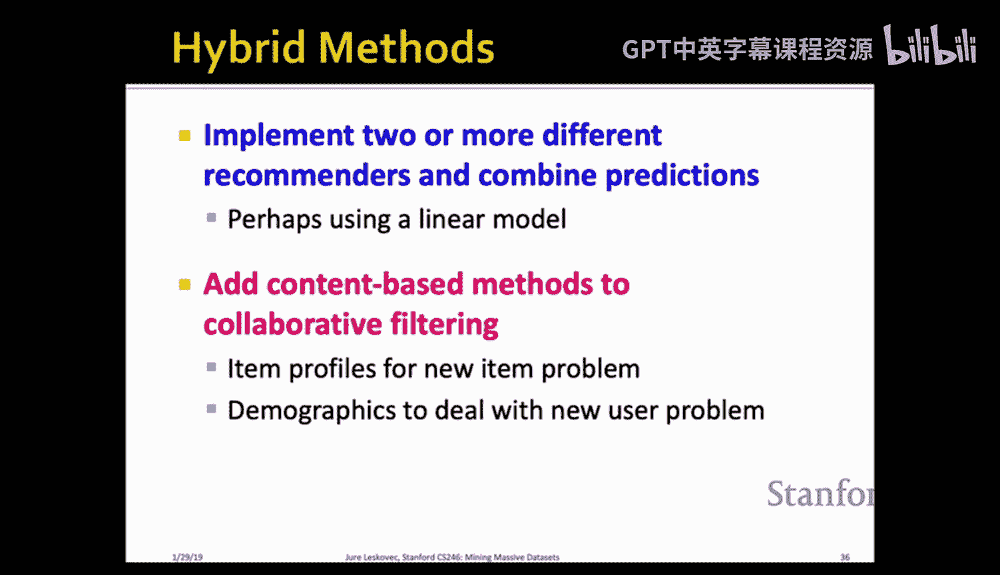

Okay， let me guide you quickly through that。 So right now， I just wanna give you a few know remarks。

 practical tips in case you will be developing your own recommendeder system in the near future。

 So some pointers of， you know。

Things that you should never forget to check。 So we're gonna be talking about evaluation。

 how we check the error metrics。 And also， it is the complexity and the speed to run a recommender system in production。

 So first of all， how do we perform evaluation。 And bear me。

 this is not the user facing evaluation that was mention to you before。 Okay。

 this is just based on our utility metrics。 What we do is the following。 We just have our， you know。

 user movie metrics。 We mask part of it。 Okay， and we use it as a tense data set。

 like very common jargon for machine learning as well。 So we must this part of the metrics。

 And we w to be able to reconstruct those ratings that now are missing。😊。

So when we then produce the recommendations for those mask ratings。

 we can use different measures to realize how good the recommender system is performing。

 The first one that can come to your mind is the root mean square error or RMSC。

 which is very common and what it does is it just shows you the deviation between the actual rating and the rating produced by your system。

 and it combines all these errors together So the pros of this measure is that it just gives you one number。

 So you can easily you know you can tune the parameters of your axises and then decide， oh。

 now I get a lower RMSC therefore I'm doing a better job。

 It turns out that it doesn't really help you as a real word measure。

 The reason is what I mentioned to you at the beginning。

 we mostly care about doing a very good job recommending the highly rated items。

 So that's where we don't want to make errors。 If we do you know subpar job in the items that are rated。

1 or two stars。 No one really cares。 Okay， so that's why the RMT can be misleading at times。

 So for that reason， another measure that is often recommended is to use the precision at top 10。

 So whenever I'm showing you set of recommendations。

 say on Amazon wantna measure how many in the top 10， which is you know， it's a， you know。

 it's a K parameter。 You can be precision a K basically， you know。

 you decide I want to show five recommendations，10 of them。

 And how many of them are gonna be relevant to the user。 There is a way more relevant， you know。

 metric to understand how good of a job you're doing， okay。😊。

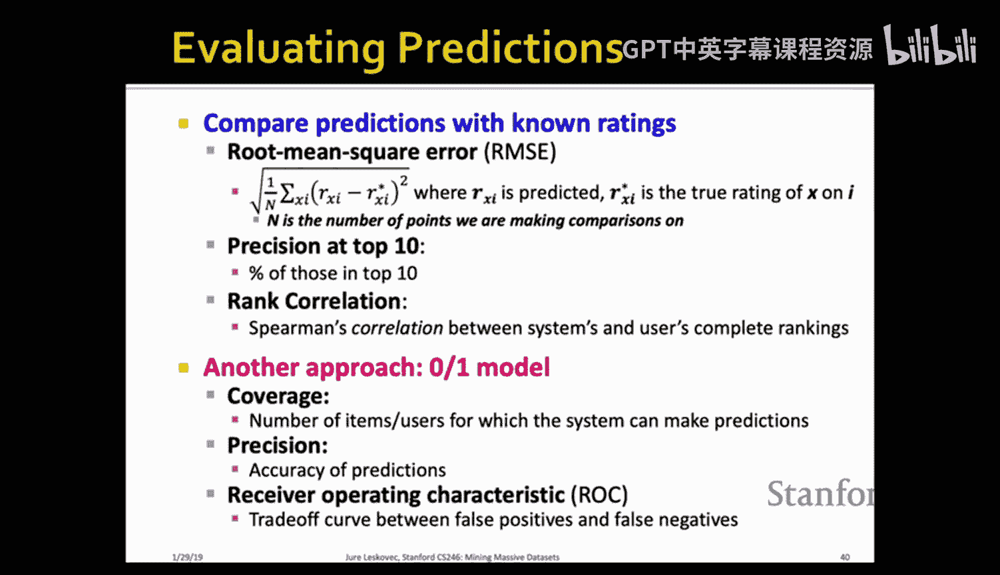

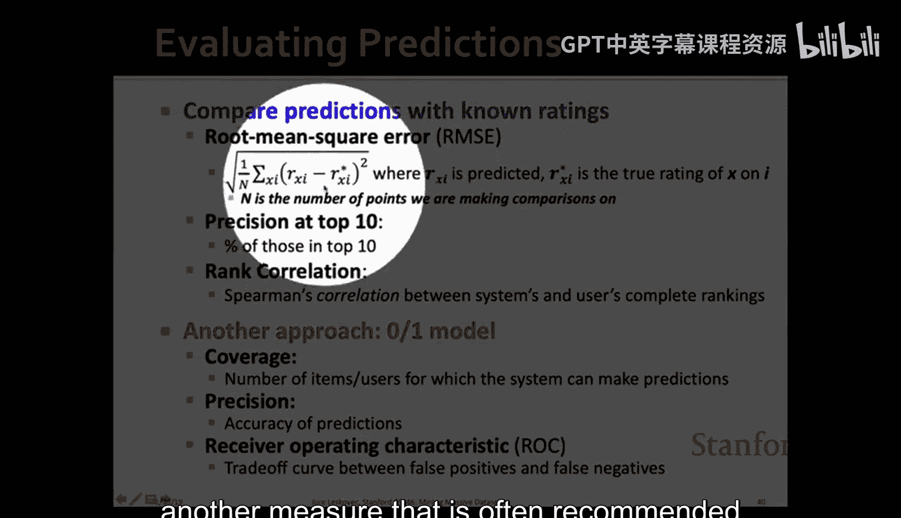

And last but not the least， people are also using the rank correlation。

 which is nothing but a measure that captures how good is a ranking。

 So we we don't care about this course that we are assigning to the ratings。

 We don't care about just the top 10， how they are appearing。

 We rather care about how closes the ranking that you produce compared to the real one。

 So what is the order of the top items that you're gonna be showing to the user。 Okay， so。

Keep in mind， this mis amat between RMSC and measures that are more useful in the real world。

Another approach that is also very interesting， which sometimes is called the 01 model。

 and it applies very much to this implicit feedback that I was telling to you about before is the fact that sometimes these recommender systems don't work with ratings。

 So you don't have the luxury of having access to1 to5 stars like in Netflix or so forth。

 You just know if so one is watching a bit on YouTube or not。 Okay， like that is our 01 model。

 If that's the case， there are some other measures that are extremely important。 First of all。

 is the coverage measure。 Okay this is really must have every time you develop a recommender system。

 This is something that you want to try to compute as quickly as possible。 It basically tells you。

 given my users on the system for how many of them can I make predictions。 and again。😊。

We said this in the context of all these ecommercecommerce websites。 for example。

 if you end up on Amazon Pinteresters or anywhere that is driving commerce and you don't provide predictions to 90% of the users of the system。

 then you're losing a lot of revenues for that reason， right。

 So that's why this is extremely important。 you might prefer recommended system that does a worse job on the top 10% of the users。

 but rather able to produce recommendations for your whole user base， Okay， so courage。

 extremely important， then other measures like precision or the rock curve and Auc curve that basically tell you what is the accuracy of your predictions。

 which is am I creating false am I predicting false positive or false negatives。

 Okay so very similar to what you've been studying in machine learning as well。

 and they apply very well to this01 model。Now， other issues that you might be having with the。

 with the error measures。 they are， they have a very narrow focus。 You know。

 there are mostly focus on the， on the accuracy of the system。

 What are other things that we care about。 So， first of all， is the prediction diversity。

 which is sometimes called like this， the serend Dity。 The fact that。

As you know the question that we got at the beginning of the lecture。

 you don't wantna always recommend the same things to the user。 You know， you w to have， you know。

 say three recommendations out of 10 should be things that are not strictly related to what the user likes。

 And that has been proved to be something that drives more views on YouTube or more purchases on Amazon Okay so that's one thing that is often included into more advanced recommender system。

 other things are， for instance， you want to leverage the prediction context。

 If you're coming from a purchase session where we were checking shoes and trousers then you might want to recommend a jacket or you you have other features that can play a role in there and also the ordering which generate these predictions plays a role as well。

 So in practice， the takeaway that that I want you to have from this part of the lecture is that some of these some of these error metrics might penalize。

The method that does instead well for I ratings and value for the others。

 So you don't want to fall into this mistake， okay。So don't rely only on RC。

And last but not the least， very quickly， we're gonna go through the complexity。

 So we talk often about know the fact that you want to get neighboring items or neighboring users and the most expensive step is to basically find the case the most similar customers or the came most similar items。

 But we learn how to do that。 Okay， so instead of being quadratic problem， we can precompute it。

 make it linear。 And that's where we use our L age。

 that's where you know we can cluster users that are similar， we precomp it once。

 And then we know if users belong to the same cluster or not。 we can apply dimensionality reduction。

 So what I told you on the second slide of today， the fact that everything we beef on top of dealing with dimensional data would help us today applies exactly here。

 because it allows us to build systems that are scalable and that can run with millions of users。

 Okay， So that's the insight about the the the complexity。😊，And this is more a personal tip。You。

Whenever you you have the luxury of having access to so much data。

 you w to try to leverage all of it。 Okay， so don't try to reduce the data size just because you wna use some you fancy algorithms that youve seen in obscure paper。

 It turns out most of the times， simple methods on large data Trump everything else they do the best。

 So it will be way better for you。 let's say you have data and you're able to So the genre or the actors。

 So use all the data you have available rather than betting some obscure mathematical models。

 clearly both of them。 But know this is the logang in。 This is what gives you the best performance。

 first of all。 And then after you can care about optimization。

 Okay there are a lot of interesting articles about this this one you can check it from the slide。

 There is thereasonable of data from Peter Norwick and distinguished scientists at Google。

 which applies to machine learning in general。 So those are very interesting things to read that really put in。

😊，This mindset that using all the data that you have tends to pay off more than having very advanced models。

Question。

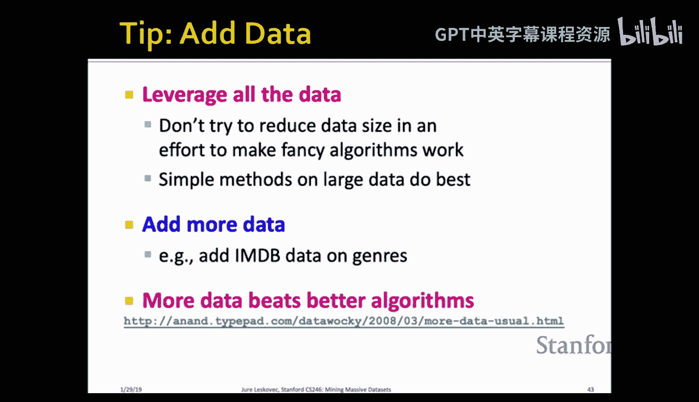

Does the pre competitionut efforts to solve the coverage problem？Not， not really。

 it It really depends if you're working item item or user user。

 So the precomput allows you to find the candidates as quickly as possible。

 But if your data is shaped in such a way that you don't find neighbors because， you know。

 you just arrive to the system， for example， and you don't have any ratings assigned to you then there might be no coverage for that reason。

 Okay， so the， the precomput is more about being able to run it at scale and in production so that you get real time recommendations。

Thanks， great question。Anything else。Okay， data will give you a very short teaser about what we're gonna be seeing on Thursday。

 So on Thursday， we're gonna be talking about the Netflix Pri and in general。

 the latent factor models， which is very powerful。 and it kind of embodies all the different things that we've seen today and puts them into a single elegant framework so that。

 you know， we can leverage data coming from the ratings coming from the content and so forth。😊。

So what was the Netflix price。 So Netflix gave training data to the public。 They。

 they gave 100 million movie ratings from a user base of roughly500000 of them pertaining 18000 movies。

 Okay， and these ratings are been generated in six years from 2000 to 2005。

 Then they they retain as small test dataset set with roughly 3 million ratings and the evaluation criterion which kind of disproves everything I was telling you about is the RMC。

 And the reason there is because， it's very easy to evaluate。 Okay。

 so that's why they they shaped it as into an RMC problem。😊。

And they gave to they published the result that their own internal recommender system algorithm was obtaining。

 So the cinema match RMC was 0。95。 Okay and the prize was all about $1 million for a 10% improvement on cinema match And as you can imagine。

1 million is not only about the fame of doing an interesting scientific paper。

 but people didn't mind about getting a significant amount of money。

 So the competition received almost 3000 teams。 Okay and you will see you will hear this amazing starting on Thursday。

 but you know towards the end， teams started started either to compete to help each other。

 they made deals to split the prize and so forth。 So it was was a very interesting period know for recommender system。

 But you know apart from the funny details that we're gonna be hearing from on Thursday。

 the nice strong scientific outcome of that competition was the fact that it was the first time。😊。

That researchers came with this idea of latent factor models。

 So latent factor models are nothing but funding clusters where both the users and the itemsom are projected into the same space。

 Okay so we're basically embedding users and atom together。

 Okay so we're gonna let's have a representation like this one。

 Okay so this is a simplistic example we just have two dimensions。 you know。

 we have movies coming from more serious to funnier and then geared towards more males on female。

 So you project the movies in this latent space。 and then you have the different users that are being projected in the same embedding space。

 And then we just get the neighbors in the dimensional space。

 Okay so you know that gas we likely most independent day and so forth。

 And and you produce recommendations in that way。 so I'm gonna be closing with these light。

 This is just 2D projection of the two main latent factors。

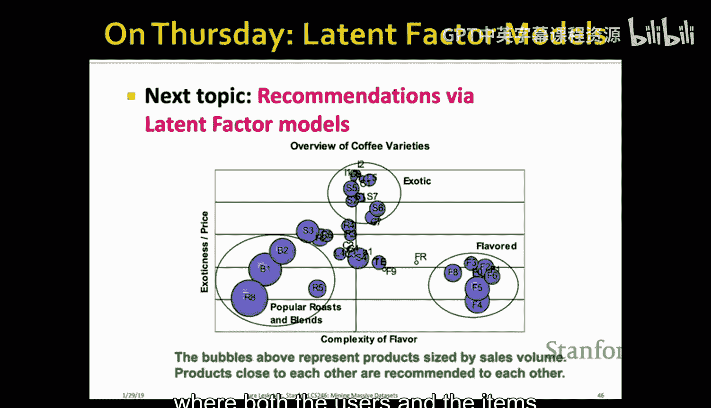

And if you go through the titles， you would see some kind of regularities， you know。

 movies that some movies are more action movies， some others are more romantic and so forth。

 So basically， you see， we're bringing in characteristics from the users， the ratings from the users。

 the content of the movies and so forth。 And this turned out to be the the winning technique of the Netflix challenge。

I'm gonna wrap it up here。 I'm happy to take questions in case you have any doubts left。 Thank you。😊。

