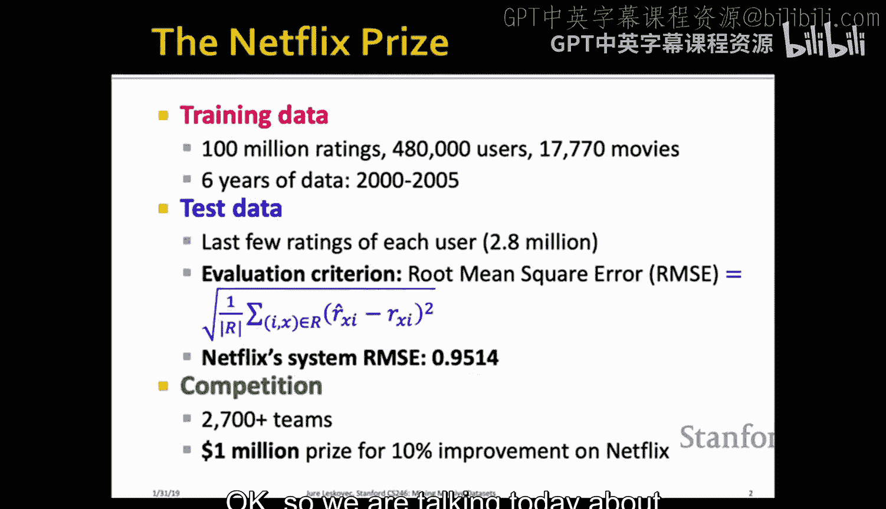
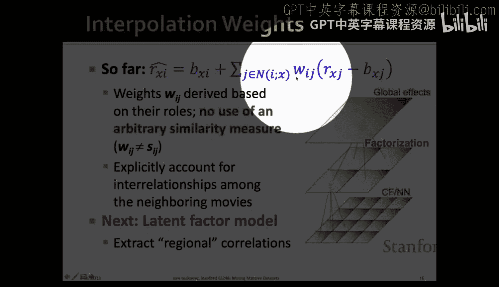
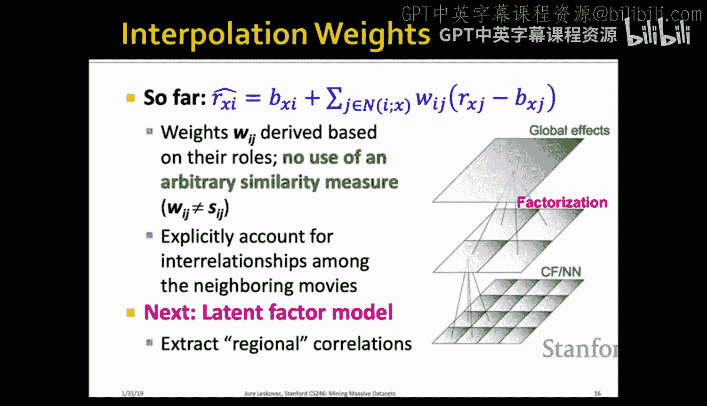
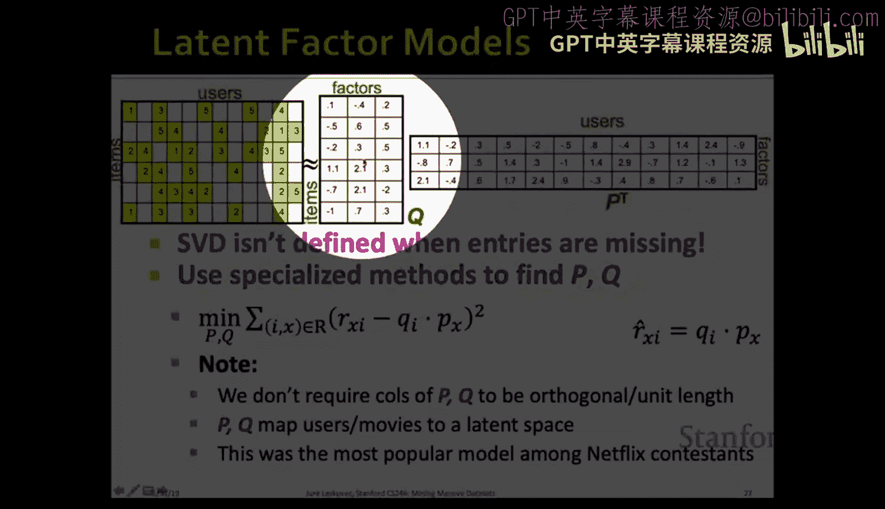
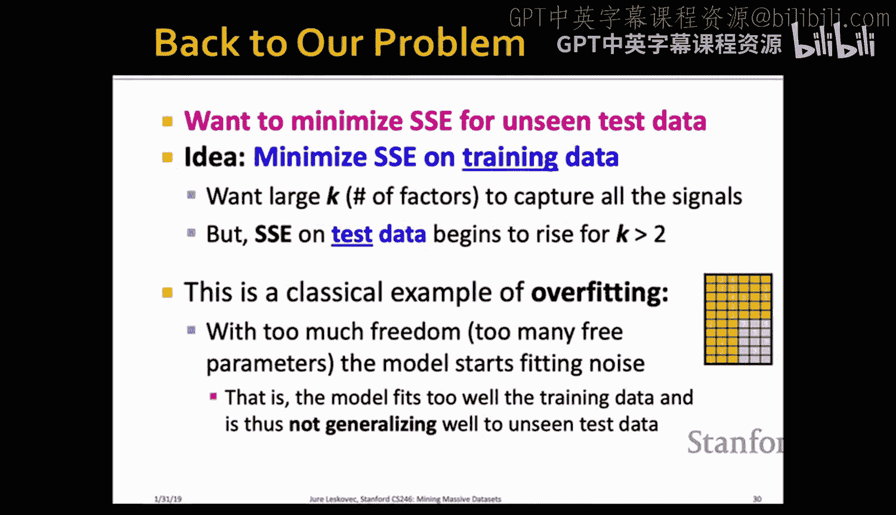
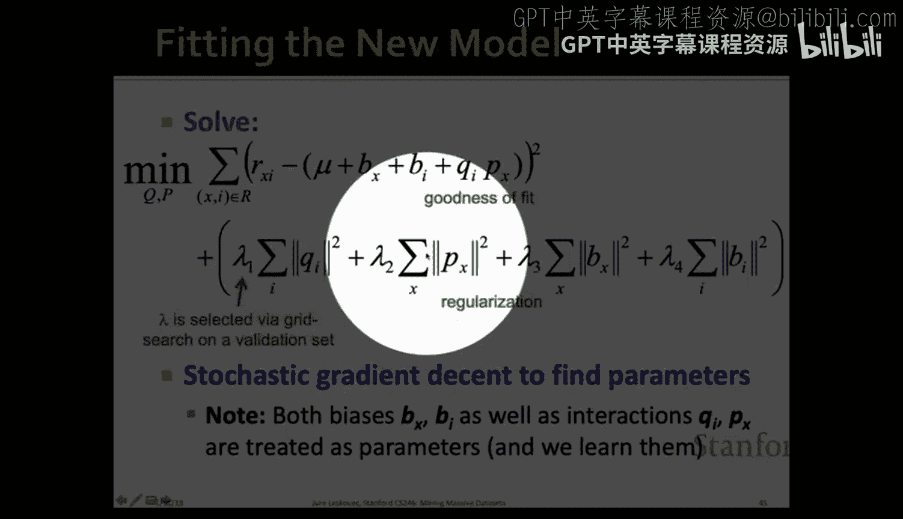
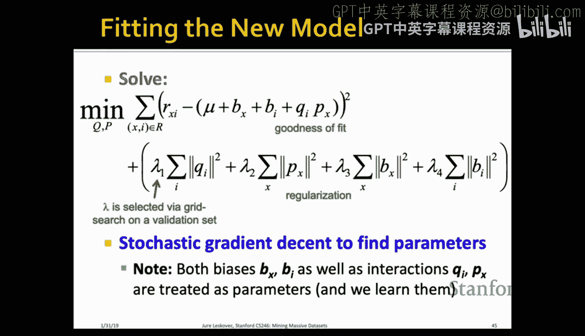

# 斯坦福大学《海量数据集挖掘｜CS246： Mining Massive Data Sets 2019》中英字幕 p08 -P08-lec8 Recommender Systems II.zh_en -BV1raSjBuE3d_p8-

Okay great welcome to the class today we have a super exciting lecture where you will learn a lot it will be a very thrilling lecture with lots of surprises very emotional and there'd be an important life advice as part of this lecture as well so wait and see okay so we are talking today about latent factor commander systems and this means we will be talking about kind of these ideas coming from singular value decomposition but applied to recommender systems and how do we make the entire thing work so here is what the problem will face today so a few years ago Netflix released this challenge called the Netflix prize and what they gave out was half sorry00 million different movie user ratings right so for about half a million people on about 18000 movies we have 100 million ratings and this was six years of data from。

😊。

Year 200th to the year 2005。And basically what they did is this was your training data and based on this training data the idea was to build a commander engine and then they also came up with this test data which was basically composed of the last few ratings of each of these users and they have about 2。

8 million of these test set ratings， they said here is the evaluation criteria。

 what you want to do is minimize the sum of the squared errors。

 so the idea is this is your prediction of how much what is the rating between one and five stars of user X on MoI。

 this this is the ground truth， this is your prediction you want to go over all the ratings in the test set and compute the root mean square error at that point in time the Netflix had a system in production that was of whose root mean square error was。

😡。

was 0。95 and they organized the competition that more than 2。

700 different teams participated in and whoever could improve this number by 10% would score a million dollars。

😡，Okay so what we'll go today through is what were these 2700 teams doing and how did they solve this problem and who won a million dollars okay so that is the plan for today here is how the data was given to us。

😡，Right so essentially there was this training set of data。

 which was this00 million ratings right and we can think of this as a matrix of。😊。

all the all the movies and all the users and an entry at a given cell tells me how much a given user like the given movie and this was the data that was released then what Netflix held privately was a set of  three million ratings which they split into two parts they had 1。

5 million ratings that they called thisquiz set so whenever you built a model here you submitted it to Netflix Netflix would evaluated it on this set of data and posted you on the leader board and then at the end when kind of for the final evaluation of the competition they had this test set and they would only use this final test set to determine the winner okay so they used thisquiz set for you to give once you build the model to get the feedback how well you are doing。

😡，And then once kind of the competition is over， they would run the models from this hidden test set to determine the final winner okay that's the that's the setting so now let's look at how did they what was happening with these 100 million ratings right so what this means is that basically you were given a matrix where you have 18000 rows each row is a different movie and you have half a million columns each column is a different user a different customer and you are given 100 non-zero elements right even though 100 may seem a lot to you this is actually little because you know this is what 10 to the four that is 10 to the five so this。

😡，This matrix has I know billions of entries so in some sense the end the matrix is very sparse it full of zeros and even though you are given 100 million known zeros it's mostly empty so but that is our data it's about for user how did they rate the movies and then as I said before how is the evaluation and how are we measuring success one way to think of this is the following the way to think of it is that you know you are given the yellow part of the matrix and you'd like to to guess some other self entries of this matrix and the idea is that right out of。

😡，This particular matrix you would kind of mask out some known ratings。

 let's say these ratings here right in my gray part and the question is how well can you guess them？

😡，And then what you want to do is measure the difference between your predicted value in this cell versus the true value in the cell and the way you measure the discrepancy as I mentioned early on is through the root mean square error where basically the idea is is that you go over all this test cases this is the predicted rating for a given user for a given item minus the true rating。

 whatever is truly in this cell and you take the difference square it sum up over over all these entries take a square root and divide by the number of entries in your test cell and this is called root mean square error right so essentially it you know it's a quadratic distance between what your prediction was and what the truth does and we would like this to be as small as possible right now the Netflix system does this with 0。

95 is the root。😡，In Sp errorero and we'd like to bring it down to about 0。

85 so 110 percentage points lower so that's the task this is what we'd like to do。

 in some sense we'd like to predict the novel narrs without us ever looking at the so now that we know what we want to do。

😡，I I'll talk to you about the winning solution for this team the winning team was called Belco by the last names of the two leaders and I'll tell you what kind of their approach was to do this and they were the winner of the Netflix challenge so I'll show you a nice photo of them with a million dollar check at the end so you see it was real and the way they approach this is to have this intuition of this kind of multi-scale modeling of the data where they say that they want to kind of model top level global effects。

 local kind of regional effects as well as very local finegrained view of the data so you know the way they visualize this is to say oh there is some global effects there are some kind of regional effects and there are very local effects that I want to capture and what do they mean by global I'll make this more precise later you can think of overall deviations of how good is the movie overall？

😡，St is the user overall。 This is what is called global then they say this regional level they call it factorization so this will be kind of singular value decomposition will talk about this and then collaborative filtering that Mia talked about on Tuesday is for this like very fine grainined interactions at very local scale and we'll see how to integrate all this into the best performing recommender engine first let me tell you what do we mean by global effects and here is how you could simply measure global effects right so you could say for example you know you want to make a prediction how much Joe we like the sixth sense movie right so the way you could do this is to say mean average movie rating in my data is 3。

7。I know that6 cents average rating is total rating the average rating is half a star higher than 0。

37 but I know that Joe tends to be a critical person so he ratess02 stars below the average right so now what would be my baseline estimation my estimation would be that Joe will array the 6 cents movie four stars how do I get to4 stars I say global average is 3。

56 cents is half a star better than the global average but Joe is 0 to stars more critical than the global average I add these things together that's my prediction for how much Joe is going to rate 6 cents okay and this is what I mean by global effects is's basically overall was the average rating overall was the average rating for 6 cents and was the average rating for Joe and I combine these numbers and here is my prediction so very kind of very。

😊，Global， very kind of average down， yes。Plus the above average， just6 cents is original。

hy just do we say so because I want to have a baseline and the baseline is rating over all the movies in the database and then I want to say how much better is 6 cents than that that the so basically if I would just ask what's the average rating of 6 cents is 3。

7 plus 0。5。😡，And then I would ask， what is the average rate in Guangzhou is 3。7 minus 02。😡。

Right but because I create this baseline， I can work with these deviations。

 That's the practical reason why we do it this way。

 but essentially the idea is this is just kind of global so now that this is global。

 let's talk about how do I do very local neighborhood level things right so I told you about this I'll tell you next about that and then we'll go to factorization so123 or132 okay sorry right so what do we mean by we talked about collaborative filtering right and the way you could do collaborative filtering is to say oh but Joe didn't like this related movie called science so you know maybe I should push my rating down a bit right so rather than say the rating is4 my final estimate is rating this 3。

8 somehow based on the relationship between movie science and the movie six cents I push down the rating a bit and I'll explain。

How would you do this so this is a recap of collaborative filtering right so collaborative filtering in this competition was the earliest and by far the most popular method。

😡，And the idea is that I want to derive unknown ratings from those of similar movies of similar items right this is what is called item item collaborative filtering as we discussed on Tuesday right and the way collaborative filtering works is that you have to define some similarity measure between items this SIJ tells me how related to items are。

😡，And then the idea is how does this work is to say let me take k nearest neighbors。

 let me find k nearest items k most similar items to my item I so most k most similar movies to my sixth sense and then I want to based on that I want to compute the rating how do I compute the rating I create this set n I'll index it as I semicollon X which is these are the items that are most similar to item I but they were also rated by my user X okay so I want to predict how much is x like item I so I say what are other items that are similar to I but were also rated by x。

😡，O。Yeah， give me some yes， okay， so how do I now compute the rating。

 I say my prediction of how much user I sorry user X will arrive like the item I is simply。😊。

The similarity between item I and item J right I go over all the item J that are similar to I but x also rated them and then I say how much did x like that item J and this is the similarity between I and J。

😡，And then I normalize out by the sum of the similarity。😡，But essentially what am I doing。

 I'm saying here is the six sense， what are the most similar movies to six sense that my user X has watched。

 and now I'm doing some kind of weighted average weighted sum of those ratings where the weight is proportional to the similarity between I and J。

😡，はい。And last time we talked about how can you define this similarity metric， we talked about Jakar。

 we talked about the spearman correlation and so on and so forth。

 right but the point is that I say my predicted rating for this Joe on a given item is simply，😡。

I find other items J that are similar to the item I'm interested in those items have to be rated by Joe。

 and then I'm basically asking how similar are the items times how much the Joe like those similar items and that's what is essentially collaborative filtering。

😡，Now the way you really implement collaborative filtering is you don't implement this formula what you implement is the following formula and way you and this is what is now is doing it's taking this local and global effects and putting them together so the idea is that you want to have these global baseline estimate that I was telling you about before and then you have this correction factor that comes from collaborative filtering but the important thing is that that here you are now predicting you are modeling deviations rather than the absolute values。

😡，Okay right so now what is the baseline estimate， The baseline estimate is what I have already explained you three slides ago right so the baseline estimate for user X and itemM I is the global average plus the deviation for user X plus the deviation for the itemI。

 So this was my Joe and 6 cents up and down 0。3。7 stars right so overall average rating deviation for the user and then rating deviation for the item and that's my global estimate。

😡，And then when I do the collaborative filtering up here。😡。

I still go over all the items J that are similar to I and were rated by x I still have the similarity but the difference happens here where I have the rating of x to thisim item J but then I say minus the baseline estimate of how much x we like item J so essentially what I'm now saying is how much theus x as rating deviate from what the baseline prediction would be and now I'm kind of averaging or summing together this baseline these deviations and that turns out to work much better in practice because you are focusing your predictive power here on modeling deviations rather than modeling absolute values right so。

😡，Before maybe I go through this， are there any questions is this clear what we do right so this is how you would implement this in practice if you you get a job tomorrow and you have to build a recommendationer system。

😡，So this would be my first step， yes。On the original readings great exactly super question How are similarities based similarities should be based the way we describe them in in your in the on Tuesday so based on original ratings right So what are some problems Here are some problems with this approach first approach is that these similarities are kind of arbitrary。

😊，Right you can pick some similarity metric and you hope you pick the good one the other thing is that these pairwise similarities kind of capture relationships between items but neglect interdependencies between users and then the last thing is that taking this weighted average you know where you take this SIJ weights kind of seems to be a bit restrictive so what we want to do is that instead of having this similarities scores SIJs we will try to use some weights WIJs okay so so far SIJ is the similarity but I'll throw away SIJs but I will use some different WIJs okay so this SIJ up there I will replace it with WIJ so now I need to tell you what the idea is。

😡，so the idea is that I will rewrite my collaborative filtering I have exactly the same thing as I had before the only thing happens here is that I throw away this guy。

😊，The sum is still the same and I replay the SIJ on the top with WIJ right so the only difference essentially is that WIJ right and what so just to explain NX is still a set of movies rated by user X that are similar to movie I using some similarity function but now WIJs are what you will call interpolation weights right there are some real numbers and I don't really care what they are they don't have to sum to one there are just some arbitrary weights and this weights tell me in some sense how much does moviej influence movie R。

😡，Okay and right so the idea is that these WIJs model the interactions between pairs of movies and that this interaction doesn't depend on the user X。

😡，Of course， what I have to do now is to figure out how am I going to figure out the values of this WIJ。

😡，What we just did is to say， let's still do collaborative filtering in a sense that we have to find the most similar movies。

 but compute when we combine the ratings from the similar movies。

 we dont the differences up here right we don aggregate them based on the similarity。

 but well aggregate them on some arbitrary weight WIJ。😡。

Okay so now the question will be how do I figure out what WIj is okay so here is our reasoning okay this is important right so what do we want to do？

😡，Our goal is to minimize the root mean square error right so we want to the sum of the squared differences between the prediction and the truth right then another thing you should observe is that you know for a given data set one over size of fire which is size of the data sets that just a constant so who cares the square root I can throw away because square root is a monotonic transformation。

😡，So what does this mean is that the model that will minimize the root means square error will minimize the sum of the squared errors。

😡，Okay so whatever minimizes the sum of square errors minimizes the root mean square error because square root is just a monotone transformation and1 over R is the size of the data set so it's a constant so whatever minimizes whatever predictions minimize this also minimize the root mean square error right so essentially what I want is I want to find the predictions that minimize the sum of the square errors so what can I do now I can say I'll be smart I'll find the WIJs such that they minimize the sum of the squared errors on the training data right so basically I'm saying you give me some ratings I'll figure out what WIJs so that I can predict those known ratings as well as possible okay。

😡，So the idea is that I will use training data to learn or estimate these WIJs based on the data okay so now you could say good okay you can go do this be my guess but who cares about training data。

 I don't care about minimizing the sum of square errors on the training data。

 I want to minimize it on this test data that is outside that I haven't yet seen so how do we how do we do that。

😡，Okay， so here is our reasoning and this is essentially the reasoning that all of supervised machine learning。

😡，Depends on And if this reasoning doesn doesn't go through then none of the machine learning worries Okay so what's the fundamental reasoning。

 The reasoning is the following right we say we will quantify the goodness of our recommendations using root mean square error or some of the squared error right so it means that the lower the root mean square error。

 the better recommendations we have we have developed。😡，Then we can say that。

 you know we want to make good recommendations on the items that users hasn't yet seen。

 that's our goal。😡，So I want to predict what movies are you going to like tomorrow。

 nobody knows that probably not even you right so I cannot really do that right there's no way for me to minimize the error for tomorrow。

😡，It's I can simply cannot do that Nobody can do that right we don't know what will happen tomorrow so what can I do。

 I can say let me build a system so that it works well on the known user item rating meaning I would be happy if you know I could after you have seen the movie and gave the rating I can now predict the same rating so I'd be happy to be able to reconstruct user item ratings for the user item pairs I have already seen right and and then what do I hope I hope that if I can do this well on the known data。

 this system will hopefully work well on the unknown ratings if will hopefully work well tomorrow right and this hope is called generalization right I'd like to use my training data to predict well the ratings on the training data and then I hope that my system will generalize into the future into the unknown ratings and。

😡，All of machine learning worries about this hope， about how do I generalize into the future。

 and we will have to worry about this as well， but for now let's just worry can we predict known ratings okay？

😡，So back to W， what do we want， we want to set the values for ws in such a way that they will work well so it means they will predict well the known user item ratings so the way I can now do this is to say how do I find the ws that will predict the known ratings well。

 the idea is to define an objective function and then solve object the optimization problem？😡。

So lets define the objective function so that I can then solve this objective function let's say minimize it and find the best value of w right so we said let's find WIJ such that it minimizes the sum of the squared errors on training data。

 so here is now my objective function I'll call it J it depends on W and then here is now this monstrosity of equation but it's really simple I go over all my training data。

😡，This big thing here is my prediction for how much user X is going to like item I。

 this is exactly the equation we had before right that's the baseline rating these are the most similar movies J here is my WIJ。

 how much the user X like the movie J minus the baseline rating for X and the movie J right so that's my predicted rating for user I on item sorry for user X on item I and then minus my true rating squared that's my sum of the squared errors okay？

😡，So now that I have written this out， it may look ugly， but it's really just a quadratic function。😡。

It couldn't be simpler right and this quadratic function depends on w because everything else is given this I know how to compute this set is given。

 this is given this is given that is given the only thing that is variable is this W so now what I want to think is solve for w solve for this vector or a matrix of numbers so how do I how do I solve。

😡，Equations like this numerically I want to basically ski right I ski into the valley until I stop so how for those who are skiers how you do this you find the direction where the slope is the steepest and you go down and hopefully you don't for okay so what would be a simple way to minimize a function is to compute the derivative right to start at some point compute the derivative the gradient of that function at that point and then make a step in the opposite direction and keep doing that until we get stuck at the bottom。

😡，right and this is how I can numerically optimize this function right now my function that I showed you has this nice qua quadratic structure so it really looks like this it looks like a bow in many dimensions but you know it looks like this so I can start at some random point and then basically move in the opposite direction of the gradient and I'll find the optimal solution okay so now let's do this。

😡，So the next two slides are a bit dense， but I want them dense because you need to implement this yourself and this will be very useful okay so what do I want to do I want to identify these interpolation rates and I want to do them using gradient descent。

😡，And gradient descent is a very simpleerative algorithm I give you the essence of it here where basically I have some estimate of my w and then I compute the gradient。

 the derivative of my function J with respect to W and then I make a step of size eta in the opposite direction and this gives me the new w and then I can again reiterate right and that's it right so what is the gradient gradient is nothing else then the derivative evaluated at a particular fixed point at a particular estimate of W so now if I show you what is the derivative or the gradient of J with respect to W so what I'm really taking this my function J and I take a partial derivative with respect to a particular WIj right my W is in some sense a matrix of this IJ entries and I take the derivative with respect to the WIJ。

😡，Of this function w of J up here right that's what I take derivative of right so you know it's a quadratic function So I get this two here。

 then there is a sum。😡，This is this is my prediction here is here are my because nothing changes in here because this is over WIK but I'm taking the derivative with respect to WIJ here is the difference and the only thing that I need to worry about is to take the derivative here and the only the only of these entries that will survive is the entry WIJ here so the only thing I have to take is take this thing and put it here for the for the entry x and item J and that's it right so that is my derivative with respect to WIJ right and this will be this will take this value for all the Js that are in the。

😡，Nearest neighbor set and for every other J the value of the derivative will be 0 or the gradient will be0 right so now I can do this to compute the gradient with respect to a particular WIJ and do the update right the way I would really implement this is that I would fix MoI。

😡，I would go over all ratings over all users who rated movieI and then for every movie J in the nearest for every movie J that is similar to I and and was rated by a given x。

 I would compute the derivative of the gradient of J with respect to WIJ and do the object right so and here is my gradient descent function basically I have the old estimate of w。

 I have the new estimate of w if the value of w changes more than some epsilon then I basically take I save my old and then I take my old minus the gradient with respect to the old to get the new one and I ask how much did it change if you change more than epsilon I do another iteration and I keep doing this until w stops changing right and the parameter。

😡，Eta here， that's the learning rate， it tells me how big step do I take， so it's like step size。

 okay？😡，So this is how gradient descent would work right so what is school about this。

 what is school is that these WIJ weights are derived based on the data and are not derived based on some arbitrary similarity method。

😡，They are really the optimal set of weights that minimizes the loss function。

 the error function we care about rather than being some similarities that we somehow came up with and this way that we explicitly learn the interrelationships among the neighboring moves。

😡，Right so what I told you now is the global how do we model global effects and how do we do these collaborative nearest neighbor effects where we actually go and learn up here this interpolation rates WIJ okay so what I will explain next is this middle ground where we will use factorization will we use support singular value decomposition before I do that I will just kind of show you how we are doing right I still want to want win the competition so what this is trying to show you is how are we making progress towards a million dollars right so for example if our prediction would always just predict the average global rating then our error up here would be you know 1。

13。😡，If I would go and predict the user average， it would be 1。065。

 if I would only go to predict movie average， it would be 1。

0533 if I would and this is where the current Netflix system is at 0。

95 right so they are doing a bit better than predicting averages。😡。

If we would just do the basic collaborative filtering with similarity scores SIJ。

 our error would be 0。94， so we would already beat whatever Netflix had in production。😡。

If we use the collaborative filtering plus these global biases plus the learn interpolation scores。

 we get to 0。91。😡，Okay， and what we need to do is we need to close this gap and get 2。85。😡。

This is whoever gets below here wins the million dollars， we are right now up here。

 we got quite a sizable benefit over what Netflix has， but still we need to move quite a bit lower。😡。

Okay， questions， yes。い。I decided。How was he decided it was。It was somehow decided。 Nobody knows。

 it turns out it was decided luckily， amazingly， luckily well。

It's very hard to know how low can you make it if you put it here。

 they could put it up here and it would be trivial。😡，They could put it somewhere down here。

 nobody would get through it and everyone would give up。

 but as it turns out somehow this was just the right thing， I'll show you later。

 I talked to the people， nobody gave me a good answer why but they somehow said here is where the magic happened。

😡，10%。Yes。It seems like this method transformed the recommended system from an unsupervised power into the supermarket。

So啊。呃，是你你到1开50。Great， so so it's a clever observation right the collaborative filtering is kind of you don't use any training you don't use any supervised signal。

 you just kind of design the system you understand it what we did here is we took the collaborative filtering but we added machine learning to it we added optimization to it and we said let's come up with the optimal set of ways and that you bought us about three percentage points and you know if if you know exactly what your error function is which here was the root mean spare error which we can debate long time why that is a bad way。

😡，Bad error metric， but you know it was chosen then if you know what the error metric is yes then you should go and optimize them in reality you don't know what the error metric is you know your user happiness is the error metric how do you measure user happiness there is a lot of different ways right。

😡，二三星有有。嗯m。😊，没得出意下。ActuallyYou have the label， but right like even think about Netflix。

 Netflix doesn't care to make good recommendations to you what really Netflix cares is for you not to cancel your subscription。

And if they believe that they can make you not cancel the subscription by giving you crappy recommendations。

 they'll give you crappy recommendations because I know you will hope you will keep your subscription to say。

 oh maybe tomorrow they give me a good one I don't know right but the point is the real I mean。

 at the end the real business metric for Netflix is the number of subscribers。😡，And。

Maybe the root means square error， if they minimize that will lead to more subscribers。

 hopefully it will， but at the end it's subscribers that matter。😡。

So that's why I'm saying that in real life， you want something that's beyond these very well measured predictions。

 but it's very hard to get。Yes。あ可い。Interpolation weights on n。

 which is the neighbors but and then we define the error on R。

 which is the whole set so then at some point we haven't figured out how do we learn n it is n is this magic function great observation so I go back and explain so you are making this observation that you know we are able to learn this W right but this n is arbitrary。

😊，That's correct。 But the point is I， the way I solve the problem is that I just make n big enough so that these ws can go to 0。

So if I make n big enough then you know it has to include the kind of the relevant neighborhood and then if some movie does not influence it will just learn to put a zero here right so n can be relatively arbitrary because w will decide which of those neighbors it really likes and which ones don't matter so the choice of n is less crucial than the choice of W W can compensate for whatever mistakes you have in n。

😡。

Right， so。

Can we just remove end， so the idea would be that you would just sum up over everything。

 all the movies。😡，You could sum up over the movies。

 but then the problem is that now you took your learning problem and you have to estimate 18。

000 squares different square different parameters and that's not necessarily the smartest thing to do and the easiest thing to do right so you don't want to do that because then it blows up and you over。

😡，Right but good points great points thank you for thinking it through all right so now the intermediate thing which is the SVD part。

 the latent sector modeling part and the idea is right that we want to take our movies and our users and embed them project them into some low dimensional space so that kind of people who like particular movies are kind of located together in this space right so you know somebody might like dumb and dumber and independence they and you know a welleduc doctor really likes the Lion King and things like that right so that's kind of the idea。

😊，And the way we will do this is to create these latent factors and essentially the idea is to take this user rating utility matrix r and do singular value decomposition of it what does this mean is that we want to take R and write it out as a product of two matrices matrixq and matrix P so the idea is that you know。

😡，I will take this matrix and decompose it as a product of two matrices where the matrix Q has zeros corresponding to items and has a set of columns we will call these columns factors and then you know the matrix P has all the users and again the same number of factors so in this case we would come up with three factors right so now for now let's assume that we can approximate the utility matrix the matrix the rating matrix R as a product of these two thin matrixrices P and Q。

😡，There is one important caveat is that R has missing entries right it has these missing entries and if you would just blindly apply singular value decomposition to this then all this missing entries would be treated as zeros and you would be evaluating your reconstruction error over those zeros as well and we don't want to do this I think somebody asked me this like two lectures ago or something when I was discussing SVD so the point is we cannot just apply SVD because SVD cares about the reconstruction error over the entire matrix but what we care about is about the reconstruction error only over the yellow cells of the matrix right and we want to ignore the missing part。

😡，So now imagine imagine you can do this decomposition how would you make the prediction the way you would make the prediction is that for a given user and an item you would say oh I want a given item I want a given user and you would simply take the corresponding vector Q and the corresponding vector P and do the dot product between them right so give you an example you want to make a prediction of this red cell。

 how much will the user number5 like the movie number two so the idea is you take the second movie you take the fifth user here are the factors you do the dot product between these vectors and here you get the value 2。

4 and that's your prediction so this is how this would work right I come up with these factors for any user movie pair I multiply the factors it it gives me the number。

😡，And the way you can think of these factors right I have three factors here and I have three factors here。

 you can think of this as a representation as an embedding as a point that represents a user now in three dimensional space so you can think of the following way right you can say aha here is factor number one here is factor number two this would be factor number3 and now every movie。

😊，iss a point in this three dimensional space right and then similarly every user is also a point in this three dimensional space and what you want is you want because you are doing the dot product you are doing in some cosine similarity you want users to be close to the movies they like。

😡，So this way you kind of embed movies and users into the same space。

 so now the question is how do we compute this em？😡，O， how do we do this？

So let me first tell you how singular value decomposition would do this and then we'll figure out why it doesn't really apply in our case and how do we fix it right so last week I think on Thursday we talked about singular value decomposition where we said I can take my data matrix a and I can decompose it as a product of three skinny matrices u sigma and v transpose sigma is diagonal it has it's a matrix of singular vectors that are greater than0 and then column columns of u and rows of v transpose are orormal meaning each one each column has a Euclidean length1 and it orthogonal to all other columns of u and all other rows of v transpose right so now if I would do if I would take my if I would want to apply this SVD to my。

😡，Use case， here is what I could do。😡，in order to get my r equals Q times p transpose。

 I could simply say my rating matrix is my matrix a。

 you know for matrix Q I will take the U from SVD and for p transpose。

 I will take sigma times w transpose。😡，And I'm kind of done right I have my Q and I have my P and I compute them based on the singular value decomposition right and it seems we are kind of done。

😡，The the reason why is SVD a good thing to do in this case is the following right we remember that SVD optimizes the objective function that we want right SVD minimizes the sum of the squared errors right so SVD is the optimal thing to solve this equation right SVD gives me the solution to this equation right it finds UVV and sigma that minimize the sum of the squared errors。

 the sum of the squared reconstruction errors right the true entry minus the reconstructed entry so it's exactly what we want for our Netflix challenge right。

😡，What there are two things to note， first one is as I explained already before that root means square error in the Netflix challenge and the sum of the squared errors are monotonically related。

 so it means if I minimize the sum of the squared errors I have minimized root mean square error。😡。

In some sense， singular value decomposition is minimizing the rootary square error which is what we want right this is the error metric of the network challenge。

 but there is a complication。😊，I that this sum in the SD error term this sum is over all the entries of the matrix and the no rating is interpreted as the zero rating so basically this error term goes over all the entries also the missing entries right and our R has missing ratings so this is not you cannot just apply SVD you have to come up with specialized methods that will essentially compute SVD so let me just just summarize the idea was the following I take my rating matrix here I write it as a product of two matricesq and P transpose I decide on the number of latent factors number of columns of Q。

😡。

And what we decided is that SVD is minimizing the sum of the square errors。

 which is the error function we care about， but it's doing this over all the entries also over the missing entries so far。

 so this is not what we want so how do we proceed， we develop specialized methods for identifying PNQ。

😡，The way we do this is to say I want to find P and Q that minimize the following function that says let me go over all the ratings I have。

 here is my true rating minus my predicted rating and the same way as we said let's find WIJ before I'm now saying let's find P and Q such that this when I multiply these two things together I get the rating I want。

😡，So a few more things to note。😡，In our case， when we solve this。

 we don't require the columns of P andq to be orthogonal or unit lands。

 we don't care anymore right so we don't have these constraints of singular value decomposition。😡。

Still， P andQ will map users and movies to this latent space to using this latent factors and this kind of matrix factorization where you think the rating matrix and you factorize it into a product of two matrices was the most popular model in the net Netflix challenge so this idea was kind of the most popular at the end okay so are there any questions at this point。

😡，Just checking okay， yes to be unique if you think about this。

 this problem now is not even convex anymore， the reason it's not convex because this is unknown and that is unknown。

 so we have a product of two unknowns so。It's no guarantees。Great question。 Great point， yes。

in R now isSo the thumb over I and X in R now is only over the ones you have these。

ExlySo this sum is not over all the entries， but it's only over the entries that you actually have。

 so this is not this is only over the yellow part of the matrix。

 not over everything because the white cells are undefined。

 we don't know what they are right so it's only over the data over the ratings I have Great point。

Good， thank you for the questions good so let's now talk a bit more how do we find these latent factors let me now tell you right our goal is to solve to find P and Q that minimize the following equation right again they minimize the sum of the squared errors between the truth and the prediction right and as I said these errors only go over the yellow entries that are given and these white entries they are missing so our error doesn't go through right and we do the same thing as we did before right we our goal is to minimize the sum of square errors on uneen test data we don't see the test data so we cannot do that so we will minimize the sum of square errors on the training data。

😡，We will select some number of latent factors k going back we will decide on how many columns do we want this matrixes p and q to have you know it's some parameter 510 20 however you want and then we will we will run our optimization our gradient descent method to find the best values for。

😡，For P and for QM。If you do that， then it turns out that as you increase the value of k。

 you are able to predict no ratings better and better and better and better。

 which is what you want but if you then apply this to some holdout test set data something you know but you hidden away from yourself then the error on the test set also increases right so what this means is that on the training set your error goes down but on the test set the error goes up and this is a classical example of what is called overfitting。

 where you are fitting your training data so well that you are fitting all these little noisy type things and when you go to the data that you haven't yet seen you are making big mistakes。

😡。

And in practice， what this means is that your model has too much freedom， it has too many parameters。

 so the model starts fitting noise。😡，And this means that the model fits well on the training data but does not generalize well to the unseen data。

 right so we have to now force our model to generalize well。

 we kind of have to force it to not use all the freedom we give it。😡，Okay that's the intuition。

 so how do we kind of force the model not to overfi and the technique to do that is called regularization。

 so let me now explain what regularization is。😡，The idea for regularization is that I want the model to be reached to use a lot of its expressive power where there is a lot of data。

 but if the data is not present at a given part of the space。

 I want the model to be very conservative。😡，Okay so the way I do this is now by solving the following equation it's long but I will explain and to make a lot of sense right so now my objective function to solve is some combination of what is my predictive error right this is predictive minus the truth this is what we had before but then I added this other termem that I call the lens termem it says oh how long is the row x and how long is the column Q。

😡，Right so I'm just asking whats the Euclidean length of a particular this is rh in P and a particular column in Q right these two right and this lambda 2 and lambda1 is what I will call regularization parameters and they are kind of offsetting about how well do I feed the training data versus how long are these two vectors and when I say how long they are it basically means how big weights are along these latent factors right so if I were to set lambda to0 my model only care to predict really well the known nas if I set lambdas to be very high then I won't care so much about predicting well but I will care about making latent factors small like weights to be tiny。

😊，And if I have tiny weights， then I cannot make big mistakes， that's the idea。😡。

Okay one thing to note is that I can allow myself to make this type of transformation What I mean by that is I don't care about what is the absolute value of this function I care about P and Q that minimize this function so I don't care whether this the value of this entire function is 27 or 38 I don't care I just care what are the P andQ that solve this function that minimize it okay so that's an important point so now let me try to tell you whats the idea with this regularization why do I want it。

😡，The idea is the following。😡，If you think I have a user。😡。

And you can think of our error termem and the way our objective function is we have this predictive error termem and then we have this length term right and the predictive error in some sense says for this user over the movies that the user rated you know how well am I able to make the prediction？

😡，And then the lens the。Tells me how far from the coordinate origin is that user？😡。

And what will happen is that if there is a lot of movies here that the user rated。

 then sum of the errors will be big because it will have a lot of terms。😡。

And because I will have a lot of thes here， this means that the lens theem will become kind of overweighted and will optimize for the good predictive accuracy。

😡，But if I have a user only let's say rate at one movie。

 then you know the most error I can do here is I know 25 right you know I predict0 but the user rated it5 so the total weight of the error term will be relatively small so the length term will take over and what the lens term will want to do is you want to take this user and push it closer to the coordinate origin right so basically the idea is that if I have a lot of data about the user then this error term for that user will become important and it will take a lot of importance but if I have little data about the user only one or two ratings then this length term will kind of have higher magnitude and what this means is that it will start pulling the user closer to the coordinate origin so it will kind of the user will move closer。

😡，So that's the intuition right if you have a lot of data then some of these square errors will add up and you will want to keep this slow and this will kind of overweigh the length term。

 but if in this here you have very few termss， then the length will take over and push the user closer to the coordinate origin and that's the idea for regularization is that you want to be conservative。

 you want to have the weights the coordinates for the user to be small so we want them to be closer to the origin。

😡，But you also want to fit well。 So where you have a lot of data。

 this term will take over and where you don't have data， this guy will take over。😡，Exactly。

 and then the same reasoning goes for movies， exactly the same reasoning goes for movies， right。

 the same thing happens。 Okay， good any questions。So now we know what regularization is doing and we know how to why we want it。

 so now I want to give you one more idea which turns out to be very very important and essentially you can think of it the following grade machine learning is about optimization and then you know there is a workhorse optimization method that is by far and most popular in the most useful and this method is called stochastic gradient design。

😊，And stochastic gradient descent is very similar to gradient descent。

 but just with a small difference。😡，So I want to now explain what the differences right we are trying to solve this equation up here where we want to find P and Q that minimize this long objective function。

 how would we do this in gradient descent， we would let's say initialize P and Q by doing SVD on it。

 pretend the missing gradients are0， and then we do the gradient descent where we take current estimate of P。

 make an update to get the new estimate， take the current estimate of Q。

 make the gradient based update to update Q and keep itrating this。😡。

Right and then you know what is the gradient the gradient is the derivative of the matrixq right so for a particular entry IF of Q here is the formula how this gradient would look like right it is the error term as we headed it before plus the derivative of the regularization term right so I have two times lambda and then and then the particular entry IF because I'm taking derivative with the entry IF and the only thing when you take this derivatives is the only thing you need to remember is the derivative of the constant is 0 right so if Im taking the derivative with respect to IF then you know some IF plus1 the derivative of that is0 with respect to IF and that's all you to。

😊，So is it possible that this my run of the issues if our estimates aren't very good， good questions？

It's a great point so the way we are doing this P&Q updates this is called coordinate ascent or disscent where we basically keep one fixed and updated the others and we are doing this kind of alternate minimization going back and forth and the reason we do it this way is because the problem is nonconvex。

 but because we initialize it using SVD。😡，That's already quite good it initialization。

 so we don't get stuck， but it's an excellent point。😡。

one observation here is when you compute the gradient。

 notice I need to go through the entire training data set。

 so I need to go over 100 million entries here to compute the gradient of my matrix cube。😡。

And that's a lot and very slow。😊，So what does stochastic gradient decent do。

 it essentially tries to get us stochastic。😡，Estimate of the gradient。

 rather than computing the gradient precisely， it computes some noisy estimate of the gradient and makes a step right so the idea is everything is kind of written in this top equation where you notice that I have this blue summation over all I and X so basically over the entire training dataset So the way I can think of this is that my gradient of the you know matrix Q or a particular entry of matrix  Q is the sum over the training data plus sum terms and now I can take this terms and you know write it write it like this I say this is the sum of the gradient。

With respect to the rating of user X on item I， where here the sum goes overall user X item I pairs。

😡，Right so if now I say how does the gradient descent update look like I said the new Q is the old Q plus the update so I can rewrite new Q is the old Q minus the update and the way the update is the eta plus the way I wrote it up there right the summation times the gradient and what is the idea the idea is to essentially get rid of this summation right so rather in my gradient descent my update looks like this where here is the summation over the training data to compute the gradient I'm now throwing this summation out and I say here is my update。

😡，I'm saying my old cu is my gradient of the Q with respect to the singular rating。

 and I do the object。😡，Okay， and。W do I care about this right notice now that my estimate of the queue is not over the entire data set。

 it's over one rating， so it's very noisy， but I can do a lot of quick updates using this so in general this will converge much faster than this thing。

😡，It will take more steps， but each step is much， much cheaper than up here。😡。

And just to say what people usually do in practice is that they do this in what is called mini batches。

 where you would compute this over not some you one rating。

 but let's say you would have a summation here over 100 ratings， compute the gradient do the step。

 take another 100 compute these do this step， and that's what you would do。😡。

And to show you pictorially how does this look like。

 if you say here is the number of iterations versus what is my value of the objective function。

 what is my sum of the square  errors， if you do gradient descent。

 then you are guaranteed that this error will keep going down。😡。

If you do stochastic gradient descent because your estimate of the gradient is noisy。

 you are kind of dancing around generally you go down。

 but sometimes you will make steps in the wrong direction， it will take you many more steps。😡。

or updates to converge But the thing is that these steps are so dumb easy that you will do a lot of steps in the time you need you do one step here so in general this will converge much much faster and you know another way to think of it heres the here's the picture you know if you want to get down to the to the bottom of this hole gradient descent will kind of nicely carefully descend and stochastic gradient will kind of dance around but eventually will hit the bottom。

😡，Generally， stochastic gradient will hit the bottom faster because it's using simpler。

 faster updates。😡，I will skip this， but here is how you implement this and you guys will digest this for the homework and if you do this for the real Netflix data and you do the two factors here are the locations of the movies right and you see that you know movies that are kind of similar or have certain things in common they tend to be put in the similar part of the space right for this particular case。

😡，So what I want to do now is I want to quickly continue and tell you about how do you extend this latent factor model to include biases and then I'll finish with the summary of the Netflix challenge so here is what we decided to do right we said we'll have the user bias we'll have the movie bias and then we'll have this user movie interactions right and the way we said this is will come up with this overall minerrating bias of the user bias of the movie。

 this is here on the left and then we said we'll also worry about the user movie interactions。😡，Now。

 as I mentioned before， our baseline predictor is， you。

 I want to take the global average and then based on the deviation of the user and based on the deviation of the item。

 I can make my predictions。😡，Rather than actually using these deviations and computing them from averages。

 I can actually go and and just train these things right so I can say the rating of user X and itemMI is the overall meanrating bias for user X bias for movie I plus this user movie interaction term my SVD termem。

 if you like my late factor term and the same way as we did before I say meanrating this 3。

7 you know the user x is a critical person so they meanerrating is one star below so you know Bx is minus1 but star Wars is a good movie so it's rate at half a star above the average and you know I would just add these things together to get the baseline estimate for that user。

And then that I have the baseline estimate， I could also use the user movie interaction term from the latent factor model to further update this value。

😡，And what is what is the idea， the idea now is that kind of we won't go and actually only estimate P and Q。

 but we will also go and estimate BX and B。😡，Okay so what I just did is I said these baseline these deviations。

 baselines BX and B， they are not computed based on averaging。

 but I will learn them from the data and you know now so what did I do I wrote now a much bigger optimization problem where I want to figure out Q B BX。

 I regularize Q I regularize P I regularize BX and I regularize BI okay and then I contochastic gradient descent where now I will。

😡。

Train for all these different parameters， yes。😡，s great how do I interpret B and B terms B。

 they are in some sense biases， how do we interpret them。

 we don't care because we just want low error。😡。

Right to be like super blunt maybe too blunt right and if you say how well does this do here is the thing right we were doing basic collaborative filtering we had collaborative filtering with learned weights interpolation weight you are at 0。

91 basic latent factors give you 0。9 so it works better if you do latent factors pluss learned biases so you learn these B you get at 0。

90。😡，Oh sorry， eight nine。We still away， but we are doing quite well。

 so let me now in the last 10 minutes tell you how do you close this gap。😡，Okay。

 so this is where we are right now， we are doing really well， right so we should keep going。😡，Okay。

 so this is the challenge this Netflix challenge had these six years of data from 2000 to 2005 and the challenge was running for three years with thousands of teams participating。

😡，So one thing when you build things and to and when you model data。

 it's extremely important to look at the data。😡，So one breakthrough that happened is that people were plotting you know what is the average generating over time right here is time in days and this is the average rating。

😡，And what they noticed is that sometime in 2004 the average rating suddenly increases and people explain this by saying oh。

 Netflix made some improvements， the user interface got better the way the ratings were given changed and so on。

 but there was this discontinuity in 2004， right something changed。

 nobody was modeling change of the rating over time。

 they noticed it and said oh now we have to model the change of the rating over time。😡。

Another thing they noticed is that users tend to prefer new movies without any reason and older movies are generally just inherently better than the new ones right so the old movies ratings tend to increase over time again some pattern in data that if you wouldn't look at the data you would never know you need tomorrow so what do you do you make your model even bigger the way you make it bigger is that you make this。

😡，User bias and item bias term depend on time。😡，And the way you make them depend on time is that you parameterize this time dependency and essentially the way you do it is that you split the time in bins and for every 10 bin interval you train a separate。

😡，B。😡，Okay so now B depends on time because I took the time I split it in bins and for every bin I have a separate parameter and you do this temporal dependence to the item biases and then you do the same thing for user biases but here we actually do it for every day separate so now you have a separate parameter for every user for every day。

😡，How well does this work if you add latent factors plus biases plus this time component you get to 0。

76 right so you gain quite a lot right we are still away from the from the prize so what people then do is they get desperate and they try something that is called a kitchen sink approach so how does a kitchen sink look like we just throw a lot of stuff into it and hope it will work right so what do they do like so up to here these models are working really well from here things will get a bit desperate right so what do what they did is they come up with I think around 300 different recommender system。

😡，And then these 300 systems made about 500 different predictions for the same user movie。😡。

And then they came up with a way how you take these different predictors。

 blend them together into another set of predictors。

 and then further blend the blends together to another 30 predictors and then add all these 500 plus 200 plus 30 predictors to make the final prediction right and if you do that。

😡，As kind of decadent as it is you get where you wanna be you get a 10。

09% improvement over the baselinelet okay so this is how these guys got it right so this is the leader board on that particular day when you know the Bel core team before they were called just Bel core this is the latent factors and stuff then they started adding more in more of these models and they renamed themselves into Bel core in big chaos and then you know the last one with 700 predictors is Belco pragmatic chaos and the pragmatic chaos got them across the line。

😡，Okay so what happens now is that a 30 day countdown period starts right whenever the first person the first team crosses this line other teams have one month to submit their final solutions and whoever is on the top after 30 days after this moment they win so what now happened is essentially is that all these other teams grouped together to go after the Belco pragmatic chaos right so all the other teams formed another team that they called ensemble right so they just group themselves together all together they relied on combining their predictions and they also very quickly got over the 10% improvement so now we have two teams competing with each other right the Belco team was they were making small improvements using their scores and they quickly realized。

😊，Were in direct competition with this team ensemble。

 and this was very interesting because kind of both teams were carefully monitoring the leaderboard。

😊，And the only way to check whether your model works well is to submit your predictions and then what Netflix would do it would evaluate your predictions and it would update the leaderboard。

 but by updating the leaderboard you let the other team know that you have a better score so the other team would work even harder to be tune so they were trying to be careful about this right and they had 30 days and they could only make one submission per day。

😡，And then they had these last 24 hours， this is what they did， the submissions， as I said。

 were limited to one a day and 24 hours before the deadline。

 the Belcops team had a member in Austria who notices that Ensemble just beat them and they are now the leader like only 24 hours before the deadline。

😊，So in the last 24 hours both teams kind of work on their final optimizations and they very carefully kind of calibrated their workload so that they would finish about an hour before the deadline okay and then what Belcops decided to do is they decided to submit whole 40 minutes before the deadline and then the ensemble team needed to you know submitted 20 minutes before the deadline right when this 30 day window runs out and then you know both teams were waiting who will win here are the results right what actually happened is that they both scored the same score。

😡，Right， but you know who who won it the be core team that won and heres the here's the check they received right。

 but this really has you know kind of。😊，One important how to say teaching， the thing。

 the lesson that you can learn， the lesson is right submitter， right？

So so really they won by submitting 40 minutes before the deadline and the other team submitted 20 minutes before the deadline。

 they match the score but whoever submitted first one right so this is how the million dollars was awarded by 20 minute difference in submission so here is some super interesting reading that you can read about how this competition went there is lots of very good papers that resulted out of this and maybe one thing I will say before we finish。

😡，Is that in these commander systems， what is very important is that you are very careful with regularization。

😡，At the end it turns out that the winninging model had a billion parameters right so you have a billion parameters with 100 million data points so you can overfi as much as you like。

 so what turns out to be very important is those regularization weights those lambdas that you treat those carefully that you limit your models expressive power even though the number of parameters can be huge right so I'd invite you to kind of follow up and read a bit more about this because it really pushed the recommender systems research a lot yes。

😡，How。Almost all that great movies just while ago and stream like I guess great point right so there is one big assumption we made here and the assumption is that these ratings are given to us and really we said recommender system problem we transformed it into predicting ratings right and then you know everything is good and you know academics like competitions and off they go right but in the real sense setting as you said。

 you don't generally have this nice label right so what do you do is that you kind of try to get this implicit labels right implicit label would be did they finish the movie。

It's not maybe the best thing， but did they finish it， if they didn't finish it。

 obviously the movie was not good in it。😡，So you can use or you know did they cancel the subscription right if they cancel this subscription whatever they watched。

 they probably felt they didn't get enough value out of you right so you can use this type of signals。

😡，As labels for you to learn。To say this question about where do the labels come from is actually the most important where you are deciding to build things like this and bring in this technology。

 it's really about what is the signal the feedback from the user is it explicit signal or is it implicit and last on Tuesday right Miela at the beginning of the lecture talked about how can you collect this rating data because that's very important good let's finish here thank you very much see you next week。

😡，啊。