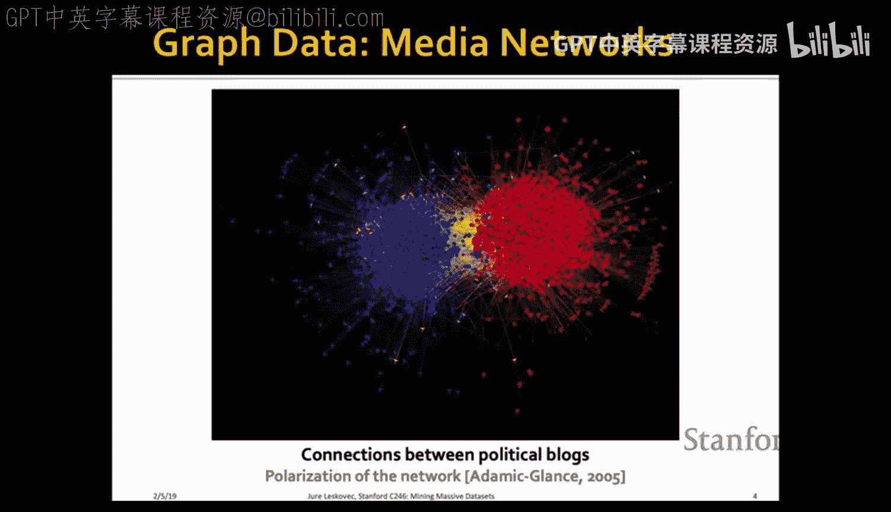
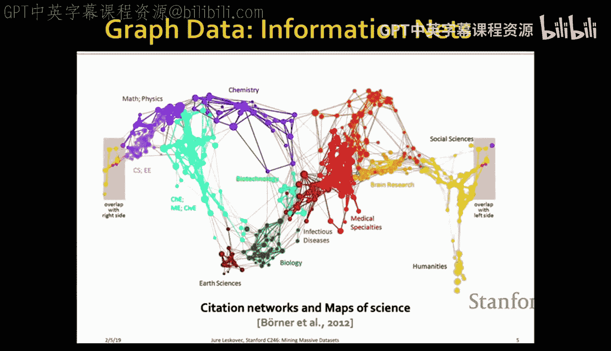
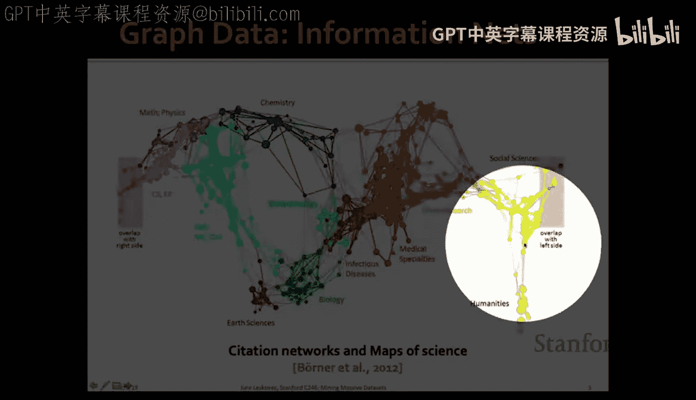
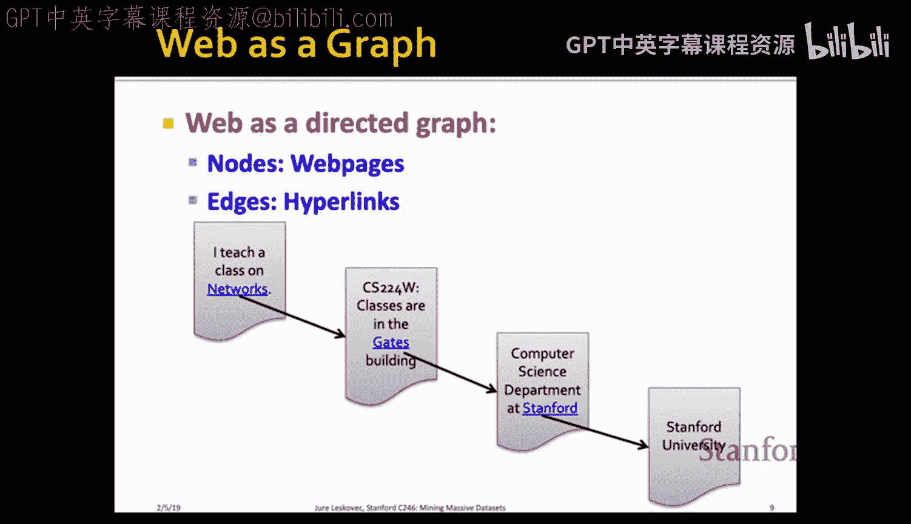
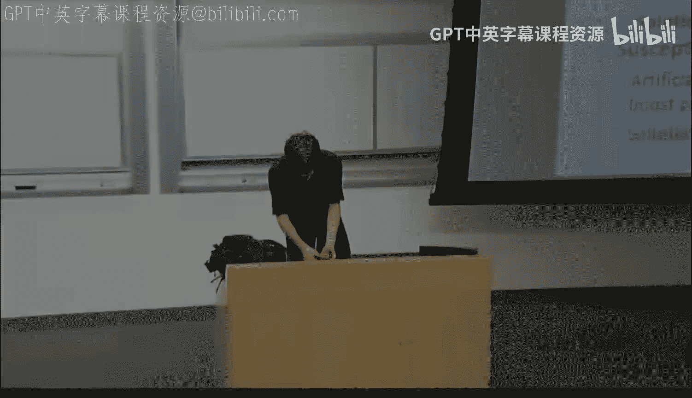

# 斯坦福大学《海量数据集挖掘｜CS246： Mining Massive Data Sets 2019》中英字幕 p09 -P09-lec9 PageRank.zh_en -BV1raSjBuE3d_p9-

OhCan you hear me yeah okay super so great welcome to the class。

 Here is the plan for the next two weeks。 We finished talking about the high dimensional data so what we are going to do in the next couple of weeks is talk about graph structure data so basically data that can naturally be represented as graphs and we will talk today about computing importances of nodes in large graphs and how these algorithms have been developed and what can we use them for so that's the idea and basically what this will allow us to do it will allow us to measure similarities between the nodes in the graph and we'll get to that so what do I mean by graph structure data。

 there is amazing amounts of different types of data that can naturally be represented as graphs graphs meaning a set of nodes and a set of edges or connections links between these nodes if you think about representing social networks then you can think。

😊，social networks as graphs of people and people having relationships with one another and of course these relationships can be heterogeneous in a sense that we can have multiple types of relationships from friends to relative and so on coer and so on another case where analysis of networks is amazingly important is if you want to understand the media ecosystem if you want to understand polarization。

 opinion formation and things like that then networks are an example of this what is this this is a visualization of United States political blogs and how they link to each other and the blogs are colored based on political affiliation and you can see is nice but worrying separation between the two sides。

 the red and blue right you can also think of if you think of science。

 science is naturally a network one way how we can create networks out of science is that we look how scientists cite each other。

😊。

So you can start asking， how do different fields of science， How do they relate to each other。

 And this is one such visualization that tries to say， how do different fields fit together。

 And you can see that， for example， computer science and Us。

Computer science here， right， You see what are the relevant areas。 It's kind of math and physics。

 Then it's， you know， the， the chemical engineering and things like that。

 And then on this side should build kind of social sciences and so on。

 So this is a picture that wraps around。 But it nicely says what computer science is all about。

 And what does it like what connections does it have in terms of applications and so on。 right， so。😊。

This is naturally a network。Another case where networks are amazingly important is if you think about communication infrastructure。

 again， those that communication infrastructure can be model modeled as a graph。 And of course。

 here is the oldest kind of networks problem。 you know。

 from 1700 by Eer who as wondering how to how to traverse over over all these bridges and get back to the same place and traverseage bridge only once。

 But the point is that this is a technological network。

 It's a network describing human infrastructure。 So you can think about describing roads maps vote distribution network。

 electrical grids with with the with networks and then thinking about how do you do optimization robustness and things like that over them。

 So basically， my point is that graphs are everywhere and you don't have to look too hard to find them。

 And what I want to talk to you today about is actually thinking of the web。😊。

As a graph and the way you can think of the web as a graph is that you think of nodes as web pages and edges as hyperlinks。

 right So if I would have my class on social networks here。

 then the way I would create a graph of this is that every page is a node and then links point to other pages。

 So this creates connections， in this case， directed connections between the nodes。

 right And here is one example， But you can imagine the web being this massive network of web pages pointing to one another。

 Of course， with the emergence of sites like Facebook and so on。

 when everything is machine automatically generated。

 know they don't necessarily conform to this static view of the web。

 But if you think of static web pages， then this is and most of the web is still static this is a good analogy of how to think about the web as a graph structure。

 So then if you say I have this graph of the web， the question is， how do I go and organize。😊。

is this graph organized。 How how can I understand what are， let's say important nodes in this graph。

 And if you w to go and organize the web， then the first try to organize the web was a human curated way to organize the web。

 And then there was this thing that now， unfortunately is the history but actually are we are that essentially the way Yahoo started was that they had these human editors who who will go and classify web pages into different categories。

 So if you wanted to find a web page， the idea was that you would go here and say， oh。

 I'm interested in health and you would click and then find a list of health related web pages right and people tried to do that until kind of Google came and said web search is the right way to do it right know rather than trying to organize the entire web in this human curated categories Let's come up with a search bar that will allow us to search documents。

 And that is a very big field that worries about how do you search documents and that field is called information。

😊，Retrieval and information retrieval is older than the Web is。

 But information retrieval really worried about， oh， you have a set of 10000 news articles trusted。

 you want to search over them， or you have a set of， I know。

 1000 documents you want to search over them。 right， like patents articles， so on， right。

 But the difference becomes that web is this huge huge piece of content。

 lots of untrusted adversarial， adversarial things， lots of spam。

 So how do you now search over this untrusted set of documents。

 And this is kind of what we'll talk about， right， So really， if you want to search the web。

 you have two problems， right， first is that there are that web contains many different websites。

 you know， who of them should you trust， right， how would you compute the trustworthiness of each page。

 And how would you say this is a good part of the web and this is untrustworthy part of the web。

 And then the second thing is。😊，You know， you could ask。

 how do I find the best answer to the query newspaper？ And if you think about this， maybe， you know。

 there is no singular right answer to the query newspaper and maybe even。

The newspaper word won't appear on the best newspapers， right？

 I don't think a word newspaper appears on New York Times or Washington Post， right。

 So how do you search for newspapers。So the idea is that。

 you know that you may want to go and exploit the web graph structure to allow you to find answers to queries like that。

 So that that's why graphs are important。 So what we want to do today is think take this abstract problem where idea is I have a graph。

 Let's say graph of the web。 And I want to understand how important is a given node in the graph。

 right， how important is is is a given node。 So maybe you know blue node versus the red node。

 I would kind of say that blue node seems more important。 You know， it has。

 it has maybe more links and so on。 right So the question is how do I compute the importance of the node in a graph。

 that's what we want to do。 And really the research area that tries to deal with this is called link analysis。

 It's basically the idea is， I want to analyze the links of a graph so that I can I can understand the graph better I can understand which nodes in the graph are important。

 And today we will talk about。Pger rank which is the main method in this area。

 and then we will talk about certain certain extensions and applications to Web spam on Thursday。

 So that's kind of the plan for this week。So what I want to do is I want to talk to you about Page rank algorithm that was essentially that was invented by by Larry and Sergey when they went and founded Google。

 So Page ranknk was one was or is one of the secret sources of why Google was was able to become the dominant search engine and the reason for that was they realized that web is a graph that web is a connected set of documents and that these connections can allow you to much better know how to search over the web than think of web as an isolated set of know independent documents where you can only do text retrieval。

 So Page rank was was one of the core algorithms and it was developed here at Stanford as a part of the project that gave rise to Google and there is a paper actually that Larry Page and Sergey Bna。

😊，Are the authors on pageing。 can you can find it。 And I think it's the title is page bringing order to the web。

 So the idea is the following， right， What do we want to do。

 We w to figure out how important is a page。 How important is node in the graph because when when we return search results。

 Maybe we will just look at the query， at what the pages that match that query。

 but then we will sort them， but by their importance in the graph right So this importance will give us kind of a priori belief or score how important is the page good is the page if we don't even know the query Okay so one way you could do this is to say I will count the number of links page has。

 The first idea would let me count the number of out。 And if you do that。

 then pages that are huge and have lots of out links would win So you don't want to do that。

 then you know you could do is to say I will count in links because are harder to fake。

 you have to find。Other people on the web who will point at you so you could look at the in links and say this is how important is a given page。

😊，But then you quickly realize that not all inlink are equally important， right。

 Like you would say links from important pages make you more important， right。

 So it's not about the the the total line know number of friends you have。

 But it's about how important are those friends。 And they give you importance， right， But of course。

 those friends importance also depends on their friends importance。

 So we have this kind of recursive definition where my importance depends on my friend's importances and my friend's importances。

 again， depends on their friends in kind of never ends。

 And this is how page rank will be will be computed and why we call it。

 it's a recursive type of question。 Okay， so idea， another idea you could think of this is。

Is this formulation of what is called a random surf。

 And I will introduce these concepts now and make them more precise later。

 But hopefully this will kind of give you some intuition that will follow us through。

 So one way you could compute the importance of a page on the on the the on the web page on the graph is to say how many people visit that page。

 Okay， and the more people visit the page。 Obviously， the more important is the page。

 But you cannot watch everyone spy on them to see what pages they go and visit， right。

 So what could you do is to say， let's come up with a model of how people browse the web。

 And maybe one possible model how people browse the web is called the random surf model。

 And the random surf model is a person who， you know， gets to a page， clicks a random link。

 gets to the next page， clicks a random link keeps walking around the web。

 They are called random surf because they are surfing the web， but in this random way。😊，Okay。

 so you can think of this random surf as a very naive model of how people would browse the web。

 right where idea is that this random server starts at a random page。 And then you know。

 follows out link from that page arrives。 So the next page follows another random out link and this process continues and what is page rank page rank is something we will call limiting probability of of the surf being at a given page。

 So the idea is that the surf walk very， very long time。

 you stop the clock and you ask where is the surf。 and the page rank is the probability distribution distribution over where the surf might be at that time when you stop the the clock。

 Okay so the server walking around create some distribution over the probability of the surf visiting that page and page rank is that probability okay。

😊，And the idea is， as I mentioned before， is that this page rank score will become to be this kind of recursive question where we'll say the importance of the page is some kind of combination of importance is coming from its neighbors or you could say probability that the surf is at a given page is the probability that the surf was some nearby page and then navigated to that page itself。

 and even more cool stuff will happen。 It will turn out that this page rank score will become some eigenvector of some funny transition matrix。

 so it's a lot of beautiful things happening right I told you about the recursive definition。

 I told you about the random surf model and now I started mentioning some eigenvectors and eigenvalues and it will turn out that all this kind of magically comes together in this great symphony so that's the preview。

 So we'll talk about the random surf model recursive recursive formulation of page rank and then。😊。

turn now that this is an eigenvalue problem that we can solve very efficiently。

 So a lot of cool stuff。 a lot of cool mathematics will kind of coalesce in this beautiful sinful。

 Okay how would the page rank scores look like in on a real graph。

 Here is a real graph where the size of the circle or the number is proportional to the page rank score of the node and the page rank scores here I made them to some to 100 I want to make you some observations right。

 for example， node be has a lot of importance because of lots of other node point to it make sense right notice that node C has also huge importance。

 And the reason why it says has so huge importance is because this node be that is very important is the only node that points to it。

 So it makes sense for this node C to be high importance as well， right， you can， for example。

 notice that， you know， these notes here， who nobody points to have low importance。😊。

RightYou also notice， for example， that， if you compute， if you say how about E and F。

 E has three nodes pointing to it。 F has two nodes pointing to it。 So E is more important than F。

Right， so， for example， D has E pointing to it。 So D is more important than these little guys。

 but is less important than E because nobody else， points to the D itself as well。 And then。

 you know， D kind of points to A and B， right， But if you look at this and compare this sizes or these numbers。

 It kind of makes a lot of sense for B to be the most important。

 The reason for C being important because they have this very important friend B。 you know。

 this ones， Nobody' is pointing to them。 So they have very little importance and so on and so forth。

 Okay， so that's what this will allow us to do and will allow kind of to get this intuition and mathematically formulated。

So here is now the recursive formulation of the page rank problem。 right， How do we。

 how do we think about it， We say that every linkss vote。

 the weight of the vote of the link is proportional to the importance of the source web page。

So the idea is if page J has some importance R subj right and it has n outlings then then that page takes its own importance and splits it n different ways equally and then and then right like if the page J says what is my own importance。

 page J simply takes the importance is from the page that point to it and sums them up right So the idea is if I'm page J my importance is third of the importance of page I and one quarter of importance of page K why one quarter because page K has four outlings。

 So whatever is the importance of k J gets one quarter of it。

 whatever is the importance of page I because I has three outlings。

 one third of it J gets and that is j's importance And of course when J now propagates its importance further。

J has three outlings。 So each of the neighbors gets one third of the j's importance。 Okay。

 so that's what do we mean by a recursive definition where， you know。

 you collect importances from your friends and send them to people that you point to。

 and you split it equally across the outlings。 That is essentially what is called the flow formulation。

 The reason we call it the flow formulation， because you can think of the influence flowing over the edges。

 right， Whatever is your influence score， you give one third of it to every of your of the people who are downstream for you。

 okay。😊，So now I give you the first， the first example， here is my graph of the web from 1800。

 when it the web was very small。 and I have this different three different websites and how they link to each other right And the way you can think of this is now to say node A gives half of its importance to node M。

 and the other half of its importance to node Y。 And then， you know， node Y has a self loop。

 So half of the importance of why stays with itself。 and the other half is sent to node A。😊，Right。

 and the way basically the way you can now think of this is that that the vote from a important page is worth more and that a page is important if it's pointed to by other important pages。

 Okay so I can define the rank the page rank score are sub J of some page J as simply the sum。

Over the importances of the pages that point to J， where every importance is divided by the degree of j of the degree of I right this is exactly what I had on the previous slide。

 I say my importance is is the sum of importances of the people that point to me。

 and each one of them gives me one over the degree of their importance right So I'm summing from people that point to me。

 and their importances are equally split among their outlings。

 and this is this is what I have Okay so now if I would write out here are what is called the flow equations right。

 I say what is the importance of M importance of M is half importance of a。

 So here's the equation for M equation for a says importance of a is importance of M plus half the importance of y right So so importance of a is half importance of y plus importance of M and then。

What the importance of y， y importance of y is one half of importance of y that's the self loop plus the inlink from now day。

 So it's half of the importance from a。 Where did I get this one2s because nodes have two outlings。

 right， This is the number of out linkss of a given node。 Okay， so now I have this set of equations。

So what could you do， You could say， haha， I have three equations，3 unknowns。 I'm good to go， right？

 You could say， oh， there is no unique solution， but basically with three unknowns and three equations。

 What you get is you get multiple different solutions。

 But they are just scaled versions of one another。 So if you say my page rank scores with sum to 100。

 now you get， you know， the fourth equation， you have three unknowns，4 equations。

 you can go solve the solve the system。 and here are your importances。 Okay。

 so here I said they have to sum to one。 So here are the importances of pages。 And this sounds great。

 right， I could use Gaussian elimination and do this。 It turns out that this is a very bad idea。

 It's kind of computationally too expensive to do this。 So nobody does this。

 So let's try to find us find a new。😊，Equivalent formulation that won't require this recursive equation solving。

 Okay， so that's the that's the next step。 Do people have any questions。Okay。

 so what we learned so far is this recursive definition where the importance of the node depends on the importance on of the nodes that point to it。

 And that defines a system of equations that's up here that you could solve。 And if you solve。

 you know， this would be the solution。But solving that system is too expensive。

 you want to do this for the whole web graph with， I know， billions， trillions of pages。

 so you need something else。😡，So here is how we will do this。

 We will go and define what is called stochastic adjacency matrix M where what we will do is the following。

 If page I has disab by out linkss， then if I points to J， then the entry M J I equals1 over D I。

 okay and otherwise is 0。 So essentially what this means is that our M is column stochastic。

 it means every column will sum to1。Okay that's why will it sum to one because every every entry every node I has this has the outings。

 So if I sum over the column， it means that I'm sum summing one over the d times which equals one。

 So that's why this will be column stochastic matrix right And then I will define what is called rank vector R where vector will have one entry per page。

 one dimension per page and that you know the the I component of vector R will be the page rank score or the important score score of that page I。

😊，And I will require the discourse sum up to one so that they are a probability distribution over the nodes。

 That's another way to look at it。 Okay， And then it turns out that my flow equations from the previous slide can be rewritten as R equals M times R。

 okay。Why is that the case Here are my previous flow equations that we like and we know And if you look at it what is this saying。

 it's saying entry for node R is all the all the nodes I that point to it importance of the node I multiplied by1 over the degree of I right in the m matrix up here。

 we store1 over the degree of I So what we are doing here is just saying R right the new R equals the old r multi summed up and multiplied by1 over d。

 So this in matrix notation is that and now you can start seeing that this looks like an eigenvalue problem right like lambda x equals a times x。

 So it looks quite similar to that So just to give you a more proper example right I have the flow equations up there I showed you that this equation that n times r equals R。

On the previous slide。 So the way you could think of this is the following。

 if you have a page I that has three outlings， then this column that that is that corresponds to page I。

 you will have three nonze entries。 and each of these entries will be one one third， one over3。 Okay。

 so now if you have a vector。And you multiply matrix with that rank vector what you get right for a。

 let's say for a given entry J， you will basically take this row multipied with this column and wherever there is a non-zero entry here this means that sum node I points to the node J So the rank j will be updated by the sum of the ranks appropriately multiplied by one of the degree for wherever there is a link。

 So this is why this is a flow equation kind of proof by picture。

 so what does this mean it means that I have my graph from before I have my flow equations。

 here is how now my matrix M would look like。 it is essentially the adjacency matrix where the entry is one over the out degree。

 So for example， node M has out degree of1 and it points。A so that this entry here equals one， right。

 This is this link。Okay， so now I could write this， you know， R equals m times R。 I say R M R， right。

 and I have this type of equation to solve。 So I will now give you a quick explanation。

 Why about this eigenvector formulation of page rank， right。

 So I'm saying flow equations can be rewritten as R equals m times R。

 and what this means is that the rank vector R is the eigenvector of the of the web matrix M。

 this transformed matrix M。 and here is another thing， right， Like we。

 we have written this R equals m times R。 I could do the following。😊。

I could start with some vector U。 I could multiply it with M to get my new vector U。

 I could multiply it with m again to get the new vector。

 and I would keep multiplying it for a very very long time and if I ask what is what is the vector I would return after I take something and keep multiplying it with M then what the limiting vector of this thing would be it would turn out that it would converge to the eigenvector right basically it would converge to the eigenvector with eigenvalue1 And right so from this point of view。

 this is now very efficient to solve all I have to do is I have to take some vector U and then keep multiplying it with M for a very long time usually you know50 iterations is enough and in 50 iterations this computation。

Will converge to the to the principal eigenvector。 This is the eigenvector that corresponds to eigenvalue with lamb to the eigenvalue with value1。

 And this is called a power iteration， Because we are just itating U times M and we keep doing that。

 what I have next is to explain this power iteration a bit more。

 And then what I have hidden from the presentation， but is in your slides is proofs why this works。

 and why does it converge and all that。 It's like three slides， It's not to hard math。 Okay。

 So what is this power iteration method。 Power iteration is the following， right。

 And we talked about power iteration when we talked about。SVD， if you remember， there we said。

 how do you find eigenvalue in the corresponding eigenvector， you can do power iteration。

 And the idea for for our case will be let's come up with some initialization of rank vector R。

 let's call it R 0。 Let's compute， you know， R 0 times M to get R1， if R1。

 if the difference between the two vectors is small， we are done less than some epsilon。

 Otherwise compute this thing again， Take R1 to obtain R2。 Again。

 what's the difference between R1 and R2。 If it's less than epsilon， we are done， otherwise repeat。

 And as I said， in about 50 iterations， even over a graph with billions of nodes。

 this thing will converge。 and this will be your page rank scores。

 and this is called power iteration。😊，To show you that this works on a simple example。

 here is my power iteration in in the in the pseudocode， right， I initialize R。

 and then I I run steps 1 and 2 until I converge。 So let me now show you。 This is again。

 the graph we have This is our matrix M。 This is our initial guess at the page rank importance is。

 And all I will do is I will take this vector， and I will keep multiplying it with that matrix up there in the corner。

 You know， after first multiplication， This is what I get after second one。

 This is what I get right so I basically now take this vector multiply with M and I get this one。

 Now I take this one， multiply it again by M。 and I get the next one。 I take this one， multiply。

 And if I keep doing， this is where it will converge right So it will be 6 over 15。

6 over 15 and 3 over 15。😊，If you remember and you can check yourself。

 these are exactly the numbers that solve this system of equations， like a few steps。

 a few steps before， when I talked about flow formulation， I gave you a solution to this system。

 And the solution to this system were this numbers。 I think I was dividing by 5 because I can。

 you know， this would be two over2 over 5，2 over 5，1 over 5。Right。So that's what you can do。 Okay。

 so this power iteration， where I just start with this vector and repeatedly multiply it with my matrix M up here。

😊，Will converge to something stationary。 So it means it will stop changing。

 And here is this conver converging vector。 And this converging vector is exactly solution to the system of equations。

 yes。guarantee that for any such stochastic matrix， you have a eigenvector with eigenvalue 1。

 great question。 So the question was， am I guaranteed that this will work for any matrix Sam。

 The answer is no， and I will fix it。 Yes， you you are absolutely correct。

 So here it turns out that this graph has some beautiful structure。

 which I haven't told you yet where this magic works， So I will explain what the magic is。 Allright。

 so thank you for the question。 It's awesome。 but don't be， don't be alarmed。😊。

So before I tell you that， I wna now， so I gave you this idea of the flow formulation。

 I showed you the power iteration。 I showed you how you take the original matrix， normalize it a bit。

 And now by just multiplying that some， you know， some random vector with that matrix all of a sudden。

 we get a solution to some system of equations。 it seems quite magical。

 So I will explain how this works。 But before I do that。

 I want to go and explain what is called the random walk interpretation。 So right now。

 we have this eigenvalue system of equations type interpretation。

 Now I will give you a different interpretation that mathematicalally is the same。

 And this is this random surf， random walker interpretation that I was talking about before when I was saying。

 oh， think of the surf surfing the web。😊，So the way to think of this is imagine that at some time T surf is at page I right？

 And then you know what's time T plus1， the surf will follow one of the I' outlinks uniformly a random。

 So it means surf is at the page looks at all the available outlinks picks one of them a random and makes a step。

 And now is surf is at the new page again， looks what are the outlings and takes one a random。

 right So imagine that the surf is doing this。 And right now they just ended up at some page I some page J。

 sorry， right and you know， this process will will will keep running。

 So let's think of the following。 Let's say that P of T is the vector whose I coordinate is a probability that the surf is at page I at some time T。

 Okay， so this is now some vector where every component tells me how likely is the surf at that web page。

At this given time。So what I'd like to figure out right is how will the P T plus 1 look based on P So I want to say。

 given that I know the probability distribution of the surf now， surf now does one step。

 How does the probability distribution of the surf looks now notice， as I said， right。

 this is a vector。 So this vector is a probability distribution over the nodes。Okay。

 so now let's work out if we know where the surf， if we have a distribution of our belief。

 where the surf is at time T， where will the surf B at time T plus1。

 Okay So how do I figure that out。 I figure this out by saying。

 how does the surf make a step a surf makes a step by selecting a link a random and navigating to the target web page。

 So the way I can think of this is to say the following。 You know。

 whats the probability that the surf will be at page J。

 So this means it will be whatever was the probability in previous step that the surf was at page I1 dividing by the out degree。

 out degree of I1 plus whatever is the probability that the previous step node I was at I2 divided by its out degree。

 And then plus the probability It was that I3 divided by by out degree of I3。

 That's the probability that the node is at。The set is at page J。😡。

And if you think what does this mean， this means the following things。

 it says whatever was the probability distribution， the previous step， so P of T。

 I multiply that with my transition matrix M to get the probability distribution at the next step。😊。

so this should be clear right so did we so what does this mean right it means that p of p at the time p plus 1 is this transition matrix times p of T。

 meaning the probabilitybabilities distribution are the previous time step。😡。

RightAnd now why did we compute before we said m R equals n times R So this is very much similar right so as I'm running this iteration。

 I'm basically saying that I want the random walker to converge basically if I keep updating this probability long enough。

 if I keep iterating this I will converge to some stationary probability distribution right So what this means that P of T is a stationary distribution of this random walk right this means that from this time on the probability distribution won't change anymore right my belief about where the random walker is will kind of converge or stabilize right So what does this mean is that our original formulation R equals n times R is essentially a stationary distribution for for a random walk on this graph right where a random walk was specified by this。

Random surfer type process。 Okay， and here you have the connection。

 It's a connection between the flow formulation and the eenvalue eigenvector。

 And this is the connection with the random walker。 Rand surfer model where again。

 solution to this iteration is is a stationary distribution of this random walker。 Okay。

 so this is how things come together。😊，Okay， are there questions。

So what I said right now is like I said a lot and it's important and I will say it again。

 what's important is that two different intuitions came together under same mathematical formulation。

 One was this flow equations and the eigenvector that corresponds to the leading eigenvalue of of this matrix M is equivalent to thinking about the random surf and the probability distribution of where this random surf is and as the surfer makes a step where it ends up with and as we iterate this random surf long enough。

 basically our belief to where the surf is converges to this stationary distribution。

And the two views of page rank are equivalent。Okay， that's the。That's the essence of what I said。

Any questions。Okay no questions moving ahead so now the question is right like when do these things exist and are they unique right and the central result of let's say the theory of random walks essentially this is the theory of marco processes says that you know if graphs satisfies certain conditions then this stationary distribution is unique and eventually will be reached no matter what is the initial probability distribution so basically what this means is that I can start with my vector r0 to be anything and if I keep multiplying it with M long enough it will converge to the stationary distribution and this distribution will be unique so whatever I start with I will always converge to this thing that's one thing another way to think of this is that where wherever。

The random walker starts after some number of steps the random walker our belief about where the random walker is will kind of become stationary it won't depend on where the random walker started okay so that's the way to look at this so now what I want to do is go in and talk about what are these certain conditions and properties of this graph that make this work okay。

😡，And what we will do is we'll now talk about page rank the way it was formulated by the Google guys。

 Okay so summary， what did we do is we took this flow formulation here。

 we wrote it as a matrix and we solve it using power iteration Now the question is does this converge does it converge to what we want are the results reasonable So the first thing is does this converge。

It turns out it doesn't converge on all the graphs。 Here is one graph。

 very simple web graph with just two web pages， one pointing to another。

 I start with some initial vector。 and I multiply with matrix M and you see this doesn't converge right So a has all the importance sends it to B。

 now B has all the importance sends it to a and to B and so on and it oscillates。

 So it seems all my story doesn't work anymore。 So that's the first problem。

 And then the second problem is even a simpler graph。 here it is。

 where if I now create a matrix M out of this and this is my initial vector right。

 I start here in A sends all the importance to B。 this is here now B has to send it somewhere。

 There is no one。 So it converges to all zeros。😊，And again， we are disappointed， right。

 So it seems something is wrong with my theory。 And I'll tell you what is wrong。

 There are two problems with what we were working with So。

 First is that web graphs or real graphs can have dead ends and dead ends are pages that have no outlink right。

 if I go back no to be here is a dead end because when the random surf comes to be。

 The random surf doesn cannot go anywhere。 There's no out link。 you get here and you。

 you then jump across the cliff or something right So this is what we call a dead end where basically the random surf gets stuck。

 They have nowhere to go right， and such pages with out to degree 0 cause the importance to leak out of the system。

 Again， if I go back what this means here is my importance is nicely sum to one。

 my importance is nicely sum to one and now the importance leaks out of the system and importance is sum up to。

0， right， so I lost magnitude。 I lost some importance mass。

 And then the second problem is what is called spider traps。

And spider traps means that all outlings are within a group if you think here right in this graph。

 this is the dead end because when the surfer traverses this edge it basically from here it leaks out of the graph because it has nowhere to go this is an example of a spider trap and basically what this means as soon as the edge from red to green now is traversed。

 the random walker gets trapped in the spider trap and it will never be able to escape it so the probability distribution of where the random walker is its in this spider trap with probability 1。

😡，RightBecause as long as the walker walks this graph。

 eventually it will get in here and it will be trapped and it will stay in there infinitely long。

 Okay， so these are the two problems。 right， basically the spider。

 the spider traps trap the walker who gets infinitely long stuck in this in this cycles。

 Okay so going back to my to my example， but changing it a bit here I change the graph so that M is now a spider trap。

😊，Here is my matrix M right now， and I show you what happens if you do the power iteration over this different graph right。

 And as you do the power iteration， notice how importance of node M， This is the node M。

 how the importance of node M increases or keeps increasing until all the importance is stuck in M。😊。

And the way you see this， if you think of the random walker in my example。

 you keep walking between A and y as long as you want。 But as soon as you get to M。

 you are stuck in M。 So after infinitely long， you say， where is my walker。

 My walker is in node M with probability1。 And this is kind of unsatisfactory。

 I don't want M to have all the importance。 Y and A are also important。

So how do you solve for spider traps， you change your random walker model and the way the Google guys decided to change it is to invent this notion of a teleport so your random walker has now two options at every step the random walker flips a coin and based on that coin flip with beta。

 the walker makes one of two decisions。Either it follows an outlink a random。

 which is what we were doing so far， or with the remaining probability。

 the random walker teleports itself to some random node right so this is in some sense you parachute yourself at some other part of the graph or you keep walking okay。

😡，Typically data is set to be somewhere between 0。8 and 0。9， so 0。

85 is kind of the best the best thing to set， which basically means that the random walker on average makes five steps and then teleports so now why will this help with spider traps because the random walker can walk gets into the end and after a few steps it will teleport out So the random walker can always escape with some probability because of the teleportation right so the way you can now think is that every node there is a little kind of outlink out of it that says。

 oh if you are here， you can always teleport out yourself from that node。

 this is what the change does does right now and this fixes our spider trap problem by basically allowing by changing the process and allowing for these teleportation Yes。

With importance。 So do we have to go and adjust the importance values for the length for every single node。

 Oh， of course， now everything will change because now my random walker has。

 it's a different process。 So my， I need to change how I define my matrix M。Correct。

 that's a good point。Okay， so theres the first thing。

 And then the second thing is what if I have my dead end like my node M is a dead end right So if you look at how the matrix M would look like here where there is M。

 there is full of zeros because M has no outlings。😊，And if you start with doing my power iteration。

 here is the first vector and I keep multiplying by M。 After a while。

 it will converge to a vector full of zeros because the importance is leaking out of M because the random walker has nowhere to go。

 that's intuition。What do I do， I say if you come to a end， you always tele aport。

 So what this means is that for nodes that have the out degrees0。

 where my matrix Sam would look like this。 Now I say， oh， you always tele aport。

 you can tele aport to node y a or back to yourself。

 So basically I replace this column of zeros with a column of one over n。 right。

 I basically say whenever you come to M， you can tele aport wherever you like to yourself as well。

 Okay， So this is now the solution to to the to the problem of that ends。 Okay。

 now why do teleports save both problems。 Why do they solve the spider traps， Why do they solve the。

The dead ends， right， here is the reason why spider traps。

 right in spider traps are not a mathematical problem， right， Our。

 our convergence and everything still happens。 Just page rank scores are then kind of stupid。Right。

 so we don't want ping scores where every all the importance is trapped in a spider trap because we don't want that。

 We want our random walker not to get stuck in a spider trap。

 So we allow the random walker to teleport。 So it can always teleports out itself from these spider traps。

 right in some finite time。 So that is why we don't why teleport save spider traps。Now， dead ends。

 in some sense， are a problem because otherwise， our power iteration converges to 0。

 which is also not what we would want， right， The reason why it converges because matrix is not column stochastic anymore。

 right， we have this column full of zeros and a column with a lot of zeros or full of zeros doesn't sum to one。

 So the matrix is not column stochastic right， So this means we have to make a matrix column stochastic。

 And the way we do this is that basically we always teleport out of the node with probability1。Yes。

these problems are naturally occurring in the web， what about things that are like adversarial against Great question。

 What about things that are adversarial against page rank？Come come to the class on Thursday。

 And I tell you。 So this will be the topic for Thursday。 Okay。

 exactly because you can now imagine I wna， I'm a bad guy。

 I will change the structure of the web to make my point。 my web page look very important right。

 and we'll talk about how do you deal with that。 But that's exactly what Web spas do search engine optimization。

 people， they want your the page to be on top so they will engineer some part of the web to push that page up。

 Okay， that's a great question。 Yes， if the graph was undirected then like we wouldn't have any issues。

 if the graph would be undirected， then we have no issues。 exactly， because you can always go back。

 right， so you cannot get stuck。 You cannot fall out of the graph because that has no direction。

 So you can always go back。 So this is， if the graph is directed， then you have this problem。

 if the graph is not directed random walker is free and happy to roam around as much as it wants。

 Good question。 actually， good observation。😊，Cool， thank you。 These are great。 So how。

 how do you now put all this together。😊，Right， we have this random walker formulation where we say with probability beta。

 random walker follows the link a random and with probability1 minus beta。

 it jumps to some random random page。 This is the paper 1121 years old。

 I guess just got into how do you say maturity， It can get drunk now or whatever。

 right So what what is it Like how do we deal with this， right So we say whats the score of page J。

 you say the score of page J is the probability of random walker being node I picking a random link and navigating to node J。

 But the random walker does that with probability beta。 So that's why we multiply here with beta。

 And then you say there is another way for the walker to come to page J。

 the way the way that the probability is the random walker decides to jump Here is the probability of jumping probability of teleporting。

 And now if the walker decides to。😊，AportIt must land at node J。 There are n nodes in the network。

 So probability of random walker landing at J is1 over N。😡，Right。

 and this is now my recursive definition。 Right， So essentially。

 I still have my matrix M that I preprocess to have no that ends。I have data here。

 And then this is the probability mass that comes from the random walker deciding to teleport and landing at this particular node J。

 Here we are assuming that random walker can land at any node with equal probability。

 That's why here is one over n。😊，Okay。Great， so how what how can you now write this out right？

 Here is my page rank equation that I said before。 And the way you can write this out。

 it is still recursive formulation。 you can define this matrix A that is beta times matrix M plus1 minus beta times dense matrix where all the all the entries are1 over n。

 Okay And now if this is your matrix a， then the the equation above can be simplified into a r equals a a times R。

 So what does this mean this means that power iteration will still work right。

 if I formulate this matrix A， then。😊，Basically my new random surf。

 this one we teleports is still an the solution to it is still eigenvector of this matrix a that has the following structure。

 which which is M scaled by beta plus1 minus beta and then a matrix full of1 over ends and the size of the matrix is M by n because n is the number of nodes in my graph As I said before。

 how do I usually set beta， I set it to be 0。85。Okay， so let me now give you this。

 and then I'll comment a bit， right。 So here is now my graph。 I have a spider trap here。

Here is my matrix M。 notice it is column stochastic right columns sum to1 Now I I also you can think that I almost like add this edges that are there due to the random jumps and teleports right so I say now this is 08 times m plus02 times matrix full 3 by three matrix where every entry is one over three。

 I add the two together and here is my matrix a。😊，And now， if I do power iteration of on my matrix。

 A， here is the starting vector， and I keep multiplying。

I get I get it to converge it the coordinates sum to 1 and these are the importances of the nodes and these are now the eigen this is the eigenvector corresponding to the eigenvalue1 of my this transformed matrix a okay so now everything sounds great there is one huge problem with this。

😊，Can somebody tell me， what's the problem。Think that I have a graph on a million nodes。

 or maybe a billion notess。What's the problem。Yes， great。 Okay。 awesome。 Thank you。

 So what's the problem。 The problem is that this matrix is a billion times， billion times billion。

 right， So this matrix is 10 to the 18 different entries。 So and every entry is nonzero。

 So this matrix is huge。 right， not even Google can work with such big matrix。 So the question is。

 what do you do， the point is， we never want to materialize this matrix A because it's dense。

 And for any graph that is nontrial in size， I cannot even materialize a so that then I could run this power iteration on So we have to do something else。

😊，So what we will do is。Talk about how do I actually go and compute this thing。 So far。

 we just developed the math。 How do I compute it。😡，And right the way we said it was， you know。

 we will run power iteration over this matrix A。 we said how to compute matrix A is， you know。

 beta times m plus1 minus beta times this matrix that's full of one over threes。

 So this means that the sum of these two matrixrices will also be a full matrix with all the entries being nonze。

 And as I said， the problem becomes that you know， if I have1，1 billion pages。

 I would need I would need basically1 billion squared number of entries to represent my matrix A。

 So I cannot do that， even if I wish to。😊，So what I will do is the following。

 right what we have so far。 we want to run this power iteration over this matrix a where aji is。

 you know， beta times Mji plus1 minus beta over n。s that's what my matrix A is。

 And then I want to run power iteration I spell it out out there。

 Now I have this Aji and I will write it out what it is right So I just took the thing above and I wrote out。

 I expand it what definition of a is and what I can do now is I can kind of push the summation in right I have here one big summation。

 and I can distribute summation inside。 So I have a sum1 to n over beta times Mji times plus you know one minus beta over n and then a sum over Rs because I take that and I multiply it in here and I multiply it in there。

😊，So now I have taken this one matrix vector product and kind of expanded it out in these two summations。

 I have a summation here and I have a summation there right And now if I try to rewrite this again。

 what do I notice。😊，I notice that sum over R equals to1 right the sum of the pageing scores equals to1。

 So this thing disappears and this summation is still here。 Okay， so now this is super cool。

 Why is this super cool because I can do my power iteration here and then I just add this constant term。

 So essentially what it means is that。😊，What we got is that r equals beta times n times r plus1 over beta divided by n。

😡，Okay， so this is now this is now great because I can iterate this equation。

 And this is just some constant that's the same for all the nodes。

 And that makes it that makes it great。 right？ So now we have rearranged our power iteration。

 And the trick here is that my matrix M is sparse， right。

 The number of nonzero elements of M is the number of links in the graph。 Multiplying by a constant。

 just changes the， the values doesn't add new entries。 This is the vector。

 and that's that constant term， right？ So。😊，Real graphs are sparse。 So this will work really well。

 So all I need to do is in every it。 I need to say are old。 I take the old。

 the old version of R multiply by M， multiply by beta。 I get the， I get the new R。😊。

And then I need to add the constant of1 minus beta over n to every entry in in this R new。

 and I just keep iterating right and this will nicely convertverge。

So this is really the page rank algorithm， right It's like。I， I， I do this plus one over beta。

 and then I keep iterating。 Okay， Here is now the full page rank algorithm where I set I initialize my R。

 I will call it are old。 then I go for node J， I say what are the importance of its people that point to it。

 I sum them up divide by the out the degree multiply by， by data and this is now the new， the new R。

 And then what do I need to do is now I need to go and and insert the leaked page rank。

 So rather than adding。Like we said here， beta -1 over n to every entry。

 I will actually do the following。 I will say what is the sum of the new page rank scores and whatever is missing to sum up to one。

 I will add one over n of that to every note So this means that here I'm inserting whatever the page rank clicked either due to random jumps or due to dead ends。

 So this formulation allows you to deal with dead ends right so。In my previous slide。

 I assumed there are no dead ends。 and if there are no dead ends。

 then the value of this termem would be one minus beta over n。But if there are dead ends。

 then all I do is I do。 This is basically beta times Z times R。Whatever I get here。

 I compute the sum of it。And whatever I'm missing between this sum and the the value of one that I insert back。

 right， S is a value between 0 and1， whatever is the difference between1 and S。

 I divide by n by the total number of nodes。 And everyone gets an equal share of this difference。

 right， This is how you would implement the page and algorithm in practice。Okay。And as I， as I said。

 there is a bit of non trivialality here because here。

 I'm assuming also that there might be dead ends in the graph。Okay， are there any questions？ Yes。

 great。Take or respond。How do I take care of the spider trap， I still。

 so there is still this constant term that I'm adding in。

 And this is the effect of of the of the random walker teleporting out of the spider trap。

Right so the teleportations take care of the spider track and I just showed you on the previous slide right。

 how to deal with teleportations。 You get this constant factor that you add to the node because somebody might lend to it because of the teleportation and it doesn't matter where where the node teleports from。

 You just care that it cleans at your place。 and that's it。Okay， good question， Great， anything else。

Right， so here the the view is different， right？ I'm asking， how do I get to the node before we said。

 I am at a node。 How do I get out， now I'm saying， how do I get in？

 And the way I say how do I get in is by either navigating from a neighbor or because I jumped to it。

And if I jump to it， I must have jumped somewhere out。And that's it。Good， any， any other thoughts。

 questions， doubts。Okay， so now what I so here is the algorithm and if your graph fits into memory。

 this is how you would compute these things。Now， what about if your graph doesn't necessarily fall fit into memory。

 right， How does Google do this on on billions or trillions of pages， right。

 there must be a scalable way to do this right， So the idea is that what you can do is you can preprocess your adjacency matrix in this type of format where you say I have the source node。

 I have the degree， and then I have the Ids of the destination nodes， right。

 and then I have next node out degree and then I have the out degree number of number of numbers。

 because you know， these are now the Is of the target nodes and so on and so forth。

 And this is now my matrix in this sparse form where this is a row。

 And then this is the number of non-zero entries in the row and here are the entries。

 That's one way to think of this。😊，So。Imagine I can fit the entire vector are new into memory。

 So at least I'm able to， to， to fit our new into memory。😊。

And imagine I store our old and matrix Sam on the disk。So then what I could do is the following。

 I could initialize our new and then for every page with some out degree I I read in the the the page。

 the degree and a set of its destinations plus the R old at that coordinate。😊。

And then for all of the all of the destinations I say our new at that destination is our old times beta divided by the out degree of that node I right so notice here what is elegant about this algorithm that the only thing I need to store in memory is this r new right so I basically say I will read one line from the disk I will read this this entry0 and this says that node with degree 0 gives importance to three nodes15 and6 so I take this entry0 whatever is the value divided by3。

😊，Here， and I update now entries 1，5 and 6， right， And then I would load in the next node and the corresponding entry at index 1。

 So this one， and then I would update this particular entries of， you know， this vector。😊。

Right and what is the elegant thing here is that Im essentially essentially only have to keep this in memory because I'm only doing random accesses here。

 I can read this sequentially and I can read this sequentially as well kind of iner right so that's how I can do this where I need very little memory。

 I only need one one float per web page， Everything else I can keep on disk and just sequentially read right。

😊，So let's analyze this case。 So I'm assuming I have enough Ram to fit R new into memory and each iteration。

 what do I need to do， I need to read through R old and M and then write R new to disk so that once I write it to disk R new becomes R old and I can repeat the process right If I say now what is cost per iteration of power method cost I'm measuring here in how much do I have to read or write from disk I have to read the vector read the the vector R once and write it once。

 So I have two times size of R， and I have to read the matrix M and the cost of that is the number of non-zero elements of matrix M So this is the cost right it's linear in the size of the data and linear in the in the linear in the number of of edges and linear in the number of nodes and what is the memory consumption。

😊，It's only all I have to do is keep this Ar new in memory。 So it's amazingly cheap， right。😊。

So is it this is clear。😡，This side is happy。 That side。 great。 Okay， so this is clear。 What now。

 if I have so little memory。 What if I want to compute a page rank of a billion node graph on。

 I know my cell phone， actually， I could do it but not on a cell phone on on my calculator， right。

 where even my R new doesn't fit in in the memory of the calculator。

 but calculator comes with the hard disk。 Okay， so I have this fancy calculator with a hard disk。

 and I want a compute new。 Okay， so how would I do this。 one way is this is called blog based update。

 and the way you could do this is the following is you'd say if I can only store。😊。

Apart a chunk of r new in memory。 then what I can do is I can scan through the matrix M。

 but in one pass over M and the R old， I will only update0 and1 whatever I can store in memory right So basically what is means is that I break my R new into blocks and I only keep one block in memory and then I make a pass to only update that block and then I would I would flush the first block of R new on disk。

 I would load the second block of R new and then I would have to make another pass over M to to update 2 and3。

 and now that I have updated 2 and3， I would flush it and I would come back to load the next block of R new and again make one pass over the data。

😊，So how how what would be the total cost if I basically， if I take R new and break it into K blocks。

 then it means I need to scan over R and M K times right。

 So my cost would be K times loading M and R and writing R back to the disk right So my total cost would be k times M plus K plus1 times R right and basically。

Because M is so big。😡，Right， M is much bigger than R。 in some sense， what is expensive。

 The constant here is much bigger than than this value， right， So really。

 what I want to minimize is number of passes over this guy。 And this guy is much smaller。

 So I don't care so much about it， right， So M is， let's say，20，30，50 times bigger than R。 Okay。

 so here's now how I could lay out data to be even smarter。 And the way I would。

 and this is now called the block stripe update。😊，And the way this works is that I took my。

Adjacency matrix， but I also partitioned the adjacency matrix， right， So let me go back。 explain。

 So before I had my matrix， but I only partitioned R into this blocks。 right。

 And the idea was that I load one block of R and do one pass over this to update that block and then I take new block and another pass over to make the update and and so on。

 Now， I will also change the layout of matrix M。 So let me show you how to do that。 right。

 So I will store my matrix as three separate matrixrices。

 And what I really did is I took this destination。😊，destination lists。

 and I partitioned them into stripes， as it is called， right， So what does this mean now。

 it means that I partitioned partitioned the M such that here。

 the destinations are only destinations to the nodes in the first block。

 And here the destinations are only destinations to nodes in the second block。

 And here are only destinations to the destination to the nodes in the third block， right。

 So now this means I load the first block of R new。

 And then I make one pass over the the first stripe of matrix M。😊。

And then I dump the block and I load the new block and then all I have to do is make this make the pass over this strip。

 and then I load the next block and make the pass over this strip right so what essentially we did if I go back。

 what we did is we took this destinations and kind of partition them further so that when I'm updating that block。

I don't even need to read this node or that number 5 because they are meant to update something else。

 right， And when I'm reading the first line here， I know I can skip 3 and 5 because all I care about is updating 0 and1。

Okay， so that's what what this block stripping algorithm allows me to do。 Basically， it allows me。

 I change the structure of my matrix M to partition it in these stripes so that when I update the blocks。

 I only read the relevant part of matrix M。😊，So let me show you the analysis。 how long does。

 how long does this take， right， the way this takess， it's actually very， it's very fast， right。

 I'm reading my matrix exam in only once。😊，Right， if I go back， I'm reading。

 I make one pass over the matrix Sam。 Of course， this part is saved multiple times。

 So I have a bit of overhead because it's a bit of duplication， But in terms of edges。

 each edge gets redm only once right？ So if I do this。

 the the cost is is the size of M plus case this is the number of blocks， K plus1 times R right。

 because if I go back， the reason for that is I need to read。

The stripe and the entire vector are old to update this guy。 and then I load in the next block。

 I need to read the next stripe plus the entire of vector are old to update it right So if I have k K stripes case stripes and K blocks I need to read this guy K times。

 I need to read this once and I need to dump this back on the disk once。

 So the total computation cost is here。Okay， so this is how you could do this and how you would really implement this on graphs that are super。

 super huge， right， And you can do this on Hadoop and so on。 So essentially。Yeah， Hadoop was。

 in some sense， developed or invented。Also， because of this type of applications， this were。

 were this was one of the motivating applications that kind of Google wanted to do。

 but couldn't do before they invented Mapreduce， right， They used specialized systems。

 And then they realized they were just kind of gathering information from neighbors。

So now I want to finish with a bit of high level high level remarks。 and then we are done。Page rank。

 right？ The idea was that it measures some kind of popularity or importance of a pay page on the world。

 And is's based on this idea of of of random walker。

 one thing we did in our random walker and teleportations， we said when the random walker teleports。

 it can land wherever they want。 the probability of landing is uniform。

 But you can actually go and play with where the random walker is going to land。

 And you can make that landing probability， nonuni as well。

 And that nonun landing probability is called topic specific page rank。

So this is what we'll talk about next。There are other measures of web page importance that are not only page rank but but but are kind of similar formulations。

 One of them is called hubs and authorities。 Another one is called salsa So there are two competing algorithms that were kind of developed later。

 And as there was a good question before。 this， this formulation is susceptible to what is called Lipan where basically somebody can come and create our artificial topology of hyperlinks with the goal to increase the page rank score of a single page。

And on Thursday， we will talk about this method called trust strength that tries to identify these artificial topologies that are there just to boost importance of a single page。

 So this is kind of the plan， for Thursday， I was also told by Michaelela。

 But I forgot to say this at the beginning of the lecture。 Thank you for submitting homeworks。

 new homework is due on Thursday。 please submit code。 right， don't forget to submit code。

 You have to submit all your code。 If it says three times you have to submit it。

 even if it only says once that you have to submit it。 You still have to submit it。

 And even if we say that we forget to tell you to submit it， you still have to submit it。 Okay。

 so don't forget to submit your code。 be careful to read the homework problem。

 but submit us your code。 I'm happy to take questions， Otherwise， we can be done with the class。😊。

Great。乖的。Are vector necessarily converence out？我跟这。

So why does the vector R converge after many iterations。

 The reason for that is is because our matrix is column stochastic。

 If you open the book or if you open the slides， you will find the proof in the slides。Okay。

 let's finish here。 Thank you very much。

