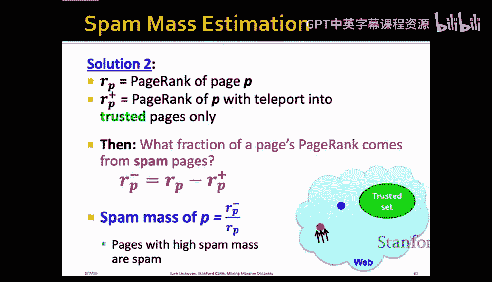

# 斯坦福大学《海量数据集挖掘｜CS246： Mining Massive Data Sets 2019》中英字幕 p10 -P10-lec10 Link Spam and Introduction to Social Networks.zh_en -BV1raSjBuE3d_p10-

Good， hello。 Let's see。 I have a problem with my clicker， sorry。嗯。啊，O。Okay。

 we'll survive without a clicker。 So we are talking about graphs。 We are talking about page rank。

 And today we are going to talk about some extensions of page rank。

 And then I'll show you some some examples of how to use page rank for commander systems。

 and I'll show you about how to use page rank to combat Webpan。

 So to give to give an overview what and a summary of what we did the last lecture。

 we came up with this metric that allows us to score importances of the nodes in the graph。

 And if we were to we were to be given this kind of directed graph the the sizes of the nodes and the numbers in the nodes correspond to the to the importance of or scores of these nodes in the graph。

 and notice how it makes sense that nodes with a lot of incoming edges get a high degree。

 like have high importance like the node B node C that has only one in link。

 but it gets this in link from the very important node B。😊。

Has just a bit less importance than the B itself and so on and so forth。

 So this makes a lot of sense。 And how did we compute this。

 The way we computed this was that we came up with this random walk interpretation of page anchorer。

 we said that this is a process where a random walker walks the graph and at any step。

 the walker can navigate to a random to a random page by following a link or can decide to teleport itself and land to a random node And we showed that the way you can then create this stochastic a this stochastic transition matrix that captures the walker is that you create the matrix M and then add in this random jump probability matrix add the two together。

 and now this is your transition probability of the random walker。

 And then what did we say also is is that the way you could solve solve this and find the stationary distribution。

😊，Over this transition matrix is to use what we call the power method where we start with some random vector and we keep multiplying it with our matrix a and eventually the thing will。

😊，The thing will converge to a stationary vector。 And we also said that this is the eigenvector that corresponds to the principal eigenvalue of the matrix a。

 that eigenvalue has value 1。 And here is the corresponding eigenvector。

 So somehow this intuition or this explanation of the random walker walking around and this kind of linear algebra。

 eigenvector eigenvalue methodology kind of cane beautifully together in this algorithm that allows us to compute what is the stationary probability distribution of the random walker being at a given state or at a given node。

 And what we also said is that that this distribution。

 What is interesting about it is it doesn't matter where we started right。

 So it doesn't matter where the walker starts after some time the starting point doesn't matter that distribution over which node is a walker at converges to a steady state。

😊，So this is what we were talking about。 And then I gave you the pseudocode for the algorithm。

 How would you implement this when we talked about the dead ends and spider traps。

 So here is the algorithm that allows you to deal with dead ends and spider traps where essentially the idea is that first we compute the contribution the score of a given node by the scores of its neighbors and then collecting that score basically dividing it by the out degree of that node multiplying it with beta and that says how likely is a random walker to walk to you。

 And then summing up all these scores， let's call that S。

 this S will sum up to less than one because we are multiplying with beta here that is less than one。

 And we also have some random some random walk mass leaking out because of the dead ends。

 So essentially what we are saying is this is how far away the sum of the scores is from one。😊。

' split that evenly across all the nodes。 And each one gets an equal share。 right。

 So here I'm saying for every node， my estimate of the page rank score is whatever it gets from the transitioning the link plus whatever is the contribution from leaking out and the and the teleportation。

 And I keep itating this until the my my estimate between two consecutive time steps converges。

 meaning it changes for less than Epsilon。 It turns out that in less than 50s， this will。

 this will converge。 So you can run this on on large graphs as we talked at the end of the lecture with this striping algorithm and blocking and so on。

 So you can run this on Hadoop and you need very little memory。😊。

So what are some things to think about about this approach， right？

 So first thing is that this just kind of measures the generic， in some sense。

 popularity or importance of the web page in in the graph。

 and kind of doesn't really take any any consideration about the topic of the web page。

 So what we will talk about next is something called topic specific page rank。

 or it is also known as random work with restart。 I'll talk about that。 right。

 And then what we will also talk about is， you know。

 some other models of importance of nodes in the graph。

 And then how I will finish the lecture today is talk to you about the link spanm right So how do how could you spam the web and how can you use this type of strategies to identify fake spammy engineered parts of the web。

 Okay， so kind of artificial link topologies that are created there to boost page rank of given pages。

 Okay， so first thing I want to talk about。😊，Is topic specific page length。

 And what topic specific page ranking case is that instead of computing the generic popularity of a web page。

 we want to measure the popularity or importance of a web page with with respect to a given topic。

 okay。So here is our goal。 The goal is to evaluate web pages not by just how important they are according to the overall graph structure。

 but we all want to somehow measure how important they are with respect to a particular。

 let's call it topic like sports or history and so on。😡。

And the idea is that right when when you use this in the search engine， you have the sports。

 you can take a query， you can classify a query into a category saying， oh， is this a sports query。

 I it a political query， is it a history query And then if you can classify a query。

 then the idea would be that you can you can then surface the web pages that are important with respect to that topic of the query and not just generically important in the graph right So the idea would be you know somebody searches for Trojan。

 then you know maybe they want different web pages depending whether they are interested in sports history or computer security and maybe based on the interests of the user。

 I could kind of say what is my guess that the user means by this query So this is where the idea of topic specific page rank comes comes from。

 So here is how we will think of topic specific page rank。😊。

We will say that right we know that our intuition or our conceptual way of thinking of page is this random walker who can decide to take a step or can decide to teleport okay and if the walker teleports the question is where do the teleport to where is the walker going to land and in the standard page rank we said they are going to land at any page with equal probability Okay so we say whenever the random walker teleports it just land somewhere on the graph everywhere with equal probability。

 So kind of chooses the landing spot uniformly at random and then what topic specific page rank says it says。

 oh， whenever the random walker teleports， it won't land just anywhere but it will land at a topic specific set of relevant pages So all we are doing is when the landing happens。

 we constrain the landing to a set of nodes and we call this。😊，The teleport set。 Okay， so just again。

 what's the difference， The difference is that where does the where does the walker land in the standard page rank Walker lenss everywhere kind of uniformly utter random。

 So picks a random page while in the topic specific page rank。

 The idea is that the walker lands at the random page out of the teleport set。

And then how can you use this to， to compute now the topic specific page rank， right。

 the idea is that whenever the walker teleports or the random server for teleports。

 she picks a page from the teleport set S。 And this S contains only pages that are relevant to a given topic。

 right， How would you now find pages that are relevant to a given topic， you can use， let's say。

 open directory or demos and so on that to say， oh。

 for a given topic What are the authoritative pages。

 And when the random walker jumps and wants to land， they can only land in this set S， right？

 So this means right that for every teleport set S， we get a different page rank actor R sub S。😊。

Okay， so one way you can think about this is that now when we are measuring the importance of the node in the graph。

 we are measuring it with the respect to the teleport set S right because the random worker walks and then jumps to the set and then walkbox socks and jump jumps back to the set。

 So now for every set， I have a different page rank， a different importance for every node。

 because depending where I jump the promities will be different， right。

 that's essentially the idea of what is called topic specific page rank or what also people call us personalized page rank right。

 And the idea is that we just have this concept of a teleport set。s that' that's it。

 even though it's called topic specific or whatever is just have a teleport set。

 Now how do you do this， How would you， how would you， how does this change our algorithm。

 it changes it in in very small way， right， the only way。😊。

The the way it changes when we are conceptually thinking of this matrix AI J。

 we only add this one minus beta term， right，1 minus beta time times we had one over n where n is the number of nodes in the graph。

 Now I have one over S because S is the teleport set。

 And only the nodes that R in the teleport set get this landing probability term， right。

 And if the node is not in the teleport set。 then it just gets a transition probability multiplied by beta right。

 So all we did like in the standard page rank， essentially， we put every node to be in the set S。

 So you know， it was the top equation and the division by the size of S was division by the size of the network。

 now I make S to be smaller than the entire network to be a subset of the network。

 So only nodes that are in S get this additional boost in importance and I need and because the random worker has equal probability here。

To land at any of the node in S， each one gets one over S mass multiplied by1 minus beta right So so this still means a a stochastic matrix and essentially what did we do is we weighted here。

 all all the pages in the teleport set equally the landing probability at any of the pages in s is equal。

 But of course， you could make that have different landing probabilities。

 If you have some way to estimate that right， So you can play with this termem here as much as you want right and you can bias this landing however you want right And then the same way how would you compute now the personalized page rank。

 you would compute the same way as as the regular page rank。

 you just have to be careful when you are inserting back in the linkeded page rank is that every note gets the proportion of the link linkeded page rank。

😊，And then only the nose in the teleport set S get the get the。

 get the landing probability part of the of the。Of the， of the mass of the random work。

 And you can still maintain sparseness and everything works。 Okay， any， any questions。All good。

 It's a small modificationification， but it's actually a kind of an amazingly powerful one。

 Mamatically， everything stays the same。 But now it really allows you to play with the definition of S。

😊，Good。Yeah， all。 so give you an example。 Here is an example of of my graph and a topic specific page rank。

 right， here are my transition probabilities over the edges。

 imagine I set my teleport set to be a single node node number one。 I can now you know。

 whenever whenever I I the random walker decides to jump it lands at node1。 Okay， And if I do this。

 and I run my power iteration， here are my my scores， and you know。

 if I run it after a couple of iterations， here is how the scores， the course converge right。

 So from that point of view， node number sorry， this way， right， iterations nodes， right。

 So I started with one quarter， this is where I end according to this node 3 is the most important。

 then it's node one node。😊，To node 4 and the node2。

 And then what I w to do here in this more dense slide。

 if I say here is my all the nodes are in my teleport set。 So this is。

 this is standard page rank score。 here is how the scores would be。 So， for example， you know。

 the node 1 would have  point13。 Now， node 1 has 02129， the node number two kind of maintains。

 maintains about the same importance。 but node3 and 4 losing their importance quite a lot。

 And here I'm showing you you know， how would this importance is look like if you choose different teleport sets。

 right if your teleport set changes beta。 but is constant between between different different cases。

 And I have， and I have more， right， So for example， what happens if I keep the teleport set fixed。

 but I changed beta。😊，Basically what it means with large beta。

 my random walker walks farther out and with smaller beta it tend to jump back to node 1 sooner。

 So what is happening is as I decrease beta， the the importance of node1 is increasing because the random walker is taking less steps and jumping back to node number one more often and then the importance of other nodes in the network is decreasing because Walker tends to spend more and more time in node number one。

 The reason for that being is we are jumping back faster and faster。Right， that's the， that's the。

 that's the idea。 right， Like with  point8 in expectation， the walker takes five steps with  point9。

 it takes about 10 steps。 with  point7， It takes about three steps before it jumps back。Right， so。

 and you see how the walker now the stationary distribution， when we say。

 what is our belief where in the graph is the walker， the more it's jumping back。

 the more it has to spend time on the node 1 where it jumps back to。 Okay， so that's the。

 that's the idea。😊，I wna quickly address this idea of how do you choose the topic character， right。

 One option is that you take the big categories of web pages like on this website called demos that is kind of a community maintained directory of trustworthy web pages。

 a big hierarchy and at the top this hierarchy has 16 categories 16 top level categories and then。

 you know， you could ask which topic ranking to use you could say I will ask the user will come and tell me what kind of results they want based on what topic you could。

 as I said before， classify a query into a topic and then use the ranking according to that personalized or topic specific page rank score or you could use the context of the query right like if you have a search box on various web pages。

 then based on the context of the webage you could try to guess the topic。😊。

You could use a history of the queries so that when people， you know。

 first maybe search for basketball， but then search for Jordan。

 you know who this Jordan is that might be different than you know， the UC Berkeley professor。

 Mike Jordan， they are both Mike Jordans but very different professions right or you could you know use some kind of context like users bookmarks and so on to come up with the teleport set。

 right But the idea is that you would precompute now many different page rank vectors。

 each one for a different topic topic vector。 when I say a topic vector。 I mean。

 for a given topic specific teleport set。 And then you could use that a ranking time when you say user has a query。

 I retrieve the pages with that keyword， But I have to sort the web pages。

 I will sort them according to the page ranks score but but according to a topic specific page rank score。

 Okay， so that's what I wanted to say about personal。😊，Pger link or topic specific page link。 Any。

 any questions。Okay， so moving on then， what we will now do is essentially take this。

topic specific page rank where we had a teleport set to be a set of nodes。

 and we'll push that and say a set of nodes。 S is a single node。

And what this will allow us to do is one way you can think about it is to say the teleport set S is a set of nodes where the random walker starts its work。

 right， So what so what the score of every other node that is not in S really means。

 it means what is the proximity in some sense of that node to the to the teleport set。 right。

 the idea is you have the teleport set out of which the random walker starts， and in some sense。

 then the page score tells you how close is is some node with regard to that teleport set。

 right now we will say the teleport set is a single node。

 So that in some sense will allow us to almost like quantify distance or proximity between the starting node and any other node in the graph。

 And this will be， as I will show you extremely powerful right So what do we want to do is given a graph。

 I somehow want to quantify how related or how close A and B in this graph。😊，Right。

 and I would like to do this at some kind of intuitive level， right。

 like if I would do short spa distance， then， for example， the the top two graphs on the left。😊。

I would say that A and B have the similar strength of connection， right。

 Like there are two hops apart in the top case and the two hops apart in the bottom case。

 But what I would argue is that they are closer in the top example than in the bottom example。

 because here D has all these other connections。 So maybe the strength or importance of this connections is not that important。

 right So I would say that the on the top case， A and B are closer to each other than in this case where D is kind of scattered。

 right， So this is one case。 And then here is another case， right。

 I have two examples where on the top between A And B。

 there are these two different paths while here at the bottom。

 there is just one path And maybe I would like to say that the proximity between A and B on the top is is larger。

 they are kind of more connected because theres different ways to get from one node to the other okay。

And this is what I would like to somehow quantify， right？ And I can， for example， in this case。

 what would I 1，1 thing that I could do is I could have this kind of flow formulation where I say。

 I have one unit of flow on， on at no day。 and I want to push this water。

 this flow all the way to node B。😊，How quickly can I do that on the top case。

 How quickly can I do that at the bottom case， And I would say on the top。

 I can I have more highways so we can transport that flow faster to B than I can do it at the bottom case。

 right， But you know， here is an example where the network flow is equal between A and B in both cases。

 even here the path is longer and up there。 the path is shorter， right。

 So kind of the flow formulation wouldn't punish long paths。

 So what we would really like is we would like a method that kind of considers multiple connections。

 multiple paths directing and indirect connections as well as degrees of the node， right。

 if I say what's the proximity between A and B， I want to kind of consider all paths in the graph。

 I want to and see how how close are A And B。😊，And the idea how to do this is called Sim rank or it's called random walk with restarts and essentially what this will boil down to it will be it will boil down to a topic specific page rank where where the teleport set is the starting note and every other node these kind of the node to which you are measuring proximity and this turns out to be extremely useful for recommender systems and kind of online applications where you can create this kind of bipartiteid graph of people to products or for example。

 if you want to recommend conferences or authors， you say authors publish at conferences。

 their papers have certain sets of tags or titles and you can start creating this type of bipartite orpartid graphs on which you can then run。

😊，AP page rank or random walk with restart type algorithm algorithm。 right。

 So what we will do is we'll talk about topic specific page rank from a given node view。

 which basically means that our teleport set， it will be that node view and nothing else。

 So it means that whenever the walker will jump， it will jump back to the starting node view。

 And sometimes people call this random walk with restart because when you jump。

 you essentially restart the walk。 you go back to the beginning。Okay， and now the resulting scores。

 in some sense， will measure some kind of proximity of a given node back to the node to the starting node U。

 right， what are some problems with this， one problem is that this must be if you want to precompute this。

 you have to do it once for every node right， Because promities from every starting node node U to every other node will be different。

 right， So this is only suitable for let's call them subweb scale applications。

 right where where you don't necessarily have the entire web graph It trillions of nodes。 Okay。

 how would this， for example， look like， I could create a simple graph where I say here are the computer science conferences and here are the computer science authors and an author is connected to a conference if they publish papers at that given conferences right and now I could ask myself。

 you know， I take this conference called IDM， which is international conference。😊，Data mining。

 And I say， you know， what are the closest conferences to ICDM。

 What are the most important conferences close to ICDM， right， And the way I would say this。

 a conference is more similar to ICM to ICDM， if there is a lot of people who publish at that conference and the at ICDM as well。

 And if I do topic specific page rank with the teleport set to be at ICDM。

 then I'm essentially saying I will start the end of here， I walk and you know。

 how likely am I to end up at any of the other conferences。 And if I do this here。

 here are the results。 So this is our starting conference。

 And then the way to read this plot is that it starts it starts， I think here。

 and then the conferences are sorted in decreasing order， right。

 So what are the most most similar conferences to ICDM， it's the KDD。

 which is the best data mining conference。 and then you have a more。😊，Mathematic data mining。

 P KDDs European data mining conference， P， A KDD Pacific Asia data mining conference。

 right then you have ICML， which is machine learning， data engineering， databases。

 This is data mining journal， European machine learning knowledge management。 Yes。

 are we looking at only graphs。😊，Does wouldn't this work on the web？Oh， yes。

 This works on any kind of graph。 This works on web graphs。 But even if I ask you。

 I ask you this simple question， how would you tell me what conferences are similar to each other。

 Here's one way to do that。😊，Right， and it's actually quite a principled way， because if I ask you。

 how will you measure similarity between conferences， it's not clear， right？

 And this now allows you to measure similarities between conferences by creating this graph。 But。

 of course， this can work on any graph。 It doesn't have to have this bipartite structure。 Yes。

 wouldn't the resulting similar graph。You can fold the graph over。

 but it doesn't the doesn't help you with anything if you weight between。

That way I like the number of overlapping participants not proportional posts No， so so this is。

 it's more than just saying how many coths have to， two conferences in common。

 because it also counts where do those coths publish， right， You can have five cos in common。

 And they only publish these two conferences， which is maybe which should be more powerful than two other conferences where you have these coths in common。

 but they each publish very little here and publish everyone else as well right。

 So the random worker， we kind of get diffused and lost。 So this is better than just that， right。

 So so if you think about these random walk， they have a lot of kind of super cool properties。

 They discount for the degree， they discount for how long is the path。

 they account that there is multiple things in common。

 all these things kind of nicely fused together。 Good point， yes。😊。

consider the edge rates also that also Oh， yes， So what you can easily do。

 right in everything that I told you， you could assume weighted edges， right。

 And what would that mean is that when the random worker comes to an node。

 it doesn't flip a coin a random， But you could flip the choose the destination based on the edge rate。

 And if you have some way to， to set the edge weight， then edge rates would be awesome。😊，Okay。

 that's a great point。I show you one more application。 Actually。

 this is this is this is basically the default recommender system that is running at Pinterest。

 And if I did the calculation correctly， when I was walking to the class。

 it's making more than a billion recommendations a second。 so this really runs super scalable。

 So and it will be using the technology or the algorithms I just showed you。

 So whats Pinterest Pinterest is a application or a website essentially for people to do visual discovery or to get ideas。

 And the way it works is that you have these images that are called pins。

 but these pins are just bookmarks to websites。 So essentially when people browse the web。

 they find an interesting webage with I know an interesting let's say product。

 and then they can save that into Pinterest as a pin and essentially this is an image description and a link to the target web page。

 And what do people do is they take this pins and they save them。😊，Into collections called boards。

Okay， so， you know， I could take this bag and save it into my collection of bags I like。

 because maybe I'm just in the market of for a new bag because my backpack is， I know。

 too ugly or old or whatever。 right， So this is kind of the use case。 And if you say。

 where is the graph here， This is the graph。 right， people take this pins。

 And they pinned them into this collections that they create。😊。

And this graph is actually amazingly humongous。 You have around 4 billion of these pins。

 You have around 3 billion of the boards， and you have about 200 billion of these connections， right。

 where basically I can take this bag and save it into my back collection。

 And then somebody else may discover my collection of bags and say， oh， I like these three bags。

 I'll save them to my collection。 So that bag will then will then belong to some other collection。

 right So essentially what this means is that you have these objects that users curate into collections and you have 200 billion different curations。

 right， So this means that these graph of how basically tells you how these objects fit together and relate to one another。

 and this is great。 if you want to make recommendations because if two objects are similar。

 people will kind of pin them to boards together。 or if two objects have。

 let's say similar aspects again， they are likely to be pinned。😊，Together in this。

 in this huge graph。 And what this allows you to do now， right， is like， you can use this。

Topic specific page rank to start making recommendations。 the way。

 the way you could think of this is I give you an input pin Here it is。 you know。

 something healthy chocolate strawberry shake， like awesome。

 right And I say what are the pins these pin， for example， belongs to 250 boards。

 right So this pin has degree，250 on these on on this graph。 right。

 So now I could say I will start the random walker this pin。 And I will see what other pins do I。

 what's the proximity of all other4 billion pins to this starting pin。 And if I do that。

 here are the here are the recommendations， right， and they are all about like the first one is awesome。

 It's about chocolate deep strawberry smoothie。 And then you know it's more smoothies and more smoothies and some are healthier Some are strawberry。

 Some have chocolate， vanilla and so on。 right And what is interesting is that if I have this as a。😊。

Think pin， this would be my recommendation。 But if the user engages， let's say with three more pins。

 then we kind of see that the user doesn't care about strawberries。

 but they are really about chocolate， right， So if now I set my teleport set to be these three nodes。

 do I get different recommendations， right， And here are the recommendations now。And notice that。

 you know， maybe here is here's a smoothie。 This is actually the the chocolate strawberry smoothie。

 but you see kind of chocolate totally took over right。

 And this is all done essentially using this bipartiteid graph and doing personalized page rank on top of this bipartite graph where the teleport set is the are the pins that the user has recently engaged with right So how。

 how do you do this。😊，You take a pin and you look what boards it belongs to right and this will now create you the pipeite graph between the pins on the top and boards at the bottom。

 And of course， you then put everything together sorry。

 and you have this humongous humongous graph right And now what is the idea the idea is that you will be given some query node or query set of nodes at which you will now want to start your random walk。

 and you will want to get a sense of what is the proximity according to this graph structure of all the other nodes in the graph。

 And this is this is what you can do。 And you know the pseudocode。

 at least in principle for this is amazingly easy。 What you can actually do is you can simulate this random walks very。

 very fast。 So you don't have to run power iteration but you can actually simulate the random walk So the idea is that。

😊，If this would be my query node， I would simply simulate the random walk I showed you above where you pick a random board and then you pick a random pin on the board go there and increase the counter for that node and then you decide the wantna restart or do I want to keep going and you keep going and you keep increasing counters whoever you visit until you restart。

😡，And you can run these blazingly fast。 You can run about1 hundred000 steps of this in about 20 milliseconds。

 So this means that you can very quickly get this visit counts， right。

 and you can then return nodes according to this visit counts and you take you return the top the top nodes。

 Okay， so why does， why does this work so well， one reason is that in the recommendation， you have。

 we said， let's say 4 billion of these nodes。 But what you care about is only the top thousand that are most close to the query node right。

 you only return about 000 results for a recommendation， not not half a billion results。

 So you don't really care， you know， is， is some node a rank 7000 or a rank 100000。

 So you don't care。 all you care about is what are the nodes in the top thousand0。

 So because the random walk has this nice nice property that it stays local in the graph。😊。

The runtime of this algorithm does not depend on the size of the graph。Right。

Because you only visit kind of the local neighborhood。 And， you know。

 the other4 billion nodes this way， we will never even visit them。 So who cares， right。

 Because I only care about are the top nodes。 Okay。

 so the idea is that now you can output top 1000 pins with the highest visit count。

 as it was nicely as before you can put in weighted edges， for example。

 where weighted edges come in very handy if you want to make language specific recommendations。

 right if you have a user from Japan， but they are looking at English pin。

 then you can say I want the random walker that starts this English pin。

 but kind of prefers to walk towards Japanese type of content。

 right So if there are Japanese pins on the board， it will choose those first before going over any other pin。

 And this way you can kind of create this language biased results。 And that's really good。

 because every every culture， every language has kind of a different view of how things。😊。

fit together。 So that's one thing。And then the other thing you can do is you can come up with this method that's called early stopping。

 right， Like even if you simulate these random walks。

 really like simulate them kind of using this Monte Carlo approach。

 You could simulate them for a fixed number of steps。 You could simulate it for， you know， let's say。

100000 steps。 But what you can also do is you don't care to simulate them too long。

 All you care about is for you to discover the top 1000 closest pins to the starting pin。

 So one way you could say is to say I will keep walking until the pin a rank 1000 has been visited by at least 20 times。

 And when you visited it 20 times， you say， okay， now I'm certain enough that， you know。

 this is really a the rank1000， and I can stop。😊，Allright， yes， You still have to run for every。

 You still have to run this forever every。 do that in Exactly， you run it in the real time。

 You don't care because it's so fast， right， You don't precompute anything。 Youre just running。Right。

 so what what do you do， So there are a few more things that are important。

 First thing is that the Pinterest graph is humongous， right， It's over 200 billion edges。

 But it turns out you don't need all the edges。 So what you can come up is you can come up with a way to clean and prune this graph to make it more kind of top focused。

 So what does this mean， one thing that it means is that you want to remove super popular pins and super super popular or super big boards。

 right， So you don't want to to hit you know， Lady Gaga in the Twitter graph， right。

 because if you hit Lady Gaga， just like the random walker shatters because she has so many followers at this lady Gaga used to be the most followed person on Twitter。

 know who that is today。 but you know， maybe it's it's the president or someone else doesn't matter。

 But if the random walker hits a super high degree node。

 it has so many options that it totally kind of shatters and scatters。

 So you want to remove this big nodes both。😊，In the the pin side， but more importantly。

 on the board side， you want to take boards that are too diverse and prune them down。 So at the end。

 what you can do is you can take the pin node and you can cut the number of edges in your graph to around only 20 billion and you can store the entire graph in around 200 gigys of memory。

 So you can just put this in in in in a given server and just run it。 So why is this。

 Why is this good。😊，Because it's blazingly fast。 a single machine can run 1500 random walks in parallel。

 So， you know， each random walk takes， let's say 1020 milliseconds。

 and you you can do 1500 in parallel。 you you can fit the entire graph in memory And if you want to scale the system。

 you just add more machines。 right， So it's amazingly bullet proof。

 And this really has has a big impact Pinterest。 So basically， if you open the app。

 this is you will you are guaranteed to see pins due to this very simple random walk method right。

 So exactly kind of the content we are learning in this class。

 So I wanted to show you this is because these types of random walk approaches are one of the most kind of bullet proof and well understood and also amazingly scalable approaches for a commander systems。

 And why scalability important。 it's important because。😊，I think hardware is expensive。Right。

 renting thousands of machines from Amazon costs you many millions of dollars。

 So you w to be efficient， right， And this is amazingly elegant because you just load the graph in memory and you can make a lot of recommendations per second at a very cheap price。

 right So now let me summarize what did we learn we learned kind of about three page rank variants。

 We learned about the normal page rank where essentially the teleport set are all the nodes in the graph。

 and the probability of landing is uniform across all the nodes in the graph。

 So this was called the normal page rank。 Then we talked about topic specific page rank that some people also called personalized page rank。

 And the idea， the idea here is that you teleport that the random walker random server teleports to a specific subset of pages。

 right so。😊，And the idea is that nodes can have different probabilities of landing， right。

 So imagine。That this could be the probability vector of landing where the random worker never lands at these two nodes。

 you know， but lands at this guy at 50% of the time and so on。

And then we talked about random walk with restarts。

 which is essentially topic specific page rank where the teleport is always to the same starting node so your teleport vector if you think about it can look like you know zeros there is the one this is where we always land and then more zeros right and are this is how these things differ from one from one another and if there is one kind of conceptual thing to remember then this is the thing to remember。

😊，Okay， good， do people have any questions？😊，Right。Yes， oh great。 Go ahead。

 Could you use random walk with restarts to generate a bigger set assets to then run topic specific paid drink on？

Great question。 So the question is， could you use the random walk to kind of expand the seat set。

And then run topic specific page and it。 Yes， you could。

 These kind of sitsat expansion techniques using random works are amazingly popular when you have little labeled data。

😊，Right， so， for example， one other place where we use this at pinterest is to discover sensitive content。

Right， what do I mean by sensitive content， right， Like， you know， porn is a trivial version of that。

 right， But like people like to， to， to pin things that are similar together。

 So you can have a couple of。Let's say important images。 And then you can do this。

 And you discover lots， lots more of those。 Or you can have， you know。

 kind of selfharm type images that pins that people pin。 Again。

 you can start from a small seat set and expand to， to the rest。

 And then you can verify and remove that sensitive content。

 So a lot of these type of random work techniques are used where， you know。

 you have kind of a trust that start seat set。 And then you want to expand， expand it。

 And this can be very useful for content labeling。 You create the graph on top of it and then surface those as candidates。

😊，Yeah， good question。Good， al， I could talk about this a very， very long time。 But moving on。

 So now what I wna teach you in the second part of the lecture is to talk about spam on the Web and how do you deal with that。

 and we'll be using。 And the method will talk about it's called trust rank， okay。😊。

So let me give you kind of the introduction， right， So spaming or spam， the way it's defined。

 it's kind of any deliberate activity to boost some web pages position in the search engine results and that's kind of in conflict with with the pages real value。

 right， So any any almost like search engine optimization is， is in some sense， spam right。

 and the spam the way well think of it， these are web pages that the result of this spaming activity。

 And this is a very broad definition， As I said， the search engine optimization industry might disagree with this。

 right， And the estimate is that about 10 to 15% of all web pages on the web are are spam。

 So they are there for the purpose of boosting the value， the prominence of some other web pages。

 Okay， so how does this， how do the search engines work。 right， So the way they work is you。😊。

You have the the web graph and you create the web crawler where basically you take a set of web pages。

 and then you start doing the breathth for search over them to discover the pages of the web， right。

 So the only way for you to discover the page on the web is to navigate to it right So this means that in principle。

 if nothing points to a given page， Google should never be able to even find that page right。

 because they basically have a web crawler， a web spider that goes over this net。

 this net of the web and identifies the web pages right And then what do you do you index those web pages by by keywords。

😊，And then whenever a search engine comes， you find pages that include those keywords somehow sort them and return that to the user。

 And， you know， early page page ranking， This was kind of before Google。

 The idea was that you wantna order pages based on how much of the query they match， right。

 and usually the way first search engines would order the pages was the number of times the query words appeared on the page。

 And maybe the prominence， prominence of that word position。

 whether that word appeared in the title or in the header。😊，So。The first spamers。

 this is kind of when I was young and I was doing this actually。 So what did you do at that time。

 the idea was the following， right， when people started to use search engines。

 you wanted your pages to be you know， be to be high in the search ranking。

 right And the idea was that I want to exploit the search engine to bring to bring people to my own website And the way I would do this is that my pages ranked as high as possible right。

 And the way maybe I could do that is maybe I'm selling t-shirts。

 but I may pretend to be about movies because when people search movies。

 I would want to be on the top。 And right how would what would be techniques to achieve this in the early days。

 So here are two strategies。 one strategy that that people used to do was the following。

 you would take the word movie and you would add thousands times to your web page。😊。

But then you would set the text color to be the background color。

 So this happens usually like you would come to a web page。 There is this much of it useful。

 And then you have this much scroll down and， and it's all empty to you。

 But if would select with the mouse， you would see it's full of text。

 And this was a very simple way how you could fool dear early search engine that you are about movies even though you might be selling T-hirts。

 right， just because you added all this text kind of below below the fold， you masked it out。

 So it had the same color as the background color。 So it wouldn't bother the user。

 but search engine would think that this is that this is regular part of the web page。

 So it would index that and it would say， oh， if you say movie so many times you must be about movies So we will rank you high。

😊，Right， that's one option。 Another option that people also do is you run query movie on on the search engine to get the target results。

 see what what web page came up on top。 and then you just copy that page into your own page and make it invisible again by setting the background color to be the same as the text color。

 And people really used to do this a lot and it really worked。

 Okay so and then what Google's solution to this what is called terms spam because you are now spaming terms and trying to to look your document。

 your web page as if it talks about a given category or a given topic a given query。

 The idea was then can you use the link information to prevent this type of spaming。

 And this is what Google did right Google basically said two things that really made it work。

 First was something that is called anchor text。 What they said is。😊。

In order for me to surface this web page， I don't care so much what the webage itself is saying。

 But what do all these other people who have links pointing to it say about it。

 And anchor text is is the text of the link that has the that is underlined。 So basically。

 in order to surface this page， you would look at what what is the link text of everyone pointing to the page。

 And this way it's much harder to to fake or spend that because now you have to convince all these page owners to say that you are about movies。

 even though you are about t-shirts So this is what is called the anchor text。

 These are the words that appear in the text of the link and the text around it。

 And Google actually was using this as a way to index web pages rather than looking at the content of the web page itself and then they were using page rank as a tool to measure the importance of the web page on the web。

 So the idea was if you are a trusted webage。😊，Your page rank will be high and people around the web who link at you will use the proper keywords to to to refer to you。

 And I have an example of this。I okay， I'll， maybe I first tell you why this works。

 And then I'll show you an example。 So， you know， what would happen for our， why would this work？

 Why would this get rid of our hypothetical T shirtt seller， right。

By tshirt seller putting a lot of movie words on the web page。

 it wouldn't help him because others who link to the web to that web page wouldn't say that it's about movies。

 They would say it's about t-shirts right and his page isn't very important。

 So it won't be ranked so high either in the t-shirts or movies because not too many people point3 So it has a low page rank score right So what could what could the t-shirt seller do a tshirt seller could go create 1000 web pages。

 each one would link to his with the word movie in the anchor text to to his web page where he's selling t-shirts and right maybe these pages have no links in so they get little page rank but but because they all point to the to to the target page with the keyword movie maybe that will boost the score of the target page。

 right。Of course， the tshirt seller can beat truly important movie pages like IMDB。

 but they can increase their own importance quite a bit。 And I'll show you one example。

 this is a bit from a few years ago。 But you know， US presidents don't seem to be too popular in the last few rounds。

 right， So what people did is through this anchor text trick。

 If you would search for miserable failure on on Google， this would be the top result。

 And the way this was done is that people created a lots of web pages who would point to the to this particular webage with the anchor text miserable failure。

 And then it came it came on top。 Another one that was funny was if you used to search for French military victories。

 it would correct and say French military defeats。 that is another one。 but。😊。

You see and and here right， actually， it's an article about this going wrong。 And this was now。

 you know， 1415 years ago， right， but early search engines would suffer。

 and it was easy to fool them。 So this is these activities are called spam farming right And you you write this was kind of the early the early iteration now。

 how about you know， the round two of this fight right as Google became the dominant search engine。

 spammers became kind of to try to figure out how to fool Google。

 And what they figured out is to create this notion of spam formss that were developed to kind of concentrate the page rank and then funnel it to a single web page And link spam is this is the term that denotes creating the link structures to boost page rank of a particular page。

 And you have likely seen web pages like this when you go。😊。

To some random domain that have all these links pointing around。

 And these links are there just to boost the page rank score。 Okay。

 so what I want to do now is we want to do some calculations。 How would you create a spam farm。

 What kind of topology you want to create to create the spam farm。

 And then we'll talk about how do you detect a spam farm， okay。

So from the Web spammer's point of view， there are three types of pages。

 There are pages that are called inaccessible。 and these are pages that the web spammer does not have access to。

 Then there is a set of what are called accessible pages。

 These are the pages that the web spammer does not own。 but， you know。

 they can post a comment and include a link in the comment。

 And you see these all the time when basically people post some bogus text and a link that again。

 points of some web page。 These are， this is what we call accessible pages。 So this means pages。

 the spammer doesn't own。 but they can post a link on those page to point wherever they want。

 And then we have the owned pages， which are basically completely controlled by the spammer。

 and they may spanm multiple domain names， multiple sites and so on。Now。

 now what does the spammer want to do， Spmmer wants to maximize the page rank score of the target page T。

 okay。So the idea is that we can create as many links from the accessible pages as possible to the target page T。

 And then we want to create a link forum to get the page rank multiplier effect。

 And one of the one one link forum topology to do this would be the following right。

 This is now the picture of the entire web where you have this inaccessible part of the web that you cannot touch because you don't own。

 You have this accessible part of the web。 These are pages where you can post comments And this is your target page T that you w to boost its page rank score。

 And then these are the red ones are the pages you own。😊。

And what you can do is the following from the accessible pages， you create links to your target page。

 and then the target page links to your own pages and on pages point back。

 So these links are bi directionional and these links are unidirect right And let's say that。

 you know， we have millions of these pages M that we own here on the right。

 So now let's try to calculate how， how much can we boost the page and score of page T， right。

 So does page D benefit if we go through this elaborate process and how much does it benefit。😊。

So here is how we'll think about this。We will label x as the page rank contribution by the accessible pages right so as accessible pages。

 blue ones point to the target page T the T gets x amount of page rank。

 whatever is the value and let's say why is the page rank of the target page T the page we care about right then if we say what is the page rank score of every far page this means of every red the red node。

 what is it right notice here I have M and N M is the number of this is not the matrix that we had before I'm sorry it's confusing is the number of pages I own and n is the size of the web right So now if you say what is the page rank score of a red node It is the page rank score of my target note T multiplied by beta divided by the number of pages。

I own right， because y has M out linkss。 So every red node gets one over M times whatever is the paging score of y times beta page rank because of the random walker making a step。

 And this is now the contribution due to due to the random jump， right。

1 minus beta divided by the size of the Web， okay。Yes。Yes， yes， Okay， great。 So this is the。

 this is the first thing。 So I can write this out and say the page rank score of y equals x。

 This is the stuff that comes from the blue pages plus data times M。

 which is the number of pages I own times the page rank score of each of the M pages I own。

 This is this thing plus whatever the the node y gets due to the random jump。😊，Okay。

 so all we did is to say what's the ping score of every farm page that it only depends on the page of the on the pageing score of the page Y。

 the target page。 this is the number of pages I own。 This is the teleport parameter beta。

 And then I say， okay， what's the what is it for the y。 Y gets the contribution X from the blue part。

 And then this is the score of every red node。 There is M red node total。 I multiply by data。

 and then this is1 minus beta times1 over n。1 over1 over n is the1 over the size of the web graph。

 And this is now my equation to compute。 The page length score of y。Now。

 if I simplify this and I multiply with beta and with beta and them， what do I， what do I get。

 I get M to cancel， and I get beta squared times y， This x remains。 And then when I multiply in here。

 I get beta times beta -1 times M divided by m。 So that's here。 And then this term remains。

 And then what I will do is。This particular term， right，1 minus beta divided by M。

 This is super small， right，1 minus beta is I know 02。 This is 1 trillion。This is so small。

 I don't even know what to do with it。 So I'll just ignore it。 Okay。

 and then now that that I got a read of this guy， I， I can now solve this equation for why。Right。

 and if I solve it for y， here is what I get。 I get y equals x divided but by 1 minus beta squared plus some C times M over n。

 right， I have this M over n， right？ and the C is a constant。

 which is beta divided but by one plus beta。😊，Okay， so what does this mean This， the。

 the most important part here is the following。 So I will take this equation。

 take you to the next slide and continue my explanation。哦。Allright here right。

 So here is my equation。 Here is the definition of this C。

 And what is important to notice is the following。 First is what is the value， what is the value of。

 of this thing here， right like 1 minus beta squared11 over 1 minus beta squared is， let's say 3。

6 if beta is 085， right， So this， this will be something that is that is that is multiplied by something greater than one。

 So whatever is the， whatever is the the the value I get。

 I actually multiplied with a nice factor that is greater than1。

 Another thing to notice is that I have this。😊，This， this M over M right times the constant。

 So basically， I got two good things out of this。 First， I got this multiplier effect， right。

 the pageing score of y。Is not just x plus something。 It's x times 3。6。

 So there's the first thing I got for free。 And then the second thing I got from this is that if I make M large。

 then I get this linear factor here that says the more spam ph I， I own the bigger this part will be。

 right， So in some sense， I can make y as big as possible。 if I make M as large as possible。

 M is number of spam pages I own。😊，Okay， so this is how you can create an effective spam farm。

 We achieved two things out of it。 First thing we achieved is the multiplier effect。

 So x gets multiplied by 3。6。😊，RightIf there would be no spam forum， this would be one。

 So this is far better。 and then the other thing we learn from this is from this ratio is that if I make big M as big as possible。

 the bigger I make it， the more the bigger this ratio will be。

 so the more the higher the page rank score of target y will be okay so I can make page rank as large as possible using this kind of spam forum topology。

😊，Are there any questions？ Yes， go。I mean， if you just own a lot of spam web websites and you just point to some website。

Wouldnt you be achieving basically the same thing， Exactly。

 if you own a lot of spam pages and you multi and you own and you set them to a given target。

 then the bigger you make this， the bigger fraction of the Web you own。

 the bigger the page and will be。 So is anything special with this Oh， there is there is this 3。

6 here， which give which comes for free。😊，哦。But N still much wider than M。 N will be very。

 very large。 I agree。 N， N， N will be very， very large， But at the end。

 you don't care to be the most important page on the Web。

 It's enough to be more important that other pages in the same category topic for the same query or whatever。

Right， so so it's not that now you want to be the most important page on the Web。 If that's the goal。

 of course， this has to be huge。 But if you care about T shirts， then。

 then these things may not be so huge。So even the x isn't it too small because， you。

 the accessible pages that we have， their pay time getting distributed to other things above， right。

 and it's not just coming to T。 It's going to other homes。Correct。

 the whatever comes from the accessible pages。 The X is not the sum of the paging scores of accessible pages。

 but it's the， the contribution that accessible pages have to T。

So the point here is that you created the multiplier effect。

 So it's better than what it would be anyway。Now， if it's good enough， that's a different question。

Okay， so now how would you combat this， right？ if you have people generating these spam farms and do a lot of farming。

 how would you， how would you get these spammers right So there we talked about how do you how do you combat term spam。

 right This was the text that uses the background color， right， basically。

 you can analyze the text and and try to and you can parse the web pages and figure out what's the foreground color and what's the background color and you can get get you can remove a lot of these issues。

 Or if you figure out that a certain word appears too often or resign informative。

 you can prune it out and so on。 you can also use locality sensitive hasing to to detect a duplicate pages so that so that you remove all these spam formss。

 even though actually， I had a friend of mine who created a website where the idea was for the Google。

To get lost。 So he was generating web pages that look thrill。

 but he could generate infinitely many of them。 And Google got lost quite a lot。

 but then stopped crawling at some time。 right， So that's one。 And then the second one is。

 how do you， what do you do with the links spam。Detection， basically。

 the idea is that you want to detect。 and then blacklist structures that look like a spam farm。

 And then， of course， this leads to another war， which is， you know。

 how do you hide a spam farm and how do you detect a spam farm， so。

I showed you how to create a spam forum。 Now there is another art。 How do you hide it。

 And then there is another art， How do you detect it。 And to detect spam farms。

 we will talk about this method called trusted rank And trust rank essentially is a topic specific page rank with a teleport set to the set of trusted pages and trusted pages could be you know。

 you know， dot E domains or you know， dot gov or dot mill domains that are very very controlled and that are inaccessible。

 use those as a trusted set and then continue from there。 So I'll explain what this is in。

 I think five slides。😊，So the trust rank has the the the following idea。

 and it's based on this principle of approximate isolation。

 where the idea is that it is rare for a good page to point to a bad page。

 but bad pages tend to point to bad pages。 So the idea is that we will w to start with a set of pages。

 Let's call this seat pages。And imagine we have an oracle， a human to identify the good pages。

 and as well as the spam pages in the seat set。And then the expensive task is， in some sense。

 how do we know。Propaate these labels from the， from the seat set to the rest of the graph。 right。

 we wan to make these seat sets to be as small as possible。

 because they require human work to create them。So what idea to do is to create。

 to do what is called trust propagation。 And the way you would do the trust propagation is that you would call a subset of pages that are identified as good。

 you would call them trusted。 And then you would perform topic sensitive page rank with the teleport set equals to the trusted set of pages。

 And in this way， you are， in some sense， propagating trust through the links， right。

 each page gets a trust value between 0 and1。 And my my trust is the sum of the trust of the people that point to me。

 And whenever I point to someone， I take my trust and equally split to the people I point。😊。

And there are two solutions。 One solution is to simply say Ill use some threshold value and mark all pages below that threshold value as spend。

Okay， so that's first solution to this。 The idea is run personalized page link with the teleport set set to the trusted web pages。

 You now have the proximity of every other page to this trusted set。 If people are。

 if pages are far away from the trusted set， they， we don't trust them， we cut them out。

So how would you think about this， right， the way you could think about this is the following。

 You would say lets the trust of each trusted page be equal to one。

And let's say that each trusted page P， we will set its value of trust to be T sub P。😊。

And let's assume that page P has out links O sub P right So O are the out linkss and t is the thrust of a given page Then what I could do is to say the following for each the of the page Q that page O points to I will transfer some trust over right so I will take my own trust divided by the number of links my out links multiplied this with some discount factor beta and this is what I send to my neighbor。

😊，Right。And then the idea is right that trust is as additive， right。

 trust of the page P is some of the trusts con to P by its by the pages that in link to it right And if you if you think about this。

 this is essentially very similar to topic specific page rank right。

 I basically say there is some page rank score of page P。

 it gets divided evenly by outgoing neighbors and it's passed along with probability be。

 So the probability of not the jumping and and then when when the page receives the trust。

 it sums it up from across the links that point to it right So this idea of trust propagation。

 it's basically topic specific page rank with the teleport set to be a set of trusted pages。

That's essentially the idea。 Now， why is this a good idea， It's a good idea， Because it allows us to。

 to worry about this that， you know， the degree of trust conferd by a trusted page decreases by the distance in the graph because we are multiplying with this factor beta here。

Right， so the farther away you are from the trust that said less， less trust you will receive。

 And then there is this notion of trust splitting where if a page has a lot of outlings。

 it will take it trusts and split it very finely among all the outlings。 And if， if the。

 if the page has fewer links， then that that。That trust won't be chopped into small pieces。

 but it would be sent in bigger pieces told the fewer outlings。

 right So the idea is that trust is split across all the outlings。

 And then the last idea is that trust is additive， meaning that you can you sum up the trust that comes from the web pages now the question is。

 how do you pick the seat set and you kind of have two conflicting considerations。

 First one is that human has to inspect each page in the seat set to make sure that the page good。

 So this means that you want to make seat set as small as possible because otherwise it's too expensive。

 But of course， right， you must ensure that every good page gets an adequate trust rank。

 So in some sense， you need to make sure that all good pages are reachable from the seat set by short paths。

 so this means that in some sense you want your seat set to be as diverse as possible。

But you want it to be also as small as possible because you don't want。

 you don't want it to be too expensive。And then what are two heuristics that you could do this？😊，To。

 to select a seat set of k pages， one would be to do the page rank where you would pick。 Basically。

 you would do the page rank on the entire web graph。

 You would take the K most highest page rank scored pages。

 And the idea would be that right the idea is that you you can't get a page that it's hard to take a bad page and push its rank so high that it would be among top K most popular pages on the web right。

 Another option would be that you could actually then take this K pages and manually verify them。

 right Another option would be to use a trusted set of domains whose membership is controlled。

 right things like dottedu dot mill dot gov。 Those things are heavily controlled who can who can register the name website under these types of domains。

 Yes quick。Because they're a trusted page and now they have a little more leverage and what else is trusted。

 great point， right， Could， could a government skew the search results。 Yeah， if if。

 if you would blindly say everything that the government says I trust。 then， then， then obviously。

 by government deciding who they want to link to that would determine what。

 what is your belief about what is spam and what is not spam。 So you maybe wouldn't want to do that。

 but you know， this is one of the ideas where the spammers generally don't have access to these types of domains。

 Now， if you think that the government is the spammer。

 then maybe you don't include them in your list， right。But good， it's an excellent point， right。

 it's a， I think what you are asking， it's a very good question， which is， you know。

 what is a representative， diverse set of trusted Web pages， And you w to be very careful。

 what do you put and who do you put in in there。😊，Yeah， thank you。 Yes。

 pay score and score you weight like how do you then these two different scores great super question。

 So what you could do right now is you would compute this trust rank score in just threshold。😊，Okay。

 that's the idea right now。 Now， given your question， sorry。Given your question。

 you can do something smarter， right， And this is what the real trust rank paper proposes。

 And it goes along your idea。 Are there any questions before I give you kind of a second idea how to deal with this。

Okay， so second idea。 Second idea is to define this notion of spam mass。 Okay， and intuitively。

 the idea goes the following， right， in the trust rank model。

 we start with a set of good pages and propagate trust。

You could say here is a complementary view where you you could say what fraction of pages。

 page rank comes from the spam pages。 right， So the idea is that you say。

If I can estimate how much of your importance comes from the spam pages。

 then I know whether whether you are you are a spammer or not， right， Of course， in practice。

 I don't know all the spam pages。 So I would need to estimate it， right？ And the idea is。

That this is my web here， I all the web pages。 This is my trusted set。

 and I would like to estimate what is the spam mass of some， you know。

 random page denoted by the red note。 And here is what I would do。

 Our second solution that is the would be the following。

 I would say let our sub P be the page rank score of the page P。😊。

And let R plus sub P be the page rank score of P， where the teleport set is the trust is a set of trusted pages。

 right， And then I can ask what fraction of pages， Page rank score comes from the spam pages。

 And the way I could estimate this is to say， what is the overall page rank score of the page versus what is the page rank that comes from the trusted trusted set。

😊，And if these two are widely different， if this is big， but this is small。

Then the difference between the two essentially tells me what is the spam mass of of the page right So I would define the spam mass of a page P as the difference between the overall page rank minus the trusted page rank divided by the overall page rank and if you are if you are a spam page。

 the idea would be globally you seem very important。 But from the trusted set of pages。

 you don't you are not important at all。 So whatever is the distance between the difference between this two。

 that amount of page rank must have came to you through the spam form。

 So here we are asking what fraction of the difference between trusted and untrusted page rank came to that page。

 And if this ratio is high， then we would say is this is a spam page。

 So we would filter out pages that have high spam mass where spam mass is defined by this and it's basically defined by the。

All score minus the trusted score， the bigger this difference。

 the more the more suspicious a pages because it got its ping score from somewhere else than the trusted set。

And then hypothesis is that it got it from the spammers。

 That's the idea for the spam mass estimation that allows us now to compare the overall page rank versus the trusted page rank。

Great， any questions。 So this is， was a good idea when you ask the question。

 This is one way to think about it， right， And it also shows you how you can use Now。

 page rank where you say I can start anywhere。 I only start the trusted set。

 I want to look at the differences and it allows you to very nicely kind of reason about the graph and how importance is change when based on where in the graph the where in the graph do you set the teleport set。

😊，Good， any questions。Yes， you send need a threshold。Here you would set a threshold。

 but a threshold on this ratio， not the threshold on absolute value。

 So what this allows you to do is you can have a page that has a very small page rank score。

 But as long as it relative spam mass is low， you would still keep that page。

 So this is why this is better。 So the previous one would just say。

 keep the pages that have high value of this thing。😊，And right now， it says keep the pages where the。

 the two numbers are about the same value。All right， good。 Yes。

 pointwise multiplication between like the trust， which is going be between 0 and1。

 and then the regular page。Point twice multiplication。 The issue。

 the issue with that is that if one is big and the other one is small。

 the value will still be bigger than if both are small。Right。

 so this is a better idea because it compares your overall importance versus the importance coming from the trusted thing。

 right， and kind of accounts that if， if a page may not be super， super important。

 as long as these two are about the same， we trust it。Right。

 that's the idea that we wanna say whats a discrepancy between what the page seems to be important versus how important it is from the trusted set。

 And as soon as there is discrepancy， we say you are suspicious。 We filter you out。

 That's the intuition。 Okay， great super。 thank you for coming to the class。

 Have a good weekend and see you next week。😊。

