# 斯坦福大学《海量数据集挖掘｜CS246： Mining Massive Data Sets 2019》中英字幕 p11 -P11-lec11 Community Detection in Graphs.zh_en -BV1raSjBuE3d_p11-

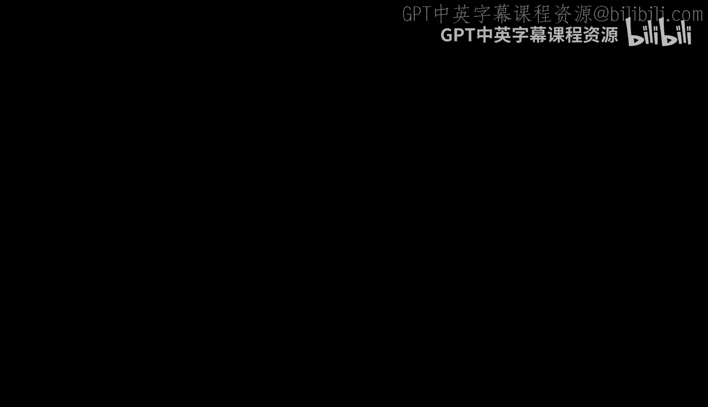

Okay， great。 welcomee everyone to the class。 So a few announcements。

 First is that we received all your homeworks and we are grading them tomorrow。

 Thank you for hard work on those。 gradients quizzes are getting released。

 and I hope you are solving them according to the schedule。 the second。

 and then the last thing I'd like to say is we sent you a piazza message that we have a midpoint quarter survey out。

 the responses to the survey are are anonymous， please give us honest and constructive feedback so we can improve your experience in the class。

 So if there is anything we can do to make this class better。

 That's a great way for you to communicate with us or just feel free to to post or send us messages。

 And it's all anonymous。 So don't worry。 Okay now the plan for this week is we are now spending two weeks。

😊，Talking with on talking about graphs last last time last week。

 we were talking about how to find the important nodes in the graph。

 and we were talking about page rank and random works and so on。

 And what I want to do today is I want to talk to you about how do you do clustering on graphs。

 Okay So today， in some sense， we talk about clustering。 And the idea is that graphs， real networks。

 social networks， biological networks， information networks and so on。 they have nonrandom structure。

 they have some latent organization and structure。 And our goal is to discover。

 extract these latent organization and structure。 So these structures that we like to extract are sometimes called clusters。

 they can be called modules， or they can be called communities。 But in all these cases。

 the idea is that the network can somehow be separated out in these densely connected units and these densely connected units。

 As I try to show in this network can be hierarchically nested right where you say， oh， I have three。

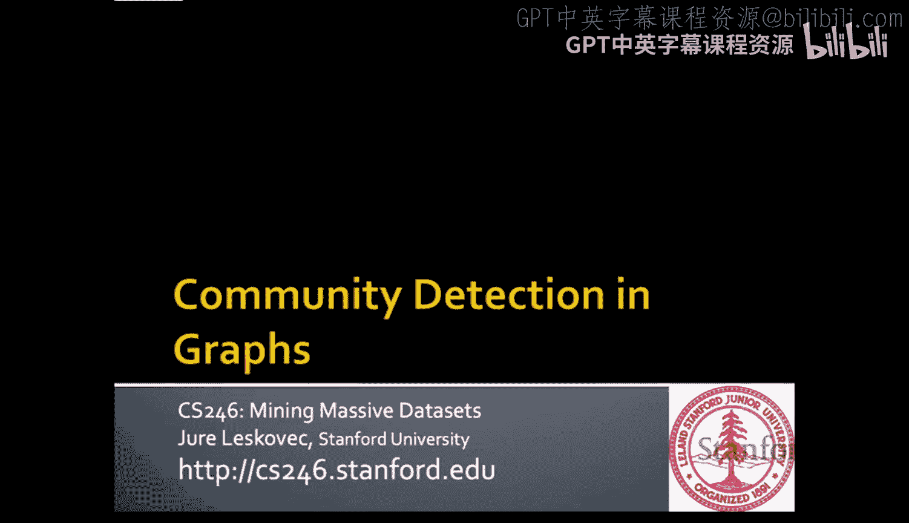

Big clusters three big， let's say communities。 if this would be a social network。

 but then each one of them has kind of different number of different subcomities， right。

 so you can have very interesting structures in in this data。

 and our goal will be to discover this type of structure and identify what are the nodes that belong to each cluster。

😊，Right， so here's another example。 And once we plot these small networks， this may seem easy。

 But still， the question is， how do we identify these densely linked groups of notes。

 How we do we define the problem， What kind of optimization functions or criteria。

 objective functions do we want to do， And then how do we solve them。 That's， that's the idea。

And today， we'll talk about what is called non overlapping community detection。

 Where idea is that you have a network and you want to kind of find groups that don't overlap。

 So if this is how the graph the network picture looks like here is how the adjacency matrix would look like right So the idea is that you wantna。

 in some some sense， sort the rows and columns of this matrix。

 such that you find this two groups where there is a lot of edges between the members of the group right like here and here。

 but very few edges across the two groups， right， So if you think these notes here linked to each other and they receive this。

 these number of edges from this other group， right。

 So a network that has this type of structure will have this type of adjacency matrix。 And of course。

 our adjacency matrix we are given is not sorted in this beautiful way。

 But essentially we look random to us。 So this is an extremely， extremely extremely hard problem。

 It's de seemingly easy when once I show you。😊，But if I were to perme this rose to you to your eye to just look like some。

 some random， random stuff。 And the question is， how do I discover that there is really this underlying structure。

Where are these types of things happening。 So， for example， in web search。

 you can create this type of graph where you say here are the advertisers and advertisers bid on a given set of keywords。

 right So the idea is that there is an advertiser who says I want whenever user searches for these these and that term。

 I want my a to show So if now you can create a bipartiteized graph。

 And you can say what are the subgroups， then regions of this graph。 And for example， here is。

 here is a case from from Yahoo from years ago， when essentially you could say all these set of advertisers tend to bid on the same set of keywords for their ads to be shown。

 And then you can examine And it turns out these are all the gambling keywords and these are the particular subset of of keywords that are towards sports betting。

 So I identify groups or clusters of advertisers who are interested in advertising。😊，The same thing。

 You can also， for example， take a look at the graph where you can say， a， I have actors to movies。

 right， So here are all the movies ever recorded。 And here are all the actors that ever acted。

 And there is a dot。 if a given actor actor in a given movie。 And the question is。

 what is the structure of this actor to movie graph。 And。

 if you would do that methodology we will talk about today。 you would identify these clusters。

 And it turns out that these clusters are the first level they correspond to different languages。

 right， So you know， there are or different countries， Argentinian movies， here's Mexico， Brazil。

 Spain and Germany and Italy and so on and so forth。 right， So again。

 we would discover this type of hidden structure in this graph data。😊，To give you。

 to give you one more example， you can even do this with your own personal social networks where you could say。

 you know， this is me。 I'm the ego。 and these are my friends。 and these are connections between them。

 So the question would be， how is my own personal social network organized。 Can I go and I identify。

 you know， these clusters of people that are of my friends who are densely connected with each other。

 and say， you know， these are my friends from the high school。

 There is cluster of family members maybe here are my college friends and you know。

 people from the same department or from the same research group and so on。 And again。

 these graph structure will allow you to make these types of inferences。

 And here notice that that these clusters can be overlapping and they can be nested right So the blue one is in is nest in the light blue1 and so on and so forth。

 right So this things can be quite quite complex。 So now how are we going。😊，To do this。

 And what are our assumptions。 Our assumptions will be that the graph is large。

 but it's small enough that it fits into the main memory。 And if you do things correctly。

 then you can fit around 200 million nodes and 2 billion edges in about 16 GB16 GB of memory， right。

 So on your laptop， you should be able to process about 200 million nodes and 2 billion edges right。

 And now if you have a bigger server and 16 GB is kind of nothing。

 we can work with much bigger graph。 right， And the idea is that even though， you know。

 you can feed the graph in your laptop， the size of the graph is so big that we cannot afford to run anything more than linear time algorithms。

 And what I will talk to you today about is one specific way。

 how you can compute page rank in a very scalable way to be able to find dense clusters in the network。

😊，And the idea， what will be cool is that the runtime of the algorithm will be proportional to the cluster size to the to the whatever we output and not to the graph size。

😊，So essentially， the algorithm runtime won't depend on how big the graph is。

 but will depend on how big of a cluster do we want to extract。 So in some sense。

 I could run this on， on in a finite time on an infinite graph。 You could think of it that way。

 right， So it will be super cool because it， we won't even visit。😊。

Parts of the graph will only visit small parts of the graph。 And here's the idea。

 How are we are we going to do this。 The idea will be that we'll be given a seed node。

 and we will w to find a cluster， a community to which this seed node belongs to。

 So the picture to think about is I have a see I'm given a seed node here。

 So what I'd like to figure out is figure out that all these nodes belong to the same community as this seed node。

 Okay， so we'll be given a seed。 And then we wantna locally explore the network around the seed and figure out what is the cluster that this seed belongs to。

😊，So that's the first thing。 The way we will do this is that we will essentially run personalized page rank with the teleport set equal to the seed node。

 right， so we will start the random walker or the seed node and the random walker will will walk around。

 And our intuition is that if S belongs to a good， densely connected cluster。

 then this random walker will be trapped in here for a very long time。

 But when kind of the random walker gets out， it will diffuse away。 right。

 So we kind of expect that the random walker gets trapped in here because there's lots of connections。

 And then if the random walker gets very lucky。😊，The walker can escape and then。

 you know gets lost in this background。 So somehow the intuition is if we start the random walk here。

 we be trapped。 And then after we escape， we are gone or the random walker is gone right that's essentially the intuition of what we are why this would work given a seed node。

 And if the seed node is in a nice dense cluster， the random walk will be the random walker。

 the surfer will be trapped inside。 But when the surfer leaves。

 they basically get lost in the background。 So well be able to then identify this blue nodes down here very easily。

 so give you give you an outline， the idea is we pick some seed node of interest。

 we will run personalized page rank with the teleport set equals equal to the seed node S。

 we will then do two more steps that are interesting one step we will do is we will sort the nodes by the decreasing page rank score。

😊，And then we will do this sweep operation that will allow us to identify good clusters。 Okay。

 now we kind of， you know， we pick a see node。 We know how to run personalized page rank。

 I'll tell you more how to you really do this in a super scalable way。

 And then we want to talk about how then I want to sort the nodes order them by the decreasing page ranks personalized page rank score。

 and then I will want to do the sweep operation that I will explain in detail later， right。

 And this sweep operation will allow us to identify clusters。😊，Okay， so idea is。

 I have the seat node。 And the way I will do this is the following。

 I will I will sort the nodes by the decreasing personalized page rank score。

 So P PRR means personalized page rank， right， and I will somehow measure the cluster quality as I take more and more nodes from the first one to the last one into my clustering And the idea will be that I will create this type of sweep profile plots where on the Y axis。

 I will have how good of a cluster would would I be if I take top 10 nodes with the highest page rank score。

 top 20 nodes with the highest page rank score。 right。

 So I'm asking if I take the top K nodes with the highest page rank score。

 how good of a cluster do I get and lower is better。😊。

And the idea the idea here is that this local minima will correspond to good clusters。Okay。

 so for this particular network and that particular seed node， then this is the sweep profile。

 And you see it has a a local minima here， it corresponds to this wirelesst partition。

 which is not that good。 But then you see how we have another local minima here。

 And this local minima corresponds to to the green cluster right to the green arrow and that and the wireless arrow is。

 is that thing。 right， So and this way we can now discover the cluster that has， I know 18 nodes。

 Yes， Why do we see that course in the beginning， because this node has huge degree， right。

 So I'm basically saying what happens if I proclaim this node as its own cluster。

 it has a lot of edges。 I will define what I mean by the cluster quality。 I haven't defined that yet。

 I'm giving you the overview。 But it will become clear once I define this。

 But what you need to take from this is run pageing score sort。😊。

And then what I'm plotting here is what is the cluster quality。 If I take the first K， right。

 the first one， the first two， the first three， the first 10， the first 20 and so on。

 And then I get this sweep profile。 And wherever I see local minima， that's the clusters I take。

 right， And notice that these clusters are nested in one another。

 right These wireless cluster is nested in the green cluster。😊，Right。

 because I'm taking increasingly bigger sets。 Now， what I have to tell you is， what's the。

 How do I measure the Y axis。 So before I do that， are there any questions。So at least at high level。

 it should be clear what we are doing， even though we don't know what the details are。

 So now I'm going kind of to fill in the details。 And the first detail I'll fill in is the cluster quality matter。

Great。😊，Thank you for nodding。How about this side。We feel good。 Okay， awesome。 Thank you。 So great。

 So what's the cluster quality。😊，The idea is the following， right， If I'm given an undirected graph。

 like I give an example down there， then my goal is to divide this vertex set。

 the node set into two groups， into groups， A and B and A and B are these joint， right。

 So I'm saying there is a， And then B is the node set minus a。 Okay， so basically what I'm saying is。

 I want to divide my vertices into these joint sets。 And then the question is。

 how do I define how good is this division。😊，Right。What is a good intuitive way to say。

 how well do I separate the graph into two clusters。And one way。

 to do this is this notion of of a cut， right？ And in particular， what would I like to do。

 What's a good cluster， as I mentioned before， The idea is that I want to maximize the number of within cluster connections。

 So if I'm given this little graph。 And I say these are my two clusters。

 then I want to have as many edges between the nodes of the of the cluster。

 and I want to minimize the number of edges that cross the cluster boundary， right。

 So I want a lot of stuff inside， and I wantna little to point out。 Okay。

 so this is what I would intuitively like。 And in order for me to get this。

 I need to define two quantities。 One is called volume and the other one is defined as cut right。

 volume is the volume and then cut is in some sense surface。

 And I want to kind of minimize the surface to volume ratio， right， I want a fat cluster with very。😊。

Surface， okay， if you like this intuition。 If you don't， it's fine。 Okay， so how。

 how do I now talk about cuts， right， I w to express cluster quality as a function of the edge cut of the cluster。

 And the idea is that cut is defined as a set of edges that where only one node is inside in in inside the cluster。

 right， And if I have a weighted graph， then it would be a set of edge a sum of edge weights， right。

 So if I say what is the cut of a set of nodes A， maybe this is a set of nodes A。

 then I'm summing over all the edges， I J， where one endpoint of the edges inside the set a and the other endpoint is outside the set A。

 right， So in this particular case， this would be the first edge and the second edge。

 and I would sum up their weights。😊，If the graph is unweighted。

 then all the weights are equal to one。 So the cut score of this cluster A would be equal to 2。 Okay。

 so nothing magical。 I'm just saying if I decide to proclaim this as a cluster。

 then the cut score of the cluster is the number of edges that stick out of that cluster。Okay。

 and that's called the cut score。So one option would be to say， you know。

 you give me the graph and I will find you the set of nodes that minimizes the cut score。

 and hopefully I found a good cluster for you。And even though that might seem as a good idea。

 it turns out that on the real graphs kind of it's not too good of an idea。

 And I give you the corner case here， right So the idea would be that right the quality of the cluster is the weight or of the connections or number of connections pointing from the cluster to the outside So the idea would be if I find the mean cut。

 the cluster that has the minimum cut， do I get the clustering I want。

 And you know if I have the network like this， then here is the mean cut right。

 I only need to cut one edge to get a cluster。 But really， especially you guys more at the back。

 you see that this graph seems to have these two clusters。 know， this thing is here。

 But who cares the main division is here between green and red nodes。

 So what I would really like to do is a metric that will cut here not at these degenerate kind of easy degree1 node right So what's the problem。

😊，We have， so our cut score is not kind of what we really want。 It's good。 It's nice。

 You can have it。 but it's kind of not what we want， right， So what we would really。

 what the problem is that we only consider connections that point outside the cluster。😊。

But we do not consider anything about the internal co connectivity of the cluster。

 We don't like this cut score only looks at the boundary， only looks at the boundary of the cluster。

 doesn't care about anything that's inside the cluster。 right， So really， we need to look inside。

 okay。So here is a criteria now that looks inside as well。And this criteria is called conductance。

 and conductance is this idea of surface to volume ratio， right。

 It's basically connectivity of the cluster。 to the rest of the network divided by the。

 in some sense， the density of the cluster itself。 and it has a very intuitive intuitive definition。

 This may look scary， but it's actually quite simple， right， on the top， I have the cut score， right。

 I have number of edges I J where one end point of the edges inside my set a and one end point is outside the set。

 So this is the cut score， right， but what I'm dividing by I'm dividing by volume。 Okay。

 So how do I define volume， volume of a is the total weight of the edges where that have at least one end point in a。

 So it's basically it's volume of a given set of nodes is a sum over the nodes in that set and you sum up their degrees。

😊，Okay， so， and I take this ratio。 So another way to think of the volume。

 volumee is simply two times number of edges between the members of the cluster plus the number of edges pointing outside the cluster。

Why do I have two times here because I sum up degrees？😡，And then if the edge is inside the cluster。

 then both endpoint get counted， get counted twice。 right， That's why there is a two here。 And。

 of course， this， these guys get counted only once because it's only one end point of the edge that is inside the cluster。

 Okay， that's the reason for this formula。 But essentially what this is doing， It's saying。

 how many edges point outside versus how many edges do I get inside。Okay。

 and then one more thing to say here is that why do I have this minimum and， and and so on。

 And the reason why I， I have this is purely technical。 Basically。

 the reason why I do this is we want a good cluster to be such where this a is as small as possible。

 And if I wouldn't have sorry， this file conductance is as small as possible。

 And if I wouldn't have this minimum， then basically， the point is the following。

 If I go back to my previous example， I could proclaim all this to be my cluster a。

 and I would have huge volume and very small cut。So that's why I take the volume of the smaller side。

 right， What I'm saying here is take the volume of the smaller side。

And because I take the volume of the smaller of the two sides。

 I kind of want to discover clusters that are of about equal size that are partitions that are balanced that have kind of equal mass。

 right， This is just saying， take the smaller of the two。 So if one is big。

 then the other one will be smaller。 because M is the number of edges。

 Some of all degrees is two times number of edges because every edge gets counted twice if you think about it。

 So its volume of a 2 m minus volume of a。 And I take the bigger sorry， the smaller of the two。😊。

Okay， so why is this criterion called conductance go Because it produces balanced partitions。O。Great。

 and to give you an example。 And then I can take some questions is the following。

 I have the same graph twice。 Imagine the red node are my set a， So I say。

 I'll cut up there if I would ask what's the conductance of that cut is 05。

 because I need to cut two edges， right， if you go up there。😊，To edges。

 what is the sum of the degrees is 3 plus1 is 4。 so it's 0。5。Now， if I say how about this cut。

 I need to cut here six edges。 you can count them。 and then you know you can say what is the sum of the degrees of these red nodes。

😡，It's 92。 So 6 over 92 is point。06。 So this is a much better cut， a much lower conductance。

 much better cluster than this cluster。 even though here we cut two edges and here we have to cut 6。

 But here we get 92 edges kind of inside the cluster versus only getting four edges inside the cluster。

 Okay， So that's essentially the idea。 And just to， to go back and and drive this。

 why do I take the minimum here。 because if I would't have that minimum。

 then I could make this to be a huge， very good conductance， if I would color all the blue nodes red。

 and the the red ones blue， then I would have huge volume for very little cut。

 I would have two times number of edges in here and that would be super small and it would look great。

 But it's useless。 So that's why I need to take the smaller volume of the two sides。😊，Good。

 now it's time to ask me questions。Everyone's still happy。Yes， can repeat the like 2 Yes， So。

 so what is this， You mean this。Yeah， great。 Okay， so this is volume， right。

 It's sum of the degrees of the nodegene。😊，If you say what is the total sum of the degrees in the entire network。

 that is two times number of edges。Why is that， Because for right imagine。

 you have two nodes and one edge。 Then this edge gets counted twice because you have the degree of this guy and degree of that guy。

 So it's one plus one。 So both end points get counted。 Okay。

 So that's why the sum of the degrees is two times number of edges。 right。

 So so the total volume of the entire graph is two times number of edges。

 So this is the volume of the left side。 So this is now the volume of the right side。

 and I take the minimum of the two。 And the reason I want to take the minimum is， if I go here。

 you know， this is left and that is right。 If I divide by the minimum volume。

 I divide by the volume of this small thing， which is4。 So， but the volume of this side is huge。

 So if I would flip what left and right is I could have I could get a very good。Conductance score。

 something that has very low value， but it's not what I want。 It's useless。 It's cheating。

 So that's why I take the smallest thing。 Great。 Thank you for the question。 Good， Anything else。

Everyone happy。Yes， so now we know how to measure quality of the cluster。 So now。

 let me tell you how the sweep operation works。 right。

 So the outline of our algorithm is pick see node S run personalized page rank with teleport set equals to the see node S sort the nodes by the decreasing page rank score。

 And then you do this sweep over the nodes to find good clusters。😊。

And the way the sweep will work is oh the following， as I said。

 I wanna dec sort the nodes such that the first node here has the highest page score second highest and so on。

 And then I want to compute for every eye， What is the conductance of the set a subi。

 where in a subi， I put the first i nodes into my set。😊，Right， so in some sense。

 I start the starting no。 and now I know then I keep adding nodes together to it。

 And for every node that I add into the cluster， I compute the conductance and whatever the local minima in the conductance of the set a sub I。

 that's a good cluster。 So what I'm plotting here is conductance of a sub I as a function of I。

 where I is the rank。😊，Yes。Good， if you care what I mean， right， So I'm just sorting my nodes。

 and I take the first eye notess and proclaim them as as my cluster。 And I ask。

 what is the conductance。😊，And if I find a good cluster， then I need to have a local mini， right。

 I need something where the conductance of that set is really good。 very low。

 But as I try to expand it， it increases。Right， so it means I kind of crossed the cluster boundary。

 That's the intuition。 Yes， great。 My assumption is that as you include more。

Bsters likely not as good。 for example， like by 50， you have something that seems lower than at 20。

 So how would you decide between the size of the bussters， Great question。 So the point is。

 I didn't say global minima。 I said local minima。 So you are searching for kinks。 right， So you want。

 you want a kink like that。Right， or a or a kink like that。 So how would you， how would you do this。

 There are several strategies， One strategies that you come up with some heuristic that tries to detect when you have local minima。

 Another thing people do is just take the first local minima。 That's， you know， thats， that。

 that depends a bit。 But the idea is that you want to search。Come up with some heuristics。

 some method that identifies this local minima and the things that are here。

 you shouldn't trust too much。 And I will explain why you shouldn't trust them too much。Okay， yes。

 great。 So does that mean the conductance like in and of itself is not a good measure of a cluster if you can't just take the global minimum。

You could take the global minimum， if。If this would be computed perfectly。

 but the method I'll explain actually has more error here to the right。

So it will become clear why you cannot trust things further out。Okay， but good， good points。

 I should have said that。Good。Awesome， happy。 Yes， good， great。 So super。

 What is one important thing。 One important thing that may not be obvious is that this sweep profile。

 this curve can be computed in linear time。 So it's in one step in one pass。

 you can compute the entire curve。 And the way why this works is because basically。

 what you do is the following， right， you loop over the nodes。

 and you keep a hash table of the nodes that that are in your cluster I right now。

 And then when you say what is the what is the conductance of the cluster that has， you know。

 the first i nodes plus one more。 then you need to compute。

 what is the cut of the set a sub I plus one divided by the volume。😊。

And the way you can do this is that if you know what was the volume of the set before。

 now you added one node to the set。 So you just need add the degree of that node。

 and that's your new volume right because your cluster is only growing。

 You are just adding one more node to the cluster。 and here is its degree and that means you have computed the volume right So updating the volume is simple How about updating the cut updating the cut is also easy。

 The way you compute the update the cut is to say whatever was the number of edges I cut I had to cut before plus the degree of this node that I add in now。

 and then you have minus two times number of edges from this node i plus one back to the set a subi right So the way to understand this is to say whatever was the cut score before。

 Now I add one node inside my cluster， this node has d。Fctions。Right。

 so I know I will have to cut some of these。 Which ones won't I have to cut the ones that point to the members of the of the。

 of the cluster that I had before。Right， and this way， again， you very simply updated your cut score。

 And now your updated conductance is just cut divided by volume。Okay， because。

 and the reason why this works is because at every step。

 we are basically growing this set A by one node。 We are throw it in。

 It's clear how to update volume。 And this is how you update the cut。

 And you can now work out the entire， the entire sweep curve in one pass over， over the node。

 And the only thing you have to do is for that for the node that you threw in the set A。

 You have to ask how many edges of it point back to other nodes of the。

 of the previous of the previous set。😊，Right， and that's it。Okay， so now we should be able to， to。

 to， to， to do this and to and to compute this。 Okay， so are there any questions so far？ Yes。

 will you also take for the minimum of volume like。m great。 Why do you check for minimum。

 Usually you would compute the entire， the entire thing。 And usually your。

 the clusters you care about are much smaller than half of the graph。

 So you don't even that that minimum never really happens in practice because you think of this set a to be relatively small。

 I know， maybe  thousand0 nodes out of a billion， right， So youll never。😊。

Compute this out out to half a billion。You， you care about finding small dance clusters。

 and usually those are relatively small compared to the entire graph。 So in， in practice。

 that minimum between volume of a and volume of not a， you never really care about it。

 But it's a good point。 You would need to consider for that。

 If this is real done on the entire graph。 Great point。 Thank you。Yes。君のか？Great super question。

 you just asked it。 And I said， no， And the reason I say you don't need to do that is because you can think of the set a to be small compared to the entire graph。

 So you never flip over beyond half of the graph or half of the volume of the graph。 right。

 if you think of a graph of a billion nodes， then the set a would have to be kind of half a billion before the。

 before the volume on the other side becomes smaller。 So， so you don't need that。

But in principle as in practice。 now。 thank you again for the question。 Good。

 So now what I wna do is answer the question is， how do we compute this page rank， right。

 How do we compute personalized page rank without touching the entire graph right。

 Because what do we know so far， how you would compute this so far would be given the teleport set S。

 you would create the teleport vector， Let's call it a that has all zeros， but you know。

 value1 at the index of the node S。 And then you know。

 R would now be the personalized page rank vector and you would iterate this equation that I showed you here。

 This is exactly what we learned last last week， right， and you could do this。

 But it would take some time， It would take about 50 iterations before this is done And here notice that M is that page rank matrix。

 the stochastic matrix we talked about。 So it means you have to touch the entire graph 50 times to compute this rank vector R。

😊，So what we will do is we will today learn about how to approximately compute the page rank score。

 And this will be a fast method for computing approximate page rank score with teleport set S。

 And the way we will the notation will be is that we have this function。

 App page rank that will take the see node it will take beta the teleportation parameter and we will take in the parameter epsilon that will tell us how。

 how much error do we tolerate in the page rank scores of nodes that are computed。 right。

 And this is what we will do。 So here is now an overview。 How will this look like。

 So first thing is we will consider a bit different version of the random walk we talked about so far。

 and this is called a lazy random walk。 And the reason this is called a lazy random walk。

 because it's a variant of a random walk where the random walk stays put at a given node with probability one half and with the remaining probability walks to the neighbor。

😊，So here would be the recursive equation for the for the lazy random work。

 Right so I'm saying where is the random walker at the next time step with probability half the walker stays where the walker is。

 And with another probability， the the remaining probability the walker makes makes a step right So from so basically。

 I'm saying my pageing score at the next time step is my current pageing score because the walker did not move or walker was one of my one of my at one of my neighbors。

 and and the walker navigated back to me to the node view。

 So this is now a bit different version of the random walk。😊。

And now what we will do for this particular version of the random work。

 there is another key concept for us to keep in mind。

 is this notion of defining residual personalized page rank score， and we'll call it Q。

 And this residual page rank score will be the difference between the true score of the node versus the current estimate of the score of the node。

 right， So this is the estimate of the page rank score of node U at time T。

 And this is the true page rank score of the node U。

 So this difference is what we will call residual page rank score right's in some sense， error。

's it's the estimate is the error in our estimate of the page rank score。

 This is our estimate that's the truth the difference is the error。

 Okay so P sub is the true page rank R sub is the page rank estimate that we compute right now at time T。

 And then the the idea is the following。 if the residual page rank score of a given node。😊。

Noode is too big， meaning if the residual divided by the degree is greater than Epsilon。

 Then in some sense， we w to push the random walk further。 We want to take some of our error。

 our residual and distribute it to some of to our neighbors so that our residual goes down right。

 So the idea is that every node will keep track of this residual score。 And if the node will say， oh。

 my rank is not accurate enough。 What it will do is it will push some of this residual away。

 it will get rid of its own error。 And this way it will improve its estimate。

 And we will keep doing this until every node， every node's error is below Epsilon。

 And when everyone's node， every every node's error is below below epsilon， every node will be happy。

Right， and because we are only pushing this further and now that are very far。

 well have tiny ping scores。 By definition， their errors will be less than epsilon。

 so we won't even push it that far。Okay， so that's the intuition。

 So the idea is that every node has this residual score that says。

 what is the error in my estimate of page rank， How， how。

 how much more important do people think I am than I really am。 And， and if my residual is too big。

 I'm like， I want to get rid of it so that Im more confident about my score。 And as。

 as we get rid of it in some sense， this residual will be pushed further in the graph And kind of the random walker will walk a step further。

 That's the idea。😊，So with this intuition， let me now make things a bit more mathematically precise。

 Are there any questions before I do that。😊，Yes， how exactly you compute cube since we obviously don't have key。

Otherwise， we wouldn't need to do this。 Awesome， How do I compute Q， I will show you into slides。

 Yes， definitely， I'll show you。 Otherwise， yes， you would be an， yeah， I will show you。Good， okay。

 good。 So here is one way。 one other way how to think about page rank。

 And this is a very different way how we thought about it so far。

 So this is not a recursive equation。 But what this is really saying its。

 it's basically it says a page rank in some sense， is linear。

 So what is this equation trying to say is the following。

 Let p sub beta of a be the true page rank vector with the teleport parameter beta and the teleport vector A。

 Okay， so this is the the page rank in some sense， this is the page rank function that given the graph。

 given beta and a returns me a vector of page rank scores。 And then what I can do is the following。

 I can write this out in the following way。 I can say that this true vector of page rank score equals1 minus beta teleport vector。

😊，Times beta plus beta times page rank score of the teleport vector that is m times Z。 Okay。

 so let's try to digest。 What does this mean。 So on the left hand side。

 we have the true page rank vector with the teleport parameter。

 beta and the teleport vector A on the right hand side， This beta times piece sub beta M times Z。

 What is this， This is the page rank vector with the teleportation vector。😊，M times Z。

And teleportation parameter beta， right。 So M here is our stochastic page rank transition matrix。

 And what is M times Z， It's a single step of the random work。 right。

 If the random walker starts here by multiplying it with M。

 it's essentially one step of the random work。 So what we are really saying is that the。

 that the page rank score。 when the walker starts at a equals 1 minus beta times a plus beta times the page rank score distribution after the random walker has made then one step and then does the rest。

😊，Okay that's what this is saying， and here is how we can prove this。😊。

And the way we can break this out is the following。 We can break the， the。

 the page rank score into two cases。 We can say， what if the walk walk is of length 1 and what sorry of length 0 and what if the walk is of length more than 0。

😊，Right， the probability that the walk is of land 0 is1 minus beta。 right。

 So the idea is I'm at the starting node。 and I ask myself。

 do I wna take a step and I want to teleport。 I say I will teleport。

 So I teleport myself with one minus beta and where do I end， I end where I am。

 So this is the first case， right， for the walk to be a land beta， we want of length 0。

 We want to teleport immediately。 So that happens with probability 1 minus beta。 And， you know。

 the walk ends where it started， So the the walker distribution is exactly where it started。

 It's the vector。 Yes， weport teleport are we assuming the teleport just doesn't matter。

 even if this is a probability distribution。 I teleport back where I was。 If I immediately teleport。

😊，It's exactly where I was。Whatever was your belief of where I started。

 If I start according to this distribution and then I tell aport again。

 your belief about where I am is exactly as it was。So that's what this is。 So this works for any。

 any vector。Okay， then now how about the other case。 when the walk is length more than0， right。

 This happens with probability beta with the remaining probability， right， And then， you know。

 then what this mean， then this means that walk starts with with the distribution A starts its starting point is according to this teleporttractor A takes a step So now that it took a step。

 It has a distribution。 M times Z， right， So a is where we started。 M is the transition matrix。

 So m times Z executes one step of the random walk。 Okay。

 so this is now our belief where the random walker is after one step right。

 and then the idea is now that I know where the walker is after one step。

 I can take the rest of the random walks by applying my page and coerator right。

 which is this is now my， in some sense， the rest of the random walk。

 and this is my pagelink operatorerator right and what。😊，We use here to make this argument work work。

 We use this notion of me melessness of the random walk and melessness in this is in Marco chain theory。

 basically， it tells us that random walk is a first order Marco chain。

 So it doesn't care where it came from。 just once it is it makes a decision， right。

 And this means melessness。 you forget where you came from。 And the random walk。

 this first order random walk， the page and random walk doesn't remember where it where it came from。

 And because of this argument， the above equation is correct。😊。

So now that that we have this intuition， where essentially know how we can compute page rank by executing one step of the random walker。

 And then， you know， the the same operator takes care of the rest。

 We can now define this notion of a push operator。 And here is the push operator。

 This is all done with the hope that well be able to compute approximately page rank， right。

 The idea is， let R B our approximate page rank vector Q is the residual vector。

 and we will start with the trivial approximation。 We will say all the nodes have have page rank score 0。

 and our residual vector is a。😊，Okay， so this is the residual for every node。

 And then the idea is that now we want to itatively push page rank from the residual to R until the residual is small enough。

 And here is the math for the push operator。 and basically we are saying take some you are right now at node you。

 here is the page rank collector。 Here are the residuals。 What will you do。

 You take the residual of of node U multiplied by one minus beta。

 And you add that to the to the to your estimate of the page rank score of node U。 right。

 So this is my previous estimate。 Now this is the probability of teleportation。

 And I take part part of the residual and store it at the node itself。 and the rest of the residual。

 I will move forward。 right like half of the residual， I will store the node itself。

 So I have one half beta times the residual of node U。 And then for every node V， that node U。😊。

Points to， I'm now taking Vi residual， and I send some of use residual to the node V。Okay。

 so here I'm saying I will take this one half beta times residual of u。

 I divide that by the degree of node out degree of node U and every of the neighbors three gets one over the degree of that residual score。

 Right？ So what， what did I do with this one simple step。I decreased the residual of node U itself。

 I took some of it and saved it into my estimate of the pageing score of node U。

 And the other half of the residual I pushed out to the neighbors of you。 And now because of this。

 some of the residuals of the neighbors we might get too big。

 So they will wake up and they will further push out this residual score。

 and we will iterate this push push operator until all the residuals are small enough。 Okay。

 so here is the here is the intuition behind the push operator。 right。

 The idea is that I have a node that has large residual。 So this means we have a。

 we have underestimated the importance of node U， right， then what do we want to do。

 We want to take some of that residual and give it away since we know that we have that the node U has too much of it。

 right， so that's the first thing。 we want to push some of it out to the。😊，Neighbors， right。

 so the way we will do this is we will keep half of the residual to and give and so this is half we keep。

 And the other half we give away to the neighbors so that they can then in turn， get rid of it。

 And this way， their estimates will be more will be will be more accurate。

 And this corresponds to this part of our equation where we are sharing basically taking our residual and offloading it to our neighbors we that happens here。

 And basically， the idea is that each note keeps once to keep giving away its excess page rank。

 It residual until all the notes have no or very very small gap in the excess page rank in their page rank residual。

 And that's essentially the algorithm。 right， So to give you the pseudo code here is a very simple pseudo code。

 the idea is while。😊。

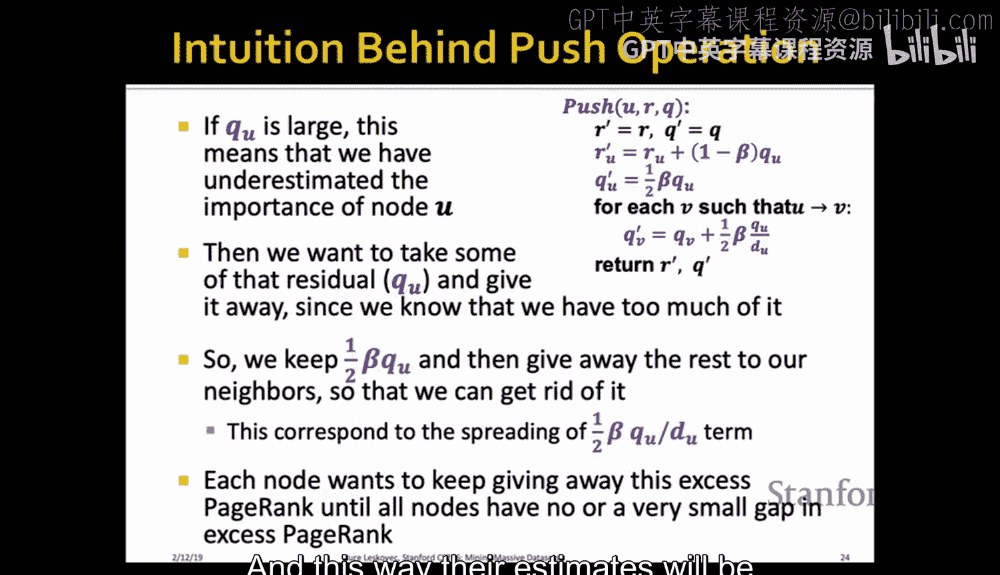

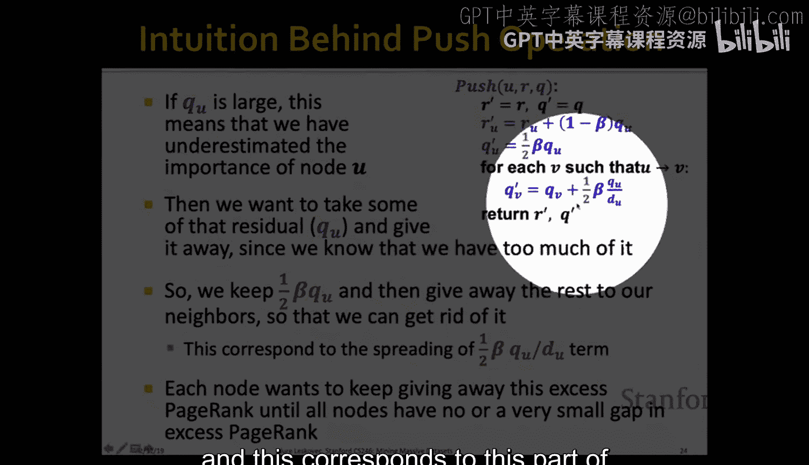

The residual of a given node of any node divided by their degree is greater than Epsilon。

 then take that node and execute a push operation。 And you keep executing push operation until every every node。

 the residual is is divided by its our degree is less than epsilon right And because this push operator just goes from node view and pushes one step out。

 you will， this operation will finish depending on the value of Epsilon very soon。

 and it don't touch parts of the graph that are very far away。😊，Right。

 and that's essentially the intuition how you do this。 And this can run super， super， super fast。😊。

Okay， because it's all local and it's all about pushing these residuals over the edges。And now。

 of course， if I set Epsilon to be super small， essentially。

 I could compute the ping scores of all the nodes。 But if my Epsilon is relatively large。

 then if I tolerate kind of relatively large errors。

 I will I will only propagate this push operator very locally in the graph。Okay， and of course。

 you have to understand that in the graph， the pageing score will kind of decay as I go farther out from the starting note。

 right， So really， the epson will will， will create kind of a border and we won't push the。

 the pageing score too far in the graph。Okay， good。 Let me now give you two observations。

 and then I'll give you some examples。 right， So de is the following that this algorithm。

 it's called page rank nible computes the personalized page rank score in time that is constant with respect to the size of the graph。

 time is one over Epon times one minus beta。 right So Epon is our error tolerance the and the beta is the teleport parameter。

 And this is better， then the power iteration that would compute the personalized page rank scores in time log n。

 So there's the first thing And then the second thing is that actually an approximation guarantee that says there exists if there exists a cut of conductance phi and volume K in the graph。

 Then our method will find a cut that is。😊，That is a quadratic factor away from the optimal cut。Okay。

 so we know that this local mini finding， finding method will actually find something that is very close to the optimal。

 Here's the paper from which this is taken， and there is also code available。Now。

 I w to give you one example to see to for you to see how this works。 right。

 So based on the value of Epsilon， the random walk， the。

 the patient will be pushed farther and farther in the graph。 So here I have my graph。

 And this is the seed node I chose。😊，And what I show you here is the sweep curves for different values of epsilon。

 right， my error tolerance。 And when I pick a big epsilon， I get the the， the violet curve， right。

 the page rank gets pushed only up to the node 18。 And then all the nodes have residual page rank class in epsilon。

 So the procedure stops。 So I only push it。😊，Limited amount。 Now I decrease epsilon。

 and I rerun my algorithm。 And as I decrease epsilon and run it further， I get the blue curve。Okay。

 notice how the blue curve kind of takes the， the violet one and then continues it。

 and notice that here they diverge。 So it means that this pageing scores。

 I shouldn't really be trusting because I had a very big error or parameter Epsilon。 right？

 So I get the blue1。 Now I further tweak the Epsilon to be even smaller rerun the algorithm。

 Now my page page rank score gets pushed up to here， almost up to node 60。😊。

And I can make the Epsson even smaller， and it gets pushed out even further。😊，Right， so essentially。

 what I'm trying to say is depending on how big cluster do I want to extract。

 I may set the value of Epsilon and the the page rank score gets pushed farther and farther out。

And you guys were telling me before， why don't you take the global。

 the global minimum of this curve is because the last part of the page rank score I don't really trust because this is where the error is the largest。

Right， so I wouldn't want to interpret this in any way because this is just noise。

 right while you see how here， basically all the curves follow， follow one another， right。

 like the blue one， sorry， the the yellow the while at one is accurate till here and then divrges then you see how blue one follows it exactly and goes this way。

 And then the green one follows the blue one exactly， but this is where the blue one diverge。

 And really， this is the right way to go。 And then you see how blue and green and red follow each other。

 And then this is where the green gets crazy， but the the when I even decrease the epsilon。

 this is the true curve。 And then again， you know somewhere here。

 it must get unstable or inaccurate right So now for this node。 you know。

 what would be the cluster we would find it would probably be this cluster。 And this is you know。

 after exactly five nodes。 So we would say cut here right and then。😊。

The second cut we would find would be somewhere here at around 20。

 and that would likely be somewhere here。Right， and， and so on and so forth。 right， So basically。

 the idea is that as I tweak epsilon， I push this random walk farther and farther out where the last part of the curve I don't trust because the error there is too big。

That's the idea。嗯。This is one way to explain this。 Another way to explain this is to say this is now on a huge graph where this is now the sweep curve where here is the。

 here is the， the nodes。 And these are now the， the， I think。Nots， noteses ordered by。

 by the by the page rank score。 and you see and then the solid curve is the the fully computed。

 personalized page rankor。 And here is the approximate page rank。

 And the idea is that the approximate traces traces the truth for some time， But then divrges。

 So we kind of trust it in the first part。 And now， if I would make Epsilon even smaller。

 then the dotted line would follow the the the the solid line longer。 And then again。

 it would diverge。 So I can push page rank as far as I want。 and the further I push it。

 the more I have to pay for it。 right， the more push operations I have to do good。

 So this is what I wanted to say here。 Are there any questions。😊，Yes。

 do you select the seat the how do you select the seat set， You have several options。

 One option is that you select seat set a trend。The other thing is many times the seat set is given to you。

Because you say， I have this node。 What cluster does it belong to。

 Who are other nodes that belong to the same cluster？

 So many times the seat set will be given to you， You can pick it a random， right。

 And then you could say， if I go back， if I go back， right， If I see a good local minimize， say， oh。

 this node is part of the cluster。 If I don't see any good local minimize。

 say this node is just part of noise， I will do nothing with it。Okay。

 but this is kind of this local clustering method that allows you to extract one cluster at a time。

Thank you for the question。 Good， Anything else。So let's do this。 Here's the summary。

 The algorithm is simple first step， picks the seed node of interest， run the page rank。

 either personalized page rank， either the basically run the page rank nibble。 As we discussed。

 sort the notes by the decreasing page rank score。 run the sweep over the node to compute the conductance。

 find the local minima。 That's your， that's your。😊，That's your And。

 And this way you discover the clusters。 Let me know， because I'm running a bit。

 where do you guys see my。Maybe I'll just do this。

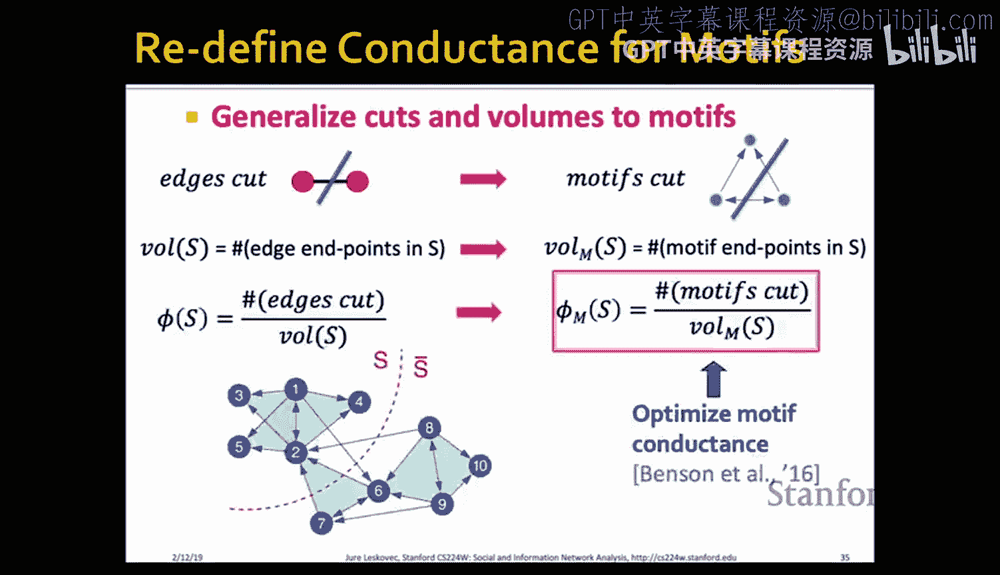

I'll skip this。 It doesn't matter。 It's super cool。

 but I will show you now the second way how to do community detection。

 And this is another very scalable methods in the in the last 20 minutes。 So here is the idea。

 The idea is that I want to go and identify tightly connected sets of nodes， right。

 we still have this type of picture。 And what we thought about so far is if I give you a seed node。

 you will discover this cluster。 Now what I want to do is I don't want to do this through seed nodes。

 but I want to directly discover the clusters。 And the way I will do this is the following。

 I will define this notion of modularity， which is， in some sense。

 a similar cop concept to conductance。 It tries to measure the quality of the cluster but it is it is it is based on a different intuition。

 And the way this modularity function queue is defined It measures how well can。😊。

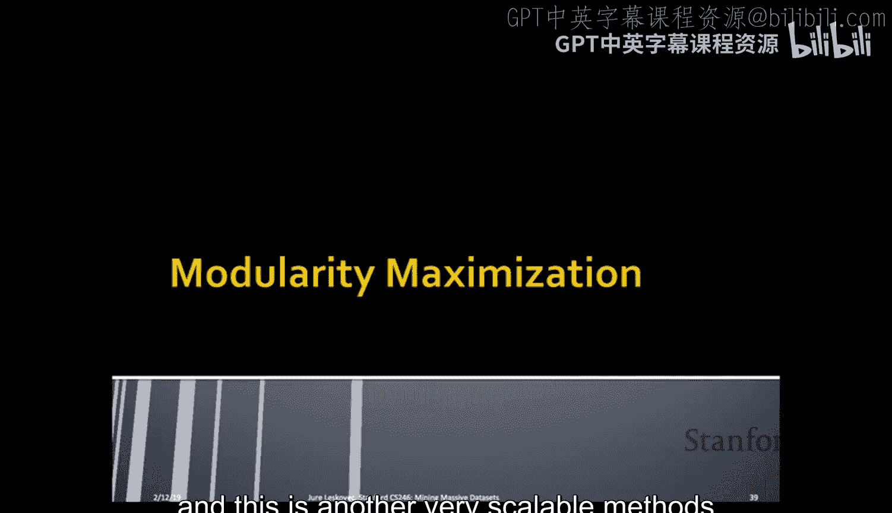

Network be partitioned into communities。 So this is not to say for one cluster。

 how good the cluster is， but it is for an entire set of clusters。

 How good is this clustering for the entire network。

And the idea is that given a partitioning of the network into groups or clusters capital S。

 then we say that modularity is the sum over the groups number of edges within the group minus the expected number of edges between the group。

 Okay so what does this mean is it basically says what is the difference between how many edges I get between the members of the group versus how many edges would I expect。

 And if this distance is big， then I'm like， wow， I'm really surprised about how well this set of nodes connect。

Now， why do we need to be able to do this。 We need to come up with an nu model。 We need to say。

 how do I compute the expected number of edges within a group of nodes。

 So let's first work out what is the expected number of edges within within the group S。

So here is how you do this。 The model we will use is called the configuration model。

 And the idea is the following。 I'm given a real graph on n nodes and M edges。

 and I will create what is called a rewire network G prime。

 And the way I will create this rewire network is that I will create nodes and nodes will have this spokes。

 right， So essentially， I take all the edges。 and I cut them in half。

 So every node has a set of spokes。 These are the edges that it has ready for the two spokes to be connected。

 right， and I will consider this as a multigraph where essentially now I want to take random end points of spokes and connect them。

😊。

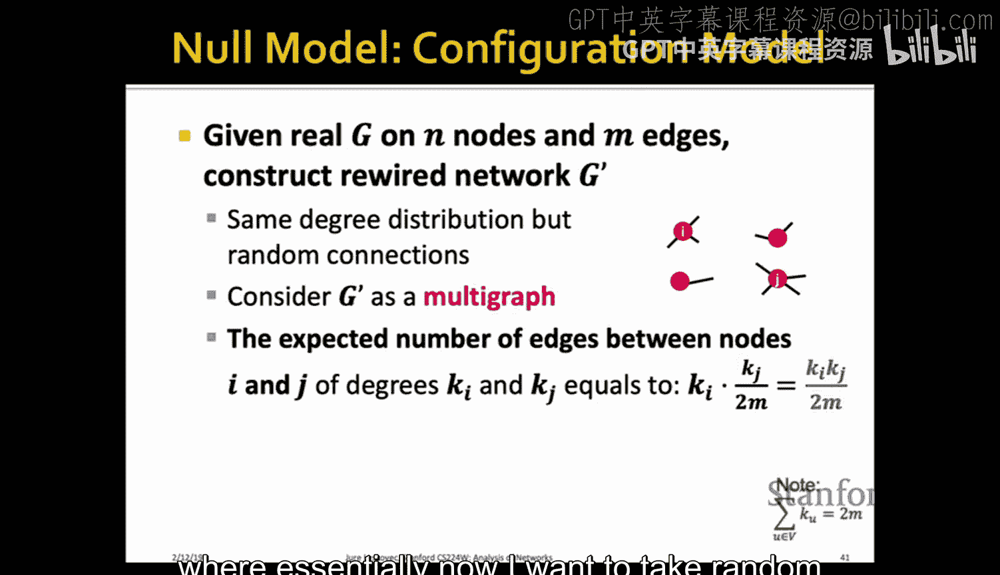

And this way， I will have a graph。What is a multi graph。

 A multigraph is a normal graph where I allow multiple edges between a pair of nodes。😡。

Then you could ask， what is the expected number of edges between nodes， I and J。

The expected number of nodes between I and J between between the expected number of edges between nodes I and J is degree of node I times degree of node J divided by twice the number of edges。

Why is that Here is how you can think about this， right， case node I has K spokes。 And now you say。

 okay， for each of these spokes， I'm going to connect it with another random spoke。

 node J has J case sub J spokes。 What is the total number of spokes in the graph is two times number of edges。

 right， again， every edges cutting half。 So I get however edges there are there are two times that number of spokes。

 So node J has。K sub J divided by 2 m fraction of all the spokes。

 If node I now has I tries to connect the expected number of times it will connect to node the J is K sub I times K sub J divided by two time number of edges。

 And that's the expected number of links of edges We， we see。

 we expect to see in this multi graph between nodes I and J where I has degree K subi and J has degree K sub J。

Okay， and as I said， the， the null model is called the configuration model。

 And the idea is essentially we take the graph。 We cut the edges in half。

 and then we randomly connect the， the endpoint of spokes。 Why is this good。

 Because this is essentially a model that says I will have the same degree distribution。

 nodes will keep the number of edges。 But I will connect edges at random。

 So that's why this is also called edge rewiring， right， Everyone keep the same number of friends。

 But the edges now go a random。😊，Okay， good， good。So now now I want to compute modularity。

 This is the formula I gave you before。 The modularity score Q goes over a set of clusters。

 And for every cluster， we say how many edges are between the members of the cluster S minus the expected number of edges between the members of the cluster S。

 How would I write this out， I can write it this way， I say this is a sum over all the groups。

 a sum over all the pairs of nodes I I and J that are member of the group。

 This now just counts how many edges are between all the members This is the adjacency matrix。

 It's 01。 So if there is an edge between I and J， this is one， otherwise it's 0。

 So this will just count how many edges are between any I and J inside S。

 And then what this thing is doing what is the expected number of edges between nodes I and J。

 So suming this up tells me how is what is the true number of edges inside the group。😊。

This is what is the expected number of edges inside the group， right。

 is's between all pairs of nodes inside the group。Whether there is a true edge versus how many edges would we expect。

 And by summing this， you get the difference above， right， So。

 and the other thing is this two times M is simply a normalizing constant so that modularity Q has value between -1 and 1。

Okay。To explain modularity will take value between -1 and1。 It is。

 it will take a positive value if the number of edges within the group exceeds the expectation。

 and it will take a value less than one， if a given group is less connected than what we less than 0。

 So modularity would take value less than 0， if the group is less connected than what we would expect under this random model。

 General， people say if your modularity is around 03。7。 This means you have a very good。

 very pronounced modularity structure。 Of course， higher modularity is better。

 But if modularity is somewhere here， we are happy with the cluster。😊，Okay。So， that is great， so。😊。

I w to see if people have any questions about the blue formula。Right。

 so what we did is we defined the null model based on the null model。

 we computed the expected number of edges between a pair of nodes。 and now we are going over all。

 all pairs of nodes in a given cluster。 AI J。 The sum of that will simply be the total number of edges between the members of the cluster and that K I K J will be the expected number of edges between all the members of the cluster。

 And the difference between the two is our modularity score。Right， that's。

 that's what I wanted to say。 So now what is our goal。

 Our goal is to find partitioning S capital S so that Q gets maximized。 That's our goal。 right。

 This is what we want to achieve。Are there any questions。や在。No questions。 That side is tired。 Okay。

 good。 Maybe I continue。 So， so now what should be clear is the modularity function。

 And what do I wna do now， I w to find this capital S。

 such that modularity function has a high value。 right。

 I want the number of edges between the numbers of clusters to be much number than the what is my expected number of edges under this random nu model where edges are flying around the random。

 Okay， that's the， that's the idea。😊，So there is a heuristic method to do this that is named But after a very nice university and town in。

 in Belgium called the Lun method。😊。

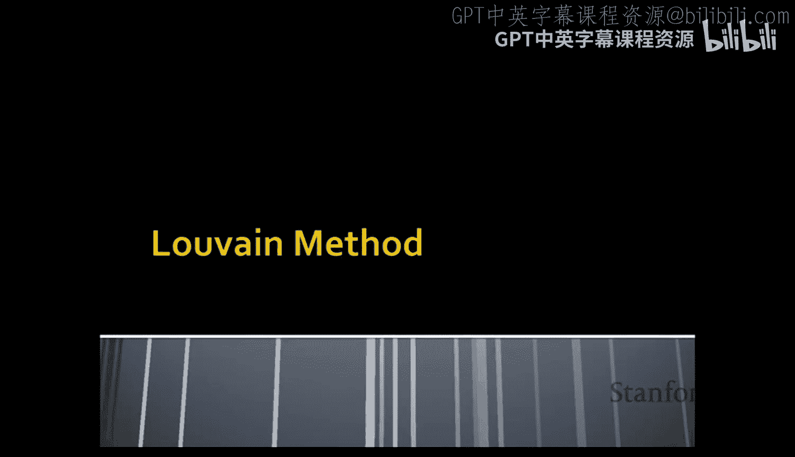

Let me now tell you how this N method works。 So this will be a greedy community detection algorithm that will have runtime of n log n where n is the number of nodes in the graph。

 It will support weight networks。 And it will give us a hierarchical decomposition。

 almost like the same as hierarchical clustering， agglomerative clustering。

 we talked about will allow us to do。 And this is the most popular community detection method to study networks。

 The reason because it's fast。 It converges quickly， and it gives you quite good communities。

 So now how does this work。😊，This is a greedy approach that maximizes modularity。

 and each pass has two phases in the phase one， we will greedily optimize modularity by making local changes to communities。

 So essentially， well ask every node。 Hey， do you want to change your class your community memberships。

 and nodes will be allowed to switch。 after the nodes have have each node greedily decided how they want to switch。

 We will then go and identify the communities。 And then we will create this communities and out of them we will create super nodes and we kind of course in the network。

 and then we will apply the the same the same two phases on the course and network。

 So the idea is I'm given my own network。 I find the communities here indicated by colors。

 I will contract each community into a super node， and I will create a super node network。

 And now I will apply community detection to this。😊，P aote network again to identify communities。

Contract super nodes to be super super nodes， create the super super network and so on。Okay。

 that's the， that's the idea。 This is a little picture。 I'll explain it more later。

 And I'll fill in the details， right， The idea is that you keep repeating these spacees until no increase in modularity is possible。

 or until you created your super， super， super super network with only one node where you contracted everything。

 right， And this now shows you the hierarchical decomposition where you say。

 I have these two groups that split into four and these four groups split into this way。

 So you get this kind of hierarchical decomposition。

 Now we need to talk about phase  one and phase 2。😊，So here is phase 1。 Phase 1 starts the following。

 You put each node in the graph in in its own community。 You say each node is its own cluster。

 And then for every node I， the algorithm compute performs2，2， two calculations。

 you compute what is called the modularity gain。 If you take node I from its current community and you put it into the community of some neighbor J。

😊，Right， so essentially， you take a note and say， hey， node。

 what if you join your neighbor J into their community， How would that increase modularity。

 and you get them the score， And then you say， okay， I'll take the second neighbor and ask politely。

 my no die。 hey， what if you join this other neighbor， what would this do to the modularity。

 And you do this for every neighbor of node of node I。 And then at the end。

 you move node die to the community that yields the largest modularity gain。😊。

And this loop continues until no no no yield is given， right。

 where every node is happy where they are。😊，There are two things to note here this loop over all the nodes where every node you ask hey。

 what if you move to your neighbors community will that help or not you keep running this until it stops。

 So this means you will find some local maxima of the modularity function。

And then the second thing is that wherever you get stuck， whatever is the local maxima。

 that will depend on the order in which you are examining your nodes。😊，And that's okay。

 So people have found that the order doesn't make too much difference。

 So you pick some random order and and do it in that way。 and you don't worry too much。

 But this is a local greedy algorithm that gets stuck where you get stuck is depending on the order of nodes。

Then what is what is another important thing Here。 I show this big equation。

 but essentially it's very cheap to compute。 modularity has this nice property that it's easy to compute。

 What would be the modularity gain。 if I move node I to community C。

 And essentially you can just you just need a couple of sufficient statistics。

 which is the sum of link weights between nodes in the existing cluster C。

 sum of all link weights of all the nodes in the cluster C， and then you also need this K in and K。

 which is the sum of link weights between node I and cluster C and sum of all link weights of node I right So essentially when you decide to to move the node。

 All you have to compute is K sub by in。 This is clear。 you can precompute that。

 this is what you already have。 This is also what you already have。

 So the only thing you have to do is look at。😊，If you are thinking of taking node I and moving it into community C。

 you have to say how many edges are there between I and C and you can compute the the delta in modularity according according to to this。

 to this metric， right。And this is now what happens if you take I and put it into community C。

 Another thing you have to compute， which is a very similar formula。

 What happens because right now now the I is in some community D。

 So you take I out of D and stick it into C。 So there will be a modularity delta because you took I and put it into C。

 And there will be some modularity delta because you took I and took it outside of D to put it into C。

 So you have to also compute this guy， But the formula is very similar。 And again。

 the point is that this can be done in time that is linear in the number of edges of the node。

 So it can be done super fast。😊，So that's the， the greedy optimization。Now， in the second step。

 we have to create in the second in the second phase of our algorithm。

 we have to create the super network。 And here is how the super network is created。

 So super network has super nodes。 So the idea is that for every cluster。

 you contract all the members of that community of that cluster into a single super node。

 And then right， so super node。 and then you have to create edges of the super network。

 And the way you create edges of the super network is that you say two super nodes are connected。

 If there is at least one edge between the nodes of one cluster pointing to the any node in the other cluster。

 And now these two super nodes are connected。 and then the weight of the connection between the two super nodes is in some sense。

 the number of edges or the some of the edge weights between any node。😊。

In one cluster that points to any node in the other cluster， And this now creates the super network。

Okay， so it should be quite intuitive。 I take all the members of the cluster and merge them into a super node。

 and then the edge between the super nodes has the weight that counts how many edges go between the two corresponding clusters。

 And that's it。 Okay， and I get now a weighted network。😊，And now that I have a weighted network。

 I can apply phase one again on this super super weighted network， right。

 and I can keep running this until until it until it converges。

 So the way the way this this will work is， if Im given， for example， this network。

 I would ask given node， for example， here， node 0。 and I ask it， okay， what would happen if I。

 if I if I move this node into the community of node2 node 5 node 3 and so on。

 And here would be the the calculations， what happens if I， if I move the node0。

 and I would then really really decide where to move it。

 And I would ask every node in this network to locally move it around and I would keep doing until node node would want to move。

 So it means when modularity， the delta would。😊。

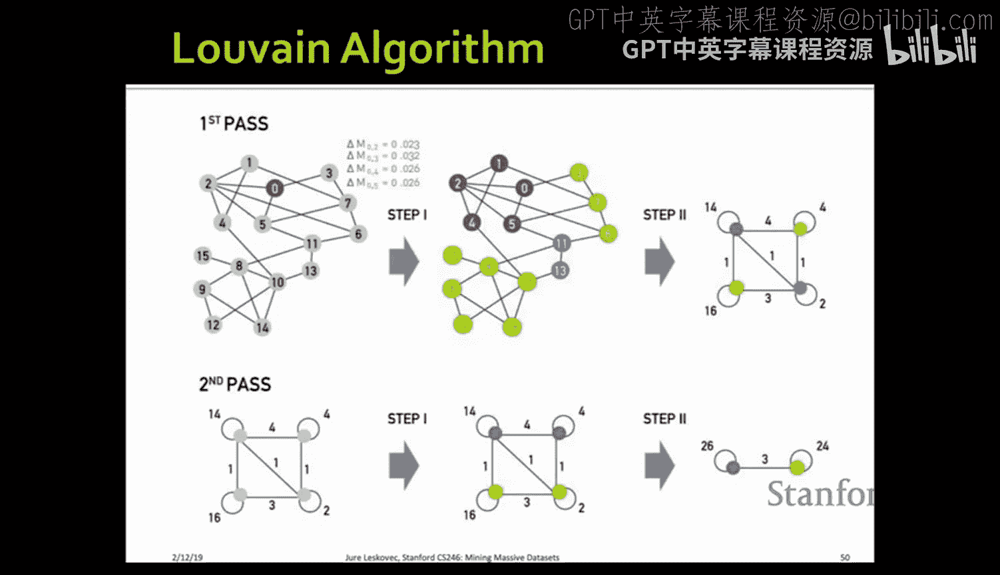

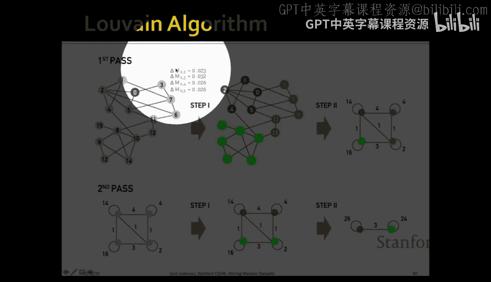

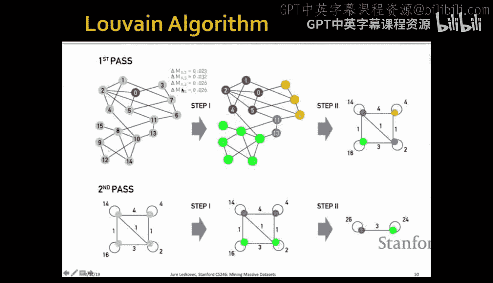

S increasing。 And after the first iteration， here is the。

 here is the community structure I would get。 Right。

 So every color is a different cluster is a different community。

 Not that there are four four clusters。 So now that my phase  one of the first step is done。

 now I have to， or the first pass， Now， what I have to do is create a super network， right。

 given that our four colors left， I create a super network on four edges。😊，And then for example。

 I can now ask what is the edge weight between between the nodes of the super network。

 So for example， green and violet。 there is an one edge between them。

 So there is there is an edge of weight1 here between green and violet， right， But for example。

 the green nodes should have 16 edges between themselves。 So the weight here is 16。 You know。

 these guys have 14 edges between themselves。 So it should be 14。

 there should be one edge between the two。 and this is my now my new network。

 So then I would say in the second phase。 I start with this new network。

 I do the grid im modularity optimization and I would converge to something like this right So this to green nodes belong to one community。

 and this two pink note belongs to to the second community。 So now again。

I would join these two together。 So my new network would be。The， the， the。

 the cell loop would be 16 plus 2 plus 3 would be26。 Okay， maybe I didn't compute that correctly。

 but the， the number of edges across is  one to 3。 So this weight would be1 to 3。嗯。Yes， okay。

 so and that this is how this would work。 And I would keep doing this until this network would collapse into a single node。

 And now I have a hierarchical decomposition where essentially。

 I would say my network is composed of four clusters where those four are then merged in such a way that blue and green merge together and orange and violet merge together。

 And then at the last level， the the new pink and green merge into the into the same into the same cluster。

 So this is how this method would work。 And it's essentially a greedy method where you ask every node。

 do you want to change your cluster。 And then you have this fast modularity update function that you can call after you are done updating you create the super network and apply the algorithm on this。

😊，Super network weighted network。 Notice that this modularity function is defined over weighted network。

 where rather than summing the， the number of links。

 you are summing the link weights and everything still generalizes。

 And now you also have the notion of a weighted degree and so on and so forth。 Okay， so with this。

 I will finish here。 And I'm happy to take any questions。😊，Yes。

So you presented these two methods for community detection。

 How do you recommend picking between the two， Great， How would I recommend picking between the two。

 Wow， I have a new camera。 It never turned on before。 So， so two things。

 if you are interested in something that's local to your see node， you would use the first method。😊。

Because the first method will very quickly allow you to find a cluster for one node。

The second method will give you this more hierarchical grouping of the entire network。

 So it depends if you just care about the node and the local neighborhood around it。

 you would run the first method。 If you more care about the global composition of these clusters。

 you would run the second method。Good question。 Great， Anything else。Right。

 so one more thing I say before you guys think of the second question is you could also use the first method to do clustering where you'd pick an node。

 find the cluster， remove that cluster from the network， Pick the second node and keep doing that。

 But that would be kind of more heuristic。 It wouldn't tell you much about the structure Here。

 you get this hierarchical decomposition for free。😊，Good。

 have you guys thought of the second question。Good， okay， so if no questions。

 think of one for for Thursday， and I'll see you then。 Thank you very much。😊。

